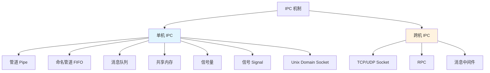

# 进程间通信-IPC

> **文档说明**：系统讲解 Linux 进程间通信（IPC）的各种机制，包括管道、命名管道、消息队列、共享内存、信号量、信号、套接字，涵盖原理、代码示例、对比选择和最佳实践。
>
> **适用人群**：后端开发者、系统程序员、运维工程师、需要理解进程协作的开发者
>
> **前置知识**：[[操作系统-进程与线程]]、[[文件系统详解-ext4-btrfs]]、[[Linux命令行实战]]

---

## 一、概述

### 1. 什么是 IPC

**IPC（Inter-Process Communication，进程间通信）** 是操作系统提供的机制，用于不同进程之间交换数据和信号。

```text
为什么需要 IPC：
- 进程地址空间相互隔离，不能直接访问对方内存
- 需要协作完成任务（如生产者-消费者）
- 需要共享数据（如配置、状态）
- 需要通知事件（如信号、中断）
- 需要远程调用（如微服务）
```

### 2. IPC 分类



### 3. IPC 对比

| 机制 | 通信方式 | 双向 | 有无连接 | 性能 | 适用场景 |
|------|---------|------|---------|------|---------|
| **管道** | 字节流 | 半双工 | 有（父子） | 中 | 父子进程、shell 管道 |
| **FIFO** | 字节流 | 半双工 | 有 | 中 | 无亲缘关系进程 |
| **消息队列** | 消息 | 双向 | 无 | 中 | 结构化消息、优先级 |
| **共享内存** | 内存 | 双向 | 无 | 最高 | 大量数据、高频 |
| **信号量** | 计数器 | - | - | 高 | 同步互斥 |
| **信号** | 信号 | - | 无 | 低 | 事件通知、中断 |
| **Unix Socket** | 字节流 | 全双工 | 有 | 高 | 本地服务、数据库 |
| **TCP Socket** | 字节流 | 全双工 | 有 | 中 | 跨网络通信 |

---

## 二、管道（Pipe）

### 1. 管道原理

```text
管道是半双工的字节流通信：
- 一端写，一端读
- 数据先进先出（FIFO）
- 数据读出后从管道移除
- 只能在有亲缘关系的进程间使用（父子、兄弟）
- 由 pipe() 系统调用创建，返回两个文件描述符

管道缓冲区：
- 默认大小 64KB（Linux）
- 写满时写操作阻塞
- 读空时读操作阻塞
- 写端关闭后，读端读完数据返回 EOF
```

### 2. C 语言示例

```c
#include <unistd.h>
#include <stdio.h>
#include <string.h>
#include <sys/wait.h>

int main() {
    int pipefd[2];
    pipe(pipefd);  // pipefd[0] 读端, pipefd[1] 写端

    pid_t pid = fork();
    if (pid == 0) {
        // 子进程：写
        close(pipefd[0]);  // 关闭读端
        const char *msg = "Hello from child";
        write(pipefd[1], msg, strlen(msg));
        close(pipefd[1]);
    } else {
        // 父进程：读
        close(pipefd[1]);  // 关闭写端
        char buf[1024];
        int n = read(pipefd[0], buf, sizeof(buf));
        buf[n] = '\0';
        printf("Parent received: %s\n", buf);
        close(pipefd[0]);
        wait(NULL);
    }
    return 0;
}
```

### 3. Shell 管道

```bash
# 经典管道：前一个命令的输出作为后一个的输入
ls -la | grep .txt
cat access.log | grep 404 | wc -l
ps aux | sort -k3 -rn | head -10

# 管道是半双工的，数据单向流动
# 每个 | 创建一个管道，连接两个进程
```

---

## 三、命名管道（FIFO）

### 1. FIFO 原理

```text
FIFO（First In First Out）又称命名管道：
- 在文件系统中有对应的文件（路径名）
- 无亲缘关系的进程也可以使用
- 同样是半双工字节流
- 用 mkfifo 创建，用 open/read/write 操作
- 文件大小始终为 0（数据在内核缓冲区）
```

### 2. 使用示例

```bash
# 创建 FIFO
mkfifo /tmp/myfifo
ls -l /tmp/myfifo  # prw-r--r--  p 表示管道

# 终端1：读
cat /tmp/myfifo

# 终端2：写
echo "Hello FIFO" > /tmp/myfifo
```

```c
// 写端
#include <fcntl.h>
#include <unistd.h>
int main() {
    int fd = open("/tmp/myfifo", O_WRONLY);
    write(fd, "Hello FIFO", 10);
    close(fd);
    return 0;
}

// 读端
#include <fcntl.h>
#include <unistd.h>
int main() {
    int fd = open("/tmp/myfifo", O_RDONLY);
    char buf[1024];
    int n = read(fd, buf, sizeof(buf));
    buf[n] = '\0';
    printf("Received: %s\n", buf);
    close(fd);
    return 0;
}
```

---

## 四、消息队列

### 1. 消息队列原理

```text
消息队列（Message Queue）：
- 消息的链表，存放在内核中
- 每个消息有类型和数据
- 可以按类型读取（不一定要先进先出）
- 进程可以独立读写，不需要同时存在
- 消息读出后从队列移除
- 系统限制：最大消息数、最大消息大小

两种实现：
- System V 消息队列（msgget/msgsnd/msgrcv）
- POSIX 消息队列（mq_open/mq_send/mq_receive）
```

### 2. POSIX 消息队列示例

```c
#include <mqueue.h>
#include <fcntl.h>
#include <stdio.h>
#include <string.h>

// 发送端
int main() {
    mqd_t mq = mq_open("/myqueue", O_CREAT | O_WRONLY, 0644, NULL);
    mq_send(mq, "Hello MQ", 9, 1);  // 优先级 1
    mq_close(mq);
    return 0;
}

// 接收端
int main() {
    mqd_t mq = mq_open("/myqueue", O_RDONLY);
    char buf[8192];
    unsigned int prio;
    ssize_t n = mq_receive(mq, buf, sizeof(buf), &prio);
    buf[n] = '\0';
    printf("Received (prio=%d): %s\n", prio, buf);
    mq_close(mq);
    return 0;
}
```

### 3. 消息队列特点

```text
优点：
- 消息边界清晰（不像管道是字节流）
- 支持优先级
- 读写进程不需要同时存在
- 可以按类型过滤消息

缺点：
- 消息大小和数量有限制
- 数据拷贝（用户态→内核→用户态）
- 不适合大量数据
```

---

## 五、共享内存

### 1. 共享内存原理

```text
共享内存（Shared Memory）：
- 将同一块物理内存映射到多个进程的地址空间
- 进程可以直接读写，不需要内核拷贝
- 速度最快的 IPC 机制
- 需要配合信号量/互斥锁保证同步
- 数据不会自动删除，需要显式删除

两种实现：
- System V 共享内存（shmget/shmat/shmdt）
- POSIX 共享内存（shm_open + mmap）
- 匿名映射（mmap + MAP_SHARED，父子进程）
```

### 2. POSIX 共享内存示例

```c
#include <sys/mman.h>
#include <fcntl.h>
#include <unistd.h>
#include <string.h>
#include <semaphore.h>

#define SHM_SIZE 4096

// 写端
int main() {
    int fd = shm_open("/myshm", O_CREAT | O_RDWR, 0644);
    ftruncate(fd, SHM_SIZE);
    void *ptr = mmap(NULL, SHM_SIZE, PROT_READ | PROT_WRITE, MAP_SHARED, fd, 0);

    // 写入数据
    strcpy((char*)ptr, "Hello Shared Memory");

    // 信号量通知
    sem_t *sem = sem_open("/mysem", O_CREAT, 0644, 0);
    sem_post(sem);

    munmap(ptr, SHM_SIZE);
    close(fd);
    return 0;
}

// 读端
int main() {
    int fd = shm_open("/myshm", O_RDONLY, 0644);
    void *ptr = mmap(NULL, SHM_SIZE, PROT_READ, MAP_SHARED, fd, 0);

    // 等待信号量
    sem_t *sem = sem_open("/mysem", 0);
    sem_wait(sem);

    printf("Received: %s\n", (char*)ptr);

    munmap(ptr, SHM_SIZE);
    close(fd);
    shm_unlink("/myshm");  // 删除共享内存
    return 0;
}
```

### 3. 共享内存同步

```text
共享内存本身不提供同步，需要配合：
- 信号量（Semaphore）：最常用
- 互斥锁（Mutex）：放在共享内存中
- 条件变量（Condition Variable）：放在共享内存中
- 自旋锁（Spinlock）：多核短等待
- 文件锁（File Lock）：简单场景

生产者-消费者模式：
1. 生产者获取信号量（空槽位）
2. 写入共享内存
3. 释放信号量（满槽位）
4. 消费者获取信号量（满槽位）
5. 读取共享内存
6. 释放信号量（空槽位）
```

---

## 六、信号量

### 1. 信号量原理

```text
信号量（Semaphore）：
- 本质是一个计数器，用于进程间同步
- P 操作（wait）：计数器减 1，为 0 则阻塞
- V 操作（post）：计数器加 1，唤醒等待进程
- 二值信号量（0/1）相当于互斥锁
- 计数信号量可以允许多个进程同时访问

用途：
- 互斥：保护临界区（二值信号量）
- 同步：协调进程执行顺序
- 资源计数：限制同时访问资源的进程数
```

### 2. POSIX 信号量示例

```c
#include <semaphore.h>
#include <fcntl.h>
#include <unistd.h>

// 进程 A
int main() {
    sem_t *sem = sem_open("/mysem", O_CREAT, 0644, 0);
    // 做一些工作
    sleep(2);
    printf("Process A done, signaling\n");
    sem_post(sem);  // V 操作
    sem_close(sem);
    return 0;
}

// 进程 B
int main() {
    sem_t *sem = sem_open("/mysem", 0);
    printf("Process B waiting\n");
    sem_wait(sem);  // P 操作，阻塞直到 A 完成
    printf("Process B continues\n");
    sem_close(sem);
    sem_unlink("/mysem");
    return 0;
}
```

---

## 七、信号（Signal）

### 1. 信号原理

```text
信号（Signal）：
- 操作系统向进程发送的异步通知
- 用于事件通知，不传输数据
- 进程可以注册信号处理函数
- 常见信号：SIGINT(2)、SIGKILL(9)、SIGTERM(15)、SIGCHLD、SIGPIPE

信号处理方式：
1. 默认动作（终止、忽略、停止等）
2. 忽略信号（SIGKILL/SIGSTOP 不能忽略）
3. 捕获信号（执行自定义处理函数）
```

### 2. 信号示例

```c
#include <signal.h>
#include <stdio.h>
#include <unistd.h>

void handler(int sig) {
    printf("Received signal %d\n", sig);
}

int main() {
    // 注册信号处理
    signal(SIGINT, handler);   // Ctrl+C
    signal(SIGTERM, handler);  // kill 默认

    // 更可靠的 sigaction
    struct sigaction sa;
    sa.sa_handler = handler;
    sigemptyset(&sa.sa_mask);
    sa.sa_flags = 0;
    sigaction(SIGUSR1, &sa, NULL);

    printf("PID: %d, waiting for signals...\n", getpid());
    while (1) pause();
    return 0;
}
```

```bash
# 发送信号
kill -SIGINT <pid>      # 中断（Ctrl+C）
kill -SIGTERM <pid>     # 终止（可捕获）
kill -9 <pid>           # 强制杀死（不可捕获）
kill -SIGUSR1 <pid>     # 用户自定义信号
killall -HUP nginx      # 重新加载配置
```

### 3. 常见信号

| 信号 | 编号 | 默认动作 | 用途 |
|------|------|---------|------|
| SIGHUP | 1 | 终止 | 终端断开/重新加载 |
| SIGINT | 2 | 终止 | Ctrl+C |
| SIGQUIT | 3 | 终止+core | Ctrl+\ |
| SIGKILL | 9 | 终止 | 强制杀死（不可捕获） |
| SIGSEGV | 11 | 终止+core | 段错误 |
| SIGPIPE | 13 | 终止 | 写已关闭的管道 |
| SIGALRM | 14 | 终止 | 闹钟 |
| SIGTERM | 15 | 终止 | 优雅终止 |
| SIGCHLD | 17 | 忽略 | 子进程状态变化 |
| SIGSTOP | 19 | 停止 | 暂停（不可捕获） |

---

## 八、Unix Domain Socket

### 1. 原理

```text
Unix Domain Socket：
- 用于同一台机器上进程间通信
- API 与网络 Socket 相同（socket/bind/listen/accept/connect）
- 不经过网络协议栈，性能更高
- 支持字节流（SOCK_STREAM）和数据报（SOCK_DGRAM）
- 在文件系统中有路径（如 /var/run/mysql.sock）
- 全双工通信

常见用途：
- MySQL 本地连接（/var/run/mysqld/mysqld.sock）
- Docker 守护进程（/var/run/docker.sock）
- X Window 系统
- 本地微服务通信
```

### 2. 服务端示例

```c
#include <sys/socket.h>
#include <sys/un.h>
#include <unistd.h>
#include <string.h>

int main() {
    int server_fd = socket(AF_UNIX, SOCK_STREAM, 0);

    struct sockaddr_un addr;
    addr.sun_family = AF_UNIX;
    strcpy(addr.sun_path, "/tmp/mysocket.sock");
    unlink(addr.sun_path);  // 删除已存在的文件

    bind(server_fd, (struct sockaddr*)&addr, sizeof(addr));
    listen(server_fd, 5);

    while (1) {
        int client_fd = accept(server_fd, NULL, NULL);
        char buf[1024];
        int n = read(client_fd, buf, sizeof(buf));
        buf[n] = '\0';
        printf("Received: %s\n", buf);
        write(client_fd, "OK", 2);
        close(client_fd);
    }
    close(server_fd);
    return 0;
}
```

### 3. 客户端示例

```c
#include <sys/socket.h>
#include <sys/un.h>
#include <unistd.h>
#include <string.h>

int main() {
    int fd = socket(AF_UNIX, SOCK_STREAM, 0);

    struct sockaddr_un addr;
    addr.sun_family = AF_UNIX;
    strcpy(addr.sun_path, "/tmp/mysocket.sock");

    connect(fd, (struct sockaddr*)&addr, sizeof(addr));
    write(fd, "Hello Socket", 12);

    char buf[1024];
    int n = read(fd, buf, sizeof(buf));
    buf[n] = '\0';
    printf("Response: %s\n", buf);

    close(fd);
    return 0;
}
```

---

## 九、选择指南

### 1. 按场景选择

| 场景 | 推荐 IPC | 原因 |
|------|---------|------|
| **父子进程简单数据** | 管道 | 简单、自动继承 |
| **无亲缘进程字节流** | FIFO / Unix Socket | 有文件路径，可连接 |
| **结构化消息** | 消息队列 | 消息边界、优先级 |
| **大量数据高频** | 共享内存+信号量 | 零拷贝、性能最高 |
| **同步互斥** | 信号量 | 专门用于同步 |
| **事件通知** | 信号 | 轻量、异步 |
| **本地服务** | Unix Domain Socket | 全双工、可靠 |
| **跨网络** | TCP Socket | 标准、跨平台 |
| **微服务** | RPC / 消息中间件 | 高级抽象、服务治理 |

### 2. 性能排序

```text
性能从高到低：
1. 共享内存（零拷贝，需同步）
2. Unix Domain Socket（内核拷贝，不经过网络栈）
3. 管道/FIFO（内核拷贝，简单）
4. 消息队列（内核拷贝，消息管理）
5. TCP Socket（网络协议栈开销）
6. 信号（只传信号号，不传数据）

注意：性能不是唯一标准，还要考虑：
- 易用性
- 可靠性
- 是否需要双向
- 是否需要跨机器
- 数据量大小
```

---

## 十、最佳实践

### 1. 通用规范

- [ ] **选择合适的 IPC**：根据场景选择，不要过度设计
- [ ] **处理错误**：所有 IPC 操作都要检查返回值
- [ ] **处理阻塞**：考虑非阻塞、超时、信号中断
- [ ] **资源清理**：进程退出时删除 IPC 资源（共享内存、消息队列）
- [ ] **权限控制**：设置正确的文件权限（0600/0644）
- [ ] **避免死锁**：信号量获取顺序一致、设置超时

### 2. 共享内存规范

- [ ] **必须同步**：共享内存一定要配合信号量/锁
- [ ] **固定结构**：用结构体定义共享内存布局
- [ ] **版本管理**：结构体加版本字段，避免不兼容
- [ ] **大小固定**：共享内存大小创建后不能改变
- [ ] **避免指针**：共享内存中不要存指针（地址空间不同）

### 3. 信号规范

- [ ] **信号处理函数要短**：只做简单操作，设置标志位
- [ ] **可重入函数**：信号处理中只用可重入函数
- [ ] **用 sigaction**：比 signal 更可靠
- [ ] **屏蔽信号**：临界区屏蔽相关信号
- [ ] **不要用信号传数据**：信号只用于通知

---

## 十一、常见问题与排查

| 问题 | 原因 | 解决方案 |
|------|------|---------|
| **管道读阻塞** | 写端未关闭 / 无数据 | 关闭写端、用非阻塞读 |
| **管道写 SIGPIPE** | 读端已关闭 | 忽略 SIGPIPE、检查读端 |
| **共享内存数据不一致** | 未同步 | 加信号量/互斥锁 |
| **消息队列满** | 消息太多 / 消费者慢 | 增加队列大小、优化消费 |
| **信号丢失** | 信号不排队 | 用实时信号、信号量、事件通知 |
| **FIFO open 阻塞** | 另一端未打开 | 用 O_NONBLOCK、两端同时启动 |
| **Unix Socket 连接失败** | 文件不存在 / 权限 | 检查文件路径、权限、服务是否运行 |
| **共享内存删除失败** | 仍有进程映射 | 所有进程 munmap 后再 shm_unlink |
| **IPC 资源泄漏** | 进程异常退出未清理 | 用 IPC_RMID、启动时清理旧资源 |
| **死锁** | 信号量获取顺序不一致 | 统一获取顺序、设置超时 |
| **大数据传输慢** | 用了管道/消息队列 | 改用共享内存 |
| **跨平台不兼容** | System V IPC 不通用 | 用 POSIX IPC 或 Socket |
| **子进程继承 IPC** | fork 继承文件描述符 | 不需要的描述符及时关闭 |
| **信号处理中崩溃** | 用了不可重入函数 | 只用可重入函数、设置标志位 |
| **权限被拒** | IPC 权限不对 | 检查 mode、用正确的用户运行 |

---

## 十二、关联笔记

### 操作系统
- [[操作系统-进程与线程]] · [[文件系统详解-ext4-btrfs]] · [[Linux命令行实战]]
- [[进程间通信-IPC]]

### 网络与分布式
- [[网络协议-TCP-IP详解]] · [[分布式系统-高可用架构设计]] · [[Raft共识算法详解]]

### 后端
- [[Java-并发编程实战]] · [[Java-网络编程与NIO]] · [[消息队列-RabbitMQ-Kafka]]

### 导航
- [[MOC-计算机基础]] · [[MOC-后端开发]] · [[全栈+AI工程双轨融合学习路线图]]

> **学习路径建议**：先掌握 [[操作系统-进程与线程]] 进程基础 → 深入本文 IPC 机制 → 学习 [[网络协议-TCP-IP详解]] 网络通信 → 实践 [[Java-并发编程实战]] 并发编程 → 研究 [[分布式系统-高可用架构设计]] 分布式协作 → 构建完整的进程与系统协作理解。

---

## 💡 全文深度讲解

本文系统梳理了进程间通信-IPC的核心知识体系，从概述入手，深入管道（Pipe）的底层机制，再通过命名管道（FIFO）掌握实战应用，最后涵盖常见问题与排查与关联笔记。学习时建议先建立整体认知，再动手实践，最后结合常见问题深化理解。

## 📝 全文精简总结

- **概述**：掌握本模块的核心概念与关键要点
- **管道（Pipe）**：掌握本模块的核心概念与关键要点
- **命名管道（FIFO）**：掌握本模块的核心概念与关键要点
- **消息队列**：掌握本模块的核心概念与关键要点
- **共享内存**：掌握本模块的核心概念与关键要点
- **信号量**：掌握本模块的核心概念与关键要点
- **信号（Signal）**：掌握本模块的核心概念与关键要点
- **Unix Domain Socket**：掌握本模块的核心概念与关键要点
- 其余4个模块涵盖进阶主题与拓展内容

