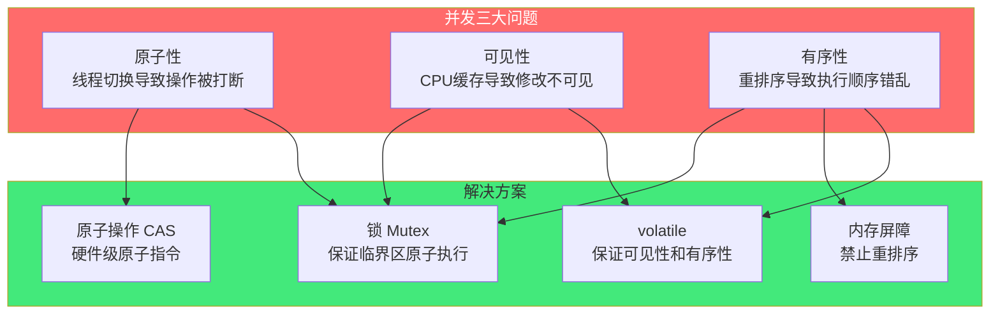
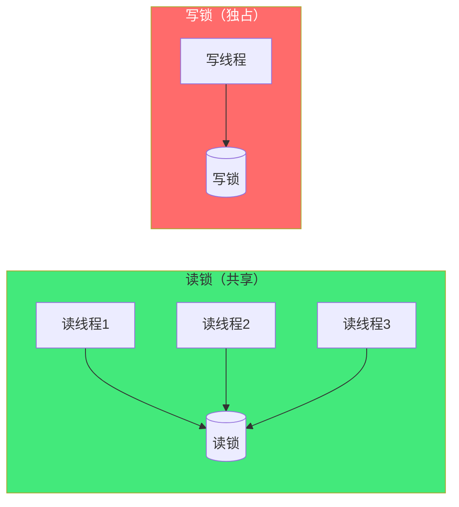

# 🔒 锁机制与并发原语

> **文档说明**：系统讲解并发编程中的锁机制与同步原语完整知识体系，涵盖并发问题根源（竞态条件/临界区/数据竞争）、互斥锁（Mutex）原理与实现、自旋锁（Spinlock）、读写锁（RWLock）、信号量（Semaphore）、条件变量（Condition Variable）、管程（Monitor）、原子操作与 CAS、内存屏障与内存模型、无锁编程（Lock-Free）与无等待编程（Wait-Free）、死锁（Deadlock）与活锁（Livelock）、优先级反转、锁的粒度与性能优化、各语言并发原语对比（Java/C++/Go/Python）、常见问题与最佳实践。
>
> **适用人群**：后端开发者、系统程序员、高性能计算工程师、并发编程学习者、面试准备者
>
> **前置知识**：[[进程线程与协程]] · [[操作系统核心原理]] · [[计算机组成原理]]

---

## 一、概述

### 1.1 为什么需要锁

并发编程的核心挑战是**多个执行流（线程/进程/协程）同时访问共享资源**时的数据一致性问题。

**竞态条件（Race Condition）**：多个线程同时读写共享数据，最终结果取决于线程执行的相对时序（哪个线程先执行），导致不可预测的结果。

**经典示例：计数器递增**
```java
// 共享变量
int count = 0;

// 1000 个线程各执行 1000 次
void increment() {
    count++;  // 看似一行，实际是三步：读 count → 加 1 → 写回 count
}

// 期望结果：count = 1,000,000
// 实际结果：可能是 950,000、980,000 等任意小于 1,000,000 的值
```

**count++ 的底层三步**：
```text
步骤1：从内存读取 count 到寄存器    (LOAD)
步骤2：寄存器值加 1                  (INCREMENT)
步骤3：将寄存器值写回内存 count      (STORE)
```

**竞态发生过程**：
```text
线程 A: LOAD count (=0) → INCREMENT (=1) → [被调度器暂停]
线程 B: LOAD count (=0) → INCREMENT (=1) → STORE count (=1)
线程 A: [恢复执行] → STORE count (=1)

结果：count = 1，但应该是 2（两次递增丢失了一次）
```

> **核心问题**：`count++` 不是原子操作——它在底层被拆分为多条指令，线程可以在这些指令之间被切换，导致数据竞争。锁的作用就是将这些需要保护的代码段（临界区）变为「原子执行」——同一时刻只有一个线程能执行临界区代码。

### 1.2 核心概念

| 概念 | 说明 |
|------|------|
| **临界区（Critical Section）** | 访问共享资源的代码段，同一时刻只允许一个线程执行 |
| **竞态条件（Race Condition）** | 多个线程同时访问共享资源，结果取决于执行时序 |
| **数据竞争（Data Race）** | 多个线程同时访问同一内存位置，且至少一个是写操作，没有同步 |
| **互斥（Mutual Exclusion）** | 同一时刻只有一个线程能进入临界区 |
| **原子操作（Atomic Operation）** | 不可分割的操作，要么全部执行，要么不执行，中间不会被打断 |
| **可见性（Visibility）** | 一个线程对共享变量的修改，其他线程能立即看到 |
| **有序性（Ordering）** | 指令执行的顺序符合预期（不会被编译器/CPU 重排序） |
| **同步（Synchronization）** | 协调多个线程的执行顺序，保证数据一致性和可见性 |
| **死锁（Deadlock）** | 多个线程互相等待对方释放锁，导致永远阻塞 |
| **活锁（Livelock）** | 线程没有阻塞，但一直在重复相同操作，无法推进 |
| **饥饿（Starvation）** | 某个线程长期得不到执行机会（一直抢不到锁） |

### 1.3 并发问题的三大根源

并发编程需要解决三个核心问题：原子性、可见性、有序性。

| 问题 | 说明 | 根源 | 解决方案 |
|------|------|------|---------|
| **原子性** | 一个操作不可分割，中间不会被打断 | 线程切换（操作系统在指令间切换线程） | 锁、原子操作（CAS） |
| **可见性** | 一个线程的修改对其他线程立即可见 | CPU 缓存（每个核心有私有缓存，修改先写缓存，不立即写回内存） | volatile、锁、内存屏障 |
| **有序性** | 指令执行顺序符合代码顺序 | 编译器重排序、CPU 乱序执行（为了性能优化） | volatile、锁、内存屏障 |



> **JMM（Java Memory Model）和 C++ 内存模型**：高级语言的内存模型定义了线程间共享变量的可见性和有序性规则，是理解并发编程的基础。`volatile`、`synchronized`、`final` 等关键字都是内存模型的具体实现。

---

## 二、互斥锁（Mutex）

### 2.1 互斥锁原理

互斥锁（Mutual Exclusion Lock，Mutex）是最基本的同步原语——它保证同一时刻只有一个线程能进入临界区。

**核心操作**：
| 操作 | 说明 |
|------|------|
| `lock()` / `acquire()` | 获取锁，如果锁已被占用则阻塞等待 |
| `unlock()` / `release()` | 释放锁，唤醒等待的线程 |
| `tryLock()` | 尝试获取锁，立即返回（成功 true/失败 false），不阻塞 |

**使用模式**：
```java
// Java
private final Lock lock = new ReentrantLock();

public void criticalSection() {
    lock.lock();          // 获取锁
    try {
        // 临界区：访问共享资源
        count++;
    } finally {
        lock.unlock();    // 释放锁（必须在 finally 中，防止异常导致死锁）
    }
}
```

```cpp
// C++
#include <mutex>
std::mutex mtx;

void criticalSection() {
    std::lock_guard<std::mutex> guard(mtx);  // RAII，自动加锁解锁
    count++;  // 临界区
}
```

```go
// Go
var mu sync.Mutex

func criticalSection() {
    mu.Lock()
    defer mu.Unlock()  // defer 保证解锁
    count++
}
```

```python
# Python
import threading
lock = threading.Lock()

def critical_section():
    with lock:  # 上下文管理器，自动加锁解锁
        count += 1
```

### 2.2 互斥锁的底层实现

互斥锁的底层依赖**原子操作**（CAS）和**操作系统的阻塞/唤醒机制**。

**简化的互斥锁实现**：
```c
typedef struct {
    atomic_int state;  // 0=未锁定, 1=已锁定
    wait_queue_t wait_queue;  // 等待队列
} mutex_t;

void mutex_lock(mutex_t *m) {
    // 快速路径：CAS 尝试获取锁
    while (atomic_cas(&m->state, 0, 1) != 0) {
        // 获取失败，加入等待队列并阻塞
        // （futex/wait 系统调用，由内核唤醒）
        wait_on_queue(&m->wait_queue);
    }
}

void mutex_unlock(mutex_t *m) {
    atomic_store(&m->state, 0);  // 释放锁
    wake_up_one(&m->wait_queue);  // 唤醒一个等待线程
}
```

**关键机制**：
1. **CAS（Compare-And-Swap）**：硬件级原子指令，尝试将锁状态从 0 改为 1，如果成功则获取锁，失败则说明锁已被占用
2. **等待队列**：获取锁失败的线程加入等待队列，进入睡眠状态（不占用 CPU）
3. **Futex（Fast Userspace Mutex）**：Linux 的快速用户空间互斥锁——无竞争时在用户空间用 CAS 完成加锁（不陷入内核），有竞争时才调用 `futex` 系统调用阻塞等待。这大大提升了无竞争场景下的性能。

> **futex 是现代互斥锁性能的关键**：传统的互斥锁每次加锁/解锁都要陷入内核（系统调用开销大），futex 让无竞争的加锁/解锁完全在用户空间完成，只有竞争时才陷入内核。

### 2.3 可重入锁（ReentrantLock）

可重入锁允许同一个线程多次获取同一把锁而不会死锁。

**为什么需要可重入**：
```java
// 递归调用场景
public void outer() {
    lock.lock();
    try {
        inner();  // 调用 inner，inner 也需要同一把锁
    } finally {
        lock.unlock();
    }
}

public void inner() {
    lock.lock();  // 如果是不可重入锁，这里会死锁（自己等自己释放）
    try {
        // ...
    } finally {
        lock.unlock();
    }
}
```

**可重入锁的实现**：
- 记录锁的持有线程（owner）
- 记录重入次数（count）
- 同一线程再次加锁：count++，立即返回
- 解锁：count--，count 归零时真正释放锁，唤醒等待线程

| 语言/库 | 可重入锁 | 不可重入锁 |
|---------|---------|-----------|
| Java | `synchronized`、`ReentrantLock` | — |
| C++ | `std::recursive_mutex` | `std::mutex` |
| Go | —（Go 没有可重入锁，需避免递归加锁） | `sync.Mutex` |
| Python | `threading.RLock` | `threading.Lock` |

> **可重入锁的代价**：需要额外存储 owner 和 count，性能略低于不可重入锁。且可重入锁容易掩盖设计问题（递归加锁往往说明代码结构需要重构）。Go 语言故意不提供可重入锁，就是为了强迫开发者写出更清晰的代码。

### 2.4 公平锁 vs 非公平锁

| 维度 | 公平锁（Fair） | 非公平锁（Non-fair） |
|------|--------------|-------------------|
| **获取顺序** | 按请求顺序（FIFO），先到先得 | 不保证顺序，后来的线程可能先获取 |
| **性能** | 较低（需要维护队列，线程切换多） | 较高（可以「插队」，减少线程切换） |
| **饥饿** | 无饥饿（保证每个线程都能获取） | 可能饥饿（某线程一直抢不到） |
| **代表** | `new ReentrantLock(true)` | `new ReentrantLock(false)`（默认）、`synchronized` |

**非公平锁为什么性能高**：当锁释放时，如果有一个线程正好在尝试获取锁（还没进入等待队列），非公平锁可以直接把锁给它，避免了「唤醒等待队列中的线程→线程被调度→获取锁」的延迟。这个「插队」的线程可能比等待队列中的线程先获取锁，但减少了上下文切换开销。

> **选择建议**：大多数场景用非公平锁（默认，性能好）。只有在公平性比性能更重要的场景（如某些资源分配）才用公平锁。

---

## 三、其他锁类型

### 3.1 自旋锁（Spinlock）

自旋锁在获取锁失败时**不阻塞睡眠**，而是循环等待（忙等），不断检查锁是否可用。

```c
// 自旋锁实现
void spin_lock(atomic_int *lock) {
    while (atomic_cas(lock, 0, 1) != 0) {
        // 忙等：循环检查，不睡眠
        // 可以加 CPU pause 指令减少功耗
        cpu_pause();
    }
}

void spin_unlock(atomic_int *lock) {
    atomic_store(lock, 0);
}
```

**自旋锁 vs 互斥锁**：
| 维度 | 自旋锁 | 互斥锁 |
|------|--------|--------|
| 等待方式 | 忙等（循环检查，占用 CPU） | 阻塞睡眠（不占用 CPU） |
| 上下文切换 | 无 | 有（阻塞和唤醒需要切换） |
| 适用场景 | 锁持有时间极短（几纳秒/微秒） | 锁持有时间较长 |
| 开销 | 无竞争时开销小，竞争时浪费 CPU | 无竞争时开销略大（futex），竞争时不浪费 CPU |
| 代表 | 内核中断处理、RCU、低延迟场景 | 用户态大多数场景 |

**自旋锁的适用条件**：
- 锁的持有时间**极短**（短于两次上下文切换的时间，约几微秒）
- 临界区**不能阻塞**（不能睡眠、不能调用可能阻塞的函数）
- 在**多核 CPU** 上才有意义（单核上自旋锁会浪费整个 CPU 时间片）

> **混合锁（自适应自旋）**：现代互斥锁（如 Java `ReentrantLock`、Linux futex）采用「自适应自旋」——获取锁失败时先自旋一段时间（期望锁很快释放），如果自旋期间锁没释放再阻塞睡眠。这结合了自旋锁（短等待无切换）和互斥锁（长等待不浪费 CPU）的优点。

### 3.2 读写锁（ReadWriteLock）

读写锁区分读操作和写操作：
- **多个读线程可以同时持有读锁**（读操作不修改数据，不需要互斥）
- **写锁是独占的**（写操作修改数据，必须与所有其他操作互斥）



**读写锁的状态**：
| 状态 | 说明 |
|------|------|
| 未锁定 | 无线程持有锁 |
| 读锁定 | 一个或多个读线程持有读锁，写线程等待 |
| 写锁定 | 一个写线程持有写锁，所有其他线程等待 |

**Java 示例**：
```java
private final ReadWriteLock rwLock = new ReentrantReadWriteLock();
private final Lock readLock = rwLock.readLock();
private final Lock writeLock = rwLock.writeLock();

public Data read() {
    readLock.lock();       // 读锁：多个读线程可同时获取
    try {
        return data;        // 读操作
    } finally {
        readLock.unlock();
    }
}

public void write(Data newData) {
    writeLock.lock();      // 写锁：独占
    try {
        data = newData;     // 写操作
    } finally {
        writeLock.unlock();
    }
}
```

**读写锁的适用场景**：
- ✅ 读多写少（读操作远多于写操作，如配置管理、缓存）
- ❌ 写多读少（写锁独占，读线程经常被阻塞，不如普通互斥锁）
- ❌ 读操作耗时很长（读锁持有时间长，写线程饥饿）

> **写饥饿问题**：在读多写少场景下，如果一直有读线程到来，写线程可能永远获取不到写锁（因为读锁是共享的，新读线程可以直接获取，写线程一直等）。解决方案：**公平读写锁**（写线程到来后，新的读线程也需要等待，保证写线程不会饥饿）或**写优先策略**。

### 3.3 信号量（Semaphore）

信号量是一个计数器，用于控制同时访问共享资源的线程数量（限流）。

| 操作 | 说明 |
|------|------|
| `acquire()` / `P()` | 计数器减 1，如果计数器为 0 则阻塞等待 |
| `release()` / `V()` | 计数器加 1，唤醒一个等待的线程 |

**信号量的两种用法**：

1. **互斥锁（计数=1）**：信号量初始化为 1，同一时刻只有一个线程能通过，等价于互斥锁。
2. **资源池限流（计数=N）**：信号量初始化为 N，最多允许 N 个线程同时访问资源（如数据库连接池、线程池限流）。

```java
// 限流：最多 10 个线程同时访问
Semaphore semaphore = new Semaphore(10);

public void accessResource() {
    semaphore.acquire();   // 获取许可，计数器减 1（满了则等待）
    try {
        // 访问受限资源
        doWork();
    } finally {
        semaphore.release(); // 释放许可，计数器加 1
    }
}
```

```python
# Python：连接池限流
import threading
semaphore = threading.Semaphore(5)  # 最多 5 个并发

def query_database():
    with semaphore:
        # 数据库查询
        pass
```

> **信号量 vs 互斥锁**：互斥锁是信号量计数=1 的特例。但互斥锁有「所有者」概念（只有加锁的线程才能解锁），信号量没有（任何线程都可以 release）。信号量更适合限流和资源池，互斥锁更适合临界区保护。

### 3.4 条件变量（Condition Variable）

条件变量用于**线程间的等待/通知机制**——线程可以等待某个条件成立，其他线程在条件成立时通知等待的线程。

条件变量总是和互斥锁一起使用：
- `wait()`：释放锁，进入等待状态，被通知后重新获取锁
- `signal()` / `notify()`：唤醒一个等待的线程
- `broadcast()` / `notifyAll()`：唤醒所有等待的线程

**经典生产者-消费者模型**：
```java
// 有界队列
class BoundedQueue<T> {
    private final Queue<T> queue = new LinkedList<>();
    private final int capacity;
    private final Lock lock = new ReentrantLock();
    private final Condition notFull = lock.newCondition();   // 队列不满
    private final Condition notEmpty = lock.newCondition();  // 队列不空

    public BoundedQueue(int capacity) {
        this.capacity = capacity;
    }

    // 生产者：放入元素
    public void put(T item) throws InterruptedException {
        lock.lock();
        try {
            while (queue.size() == capacity) {
                notFull.await();  // 队列满了，等待「不满」条件
            }
            queue.add(item);
            notEmpty.signal();    // 通知消费者：队列不空了
        } finally {
            lock.unlock();
        }
    }

    // 消费者：取出元素
    public T take() throws InterruptedException {
        lock.lock();
        try {
            while (queue.isEmpty()) {
                notEmpty.await(); // 队列空了，等待「不空」条件
            }
            T item = queue.poll();
            notFull.signal();     // 通知生产者：队列不满了
            return item;
        } finally {
            lock.unlock();
        }
    }
}
```

> **为什么用 while 而不是 if 检查条件**：因为 `signal()` 可能是「虚假唤醒」（Spurious Wakeup，POSIX 允许），或者多个线程等待同一条件，被唤醒后条件可能又不满足了。所以必须用 `while` 循环重新检查条件。

### 3.5 管程（Monitor）

管程是一种高级同步机制，将**共享数据、操作共享数据的过程、同步机制**封装在一起，保证同一时刻只有一个过程在执行（互斥），并支持条件变量（等待/通知）。

管程是语言级的抽象，Java 的 `synchronized` 关键字就是管程的实现——每个 Java 对象都有一个内置管程（监视器锁）。

```java
// Java 内置管程（synchronized）
class BoundedBuffer {
    private final Object[] items = new Object[100];
    private int putptr, takeptr, count;

    // synchronized 方法：自动获取 this 的管程锁
    public synchronized void put(Object x) throws InterruptedException {
        while (count == items.length) {
            wait();  // 管程的条件等待（释放锁，等待 notify）
        }
        items[putptr] = x;
        if (++putptr == items.length) putptr = 0;
        ++count;
        notifyAll();  // 通知所有等待线程
    }

    public synchronized Object take() throws InterruptedException {
        while (count == 0) {
            wait();
        }
        Object x = items[takeptr];
        if (++takeptr == items.length) takeptr = 0;
        --count;
        notifyAll();
        return x;
    }
}
```

**管程的核心特性**：
- **互斥**：同一时刻只有一个线程能执行管程内的过程
- **条件变量**：支持 `wait()`/`signal()` 等待和通知
- **封装**：共享数据和操作封装在一起，外部只能通过管程的过程访问
- **安全性**：编译器/运行时保证同步，减少手动加锁错误

---

## 四、原子操作与 CAS

### 4.1 原子操作

原子操作是**不可分割**的操作——要么全部执行完成，要么不执行，中间不会被线程切换或中断打断。

**常见原子操作**：
| 操作 | 说明 |
|------|------|
| `atomic_load` | 原子读取 |
| `atomic_store` | 原子写入 |
| `atomic_fetch_add` | 原子读取并加（返回旧值） |
| `atomic_fetch_sub` | 原子读取并减 |
| `CAS`（Compare-And-Swap） | 比较并交换：如果当前值等于预期值，则更新为新值，返回是否成功 |
| `TAS`（Test-And-Set） | 测试并设置：写入 1，返回旧值 |
| `FAA`（Fetch-And-Add） | 读取并加：返回旧值，然后加 |

**CAS（Compare-And-Swap）是最重要的原子操作**：
```c
// CAS 伪代码（硬件级原子执行）
bool cas(atomic_int *addr, int expected, int new_value) {
    if (*addr == expected) {
        *addr = new_value;
        return true;   // 成功
    }
    return false;      // 失败（当前值不等于预期值）
}
```

**CAS 实现原子递增**：
```java
// Java AtomicInteger 的 incrementAndGet 实现（CAS 循环）
public final int incrementAndGet() {
    while (true) {
        int current = get();              // 读取当前值
        int next = current + 1;           // 计算新值
        if (compareAndSet(current, next)) {  // CAS 尝试更新
            return next;                   // 成功返回
        }
        // 失败说明其他线程修改了值，重试（自旋）
    }
}
```

> **CAS 的 ABA 问题**：CAS 只比较值是否相等，如果值从 A 变成 B 又变回 A，CAS 会认为没变过，但实际上中间发生了变化。解决方案：使用版本号（AtomicStampedReference），每次修改递增版本号，CAS 同时比较值和版本号。

### 4.2 原子操作的硬件支持

原子操作依赖 CPU 的**锁缓存行**或**锁总线**机制：
- **x86**：`LOCK` 指令前缀，锁定缓存行（MESI 协议），保证原子性
- **ARM**：`LDREX`/`STREX` 指令（独占加载/存储），通过监控内存地址实现原子性
- **RISC-V**：`LR`/`SC` 指令（Load-Reserved/Store-Conditional）

**缓存行锁 vs 总线锁**：
- **缓存行锁**（现代 CPU 默认）：只锁定该变量所在的缓存行，其他缓存行的操作不受影响，性能好
- **总线锁**：锁定整个内存总线，所有 CPU 都不能访问内存，性能差，只在跨缓存行等特殊场景使用

### 4.3 各语言原子类

| 语言 | 原子类/操作 |
|------|------------|
| Java | `java.util.concurrent.atomic`：`AtomicInteger`、`AtomicLong`、`AtomicReference`、`AtomicIntegerArray`、`LongAdder`（高竞争优化） |
| C++ | `std::atomic<T>`、`std::atomic_ref`、`std::atomic_flag` |
| Go | `sync/atomic`：`atomic.Int64`、`atomic.Int32`、`atomic.Value` |
| Python | `threading` 没有内置原子类（GIL 保证了字节码级原子性），多进程用 `multiprocessing.Value` |
| Rust | `std::sync::atomic`：`AtomicI32`、`AtomicUsize`、`AtomicBool`、`AtomicPtr` |

**Java LongAdder（高竞争优化）**：
`AtomicLong` 在高竞争下 CAS 重试频繁，性能差。`LongAdder` 将一个值拆分为多个 Cell（每个线程对应一个 Cell），各线程只更新自己的 Cell（无竞争），最终求和。用空间换时间，高并发下性能远优于 `AtomicLong`。

---

## 五、内存屏障与内存模型

### 5.1 为什么需要内存屏障

现代 CPU 和编译器为了性能会进行**指令重排序**，这可能导致并发程序的可见性和有序性问题。

**重排序的类型**：
| 类型 | 说明 | 示例 |
|------|------|------|
| **编译器重排序** | 编译器在不改变单线程语义的前提下重排指令 | `a=1; b=2;` 可能被重排为 `b=2; a=1;` |
| **CPU 指令级并行重排** | CPU 乱序执行（Out-of-Order Execution） | 后面的指令可能先执行（如果不依赖前面的结果） |
| **内存系统重排序** | CPU 写缓冲区导致写操作延迟可见 | 写操作先进入写缓冲区，还没写回缓存，其他核看不到 |

**经典问题：DCL（双重检查锁定）单例**：
```java
// 错误的 DCL（没有 volatile）
public class Singleton {
    private static Singleton instance;  // 没有 volatile！

    public static Singleton getInstance() {
        if (instance == null) {              // 第一次检查
            synchronized (Singleton.class) {
                if (instance == null) {      // 第二次检查
                    instance = new Singleton();  // 问题在这里！
                }
            }
        }
        return instance;
    }
}
```

`new Singleton()` 不是原子操作，分为三步：
1. 分配内存空间
2. 初始化对象（调用构造函数）
3. 将 instance 指向分配的内存

由于重排序，步骤 2 和 3 可能颠倒：1→3→2。如果线程 A 执行到 3（instance 已非空，但对象还没初始化），线程 B 进入第一次检查，发现 instance 非空，直接返回未初始化的对象，导致错误。

**解决方案**：`instance` 声明为 `volatile`——volatile 禁止重排序（插入内存屏障），保证 1→2→3 的顺序。

### 5.2 内存屏障（Memory Barrier）

内存屏障是一种 CPU 指令，用于**禁止屏障两侧的指令重排序**，并保证**缓存一致性**（刷新写缓冲区/失效缓存行）。

| 屏障类型 | 作用 | 说明 |
|---------|------|------|
| **LoadLoad** | 禁止前面的 Load 与后面的 Load 重排序 | 保证先读的先完成 |
| **StoreStore** | 禁止前面的 Store 与后面的 Store 重排序 | 保证先写的先完成 |
| **LoadStore** | 禁止前面的 Load 与后面的 Store 重排序 | |
| **StoreLoad** | 禁止前面的 Store 与后面的 Load 重排序 | 最耗性能的屏障，刷新写缓冲区 |

**volatile 的内存语义**：
- **volatile 写**：在写操作前插入 StoreStore 屏障，写操作后插入 StoreLoad 屏障
- **volatile 读**：在读操作后插入 LoadLoad 屏障和 LoadStore 屏障

这保证了：
1. volatile 写之前的所有操作都不能重排到写之后
2. volatile 读之后的所有操作都不能重排到读之前
3. volatile 写会刷新缓存到内存（其他核可见）
4. volatile 读会使缓存失效，从内存重新读取

### 5.3 C++ 内存序（Memory Order）

C++ `std::atomic` 支持六种内存序，允许程序员精细控制内存屏障的强度（性能 vs 安全性的权衡）：

| 内存序 | 说明 | 性能 | 场景 |
|--------|------|------|------|
| `memory_order_relaxed` | 只保证原子性，不保证顺序 | 最高 | 计数器（只需要原子增减，不需要顺序） |
| `memory_order_consume` | 数据依赖的操作不重排 | 高 | （很少使用，多数编译器实现为 acquire） |
| `memory_order_acquire` | 读操作后，后续读写不能重排到读之前 | 中 | 读端（获取锁、读取共享数据） |
| `memory_order_release` | 写操作前，前面的读写不能重排到写之后 | 中 | 写端（释放锁、写入共享数据） |
| `memory_order_acq_rel` | acquire + release | 中低 | CAS 操作（同时有读和写） |
| `memory_order_seq_cst` | 全部顺序一致（最强保证） | 最低 | 默认值，需要全局顺序的场景 |

**Acquire-Release 语义**：
- 如果线程 A 的 `release` 操作与线程 B 的 `acquire` 操作同步，则 A 在 release 之前的所有写操作，对 B 在 acquire 之后的所有读操作都可见。
- 这实现了「线程间的 happens-before 关系」。

```cpp
std::atomic<int> data{0};
std::atomic<bool> ready{false};

// 线程 A：写数据
data.store(42, std::memory_order_relaxed);
ready.store(true, std::memory_order_release);  // release：之前的写不能重排到之后

// 线程 B：读数据
while (!ready.load(std::memory_order_acquire)) {  // acquire：之后的读不能重排到之前
    // 等待
}
assert(data.load(std::memory_order_relaxed) == 42);  // 保证能看到 42
```

> **Java 的内存模型更简单**：Java 不暴露内存序给程序员，`volatile` 就是 seq_cst 级别的保证，`synchronized` 同时保证原子性、可见性、有序性。这降低了并发编程的复杂度，但也损失了一些性能优化空间。

---

## 六、无锁编程（Lock-Free）

### 6.1 什么是无锁编程

无锁编程（Lock-Free Programming）是不使用锁（互斥锁），仅通过**原子操作**和**内存屏障**来实现线程安全的并发编程技术。

| 级别 | 说明 | 保证 |
|------|------|------|
| **阻塞（Blocking）** | 使用互斥锁，线程可能阻塞 | 不保证系统级推进（一个线程持有锁时崩溃，其他线程永远等） |
| **无锁（Lock-Free）** | 不使用锁，保证**系统级推进**（至少一个线程能在有限步内完成操作） | 系统整体能推进，但个别线程可能饥饿 |
| **无等待（Wait-Free）** | 不使用锁，保证**每个线程**都能在有限步内完成操作 | 最强保证，无饥饿，但实现复杂、性能开销大 |

> **无锁 ≠ 无阻塞**：无锁编程中线程不会因为锁而阻塞，但 CAS 失败时会自旋重试（忙等），这也是一种「阻塞」（但不是锁阻塞）。无锁的核心保证是「系统级推进」——即使某个线程一直 CAS 失败，其他线程也能继续推进，不会因为一个线程的问题导致整个系统卡死。

### 6.2 无锁数据结构

**无锁栈（Treiber Stack）**：
```java
public class LockFreeStack<T> {
    private final AtomicReference<Node<T>> head = new AtomicReference<>();

    private static class Node<T> {
        final T value;
        Node<T> next;
        Node(T value) { this.value = value; }
    }

    public void push(T value) {
        Node<T> newNode = new Node<>(value);
        while (true) {
            Node<T> oldHead = head.get();
            newNode.next = oldHead;
            if (head.compareAndSet(oldHead, newNode)) {
                return;  // CAS 成功
            }
            // CAS 失败，重试
        }
    }

    public T pop() {
        while (true) {
            Node<T> oldHead = head.get();
            if (oldHead == null) return null;  // 栈空
            Node<T> newHead = oldHead.next;
            if (head.compareAndSet(oldHead, newHead)) {
                return oldHead.value;  // CAS 成功
            }
            // CAS 失败，重试
        }
    }
}
```

**无锁队列（Michael-Scott Queue）**：
使用头尾指针 + CAS 实现的无锁并发队列，是 `java.util.concurrent.ConcurrentLinkedQueue` 的基础。

### 6.3 无锁编程的挑战

| 挑战 | 说明 |
|------|------|
| **ABA 问题** | 值从 A→B→A，CAS 误认为没变 | 用版本号（AtomicStampedReference） |
| **内存回收** | 无锁数据结构中，节点被其他线程引用时不能立即释放 | 用 Hazard Pointer、Epoch-Based Reclamation（EBR）、RCU |
| **性能不一定更好** | 高竞争下 CAS 重试频繁，可能比锁还慢 | 无锁适合低竞争、短操作场景 |
| **实现复杂** | 需要深入理解内存模型、原子操作、内存屏障 | 优先使用成熟的无锁库（JDK Concurrent、Boost.Lockfree、folly） |
| **调试困难** | 竞态条件难以复现和调试 | 用 ThreadSanitizer、Helgrind 等工具 |

> **什么时候用无锁编程**：
> - 锁的开销成为瓶颈（如高频短操作的计数器）
> - 不能容忍线程阻塞（如实时系统、中断处理）
> - 避免死锁（无锁不会死锁）
> - 大多数业务场景**不需要**无锁编程——用互斥锁 + 良好的设计足够，无锁编程的复杂度和风险远大于收益。

---

## 七、死锁与活跃性问题

### 7.1 死锁（Deadlock）

死锁是指多个线程互相等待对方释放锁，导致所有线程都永远阻塞，无法继续执行。

**死锁的四个必要条件（Coffman 条件）**：
| 条件 | 说明 |
|------|------|
| **互斥（Mutual Exclusion）** | 资源不能被多个线程同时持有 |
| **持有并等待（Hold and Wait）** | 线程持有至少一个资源，同时等待其他线程持有的资源 |
| **不可剥夺（No Preemption）** | 资源不能被强制剥夺，只能由持有者主动释放 |
| **循环等待（Circular Wait）** | 存在一个线程循环链，每个线程等待下一个线程持有的资源 |

> **破坏任意一个条件就能预防死锁**。最常用的是破坏「循环等待」——按固定顺序获取锁（所有线程按相同顺序申请锁）。

**经典死锁示例**：
```java
// 两个线程，两个锁，交叉获取
Object lockA = new Object();
Object lockB = new Object();

// 线程 A：先 A 后 B
new Thread(() -> {
    synchronized (lockA) {
        Thread.sleep(100);  // 持有 A，等待 B
        synchronized (lockB) {
            // 永远到不了这里
        }
    }
}).start();

// 线程 B：先 B 后 A
new Thread(() -> {
    synchronized (lockB) {
        Thread.sleep(100);  // 持有 B，等待 A
        synchronized (lockA) {
            // 永远到不了这里
        }
    }
}).start();

// 结果：线程 A 持有 lockA 等 lockB，线程 B 持有 lockB 等 lockA，死锁！
```

**死锁预防策略**：
| 策略 | 说明 | 代价 |
|------|------|------|
| **按固定顺序获取锁** | 所有线程按相同顺序申请锁（如按锁的 hashcode 排序） | 需要全局约定，可能降低并发度 |
| **尝试获取锁 + 超时** | 用 `tryLock(timeout)`，获取失败则释放已持有的锁，重试 | 可能活锁，需要随机退避 |
| **一次性获取所有锁** | 进入临界区前一次性获取所有需要的锁 | 降低并发度，持有锁时间长 |
| **避免嵌套锁** | 尽量不持有一个锁时再获取另一个锁 | 可能需要重构代码 |
| **使用并发数据结构** | 用 `ConcurrentHashMap`、`ConcurrentLinkedQueue` 等代替手动加锁 | 学习成本，某些场景不适用 |

**死锁检测**：
- **JVM**：`jstack <pid>` 检测死锁，`JConsole`/`VisualVM` 图形化检测
- **Linux**：`pstack`、`gdb` 查看线程栈
- **Go**：`pprof`、`runtime` 检测 goroutine 阻塞
- **工具**：ThreadSanitizer（编译时插桩）、Helgrind（Valgrind）

### 7.2 活锁（Livelock）

活锁是指线程没有阻塞，但一直在重复相同的操作，无法推进（「忙了半天什么都没做成」）。

**活锁示例**：
```java
// 两个线程都很「礼貌」，获取锁失败就释放自己的锁重试
public void transfer(Account from, Account to, int amount) {
    while (true) {
        if (from.lock.tryLock()) {
            try {
                if (to.lock.tryLock()) {
                    try {
                        from.withdraw(amount);
                        to.deposit(amount);
                        return;  // 成功
                    } finally {
                        to.lock.unlock();
                    }
                }
            } finally {
                from.lock.unlock();  // 失败就释放，重试
            }
        }
        // 两个线程可能同时释放、同时重试，永远循环（活锁）
    }
}
```

**活锁解决方案**：
- **随机退避（Random Backoff）**：获取失败后等待随机时间再重试，避免同步重试
- **指数退避**：等待时间逐次增加（1ms, 2ms, 4ms, ...）
- **固定顺序获取锁**：从根本上避免竞争

### 7.3 饥饿（Starvation）

饥饿是指某个线程长期得不到执行机会（一直抢不到锁或 CPU）。

**饥饿的原因**：
- 非公平锁：后来的线程一直「插队」，某个线程永远抢不到
- 高优先级线程一直占用 CPU，低优先级线程得不到执行
- 读多写少的读写锁：写线程一直等不到（读锁一直被持有）

**饥饿解决方案**：
- 使用公平锁（`new ReentrantLock(true)`）
- 合理设置线程优先级（不要过度依赖优先级）
- 读写锁使用公平模式或写优先策略
- 保证每个线程都有公平的执行机会

### 7.4 优先级反转（Priority Inversion）

优先级反转是指低优先级线程持有高优先级线程需要的资源，导致高优先级线程被低优先级线程「阻塞」，实际表现为高优先级不如中等优先级。

**经典场景**：
1. 低优先级线程 L 获取了锁
2. 高优先级线程 H 需要同一把锁，阻塞等待 L 释放
3. 中等优先级线程 M 不需要锁，可以运行，抢占了 L 的 CPU
4. L 一直得不到 CPU，无法释放锁，H 一直等
5. 结果：M 能运行，H 不能运行（优先级反转了）

**解决方案**：
- **优先级继承（Priority Inheritance）**：低优先级线程持有高优先级线程需要的锁时，临时提升低优先级线程的优先级到高优先级，使其尽快执行并释放锁。（Linux futex、RTOS、Java `ReentrantLock` 都支持）
- **优先级天花板（Priority Ceiling）**：每个锁有一个优先级天花板（所有可能持有该锁的线程的最高优先级），线程持有锁时优先级提升到天花板。

---

## 八、锁的粒度与性能优化

### 8.1 锁的粒度

| 粒度 | 说明 | 优点 | 缺点 |
|------|------|------|------|
| **粗粒度锁** | 一把大锁保护整个数据结构/整个类 | 实现简单，不易出错 | 并发度低，所有操作串行 |
| **细粒度锁** | 多把小锁，分别保护不同部分 | 并发度高，不同部分可并行 | 实现复杂，容易死锁，锁开销大 |
| **锁分离** | 读写锁、读多写少场景 | 读操作并行 | 写操作阻塞所有读 |
| **锁分段** | 数据分为多段，每段一把锁（如 ConcurrentHashMap 的分段锁） | 不同段可并行 | 跨段操作复杂，size() 等全局操作需要加所有锁 |
| **无锁** | CAS 原子操作，无锁 | 无阻塞，高并发 | 实现复杂，ABA 问题，高竞争下 CAS 重试多 |

**ConcurrentHashMap 的演进**：
- **Java 7**：分段锁（Segment），默认 16 段，每段一把锁，不同段可并行
- **Java 8+**：CAS + synchronized（桶级锁），无竞争时用 CAS，有竞争时对每个桶（链表/红黑树的头节点）加 synchronized，粒度更细，并发度更高

### 8.2 减少锁竞争的方法

| 方法 | 说明 |
|------|------|
| **缩小临界区** | 只在必要的代码段加锁，锁外做耗时操作（如 IO、计算） |
| **减少锁持有时间** | 提前准备好数据，加锁后只做快速的内存操作 |
| **读写分离** | 读多写少用读写锁，读操作并行 |
| **锁分段** | 数据分段，不同段不同锁 |
| **ThreadLocal** | 每个线程私有数据，不需要锁（空间换并发） |
| **不可变对象** | 不可变对象（final）线程安全，不需要锁 |
| **CAS 原子操作** | 短操作用 CAS 代替锁 |
| **消息传递** | 用消息队列/Actor 模型代替共享内存+锁（Go 的 channel、Erlang/Akka 的 Actor） |
| **批量操作** | 合并多次加锁为一次（如批量更新，减少锁获取次数） |
| **乐观锁** | 用版本号/CAS，先操作后检查冲突（适合读多写少） |

**缩小临界区示例**：
```java
// 不好：锁内做 IO（持有锁时间长）
public void badExample() {
    lock.lock();
    try {
        String data = readFromDatabase();  // 慢 IO，持有锁
        process(data);
        writeToDatabase(data);              // 慢 IO，持有锁
    } finally {
        lock.unlock();
    }
}

// 好：锁外做 IO，锁内只做快速内存操作
public void goodExample() {
    String data = readFromDatabase();  // 锁外 IO
    String result = process(data);     // 锁外计算
    
    lock.lock();
    try {
        cache.put(result);  // 锁内只做快速操作
    } finally {
        lock.unlock();
    }
    
    writeToDatabase(result);  // 锁外 IO
}
```

### 8.3 乐观锁 vs 悲观锁

| 维度 | 悲观锁（Pessimistic） | 乐观锁（Optimistic） |
|------|---------------------|---------------------|
| **假设** | 假设冲突经常发生，先加锁再操作 | 假设冲突很少发生，先操作后检查 |
| **实现** | 互斥锁（synchronized/Lock） | 版本号/CAS |
| **冲突时** | 阻塞等待 | 回滚重试 |
| **适用场景** | 写多冲突多 | 读多写少冲突少 |
| **代表** | `SELECT ... FOR UPDATE`、`synchronized` | `AtomicInteger`、Hibernate `@Version`、`ConcurrentHashMap`（Java 8+） |

**乐观锁示例（数据库）**：
```sql
-- 表结构加 version 字段
CREATE TABLE account (
    id INT PRIMARY KEY,
    balance DECIMAL(10,2),
    version INT DEFAULT 0  -- 版本号
);

-- 更新时检查版本号
UPDATE account 
SET balance = balance - 100, version = version + 1 
WHERE id = 1 AND version = 5;  -- 只有版本号匹配才更新

-- 影响行数为 0 说明冲突，需要重试
```

---

## 九、各语言并发原语对比

| 原语 | Java | C++ | Go | Python | Rust |
|------|------|-----|-----|--------|------|
| **互斥锁** | `synchronized`、`ReentrantLock` | `std::mutex`、`std::lock_guard` | `sync.Mutex` | `threading.Lock` | `std::sync::Mutex` |
| **读写锁** | `ReentrantReadWriteLock` | `std::shared_mutex` | `sync.RWMutex` | `threading.RWLock`（第三方） | `std::sync::RwLock` |
| **信号量** | `Semaphore` | `std::counting_semaphore`（C++20） | —（用 channel 模拟） | `threading.Semaphore` | `std::sync::Semaphore`（不稳定） |
| **条件变量** | `Condition`、`Object.wait/notify` | `std::condition_variable` | `sync.Cond` | `threading.Condition` | `std::sync::Condvar` |
| **原子操作** | `AtomicInteger`、`AtomicLong`、`LongAdder` | `std::atomic<T>` | `sync/atomic` | —（GIL） | `std::sync::atomic` |
| **线程池** | `ExecutorService`、`ThreadPoolExecutor` | `std::thread`（无内置池） | goroutine（语言级） | `concurrent.futures` | `rayon`（第三方） |
| **并发容器** | `ConcurrentHashMap`、`ConcurrentLinkedQueue`、`BlockingQueue` | `std::atomic`（无内置并发容器） | `sync.Map`、channel | `queue.Queue` | `crossbeam`（第三方） |
| **Future/Promise** | `Future`、`CompletableFuture` | `std::future`、`std::promise` | goroutine + channel | `asyncio.Future` | `std::future::Future` |

> **Go 的并发哲学**：Go 不鼓励用共享内存+锁的方式通信，而是鼓励「不要通过共享内存来通信，而要通过通信来共享内存」——用 channel（CSP 模型）在 goroutine 间传递数据。这从根本上避免了很多锁相关的问题（数据竞争、死锁）。但 Go 也提供了 `sync.Mutex`、`sync.RWMutex`、`sync/atomic` 等传统同步原语，在某些场景（如保护共享状态）下仍然需要。

---

## 十、常见问题与最佳实践

### 10.1 常见问题

| 问题 | 原因 | 解决方案 |
|------|------|---------|
| **死锁** | 循环等待、持有并等待 | 按固定顺序获取锁、tryLock+超时、避免嵌套锁 |
| **活锁** | 同时释放同时重试 | 随机退避、指数退避 |
| **饥饿** | 非公平锁、读多写少 | 公平锁、写优先策略 |
| **数据竞争** | 共享变量未同步 | 加锁、volatile、原子操作 |
| **可见性问题** | CPU 缓存、重排序 | volatile、锁、内存屏障 |
| **有序性问题** | 编译器/CPU 重排序 | volatile、锁、内存屏障 |
| **性能差（锁竞争激烈）** | 临界区太大、锁粒度太粗 | 缩小临界区、细粒度锁、读写锁、锁分段、CAS |
| **ABA 问题** | CAS 只比较值 | 版本号（AtomicStampedReference） |
| **伪共享（False Sharing）** | 多个线程修改同一缓存行的不同变量 | 缓存行填充（@Contended、padding） |
| **优先级反转** | 低优先级持锁阻塞高优先级 | 优先级继承、优先级天花板 |
| **线程安全的单例** | DCL 未加 volatile | 饿汉式、静态内部类、枚举（推荐） |
| **ThreadLocal 内存泄漏** | 线程池复用线程，ThreadLocal 未 remove | 使用后调用 `remove()`，try-finally 保证 |

### 10.2 伪共享（False Sharing）

伪共享是多核 CPU 缓存系统中的性能问题——多个线程修改**同一缓存行**中的不同变量，导致缓存行频繁失效（MESI 协议），性能急剧下降。

```text
缓存行（64 字节）：
┌─────────────────────────────────────────┐
│ 变量A（线程1修改） │ 变量B（线程2修改） │ ... │
└─────────────────────────────────────────┘
线程1修改A → 缓存行失效 → 线程2的B也失效 → 线程2需要重新加载
```

**解决方案：缓存行填充**：
```java
// Java 7+：@Contended 注解（需要 -XX:-RestrictContended）
@sun.misc.Contended
public class PaddedAtomicLong {
    private volatile long value;
}

// 手动填充（通用方法）
public class PaddedAtomicLong {
    private volatile long p1, p2, p3, p4, p5, p6, p7;  // 填充 56 字节
    private volatile long value;                           // 实际值 8 字节
    private volatile long q1, q2, q3, q4, q5, q6, q7;  // 后面再填充
}
```

> **伪共享的检测**：用 Linux `perf` 工具查看缓存未命中率（`perf stat -e cache-misses,cache-references`），或用 Intel VTune、JFR（Java Flight Recorder）分析。

### 10.3 最佳实践

1. **优先使用高级并发工具**：用 `ConcurrentHashMap`、`BlockingQueue`、`ExecutorService` 等 JDK 并发容器，而不是手动用 `synchronized` 实现
2. **最小化临界区**：只在必要的代码加锁，锁外做耗时操作
3. **优先用不可变对象**：不可变对象（`final` 字段）天然线程安全，不需要锁
4. **优先用 ThreadLocal**：线程私有数据不需要锁，用空间换并发
5. **优先用消息传递**：Go channel、Actor 模型，避免共享内存
6. **按固定顺序获取锁**：预防死锁的最简单方法
7. **使用 tryLock + 超时**：避免无限等待，获取失败时优雅降级
8. **锁必须在 finally 中释放**：防止异常导致死锁（或用 RAII/上下文管理器）
9. **避免在锁内调用外部方法**：外部方法可能获取其他锁（导致死锁）或耗时很长
10. **合理选择锁类型**：读多写少用读写锁，短操作用 CAS，长操作用互斥锁
11. **监控锁竞争**：用 JFR、Arthas、`perf` 等工具监控锁竞争，发现瓶颈
12. **测试并发代码**：用多线程压力测试、ThreadSanitizer、jcstress（Java 并发测试工具）
13. **文档化线程安全策略**：明确标注哪些是线程安全的，哪些不是，使用条件是什么
14. **不要过度设计**：大多数场景简单的 `synchronized` 就够了，不要为了「高性能」引入复杂的无锁编程
15. **理解内存模型**：深入理解 JMM/C++ 内存模型/Go 内存模型，这是并发编程的基础

---

## 十一、关联笔记

### 操作系统与并发
- [[进程线程与协程]] · [[操作系统核心原理]] · [[IO模型与零拷贝]]
- [[内存管理与虚拟内存]] · [[调度算法与上下文切换]]

### 编程语言
- [[Java-并发编程JUC_backup_skeleton]] · [[JVM核心原理]] · [[Go并发模型]]
- [[C++并发编程]] · [[Python多线程与多进程]]

### 分布式系统
- [[Seata-分布式事务]] · [[分布式锁]] · [[一致性哈希]]
- [[Raft共识算法详解]] · [[CAP定理与一致性]]

### 性能优化
- [[性能优化方法论]] · [[Linux性能调优]] · [[JVM性能调优]]
- [[高并发架构设计]]

### 导航
- [[MOC-计算机基础]] · [[MOC-操作系统]] · [[MOC-综合导航]] · [[Home]]

> 🔍 **知识点深度解析**
>
> **作用**：锁机制与并发原语解决的是「多线程/多进程并发访问共享资源时的数据一致性与协调」问题——并发编程的三大根源是原子性（线程切换导致操作被打断）、可见性（CPU 缓存导致修改不可见）、有序性（编译器/CPU 重排序导致执行顺序错乱）。锁通过将临界区变为原子执行来保证原子性，通过内存屏障来保证可见性和有序性。各种并发原语（互斥锁/自旋锁/读写锁/信号量/条件变量/管程/原子操作/CAS）为不同场景提供了合适的同步机制，是构建高性能并发程序的基础。
>
> **底层原理**：锁的底层依赖硬件级原子指令（CAS/TAS/FAA）和操作系统的阻塞/唤醒机制（futex）。互斥锁无竞争时在用户空间用 CAS 加锁（不陷入内核），有竞争时调用 futex 系统调用阻塞等待，这就是「自适应锁」——结合了自旋锁（短等待无切换）和互斥锁（长等待不浪费 CPU）的优点。可见性和有序性的根源是 CPU 的缓存层次结构（每个核心有私有 L1/L2 缓存，修改先写缓存不立即写回内存）和 CPU 的乱序执行/编译器重排序（为了性能优化）。内存屏障（LoadLoad/StoreStore/LoadStore/StoreLoad）通过禁止重排序和刷新缓存来保证可见性和有序性。`volatile` 关键字就是内存屏障的语言级封装。CAS（Compare-And-Swap）是无锁编程的基础——用硬件原子指令实现「比较并交换」，通过 CAS 循环（自旋重试）实现无锁数据结构（如 Treiber 栈、Michael-Scott 队列），但无锁编程面临 ABA 问题（值从 A→B→A 被误认为没变）、内存回收（节点被引用时不能释放）、高竞争下 CAS 重试频繁等挑战。
>
> **用法要点**：① 三大问题：原子性（锁/CAS）、可见性（volatile/锁/内存屏障）、有序性（volatile/锁/内存屏障） ② 锁类型：互斥锁（Mutex，最常用，临界区保护）、自旋锁（Spinlock，极短临界区，忙等不睡眠）、读写锁（RWLock，读多写少，读共享写独占）、可重入锁（ReentrantLock，同一线程可多次获取）、公平锁（FIFO，无饥饿但性能低） ③ 同步原语：信号量（Semaphore，限流/资源池，计数=N）、条件变量（Condition，等待/通知，必须配互斥锁）、管程（Monitor，封装共享数据+同步，Java synchronized） ④ 原子操作：CAS（最重要，比较并交换）、FAA（读取并加）、TAS（测试并设置），各语言有 Atomic 类 ⑤ 内存模型：C++ 六种内存序（relaxed/acquire/release/acq_rel/seq_cst），Java volatile=seq_cst，Go 内存模型较简单 ⑥ 无锁编程：Lock-Free（系统级推进）、Wait-Free（每线程都能推进），用 CAS 实现无锁数据结构，但优先用成熟库 ⑦ 活跃性问题：死锁（四条件，按固定顺序获取锁预防）、活锁（随机退避）、饥饿（公平锁）、优先级反转（优先级继承） ⑧ 性能优化：缩小临界区、细粒度锁、读写锁、锁分段、ThreadLocal、不可变对象、CAS、消息传递（Go channel）、乐观锁（版本号） ⑨ 伪共享：多线程修改同一缓存行的不同变量，用缓存行填充（@Contended/padding）解决 ⑩ 最佳实践：优先用高级并发工具（ConcurrentHashMap/BlockingQueue）、最小化临界区、不可变对象、ThreadLocal、按固定顺序加锁、tryLock+超时、finally 释放锁、监控锁竞争、不要过度设计。

> 💡 **深度讲解**：并发编程最核心的智慧是「理解权衡」——每种同步机制都是在性能、公平性、复杂度、适用场景之间做权衡。互斥锁简单通用但有阻塞和上下文切换开销；自旋锁无切换但竞争时浪费 CPU；读写锁读多写少性能好但有写饥饿问题；可重入锁方便递归但有额外开销；公平锁无饥饿但性能低；CAS 无锁但高竞争下重试多且有 ABA 问题。没有「最好的锁」，只有「最合适的锁」——根据临界区长度、读写比例、竞争程度、延迟要求来选择。另一个关键点是「并发问题的三大根源」——很多人学并发只学了「怎么加锁」，但不理解「为什么需要锁」。原子性问题来自线程切换（操作系统在指令间切换线程，导致 `count++` 这种高级语言的一行被拆成多条指令后中间被打断）；可见性问题来自 CPU 缓存（每个核心有私有缓存，修改先写缓存不立即写回内存，其他核看不到）；有序性问题来自重排序（编译器和 CPU 为了性能会重排指令，单线程下不影响结果但多线程下会）。理解了这三个根源，才能理解为什么 `volatile` 能解决可见性和有序性但不能解决原子性，为什么 `synchronized` 能同时解决三个问题，为什么 CAS 只能解决原子性。这也是为什么内存模型（JMM/C++ Memory Model）是并发编程的「宪法」——它定义了线程间共享变量的可见性和有序性规则，所有并发原语（volatile/synchronized/final/atomic）都是内存模型的具体实现。死锁的四个必要条件（Coffman 条件）是另一个重要知识点——互斥、持有并等待、不可剥夺、循环等待，破坏任意一个就能预防死锁。最实用的是破坏「循环等待」——按固定顺序获取锁（如按锁的 hashcode 从小到大排序），这是预防死锁最简单有效的方法。但更根本的方法是「减少锁的使用」——用不可变对象、ThreadLocal、消息传递（Go channel/Actor）、高级并发容器来避免手动加锁，从根源上消除死锁和数据竞争的可能。这也是 Go 语言的并发哲学——「不要通过共享内存来通信，而要通过通信来共享内存」。

> 📝 **精简总结**：并发三大问题：原子性（线程切换）、可见性（CPU缓存）、有序性（重排序）。锁类型：互斥锁（Mutex，最常用）、自旋锁（Spinlock，极短临界区）、读写锁（RWLock，读多写少）、可重入锁（ReentrantLock）、公平锁（FIFO）。同步原语：信号量（Semaphore，限流）、条件变量（Condition，等待/通知）、管程（Monitor，Java synchronized）。原子操作：CAS（比较并交换，无锁基础）、FAA、TAS。内存屏障：LoadLoad/StoreStore/LoadStore/StoreLoad，volatile=内存屏障封装。无锁编程：Lock-Free（系统级推进）、Wait-Free（每线程推进），CAS实现，ABA问题用版本号。活跃性问题：死锁（四条件，固定顺序预防）、活锁（随机退避）、饥饿（公平锁）、优先级反转（优先级继承）。性能优化：缩小临界区、细粒度锁、读写锁、锁分段、ThreadLocal、不可变对象、CAS、消息传递、乐观锁。伪共享：缓存行填充。最佳实践：优先高级并发工具、最小化临界区、不可变对象、按顺序加锁、tryLock+超时、finally释放、监控竞争、不过度设计。

> **学习路径建议**：先学习 [[进程线程与协程]] 理解并发基础 → 学习本文档掌握锁和并发原语 → 学习 [[Java-并发编程JUC_backup_skeleton]] 深入 JUC 包 → 学习 [[JVM核心原理]] 理解 JMM → 学习 [[Go并发模型]] 理解 CSP 和 channel → 学习 [[分布式锁]] 扩展到分布式场景 → 学习 [[性能优化方法论]] 实践并发性能调优 → 阅读《Java并发编程实战》《C++并发编程实战》《Go并发编程实战》深入。

---

> **锁机制与并发原语的本质是「在不确定性中创造确定性」——并发程序的执行顺序是不确定的（线程切换由操作系统调度，CPU 乱序执行，缓存导致可见性延迟），但我们需要程序的结果是确定的（数据一致、行为可预测）。锁、原子操作、内存屏障、条件变量等并发原语就是我们用来「约束不确定性」的工具——它们通过互斥、原子性、可见性、有序性保证，在并发的混乱中建立起秩序。但并发编程的最高境界不是「精通各种锁」，而是「不需要锁」——通过不可变对象、ThreadLocal、消息传递、函数式编程等方式从根源上消除共享状态，从而消除数据竞争和死锁的可能。这也是为什么 Go 语言推崇「通过通信来共享内存」而不是「通过共享内存来通信」——当你不需要共享可变状态时，你就不需要锁，也就不需要担心死锁、活锁、饥饿、伪共享等所有锁相关的问题。理解了这一点，你就从「并发工具的使用者」升华为「并发系统的设计者」——不是遇到并发问题就加锁，而是从架构层面设计出不需要锁的并发系统。这才是并发编程的终极智慧。**
