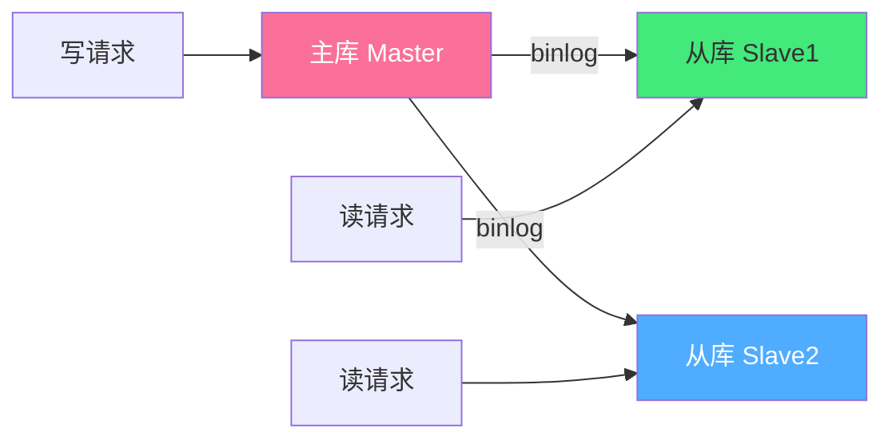
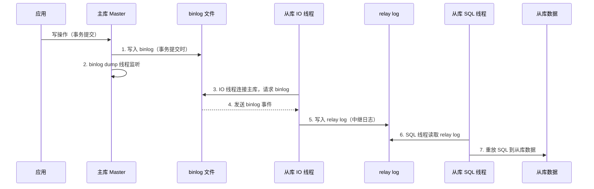

# 🔄 MySQL 主从复制与读写分离

> **文档说明**：系统讲解 MySQL 主从复制与读写分离的完整知识体系，涵盖主从复制原理（binlog/relay log/三线程）、三种复制模式（异步/半同步/全同步）、binlog 格式（STATEMENT/ROW/MIXED）、GTID 全局事务 ID、并行复制、主从搭建完整步骤、读写分离三种实现方案（应用层/代理层/代码层）、主从切换与高可用（MHA/Orchestrator/Keepalived）、主从延迟分析与优化、数据一致性校验、常见问题排查与最佳实践。主从复制是 MySQL 高可用和性能扩展的基础架构。
>
> **适用人群**：后端开发者、DBA、运维工程师、架构师
>
> **前置知识**：[[MySQL基础与SQL实战]] · [[索引原理与SQL优化]] · [[事务隔离级别与MVCC详解]]

---

## 一、概述

### 1.1 什么是主从复制

MySQL 主从复制（Replication）是指一台 MySQL 服务器（**主库 Master**）的数据变更，通过二进制日志（binlog）自动同步到另一台或多台 MySQL 服务器（**从库 Slave**）的过程。



**核心角色**：
- **主库（Master）**：负责写操作（INSERT/UPDATE/DELETE），记录 binlog
- **从库（Slave）**：负责读操作（SELECT），从主库拉取 binlog 并重放
- **复制通道**：主库 binlog → 网络 → 从库 relay log → 从库重放

### 1.2 解决的问题

| 问题 | 说明 |
|------|------|
| **数据备份** | 从库作为主库的实时备份，主库故障时数据不丢失 |
| **读写分离** | 读请求分散到从库，减轻主库读压力，提升整体吞吐量 |
| **高可用** | 主库故障时，从库可提升为主库，实现故障转移 |
| **数据分析** | 从库用于报表、统计、ETL，不影响主库性能 |
| **异地容灾** | 从库部署在异地，实现跨区域数据备份和容灾 |
| **滚动升级** | 先升级从库，验证无误后切换，降低升级风险 |

### 1.3 主从复制的局限性

| 局限 | 说明 |
|------|------|
| **主从延迟** | 复制是异步的，从库数据可能落后于主库（毫秒到秒级） |
| **不是备份** | 主库误删数据会同步到从库，不能替代物理备份 |
| **写瓶颈** | 写操作仍只能在主库，主库是写性能瓶颈 |
| **数据不一致** | 从库误写入、复制中断可能导致数据不一致 |
| **切换复杂** | 主从切换需要处理连接、VIP、应用配置等 |

---

## 二、底层原理

### 2.1 主从复制流程



**三个核心线程**：

| 线程 | 位置 | 职责 |
|------|------|------|
| **binlog dump 线程** | 主库 | 当从库连接时创建，读取 binlog 并发送给从库 |
| **IO 线程** | 从库 | 连接主库，拉取 binlog，写入 relay log |
| **SQL 线程** | 从库 | 读取 relay log，重放 SQL 到从库（MySQL 5.7+ 可多线程并行） |

### 2.2 三种复制模式

| 模式 | 说明 | 数据安全 | 性能 | 适用场景 |
|------|------|---------|------|---------|
| **异步复制（async）** | 主库写 binlog 后立即返回，不等待从库 | 低（主库宕机可能丢数据） | 高 | 一般业务、性能优先 |
| **半同步复制（semi-sync）** | 至少一个从库收到 binlog 并确认后才返回 | 中（至少一个从库有数据） | 中 | 核心业务、数据安全要求高 |
| **全同步复制** | 所有从库都确认后才返回 | 最高 | 低（MySQL 不原生支持，需 Galera/MGR） | 金融级强一致 |

**半同步复制超时降级**：
- 半同步复制设置超时时间（默认 10 秒）
- 如果从库在超时时间内未确认，自动降级为异步复制
- 从库恢复后自动切回半同步

### 2.3 binlog 格式

| 格式 | 记录内容 | 优点 | 缺点 | 适用场景 |
|------|---------|------|------|---------|
| **STATEMENT** | 记录原始 SQL 语句 | 日志小、逻辑清晰 | 函数（NOW()/UUID()）可能导致主从不一致；不确定函数有风险 | 简单 SQL、日志空间敏感 |
| **ROW**（默认） | 记录每行数据的变化（before/after image） | 最安全、无歧义、所有函数都正确复制 | 日志大（大表批量更新会产生大量日志） | 生产环境推荐、数据安全优先 |
| **MIXED** | 混合模式，自动选择（一般用 STATEMENT，不安全时用 ROW） | 兼顾安全和空间 | 逻辑复杂、不易排查 | 一般不推荐 |

**ROW 格式的三种镜像（binlog_row_image）**：
- `FULL`（默认）：记录所有列的 before/after 镜像
- `MINIMAL`：只记录变更列和主键列（日志更小）
- `NOBLOB`：FULL 模式但不记录 BLOB/TEXT 列（除非被修改）

### 2.4 GTID 全局事务 ID

**GTID（Global Transaction ID）** 是 MySQL 5.6+ 引入的全局事务标识，每个事务在集群中唯一标识，格式为：

```text
server_uuid:transaction_id
例如：3E11FA47-71CA-11E1-9E33-C80AA9429562:23
```

| 维度 | 传统复制（基于文件位置） | GTID 复制 |
|------|------------------------|-----------|
| 定位方式 | binlog 文件名 + 位置点 | GTID（事务 ID） |
| 切换难度 | 需要找新主库的 binlog 位置 | 自动找，无需手动指定 |
| 数据一致性 | 可能重复/遗漏事务 | 自动去重，确保每个事务只执行一次 |
| 故障恢复 | 复杂 | 简单（自动找同步点） |
| 多源复制 | 支持但复杂 | 原生支持，简单 |

**GTID 复制的优势**：
- ✅ 主从切换时无需手动找 binlog 位置，自动同步
- ✅ 自动去重，避免事务重复执行
- ✅ 故障恢复简单，从库自动找同步点
- ✅ 支持多源复制（一个从库同步多个主库）

### 2.5 并行复制

MySQL 复制的 SQL 线程从单线程演进到多线程并行复制，大幅减少主从延迟：

| 版本 | 并行方式 | 说明 |
|------|---------|------|
| 5.5 及以前 | 单线程 | SQL 线程串行重放，延迟大 |
| 5.6 | 按 Schema 并行 | 不同数据库的事务可并行（同一库仍串行） |
| 5.7+ | 基于组提交（LOGICAL_CLOCK） | 主库同一组提交的事务在从库并行重放，效果好 |
| 8.0 | 增强并行 + WriteSet | 基于事务依赖检测，更智能的并行 |

**关键配置（MySQL 5.7+）**：
```ini
[mysqld]
slave_parallel_type = LOGICAL_CLOCK    # 并行复制类型
slave_parallel_workers = 8              # 并行工作线程数（根据 CPU 核数设置）
slave_preserve_commit_order = ON        # 保持提交顺序（避免主从不一致）
```

---

## 三、实操示例

### 3.1 主从复制搭建（传统方式）

#### 步骤 1：主库配置

```ini
# /etc/my.cnf — 主库配置
[mysqld]
# ===== 基本配置 =====
server-id = 1                          # 唯一 ID，主从不能相同（1-4294967295）
port = 3306
datadir = /var/lib/mysql

# ===== binlog 配置 =====
log-bin = mysql-bin                    # 开启 binlog，指定文件名前缀
binlog_format = ROW                    # binlog 格式（推荐 ROW）
binlog_row_image = FULL                # 行镜像模式
expire_logs_days = 7                   # binlog 保留天数（自动清理）
max_binlog_size = 500M                 # 单个 binlog 最大大小
binlog_cache_size = 4M                 # binlog 缓存大小
max_binlog_cache_size = 2G             # 最大 binlog 缓存

# ===== 同步过滤（可选，谨慎使用）=====
# binlog-do-db = myapp                 # 只同步指定数据库（不推荐，跨库操作有坑）
# binlog-ignore-db = mysql             # 忽略指定数据库

# ===== 性能优化 =====
sync_binlog = 1                        # 每次事务提交都刷 binlog 到磁盘（最安全，性能稍差）
innodb_flush_log_at_trx_commit = 1    # 每次事务提交刷 redo log（最安全）
```

```sql
-- 主库创建复制用户
CREATE USER 'repl'@'%' IDENTIFIED BY 'StrongPassword123!';
GRANT REPLICATION SLAVE ON *.* TO 'repl'@'%';
-- MySQL 8.0+ 需要额外授权
-- GRANT REPLICATION SLAVE, REPLICATION CLIENT ON *.* TO 'repl'@'%';
FLUSH PRIVILEGES;

-- 查看主库状态（记录 File 和 Position，从库需要）
SHOW MASTER STATUS;
-- +------------------+----------+--------------+------------------+
-- | File             | Position | Binlog_Do_DB | Binlog_Ignore_DB |
-- +------------------+----------+--------------+------------------+
-- | mysql-bin.000001 |     154  |              |                  |
-- +------------------+----------+--------------+------------------+
```

#### 步骤 2：从库配置

```ini
# /etc/my.cnf — 从库配置
[mysqld]
server-id = 2                          # 不同的 ID（不能和主库相同）
port = 3306
datadir = /var/lib/mysql

# ===== relay log 配置 =====
relay-log = relay-bin                  # relay log 文件名前缀
relay-log-index = relay-bin.index
max_relay_log_size = 500M

# ===== 只读配置 =====
read-only = 1                          # 普通用户只读（super 用户仍可写）
super_read_only = 1                    # super 用户也只读（MySQL 5.7+，推荐）

# ===== 并行复制（MySQL 5.7+）=====
slave_parallel_type = LOGICAL_CLOCK
slave_parallel_workers = 8
slave_preserve_commit_order = ON

# ===== 复制过滤（可选）=====
# replicate-do-db = myapp              # 只复制指定数据库
# replicate-ignore-db = mysql         # 忽略指定数据库
# replicate-wild-do-table = myapp.%   # 只复制 myapp 库的所有表
# replicate-wild-ignore-table = mysql.%

# ===== 崩溃安全 =====
relay_log_recovery = ON                # 从库崩溃后自动恢复 relay log
master_info_repository = TABLE         # 主库信息存表（崩溃安全）
relay_log_info_repository = TABLE      # relay log 信息存表
```

#### 步骤 3：数据初始化（两种方式）

**方式 A：mysqldump 逻辑备份（小库推荐）**

```bash
# 主库导出数据（--master-data=2 会在文件中记录 binlog 位置）
mysqldump -u root -p --all-databases --single-transaction --master-data=2 --routines --triggers --events > full_backup.sql

# 从库导入数据
mysql -u root -p < full_backup.sql
```

**方式 B：xtrabackup 物理备份（大库推荐）**

```bash
# 主库物理备份
xtrabackup --backup --user=root --password=xxx --target-dir=/backup/full

# 准备备份
xtrabackup --prepare --target-dir=/backup/full

# 从库恢复（先停止 MySQL，清空数据目录）
systemctl stop mysql
rm -rf /var/lib/mysql/*
xtrabackup --copy-back --target-dir=/backup/full
chown -R mysql:mysql /var/lib/mysql
systemctl start mysql
```

#### 步骤 4：从库启动复制

```sql
-- 从库配置主库信息（传统方式，基于文件位置）
CHANGE MASTER TO
    MASTER_HOST='192.168.1.100',       -- 主库 IP
    MASTER_PORT=3306,                    -- 主库端口
    MASTER_USER='repl',                  -- 复制用户
    MASTER_PASSWORD='StrongPassword123!',-- 复制密码
    MASTER_LOG_FILE='mysql-bin.000001', -- 主库 SHOW MASTER STATUS 的 File
    MASTER_LOG_POS=154;                  -- 主库 SHOW MASTER STATUS 的 Position

-- 启动复制
START SLAVE;

-- 查看复制状态（关键！）
SHOW SLAVE STATUS\G
-- 关键指标：
-- Slave_IO_Running: Yes            ← IO 线程正常
-- Slave_SQL_Running: Yes           ← SQL 线程正常
-- Seconds_Behind_Master: 0         ← 延迟秒数（0 表示无延迟）
-- Last_IO_Error: (空)              ← IO 错误（空表示无错误）
-- Last_SQL_Error: (空)             ← SQL 错误（空表示无错误）
-- Retrieved_Gtid_Set:              ← 已获取的 GTID
-- Executed_Gtid_Set:               ← 已执行的 GTID
```

### 3.2 GTID 复制搭建

```ini
# 主库和从库都需要配置 GTID
[mysqld]
gtid_mode = ON                          # 开启 GTID
enforce_gtid_consistency = ON           # 强制 GTID 一致性（不允许不支持 GTID 的语句）
log-bin = mysql-bin
server-id = 1                           # 主库 1，从库 2/3...
```

```sql
-- 从库配置（GTID 方式，不需要指定 binlog 文件和位置！）
CHANGE MASTER TO
    MASTER_HOST='192.168.1.100',
    MASTER_PORT=3306,
    MASTER_USER='repl',
    MASTER_PASSWORD='StrongPassword123!',
    MASTER_AUTO_POSITION = 1;           -- 关键：自动找同步位置（GTID 模式）

START SLAVE;
SHOW SLAVE STATUS\G
```

> GTID 模式下，从库会自动根据已执行的 GTID 集合（Executed_Gtid_Set）找到需要从主库拉取的起始位置，无需手动指定 binlog 文件和 Position。

### 3.3 半同步复制配置

```sql
-- ===== 主库配置 =====
-- 安装半同步主库插件
INSTALL PLUGIN rpl_semi_sync_master SONAME 'semisync_master.so';

-- 启用半同步
SET GLOBAL rpl_semi_sync_master_enabled = 1;
SET GLOBAL rpl_semi_sync_master_timeout = 1000;  -- 超时 1000ms（1秒），超时降级为异步
SET GLOBAL rpl_semi_sync_master_wait_for_slave_count = 1;  -- 至少等待 1 个从库确认
SET GLOBAL rpl_semi_sync_master_wait_point = AFTER_SYNC;    -- 等待点：binlog 刷盘后（MySQL 5.7+ 默认，更安全）
-- AFTER_COMMIT：事务提交后等待（旧版，有主库提交但从库未收到的风险）

-- ===== 从库配置 =====
INSTALL PLUGIN rpl_semi_sync_slave SONAME 'semisync_slave.so';
SET GLOBAL rpl_semi_sync_slave_enabled = 1;

-- 重启从库 IO 线程使配置生效
STOP SLAVE IO_THREAD;
START SLAVE IO_THREAD;

-- ===== 查看半同步状态 =====
SHOW STATUS LIKE 'Rpl_semi_sync%';
-- Rpl_semi_sync_master_status: ON       ← 主库半同步状态
-- Rpl_semi_sync_master_clients: 1       ← 连接的半同步从库数量
-- Rpl_semi_sync_master_yes_tx: 100      ← 半同步成功提交的事务数
-- Rpl_semi_sync_master_no_tx: 0         ← 降级为异步的事务数
-- Rpl_semi_sync_slave_status: ON        ← 从库半同步状态
```

```ini
# 永久配置（写入 my.cnf，重启不丢失）
[mysqld]
# 主库
plugin-load = "rpl_semi_sync_master=semisync_master.so"
rpl_semi_sync_master_enabled = 1
rpl_semi_sync_master_timeout = 1000

# 从库
plugin-load = "rpl_semi_sync_slave=semisync_slave.so"
rpl_semi_sync_slave_enabled = 1
```

### 3.4 读写分离实现

#### 方案一：应用层中间件（ShardingSphere / MyCat）

```yaml
# ShardingSphere-JDBC 配置（应用内嵌，无额外部署）
spring:
  shardingsphere:
    datasource:
      names: master,slave0,slave1
      master:
        type: com.zaxxer.hikari.HikariDataSource
        driver-class-name: com.mysql.cj.jdbc.Driver
        jdbc-url: jdbc:mysql://192.168.1.100:3306/myapp
        username: root
        password: xxx
      slave0:
        type: com.zaxxer.hikari.HikariDataSource
        jdbc-url: jdbc:mysql://192.168.1.101:3306/myapp
        username: root
        password: xxx
      slave1:
        jdbc-url: jdbc:mysql://192.168.1.102:3306/myapp
        # ...
    rules:
      - readwrite-splitting:
          data-sources:
            master-slave:
              type: Static
              props:
                write-data-source-name: master
                read-data-source-names: slave0,slave1
              load-balancer-name: round_robin    # 轮询
          load-balancers:
            round_robin:
              type: ROUND_ROBIN
```

**ShardingSphere 特点**：
- ✅ 客户端内嵌（ShardingSphere-JDBC）或独立代理（ShardingSphere-Proxy）
- ✅ 自动路由：写走主库，读走从库
- ✅ 支持强制走主库（`/*+ Hint: writeRoute */`）
- ✅ 支持多种负载均衡算法（轮询/随机/权重）
- ✅ 支持从库延迟感知（延迟过高的从库不分配读请求）

#### 方案二：数据库代理层（ProxySQL / MaxScale）

```text
应用 → ProxySQL（3306）→ 主库（写）
                      → 从库1（读）
                      → 从库2（读）
```

```sql
-- ProxySQL 配置示例
-- 1. 添加 MySQL 服务器
INSERT INTO mysql_servers(hostgroup_id, hostname, port) VALUES
(10, '192.168.1.100', 3306),  -- 主库 hostgroup 10
(20, '192.168.1.101', 3306),  -- 从库1 hostgroup 20
(20, '192.168.1.102', 3306);  -- 从库2 hostgroup 20

-- 2. 配置读写分离规则（hostgroup 10 写，20 读）
INSERT INTO mysql_replication_hostgroups(writer_hostgroup, reader_hostgroup, comment)
VALUES (10, 20, '读写分离');

-- 3. 配置查询规则（特定查询强制走主库）
INSERT INTO mysql_query_rules(rule_id, active, match_pattern, destination_hostgroup, apply)
VALUES
(1, 1, '^SELECT.*FOR UPDATE$', 10, 1),     -- SELECT FOR UPDATE 走主库
(2, 1, '^SELECT', 20, 1);                    -- 其他 SELECT 走从库

-- 4. 加载配置到运行时
LOAD MYSQL SERVERS TO RUNTIME;
LOAD MYSQL QUERY RULES TO RUNTIME;
SAVE MYSQL SERVERS TO DISK;
SAVE MYSQL QUERY RULES TO DISK;
```

**ProxySQL 特点**：
- ✅ 独立代理层，应用无需改代码（只改连接地址）
- ✅ 连接池（减少数据库连接数）
- ✅ 查询缓存（缓存 SELECT 结果）
- ✅ 查询规则（灵活路由、限流、重写）
- ✅ 自动故障转移（主库故障自动提升从库）
- ✅ 监控统计（查询次数、延迟、命中率）

#### 方案三：代码层手动路由

```java
// Spring + AbstractRoutingDataSource 动态数据源切换
@Configuration
public class DataSourceConfig {
    
    @Bean
    public DataSource masterDataSource() {
        return DataSourceBuilder.create()
            .url("jdbc:mysql://192.168.1.100:3306/myapp")
            .username("root").password("xxx").build();
    }
    
    @Bean
    public DataSource slaveDataSource() {
        return DataSourceBuilder.create()
            .url("jdbc:mysql://192.168.1.101:3306/myapp")
            .username("root").password("xxx").build();
    }
    
    @Bean
    @Primary
    public DataSource routingDataSource(DataSource master, DataSource slave) {
        Map<Object, Object> targets = new HashMap<>();
        targets.put("master", master);
        targets.put("slave", slave);
        RoutingDataSource routing = new RoutingDataSource();
        routing.setTargetDataSources(targets);
        routing.setDefaultTargetDataSource(master);
        return routing;
    }
}

// 自定义注解标记读写
@Target(ElementType.METHOD)
@Retention(RetentionPolicy.RUNTIME)
public @interface DataSource {
    String value() default "master";
}

// Service 层使用
@Service
public class UserService {
    
    @DataSource("slave")  // 读走从库
    public User getUserById(Long id) {
        return userMapper.selectById(id);
    }
    
    @DataSource("master")  // 写走主库
    public void createUser(User user) {
        userMapper.insert(user);
    }
    
    // 写后立即读（强制走主库，避免主从延迟）
    @DataSource("master")
    public User createAndGet(User user) {
        userMapper.insert(user);
        return userMapper.selectById(user.getId());
    }
}
```

### 3.5 主从切换与高可用

#### 手动切换步骤

```sql
-- ===== 主库故障时，手动将从库提升为主库 =====

-- 1. 在原主库（如果还能操作）：设置只读，防止新写入
SET GLOBAL read_only = ON;
SET GLOBAL super_read_only = ON;

-- 2. 在目标从库：等待 relay log 全部重放
SHOW SLAVE STATUS\G
-- 确认 Seconds_Behind_Master = 0，Relay_Master_Log_File = Read_Master_Log_Pos

-- 3. 停止从库复制
STOP SLAVE;
RESET SLAVE ALL;  -- 清除主库信息（MySQL 5.7+）

-- 4. 提升为主库（关闭只读）
SET GLOBAL read_only = OFF;
SET GLOBAL super_read_only = OFF;

-- 5. 查看新主库状态
SHOW MASTER STATUS;

-- 6. 其他从库指向新主库
CHANGE MASTER TO
    MASTER_HOST='新主库IP',
    MASTER_USER='repl',
    MASTER_PASSWORD='xxx',
    MASTER_AUTO_POSITION=1;  -- GTID 模式
START SLAVE;

-- 7. 应用切换连接到新主库（修改配置/VIP/DNS）
```

#### 自动高可用方案

| 方案 | 说明 | 特点 |
|------|------|------|
| **MHA** | Master High Availability，Percona 开发 | 成熟稳定，自动故障转移，需要额外管理节点 |
| **Orchestrator** | MySQL 高可用管理工具 | Web 界面，智能切换，支持多种拓扑 |
| **MySQL Router** | MySQL 官方路由 | 轻量，配合 InnoDB Cluster 使用 |
| **Keepalived + VIP** | 虚拟 IP 漂移 | 简单，配合脚本实现切换 |
| **ProxySQL** | 数据库代理 | 自动检测主库状态，切换读/写 hostgroup |
| **MGR（MySQL Group Replication）** | MySQL 官方组复制 | 原生多主/单主，强一致，Paxos 协议 |

**MHA 架构**：
```text
MHA Manager（管理节点）
    │ 监控
    ├── Master（主库）← VIP
    ├── Slave1（从库）
    └── Slave2（从库）

主库故障 → MHA 检测 → 选择最新从库提升 → VIP 漂移 → 其他从库指向新主库
```

### 3.6 常用运维命令

```sql
-- ===== 复制状态监控 =====
SHOW SLAVE STATUS\G                          -- 查看从库复制状态
SHOW MASTER STATUS;                          -- 查看主库 binlog 状态
SHOW BINARY LOGS;                            -- 查看所有 binlog 文件
SHOW BINLOG EVENTS IN 'mysql-bin.000001';   -- 查看 binlog 事件
SHOW PROCESSLIST;                            -- 查看线程（包括复制线程）

-- ===== 复制控制 =====
START SLAVE;                                 -- 启动复制
STOP SLAVE;                                  -- 停止复制
START SLAVE IO_THREAD;                       -- 只启动 IO 线程
STOP SLAVE SQL_THREAD;                       -- 只停止 SQL 线程
RESET SLAVE;                                 -- 重置从库复制信息（保留 relay log）
RESET SLAVE ALL;                             -- 完全重置（删除主库信息和 relay log）
RESET MASTER;                                -- 重置主库（删除所有 binlog，重新开始）

-- ===== GTID 相关 =====
SELECT @@global.gtid_mode;                   -- 查看 GTID 模式
SELECT @@global.gtid_executed;               -- 查看已执行的 GTID 集合
SHOW MASTER STATUS;                          -- 查看 Executed_Gtid_Set
SHOW SLAVE STATUS\G                          -- 查看 Retrieved_Gtid_Set / Executed_Gtid_Set

-- ===== 半同步相关 =====
SHOW STATUS LIKE 'Rpl_semi_sync%';           -- 查看半同步状态
SHOW VARIABLES LIKE 'rpl_semi_sync%';        -- 查看半同步配置

-- ===== 延迟监控 =====
SHOW SLAVE STATUS\G | grep Seconds_Behind_Master
-- 或查询 performance_schema
SELECT * FROM performance_schema.replication_applier_status_by_worker;
```

```bash
# ===== 命令行工具 =====

# 查看从库延迟（秒）
mysql -e "SHOW SLAVE STATUS\G" | grep Seconds_Behind_Master

# 查看 binlog 内容
mysqlbinlog --base64-output=decode-rows -v mysql-bin.000001 | head -100

# 按时间导出 binlog
mysqlbinlog --start-datetime="2026-08-28 10:00:00" --stop-datetime="2026-08-28 12:00:00" mysql-bin.000001 > binlog.sql

# 按位置导出
mysqlbinlog --start-position=154 --stop-position=1000 mysql-bin.000001 > binlog.sql

# pt-heartbeat（Percona Toolkit，精确测量延迟）
pt-heartbeat -D test --update -h master &   # 主库更新心跳
pt-heartbeat -D test --check -h slave         # 从库检查延迟
```

---

## 四、常见问题与排查

| 问题现象 | 可能原因 | 解决方案 |
|---------|---------|---------|
| **Slave_IO_Running: No** | 网络不通；账号密码错误；防火墙；主库 binlog 已删除 | `ping`/`telnet` 测试网络；验证复制账号；检查防火墙；重新搭建复制 |
| **Slave_SQL_Running: No** | 主键冲突；数据不一致；SQL 执行错误；表结构不一致 | 查看 Last_SQL_Error；跳过错误或重新同步；用 pt-table-checksum 校验 |
| **主从延迟大（Seconds_Behind_Master 高）** | 从库性能差；大事务；单线程重放；从库负载高；网络慢 | 升级从库硬件；并行复制；避免大事务；从库减负；检查网络 |
| **数据不一致** | 从库被误写入；复制中断后重启；binlog 格式问题；从库崩溃 | 从库设 super_read_only；定期校验；用 ROW 格式；relay_log_recovery=ON |
| **切换后数据丢失** | 异步复制；主库 binlog 未同步到从库 | 用半同步复制；GTID 复制；切换前确认从库已追平 |
| **从库连接主库超时** | 网络不稳定；主库负载高；连接数满 | 检查网络；主库减负；增加 max_connections |
| **binlog 增长过快** | ROW 格式 + 大表批量更新；大事务 | 用 MINIMAL 行镜像；拆分大事务；合理设置 expire_logs_days |
| **GTID 冲突** | 主从都有写入；多源复制冲突 | 从库设只读；用 GTID 自动去重；排查误写入 |
| **半同步降级为异步** | 从库响应慢；网络延迟；从库崩溃 | 检查从库状态；优化网络；增加从库数量 |
| **relay log 损坏** | 从库崩溃；磁盘故障 | relay_log_recovery=ON 自动恢复；删除 relay log 重新拉取 |
| **主从延迟为 NULL** | 复制未启动；IO 线程错误 | 检查 Slave_IO_Running；查看 Last_IO_Error |
| **重复主键错误（1062）** | 从库已有数据；主库重复写入 | 跳过错误（谨慎）；清理从库数据重新同步；检查应用逻辑 |
| **表不存在错误（1146）** | 从库缺少表；主从表结构不一致 | 同步表结构；重新搭建复制；检查 DDL 复制 |

### 跳过复制错误（谨慎使用！）

```sql
-- ===== 传统方式跳过一个错误 =====
STOP SLAVE;
SET GLOBAL sql_slave_skip_counter = 1;  -- 跳过下一个事件
START SLAVE;

-- 注意：只能跳过一个事件，大事务可能需要多次跳过
-- 跳过错误可能导致数据不一致，仅用于紧急恢复！

-- ===== GTID 方式跳过 =====
-- 1. 查看错误的 GTID
SHOW SLAVE STATUS\G
-- 查看 Last_SQL_Error 中的 GTID，或 Retrieved_Gtid_Set

-- 2. 注入空事务跳过
STOP SLAVE;
SET GTID_NEXT='aaaaaaaa-bbbb-cccc-dddd-eeeeeeeeeeee:123';  -- 要跳过的 GTID
BEGIN;
COMMIT;
SET GTID_NEXT='AUTOMATIC';
START SLAVE;

-- ===== 更安全的方式：pt-slave-restart =====
# Percona Toolkit 工具，自动跳过指定错误类型
pt-slave-restart --error-numbers=1062,1146  # 自动跳过 1062/1146 错误
```

### 主从延迟排查流程

```bash
# ===== 主从延迟四步排查 =====

# 1. 确认延迟是否真实
mysql -h slave -e "SHOW SLAVE STATUS\G" | grep -E "Seconds_Behind_Master|Last_IO_Error|Last_SQL_Error"
# Seconds_Behind_Master 可能不准确（大事务时），用 pt-heartbeat 精确测量

# 2. 检查 IO 线程（网络/主库问题）
# IO 线程状态：Master_Log_File vs Read_Master_Log_Pos
# 如果 IO 线程落后 → 网络慢/主库负载高/带宽不足
mysql -h slave -e "SHOW SLAVE STATUS\G" | grep -E "Master_Log_File|Read_Master_Log_Pos|Relay_Master_Log_File|Exec_Master_Log_Pos"

# 3. 检查 SQL 线程（从库重放问题）
# Relay_Master_Log_File vs Exec_Master_Log_Pos
# 如果 SQL 线程落后 → 从库性能差/大事务/单线程
# 查看正在执行的事务
mysql -h slave -e "SHOW PROCESSLIST;" | grep -i "system user"

# 4. 检查从库负载
# CPU/IO/内存是否打满
top -bn1 | head -20
iostat -x 1 5
```

---

## 五、进阶与最佳实践

### 5.1 主从延迟优化

| 优化方向 | 方法 | 效果 |
|---------|------|------|
| **并行复制** | `slave_parallel_type=LOGICAL_CLOCK` + `slave_parallel_workers=8-16` | 大幅减少延迟（5.7+） |
| **从库硬件** | SSD、高 CPU、大内存 | 提升重放速度 |
| **避免大事务** | 拆分为小事务（每批 1000 行） | 减少单个事务重放时间 |
| **从库减负** | 从库不跑报表/ETL，或用独立从库 | 减少资源竞争 |
| **网络优化** | 主从同机房/同区域；增大带宽 | 减少 IO 线程延迟 |
| **binlog 格式** | ROW + MINIMAL 镜像 | 减少 binlog 大小和传输量 |
| **组提交** | 主库 `binlog_group_commit_sync_delay` 增加组提交数量 | 提升从库并行度 |
| **从库不刷盘** | `sync_binlog=0` + `innodb_flush_log_at_trx_commit=2`（从库） | 提升重放速度（从库崩溃可能丢 relay log） |
| **半同步** | 半同步复制确保至少一个从库收到 | 减少切换时数据丢失 |

### 5.2 数据一致性保障

```text
数据一致性保障 Checklist：

✅ 从库设置 super_read_only=ON（防止任何用户写入）
✅ 使用 ROW 格式 binlog（最安全，无歧义）
✅ 使用 GTID 复制（自动去重，切换简单）
✅ 开启 relay_log_recovery=ON（崩溃安全）
✅ 定期用 pt-table-checksum 校验主从数据一致性
   pt-table-checksum --replicate=test.checksums --databases=mydb h=master
✅ 发现不一致用 pt-table-sync 修复
   pt-table-sync --replicate=test.checksums h=slave h=master
✅ 监控复制状态（IO/SQL 线程、延迟、错误）
✅ 主从切换前确认从库已追平（Seconds_Behind_Master=0）
✅ 避免在从库执行 DDL（会导致复制中断）
✅ 重要操作前先在从库验证（如大表删除先在从库测试）
✅ 定期做从库提升演练（确保切换流程可靠）
```

### 5.3 高可用架构选型

| 架构 | 数据一致性 | 自动切换 | 复杂度 | 适用场景 |
|------|-----------|---------|--------|---------|
| **主从 + 手动切换** | 异步（可能丢数据） | 否 | 低 | 小型项目、非核心业务 |
| **主从 + MHA** | 异步/半同步 | 是 | 中 | 中大型项目、核心业务 |
| **主从 + Orchestrator** | 异步/半同步 | 是 | 中 | 多集群管理、需要 Web 界面 |
| **主从 + ProxySQL** | 异步/半同步 | 是（读自动，写需配合） | 中 | 需要读写分离代理、连接池 |
| **MGR 单主模式** | 强一致（Paxos） | 是 | 高 | 金融级、强一致要求 |
| **MGR 多主模式** | 强一致 | 是 | 高 | 多区域写入、冲突少的场景 |
| **Galera Cluster** | 强一致（同步复制） | 是 | 高 | 多主写入、MariaDB/Percona |

### 5.4 监控指标

| 指标 | 说明 | 告警阈值 |
|------|------|---------|
| **Slave_IO_Running** | IO 线程状态 | != Yes 立即告警 |
| **Slave_SQL_Running** | SQL 线程状态 | != Yes 立即告警 |
| **Seconds_Behind_Master** | 主从延迟（秒） | > 30 告警，> 300 严重 |
| **Last_IO_Error** | IO 错误 | 非空立即告警 |
| **Last_SQL_Error** | SQL 错误 | 非空立即告警 |
| **binlog 大小增长** | binlog 生成速度 | 异常增长告警 |
| **从库连接数** | 从库活跃连接 | 接近上限告警 |
| **半同步状态** | Rpl_semi_sync_master_status | 降级为异步告警 |
| **主库 binlog 保留** | 最早 binlog 时间 | < 从库需要的时间告警 |
| **从库 relay log 大小** | relay log 堆积 | 异常增长告警 |

### 5.5 生产环境最佳实践

```text
生产环境主从复制最佳实践：

✅ 架构规划
   - 至少一主两从（一个从库用于读写分离，一个用于备份/容灾）
   - 主从同机房低延迟网络（< 2ms），异地从库用于容灾
   - 核心业务用半同步复制，一般业务用异步

✅ 配置规范
   - server-id 全局唯一（建议用 IP 后两段，如 101 对应 192.168.1.101）
   - binlog_format=ROW，binlog_row_image=FULL（安全优先）
   - 从库 super_read_only=ON，read_only=ON
   - GTID 模式（gtid_mode=ON, enforce_gtid_consistency=ON）
   - 并行复制（LOGICAL_CLOCK + 8-16 workers）
   - 崩溃安全（relay_log_recovery=ON, master_info_repository=TABLE）
   - sync_binlog=1 + innodb_flush_log_at_trx_commit=1（主库，最安全）

✅ 安全规范
   - 复制用户专用，只授 REPLICATION SLAVE 权限
   - 复制密码强密码，定期更换
   - 主从通信走内网或 SSL 加密
   - 从库防火墙只允许主库 3306 连接

✅ 运维规范
   - 主库 DDL 先在从库测试（pt-online-schema-change）
   - 大事务拆分为小事务（每批 <= 1000 行）
   - 定期校验数据一致性（pt-table-checksum，每周/每月）
   - 定期做主从切换演练（每季度）
   - 备份从从库做（不影响主库）
   - 监控复制状态和延迟，设置告警

✅ 性能规范
   - 从库硬件不低于主库（避免从库成为瓶颈）
   - 读写分离注意主从延迟（写后立即读走主库）
   - 报表/ETL 用独立从库，不影响业务从库
   - 监控从库 CPU/IO，及时扩容

✅ 容灾规范
   - 异地从库（跨区域）用于容灾
   - 定期演练故障转移流程
   - 准备回滚方案（切换失败能切回）
   - 文档记录切换步骤和联系人
```

---

## 六、关联笔记

### 数据库
- [[MySQL基础与SQL实战]] · [[索引原理与SQL优化]] · [[事务隔离级别与MVCC详解]]
- [[数据库备份与恢复策略]] · [[数据库分库分表策略]] · [[NoSQL数据模型对比]]

### 高可用与架构
- [[高可用架构设计]] · [[负载均衡原理与实践]] · [[Redis高可用与集群]]
- [[K8s-故障排查手册]]

### 导航
- [[MOC-计算机基础]] · [[MOC-数据库原理]] · [[MOC-综合导航]] · [[Home]]

> 🔍 **知识点深度解析**
>
> **作用**：MySQL 主从复制解决的是「数据高可用和读写性能扩展」问题，通过将主库的数据变更实时同步到从库，实现数据备份、读写分离、故障转移和容灾，是 MySQL 生产环境的标配架构。
>
> **底层原理**：主库在事务提交时将变更写入 binlog（二进制日志），从库的 IO 线程连接主库拉取 binlog 写入 relay log（中继日志），从库的 SQL 线程读取 relay log 重放 SQL 到从库数据。三种复制模式：异步（主库写 binlog 即返回，性能好但可能丢数据）、半同步（至少一个从库确认才返回，数据更安全）、全同步（所有从库确认，MySQL 不原生支持）。binlog 三种格式：STATEMENT（记录 SQL）、ROW（记录行变更，最安全，默认）、MIXED（混合）。GTID 全局事务 ID 让主从切换和故障恢复更简单。MySQL 5.7+ 支持基于组提交的并行复制，大幅减少主从延迟。
>
> **用法要点**：① 搭建：主库配置 server-id+log-bin，创建复制用户；从库配置 server-id+relay-log+read_only；数据初始化（mysqldump/xtrabackup）；CHANGE MASTER TO + START SLAVE ② 验证：SHOW SLAVE STATUS\G，IO/SQL 线程都 Yes，Seconds_Behind_Master=0 ③ 推荐：GTID 模式（MASTER_AUTO_POSITION=1）、ROW 格式 binlog、半同步复制、并行复制（LOGICAL_CLOCK）、从库 super_read_only ④ 读写分离：应用层（ShardingSphere）、代理层（ProxySQL）、代码层（动态数据源） ⑤ 高可用：MHA/Orchestrator/ProxySQL 自动切换，MGR 强一致 ⑥ 最大坑：主从延迟——写后立即读从库可能读不到，解决方案：强制读主库、半同步、并行复制、等待从库追平 ⑦ 从库一定要设 super_read_only=1，防止误写入导致数据不一致 ⑧ 主从复制不是备份，仍需定期物理备份（xtrabackup） ⑨ 定期用 pt-table-checksum 校验数据一致性 ⑩ 切换前确认从库已追平（Seconds_Behind_Master=0）。

> 💡 **深度讲解**：主从复制最核心的设计是「binlog + 三线程」——主库把数据变更记录到 binlog（这是复制的数据源），从库用 IO 线程拉取 binlog 到 relay log（这是复制的传输层），再用 SQL 线程重放 relay log（这是复制的执行层）。这种分层设计让传输和执行解耦——IO 线程可以持续拉取，SQL 线程可以慢慢重放，即使从库暂时落后也不会丢失数据（relay log 已保存）。主从延迟是生产环境最常见的问题，根本原因是「从库 SQL 线程单线程重放，追不上主库的并发写入」——MySQL 5.5 及以前 SQL 线程是单线程，主库并发写入但从库串行重放，延迟会越来越大。MySQL 5.7 引入基于组提交的并行复制（LOGICAL_CLOCK），主库同一时刻组提交的事务在从库可以并行重放，这才真正解决了延迟问题。另一个容易被忽视的点是「主从复制不是备份」——主库误执行 DROP TABLE，这个操作会通过 binlog 同步到从库，从库的数据也会被删除，所以必须有独立的物理备份（xtrabackup）才能应对误操作。读写分离最大的坑是「主从延迟导致的读不一致」——用户刚提交订单（写主库），立即查询订单（读从库），如果从库还没同步到，就会查不到订单。解决方案是「写后读走主库」——可以在代码层标记写操作后的读请求走主库，或者用 ShardingSphere 的 hint 强制路由，或者用半同步复制减少延迟。

> 📝 **精简总结**：MySQL 主从复制 = binlog（主库记录变更）+ relay log（从库中继）+ 三线程（主库 binlog dump / 从库 IO / 从库 SQL）。三种模式：异步（性能好）、半同步（数据安全）、全同步（MySQL 不原生）。binlog 推荐 ROW 格式。推荐架构：GTID + 半同步 + 并行复制 + super_read_only。读写分离：ShardingSphere/ProxySQL/代码层，注意主从延迟。高可用：MHA/Orchestrator/ProxySQL 自动切换。最重要：从库只读、监控延迟、定期校验、主从复制不是备份！

> **学习路径建议**：先学习 [[MySQL基础与SQL实战]] 掌握 MySQL 基础 → 学习 [[索引原理与SQL优化]] 理解性能优化 → 学习 [[事务隔离级别与MVCC详解]] 理解事务原理 → 学习本文档掌握主从复制与读写分离 → 学习 [[数据库分库分表策略]] 理解大规模数据扩展 → 学习 [[数据库备份与恢复策略]] 掌握数据安全 → 在项目中实践完整的 MySQL 高可用架构。

---

> **主从复制的本质是「给数据库造一个实时镜像」——主库负责写，从库负责读和备份，主库挂了从库顶上。但镜像不是备份（误删会同步），镜像有延迟（写后立即读可能不一致），用好主从复制的关键是理解它的边界，在边界内发挥它的价值。**
