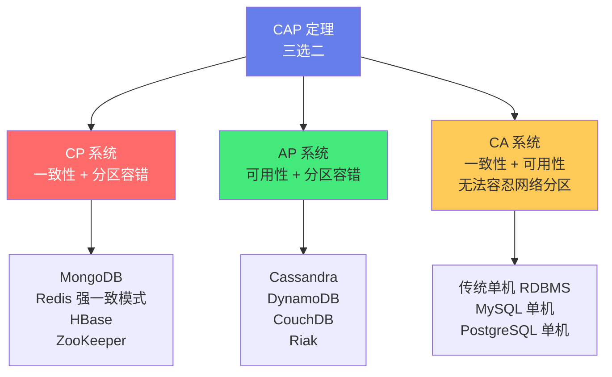
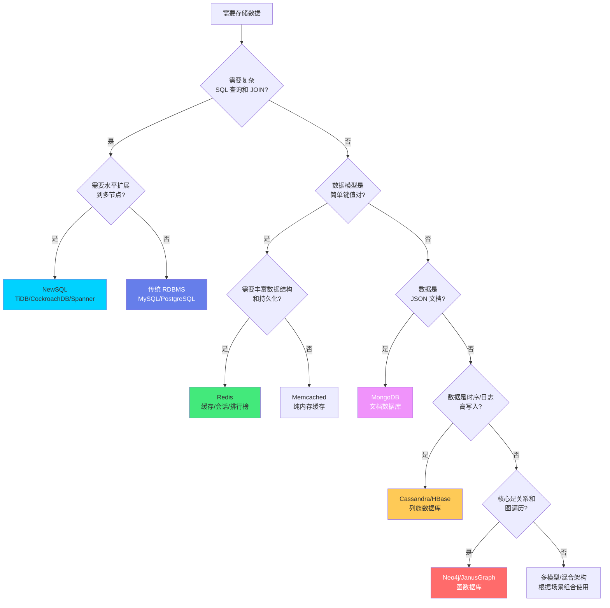
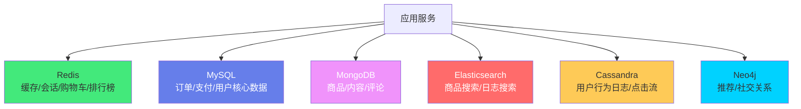

# 🗄️ NoSQL 数据模型对比

> **文档说明**：系统讲解 NoSQL 数据库的完整知识体系，涵盖 NoSQL 兴起背景与核心思想、CAP 定理与 BASE 理论、四大 NoSQL 数据模型（键值/文档/列族/图）深度对比、各模型代表产品（Redis/MongoDB/Cassandra/Neo4j 等）原理与适用场景、数据建模方法论（反范式/嵌入/引用/宽表）、SQL vs NoSQL 对比、NewSQL 与混合数据库、多模型数据库、选型决策框架、常见问题与最佳实践。
>
> **适用人群**：后端开发者、架构师、DBA、全栈工程师、需要进行数据库选型的技术决策者
>
> **前置知识**：[[MySQL基础与SQL实战]] · [[数据库索引与查询优化]] · [[分布式系统基础]]

---

## 一、概述

### 1.1 NoSQL 的兴起

NoSQL（Not Only SQL）是对传统关系型数据库（RDBMS）之外的数据库的统称，兴起于 2009 年，主要为了解决 Web 2.0 时代大规模数据、高并发、灵活数据模型的需求。

**传统 RDBMS 的局限**：
| 局限 | 说明 |
|------|------|
| **扩展性差** | 单机架构，水平扩展困难（分库分表复杂） |
| **固定 Schema** | 表结构固定，修改 Schema 成本高（ALTER TABLE 锁表） |
| **不适合半结构化数据** | JSON/XML 等半结构化数据存储和查询不便 |
| **高并发性能瓶颈** | ACID 事务开销大，高并发写入性能有限 |
| **复杂关联查询慢** | 多表 JOIN 在大数据量下性能差 |
| **不适合特定场景** | 图关系、时序数据、缓存等场景 RDBMS 不是最优 |

**NoSQL 的核心优势**：
| 优势 | 说明 |
|------|------|
| **水平扩展** | 天然支持分布式架构，可通过增加节点扩展 |
| **灵活 Schema** | Schema-less 或动态 Schema，适应数据结构变化 |
| **高性能** | 针对特定场景优化，读写性能远超 RDBMS |
| **适合大数据** | 支持 PB 级数据存储和处理 |
| **高可用** | 多副本复制，自动故障转移 |
| **数据模型多样** | 键值/文档/列族/图等多种模型，适配不同场景 |

### 1.2 CAP 定理

CAP 定理（Brewer 定理）指出：分布式系统不可能同时满足以下三个特性，最多只能同时满足两个。

| 特性 | 说明 |
|------|------|
| **一致性（Consistency）** | 所有节点在同一时间看到相同的数据（强一致性） |
| **可用性（Availability）** | 每个请求都能收到非错误响应（不保证是最新数据） |
| **分区容错性（Partition Tolerance）** | 网络分区（节点间通信中断）时系统仍能继续运行 |



> **关键理解**：在分布式系统中，网络分区（P）是不可避免的，所以实际上只能在 C（一致性）和 A（可用性）之间选择。CP 系统在分区时牺牲可用性（返回错误或超时），AP 系统在分区时牺牲一致性（返回可能过期的数据）。

### 1.3 BASE 理论

BASE 是 NoSQL 数据库常用的设计原则，是对 CAP 定理中 AP 系统的实践。

| 特性 | 说明 |
|------|------|
| **基本可用（Basically Available）** | 系统出现故障时，允许损失部分可用性（如响应时间增加、功能降级），但保证核心功能可用 |
| **软状态（Soft State）** | 允许系统存在中间状态（数据同步过程中的不一致），不影响系统整体可用性 |
| **最终一致性（Eventual Consistency）** | 系统中的所有数据副本，经过一段时间后最终会达到一致状态，不要求实时一致 |

**最终一致性的变体**：
| 类型 | 说明 |
|------|------|
| **因果一致性（Causal）** | 有因果关系的操作顺序一致，无因果关系的操作顺序任意 |
| **读己之写（Read Your Writes）** | 写入后立即能读到自己写入的值 |
| **会话一致性（Session）** | 在同一会话内保证读己之写 |
| **单调读（Monotonic Reads）** | 读取数据后，后续读取不会读到更旧的值 |
| **单调写（Monotonic Writes）** | 写操作按顺序执行，不会乱序 |

> **ACID vs BASE**：ACID（原子性/一致性/隔离性/持久性）是传统 RDBMS 的强一致性模型，适合金融等对一致性要求高的场景；BASE 是 NoSQL 的最终一致性模型，适合高可用、大规模、对一致性要求不那么严格的场景（如社交、电商商品展示）。

---

## 二、四大 NoSQL 数据模型

### 2.1 总览对比

| 维度 | 键值存储（KV） | 文档数据库 | 列族数据库 | 图数据库 |
|------|----------------|-----------|-----------|---------|
| **数据模型** | Key-Value 键值对 | JSON/BSON 文档 | 行键+列族+列 | 节点+边+属性 |
| **查询能力** | 按 Key 查询 | 丰富的查询（索引/聚合） | 按行键/列查询，支持 MapReduce | 图遍历（深度/广度/最短路径） |
| **扩展性** | 极高 | 高 | 极高 | 中等（图分区难） |
| **一致性** | 可配置（强/最终） | 可配置 | 最终一致性（可调） | 强一致性（多数） |
| **典型场景** | 缓存、会话、排行榜 | 内容管理、用户数据、IoT | 时序数据、日志、分析 | 社交关系、推荐、知识图谱 |
| **代表产品** | Redis、DynamoDB、Memcached | MongoDB、CouchDB、DocumentDB | Cassandra、HBase、Bigtable | Neo4j、JanusGraph、Nebula |
| **学习曲线** | 简单 | 中等 | 较陡 | 陡（图论概念） |
| **事务支持** | 有限（Redis 支持简单事务） | 单文档原子操作，4.0+ 多文档事务 | 行级原子操作 | 多数支持 ACID 事务 |
| **Schema** | 无（Value 任意） | 灵活（动态 Schema） | 列族固定，列动态 | 灵活（节点/边属性动态） |

```mermaid
flowchart LR
    subgraph KV["键值存储 Key-Value"]
        K1[Key] --> K2[Value<br/>任意类型]
    end
    
    subgraph Doc["文档数据库 Document"]
        D1[{JSON/BSON<br/>嵌套结构<br/>动态字段}]
    end
    
    subgraph Col["列族数据库 Column-Family"]
        C1[RowKey] --> C2[列族A<br/>列1:值<br/>列2:值]
        C1 --> C3[列族B<br/>列3:值]
    end
    
    subgraph Graph["图数据库 Graph"]
        G1((节点A)) -->|关系| G2((节点B))
        G2 -->|关系| G3((节点C))
    end
    
    style KV fill:#667eea,color:#fff
    style Doc fill:#43e97b,color:#333
    style Col fill:#f093fb,color:#fff
    style Graph fill:#feca57,color:#333
```

### 2.2 键值存储（Key-Value Store）

**数据模型**：最简单的 NoSQL 模型，数据以 Key-Value 对存储，Value 可以是任意类型（字符串、数字、二进制、JSON 等）。

**核心特点**：
- 按 Key 快速查找（O(1) 哈希查找）
- 不支持按 Value 查询（除非建二级索引）
- Value 对数据库透明（数据库不知道 Value 内部结构）
- 极其简单，性能极高

**代表产品**：

| 产品 | 特点 | 适用场景 |
|------|------|---------|
| **Redis** | 内存数据库，支持丰富数据结构（String/Hash/List/Set/ZSet/Stream），持久化可选，单线程高性能 | 缓存、会话、排行榜、分布式锁、消息队列、实时计数 |
| **Memcached** | 纯内存缓存，多线程，简单，无持久化 | 简单缓存场景 |
| **DynamoDB** | AWS 托管，SSD 存储，自动扩展，最终一致性/强一致性可选 | 云原生应用、Serverless、大规模低延迟 |
| **Riak** | 分布式 KV，高可用，最终一致性 | 高可用存储 |
| **etcd** | 强一致性 KV（Raft 协议），用于配置和服务发现 | K8s 配置存储、服务发现、分布式锁 |

**Redis 数据结构**：
| 类型 | 说明 | 应用场景 |
|------|------|---------|
| **String** | 字符串/整数/浮点数 | 缓存、计数器、分布式锁 |
| **Hash** | 键值对集合（类似 Map） | 对象存储（用户信息、商品信息） |
| **List** | 有序列表（双向链表） | 消息队列、最新列表、时间线 |
| **Set** | 无序唯一集合 | 标签、共同好友、去重 |
| **ZSet（Sorted Set）** | 有序唯一集合（按分数排序） | 排行榜、延时队列、范围查询 |
| **Bitmap** | 位操作 | 签到、用户在线状态、布隆过滤器 |
| **HyperLogLog** | 基数估算 | UV 统计（去重计数） |
| **Stream** | 消息流 | 消息队列、事件溯源 |
| **Geo** | 地理位置 | 附近的人、距离计算 |

**Redis 示例**：
```bash
# String
SET user:1:name "张三"
GET user:1:name

# Hash（对象存储）
HSET user:1 name "张三" age 25 email "zhangsan@example.com"
HGETALL user:1
HGET user:1 name

# ZSet（排行榜）
ZADD leaderboard 100 "player1" 200 "player2" 150 "player3"
ZREVRANGE leaderboard 0 9 WITHSCORES  # 排行榜前10

# Set（共同好友）
SADD user:1:friends "user2" "user3" "user4"
SADD user:2:friends "user3" "user5" "user6"
SINTER user:1:friends user:2:friends  # 共同好友
```

**键值存储的适用场景**：
- ✅ 缓存（数据库查询结果、API 响应）
- ✅ 会话存储（用户 Session）
- ✅ 排行榜/计数器（ZSet/String 自增）
- ✅ 分布式锁（SETNX）
- ✅ 消息队列（List/Stream）
- ✅ 配置存储（etcd）
- ❌ 需要按 Value 复杂查询的场景
- ❌ 需要多表关联的场景
- ❌ 需要 ACID 事务的场景（Redis 事务有限）

### 2.3 文档数据库（Document Store）

**数据模型**：数据以文档（通常是 JSON/BSON）存储，文档可以嵌套，字段动态，每个文档可以有不同的结构。

**核心特点**：
- 文档自包含（一个文档就是一个完整对象）
- 支持嵌套结构（对象内嵌套对象/数组）
- 动态 Schema（每个文档字段可以不同）
- 支持丰富的查询（按任意字段查询、索引、聚合管道）
- 单文档原子操作（MongoDB 4.0+ 支持多文档事务）

**代表产品**：

| 产品 | 特点 | 适用场景 |
|------|------|---------|
| **MongoDB** | 最流行的文档数据库，BSON 格式，丰富查询，聚合管道，分片集群，4.0+ 多文档事务 | 内容管理、用户数据、IoT、实时分析、移动应用 |
| **CouchDB** | JSON 文档，RESTful API，MVCC，离线同步（PouchDB） | 离线优先应用、移动端同步 |
| **Amazon DocumentDB** | AWS 托管，兼容 MongoDB 协议 | 云原生 MongoDB 替代 |
| **Azure Cosmos DB** | 多模型数据库（文档/图/KV/列族），全球分布 | 微软云生态、多区域应用 |
| **RavenDB** | ACID 事务文档数据库，.NET 生态 | 需要强一致性事务的文档场景 |

**MongoDB 文档示例**：
```javascript
// 用户文档（嵌套结构）
{
  "_id": ObjectId("5f8b9c3d2e1a0b1c2d3e4f5a"),
  "username": "zhangsan",
  "email": "zhangsan@example.com",
  "profile": {
    "name": "张三",
    "age": 25,
    "gender": "male",
    "address": {
      "city": "北京",
      "district": "朝阳区",
      "street": "某某街道"
    }
  },
  "tags": ["developer", "java", "mongodb"],
  "createdAt": ISODate("2024-01-01T00:00:00Z"),
  "updatedAt": ISODate("2024-01-15T10:30:00Z")
}

// 查询示例
db.users.find({ "profile.city": "北京", "tags": "java" })
db.users.aggregate([
  { $match: { "profile.age": { $gte: 18 } } },
  { $group: { _id: "$profile.city", count: { $sum: 1 } } },
  { $sort: { count: -1 } }
])
```

**文档数据库的适用场景**：
- ✅ 内容管理系统（文章、页面、媒体）
- ✅ 用户数据管理（用户资料、偏好、设置）
- ✅ IoT 设备数据（传感器数据，结构可能变化）
- ✅ 实时分析（聚合管道）
- ✅ 移动应用后端（离线同步，CouchDB）
- ✅ 目录/产品信息（属性多变的商品）
- ❌ 需要复杂多表 JOIN 的场景（文档数据库不擅长关联）
- ❌ 需要强 ACID 跨文档事务的场景（虽然支持但性能不如 RDBMS）
- ❌ 数据高度结构化且关联复杂的场景（如金融核心系统）

### 2.4 列族数据库（Column-Family Store）

**数据模型**：数据按列族（Column Family）组织，每个列族包含多个列（Column），每行有唯一的行键（Row Key）。列是动态的，每行可以有不同的列。

**核心特点**：
- 按列存储（同一列的数据连续存储，适合分析查询）
- 列族固定，列动态（每行可以有不同的列）
- 按行键排序（行键决定数据物理顺序）
- 极高的写入吞吐量（追加写）
- 适合时序数据和大规模分析
- 最终一致性（可调一致性级别）

**数据结构**：
```text
RowKey → 列族A → 列1: 值1 (时间戳)
              → 列2: 值2 (时间戳)
       → 列族B → 列3: 值3 (时间戳)
```

**代表产品**：

| 产品 | 特点 | 适用场景 |
|------|------|---------|
| **Cassandra** | 去中心化 P2P 架构，无单点故障，线性扩展，可调一致性，CQL 查询语言 | 时序数据、物联网、大规模写入、高可用存储 |
| **HBase** | Hadoop 生态，基于 HDFS，强一致性（行级），适合大数据分析 | 大数据存储、实时读写、Hadoop 生态 |
| **Bigtable** | Google 自研，GCP 托管，Spanner 的底层存储 | GCP 生态、大规模低延迟 |
| **ScyllaDB** | Cassandra 的 C++ 重写版本，性能更高，延迟更低 | 高性能 Cassandra 替代 |
| **DynamoDB** | AWS 托管，键值+文档，自动扩展 | 云原生、Serverless |

**Cassandra 数据模型示例**：
```sql
-- 创建键空间（类似数据库）
CREATE KEYSPACE IF NOT EXISTS sensor_data
WITH replication = {'class': 'SimpleStrategy', 'replication_factor': 3};

-- 创建表（列族）
CREATE TABLE sensor_data.temperature (
    device_id UUID,
    recorded_at timestamp,
    temperature float,
    humidity float,
    location text,
    PRIMARY KEY (device_id, recorded_at)  -- 分区键 + 聚类键
) WITH CLUSTERING ORDER BY (recorded_at DESC);

-- 插入数据
INSERT INTO sensor_data.temperature (device_id, recorded_at, temperature, humidity, location)
VALUES (uuid(), '2024-01-01 00:00:00', 25.5, 60.0, '北京');

-- 查询（必须按分区键查询，避免全表扫描）
SELECT * FROM sensor_data.temperature
WHERE device_id = ? AND recorded_at > '2024-01-01'
ORDER BY recorded_at DESC LIMIT 100;
```

**Cassandra 主键设计**：
| 组成 | 说明 |
|------|------|
| **分区键（Partition Key）** | 决定数据存储在哪个节点，查询必须包含分区键 |
| **聚类键（Clustering Key）** | 决定分区内数据的排序顺序，支持范围查询 |

> **列族数据库的关键设计原则**：查询驱动建模（Query-Based Modeling）——先确定查询模式，再设计表结构，而不是像 RDBMS 那样先规范化再查询。因为列族数据库不支持 JOIN 和任意条件查询，表结构必须为查询优化。

**列族数据库的适用场景**：
- ✅ 时序数据（传感器、监控、日志）
- ✅ 大规模写入（事件流、点击流）
- ✅ 高可用存储（多数据中心，无单点故障）
- ✅ 实时分析（按列存储，聚合快）
- ✅ 消息/事件存储（追加写，高吞吐）
- ❌ 需要复杂查询（JOIN、子查询、任意条件）
- ❌ 需要强一致性（多数列族数据库是最终一致性）
- ❌ 数据量小的场景（分布式 overhead 不值得）
- ❌ 需要频繁更新的场景（列族数据库更适合追加写）

### 2.5 图数据库（Graph Database）

**数据模型**：数据以图结构存储，包含节点（Vertex/Node）、边（Edge/Relationship）和属性（Property）。节点表示实体，边表示实体间的关系，属性描述节点和边的特征。

**核心特点**：
- 天然表达关系（节点和边是一等公民）
- 图遍历性能极高（关系查询不需要 JOIN，直接遍历边）
- 支持丰富的图算法（最短路径、社区发现、PageRank 等）
- 灵活 Schema（节点/边属性动态）
- 适合深度关系查询（如"朋友的朋友的朋友"）

**代表产品**：

| 产品 | 特点 | 适用场景 |
|------|------|---------|
| **Neo4j** | 最流行的图数据库，原生图存储，Cypher 查询语言，ACID 事务，社区版/企业版 | 社交网络、推荐系统、知识图谱、欺诈检测 |
| **JanusGraph** | 分布式图数据库，支持 Cassandra/HBase/BerkeleyDB 存储后端，支持 ElasticSearch 索引 | 大规模图、分布式图 |
| **Nebula Graph** | 开源分布式图数据库，高性能，nGQL 查询语言 | 大规模图、互联网场景 |
| **Amazon Neptune** | AWS 托管图数据库，支持属性图和 RDF | 云原生图应用 |
| **ArangoDB** | 多模型数据库（文档+图+KV），AQL 查询语言 | 需要多模型的场景 |
| **TigerGraph** | 企业级分布式图数据库，GSQL 查询语言，支持实时分析 | 企业级大规模图分析 |

**Neo4j Cypher 示例**：
```cypher
// 创建节点和关系
CREATE (zhangsan:Person {name: '张三', age: 25})
CREATE (lisi:Person {name: '李四', age: 28})
CREATE (wangwu:Person {name: '王五', age: 30})
CREATE (java:Skill {name: 'Java', level: 'expert'})

CREATE (zhangsan)-[:FRIEND {since: 2020}]->(lisi)
CREATE (lisi)-[:FRIEND {since: 2021}]->(wangwu)
CREATE (zhangsan)-[:KNOWS {level: 'expert'}]->(java)
CREATE (lisi)-[:KNOWS {level: 'intermediate'}]->(java)

// 查询：张三的朋友的朋友（二度关系）
MATCH (zhangsan:Person {name: '张三'})-[:FRIEND]->(friend)-[:FRIEND]->(fof)
RETURN fof.name

// 查询：共同好友
MATCH (a:Person {name: '张三'})-[:FRIEND]->(friend)<-[:FRIEND]-(b:Person {name: '李四'})
RETURN friend.name

// 最短路径
MATCH path = shortestPath(
  (zhangsan:Person {name: '张三'})-[:FRIEND*..5]-(wangwu:Person {name: '王五'})
)
RETURN path

// 图算法：PageRank（需要 GDS 库）
CALL gds.pageRank.stream('myGraph')
YIELD nodeId, score
RETURN gds.util.asNode(nodeId).name AS name, score
ORDER BY score DESC
```

**图数据库的适用场景**：
- ✅ 社交网络（好友关系、粉丝关注、动态传播）
- ✅ 推荐系统（基于图的协同过滤、关联推荐）
- ✅ 知识图谱（实体关系、推理查询）
- ✅ 欺诈检测（资金流转网络、关联分析）
- ✅ 网络/IT 运维（依赖关系、拓扑图、故障传播）
- ✅ 身份与访问管理（角色权限关系图）
- ✅ 实时推荐（路径查询、邻居查询）
- ❌ 简单的 CRUD 操作（图数据库 overhead 大）
- ❌ 大规模批量分析（图数据库不擅长全表扫描聚合，可用图计算引擎如 Spark GraphX）
- ❌ 数据无明显关系的场景（用 KV 或文档更简单）
- ❌ 需要水平扩展到超大规模（图分区是难题，多数图数据库扩展有限）

---

## 三、数据建模方法论

### 3.1 关系型建模 vs NoSQL 建模

| 维度 | 关系型建模（RDBMS） | NoSQL 建模 |
|------|---------------------|-----------|
| **建模原则** | 规范化（Normalization），减少冗余 | 反范式（Denormalization），适当冗余 |
| **设计驱动** | 实体关系驱动（ER 模型） | 查询驱动（Query-Based） |
| **关联方式** | 外键 + JOIN | 嵌入（Embed）或引用（Reference） |
| **Schema** | 固定 Schema，先设计后使用 | 动态 Schema，边用边演化 |
| **事务** | ACID 事务，支持复杂事务 | 有限事务（单文档/单行原子） |
| **扩展性** | 垂直扩展为主，水平扩展难 | 水平扩展，分布式架构 |

### 3.2 文档数据库建模（MongoDB）

**两种关联方式**：

| 方式 | 说明 | 适用场景 |
|------|------|---------|
| **嵌入（Embed）** | 将关联数据嵌套在主文档中 | 一对一、一对多（少）、数据经常一起读取 |
| **引用（Reference）** | 通过 ID 引用其他文档（类似外键） | 一对多（多）、多对多、数据经常独立查询 |

**嵌入示例**：
```javascript
// 用户文档嵌入地址（一对一，经常一起读取）
{
  "_id": ObjectId("..."),
  "username": "zhangsan",
  "address": {
    "city": "北京",
    "district": "朝阳区",
    "street": "某某街道"
  }
}

// 文章文档嵌入评论（一对多，但评论数量有限且经常一起读取）
{
  "_id": ObjectId("..."),
  "title": "MongoDB 建模指南",
  "content": "...",
  "comments": [
    { "author": "user1", "text": "写得好", "createdAt": ISODate("...") },
    { "author": "user2", "text": "收藏了", "createdAt": ISODate("...") }
  ]
}
```

**引用示例**：
```javascript
// 文章文档引用作者（多对一，作者信息经常独立更新）
{
  "_id": ObjectId("article1"),
  "title": "MongoDB 建模指南",
  "authorId": ObjectId("user1"),  // 引用用户文档
  "content": "..."
}

// 用户文档
{
  "_id": ObjectId("user1"),
  "username": "zhangsan",
  "email": "zhangsan@example.com"
}

// 查询时需要两次查询（或 $lookup 聚合）
const article = db.articles.findOne({ _id: ObjectId("article1") });
const author = db.users.findOne({ _id: article.authorId });
```

**嵌入 vs 引用决策**：
| 因素 | 倾向嵌入 | 倾向引用 |
|------|---------|---------|
| 关系基数 | 一对少 | 一对多/多对多 |
| 读取模式 | 经常一起读取 | 经常独立读取 |
| 更新频率 | 关联数据更新少 | 关联数据更新频繁 |
| 数据量 | 关联数据量小 | 关联数据量大（避免文档过大） |
| 一致性 | 不需要强一致 | 需要一致的引用 |

> **MongoDB 文档大小限制**：单个文档最大 16MB。如果嵌入的数据可能导致文档超过 16MB，必须使用引用。

### 3.3 列族数据库建模（Cassandra）

**核心原则：查询驱动建模（Query-Based Modeling）**

1. 先列出所有查询模式
2. 为每个查询模式设计一张表
3. 表结构围绕查询优化（分区键、聚类键、索引）
4. 允许数据冗余（同一份数据可能存在多张表中）

**示例：博客系统建模**

查询模式：
1. 按用户 ID 查询该用户的所有文章（按时间倒序）
2. 按文章 ID 查询文章详情
3. 按标签查询文章列表

```sql
-- 表1：按用户查询文章
CREATE TABLE articles_by_user (
    user_id UUID,
    article_id UUID,
    title text,
    created_at timestamp,
    PRIMARY KEY (user_id, created_at)
) WITH CLUSTERING ORDER BY (created_at DESC);

-- 表2：按文章 ID 查询详情
CREATE TABLE articles (
    article_id UUID PRIMARY KEY,
    user_id UUID,
    title text,
    content text,
    created_at timestamp
);

-- 表3：按标签查询文章
CREATE TABLE articles_by_tag (
    tag text,
    article_id UUID,
    title text,
    created_at timestamp,
    PRIMARY KEY (tag, created_at)
) WITH CLUSTERING ORDER BY (created_at DESC);
```

> 注意：文章数据在三张表中都有存储（冗余），这是 Cassandra 建模的正常做法。写入时需要同时写入三张表（可通过批处理或应用层保证）。

### 3.4 图数据库建模（Neo4j）

**核心原则：自然世界建模**

图数据库建模最接近自然世界的思维方式——实体是节点，关系是边。

| 关系型概念 | 图数据库概念 |
|-----------|------------|
| 表（Table） | 节点标签（Label） |
| 行（Row） | 节点（Node） |
| 列（Column） | 属性（Property） |
| 外键（Foreign Key） | 关系（Relationship） |
| JOIN 查询 | 图遍历（Traversal） |

**建模要点**：
- 节点表示实体（人、物、概念）
- 边表示关系（好友、属于、购买、关注）
- 边必须有方向和类型
- 属性可以放在节点和边上（边的属性描述关系的特征，如「好友关系的建立时间」）
- 避免超级节点（一个节点连接了大量边，会影响性能）

---

## 四、SQL vs NoSQL vs NewSQL

### 4.1 综合对比

| 维度 | SQL（RDBMS） | NoSQL | NewSQL |
|------|-------------|-------|--------|
| **数据模型** | 关系型（表/行/列） | 键值/文档/列族/图 | 关系型（SQL） |
| **Schema** | 固定 Schema | 灵活/动态 Schema | 固定 Schema |
| **事务** | ACID（强一致） | BASE（最终一致，有限事务） | ACID（分布式强一致） |
| **查询语言** | SQL | 各有不同（CQL/Cypher/API） | SQL |
| **扩展性** | 垂直扩展，水平扩展难 | 水平扩展，分布式 | 水平扩展，分布式 |
| **一致性** | 强一致性 | 最终一致性（可调） | 强一致性 |
| **JOIN** | 支持 | 不支持/有限支持 | 支持 |
| **代表产品** | MySQL、PostgreSQL、Oracle | Redis、MongoDB、Cassandra、Neo4j | TiDB、CockroachDB、Spanner、OceanBase |
| **适用场景** | 传统企业应用、金融、ERP | 大规模 Web、IoT、缓存、社交 | 云原生应用、需要 SQL+水平扩展的场景 |

### 4.2 NewSQL 简介

NewSQL 是一类新型分布式关系型数据库，旨在结合 RDBMS 的 ACID 事务和 SQL 能力与 NoSQL 的水平扩展能力。

**核心特点**：
- 支持标准 SQL（兼容 MySQL/PostgreSQL 协议）
- 分布式 ACID 事务（强一致性）
- 水平扩展（通过 Raft/Paxos 共识协议）
- 云原生架构（存算分离、弹性扩展）

**代表产品**：
| 产品 | 特点 |
|------|------|
| **TiDB** | 开源，兼容 MySQL，Raft 共识，HTAP（OLTP+OLAP），PingCAP 开发 |
| **CockroachDB** | 开源，兼容 PostgreSQL，Raft 共识，全球分布式，Cockroach Labs 开发 |
| **Google Spanner** | Google 自研，全球分布式，TrueTime（原子钟+GPS）保证外部一致性 |
| **OceanBase** | 蚂蚁集团自研，兼容 MySQL/Oracle，金融级，TPC-C 世界纪录 |
| **YugabyteDB** | 开源，兼容 PostgreSQL，Raft 共识，云原生 |
| **Amazon Aurora** | AWS 托管，兼容 MySQL/PostgreSQL，云原生关系型数据库 |

> **NewSQL 的定位**：NewSQL 不是要取代 NoSQL，而是填补「需要 SQL+ACID+水平扩展」这一空白场景。对于传统 RDBMS 扩展性不足、NoSQL 不支持 SQL 和事务的场景，NewSQL 是理想选择。

---

## 五、选型决策框架

### 5.1 选型决策树



### 5.2 按场景选型

| 场景 | 推荐数据库 | 原因 |
|------|-----------|------|
| **缓存** | Redis | 高性能，丰富数据结构，持久化可选 |
| **会话存储** | Redis | 快速读写，TTL 过期，分布式会话 |
| **用户资料** | MongoDB / MySQL | 文档灵活或关系规范，视查询模式 |
| **商品目录** | MongoDB | 属性多变，嵌套结构，全文搜索 |
| **博客/内容** | MongoDB | 文档结构，评论嵌入，灵活 Schema |
| **电商订单** | MySQL / NewSQL | ACID 事务，库存扣减，财务一致性 |
| **支付/金融** | MySQL / Oracle / OceanBase | 强一致性，ACID 事务，成熟稳定 |
| **社交关系** | Neo4j | 好友关系，推荐，图遍历 |
| **推荐系统** | Neo4j / Redis | 图关系推荐，排行榜，协同过滤 |
| **知识图谱** | Neo4j / JanusGraph | 实体关系，推理查询，图算法 |
| **IoT 传感器** | Cassandra / InfluxDB / MongoDB | 时序数据，高写入，灵活 Schema |
| **监控指标** | Prometheus / InfluxDB / Cassandra | 时序数据，高写入，按时间查询 |
| **日志存储** | Elasticsearch / Cassandra | 全文搜索，高写入，分析查询 |
| **消息队列** | Redis / Kafka | 轻量用 Redis，大规模用 Kafka |
| **分布式锁** | Redis / etcd | Redis SETNX，etcd 强一致 |
| **配置中心** | etcd / Consul | 强一致 KV，服务发现，Watch 机制 |
| **大规模分析** | ClickHouse / HBase / Cassandra | 列式存储，聚合快，PB 级数据 |
| **全文搜索** | Elasticsearch | 倒排索引，全文搜索，分析聚合 |
| **云原生应用** | NewSQL（TiDB）/ DynamoDB / Cosmos DB | 水平扩展，托管服务，弹性伸缩 |

### 5.3 混合架构（Polyglot Persistence）

现代系统通常使用**混合持久化（Polyglot Persistence）**架构——不同场景使用不同数据库，各取所长。

**典型电商系统混合架构**：


> **混合架构的挑战**：数据一致性（不同数据库间的数据同步）、事务跨库（分布式事务）、运维复杂度（多种数据库的维护成本）、团队技能（需要掌握多种数据库）。需要根据业务需求权衡，避免过度设计。

---

## 六、常见问题与最佳实践

### 6.1 常见问题

| 问题 | 原因 | 解决方案 |
|------|------|---------|
| **NoSQL 比 SQL 快** | 误解，NoSQL 在特定场景快，复杂查询可能更慢 | 根据场景选择，不要盲目用 NoSQL |
| **NoSQL 不需要 Schema** | 误解，Schema 从「写时强制」变为「读时约定」，应用层需要管理 Schema | 在应用层定义 Schema 验证，使用 Schema 版本控制 |
| **MongoDB 不支持事务** | 误解，MongoDB 4.0+ 支持多文档 ACID 事务 | 但跨文档事务性能不如 RDBMS，尽量用单文档原子操作 |
| **Redis 是纯内存的** | 误解，Redis 支持 RDB/AOF 持久化 | 根据场景选择持久化策略，重要数据开启 AOF |
| **Cassandra 可以替代 MySQL** | 误解，Cassandra 不支持 JOIN 和复杂查询，建模方式完全不同 | 用 Cassandra 做它擅长的（时序/高写入），不要当 RDBMS 用 |
| **图数据库可以替代所有数据库** | 误解，图数据库在关系查询上有优势，但简单 CRUD 性能不如 KV/文档 | 用图数据库做关系密集型场景，其他场景用更合适的数据库 |
| **最终一致性就是数据不一致** | 误解，最终一致性是「一段时间后一致」，不是「永远不一致」 | 根据业务对一致性的要求调整一致性级别，关键业务用强一致 |
| **NoSQL 没有事务** | 误解，多数 NoSQL 支持单文档/单行原子操作，部分支持分布式事务 | 了解具体数据库的事务能力，设计数据模型时利用原子操作 |
| **水平扩展就是加机器** | 误解，水平扩展需要数据分片、路由、一致性保障，复杂度高 | 评估是否真的需要水平扩展，小规模用垂直扩展更简单 |
| **选了 NoSQL 就不能用 SQL** | 误解，可以混合使用（Polyglot Persistence） | 根据场景选择最合适的数据库，不要被「技术栈统一」束缚 |

### 6.2 最佳实践

1. **场景驱动选型**：先明确业务场景和查询模式，再选择数据库，不要为了用 NoSQL 而用 NoSQL
2. **了解一致性模型**：明确业务对一致性的要求（强一致/最终一致/读己之写），选择支持的数据库和配置
3. **数据建模为查询优化**：NoSQL 建模是查询驱动的，先确定查询再设计表/文档结构
4. **适当冗余**：NoSQL 鼓励反范式和冗余，用空间换时间（减少 JOIN 和多次查询）
5. **控制文档/行大小**：MongoDB 文档最大 16MB，Cassandra 分区不宜过大，避免超级节点
6. **设计主键/分区键**：Cassandra 分区键决定数据分布和查询效率，MongoDB _id 影响分片，Redis Key 设计影响命名空间和批量操作
7. **使用 TTL 过期**：缓存、会话、临时数据使用 TTL 自动过期，避免数据膨胀
8. **监控和调优**：监控数据库性能指标（延迟、吞吐量、连接数、内存/磁盘使用），定期调优
9. **备份和恢复**：无论什么数据库都要有备份策略和恢复演练，NoSQL 也不例外
10. **渐进式迁移**：从 RDBMS 迁移到 NoSQL 时，采用渐进式策略（双写、只读迁移、灰度切换），不要一次性大爆炸迁移
11. **团队技能**：选择团队熟悉的数据库，或投入时间学习，避免「选了但不会用」
12. **避免过度设计**：不是所有系统都需要分布式 NoSQL，很多场景 MySQL + Redis 就够了

---

## 七、关联笔记

### 数据库
- [[MySQL基础与SQL实战]] · [[数据库索引与查询优化]] · [[MySQL主从复制与读写分离]]
- [[Redis核心原理与实战]] · [[MongoDB实战]] · [[分布式数据库原理]]
- [[数据库备份与恢复策略]] · [[NoSQL数据模型对比]]

### 分布式系统
- [[分布式系统基础]] · [[CAP定理与一致性]] · [[Seata-分布式事务]]
- [[一致性哈希]] · [[Raft共识算法详解]] · [[微服务架构设计]]

### 云原生与架构
- [[高可用架构设计]] · [[系统设计方法论]] · [[缓存架构设计]]
- [[消息队列与异步架构]]

### 导航
- [[MOC-计算机基础]] · [[MOC-数据库原理]] · [[MOC-综合导航]] · [[Home]]

> 🔍 **知识点深度解析**
>
> **作用**：NoSQL 数据模型对比解决的是「如何根据业务场景选择合适的非关系型数据库」问题——传统关系型数据库（RDBMS）在大规模数据、高并发、灵活数据模型场景下存在局限，NoSQL 提供了四种核心数据模型（键值/文档/列族/图），每种模型针对特定场景优化。通过对比四种模型的原理、特点、代表产品和适用场景，帮助开发者做出正确的数据库选型决策，并掌握 NoSQL 数据建模方法论（反范式、查询驱动、嵌入与引用）。
>
> **底层原理**：NoSQL 的理论基础是 CAP 定理——分布式系统无法同时满足一致性（C）、可用性（A）、分区容错性（P），由于网络分区（P）不可避免，实际只能在 C 和 A 之间选择。CP 系统（如 MongoDB 强一致模式、HBase）牺牲可用性保证一致性；AP 系统（如 Cassandra、DynamoDB）牺牲一致性保证可用性，采用 BASE 理论（基本可用/软状态/最终一致性）。四种数据模型各有其底层存储和查询原理：键值存储用哈希表实现 O(1) 查找，Value 对数据库透明；文档数据库用 BSON/JSON 存储，支持嵌套结构和二级索引，查询引擎解析文档字段；列族数据库按列存储（同一列数据连续），用行键+列族+列的三维结构，按行键分区分布到节点，适合时序和高写入；图数据库用邻接表/索引-free邻接（节点直接存储边的指针）实现高性能图遍历，关系查询不需要 JOIN，直接沿边遍历。NoSQL 普遍采用分布式架构（数据分片+多副本复制+一致性协议），通过水平扩展应对大规模数据和高并发。
>
> **用法要点**：① 四大模型：键值（Redis，缓存/会话/排行榜，O(1) 查找，不支持 Value 查询）、文档（MongoDB，JSON 嵌套，丰富查询，动态 Schema，单文档原子）、列族（Cassandra，时序/高写入，查询驱动建模，最终一致性，按列存储）、图（Neo4j，关系/推荐/知识图谱，图遍历，Cypher，ACID 事务） ② CAP 选择：强一致选 CP（MongoDB 强一致/HBase/etcd），高可用选 AP（Cassandra/DynamoDB），金融核心用 RDBMS 或 NewSQL ③ 建模方法：文档数据库用嵌入（一对少/一起读）vs 引用（一对多/独立读），列族数据库用查询驱动建模（先查询后建表，允许冗余），图数据库用自然建模（实体=节点，关系=边） ④ 选型决策：缓存→Redis，用户/内容→MongoDB，订单/支付→MySQL/NewSQL，社交/推荐→Neo4j，时序/日志→Cassandra/InfluxDB，搜索→Elasticsearch ⑤ 混合架构（Polyglot Persistence）：不同场景用不同数据库，各取所长，但注意数据一致性和运维复杂度 ⑥ NewSQL（TiDB/CockroachDB/Spanner）：需要 SQL+ACID+水平扩展时选择，填补 RDBMS 和 NoSQL 之间的空白 ⑦ 常见误区：NoSQL 不是比 SQL 快（特定场景快）、不是没有 Schema（Schema 在应用层）、不是没有事务（单文档原子/部分支持分布式事务）、最终一致性不是永远不一致 ⑧ 最佳实践：场景驱动选型、查询驱动建模、适当冗余、控制文档大小、设计好主键/分区键、TTL 过期、监控调优、备份恢复、渐进式迁移、避免过度设计。

> 💡 **深度讲解**：NoSQL 最核心的智慧是「没有银弹，只有最合适」——不存在一种数据库能在所有场景下都最优，每种数据库都是在特定维度上做了权衡（CAP 权衡、读写性能权衡、一致性与可用性权衡、灵活与规范权衡）。键值存储牺牲了查询能力换取了极致的读写性能；文档数据库牺牲了事务和 JOIN 换取了灵活 Schema 和嵌套结构；列族数据库牺牲了查询灵活性和一致性换取了极高的写入吞吐和水平扩展；图数据库牺牲了简单 CRUD 性能和扩展性换取了关系查询的极致性能。理解这些权衡，才能做出正确的选型。另一个关键点是「查询驱动建模」——这是 NoSQL（尤其是列族数据库）与关系型建模最大的区别。关系型建模是「实体驱动」的：先识别实体和关系，规范化设计表，然后写查询（不管查询多复杂，JOIN 就行）。NoSQL 建模是「查询驱动」的：先列出所有查询模式，为每个查询模式设计一张表/文档结构，允许数据冗余，因为 NoSQL 不支持 JOIN，必须把查询需要的数据放在一起。这种建模方式初看很「反规范化」，但在大规模分布式场景下是必要的——用空间换时间，用冗余换性能。MongoDB 的嵌入 vs 引用是另一个重要决策：嵌入把关联数据放在同一个文档里，读取一次就能拿到所有数据（性能好），但更新嵌入数据需要更新整个文档（如果嵌入数据经常变化，写放大严重），且文档大小有限制（16MB）；引用通过 ID 关联，需要两次查询（或 $lookup），但关联数据可以独立更新，适合一对多/多对多关系。决策的核心是「读取模式」——如果关联数据经常和主数据一起读取且变化少，用嵌入；如果关联数据经常独立读取或变化频繁或数量多，用引用。

> 📝 **精简总结**：NoSQL = 非关系型数据库统称，四大模型：键值（Redis，缓存/会话，O(1) 查找）、文档（MongoDB，JSON 嵌套，灵活 Schema，丰富查询）、列族（Cassandra，时序/高写入，查询驱动建模，最终一致）、图（Neo4j，关系/推荐/知识图谱，图遍历）。理论基础：CAP 定理（C/A/P 三选二，P 不可避免，选 C 或 A）、BASE 理论（基本可用/软状态/最终一致）。建模：文档用嵌入/引用，列族用查询驱动，图用自然建模。选型：缓存→Redis，内容→MongoDB，订单→MySQL/NewSQL，关系→Neo4j，时序→Cassandra，搜索→ES。NewSQL（TiDB/CockroachDB）= SQL+ACID+水平扩展。混合架构（Polyglot Persistence）= 不同场景用不同数据库。误区：NoSQL 不是更快/不是无 Schema/不是无事务/最终一致不是不一致。最佳实践：场景驱动选型、查询驱动建模、适当冗余、控制大小、设计主键、TTL、监控、备份、渐进迁移。

> **学习路径建议**：先学习 [[MySQL基础与SQL实战]] 掌握关系型数据库 → 学习本文档理解 NoSQL 四大模型和选型 → 学习 [[Redis核心原理与实战]] 深入键值存储 → 学习 [[MongoDB实战]] 深入文档数据库 → 学习 [[分布式数据库原理]] 理解分布式一致性 → 学习 [[Seata-分布式事务]] 理解跨库事务 → 根据业务需求实践选型和建模。

---

> **NoSQL 的本质是「解放数据」——传统关系型数据库把数据束缚在固定的表结构和严格的事务中，NoSQL 打破了这些束缚，让数据模型可以根据业务需求自由选择。但自由不是没有代价——选择了灵活就要自己管理 Schema，选择了高可用就要接受最终一致性，选择了高性能就要放弃复杂查询。NoSQL 不是要取代 SQL，而是要和 SQL 一起，为不同的业务场景提供最合适的数据存储方案。真正优秀的架构师不是「只用 NoSQL」或「只用 SQL」，而是「在正确的场景用正确的数据库」——理解每种数据库的权衡，做出理性的选型，用混合架构构建既能满足业务需求又能应对未来变化的系统。这就是 NoSQL 时代的数据架构智慧。**
