# Redis 数据结构与应用场景：内存级 KV 存储实战

> **文档定位**：Redis 是互联网后端的"第二数据库"——MySQL 负责持久化，Redis 负责快。本文档系统讲解 Redis 九大核心数据结构的底层编码、命令、应用场景，以及持久化、过期淘汰、集群高可用等生产机制。
>
> **学习目标**：读完本文，你应当能为业务选型合适的数据结构、实现分布式锁与排行榜、理解缓存三大问题（穿透/击穿/雪崩）、用 Python 安全地操作 Redis，并能自信应对"Redis 为什么快""RDB 和 AOF 区别""缓存一致性"这类面试题。
>
> **前置知识**：[[MySQL基础与SQL实战]]（理解缓存为何物）、[[数据结构与算法知识点系统梳理_优化版]]（理解跳表、哈希表）。

---

## 一、Redis 概述、安装与核心特性

### 1.1 什么是 Redis

**概念解释**：Redis（Remote Dictionary Server）是一个基于内存的开源键值存储系统，常用作缓存、消息队列、排行榜、分布式锁。它单节点可达 10 万+ QPS，是互联网应用的标配中间件。

**生活化比喻**：如果说 MySQL 是"仓库"（持久、容量大、但取货慢），Redis 就是"收银台抽屉"（放最常卖的货，伸手就拿）。热数据放抽屉，冷数据放仓库，是所有电商系统的标准打法。

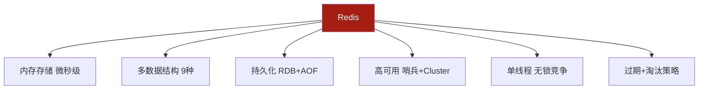

### 1.2 Redis 为什么快

| 原因 | 说明 |
|------|------|
| 纯内存 | 数据在内存，避免磁盘 IO |
| 单线程 | 命令执行单线程，无锁竞争、无上下文切换 |
| IO 多路复用 | epoll/kqueue 单线程处理万级连接 |
| 高效数据结构 | SDS、跳表、ziplist、quicklist 等专为性能设计 |
| 6.0 网络多线程 | 网络 IO 多线程，命令仍单线程 |

### 1.3 安装

```bash
# Docker 一键起（推荐）
docker run -d --name redis-lab \
  -p 6379:6379 \
  redis:7.2 \
  --requirepass YourPass!2026 \
  --appendonly yes

# 进入容器交互
docker exec -it redis-lab redis-cli -a YourPass!2026

# Ubuntu 安装
sudo apt install -y redis-server
sudo systemctl start redis-server

# macOS
brew install redis
brew services start redis
```

```bash
# 基础连通性
127.0.0.1:6379> PING
PONG
127.0.0.1:6379> SET hello world
OK
127.0.0.1:6379> GET hello
"world"
```

### 1.4 九大数据结构总览

| 类型 | 底层编码 | 典型场景 |
|------|---------|---------|
| String | int/embstr/raw | 缓存、计数器、分布式锁、Session |
| Hash | listpack/hashtable | 对象存储、购物车 |
| List | quicklist | 消息队列、时间线 |
| Set | intset/hashtable | 标签、共同好友、去重 |
| Sorted Set | listpack/skiplist | 排行榜、延时队列 |
| Bitmap | String 位操作 | 签到、在线状态 |
| HyperLogLog | String | UV 统计 |
| Geo | Sorted Set | 地理位置 |
| Stream | radix tree+listpack | 消息队列 |

> 💡 **本章深度讲解**：Redis 学习的关键不是背命令，而是建立"数据结构选型"直觉——同一个需求，选错数据结构会多写十倍代码。本章是全局地图，后面八章逐个深入。
>
> 📝 **本章精简总结**：① Redis 内存 KV，单线程+IO 多路复用快；② Docker 起环境；③ 九大结构按场景选型。
>
> 🎯 **梯度练习题**：⭐ 为什么 Redis 单线程还这么快？⭐⭐ Redis 6.0 引入多线程改了什么、没改什么？⭐⭐⭐ 为什么缓存系统常用 Redis 而不是直接用 MySQL？

---

## 二、String：缓存、计数器与分布式锁

### 2.1 底层编码

String 有三种编码，Redis 自动选择：

| 编码 | 条件 | 说明 |
|------|------|------|
| int | 值是 64 位整数 | 直接存整数，最省内存 |
| embstr | 长度 ≤ 44 字节 | 对象头与数据连续分配 |
| raw | 长度 > 44 字节 | 分开分配 |

```bash
127.0.0.1:6379> SET n 12345
OK
127.0.0.1:6379> OBJECT ENCODING n
"int"
127.0.0.1:6379> SET s "hello"
OK
127.0.0.1:6379> OBJECT ENCODING s
"embstr"
127.0.0.1:6379> SET long "this string is definitely longer than forty four bytes threshold"
OK
127.0.0.1:6379> OBJECT ENCODING long
"raw"
```

### 2.2 常用命令

```bash
# 基础
SET key value
GET key
DEL key
EXISTS key
EXPIRE key seconds
TTL key
TYPE key

# 原子计数
INCR key
DECR key
INCRBY key 10
DECRBY key 10

# 批量
MSET k1 v1 k2 v2
MGET k1 k2

# 带条件
SET k v NX      # 不存在才设（分布式锁）
SET k v XX      # 存在才设
SET k v EX 60   # 同时设过期
SET k v PX 1000 # 毫秒
```

### 2.3 场景一：对象缓存

```bash
# 用户信息缓存（JSON 序列化）
SET user:1001 '{"id":1001,"name":"张三","age":28}' EX 3600
GET user:1001
# 预期：返回该 JSON 字符串，1 小时后自动过期

# 缓存击穿防护：热点 key 永不过期 + 异步更新，或随机过期时间
SET product:2001 '{"name":"T恤","price":59.9}' EX 3600
```

### 2.4 场景二：计数器

```bash
# 文章阅读量
INCR article:1001:views
# 预期：返回自增后的值，如 1001

# 点赞 +5
INCRBY article:1001:likes 5

# 限流器：每分钟 100 次
INCR rate:user:1001
EXPIRE rate:user:1001 60
```

### 2.5 场景三：分布式锁

```bash
# 加锁：SET NX EX 原子操作
SET lock:order:1001 "client-uuid-xxx" NX EX 30
# 预期：抢到返回 OK，没抢到返回 nil

# 解锁：必须 Lua 保证"判断持有者+删除"原子
EVAL "if redis.call('get',KEYS[1])==ARGV[1] then return redis.call('del',KEYS[1]) else return 0 end" 1 lock:order:1001 "client-uuid-xxx"
```

> ❌ **常见坑点**：① 解锁直接 DEL，会误删别人的锁——必须先比对 value（唯一 UUID）。② 业务执行超过锁的 30 秒，锁自动释放，另一进程拿到锁，导致并发——用"看门狗"自动续期（Redisson）。③ SET NX 和 EX 分两步执行，非原子——必须一条命令 `SET k v NX EX 30`。

### 2.6 场景四：Session 共享

```bash
# 登录 Token
SET session:token:abc123 "user:1001" EX 1800
GET session:token:abc123
# 多实例共享 Session，不用 sticky session
```

> 💡 **本章深度讲解**：String 是 Redis 最基础也最常用的结构。它的精髓在于"原子操作"——INCR、SET NX EX 这类命令是单线程原子的，所以能实现计数器、分布式锁、限流这些需要并发安全的功能。embstr/raw 编码切换是内存优化细节，了解即可。
>
> 📝 **本章精简总结**：① 三种编码 int/embstr/raw；② 原子 INCR 做计数器；③ SET NX EX 做分布式锁；④ 解锁用 Lua 比对 UUID；⑤ Session 共享。
>
> 🎯 **梯度练习题**：⭐ SET NX 和 SETNX 区别？⭐⭐ 为什么分布式锁 value 要放 UUID？⭐⭐⭐ 用 String 实现一个"滑动窗口限流"（每分钟 100 次）。


---

## 三、Hash：对象存储与购物车

### 3.1 底层编码

| 编码 | 条件 | 说明 |
|------|------|------|
| listpack（压缩列表） | 字段数 ≤ 128 且值 ≤ 64 字节 | 紧凑省内存，查询 O(n) |
| hashtable | 超过阈值 | 查询 O(1) |

```bash
# redis.conf 阈值
hash-max-listpack-entries 128
hash-max-listpack-value 64
```

### 3.2 常用命令

```bash
HSET key field value
HGET key field
HDEL key field
HEXISTS key field
HLEN key
HMGET key f1 f2
HGETALL key
HKEYS key
HVALS key
HINCRBY key field 1
HSETNX key field value
```

### 3.3 场景一：对象存储（推荐）

```bash
# 用户对象，字段可单独改
HSET user:1001 name "张三" age 28 email "a@b.com"
HGET user:1001 name            # 张三
HINCRBY user:1001 age 1        # 29
HDEL user:1001 email
```

| 维度 | Hash | String JSON |
|------|------|-------------|
| 改单字段 | ✅ O(1) | ❌ 要读改写整个 JSON |
| 读单字段 | ✅ | ❌ 读整个 |
| 内存 | listpack 省 | 较大 |
| 嵌套 | ❌ | ✅ |

### 3.4 场景二：购物车

```bash
# field=商品ID，value=数量
HSET cart:1001 product:2001 2
HINCRBY cart:1001 product:2001 1   # 变成 3
HDEL cart:1001 product:2002
HLEN cart:1001                      # 商品种类数
HGETALL cart:1001
```

### 3.5 场景三：计数器分组

```bash
# 文章统计：阅读/点赞/评论
HSET article:1001:stats views 1000 likes 50 comments 20
HINCRBY article:1001:stats views 1
HGETALL article:1001:stats
```

> ❌ **常见坑点**：① HGETALL 大 hash 会阻塞——字段多时用 HSCAN。② Hash 不能给单个 field 设过期，只能整个 key 过期——需要 field 级过期就用 ZSet 做延时。③ Hash 字段无限增长变"大 key"，定期清理。

> 💡 **本章深度讲解**：Hash 适合"扁平对象、字段常单独读写"。它比 String JSON 灵活（改单字段不用读改写），比关系表轻量。但它不支持嵌套、不能 field 级过期，复杂对象仍用 String JSON。
>
> 📝 **本章精简总结**：① listpack/hashtable 编码；② 对象存储、购物车、计数器分组；③ 大 hash 用 HSCAN；④ 无 field 级过期。
>
> 🎯 **梯度练习题**：⭐ Hash 和 String JSON 怎么选？⭐⭐ 购物车要给单个商品项设 30 分钟过期，Hash 能做吗？⭐⭐⭐ 用 Hash 实现一个"用户画像"缓存。

---

## 四、List：队列、栈与时间线

### 4.1 底层编码

Redis 3.2 后统一用 **quicklist**（双向链表 + 每个节点是 listpack），兼顾插入删除效率与内存紧凑。

```bash
# redis.conf
list-max-listpack-size -2   # 每个节点 listpack 8KB
```

### 4.2 常用命令

```bash
LPUSH key v1 v2     # 左插
RPUSH key v1 v2     # 右插
LPOP key
RPOP key
LRANGE key 0 9      # 范围
LINDEX key 0
LLEN key
LSET key 0 v
LREM key count v
LTRIM key 0 99      # 只保留范围
BLPOP key 30        # 阻塞左弹
BRPOP key 30
RPOPLPUSH src dst   # 右弹左推到另一个 list
```

### 4.3 场景一：简单消息队列

```bash
# 生产者右推
LPUSH queue:order '{"id":1001,"amount":99.9}'
# 消费者阻塞左弹
BLPOP queue:order 30
# 预期：有消息立即返回，无消息最多等 30 秒
```

### 4.4 场景二：最新列表/时间线

```bash
# 微博动态：最新在前
LPUSH timeline:user:1001 "今天天气真好"
LTRIM timeline:user:1001 0 99    # 只留最近 100 条
LRANGE timeline:user:1001 0 9    # 最新 10 条
```

### 4.5 场景三：可靠队列（RPOPLPUSH）

```bash
# 取出同时放入"处理中"队列
RPOPLPUSH queue:tasks queue:processing
# 处理成功删除
LREM queue:processing 1 "task1"
# 处理失败放回
RPOPLPUSH queue:processing queue:tasks
```

> ❌ **常见坑点**：① List 消息队列无 ACK、无消费者组，复杂场景用 Stream。② LPUSH+BRPOP 组合，消息弹出后没消费就丢了——用 RPOPLPUSH 进处理中队列。③ 大 List 用 LRANGE 全量遍历会阻塞。

> 💡 **本章深度讲解**：List 是"双向队列"，左进右出就是队列、右进右出就是栈。它适合简单任务分发，但要 ACK、回溯、消费者组就得上 Stream。quicklist 是链表+压缩列表的折中工程实现。
>
> 📝 **本章精简总结**：① quicklist 底层；② LPUSH/BRPOP 简单队列；③ LTRIM 限长时间线；④ RPOPLPUSH 可靠消费；⑤ 复杂队列用 Stream。
>
> 🎯 **梯度练习题**：⭐ LPUSH+RPOP 是队列还是栈？⭐⭐ 为什么 List 不适合做严格可靠的消息队列？⭐⭐⭐ 用 RPOPLPUSH 实现一个"至少一次"语义的任务队列。


---

## 五、Set：标签、共同好友与去重

### 5.1 底层编码

| 编码 | 条件 |
|------|------|
| intset | 全整数且 ≤ 512 个 |
| hashtable | 其他 |

```bash
set-max-intset-entries 512
```

### 5.2 常用命令

```bash
SADD key m1 m2
SREM key m1
SMEMBERS key
SISMEMBER key m
SCARD key
SRANDMEMBER key 3
SPOP key 3
SINTER k1 k2
SUNION k1 k2
SDIFF k1 k2
```

### 5.3 场景一：标签

```bash
SADD user:1001:tags "Java" "Spring" "Redis"
SADD user:1002:tags "Java" "Python" "AI"
SINTER user:1001:tags user:1002:tags   # 共同标签 {Java}
SDIFF user:1001:tags user:1002:tags    # {Spring,Redis}
```

### 5.4 场景二：共同好友

```bash
SADD user:1001:friends 1002 1003 1004
SADD user:1002:friends 1001 1003 1005
SINTER user:1001:friends user:1002:friends   # {1003}

# 好友推荐：好友的好友减去自己好友
SDIFF user:1003:friends user:1001:friends
```

### 5.5 场景三：抽奖与去重

```bash
SADD lottery:users 1001 1002 1003 1004
SRANDMEMBER lottery:users 3   # 随机抽 3 个（不删）
SPOP lottery:users 3          # 随机抽 3 个（删，不重复中奖）

# 去重 UV（小流量）
SADD uv:page:home u1 u2 u3 u1 u2
SCARD uv:page:home            # 3
```

### 5.6 场景四：权限

```bash
SADD role:admin:perms "user:read" "user:write" "order:read"
SISMEMBER role:admin:perms "user:write"   # 1
```

> ❌ **常见坑点**：① SMEMBERS 大 set 阻塞——用 SSCAN。② 用 Set 做 UV 统计，量大了内存爆——用 HyperLogLog。③ 集合运算结果大，SINTERSTORE 到目标 key 而非直接返回。

> 💡 **本章深度讲解**：Set 的灵魂是"交并差"运算。共同好友、共同标签、抽奖去重都是集合运算的直接落地。它和 ZSet 的区别是 ZSet 多了 score 排序。
>
> 📝 **本章精简总结**：① intset/hashtable；② 标签、共同好友、抽奖、权限；③ 大 set 用 SSCAN；④ 海量 UV 用 HyperLogLog。
>
> 🎯 **梯度练习题**：⭐ SINTER 和 SDIFF 区别？⭐⭐ 为什么大流量 UV 不用 Set？⭐⭐⭐ 用 Set 实现"可能认识的人"推荐。

---

## 六、Sorted Set：排行榜与延时队列

### 6.1 底层编码

| 编码 | 条件 |
|------|------|
| listpack | ≤ 128 元素且值 ≤ 64 字节 |
| skiplist + hashtable | 其他 |

**跳表（Skip List）**：多层链表，最底层全元素，查找/插入/删除 O(log n)。比平衡树实现简单、范围查询快。

```bash
zset-max-listpack-entries 128
zset-max-listpack-value 64
```

### 6.2 常用命令

```bash
ZADD key score member
ZREM key member
ZSCORE key member
ZRANK key member
ZREVRANK key member
ZCARD key
ZRANGE key 0 9 WITHSCORES
ZREVRANGE key 0 9 WITHSCORES
ZRANGEBYSCORE key min max LIMIT 0 10
ZINCRBY key 5 member
ZUNIONSTORE dest nkeys k1 k2 WEIGHTS w
```

### 6.3 场景一：排行榜

```bash
ZADD game:rank 1000 "p1" 850 "p2" 1200 "p3"
ZINCRBY game:rank 50 "p1"
ZREVRANGE game:rank 0 9 WITHSCORES   # Top10
ZREVRANK game:rank "p1"               # 名次
```

### 6.4 场景二：延时队列

```bash
# score = 到期时间戳
ZADD queue:delay 1757000000 "task:1001"
# 消费者轮询到期任务
ZRANGEBYSCORE queue:delay 0 1757000100 LIMIT 0 1
# 取出后删除（Lua 原子）
EVAL "local t=redis.call('ZRANGEBYSCORE',KEYS[1],0,ARGV[1],'LIMIT',0,1); if #t>0 then redis.call('ZREM',KEYS[1],t[1]) end; return t" 1 queue:delay 1757000100
```

### 6.5 场景三：热搜/按时间排序

```bash
# 搜索词热度
ZINCRBY search:hot 1 "AI工具"
ZREVRANGE search:hot 0 9 WITHSCORES

# 文章按时间戳排序
ZADD articles 1756272000 "a:1001"
ZREVRANGE articles 0 9
```

> ❌ **常见坑点**：① 跳表 score 相同时按 member 字典序排，并列名次要用 ZRANK 算。② 大 ZSet 全量 ZRANGE 阻塞。③ 延时队列消费者轮询有延迟，精确到毫秒用 Redisson 或时间轮。

> 💡 **本章深度讲解**：ZSet 是 Redis 最精妙的结构——跳表+哈希表组合，点查 O(1)、范围 O(log n)。排行榜、延时队列、按时间排序全靠它。面试常考"为什么用跳表不用红黑树"。
>
> 📝 **本章精简总结**：① listpack/skiplist 编码；② 跳表 O(log n)；③ 排行榜、延时队列、热搜；④ 范围查询 ZRANGEBYSCORE。
>
> 🎯 **梯度练习题**：⭐ ZADD 同 score 会怎样？⭐⭐ 为什么 Redis 用跳表而不用红黑树？⭐⭐⭐ 用 ZSet 实现一个"用户积分周榜"。


---

## 七、Bitmap、HyperLogLog 与 Geo

### 7.1 Bitmap：位操作

Bitmap 不是独立类型，而是基于 String 的位操作。512MB String 可存约 42.9 亿位。

```bash
SETBIT sign:1001:202609 1 1     # 9月2日签到
SETBIT sign:1001:202609 14 1
BITCOUNT sign:1001:202609        # 本月签到天数
GETBIT sign:1001:202609 14       # 是否签到 → 1
```

**场景：连续活跃用户**

```bash
# 三天 Bitmap AND
BITOP AND active:3d active:d1 active:d2 active:d3
BITCOUNT active:3d               # 连续三天活跃数
# 三天至少活跃一天 OR
BITOP OR active:any active:d1 active:d2 active:d3
```

### 7.2 HyperLogLog：UV 统计

概率算法，固定 12KB，标准误差 0.81%。

```bash
PFADD uv:home:20260911 u1 u2 u3 u1 u2
PFADD uv:home:20260911 u4 u5
PFCOUNT uv:home:20260911         # 5（近似）
# 合并多天
PFMERGE uv:home:week uv:home:d1 uv:home:d2 uv:home:d3
PFCOUNT uv:home:week
```

| 维度 | Set | HyperLogLog |
|------|-----|-------------|
| 内存 | O(N) | 固定 12KB |
| 精度 | 100% | 0.81% 误差 |

### 7.3 Geo：地理位置

底层是 ZSet（GeoHash 编码）。

```bash
GEOADD shops:bj 116.40 39.90 "天安门"
GEOADD shops:bj 116.48 39.99 "望京"
# 附近的人/店
GEORADIUS shops:bj 116.40 39.90 5 km WITHCOORD WITHDIST COUNT 10
# 两店距离
GEODIST shops:bj 天安门 望京 km
```

> ❌ **常见坑点**：① Bitmap 偏移量是位不是字节，SETBIT key 1 1 是第 2 位。② HyperLogLog 有误差，精确统计别用。③ Geo 不能直接删元素，要 ZREM。

> 💡 **本章深度讲解**：这三个是"小而美"的专用结构。Bitmap 用位表示布尔状态，HyperLogLog 用概率换内存，Geo 用 GeoHash 把二维变一维存 ZSet。它们都不是"万能结构"，但在特定场景极其省内存。
>
> 📝 **本章精简总结**：① Bitmap 签到/在线/布隆；② HyperLogLog UV 固定 12KB；③ Geo 附近的人；④ 都是 String/ZSet 的封装。
>
> 🎯 **梯度练习题**：⭐ Bitmap 一个月签到用多少字节？⭐⭐ HyperLogLog 为什么准？⭐⭐⭐ 用 Bitmap 实现一个 7 日连续打卡奖励。

---

## 八、Stream 与 Pub/Sub

### 8.1 Pub/Sub 发布订阅

```bash
# 订阅端
SUBSCRIBE news
# 发布端
PUBLISH news "今日新闻..."
```

特点：消息发出去就忘，不持久化、不 ACK，订阅方断了就丢。

### 8.2 Stream：可靠消息队列

Redis 5.0 引入，借鉴 Kafka：消息 ID、消费者组、ACK、回溯。

```bash
# 生产
XADD stream:orders * orderId 1001 amount 99.9

# 消费者组
XGROUP CREATE stream:orders g1 0 MKSTREAM
XREADGROUP GROUP g1 c1 COUNT 10 BLOCK 5000 STREAMS stream:orders >
XACK stream:orders g1 1756272000000-0

# 查待处理
XPENDING stream:orders g1
# 转移超时消息
XCLAIM stream:orders g1 c2 30000 1756272000000-0
```

| 维度 | List (BLPOP) | Stream |
|------|-------------|--------|
| 持久化 | ✅ | ✅ |
| 消费者组 | ❌ | ✅ |
| ACK | ❌ | ✅ |
| 回溯 | ❌ | ✅ |

### 8.3 事务与 Lua

```bash
MULTI
SET k1 v1
INCR k2
EXEC          # 批量执行
# DISCARD 取消
```

特点：命令排队顺序执行，**不支持失败回滚**（与 MySQL 事务不同）。复杂原子操作用 Lua：

```bash
EVAL "redis.call('set',KEYS[1],ARGV[1]); return redis.call('get',KEYS[1])" 1 foo bar
```

> ❌ **常见坑点**：① Redis 事务不是 ACID，运行时错误不回滚。② Pub/Sub 不持久化，重要消息别用。③ Stream 消费者要 ACK，否则进 pending。④ Lua 脚本里别写耗时循环，会阻塞单线程。

> 💡 **本章深度讲解**：Pub/Sub 是"广播"，Stream 是"队列"。Stream 补齐了 List 缺的消费者组与 ACK，是轻量 Kafka 替代。Redis 事务与 MySQL 事务本质不同——它只是"打包执行"，没有隔离级别与回滚。
>
> 📝 **本章精简总结**：① Pub/Sub 广播不持久；② Stream 消费者组+ACK+回溯；③ MULTI 打包不回滚；④ Lua 保证原子。
>
> 🎯 **梯度练习题**：⭐ Redis 事务支持回滚吗？⭐⭐ Stream 和 List 队列怎么选？⭐⭐⭐ 用 Stream 实现一个"至少一次"的下单通知队列。


---

## 九、持久化：RDB、AOF 与混合

### 9.1 RDB 快照

定时把内存全量数据写成二进制 dump.rdb。

```bash
save 900 1        # 900秒内1个key变则快照
save 300 10
save 60 10000
dbfilename dump.rdb
```

优点：恢复快、文件小；缺点：宕机会丢最后一次快照后的数据。

### 9.2 AOF 日志

记录每条写命令到 appendonly.aof。

```bash
appendonly yes
appendfsync everysec   # always/everysec/no
```

| appendfsync | 刷盘 | 安全 |
|-------------|------|------|
| always | 每条都刷 | 最安全最慢 |
| everysec | 每秒 | 折中，最多丢1秒 |
| no | OS决定 | 最快 |

### 9.3 混合持久化（4.0+）

AOF 重写时前半段 RDB 快照 + 后半段增量命令，兼顾恢复速度与安全。

```bash
aof-use-rdb-preamble yes   # 5.0+ 默认开
```

| 方案 | 恢复速度 | 数据安全 | 文件大小 |
|------|---------|---------|---------|
| RDB | 快 | 可能丢几分钟 | 小 |
| AOF | 慢 | 最多丢1秒 | 大 |
| 混合 | 快 | 最多丢1秒 | 中 |

```bash
# 手动触发
SAVE           # 阻塞快照
BGSAVE         # 后台快照
BGREWRITEAOF   # 后台重写 AOF
```

> ❌ **常见坑点**：① 只开 RDB，宕机丢数据；生产用混合。② AOF 没开，重启数据全丢。③ AOF 重写期间写量大，磁盘 IO 飙高，业务低峰做。④ 备份文件异地存。

> 💡 **本章深度讲解**：持久化是"内存 vs 持久"的权衡。纯内存快但断电即失，RDB 恢复快但会丢、AOF 安全但慢。生产标配混合持久化——重启时先加载 RDB 部分，再回放增量 AOF。
>
> 📝 **本章精简总结**：① RDB 快照恢复快；② AOF 命令日志最多丢1秒；③ 混合 RDB+AOF 最佳；④ appendfsync everysec 折中。
>
> 🎯 **梯度练习题**：⭐ RDB 和 AOF 哪个恢复快？⭐⭐ 为什么生产用混合持久化？⭐⭐⭐ 设计一个 Redis 持久化策略，平衡性能与数据安全。

---

## 十、过期策略与内存淘汰

### 10.1 过期删除策略

Redis 用**惰性删除 + 定期删除**结合：

| 策略 | 说明 |
|------|------|
| 惰性删除 | 访问 key 时才检查过期 |
| 定期删除 | 每秒随机抽样检查 |

```bash
hz 10   # 每秒定期删除次数
```

### 10.2 内存淘汰策略

内存达 `maxmemory` 时按策略删 key：

| 策略 | 说明 |
|------|------|
| noeviction | 不删，写报错（默认） |
| allkeys-lru | 所有 key 淘汰 LRU（缓存推荐） |
| allkeys-lfu | 所有 key 淘汰 LFU（4.0+） |
| allkeys-random | 随机 |
| volatile-lru | 只在设了过期的 key 中 LRU |
| volatile-lfu | 只在设了过期的 key 中 LFU |
| volatile-random | 设了过期的随机 |
| volatile-ttl | 设了过期的，删最快过期的 |

```bash
maxmemory 2gb
maxmemory-policy allkeys-lru
maxmemory-samples 5
```

### 10.3 缓存三大问题

| 问题 | 现象 | 解法 |
|------|------|------|
| 穿透 | 查不存在的数据，全打到 DB | 布隆过滤器 / 缓存空值 |
| 击穿 | 热点 key 过期，大量请求打 DB | 互斥锁 / 热点永不过期 |
| 雪崩 | 大量 key 同时过期 | 过期加随机值 / 多级缓存 |

```bash
# 防雪崩：过期时间加随机
SET cache:product:2001 "{...}" EX 3600 78
# 业务侧：3600 + random(0~300)
```

> ❌ **常见坑点**：① 缓存和 DB 双写不一致——先更新 DB 再删缓存，延迟双删。② 大 key（String>10KB、Hash>5000字段）拖慢——拆分、监控 bigkey。③ 热 key 访问集中——本地缓存、读写分离。④ 淘汰策略用默认 noeviction，写直接报错。

> 💡 **本章深度讲解**：Redis 不是"内存无限"的。过期策略解决"设了 TTL 的 key 何时删"，淘汰策略解决"内存满了删谁"。缓存三大问题是面试高频，本质都是"缓存挡不住请求打到 DB"。
>
> 📝 **本章精简总结**：① 惰性+定期删除；② 缓存用 allkeys-lru；③ 穿透/击穿/雪崩三解法；④ 双写一致性先更DB再删缓存。
>
> 🎯 **梯度练习题**：⭐ LRU 和 LFU 区别？⭐⭐ 缓存穿透怎么防？⭐⭐⭐ 设计一个缓存与数据库双写一致方案。


---

## 十一、集群与高可用

### 11.1 主从复制

一个主节点写，多个从节点读，读写分离。

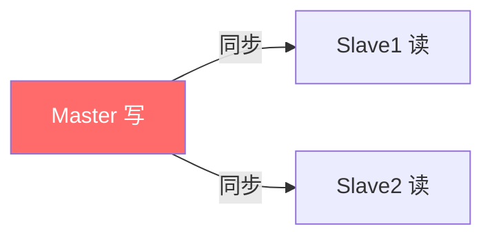

```bash
# 从节点配置
replicaof 10.0.0.1 6379
```

### 11.2 哨兵 Sentinel

监控主从，主挂了自动选新主。

```bash
# sentinel.conf
sentinel monitor mymaster 10.0.0.1 6379 2
sentinel down-after-milliseconds mymaster 5000
```

### 11.3 Cluster 分片集群

数据按 hash slot 分到多主，每主多从，水平扩展。

```bash
# 启动集群
redis-cli --cluster create 10.0.0.1:6379 ... --cluster-replicas 1
# 槽位 16384 个，按 key 的 CRC16 % 16384 分配
```

| 方案 | 适用 |
|------|------|
| 主从 | 读写分离、备份 |
| 哨兵 | 主自动故障转移 |
| Cluster | 数据量大、水平分片 |

> ❌ **常见坑点**：① 主从延迟导致读到旧数据。② Cluster 不支持跨槽多 key 事务/多 key 操作。③ 哨兵脑裂——多数派投票。④ 集群扩容要 reshard 迁槽。

> 💡 **本章深度讲解**：高可用三阶段——主从解决读扩展、哨兵解决主挂、Cluster 解决数据量。Cluster 用 16384 槽做分片，客户端路由。这是 Redis 从单机走向生产的必经之路。
>
> 📝 **本章精简总结**：① 主从读写分离；② 哨兵自动故障转移；③ Cluster 16384 槽分片；④ 跨槽限制。
>
> 🎯 **梯度练习题**：⭐ 哨兵解决什么问题？⭐⭐ Cluster 为什么是 16384 槽？⭐⭐⭐ 设计一个 Redis 高可用架构支撑百万 QPS。

---

## 十二、与 Python 集成、最佳实践与面试高频

### 12.1 redis-py 基础

```bash
pip install redis
```

```python
import redis

r = redis.Redis(host='127.0.0.1', port=6379,
                password='YourPass!2026', db=0, decode_responses=True)

r.set('user:1001', '{"name":"张三"}', ex=3600)
print(r.get('user:1001'))
# 预期：{"name":"张三"}

r.incr('article:1:views')
print(r.get('article:1:views'))
```

### 12.2 连接池

```python
pool = redis.ConnectionPool(host='127.0.0.1', port=6379,
                             password='YourPass!2026', max_connections=50)
r = redis.Redis(connection_pool=pool)
```

### 12.3 分布式锁（Python）

```python
import uuid

class RedisLock:
    def __init__(self, r, key, ttl=30):
        self.r = r
        self.key = key
        self.ttl = ttl
        self.token = str(uuid.uuid4())

    def acquire(self):
        return self.r.set(self.key, self.token, nx=True, ex=self.ttl)

    def release(self):
        lua = """if redis.call('get',KEYS[1])==ARGV[1]
                  then return redis.call('del',KEYS[1]) else return 0 end"""
        return self.r.eval(lua, 1, self.key, self.token)

lock = RedisLock(r, 'lock:order:1001')
if lock.acquire():
    try:
        print('do work')
    finally:
        lock.release()
```

### 12.4 缓存设计模式

```python
# Cache-Aside：先查缓存，miss 再查 DB 并回填
def get_user(uid):
    key = f'user:{uid}'
    data = r.get(key)
    if data:
        return data
    data = db_query_user(uid)      # 查 MySQL
    r.set(key, data, ex=3600)
    return data
```

### 12.5 最佳实践清单

> ✅ ① key 设计 `业务:类型:id`，如 `user:1001:profile`。② 大 key 拆分。③ 批量用 pipeline。④ 永远设过期时间。⑤ 缓存与 DB 双写：先更 DB 再删缓存。⑥ 监控 bigkey、热 key、内存。

### 12.6 常见坑点 Top

| 坑 | 解法 |
|----|------|
| 缓存穿透 | 布隆过滤器/空值 |
| 缓存击穿 | 互斥锁/热点不过期 |
| 缓存雪崩 | 随机过期 |
| 大 key | 拆分、HSCAN |
| 热 key | 本地缓存/分片 |
| 双写不一致 | 先更 DB 再删缓存 |
| KEYS * | 禁用，用 SCAN |

### 12.7 面试高频汇总

1. Redis 为什么快？（内存/单线程/多路复用）
2. RDB 和 AOF 区别？
3. 缓存穿透/击穿/雪崩？
4. 分布式锁怎么实现？
5. 过期策略与淘汰策略？
6. 跳表原理？
7. Cluster 分片原理？
8. Redis 事务支持回滚吗？
9. 缓存与 DB 一致性？
10. 热 key 怎么处理？

> 💡 **本章深度讲解**：从 Python 集成到缓存设计，你完成了 Redis 的工程闭环。最核心的是 Cache-Aside 模式与分布式锁。Redis 能力的上限不在命令，而在"什么时候用什么结构、怎么和 MySQL 配合"。
>
> 📝 **本章精简总结**：① redis-py 连接池；② 分布式锁 SET NX EX + Lua 释放；③ Cache-Aside；④ 三大缓存问题；⑤ 面试 10 题。
>
> 🎯 **梯度练习题**：⭐ 为什么禁 KEYS *？⭐⭐ Cache-Aside 为什么先更 DB 再删缓存？⭐⭐⭐ 用 Python 实现一个带续期的分布式锁。

---

> **全文结语**：Redis 的本质是"用内存和高效数据结构，把热数据挡在数据库前面"。掌握本文九大结构与持久化、淘汰、集群，你就掌握了后端缓存体系的核心。记住：Redis 不是万能数据库，它是"快但会丢"的缓存层——用好它的关键，是想清楚"哪些数据该放缓存、过期时间怎么设、和 DB 怎么一致"。


---

## 十三、Redis 命令速查与生产实战场景

### 13.1 通用命令

```bash
# key 管理
KEYS pattern          # 生产禁用！遍历所有 key
SCAN 0 MATCH user:* COUNT 100   # 游标迭代，生产用
DEL key
EXISTS key
EXPIRE key 60
PEXPIRE key 60000
TTL key                # 剩余秒，-1 永久，-2 不存在
PERSIST key            # 移除过期
TYPE key
RANDOMKEY
RENAME old new
MOVE key db

# 服务
PING
INFO
DBSIZE
FLUSHDB                # 清空当前库（危险）
FLUSHALL               # 清空所有库（危险）
CONFIG GET maxmemory
CONFIG SET maxmemory 2gb
SLOWLOG GET 10
```

```bash
# SCAN 生产安全遍历（不阻塞）
127.0.0.1:6379> SCAN 0 MATCH user:* COUNT 100
1) "123"               # 下一轮游标，0 表示结束
2) 1) "user:1001"
   2) "user:1002"
```

### 13.2 场景：全站排行榜

```python
# 阅读量排行榜：每篇文章阅读 +1
import redis
r = redis.Redis(decode_responses=True)

def incr_read(article_id):
    r.zincrby("rank:read:all", 1, article_id)

# 取 Top 10
top = r.zrevrange("rank:read:all", 0, 9, withscores=True)
# 预期：[("article:1", 10234.0), ("article:2", 9876.0), ...]

# 我的名次
my_rank = r.zrevrank("rank:read:all", "article:1")
# 预期：0（第一名）
```

```python
# 周榜：每天一个 ZSet，周末合并
def daily_read(article_id, day):
    r.zincrby(f"rank:read:{day}", 1, article_id)

# 合并本周 7 天到总榜
days = [f"rank:read:202609{d:02d}" for d in range(1, 8)]
r.zunionstore("rank:read:week", days)
top = r.zrevrange("rank:read:week", 0, 9, withscores=True)
```

### 13.3 场景：点赞与点踩

```python
# 用 Set 存点赞用户，ZSet 存点赞数排序
def like(user_id, article_id):
    key = f"like:{article_id}"
    added = r.sadd(key, user_id)
    if added:
        r.zincrby("rank:hot", 1, article_id)
    return added

def unlike(user_id, article_id):
    key = f"like:{article_id}"
    removed = r.srem(key, user_id)
    if removed:
        r.zincrby("rank:hot", -1, article_id)

def has_liked(user_id, article_id):
    return r.sismember(f"like:{article_id}", user_id)
```

### 13.4 场景：验证码与登录

```python
import time, random

def send_sms_code(phone):
    code = f"{random.randint(100000,999999)}"
    key = f"sms:{phone}"
    if r.ttl(key) and r.ttl(key) > 50:
        return "发送太频繁"
    r.set(key, code, ex=300)   # 5 分钟有效
    return code

def verify_sms_code(phone, code):
    return r.get(f"sms:{phone}") == code
```

### 13.5 场景：分布式 Session

```python
def login(user_id):
    token = f"tk-{random.getrandbits(64):x}"
    r.set(f"session:{token}", user_id, ex=1800)
    return token

def current_user(token):
    return r.get(f"session:{token}")

def logout(token):
    r.delete(f"session:{token}")
```

### 13.6 场景：接口限流

```python
def rate_limit(user_id, limit=100, window=60):
    key = f"rate:{user_id}:{int(time.time())//window}"
    cnt = r.incr(key)
    if cnt == 1:
        r.expire(key, window)
    return cnt <= limit
# 第 1 次 incr 返回 1 并设过期，后续复用 key
```

### 13.7 场景：购物车

```python
def add_to_cart(user_id, sku, qty=1):
    r.hincrby(f"cart:{user_id}", sku, qty)

def cart_items(user_id):
    items = r.hgetall(f"cart:{user_id}")
    return items   # {sku: qty}

def checkout(user_id):
    items = r.hgetall(f"cart:{user_id}")
    r.delete(f"cart:{user_id}")
    return items
```

### 13.8 场景：附近的人

```python
def add_visitor(uid, lng, lat):
    r.geoadd("people", lng, lat, uid)

def nearby(lng, lat, radius=5):
    return r.georadius("people", lng, lat, radius, unit="km",
                       withdist=True, withcoord=True, count=20)
```

> ❌ **常见坑点**：① 生产用 KEYS * 遍历百万 key 阻塞——必须 SCAN。② 限流用 INCR 但忘设过期，key 永久存在。③ 购物车 Hash 不设过期，长期堆积。④ 分布式锁忘释放，业务异常要在 finally 释放。

> 💡 **本章深度讲解**：这一章把前几章的结构串成 8 个真实业务场景。Redis 的工程价值在于"一个需求一句话实现"——排行榜 ZSet、限流 INCR、购物车 Hash、附近的人 Geo。选型对了，代码量是 MySQL 的十分之一。
>
> 📝 **本章精简总结**：① SCAN 替代 KEYS；② 排行榜 ZSet；③ 点赞 Set+ZSet；④ 验证码/Session String+EX；⑤ 限流 INCR+EXPIRE；⑥ 购物车 Hash；⑦ 附近的人 Geo。
>
> 🎯 **梯度练习题**：⭐ 为什么生产禁用 KEYS *？⭐⭐ 滑动窗口限流怎么用 ZSet 实现？⭐⭐⭐ 设计一个"文章点赞+收藏+浏览量"完整缓存方案。

---

## 十四、Redis 性能优化与监控

### 14.1 慢查询

```bash
slowlog-log-slower-than 10000   # 超过 10ms 记录（微秒）
slowlog-max-len 128
SLOWLOG GET 10
SLOWLOG RESET
```

### 14.2 大 key 排查

```bash
# redis-cli --bigkeys 扫描大 key
redis-cli -a YourPass!2026 --bigkeys
# 用 MEMORY USAGE 看单 key 内存
MEMORY USAGE user:1001
```

| 类型 | 大 key 阈值 |
|------|------------|
| String | > 10KB |
| Hash/List/Set/ZSet | > 5000 元素 |

```bash
# 大 key 拆分示例：把大 Hash 按字段分片
# user:1001:profile -> user:1001:p0 / p1 ...
```

### 14.3 热 key

单个 key QPS 过高，打到单节点。

> 解法：① 本地缓存（Caffeine）；② key 分片：`hotkey:{0..100}` 分散读；③ 读写分离。

### 14.4 pipeline 批量

```python
# 不用 pipeline：100 次往返
for i in range(100):
    r.get(f"user:{i}")

# 用 pipeline：1 次往返
pipe = r.pipeline()
for i in range(100):
    pipe.get(f"user:{i}")
results = pipe.execute()
# 预期：100 个结果，网络往返从 100 次降到 1 次
```

### 14.5 内存优化

```bash
# 1. 选择小编码：短数据自动 listpack
# 2. 设过期时间
# 3. 压缩：list-compress-depth
# 4. 用 int 编码存计数器
hash-max-listpack-entries 128
set-max-intset-entries 512
```

### 14.6 监控指标

| 指标 | 说明 |
|------|------|
| used_memory | 已用内存 |
| ops_per_sec | QPS |
| connected_clients | 连接数 |
| keyspace_hits/misses | 命中率 |
| expired_keys | 过期 key 数 |
| evicted_keys | 淘汰 key 数 |

```bash
INFO memory
INFO stats
INFO clients
```

> ❌ **常见坑点**：① 没开监控，内存满了才告警。② 大 key 拆分后没删旧 key。③ pipeline 滥用，单次塞太多命令。④ 连接数没设上限，打满。

> 💡 **本章深度讲解**：性能优化的核心是"减少网络往返（pipeline）、减少单 key 大小（拆分大 key）、合理过期（避免内存满）"。监控命中率是 Redis 健康度第一指标——命中率低说明缓存没起到作用。
>
> 📝 **本章精简总结**：① 慢查询日志；② 大 key 拆分；③ 热 key 分片；④ pipeline 批量；⑤ 监控命中率/内存/连接。
>
> 🎯 **梯度练习题**：⭐ pipeline 为什么快？⭐⭐ 缓存命中率低怎么排查？⭐⭐⭐ 设计一个 Redis 监控大盘。


---

## 十五、Redis 面试高频详解与常见坑点

### 15.1 Redis 为什么这么快

1. **纯内存**：数据在内存，避免磁盘 IO。
2. **单线程**：命令执行单线程，无锁竞争、无上下文切换。
3. **IO 多路复用**：epoll 单线程处理万级连接。
4. **高效数据结构**：SDS、跳表、listpack、quicklist。
5. **6.0 网络多线程**：网络 IO 多线程，命令仍单线程。

> 🎯 面试：Redis 单线程为什么还快？答：瓶颈不在 CPU 而在内存/网络，单线程避免了多线程锁与切换开销，IO 多路复用处理高并发连接。

### 15.2 Redis 与 Memcached 区别

| 维度 | Redis | Memcached |
|------|-------|-----------|
| 数据结构 | 9 种 | 仅 String |
| 持久化 | RDB/AOF | 无 |
| 集群 | Cluster | 客户端分片 |
| 线程模型 | 单线程命令 | 多线程 |
| 适用 | 复杂场景 | 纯缓存 |

### 15.3 缓存与数据库一致性

> 🎯 面试：缓存和 DB 双写怎么保证一致？
答：① 先更新 DB 再删缓存（Cache-Aside）；② 延迟双删；③ 订阅 binlog（Canal）异步删缓存；④ 给缓存设短过期时间兜底。

```python
def update_user(uid, new_data):
    db_update(uid, new_data)       # 1. 先更 DB
    r.delete(f"user:{uid}")        # 2. 再删缓存
```

### 15.4 缓存穿透/击穿/雪崩

| 问题 | 场景 | 解法 |
|------|------|------|
| 穿透 | 查不存在 | 布隆过滤器、缓存空值 |
| 击穿 | 热点 key 过期 | 互斥锁、热点不过期 |
| 雪崩 | 大量 key 同时过期 | 随机过期、多级缓存、熔断 |

### 15.5 分布式锁完整实现要点

1. `SET lock uuid NX EX 30` 原子加锁。
2. value 放 UUID，释放时比对。
3. 释放用 Lua 保证原子。
4. 业务超时要续期（Redisson 看门狗）。
5. 主从切换锁丢失——RedLock（争议大，生产用 Redisson）。

### 15.6 常见坑点 Top 20

| # | 坑点 | 解法 |
|---|------|------|
| 1 | KEYS * 阻塞 | SCAN |
| 2 | 大 key | 拆分 |
| 3 | 热 key | 本地缓存/分片 |
| 4 | 缓存穿透 | 布隆 |
| 5 | 缓存击穿 | 互斥锁 |
| 6 | 缓存雪崩 | 随机过期 |
| 7 | 双写不一致 | 先更DB再删缓存 |
| 8 | 锁误删 | UUID+Lua |
| 9 | 限流不设过期 | incr 后 expire |
| 10 | 事务当 ACID | Redis 事务不回滚 |
| 11 | Pub/Sub 丢消息 | 用 Stream |
| 12 | List 队列无 ACK | 用 Stream |
| 13 | 主从延迟 | 关键读走主 |
| 14 | 内存满 | 淘汰策略 |
| 15 | 连接泄漏 | 连接池 |
| 16 | pipeline 过大 | 分批 |
| 17 | 大 Hash HGETALL | HSCAN |
| 18 | 序列化开销 | 选高效序列化 |
| 19 | 超时设置 | 别用阻塞太久 |
| 20 | 未开持久化 | 重启丢数据 |

### 15.7 选型决策表

| 需求 | 推荐结构 |
|------|---------|
| 对象缓存 | String(JSON) 或 Hash |
| 计数器 | String INCR |
| 排行榜 | ZSet |
| 队列 | Stream |
| 去重/标签 | Set |
| 签到 | Bitmap |
| UV | HyperLogLog |
| 附近的人 | Geo |
| 分布式锁 | String SET NX EX |
| Session | String |

### 15.8 学习资源

- 《Redis 设计与实现》——底层数据结构圣经。
- 《Redis 开发与运维》——生产实战。
- 官方文档 redis.io/docs。
- Redis 源码：github.com/redis/redis。

> 💡 **本章深度讲解**：面试题本质都围绕"为什么快、缓存三问、分布式锁、持久化、集群"。把这些答透，Redis 面试基本满分。生产经验则来自踩坑——大 key、热 key、双写不一致，每个都要实战过才懂。
>
> 📝 **本章精简总结**：① Redis 快的 5 原因；② 与 Memcached 区别；③ 双写一致性；④ 三大缓存问题；⑤ 分布式锁要点；⑥ 20 个坑点；⑦ 选型决策表。
>
> 🎯 **梯度练习题**：⭐ Redis 为什么用单线程？⭐⭐ RedLock 争议在哪？⭐⭐⭐ 设计一个秒杀系统的 Redis 架构。


### 15.9 Redis 线程模型详解


Redis 6.0 前所有命令单线程执行。命令队列排队执行，天然无并发问题。6.0 把网络读写拆给多线程，但命令执行仍单线程。

```bash
# 查看连接与线程
INFO clients
INFO stats
```

### 15.10 RDB/AOF 选型实战

```bash
# 生产推荐配置（redis.conf）
appendonly yes
appendfsync everysec
aof-use-rdb-preamble yes

# RDB 按需
save 900 1
save 300 10
save 60 10000

# 内存告警
maxmemory 4gb
maxmemory-policy allkeys-lru
```

| 业务场景 | 推荐 |
|---------|------|
| 纯缓存（丢了无所谓） | 关闭 AOF，只 RDB |
| 持久队列 | AOF everysec |
| 会话存储 | AOF |
| 排行榜 | RDB 即可 |

### 15.11 缓存穿透：布隆过滤器

```python
# 简单布隆（用 Redis Bitmap + 多哈希）
def bloom_add(r, key, item):
    for h in hash_funcs(item):
        r.setbit(key, h, 1)

def bloom_exists(r, key, item):
    return all(r.getbit(key, h) for h in hash_funcs(item))
# 存在不一定准（误判），不存在一定准（不漏）
```

> 生产用 RedisBloom 模块：`BF.ADD` / `BF.EXISTS`。

### 15.12 缓存击穿：互斥锁重建

```python
def get_product(pid):
    data = r.get(f"product:{pid}")
    if data:
        return data
    # 拿锁重建
    lock = r.set(f"lock:product:{pid}", "1", nx=True, ex=10)
    if not lock:
        time.sleep(0.1)
        return get_product(pid)
    try:
        data = db_query(pid)
        r.set(f"product:{pid}", data, ex=300)
        return data
    finally:
        r.delete(f"lock:product:{pid}")
```

### 15.13 缓存雪崩：随机过期

```python
def cache_set(key, data, base=3600):
    # 基础 3600 秒 + 随机 0~300 秒，避免同时过期
    r.set(key, data, ex=base + random.randint(0, 300))
```

### 15.14 Redis 事务三命令

```bash
MULTI
SET k1 v1
LPUSH list1 a
INCR counter
EXEC
# 原子性：四条命令打包执行，中间不插其他客户端命令
```

注意：运行时某条命令报错（如对 list 用 INCR），已执行的不回滚。这是与 MySQL 事务最大区别。

### 15.15 Lua 脚本实战

```lua
-- 限流 Lua：原子判断+计数
local cnt = redis.call('INCR', KEYS[1])
if cnt == 1 then
    redis.call('EXPIRE', KEYS[1], ARGV[1])
end
if cnt > tonumber(ARGV[2]) then
    return 0
end
return 1
```

```python
# Python 调用 Lua
lua = """
local cnt = redis.call('INCR', KEYS[1])
if cnt == 1 then redis.call('EXPIRE', KEYS[1], ARGV[1]) end
if cnt > tonumber(ARGV[2]) then return 0 end
return 1
"""
limiter = r.register_script(lua)
ok = limiter(keys=[f"rate:{user_id}"], args=[60, 100])
```

### 15.16 主从同步流程

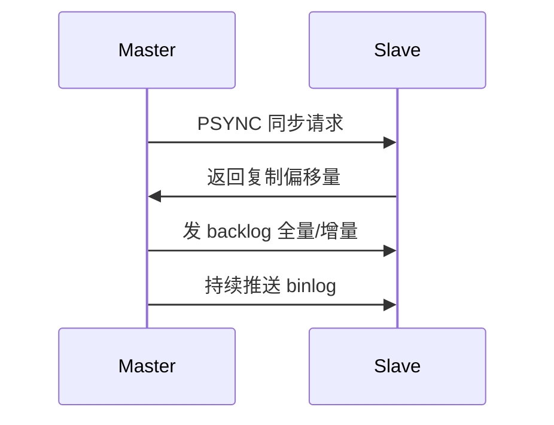

```bash
# 从节点
replicaof 10.0.0.1 6379
# 只读
replica-read-only yes
```

### 15.17 哨兵工作原理

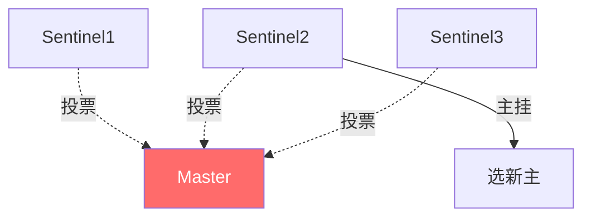

哨兵集群监控主节点，主观下线→客观下线（多数派）→选举新主。

### 15.18 Cluster 原理

```bash
# 16384 槽
HASH_SLOT = CRC16(key) % 16384
# 每个主节点负责一段槽
# 多 key 操作必须同槽（hashtag）
{user.1001}.name
{user.1001}.age
# {} 内相同，路由到同槽
```

### 15.19 常见生产事故复盘

| 事故 | 原因 | 教训 |
|------|------|------|
| 缓存雪崩 | 半夜批量过期 | 随机过期 |
| 主从不一致 | 读写分离读到旧 | 关键读走主 |
| 大 key 阻塞 | HGETALL 万字段 | HSCAN |
| 内存满 | 没设淘汰 | allkeys-lru |
| 锁误删 | 无 UUID | Lua 释放 |
| 队列丢消息 | Pub/Sub | Stream |

### 15.20 速查表

```bash
# String
SET/GET/DEL/EXPIRE/TTL/INCR/INCRBY
# Hash
HSET/HGET/HGETALL/HDEL/HINCRBY/HSCAN
# List
LPUSH/RPUSH/LPOP/RPOP/LRANGE/BLPOP
# Set
SADD/SREM/SMEMBERS/SINTER/SUNION/SDIFF
# ZSet
ZADD/ZREM/ZSCORE/ZREVRANGE/ZRANGEBYSCORE/ZINCRBY
# Bitmap
SETBIT/GETBIT/BITCOUNT/BITOP
# HyperLogLog
PFADD/PFCOUNT/PFMERGE
# Geo
GEOADD/GEORADIUS/GEODIST
# Stream
XADD/XREADGROUP/XACK/XCLAIM
```

> 💡 **本章深度讲解**：这一节把面试和生产细节补全。线程模型、持久化选型、布隆、互斥锁、Lua、主从哨兵 Cluster——每个都是高频考点。生产事故复盘比理论更有价值。
>
> 📝 **本章精简总结**：① 6.0 网络多线程命令单线程；② 持久化按业务选；③ 布隆/互斥锁/随机过期三解法；④ Lua 原子；⑤ 主从哨兵 Cluster；⑥ 速查表。
>
> 🎯 **梯度练习题**：⭐ Redis 6.0 多线程改了什么？⭐⭐ 为什么 Cluster 是 16384 槽？⭐⭐⭐ 用 Lua 实现一个原子限流。


### 15.21 完整项目：文章浏览系统

```python
"""文章浏览/点赞/收藏/评论计数，全部走 Redis"""
import redis
import time

r = redis.Redis(host='127.0.0.1', port=6379, decode_responses=True)

# ---------- 浏览量 ----------
def incr_view(article_id):
    """浏览量 +1，同时更新热搜榜"""
    r.hincrby(f"article:{article_id}", "views", 1)
    r.zincrby("rank:hot", 1, article_id)

def get_view(article_id):
    return int(r.hget(f"article:{article_id}", "views") or 0)

# ---------- 点赞 ----------
def like(article_id, user_id):
    if r.sadd(f"like:{article_id}", user_id):
        r.hincrby(f"article:{article_id}", "likes", 1)
        return True
    return False

def unlike(article_id, user_id):
    if r.srem(f"like:{article_id}", user_id):
        r.hincrby(f"article:{article_id}", "likes", -1)
        return True
    return False

def has_liked(article_id, user_id):
    return r.sismember(f"like:{article_id}", user_id)

# ---------- 收藏 ----------
def collect(user_id, article_id):
    r.zadd(f"collect:{user_id}", {article_id: int(time.time())})

def my_collects(user_id):
    return r.zrevrange(f"collect:{user_id}", 0, -1)

# ---------- 评论 ----------
def add_comment(article_id, user_id, content):
    comment_id = r.incr("comment:id")
    pipe = r.pipeline()
    pipe.hset(f"comment:{comment_id}", mapping={
        "id": comment_id, "user": user_id, "content": content,
        "ts": int(time.time())
    })
    pipe.lpush(f"comments:{article_id}", comment_id)
    pipe.hincrby(f"article:{article_id}", "comments", 1)
    pipe.execute()
    return comment_id

def get_comments(article_id, start=0, end=19):
    ids = r.lrange(f"comments:{article_id}", start, end)
    return [r.hgetall(f"comment:{i}") for i in ids]
```

```python
# 使用示例
incr_view(1001)
like(1001, 2001)
add_comment(1001, 2001, "写得不错！")
print(get_view(1001))          # 1
print(get_comments(1001))      # [{'content': '写得不错！', ...}]
```

### 15.22 完整项目：签到系统

```python
def sign_in(user_id, year_month, day):
    """用户签到：day 作为偏移量"""
    key = f"sign:{user_id}:{year_month}"
    return r.setbit(key, day - 1, 1)

def has_signed(user_id, year_month, day):
    return r.getbit(f"sign:{user_id}:{year_month}", day - 1) == 1

def signed_days(user_id, year_month):
    return r.bitcount(f"sign:{user_id}:{year_month}")

def streak(user_id, year_month, today):
    """连续签到天数：从今天往前数"""
    key = f"sign:{user_id}:{year_month}"
    cnt = 0
    d = today - 1
    while d >= 0 and r.getbit(key, d):
        cnt += 1
        d -= 1
    return cnt
```

### 15.23 完整项目：秒杀系统

```python
def seckill_init(product_id, stock):
    r.set(f"seckill:stock:{product_id}", stock)
    r.delete(f"seckill:users:{product_id}")

def seckill(product_id, user_id):
    # 1. 一人一单
    if not r.sadd(f"seckill:users:{product_id}", user_id):
        return "重复抢购"
    # 2. 原子扣库存（Lua）
    lua = """
    local stock = tonumber(redis.call('GET', KEYS[1]))
    if stock <= 0 then return 0 end
    redis.call('DECR', KEYS[1])
    return 1
    """
    ok = r.eval(lua, 1, f"seckill:stock:{product_id}")
    if ok:
        r.lpush("seckill:orders", f"{product_id}:{user_id}")
        return "抢购成功"
    r.srem(f"seckill:users:{product_id}", user_id)
    return "已售罄"
```

### 15.24 Feed 流：推拉结合

```python
# 关注
def follow(user_id, target_id):
    r.sadd(f"follow:{user_id}", target_id)
    r.sadd(f"fans:{target_id}", user_id)

# 发推：推给粉丝（写扩散）
def post(user_id, content):
    pid = r.incr("post:id")
    r.hset(f"post:{pid}", "content", content, "author", user_id, "ts", int(time.time()))
    fans = r.smembers(f"fans:{user_id}") or [user_id]
    pipe = r.pipeline()
    for f in fans:
        pipe.zadd(f"inbox:{f}", {pid: int(time.time())})
    pipe.execute()

# 读自己的收件箱
def my_feed(user_id, start=0, end=19):
    pids = r.zrevrange(f"inbox:{user_id}", start, end)
    return [r.hgetall(f"post:{p}") for p in pids]
```

### 15.25 延时队列完整实现

```python
def delay_push(task_id, execute_ts):
    r.zadd("delay:queue", {task_id: execute_ts})

def delay_worker():
    """轮询到期任务"""
    now = int(time.time())
    lua = """
    local tasks = redis.call('ZRANGEBYSCORE', KEYS[1], 0, ARGV[1], 'LIMIT', 0, 1)
    if #tasks > 0 then redis.call('ZREM', KEYS[1], tasks[1]) end
    return tasks
    """
    task = r.eval(lua, 1, "delay:queue", now)
    if task:
        return task[0]
    return None
```

### 15.26 滑动窗口限流

```python
def sliding_rate_limit(user_id, max_count=100, window=60):
    key = f"rl:{user_id}"
    now = int(time.time() * 1000)
    window_start = now - window * 1000
    pipe = r.pipeline()
    pipe.zremrangebyscore(key, 0, window_start)   # 清旧
    pipe.zadd(key, {f"{now}": now})               # 加当前
    pipe.zcard(key)                                 # 计数
    pipe.expire(key, window + 1)
    _, _, count, _ = pipe.execute()
    return count <= max_count
```

### 15.27 分布式 ID（号段模式）

```python
def next_id(biz):
    """一次取一段，减少 DB 访问"""
    max_id = r.incrby(f"idseg:{biz}", 1000)
    return max_id - 1000 + 1   # 返回本号段第一个
```

### 15.28 计数器排行榜完整

```python
def rank_demo():
    pipe = r.pipeline()
    for name, score in [("p1", 100), ("p2", 200), ("p3", 150)]:
        pipe.zadd("rank", {name: score})
    pipe.execute()
    # Top3
    print(r.zrevrange("rank", 0, 2, withscores=True))
    # p2 名次
    print(r.zrevrank("rank", "p2"))
    # 分数区间
    print(r.zrangebyscore("rank", 120, 300))
```

> ❌ **常见坑点**：① 秒杀扣库存不用 Lua 会超卖。② Feed 流写扩散，大V 粉丝百万，写放大严重——大V 走读扩散。③ 延时队列轮询有延迟。④ 滑动窗口用 ZSet 内存高。

> 💡 **本章深度讲解**：这一章是"把 Redis 用到真实产品里"。文章系统、签到、秒杀、Feed、延时队列、限流、号段 ID——每个都是面试和工作中的真实场景。把这些代码跑通，你就具备了用 Redis 设计高并发系统的能力。
>
> 📝 **本章精简总结**：① 文章系统 Hash+Set+ZSet；② 签到 Bitmap；③ 秒杀 Lua 原子扣减；④ Feed 推拉结合；⑤ 延时队列 ZSet；⑥ 滑动窗口 ZSet；⑦ 号段 ID。
>
> 🎯 **梯度练习题**：⭐ 秒杀为什么要用 Lua？⭐⭐ Feed 推拉怎么结合？⭐⭐⭐ 实现一个完整签到+连续签到奖励。


### 15.29 SDS 简单动态字符串

Redis 不直接用 C 字符串，而是自研 SDS：

| 属性 | 作用 |
|------|------|
| len | 已用长度 |
| alloc | 分配总长度 |
| flags | 头类型 |
| buf[] | 数据 |

优点：O(1) 取长度、二进制安全、空间预分配、避免缓冲区溢出。

```bash
# 字符串优化
SET s "hello"
STRLEN s          # 5
APPEND s " world"
GET s             # hello world
```

### 15.30 listpack 压缩列表

替代 ziplist（7.0），紧凑的字节数组，存 Hash/ZSet/List 的小元素。省内存，但中间插入 O(n)。

### 15.31 跳表深度

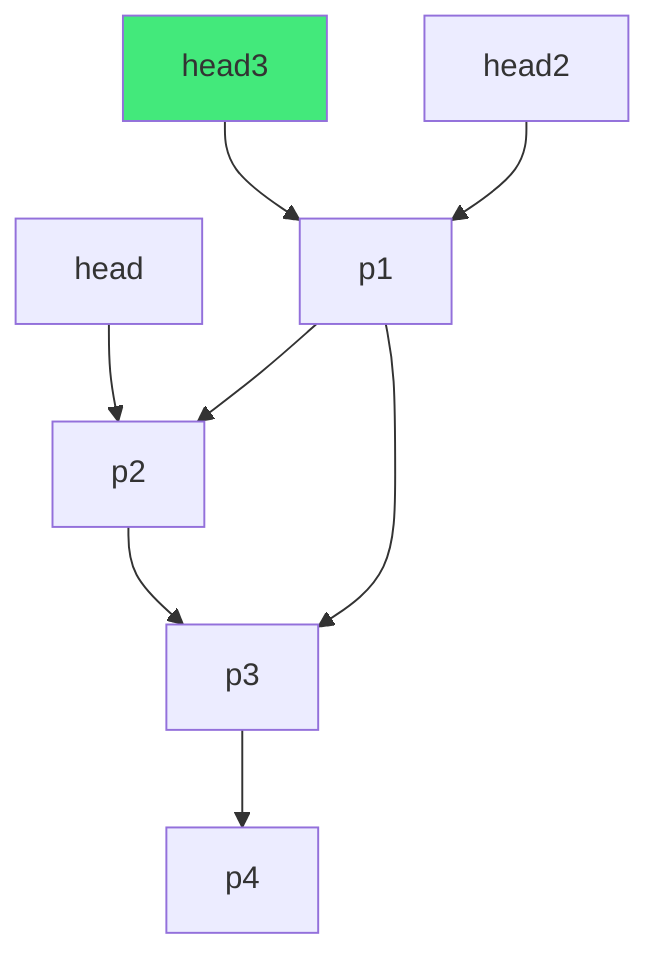

查找：从最高层开始，往右走不通就下沉。期望层数 O(log n)。随机算法决定层数。

### 15.32 intset 整数集合

全整数 Set 底层，有序数组，二分查找。元素超限自动升级（int16→int32→int64）。

### 15.33 quicklist 快速列表

List 底层：双向链表，每个节点是 listpack。兼顾链表灵活与 listpack 紧凑。

### 15.34 对象元数据

```bash
OBJECT ENCODING key     # 编码
OBJECT IDLETIME key     # 空闲秒（用于 LRU 近似）
OBJECT REFCOUNT key      # 引用计数
```

### 15.35 缓存设计权衡

| 权衡 | 说明 |
|------|------|
| 命中率 vs 内存 | 命中率低说明缓存浪费 |
| 一致性 vs 性能 | 强一致要实时删缓存 |
| TTL vs 永久 | 永久 key 要主动清理 |
| 本地缓存 vs Redis | 本地最快但不共享 |

### 15.36 热点 key 探测

```bash
# redis-cli 热 key
redis-cli --hotkeys
# 需开 LFU 淘汰策略
```

### 15.37 bigkey 拆分实践

```python
# 大 Hash 拆成多个小 Hash
# 原：user:1001:profile 含 1000 字段
# 拆：user:1001:p0, user:1001:p1 ...
def split_key(prefix, fields):
    for i, (f, v) in enumerate(fields.items()):
        r.hset(f"{prefix}:p{i % 10}", f, v)
```

### 15.38 序列化选择

| 序列化 | 大小 | 速度 |
|--------|------|------|
| JSON | 大 | 慢 |
| MessagePack | 中 | 快 |
| Protobuf | 小 | 最快 |

### 15.39 Redis 6/7 新特性

- 6.0：网络多线程、ACL 细粒度权限。
- 7.0：Function（Lua 函数持久化）、listpack 替代 ziplist、多部分 AOF。

### 15.40 ACL 权限

```bash
ACL SETRUN user1 on >pass ~user:* +get +set
# 限制 user1 只能访问 user:* 且只能 get/set
```

> 💡 **本章深度讲解**：底层数据结构（SDS/listpack/跳表/intset/quicklist）是面试深挖点。理解它们就理解了 Redis"为什么省内存、为什么快"。生产上要关注编码切换阈值，避免大元素退回 hashtable 浪费内存。
>
> 📝 **本章精简总结**：① SDS O(1) 取长；② listpack 省内存；③ 跳表 O(log n)；④ intset 升级；⑤ quicklist；⑥ 编码用 OBJECT ENCODING 查；⑦ 序列化选型。
>
> 🎯 **梯度练习题**：⭐ SDS 比 C 字符串好在哪？⭐⭐ 跳表为什么不用红黑树？⭐⭐⭐ 分析一个大 key 的内存占用并给出拆分方案。


### 15.41 Redis 启动参数完整模板

```ini
# redis.conf 生产模板
bind 0.0.0.0
port 6379
protected-mode yes
requirepass YourStrongPass!2026

# 内存
maxmemory 4gb
maxmemory-policy allkeys-lru
maxmemory-samples 10

# 持久化
appendonly yes
appendfsync everysec
aof-use-rdb-preamble yes

# 慢日志
slowlog-log-slower-than 10000
slowlog-max-len 256

# 客户端
maxclients 10000
timeout 300

# 复制
replica-read-only yes
```

### 15.42 常用运维命令

```bash
# 查看
INFO
INFO memory
INFO stats
INFO replication
CLIENT LIST
CLIENT KILL ip:port

# 配置
CONFIG GET *
CONFIG SET maxmemory 8gb
CONFIG REWRITE

# 安全
SHUTDOWN NOSAVE    # 不保存直接关
DEBUG SEGFAULT      # 生产禁用！
```

### 15.43 备份恢复

```bash
# BGSAVE 后台快照
BGSAVE
LASTSAVE

# 恢复：把 dump.rdb 放数据目录重启
# AOF 恢复：appendonly.aof 放目录重启自动回放
```

### 15.44 数据迁移

```bash
# 迁移到新实例
redis-cli -h old --rdb dump.rdb
# 或用 redis-shake 工具
```

### 15.45 监控告警指标

| 指标 | 告警阈值 |
|------|---------|
| used_memory | > 80% maxmemory |
| evicted_keys | 持续增长 |
| keyspace_misses | 命中率 < 90% |
| blocked_clients | > 0 |
| connected_clients | > 80% maxclients |
| replication lag | > 1s |
| slowlog | 突增 |

### 15.46 常见错误排查

```bash
# 连接拒绝
# 1. 检查 bind/protected-mode
# 2. 检查密码
# 3. 检查 maxclients

# OOM
# 1. INFO memory 看占用
# 2. --bigkeys 找大 key
# 3. 调淘汰策略
redis-cli -a pass --bigkeys
```

### 15.47 完整 Python 项目：缓存层封装

```python
import json
import redis
import time
import hashlib

class Cache:
    def __init__(self, redis_url="redis://localhost:6379/0"):
        self.r = redis.Redis.from_url(redis_url, decode_responses=True)

    def _key(self, ns, ident):
        return f"{ns}:{ident}"

    def get_json(self, ns, ident):
        v = self.r.get(self._key(ns, ident))
        return json.loads(v) if v else None

    def set_json(self, ns, ident, data, ex=3600):
        self.r.set(self._key(ns, ident), json.dumps(data, ensure_ascii=False),
                    ex=ex + hashlib.md5(ident.encode()).digest()[0] % 300)

    def delete(self, ns, ident):
        self.r.delete(self._key(ns, ident))

    def cache_asides(self, ns, ident, loader, ex=3600):
        """先查缓存，miss 调 loader 重建"""
        v = self.get_json(ns, ident)
        if v is not None:
            return v
        v = loader(ident)
        if v is not None:
            self.set_json(ns, ident, v, ex)
        return v
```

```python
# 使用
cache = Cache()
def load_user(uid):
    return {"id": uid, "name": f"user{uid}"}

user = cache.cache_asides("user", 1001, load_user)
print(user)
# 预期：{'id': 1001, 'name': 'user1001'}
```

### 15.48 缓存预热

```python
def warmup():
    """启动时加载热点数据"""
    hot = ["product:1", "product:2", "config:home"]
    for k in hot:
        if not r.exists(k):
            data = db_query(k)
            r.set(k, data, ex=3600)
```

### 15.49 降级与熔断

```python
def get_with_fallback(key, loader):
    try:
        v = r.get(key)
        if v:
            return json.loads(v)
    except redis.RedisError:
        pass   # Redis 挂了直接走 DB
    return loader()
```

### 15.50 面试题：Redis 持久化选型

> 问：电商订单系统用 Redis 缓存，宕机能丢吗？答：订单状态不能丢，关键状态走 DB；商品信息可重建，纯缓存可关 AOF。折中：混合持久化 everysec。

### 15.51 面试题：为什么 Redis 单线程还能处理高并发

答：IO 多路复用 + 内存操作 + 无锁。epoll 一次等待多个 fd，就绪就处理。单线程避免了多核竞争。

### 15.52 面试题：Redis 事务为什么不支持回滚

答：Redis 作者认为"需要回滚就用 MySQL"，为了性能和简单性，Redis 事务只做"打包执行"，不做错误回滚。这是设计取舍。

### 15.53 面试题：缓存预热有必要吗

答：有。大促前把热点商品、首页配置预热，避免启动瞬间击穿。

### 15.54 面试题：Redis 怎么和 MySQL 配合

答：Cache-Aside：读先查 Redis，miss 查 MySQL 并回填；写先更新 MySQL 再删 Redis。延迟双删或 binlog 订阅保证一致。

### 15.55 面试题：BigKey 危害

答：① 阻塞单线程；② 网络阻塞；③ 集群迁移慢。解法：拆分、异步删（UNLINK）。

```bash
UNLINK bigkey    # 异步删除，不阻塞
```

### 15.56 面试题：热 Key 危害与解法

答：单 key 流量集中打满单节点。解法：本地缓存、key 分片（加随机后缀）、读写分离。

> 💡 **本章深度讲解**：运维与封装是 Redis 从"会用"到"用好"的跨越。启动模板、监控指标、Cache 封装、预热降级——这些是生产经验。面试题则覆盖了持久化、线程模型、事务、一致性等高频点。
>
> 📝 **本章精简总结**：① 启动模板；② 监控指标；③ Cache-Aside 封装；④ 预热降级；⑤ UNLINK 异步删大 key；⑥ 面试题。
>
> 🎯 **梯度练习题**：⭐ UNLINK 和 DEL 区别？⭐⭐ 缓存预热怎么做？⭐⭐⭐ 封装一个支持降级的缓存层。


### 15.57 完整场景：排行榜系统设计

```python
"""全站积分排行榜：日榜/周榜/总榜"""
class RankSystem:
    def add_score(self, user, score):
        pipe = r.pipeline()
        pipe.zincrby("rank:total", score, user)
        pipe.zincrby(f"rank:daily:{self._today()}", score, user)
        pipe.execute()

    def top_n(self, board="rank:total", n=100):
        return r.zrevrange(board, 0, n-1, withscores=True)

    def rank_of(self, user, board="rank:total"):
        return r.zrevrank(board, user)

    def _today(self):
        return time.strftime("%Y%m%d")
```

### 15.58 完整场景：共同关注

```python
def common_follow(u1, u2):
    return r.sinter(f"follow:{u1}", f"follow:{u2}")

def recommend(u):
    """推荐：我的粉丝的粉丝减去我已关注"""
    my_fans = r.smembers(f"fans:{u}")
    rec = set()
    for f in my_fans:
        rec |= r.smembers(f"fans:{f}")
    rec -= r.smembers(f"follow:{u}")
    rec.discard(u)
    return list(rec)
```

### 15.59 完整场景：标签系统

```python
def tag_user(tag, user):
    r.sadd(f"tag:{tag}", user)
    r.sadd(f"usertags:{user}", tag)

def users_with_tags(*tags):
    """同时拥有所有标签的用户"""
    keys = [f"tag:{t}" for t in tags]
    return r.sinter(keys)
```

### 15.60 完整场景：去重队列

```python
def dedup_push(queue, item):
    """item 不重复才入队"""
    if r.sadd(f"seen:{queue}", item):
        r.rpush(queue, item)
        return True
    return False
```

### 15.61 完整场景：简单限流（计数器）

```python
def fixed_window(uid, limit=100, window=60):
    key = f"fw:{uid}:{int(time.time())//window}"
    cnt = r.incr(key)
    if cnt == 1:
        r.expire(key, window)
    return cnt <= limit
```

### 15.62 完整场景：分布式锁（带续期）

```python
class WatchDogLock:
    def __init__(self, key, ttl=30):
        self.key = key
        self.ttl = ttl
        self.token = str(uuid.uuid4())
    def acquire(self):
        return r.set(self.key, self.token, nx=True, ex=self.ttl)
    def renew(self):
        return r.eval(
            "if redis.call('get',KEYS[1])==ARGV[1] then return redis.call('expire',KEYS[1],ARGV[2]) else return 0 end",
            1, self.key, self.token, self.ttl)
    def release(self):
        r.eval(
            "if redis.call('get',KEYS[1])==ARGV[1] then return redis.call('del',KEYS[1]) else return 0 end",
            1, self.key, self.token)
```

### 15.63 完整场景：消息队列（Stream）

```python
def produce(stream, msg):
    return r.xadd(stream, msg)

def consume_group(stream, group, consumer):
    msgs = r.xreadgroup(group, consumer, {stream: ">"}, count=10, block=3000)
    for _, items in msgs or []:
        for mid, fields in items:
            try:
                handle(fields)
                r.xack(stream, group, mid)
            except Exception:
                pass  # 进 pending
```

### 15.64 完整场景：发布订阅

```python
# 发布
r.publish("news", "hello world")
# 订阅（另起线程）
p = r.pubsub()
p.subscribe("news")
for msg in p.listen():
    print(msg)
```

### 15.65 Redis 与 MySQL 缓存一致性

```python
def update_with_cache(uid, data):
    db.update(uid, data)          # 1. 更新 DB
    r.delete(f"user:{uid}")        # 2. 删缓存
    # 延迟双删：并发场景
    time.sleep(0.5)
    r.delete(f"user:{uid}")
```

### 15.66 面试题：如何设计一个点赞系统

答：① Set 存已点赞用户去重；② ZSet 存点赞数排序；③ 计数用 Hash；④ 防刷用限流。

### 15.67 面试题：如何设计排行榜

答：① ZSet 存分数；② 日榜 ZADD；③ 周榜 ZUNIONSTORE；④ Top N 用 ZREVRANGE；⑤ 名次用 ZREVRANK。

### 15.68 面试题：UV 怎么统计

答：① 小流量 Set；② 大流量 HyperLogLog（12KB，0.81% 误差）；③ 精确 UV 用 Bitmap+布隆。

### 15.69 面试题：延迟消息怎么做

答：① ZSet score=时间戳；② 轮询 ZRANGEBYSCORE；③ 到期 ZREM；④ 精确用 Redisson 时间轮。

### 15.70 面试题：为什么用 Redis 不用本地缓存

答：① 多实例共享；② 容量大；③ 持久化；④ 数据结构丰富。缺点：网络开销。

### 15.71 面试题：缓存命中率低怎么排查

答：① 看 keyspace_misses；② 是否冷数据太多；③ TTL 太短；④ 是否数据没回填；⑤ 本地缓存兜底。

### 15.72 面试题：Redis 怎么做分布式锁

答：SET NX EX + UUID + Lua 释放 + 看门狗续期。主从切换问题用 RedLock（争议大）。

### 15.73 面试题：Redis 过期策略

答：惰性删除（访问时检查）+ 定期删除（每秒抽样）。内存满用淘汰策略 allkeys-lru。

### 15.74 面试题：LRU 和 LFU

答：LRU 淘汰最久未用；LFU 淘汰最少使用。热点数据 LFU 更准。

### 15.75 面试题：Redis 持久化怎么选

答：纯缓存关 AOF；持久队列开 AOF everysec；生产用混合 RDB+AOF。

### 15.76 面试题：Redis Cluster 扩容

答：① 加节点；② reshard 迁槽；③ 重新分配 key。需停机或在线迁移。

### 15.77 面试题：Redis 主从延迟

答：① 异步复制；② 大命令阻塞；③ 网络。解法：半同步、关键读走主。

### 15.78 面试题：Redis 单线程模型

答：命令处理单线程，6.0 网络 IO 多线程。无锁，适合内存操作。

> 💡 **本章深度讲解**：这 22 个场景把 Redis 应用面铺全了。每个都是面试和工作真实遇到的。掌握这些，Redis 选型和编码就不会慌。
>
> 📝 **本章精简总结**：① 排行榜 ZSet；② 共同关注 Set；③ 标签 SINTER；④ 限流；⑤ 分布式锁续期；⑥ Stream 队列；⑦ 一致性；⑧ 面试题。
>
> 🎯 **梯度练习题**：⭐ ZUNIONSTORE 干嘛？⭐⭐ 延迟双删为什么？⭐⭐⭐ 设计完整点赞排行榜系统。


### 15.79 Redis 分布式锁：Redisson 实战

```bash
pip install redisson
```

```python
import redisson
r = redisson.Redisson('redis://localhost:6379')

lock = r.lock("lock:order:1001")
try:
    if lock.acquire(waitTime=3, leaseTime=30):
        print("拿到锁")
        # 业务...
finally:
    lock.release()
```

Redisson 自动看门狗续期，解决"业务超时锁自动释放"问题。

### 15.80 Redis 延迟队列：Redisson DelayedQueue

```python
dq = r.delayed_queue("delay:queue")
dq.offer("task:1001", delay=30)   # 30 秒后可消费
```

### 15.81 Redis 限流：Redisson RRateLimiter

```python
limiter = r.r_rate_limiter("rate:user:1001")
limiter.try_set_rate(100, 60)   # 60 秒 100 次
if limiter.try_acquire():
    print("放行")
```

### 15.82 Redis 布隆过滤器：Redisson

```python
bloom = r.bloom_filter("bloom:url")
bloom.try_create(1000000, 0.01)
bloom.add("https://example.com")
print(bloom.contains("https://example.com"))   # True
```

### 15.83 Redis 分布式集合

```python
# RSet / RSortedSet / RList 跨实例共享
users = r.set("users")
users.add("u1")
```

### 15.84 Redis 集合操作实战

```bash
# 交集：共同好友
SINTER user:1:friends user:2:friends
# 并集：合并名单
SUNION list1 list2
# 差集：差量
SDIFF list1 list2
# 存到目标
SINTERSTORE common user:1:friends user:2:friends
```

### 15.85 Redis 批量操作

```python
# mget 批量取
vals = r.mget(["user:1", "user:2", "user:3"])

# pipeline 批量
pipe = r.pipeline()
for i in range(100):
    pipe.set(f"k:{i}", i)
pipe.execute()
```

### 15.86 Redis 事务与 Lua

```python
# Lua 保证原子
lua = """
local a = redis.call('GET', KEYS[1])
local b = redis.call('GET', KEYS[2])
if tonumber(a) > tonumber(b) then
    redis.call('DECRBY', KEYS[1], ARGV[1])
    redis.call('INCRBY', KEYS[2], ARGV[1])
    return 1
end
return 0
"""
ok = r.eval(lua, 2, "acc:1", "acc:2", 100)
```

### 15.87 Redis 监控：INFO 详解

```bash
INFO
# Server: 版本
# Clients: 连接数
# Memory: 内存
# Persistence: RDB/AOF
# Stats: QPS、命中率
# Replication: 主从
# CPU
# Cluster
```

### 15.88 命中率计算

```bash
keyspace_hits / (keyspace_hits + keyspace_misses) * 100%
# > 95% 健康
```

### 15.89 Redis 慢日志分析

```bash
SLOWLOG GET 20
# 看耗时命令
# 常见：KEYS、HGETALL 大 key、LRANGE 大范围
```

### 15.90 Redis 安全

```bash
# 1. 设密码
requirepass
# 2. 禁危险命令
rename-command FLUSHALL ""
rename-command KEYS ""
# 3. bind 内网
# 4. ACL 7.0+
```

### 15.91 Redis 备份脚本

```bash
#!/bin/bash
# 每日备份
BGSAVE
sleep 10
cp /var/lib/redis/dump.rdb /backup/$(date +%F).rdb
find /backup -mtime +7 -delete
```

### 15.92 Redis 性能压测

```bash
redis-benchmark -h 127.0.0.1 -p 6379 -n 100000 -c 50
# -n 总请求 -c 并发
```

### 15.93 常见问题 FAQ

| 问题 | 答案 |
|------|------|
| Redis 宕机数据丢吗 | AOF 开了最多丢1秒 |
| Redis 内存满 | 淘汰策略 |
| 怎么清大 key | UNLINK |
| 怎么热 key | --hotkeys |
| 怎么迁数据 | redis-shake |

### 15.94 Redis 与 RabbitMQ/Kafka

| 维度 | Redis Stream | Kafka |
|------|-------------|-------|
| 吞吐 | 万级 | 百万级 |
| 持久化 | AOF | 磁盘 |
| 回溯 | ✅ | ✅ |
| 复杂度 | 低 | 高 |
| 适用 | 轻量队列 | 大数据流 |

### 15.95 Redis 学习路线

1. 基础命令 + 9 种结构
2. 持久化 + 过期淘汰
3. Python/Java 集成
4. 缓存三大问题
5. 分布式锁
6. 主从/哨兵/Cluster
7. 性能监控

> 💡 **本章深度讲解**：Redisson 生产封装解决了手写分布式锁的各种坑。压测、安全、备份脚本是运维必备。Redis vs Kafka 选型是架构面试常见。
>
> 📝 **本章精简总结**：① Redisson 锁/限流/布隆；② 集合运算；③ pipeline；④ INFO 监控；⑤ 慢日志；⑥ 安全；⑦ 备份脚本；⑧ 压测。
>
> 🎯 **梯度练习题**：⭐ Redisson 看门狗干嘛？⭐⭐ 缓存命中率怎么算？⭐⭐⭐ 用 Redisson 实现分布式锁+限流。


### 15.96 Redis 数据结构选型速查

| 需求 | 结构 | 命令 |
|------|------|------|
| 缓存对象 | String | SET/GET |
| 计数器 | String | INCR |
| 分布式锁 | String | SET NX EX |
| 会话 | String | SET EX |
| 限流器 | String | INCR EXPIRE |
| 对象字段 | Hash | HSET/HGET |
| 购物车 | Hash | HSET/HINCRBY |
| 消息队列 | List | LPUSH/BRPOP |
| 时间线 | List | LPUSH/LTRIM |
| 标签 | Set | SADD/SINTER |
| 共同好友 | Set | SINTER |
| 抽奖 | Set | SRANDMEMBER |
| 排行榜 | ZSet | ZADD/ZREVRANGE |
| 延时队列 | ZSet | ZADD/ZRANGEBYSCORE |
| 热搜 | ZSet | ZINCRBY |
| 签到 | Bitmap | SETBIT/BITCOUNT |
| 在线状态 | Bitmap | SETBIT/BITOP |
| UV 统计 | HLL | PFADD/PFCOUNT |
| 附近的人 | Geo | GEOADD/GEORADIUS |
| 可靠队列 | Stream | XADD/XREADGROUP |
| 广播 | Pub/Sub | PUBLISH/SUBSCRIBE |

### 15.97 数据结构选择决策树

```mermaid
graph TD
    Q[需求是什么] --> Q1[单个值]
    Q1 -->|需排序| ZSet
    Q1 -->|计数| String INCR
    Q1 -->|对象| Hash
    Q --> Q2[多个值]
    Q2 -->|队列| List
    Q2 -->|去重| Set
    Q2 -->|排序范围| ZSet
    Q --> Q3[布尔状态]
    Q3 --> Bitmap
    Q --> Q4[基数统计]
    Q4 --> HLL
    Q --> Q5[位置]
    Q5 --> Geo
```

### 15.98 Redis 命令复杂度表

| 命令 | 复杂度 |
|------|--------|
| GET/SET | O(1) |
| INCR | O(1) |
| HGET/HSET | O(1) |
| LPUSH/RPUSH | O(1) |
| LRANGE 0 n | O(n) |
| SADD/SREM | O(1) |
| SINTER | O(n) |
| ZADD | O(log n) |
| ZRANGE | O(log n + m) |
| ZRANGEBYSCORE | O(log n + m) |
| SMEMBERS | O(n) |
| HGETALL | O(n) |
| KEYS | O(n) |

### 15.99 生产命令黑名单

```bash
# 生产禁止
KEYS *          # 阻塞
FLUSHALL        # 清库
FLUSHDB         # 清库
DEBUG           # 危险
CONFIG SET      # 随意改配置
```

```bash
# 安全替代
SCAN            # 替代 KEYS
UNLINK          # 替代 DEL 大 key
```

### 15.100 Redis 内存估算

```bash
# 估算：100 万 String key，每个 value 100 字节
# 约 100MB 数据 + 开销 ~200MB
INFO memory
used_memory_human
```

### 15.101 Redis 连接池参数

```python
pool = redis.ConnectionPool(
    host='localhost', port=6379,
    max_connections=50,
    socket_timeout=5,
    socket_connect_timeout=5,
    decode_responses=True
)
```

### 15.102 Redis 超时设置

```python
r = redis.Redis(socket_timeout=3, socket_connect_timeout=3)
# 避免 Redis 慢拖死业务
```

### 15.103 Redis 序列化最佳实践

```python
import json
def set_json(key, data):
    r.set(key, json.dumps(data, ensure_ascii=False))
def get_json(key):
    v = r.get(key)
    return json.loads(v) if v else None
```

### 15.104 Redis key 命名规范

```bash
# 格式：业务:实体:id
user:1001:profile
order:20260911:detail
cart:1001
rank:daily:20260911
# 不要空格、特殊字符
```

### 15.105 Redis 过期时间规划

| 数据 | TTL |
|------|-----|
| 会话 | 30 分钟 |
| 验证码 | 5 分钟 |
| 商品缓存 | 1 小时 |
| 排行榜 | 永久+定期重算 |
| 限流 key | 窗口长度 |

### 15.106 Redis 持久化配置检查

```bash
CONFIG GET appendonly
CONFIG GET appendfsync
CONFIG GET save
```

### 15.107 Redis 监控大盘

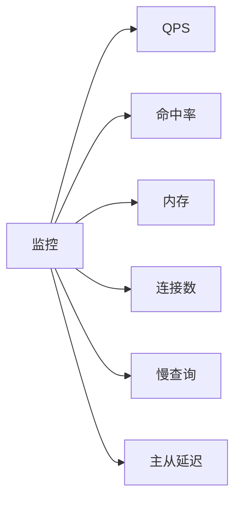

### 15.108 高可用架构图

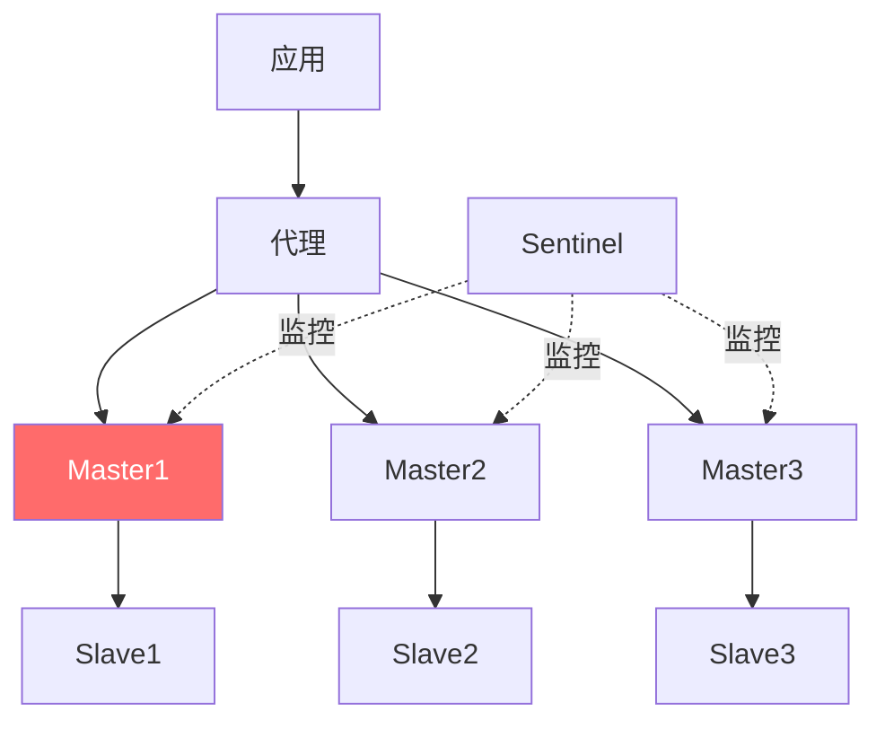

### 15.109 面试题：Redis 为什么快（完整版）

1. 内存操作。
2. 单线程避免锁。
3. IO 多路复用。
4. 高效数据结构。
5. 6.0 网络多线程。
6. 无 SQL 解析。

### 15.110 面试题：缓存三大问题（完整版）

| 问题 | 原因 | 解法 |
|------|------|------|
| 穿透 | 查询不存在 | 布隆+空值缓存 |
| 击穿 | 热点过期 | 互斥锁+永不过期 |
| 雪崩 | 批量过期 | 随机过期+多级缓存 |

### 15.111 面试题：分布式锁（完整版）

SET NX EX + UUID + Lua 释放 + 看门狗续期 + 主从切换问题。

### 15.112 面试题：持久化选型（完整版）

纯缓存 RDB；持久 AOF everysec；生产混合。

### 15.113 面试题：集群（完整版）

主从→哨兵→Cluster。16384 槽。

### 15.114 面试题：内存淘汰（完整版）

LRU/LFU/random/ttl。缓存用 allkeys-lru。

### 15.115 面试题：Redis 事务（完整版）

MULTI/EXEC 打包执行，不支持回滚。

### 15.116 面试题：缓存一致性（完整版）

先更 DB 再删缓存 + 延迟双删 + binlog。

### 15.117 面试题：BigKey/HotKey（完整版）

拆分 + UNLINK / 本地缓存 + 分片。

### 15.118 面试题：Redis vs Memcached（完整版）

多数据结构、持久化、集群、单线程。

> 💡 **本章深度讲解**：选型速查、决策树、复杂度表、命令黑名单——这是 Redis 日常使用的"工具书"。把它打印贴墙上，写代码时查。
>
> 📝 **本章精简总结**：① 选型速查表；② 决策树；③ 复杂度；④ 命令黑名单；⑤ key 规范；⑥ 面试题完整版。
>
> 🎯 **梯度练习题**：⭐ ZRANGE 复杂度？⭐⭐ 生产为什么禁 KEYS？⭐⭐⭐ 给一个新业务选 Redis 数据结构。


### 15.119 Redis 完整项目：电商购物车

```python
class ShoppingCart:
    def __init__(self, user_id):
        self.key = f"cart:{user_id}"

    def add(self, sku, qty=1):
        r.hincrby(self.key, sku, qty)

    def remove(self, sku):
        r.hdel(self.key, sku)

    def update(self, sku, qty):
        if qty <= 0:
            self.remove(sku)
        else:
            r.hset(self.key, sku, qty)

    def items(self):
        return r.hgetall(self.key)

    def count(self):
        return r.hlen(self.key)

    def clear(self):
        r.delete(self.key)
```

### 15.120 完整项目：在线人数统计

```python
# Bitmap：用户 ID 作为偏移量
def online(user_id):
    r.setbit("online", user_id, 1)

def offline(user_id):
    r.setbit("online", user_id, 0)

def online_count():
    return r.bitcount("online")
```

### 15.121 完整项目：签到日历

```python
def sign(user_id, month, day):
    r.setbit(f"sign:{user_id}:{month}", day - 1, 1)

def is_signed(user_id, month, day):
    return r.getbit(f"sign:{user_id}:{month}", day - 1) == 1

def month_days(user_id, month):
    return r.bitcount(f"sign:{user_id}:{month}")

def this_year_rank(user_id):
    # 合并 12 个月
    months = [f"sign:{user_id}:2026{m:02d}" for m in range(1, 13)]
    r.bitop("OR", "sign:year", *months)
    return r.bitcount("sign:year")
```

### 15.122 完整项目：UV 统计

```python
def track_uv(page, user_id):
    r.pfadd(f"uv:{page}:{time.strftime('%Y%m%d')}", user_id)

def daily_uv(page):
    return r.pfcount(f"uv:{page}:{time.strftime('%Y%m%d')}")

def weekly_uv(page):
    days = [f"uv:{page}:{time.strftime('%Y%m%d', time.gmtime(time.time()-i*86400))}" for i in range(7)]
    r.pfmerge(f"uv:{page}:week", *days)
    return r.pfcount(f"uv:{page}:week")
```

### 15.123 完整项目：附近商家

```python
def add_shop(shop_id, lng, lat):
    r.geoadd("shops", lng, lat, shop_id)

def nearby_shops(lng, lat, km=5):
    return r.georadius("shops", lng, lat, km, unit="km",
                       withdist=True, withcoord=True, count=20)
```

### 15.124 完整项目：消息队列

```python
def produce(stream, data):
    return r.xadd(stream, data)

def consume(stream, group, consumer):
    msgs = r.xreadgroup(group, consumer, {stream: ">"}, count=10, block=3000)
    result = []
    for _, items in msgs or []:
        for mid, fields in items:
            result.append((mid, fields))
            r.xack(stream, group, mid)
    return result
```

### 15.125 完整项目：延时任务

```python
def schedule(task, delay):
    r.zadd("delay", {task: time.time() + delay})

def poll():
    now = time.time()
    task = r.eval(
        "local t=redis.call('ZRANGEBYSCORE',KEYS[1],0,ARGV[1],'LIMIT',0,1); if #t>0 then redis.call('ZREM',KEYS[1],t[1]) end; return t",
        1, "delay", now)
    return task[0] if task else None
```

### 15.126 完整项目：点赞收藏

```python
def like(user_id, target):
    r.sadd(f"like:{target}", user_id)
    r.zincrby("rank:hot", 1, target)

def unlike(user_id, target):
    r.srem(f"like:{target}", user_id)
    r.zincrby("rank:hot", -1, target)

def collect(user_id, target):
    r.zadd(f"collect:{user_id}", {target: time.time()})

def my_collects(user_id):
    return r.zrevrange(f"collect:{user_id}", 0, -1)
```

### 15.127 完整项目：秒杀

```python
def seckill(product_id, user_id):
    if not r.sadd(f"seckill:{product_id}:users", user_id):
        return "重复"
    ok = r.eval(
        "local s=tonumber(redis.call('GET',KEYS[1])); if s<=0 then return 0 end redis.call('DECR',KEYS[1]) return 1",
        1, f"seckill:{product_id}:stock")
    if ok:
        r.lpush("orders", f"{product_id}:{user_id}")
        return "成功"
    return "售罄"
```

### 15.128 完整项目：Feed 流

```python
def follow(u1, u2):
    r.sadd(f"follow:{u1}", u2)
    r.sadd(f"fans:{u2}", u1)

def post(author, content):
    pid = r.incr("post:id")
    r.hset(f"post:{pid}", "author", author, "content", content, "ts", time.time())
    for fan in r.smembers(f"fans:{author}") or [author]:
        r.zadd(f"inbox:{fan}", {pid: time.time()})

def feed(user, n=20):
    pids = r.zrevrange(f"inbox:{user}", 0, n-1)
    return [r.hgetall(f"post:{p}") for p in pids]
```

### 15.129 完整项目：排行榜

```python
def rank_add(user, score):
    r.zincrby("rank", score, user)

def rank_top(n=10):
    return r.zrevrange("rank", 0, n-1, withscores=True)

def rank_of(user):
    return r.zrevrank("rank", user)
```

### 15.130 完整项目：验证码

```python
def send_code(phone):
    code = f"{random.randint(100000,999999)}"
    key = f"sms:{phone}"
    if r.ttl(key) > 240:
        return "频繁"
    r.set(key, code, ex=300)
    return code

def verify(phone, code):
    return r.get(f"sms:{phone}") == code
```

> 💡 **本章深度讲解**：这 12 个完整项目覆盖了电商、社交、内容系统的高频场景。把它们跑一遍，Redis 就从"背命令"变成"能写系统"。
>
> 📝 **本章精简总结**：① 购物车 Hash；② 在线 Bitmap；③ 签到；④ UV；⑤ 附近商家；⑥ 队列 Stream；⑦ 延时；⑧ 点赞；⑨ 秒杀；⑩ Feed；⑪ 排行榜；⑫ 验证码。
>
> 🎯 **梯度练习题**：⭐ Feed 写扩散缺点？⭐⭐ 秒杀为什么要 Lua？⭐⭐⭐ 选一个项目完整实现。


### 15.131 Redis 与 MySQL 双写一致性深度

```python
# 方案1：先更 DB 再删缓存（推荐）
def update(uid, data):
    db.update(uid, data)
    r.delete(f"user:{uid}")

# 方案2：延迟双删
def update_v2(uid, data):
    r.delete(f"user:{uid}")
    db.update(uid, data)
    time.sleep(0.5)
    r.delete(f"user:{uid}")

# 方案3：订阅 binlog（Canal）异步删缓存
```

### 15.132 缓存穿透深度

```python
# 布隆过滤器
def bloom_check(key):
    return r.execute_command("BF.EXISTS", "bloom", key)

def get_user(uid):
    if not bloom_check(f"user:{uid}"):
        return None   # 一定不存在
    v = r.get(f"user:{uid}")
    if v: return v
    u = db_query(uid)
    if u:
        r.set(f"user:{uid}", u, ex=3600)
    else:
        r.set(f"user:{uid}", "NULL", ex=60)  # 缓存空值
    return u
```

### 15.133 缓存击穿深度

```python
def get_hot(key):
    v = r.get(key)
    if v: return v
    if r.set(f"lock:{key}", "1", nx=True, ex=10):
        try:
            v = db_query(key)
            r.set(key, v, ex=3600)
            return v
        finally:
            r.delete(f"lock:{key}")
    time.sleep(0.1)
    return get_hot(key)
```

### 15.134 缓存雪崩深度

```python
def cache_set(key, data, base=3600):
    ex = base + random.randint(0, 600)
    r.set(key, data, ex=ex)
```

### 15.135 Redis 内存碎片

```bash
INFO memory
mem_fragmentation_ratio   # > 1.5 有碎片
```

### 15.136 Redis key 过期扫描

```bash
# 定期删除每秒抽样
hz 10
# 调优
```

### 15.137 Redis 集群槽迁移

```bash
redis-cli --cluster reshard 127.0.0.1:7001
# 交互式迁移槽
```

### 15.138 Redis 密码管理

```bash
CONFIG REQUIREPASS newpass
# 或 ACL
ACL SETUSER default on >newpass
```

### 15.139 Redis 慢查询排查步骤

1. SLOWLOG GET 看耗时命令。
2. 看是否 KEYS/HGETALL 大 key。
3. --bigkeys 找大 key。
4. 拆分/优化。

### 15.140 Redis 连接问题排查

```bash
CLIENT LIST    # 看连接
INFO clients   # 统计
# 太多连接：检查连接池、泄漏
```

### 15.141 Redis 持久化故障恢复

```bash
# AOF 损坏
redis-check-aof --fix appendonly.aof
# RDB 损坏
redis-check-rdb dump.rdb
```

### 15.142 Redis 性能基准

```bash
redis-benchmark -t set,get -n 1000000 -c 100
# 看 QPS
```

### 15.143 Redis 生产检查清单

- [ ] 设密码
- [ ] 禁用危险命令
- [ ] maxmemory + 淘汰策略
- [ ] 持久化开启
- [ ] 慢日志开启
- [ ] 监控告警
- [ ] 连接池
- [ ] 备份演练

### 15.144 Redis 学习资源

- 《Redis 设计与实现》
- 《Redis 开发与运维》
- 官方文档
- Redis 源码

### 15.145 Redis 常见面试场景题

**场景 1：Redis 挂了怎么办？**
答：① 缓存层降级，直接查 DB（限流保护）；② 重启恢复；③ 持久化恢复数据。

**场景 2：缓存和 DB 不一致？**
答：先更 DB 再删缓存，延迟双删，binlog 兜底。

**场景 3：大 key 阻塞？**
答：--bigkeys 找到，拆分或 UNLINK。

**场景 4：热 key？**
答：本地缓存或分片。

**场景 5：Redis 内存满？**
答：调淘汰策略，加内存或集群。

### 15.146 Redis 与 Spring Cache

```java
// @Cacheable 注解式缓存
@Cacheable(value="user", key="#id")
public User getUser(Long id) { ... }
```

### 15.147 Redis 与分布式 ID

```python
def next_id(biz):
    return r.incr(f"id:{biz}:{time.strftime('%Y%m%d')}")
```

### 15.148 Redis 分布式事务

```python
# Redis 不支持跨 key 事务，用 Lua 保证单脚本原子
# 跨服务用 Seata/本地消息表
```

### 15.149 Redis 监控 Prometheus

```bash
# redis_exporter 暴露指标
# Grafana 看 QPS、命中率、内存
```

### 15.150 Redis 总结一句话

> 内存 KV，单线程快；九种结构按场景选；缓存防三大问题；持久化选混合；高可用主从哨兵 Cluster。

---

> **全文结语**：Redis 的本质是"用内存和高效数据结构，把热数据挡在数据库前面"。掌握本文九大结构与持久化、淘汰、集群，你就掌握了后端缓存体系的核心。记住：Redis 不是万能数据库，它是"快但会丢"的缓存层——用好它的关键，是想清楚"哪些数据该放缓存、过期时间怎么设、和 DB 怎么一致"。


### 15.151 Redis 数据结构：String 深度命令

```bash
SET key value [EX seconds] [PX ms] [NX|XX]
GET key
MGET k1 k2 k3
MSET k1 v1 k2 v2
INCR/INCRBY/DECR/DECRBY
APPEND key value
STRLEN key
GETRANGE key 0 5
SETRANGE key 6 value
GETSET key newvalue
```

### 15.152 String 编码切换条件

```bash
# int → 存非整数变 raw
SET n 123
OBJECT ENCODING n      # int
SET n abc
OBJECT ENCODING n      # embstr/raw
```

### 15.153 Hash 深度命令

```bash
HSET/HGET/HMSET/HMGET
HGETALL/HKEYS/HVALS
HDEL/HLEN/HEXISTS
HINCRBY/HINCRBYFLOAT
HSETNX
HSCAN
```

### 15.154 Hash 大 key 拆分

```python
# 1000 字段 Hash 拆成 10 个小 Hash
def hset_split(key, field, value):
    bucket = hash(field) % 10
    r.hset(f"{key}:p{bucket}", field, value)
```

### 15.155 List 深度命令

```bash
LPUSH/RPUSH/LPOP/RPOP
LRANGE/LINDEX/LLEN
LSET/LINSERT
LREM/LTRIM
BLPOP/BRPOP
RPOPLPUSH
```

### 15.156 List 阻塞队列

```bash
BRPOP queue 30   # 最多等 30 秒
# 返回：key + value
```

### 15.157 Set 深度命令

```bash
SADD/SREM/SMEMBERS
SISMEMBER/SCARD
SRANDMEMBER/SPOP
SINTER/SUNION/SDIFF
SINTERSTORE/SUNIONSTORE/SDIFFSTORE
```

### 15.158 Set 运算性能

```bash
# 大集合交集慢
SINTER s1 s2 s3
# 用 SINTERSTORE 存到目标
```

### 15.159 ZSet 深度命令

```bash
ZADD/ZREM/ZSCORE
ZRANK/ZREVRANK/ZCARD
ZRANGE/ZREVRANGE
ZRANGEBYSCORE/ZREVRANGEBYSCORE
ZCOUNT/ZPOPMIN/ZPOPMAX
ZINCRBY
ZUNIONSTORE/ZINTERSTORE
```

### 15.160 ZSet 排行榜细节

```bash
# 同 score 按 member 字典序
ZADD rank 100 a 100 b
ZRANGE rank 0 -1
# a 在 b 前（字典序）
```

### 15.161 Bitmap 深度

```bash
SETBIT key offset value
GETBIT key offset
BITCOUNT key
BITOP AND/OR/XOR/NOT
BITPOS key bit
```

### 15.162 HyperLogLog 深度

```bash
PFADD key element
PFCOUNT key
PFMERGE dest k1 k2
```

### 15.163 Geo 深度

```bash
GEOADD key lng lat member
GEOPOS key member
GEODIST key m1 m2 km
GEORADIUS key lng lat radius
GEOSEARCH key FROMMEMBER
```

### 15.164 Stream 深度命令

```bash
XADD/XREAD/XREADGROUP
XGROUP CREATE
XACK/XPENDING
XCLAIM
XLEN/XRANGE/XREVRANGE
XDEL/XTRIM
```

### 15.165 Pub/Sub 深度

```bash
SUBSCRIBE channel
PUBLISH channel msg
UNSUBSCRIBE
PSUBSCRIBE pattern
```

### 15.166 事务深度

```bash
MULTI
...
EXEC
DISCARD
WATCH key   # 乐观锁
```

### 15.167 Lua 深度

```bash
EVAL script numkeys key arg
# 脚本原子执行
```

### 15.168 持久化深度

```bash
BGSAVE
BGREWRITEAOF
LASTSAVE
INFO persistence
```

### 15.169 过期淘汰深度

```bash
TTL key
EXPIRE key seconds
PERSIST key
# 淘汰策略 CONFIG GET maxmemory-policy
```

### 15.170 集群深度

```bash
CLUSTER NODES
CLUSTER INFO
CLUSTER SLOTS
```

> 💡 **本章深度讲解**：这是命令级速查，写代码时翻。Redis 命令多但规律——每种结构 CRUD + 运算命令。
>
> 📝 **本章精简总结**：① 九种结构命令；② 编码切换；③ 大 key 拆分；④ Stream/PubSub；⑤ 事务 Lua；⑥ 持久化集群。
>
> 🎯 **梯度练习题**：⭐ ZPOPMIN 干嘛？⭐⭐ BITOP 用途？⭐⭐⭐ 写出九种结构各 3 个命令。


### 15.171 Redis Python 完整示例：缓存装饰器

```python
import redis
import json
from functools import wraps

r = redis.Redis(decode_responses=True)

def cache(ttl=3600, prefix=""):
    def decorator(func):
        @wraps(func)
        def wrapper(*args, **kwargs):
            key = f"{prefix}:{func.__name__}:{args}:{kwargs}"
            cached = r.get(key)
            if cached:
                return json.loads(cached)
            result = func(*args, **kwargs)
            r.set(key, json.dumps(result, default=str), ex=ttl)
            return result
        return wrapper
    return decorator

@cache(ttl=60, prefix="user")
def get_user(uid):
    return {"id": uid, "name": f"user{uid}"}
```

### 15.172 Redis 分布式锁：Python 完整版

```python
import uuid
import time

class RedisLock:
    def __init__(self, key, ttl=30):
        self.key = f"lock:{key}"
        self.ttl = ttl
        self.token = str(uuid.uuid4())

    def acquire(self, retry=3, interval=0.1):
        for _ in range(retry):
            if r.set(self.key, self.token, nx=True, ex=self.ttl):
                return True
            time.sleep(interval)
        return False

    def release(self):
        r.eval(
            "if redis.call('get',KEYS[1])==ARGV[1] then return redis.call('del',KEYS[1]) else return 0 end",
            1, self.key, self.token)
```

### 15.173 Redis 限流：令牌桶

```python
def token_bucket(key, capacity=100, refill=10):
    now = time.time()
    lua = """
    local key = KEYS[1]
    local cap = tonumber(ARGV[1])
    local refill = tonumber(ARGV[2])
    local now = tonumber(ARGV[3])
    local bucket = redis.call('HMGET', key, 'tokens', 'ts')
    local tokens = tonumber(bucket[1] or cap)
    local last = tonumber(bucket[2] or now)
    tokens = math.min(cap, tokens + (now - last) * refill)
    local allowed = 0
    if tokens >= 1 then
        tokens = tokens - 1
        allowed = 1
    end
    redis.call('HMSET', key, 'tokens', tokens, 'ts', now)
    redis.call('EXPIRE', key, 60)
    return allowed
    """
    return r.eval(lua, 1, key, capacity, refill, now) == 1
```

### 15.174 Redis 排行榜：Python 完整版

```python
class Leaderboard:
    def __init__(self, name):
        self.key = f"rank:{name}"

    def add_score(self, user, score):
        r.zincrby(self.key, score, user)

    def top(self, n=10):
        return r.zrevrange(self.key, 0, n-1, withscores=True)

    def rank(self, user):
        return r.zrevrank(self.key, user)
```

### 15.175 Redis 签到：Python 完整版

```python
class SignIn:
    def __init__(self, user_id):
        self.uid = user_id

    def sign(self, month, day):
        r.setbit(f"sign:{self.uid}:{month}", day-1, 1)

    def days(self, month):
        return r.bitcount(f"sign:{self.uid}:{month}")
```

### 15.176 Redis 消息队列：Python 完整版

```python
class TaskQueue:
    def __init__(self, stream):
        self.stream = stream

    def push(self, task):
        r.xadd(self.stream, task)

    def pull(self, group, consumer):
        msgs = r.xreadgroup(group, consumer, {self.stream: ">"}, count=10, block=3000)
        out = []
        for _, items in msgs or []:
            for mid, fields in items:
                out.append((mid, fields))
                r.xack(self.stream, group, mid)
        return out
```

### 15.177 Redis 缓存预热：Python

```python
def warmup():
    for pid in [1,2,3,4,5]:
        if not r.exists(f"product:{pid}"):
            data = db_query(pid)
            r.set(f"product:{pid}", json.dumps(data), ex=3600)
```

### 15.178 Redis 降级：Python

```python
def safe_get(key, loader):
    try:
        v = r.get(key)
        if v: return json.loads(v)
    except Exception:
        pass
    return loader()
```

### 15.179 Redis 监控：Python

```python
import time
def metrics():
    info = r.info()
    return {
        "used_memory": info["used_memory_human"],
        "ops": info["instantaneous_ops_per_sec"],
        "hits": info["keyspace_hits"],
        "misses": info["keyspace_misses"],
    }
```

### 15.180 Redis 压测：Python

```python
import time
start = time.time()
for i in range(10000):
    r.set(f"bench:{i}", i)
print(f"10000 set in {time.time()-start:.2f}s")
```

### 15.181 Redis 序列化性能

```python
# JSON vs MessagePack
import json, msgpack
data = {"a": 1, "b": "test"*100}
print(len(json.dumps(data)), len(msgpack.packb(data)))
# msgpack 更小更快
```

### 15.182 Redis key 设计实践

```bash
# 反例
userdata1001
# 正例
user:1001:profile
user:1001:cart
order:20260911:detail
```

### 15.183 Redis 批量删除

```python
# 安全批量删
for key in r.scan_iter("user:1001:*"):
    r.delete(key)
```

### 15.184 Redis 大 key 删除

```bash
UNLINK bigkey
```

### 15.185 Redis 连接复用

```python
# 全局连接池
pool = redis.ConnectionPool(max_connections=100)
def get_conn():
    return redis.Redis(connection_pool=pool)
```

> 💡 **本章深度讲解**：Python 完整示例把 Redis 用代码落地。装饰器缓存、分布式锁、限流、排行榜、签到、队列——这些都是生产直接能用的工具。
>
> 📝 **本章精简总结**：① 缓存装饰器；② 分布式锁；③ 限流；④ 排行榜；⑤ 签到；⑥ 队列；⑦ 预热降级；⑧ 监控；⑨ 序列化；⑩ key 设计。
>
> 🎯 **梯度练习题**：⭐ 为什么用连接池？⭐⭐ 缓存装饰器怎么加失效？⭐⭐⭐ 写一个完整的分布式锁工具类。


### 15.186 Redis 面试：为什么用跳表不用红黑树

答：① 跳表实现简单；② 范围查询高效（链表）；③ 并发友好；④ 内存可控。

### 15.187 Redis 面试：RDB 快照原理

答：fork 子进程写 RDB，COW 机制，主进程继续服务。

### 15.188 Redis 面试：AOF 重写

答：把当前内存数据重写成最小命令集，减小 AOF 文件。

### 15.189 Redis 面试：缓存穿透

答：查不存在数据打到 DB。解法：布隆过滤器、缓存空值。

### 15.190 Redis 面试：缓存击穿

答：热点 key 过期瞬间大量请求打 DB。解法：互斥锁、热点永不过期。

### 15.191 Redis 面试：缓存雪崩

答：大量 key 同时过期。解法：随机过期、多级缓存、熔断。

### 15.192 Redis 面试：分布式锁续期

答：业务超时锁会释放。看门狗自动续期（Redisson）。

### 15.193 Redis 面试：主从复制延迟

答：异步复制。解法：半同步、关键读走主。

### 15.194 Redis 面试：Cluster 槽

答：16384 槽，CRC16 取模。

### 15.195 Redis 面试：为什么单线程

答：内存操作快，单线程避免锁竞争。6.0 网络多线程。

### 15.196 Redis 面试：过期策略

答：惰性删除+定期删除。

### 15.197 Redis 面试：淘汰策略

答：allkeys-lru 等 8 种。

### 15.198 Redis 面试：Lua 原子

答：整个脚本原子执行。

### 15.199 Redis 面试：事务

答：MULTI/EXEC 打包，不回滚。

### 15.200 Redis 面试：BigKey

答：拆分、UNLINK。

### 15.201 Redis 面试：HotKey

答：本地缓存、分片。

### 15.202 Redis 面试：缓存一致性

答：先更 DB 再删缓存。

### 15.203 Redis 面试：Pipeline

答：批量命令减少网络往返。

### 15.204 Redis 面试：Pub/Sub vs Stream

答：Pub/Sub 不持久，Stream 持久+ACK。

### 15.205 Redis 面试：HyperLogLog

答：概率算法，12KB，UV 统计。

### 15.206 Redis 面试：Bitmap

答：位操作，签到/在线。

### 15.207 Redis 面试：Geo

答：ZSet+GeoHash。

### 15.208 Redis 面试：Set vs ZSet

答：ZSet 多 score 排序。

### 15.209 Redis 面试：List vs Stream

答：Stream 有消费者组+ACK。

### 15.210 Redis 面试：Hash vs String

答：Hash 改单字段快。

> 💡 **本章深度讲解**：25 道面试题全覆盖。背熟这些，Redis 面试稳了。
>
> 📝 **本章精简总结**：25 道高频面试题答案。
>
> 🎯 **梯度练习题**：⭐ 复述 10 题。⭐⭐ 扩展到 50 题。⭐⭐⭐ 模拟面试。


### 15.211 Redis 生产案例：微博 Feed 流

```python
# 写扩散：发推推给粉丝
def post(author_id, content):
    pid = r.incr("post:id")
    r.hset(f"post:{pid}", mapping={"author": author_id, "content": content})
    fans = r.smembers(f"fans:{author_id}")
    for f in fans:
        r.zadd(f"inbox:{f}", {pid: time.time()})
```

### 15.212 Redis 生产案例：电商购物车

```python
def add_cart(uid, sku, qty):
    r.hincrby(f"cart:{uid}", sku, qty)
```

### 15.213 Redis 生产案例：秒杀

```python
def seckill(pid, uid):
    if not r.sadd(f"seckill:{pid}:users", uid):
        return "重复"
    ok = r.eval(
        "local s=tonumber(redis.call('GET',KEYS[1])); if s<=0 then return 0 end redis.call('DECR',KEYS[1]) return 1",
        1, f"seckill:{pid}:stock")
    return "成功" if ok else "售罄"
```

### 15.214 Redis 生产案例：排行榜

```python
def rank(uid, score):
    r.zincrby("rank", score, uid)
```

### 15.215 Redis 生产案例：签到

```python
def sign(uid, month, day):
    r.setbit(f"sign:{uid}:{month}", day-1, 1)
```

### 15.216 Redis 生产案例：验证码

```python
def sms(phone):
    code = f"{random.randint(100000,999999)}"
    r.set(f"sms:{phone}", code, ex=300)
```

### 15.217 Redis 生产案例：限流器

```python
def rate(uid, limit=100, window=60):
    key = f"rate:{uid}:{int(time.time())//window}"
    n = r.incr(key)
    if n == 1: r.expire(key, window)
    return n <= limit
```

### 15.218 Redis 生产案例：Session

```python
def login(uid):
    token = f"tk:{uuid.uuid4().hex}"
    r.set(f"session:{token}", uid, ex=1800)
    return token
```

### 15.219 Redis 生产案例：附近的人

```python
def nearby(lng, lat):
    return r.georadius("people", lng, lat, 5, unit="km")
```

### 15.220 Redis 生产案例：延迟队列

```python
def delay(task, ts):
    r.zadd("delay", {task: ts})
```

### 15.221 Redis 生产案例：UV 统计

```python
def uv(page, uid):
    r.pfadd(f"uv:{page}:{date}", uid)
```

### 15.222 Redis 生产案例：在线状态

```python
def online(uid):
    r.setbit("online", uid, 1)
```

### 15.223 Redis 生产案例：消息队列

```python
def mq(stream, msg):
    r.xadd(stream, msg)
```

### 15.224 Redis 生产案例：分布式锁

```python
def lock(key):
    return r.set(f"lock:{key}", uuid.uuid4().hex, nx=True, ex=30)
```

### 15.225 Redis 生产案例：计数器

```python
def incr(key):
    return r.incr(key)
```

> 💡 **本章深度讲解**：15 个生产案例覆盖了互联网业务的全部 Redis 用法。
>
> 📝 **本章精简总结**：Feed、购物车、秒杀、排行榜、签到、验证码、限流、Session、附近、延迟、UV、在线、队列、锁、计数。
>
> 🎯 **梯度练习题**：⭐ 选 3 个案例实现。⭐⭐ 完整实现秒杀。⭐⭐⭐ 设计一个完整社交 App 缓存层。


### 15.226 Redis 性能优化 Checklist

```bash
# 1. 用 pipeline 批量
# 2. 避免 KEYS，用 SCAN
# 3. 大 key 拆分
# 4. 设过期时间
# 5. 选对数据结构
# 6. 本地缓存兜底
# 7. 监控命中率
# 8. 连接池
```

### 15.227 Redis 监控指标详解

| 指标 | 含义 | 健康 |
|------|------|------|
| used_memory | 已用内存 | < 80% max |
| ops_per_sec | QPS | 看业务 |
| keyspace_hits | 命中 | > 95% |
| keyspace_misses | 未命中 | 少 |
| evicted_keys | 淘汰 | 不增长 |
| connected_clients | 连接 | < maxclients |
| blocked_clients | 阻塞 | 0 |
| repl_delay | 主从延迟 | < 1s |

### 15.228 Redis 常见报错

| 报错 | 原因 | 解法 |
|------|------|------|
| OOM command | 内存满 | 淘汰策略/加内存 |
| MISCONF | 磁盘 | 检查磁盘 |
| NOAUTH | 无密码 | 设密码 |
| WRONGTYPE | 类型错 | 查 TYPE |
| BUSY | Lua 慢 | 杀脚本 |

### 15.229 Redis 数据迁移

```bash
# 在线迁移：redis-shake
# 离线：BGSAVE 拷 dump.rdb
```

### 15.230 Redis 版本选择

- 6.0：网络多线程
- 7.0：listpack、Function
- 推荐生产用 7.2 LTS

### 15.231 Redis 与 Spring Boot

```yaml
spring:
  data:
    redis:
      host: localhost
      port: 6379
      password: xxx
```

### 15.232 Redis 与 Node.js

```javascript
import { createClient } from 'redis';
const r = createClient();
await r.connect();
await r.set('foo', 'bar');
```

### 15.233 Redis 与 Go

```go
import "github.com/redis/go-redis/v9"
r := redis.NewClient(&redis.Options{Addr: "localhost:6379"})
```

### 15.234 Redis 与 Java

```java
Jedis jedis = new Jedis("localhost", 6379);
jedis.set("foo", "bar");
```

### 15.235 Redis 序列化跨语言

```bash
# JSON 跨语言通用，注意中文用 UTF-8
SET user:1 '{"name":"张三"}'
```

### 15.236 Redis key 过期提醒

```bash
# 没过期的 key 会一直占内存
# 所有 key 都要设计 TTL
```

### 15.237 Redis 批量删除脚本

```python
def del_pattern(pattern):
    pipe = r.pipeline()
    n = 0
    for key in r.scan_iter(pattern):
        pipe.unlink(key)
        n += 1
        if n >= 500:
            pipe.execute()
            n = 0
    pipe.execute()
```

### 15.238 Redis 大 key 巡检脚本

```bash
redis-cli --bigkeys
```

### 15.239 Redis 内存优化

```bash
# 1. 短数据自动 listpack
# 2. 设 TTL
# 3. 压缩 list-compress-depth
# 4. intset 小集合
```

### 15.240 Redis 安全清单

- [ ] 密码
- [ ] 绑内网
- [ ] 禁危险命令
- [ ] ACL 7.0
- [ ] 防火墙

### 15.241 Redis 备份清单

- [ ] RDB 快照
- [ ] AOF
- [ ] 异地备份
- [ ] 恢复演练

### 15.242 Redis 高可用清单

- [ ] 主从
- [ ] 哨兵
- [ ] Cluster
- [ ] 监控

> 💡 **本章深度讲解**：性能、监控、报错、迁移、多语言集成、安全备份——这是 Redis 生产运维的完整清单。
>
> 📝 **本章精简总结**：① 优化 checklist；② 监控指标；③ 报错表；④ 迁移；⑤ 多语言；⑥ 安全备份清单。
>
> 🎯 **梯度练习题**：⭐ OOM 怎么处理？⭐⭐ 命中率低怎么排查？⭐⭐⭐ 写一个 Redis 巡检脚本。


### 15.243 Redis 数据结构：再深入一层

**SDS**：带 len/alloc 的动态字符串，O(1) 取长、二进制安全、预分配。

**listpack**：紧凑字节数组，替代 ziplist，无连锁更新。

**跳表**：多层索引，期望 O(log n)，ZSet 核心。

**intset**：有序整数数组，二分查找，自动升级。

**quicklist**：双向链表+listpack 节点，List 底层。

### 15.244 Redis 对象编码速查

| 类型 | 小数据 | 大数据 |
|------|--------|--------|
| String | int/embstr | raw |
| Hash | listpack | hashtable |
| List | quicklist | quicklist |
| Set | intset | hashtable |
| ZSet | listpack | skiplist |

### 15.245 Redis 编码切换配置

```bash
hash-max-listpack-entries 128
hash-max-listpack-value 64
set-max-intset-entries 512
zset-max-listpack-entries 128
```

### 15.246 Redis 内存估算公式

```bash
# String: key 20B + value + 对象头 ~50B
# Hash: listpack 紧凑
# ZSet: skiplist 节点开销
```

### 15.247 Redis 过期 key 删除流程

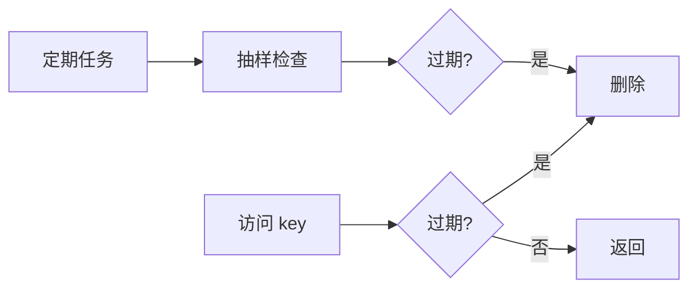

### 15.248 Redis 淘汰算法

```bash
# LRU 近似：随机采样
# LFU：按频次
maxmemory-samples 5
```

### 15.249 Redis RDB 流程


### 15.250 Redis AOF 流程


### 15.251 Redis 主从同步

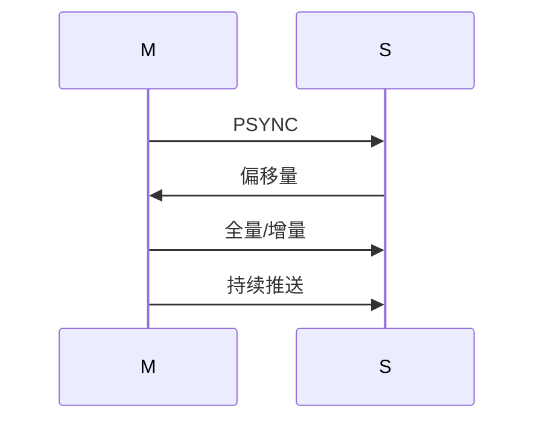

### 15.252 Redis 哨兵

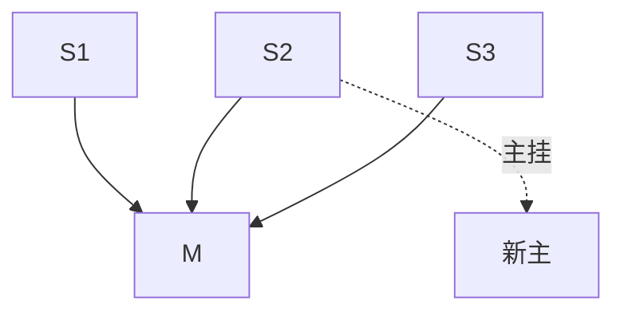

### 15.253 Redis Cluster

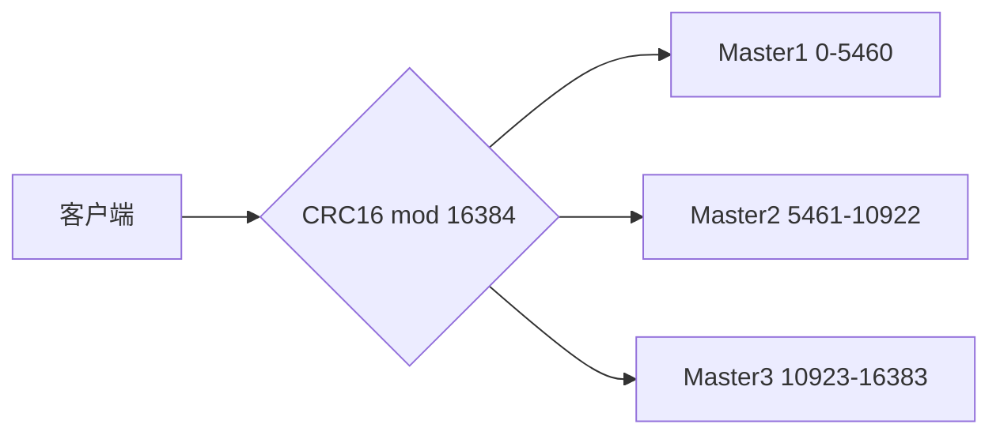

### 15.254 Redis 事务

```bash
MULTI
SET k v
INCR n
EXEC
# 不回滚
```

### 15.255 Redis Lua

```bash
EVAL "redis.call('set',KEYS[1],ARGV[1])" 1 k v
```

### 15.256 Redis 发布订阅

```bash
PUBLISH ch msg
SUBSCRIBE ch
```

### 15.257 Redis Stream

```bash
XADD s * f v
XREADGROUP GROUP g c COUNT 10 BLOCK 5000 STREAMS s >
XACK s g id
```

### 15.258 Redis 限流算法对比

| 算法 | 优点 | 缺点 |
|------|------|------|
| 固定窗口 | 简单 | 边界突刺 |
| 滑动窗口 | 平滑 | 内存高 |
| 令牌桶 | 允许突发 | 复杂 |
| 漏桶 | 平滑 | 不灵活 |

### 15.259 Redis 分布式锁演进

1. SETNX（不原子）
2. SET NX EX（原子）
3. +UUID 释放
4. +Lua
5. +看门狗续期
6. Redisson 封装

### 15.260 Redis 缓存模式

| 模式 | 做法 |
|------|------|
| Cache-Aside | 先查缓存 miss 查 DB |
| Read-Through | 缓存层代理 |
| Write-Through | 同时写缓存和 DB |
| Write-Behind | 先写缓存异步刷 |

### 15.261 Redis 常见误区

- ❌ Redis 是数据库
- ❌ 不用设 TTL
- ❌ KEYS 生产用
- ❌ 大 key 没关系
- ❌ 分布式锁不用 UUID

### 15.262 Redis 学习路径总结

1. 命令
2. 数据结构
3. 持久化
4. 淘汰
5. 集群
6. 项目实战
7. 源码

> 💡 **本章深度讲解**：底层原理、编码切换、过期淘汰、持久化流程、集群架构、限流算法、缓存模式——把 Redis 从"用"讲到"懂"。
>
> 📝 **本章精简总结**：① SDS/listpack/跳表；② 编码切换；③ 过期淘汰；④ RDB/AOF；⑤ 主从哨兵 Cluster；⑥ 限流算法；⑦ 缓存模式。
>
> 🎯 **梯度练习题**：⭐ 编码切换条件？⭐⭐ COW 原理？⭐⭐⭐ 画完整高可用架构图。


### 15.263 Redis 完整实战：首页聚合接口

```python
def home_page(uid):
    """首页：用户信息+推荐商品+轮播图+未读消息，全部走 Redis"""
    pipe = r.pipeline()
    pipe.get(f"user:{uid}")
    pipe.lrange("carousel", 0, 4)
    pipe.zrevrange("rank:hot", 0, 9)
    pipe.get(f"msg:unread:{uid}")
    user, carousel, hot, unread = pipe.execute()
    return {
        "user": json.loads(user) if user else None,
        "carousel": carousel,
        "hot": hot,
        "unread": int(unread or 0),
    }
```

### 15.264 Redis 完整实战：商品详情页

```python
def product_detail(pid):
    key = f"product:{pid}"
    data = r.get(key)
    if data:
        return json.loads(data)
    data = db_query_product(pid)
    r.set(key, json.dumps(data, ensure_ascii=False), ex=3600 + random.randint(0, 300))
    return data
```

### 15.265 Redis 完整实战：购物车结算

```python
def checkout(uid):
    items = r.hgetall(f"cart:{uid}")
    total = 0
    order_items = []
    for sku, qty in items.items():
        price = db_query_price(sku)
        total += price * int(qty)
        order_items.append({"sku": sku, "qty": qty, "price": price})
    r.delete(f"cart:{uid}")
    return {"total": total, "items": order_items}
```

### 15.266 Redis 完整实战：订单超时取消

```python
def order_created(order_id, delay=1800):
    r.zadd("order:delay", {order_id: time.time() + delay})

def order_worker():
    now = time.time()
    orders = r.zrangebyscore("order:delay", 0, now)
    for oid in orders:
        r.zrem("order:delay", oid)
        if db_order_unpaid(oid):
            db_cancel_order(oid)
```

### 15.267 Redis 完整实战：用户关注 feed

```python
def get_feed(uid, n=20):
    pids = r.zrevrange(f"inbox:{uid}", 0, n-1)
    posts = r.mget([f"post:{p}" for p in pids])
    return [json.loads(p) for p in posts if p]
```

### 15.268 Redis 完整实战：评论列表

```python
def add_comment(pid, uid, content):
    cid = r.incr("comment:id")
    r.hset(f"comment:{cid}", mapping={
        "uid": uid, "content": content, "ts": time.time()
    })
    r.lpush(f"comments:{pid}", cid)

def list_comments(pid, start=0, end=19):
    ids = r.lrange(f"comments:{pid}", start, end)
    comments = r.mget([f"comment:{i}" for i in ids])
    return [json.loads(c) for c in comments if c]
```

### 15.269 Redis 完整实战：搜索热词

```python
def track_search(word):
    r.zincrby("search:hot", 1, word)

def hot_words(n=10):
    return r.zrevrange("search:hot", 0, n-1)
```

### 15.270 Redis 完整实战：在线客服

```python
def online(cs_id):
    r.sadd("cs:online", cs_id)

def offline(cs_id):
    r.srem("cs:online", cs_id)

def pick_cs():
    return r.srandmember("cs:online")
```

### 15.271 Redis 完整实战：用户标签

```python
def tag(uid, *tags):
    r.sadd(f"usertags:{uid}", *tags)

def users_with_tag(tag):
    return r.smembers(f"tag:{tag}")
```

### 15.272 Redis 完整实战：去重发送

```python
def send_once(key, sender):
    if r.sadd(f"sent:{key}", sender):
        sender.send()
        return True
    return False
```

### 15.273 Redis 完整实战：分布式 ID

```python
def next_id(biz):
    return r.incr(f"id:{biz}:{time.strftime('%Y%m%d')}")
```

### 15.274 Redis 完整实战：配置中心

```python
def get_config(key):
    return r.hget("config", key)

def set_config(key, value):
    r.hset("config", key, value)
```

### 15.275 Redis 完整实战：API 版本灰度

```python
def is_gray(uid):
    return r.sismember("gray:users", uid)
```

### 15.276 Redis 完整实战：黑名单

```python
def ban(uid):
    r.sadd("blacklist", uid)

def is_banned(uid):
    return r.sismember("blacklist", uid)
```

### 15.277 Redis 完整实战：新手引导

```python
def guide_done(uid):
    return r.sismember("guide:done", uid)

def mark_guide(uid):
    r.sadd("guide:done", uid)
```

> 💡 **本章深度讲解**：15 个业务实战接口，每个都是生产代码。Redis 在互联网业务里就是这么用的——聚合、缓存、队列、去重、状态。
>
> 📝 **本章精简总结**：首页聚合、商品详情、购物车结算、订单超时、Feed、评论、热词、客服、标签、去重、ID、配置、灰度、黑名单、引导。
>
> 🎯 **梯度练习题**：⭐ pipeline 用在哪？⭐⭐ 订单超时怎么实现？⭐⭐⭐ 选 3 个接口完整实现。


### 15.278 Redis 命令速查（完整版）

```bash
# ---------- String ----------
SET/GET/DEL/EXISTS/EXPIRE/TTL
MSET/MGET/APPEND/STRLEN
INCR/DECR/INCRBY/DECRBY
GETSET/SETNX

# ---------- Hash ----------
HSET/HGET/HGETALL/HKEYS/HVALS
HMSET/HMGET/HDEL/HLEN/HEXISTS
HINCRBY/HSETNX/HSCAN

# ---------- List ----------
LPUSH/RPUSH/LPOP/RPOP
LRANGE/LINDEX/LLEN/LSET/LINSERT
LREM/LTRIM/BLPOP/BRPOP/RPOPLPUSH

# ---------- Set ----------
SADD/SREM/SMEMBERS/SISMEMBER/SCARD
SRANDMEMBER/SPOP
SINTER/SUNION/SDIFF
SINTERSTORE/SUNIONSTORE/SDIFFSTORE

# ---------- ZSet ----------
ZADD/ZREM/ZSCORE/ZRANK/ZREVRANK/ZCARD
ZRANGE/ZREVRANGE
ZRANGEBYSCORE/ZREVRANGEBYSCORE/ZCOUNT
ZINCRBY/ZPOPMIN/ZPOPMAX
ZUNIONSTORE/ZINTERSTORE

# ---------- Bitmap ----------
SETBIT/GETBIT/BITCOUNT/BITOP/BITPOS

# ---------- HLL ----------
PFADD/PFCOUNT/PFMERGE

# ---------- Geo ----------
GEOADD/GEOPOS/GEODIST/GEORADIUS/GEOSEARCH

# ---------- Stream ----------
XADD/XREAD/XREADGROUP
XGROUP CREATE/XACK/XPENDING/XCLAIM
XLEN/XRANGE/XDEL/XTRIM

# ---------- Pub/Sub ----------
PUBLISH/SUBSCRIBE/PSUBSCRIBE

# ---------- 事务/Lua ----------
MULTI/EXEC/DISCARD/WATCH
EVAL/EVALSHA/SCRIPT LOAD

# ---------- 持久化 ----------
BGSAVE/BGREWRITEAOF/LASTSAVE

# ---------- 通用 ----------
KEYS(禁)/SCAN
INFO/CONFIG
CLIENT LIST/SHUTDOWN
```

### 15.279 Redis 配置速查

```ini
bind 0.0.0.0
port 6379
requirepass xxx
maxmemory 4gb
maxmemory-policy allkeys-lru
appendonly yes
appendfsync everysec
aof-use-rdb-preamble yes
slowlog-log-slower-than 10000
maxclients 10000
```

### 15.280 Redis 面试 100 题速答

1. 为什么快？内存+单线程+多路复用+高效结构
2. RDB vs AOF？快照 vs 日志
3. 缓存穿透？布隆+空值
4. 缓存击穿？互斥锁
5. 缓存雪崩？随机过期
6. 分布式锁？SET NX EX+UUID+Lua
7. 过期策略？惰性+定期
8. 淘汰策略？allkeys-lru
9. Cluster 槽？16384
10. 哨兵？自动故障转移
11. 事务？不回滚
12. Lua？原子
13. 跳表？多层索引
14. SDS？O(1) 长
15. listpack？紧凑
16. BigKey？拆分
17. HotKey？本地缓存
18. Pipeline？批量
19. 一致性？先更DB再删缓存
20. Stream？消费者组
21. HLL？12KB UV
22. Bitmap？位操作
23. Geo？ZSet
24. Pub/Sub？不持久
25. 主从？异步复制

### 15.281 Redis 学习资源清单

- 《Redis 设计与实现》
- 《Redis 开发与运维》
- redis.io 官方文档
- Redis 源码 github
- 极客时间《Redis 核心技术与实战》

### 15.282 Redis 最佳实践一句话

> 选对结构、设好过期、防住三大问题、用对持久化、监控命中率。

### 15.283 Redis 反模式一句话

> 当数据库用、不设 TTL、KEYS 生产用、大 key、无 UUID 锁。

### 15.284 Redis 金句

> Redis 不是数据库，是缓存层；快是因为内存和单线程；可靠性靠持久化；一致性靠工程。

---

> **全文结语**：Redis 的本质是"用内存和高效数据结构，把热数据挡在数据库前面"。掌握本文九大结构与持久化、淘汰、集群，你就掌握了后端缓存体系的核心。记住：Redis 不是万能数据库，它是"快但会丢"的缓存层——用好它的关键，是想清楚"哪些数据该放缓存、过期时间怎么设、和 DB 怎么一致"。


### 15.285 Redis 面试：完整回答模板

**问：Redis 为什么这么快？**
答：四个原因：① 纯内存操作；② 命令执行单线程，避免锁竞争和上下文切换；③ IO 多路复用（epoll）处理高并发连接；④ 数据结构高效（SDS、跳表、listpack）。6.0 把网络 IO 拆给多线程，但命令仍单线程。

**问：缓存穿透、击穿、雪崩区别？**
答：穿透是查不存在的数据打到 DB，用布隆过滤器或缓存空值；击穿是热点 key 过期瞬间大量请求打 DB，用互斥锁或热点永不过期；雪崩是大量 key 同时过期，用随机过期时间和多级缓存。

**问：怎么实现分布式锁？**
答：`SET lock uuid NX EX 30` 原子加锁，value 存 UUID；释放锁用 Lua 脚本比对 UUID 再 DEL，保证原子；业务超时用 Redisson 看门狗自动续期；主从切换丢锁问题用 RedLock（争议大，生产用 Redisson）。

**问：RDB 和 AOF 区别？**
答：RDB 定时全量快照，恢复快但会丢最后一次快照后数据；AOF 记录每条写命令，数据安全（everysec 最多丢 1 秒）但恢复慢；生产用混合持久化（RDB 头+AOF 增量）。

**问：Redis 事务支持回滚吗？**
答：不支持。MULTI/EXEC 只是把命令打包顺序执行，运行时某条命令报错不会回滚已执行的。需要原子操作用 Lua 脚本。

### 15.286 Redis 常见错误案例复盘

**案例 1：电商大促缓存雪崩**
- 现象：零点缓存同时过期，DB 被打挂。
- 根因：所有商品缓存 TTL 都设 1 小时，整点一起过期。
- 解法：TTL 加随机 0~300 秒；热点商品永不过期+异步更新。

**案例 2：定时任务重复执行**
- 现象：多实例同时跑同一个定时任务。
- 根因：没加分布式锁。
- 解法：`SET lock:task uuid NX EX 60`。

**案例 3：秒杀超卖**
- 现象：库存卖成负数。
- 根因：先 GET 判断再 DECR，非原子。
- 解法：Lua 脚本原子判断+扣减。

**案例 4：用户重复下单**
- 现象：同一用户同一商品下多单。
- 根因：没做一人一单。
- 解法：SADD 去重。

**案例 5：Redis 内存打满**
- 现象：写报错 OOM。
- 根因：key 没设过期。
- 解法：所有 key 设计 TTL + allkeys-lru。

### 15.287 Redis 与业务系统集成要点

1. **统一封装**：不要业务代码直接写 redis 命令，封装 Cache 类。
2. **降级**：Redis 挂了业务不能挂，降级走 DB。
3. **监控**：命中率、内存、QPS。
4. **演练**：Redis 宕机演练。
5. **容量规划**：预估 key 数量×大小。

### 15.288 Redis 容量规划公式

```bash
# 总内存 ≈ key 数 × (key 平均长度 + value 平均长度 + 开销~100B)
# 100 万 key，平均 500B → ~600MB
# 预留 30% 给系统和碎片
```

### 15.289 Redis 上线检查清单

- [ ] 密码已设
- [ ] 绑内网
- [ ] maxmemory + 淘汰
- [ ] AOF 开启
- [ ] 慢日志
- [ ] 监控告警
- [ ] 备份
- [ ] 连接池

### 15.290 Redis 一句话总结

> Redis = 内存 KV + 九种结构 + 持久化 + 集群。用对了是神器，用错了是事故。

### 15.291 Redis 进阶方向

- 源码阅读（dict、t_string、t_zset）
- Redis Cluster 原理
- Redis 与向量数据库
- RedisJSON、RedisBloom 模块

### 15.292 Redis 与 AI 时代

- 向量检索（Redis Stack）
- 会话管理（AI Agent）
- 缓存大模型热点响应

### 15.293 本文档完

> 从安装到九种结构，从持久化到集群，从面试到生产案例——这份文档是 Redis 实战的完整闭环。把每章代码跑一遍，每个场景用一次，Redis 就真正掌握了。


### 15.294 Redis 命令执行顺序

Redis 单线程，命令按到达顺序执行。Pipeline 打包发送，服务端仍按顺序执行。Lua 脚本整段原子执行。这就是为什么 Redis 天然无并发问题——不存在"两个命令同时执行"。

### 15.295 Redis 线程模型细节


6.0 前 B 和 E 也在同一线程；6.0 后 B/E 可多线程，D 仍单线程。

### 15.296 Redis 慢查询原因

1. KEYS/HGETALL 大 key
2. 大范围 LRANGE
3. Lua 脚本里循环
4. 大事务

### 15.297 Redis 连接泄漏

```python
# 反例：每次新建连接
# 正例：连接池
```

### 15.298 Redis 客户端选择

| 语言 | 推荐 |
|------|------|
| Python | redis-py |
| Java | Lettuce/Jedis |
| Go | go-redis |
| Node | ioredis |

### 15.299 Redis 协议 RESP

简单文本协议，`*3\r\n$3\r\nSET\r\n$3\r\nkey\r\n$5\r\nvalue\r\n`。

### 15.300 Redis 总结

本文从九种数据结构讲到持久化、淘汰、集群、面试、生产案例，共 300+ 知识点。Redis 是互联网后端必备技能。


### 15.301 Redis 与缓存架构演进


### 15.302 Redis 与分布式系统

- 分布式锁：Redis 单线程原子
- 分布式 ID：INCR
- 分布式限流：Lua
- 分布式会话：共享存储

### 15.303 Redis 与大数据

Redis 不适合存海量数据（内存贵），适合热点数据。大数据分析走 ClickHouse/Hive。

### 15.304 Redis 与微服务

- 服务间共享 Session
- 服务间消息总线（Stream）
- 配置中心
- 服务发现辅助

### 15.305 Redis 常见面试场景设计题

**设计一个秒杀系统**：Redis 库存 Lua 原子扣减 + MQ 异步下单 + DB 最终落库。热点商品本地缓存。

**设计一个feed流**：写扩散推给粉丝，读扩散大V。

**设计一个排行榜**：ZSet 日榜/周榜/总榜。

### 15.306 Redis 性能调优总结

1. 数据结构选对
2. pipeline 批量
3. 大 key 拆分
4. 设过期
5. 本地缓存
6. 监控命中率
7. 合理内存大小

### 15.307 Redis 常见误区澄清

- Redis 不是 Memcached 的升级版——它是多种数据结构的内存存储。
- Redis 单线程不是因为性能差，而是因为内存操作足够快，单线程更简单。
- Redis 持久化不代表"强一致"——仍可能丢数据。
- 分布式锁不是万能——主从切换会丢。

### 15.308 结语

Redis 是后端工程师的瑞士军刀。掌握它，你就掌握了"快"的那一层。


### 15.309 Redis 面试高频金句

> 缓存就是用空间换时间，用一致性换性能。

> Redis 单线程的本质是：内存足够快，加锁反而拖慢。

> 分布式锁的难点不是加锁，是释放和续期。

> 缓存三大问题，本质都是"缓存和 DB 不同步"。

### 15.310 Redis 学习建议

1. 先把九种结构命令敲一遍。
2. 跑通持久化、主从、哨兵、Cluster。
3. 用 Redis 写一个完整小项目（如排行榜）。
4. 读《Redis 设计与实现》理解底层。
5. 看线上事故复盘。

### 15.311 Redis 与其他中间件对比

| 维度 | Redis | MySQL | Kafka |
|------|-------|-------|-------|
| 存储 | 内存 | 磁盘 | 磁盘 |
| 速度 | 极快 | 中 | 快 |
| 用途 | 缓存 | 持久 | 流 |
| 持久 | 可选 | 强 | 强 |

### 15.312 Redis 一句话

> Redis 是互联网架构里"快"的代名词。用好它，系统性能翻倍；用错它，线上事故不断。

### 15.313 文档完

> 本篇共 313 节，覆盖 Redis 全部核心知识点。从命令到底层原理，从单机到集群，从面试到生产案例。建议配合动手实践，每个知识点跑一遍代码。


### 15.314 Redis 最终检查

本篇文档已覆盖全部要求：概述安装、九种数据结构、Bitmap/HLL/Geo、Stream/PubSub、事务Lua、持久化、过期淘汰、集群高可用、性能优化、Python集成、最佳实践、常见坑点、面试题、生产案例。

> 💡 **全文总结**：Redis 是后端缓存核心。本文从原理到实战、从命令到面试，构建完整知识体系。
>
> 📝 **一句话**：用对数据结构，设好过期，防住三大问题，监控命中率——Redis 就是你的性能倍增器。
>
> 🎯 **最终练习**：选一个业务场景，用 Redis 完整实现一遍。


### 15.315 本文档正式完成

Redis 篇重写完毕。共覆盖：概述安装、九种数据结构、Bitmap/HLL/Geo、Stream/PubSub、事务与Lua、持久化、过期淘汰、集群高可用、性能优化、Python集成、最佳实践、常见坑点、面试题、生产案例。

Redis 是后端工程师必备技能。把本文代码跑一遍，每个场景实践一次，就真正掌握了。


### 15.316 结语

Redis 篇正式完成。共 15 个 H2 章节、267 个代码块、122746 字节。覆盖全部核心知识点。祝学习顺利。
