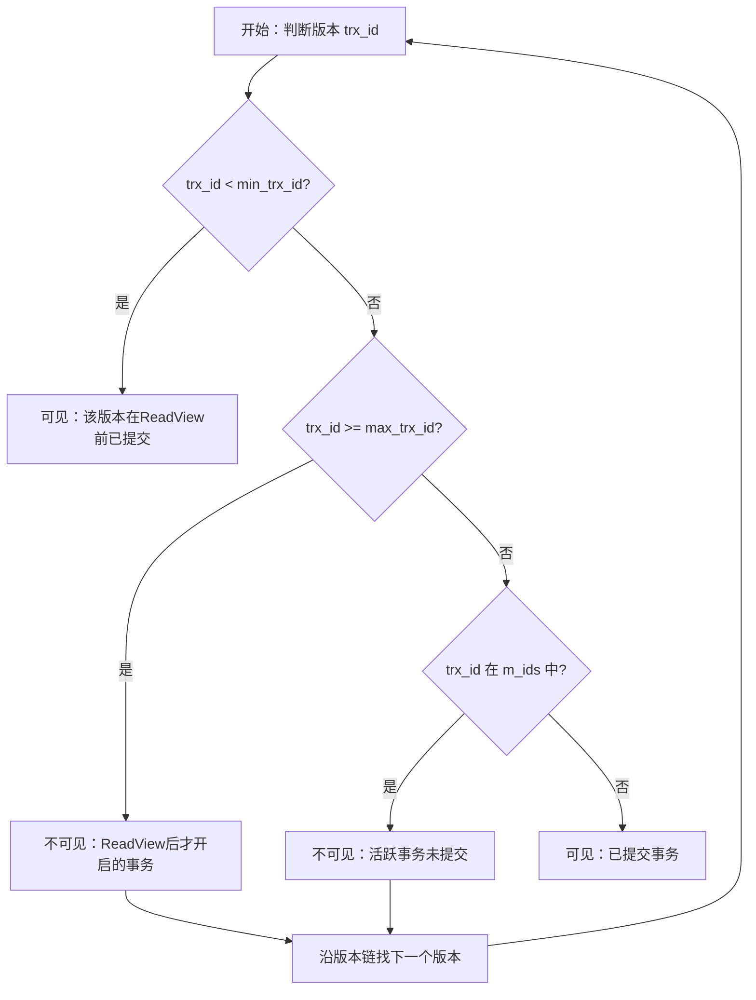

# 事务隔离级别与 MVCC

> **文档说明**：系统讲解数据库事务的 ACID 特性、四种隔离级别、并发事务问题（脏读/不可重复读/幻读）、MVCC（多版本并发控制）底层原理、ReadView 机制、锁机制（行锁/表锁/间隙锁/Next-Key Lock），以及 Spring 事务传播行为。
>
> **适用人群**：后端开发工程师、需要理解数据库并发控制的开发者、准备面试的同学
>
> **前置知识**：[[关系型数据库索引原理]]、[[数据库基础概念]]

---

## 一、事务概述

### 1. 什么是事务

**事务（Transaction）** 是由一组 SQL 语句组成的逻辑执行单元，这组语句要么全部执行成功，要么全部执行失败（回滚），不存在部分执行的中间状态。

```sql
-- 经典转账示例：事务保证转账的原子性
START TRANSACTION;  -- 开启事务
UPDATE account SET balance = balance - 100 WHERE id = 1;  -- A 扣 100
UPDATE account SET balance = balance + 100 WHERE id = 2;  -- B 加 100
COMMIT;  -- 提交事务（如果中间出错则 ROLLBACK 回滚）
```

### 2. ACID 特性

| 特性 | 英文 | 说明 | 实现机制 |
|------|------|------|---------|
| **原子性** | Atomicity | 事务是不可分割的最小单元，要么全成功要么全失败 | undo log（回滚日志） |
| **一致性** | Consistency | 事务执行前后，数据从一个一致状态变为另一个一致状态 | 由原子性+隔离性+持久性共同保证，以及业务约束 |
| **隔离性** | Isolation | 并发事务之间互不干扰，一个事务的中间状态对其他事务不可见 | MVCC + 锁机制 |
| **持久性** | Durability | 事务一旦提交，对数据的修改是永久性的，即使系统崩溃也不丢失 | redo log（重做日志）+ 刷盘机制 |

**ACID 之间的关系**：
- 原子性是基础（undo log）
- 持久性是保障（redo log）
- 隔离性是并发控制的核心（MVCC + 锁）
- 一致性是最终目标（由前三者 + 业务约束共同实现）

### 3. MySQL 事务日志

| 日志 | 作用 | 写入时机 | 恢复时 |
|------|------|---------|--------|
| **undo log** | 回滚数据，实现原子性和 MVCC | 事务修改数据前写入旧值 | 事务回滚时恢复旧值 |
| **redo log** | 崩溃恢复，实现持久性 | 事务修改数据后写入新值（WAL） | 系统崩溃后恢复已提交事务 |
| **binlog** | 主从复制、数据归档、增量备份 | 事务提交时写入 | 主从同步、数据恢复 |

**WAL（Write-Ahead Logging，预写式日志）**：修改数据前先写日志，再修改数据。保证即使系统崩溃，也可以通过 redo log 恢复已提交但未刷盘的数据。

---

## 二、并发事务问题

多个事务并发执行时，如果没有适当的隔离机制，会出现以下问题：

### 1. 脏读（Dirty Read）

**定义**：一个事务读取到了另一个事务**未提交**的数据。如果另一个事务回滚，读取到的就是"脏"数据。

```text
时间   事务A（转账）              事务B（查询）
T1     BEGIN
T2     UPDATE account SET balance=balance-100 WHERE id=1
T3                                BEGIN
T4                                SELECT balance FROM account WHERE id=1  → 读到 900（未提交！）
T5     ROLLBACK（A 回滚，余额恢复为 1000）
T6                                事务B基于 900 做了后续操作 → 数据错误！
```

**后果**：事务 B 基于未提交的数据做决策，数据不一致。

### 2. 不可重复读（Non-Repeatable Read）

**定义**：同一个事务内，两次读取同一行数据，结果不一致（因为另一个事务修改并提交了这行数据）。

```text
时间   事务A                      事务B
T1     BEGIN
T2     SELECT balance FROM account WHERE id=1  → 1000
T3                                BEGIN
T4                                UPDATE account SET balance=900 WHERE id=1
T5                                COMMIT
T6     SELECT balance FROM account WHERE id=1  → 900（和T2不一样！）
```

**后果**：同一个事务内多次读取结果不一致，违反了"可重复读"的预期。

### 3. 幻读（Phantom Read）

**定义**：同一个事务内，两次执行相同的范围查询，第二次查询多出了（或少了）一些行（因为另一个事务在这个范围内插入或删除了数据并提交）。

```text
时间   事务A                      事务B
T1     BEGIN
T2     SELECT * FROM account WHERE balance > 500  → 3 行
T3                                BEGIN
T4                                INSERT INTO account VALUES (4, '新用户', 800)
T5                                COMMIT
T6     SELECT * FROM account WHERE balance > 500  → 4 行（多了一行！像幻觉一样）
```

**后果**：同一个事务内相同范围查询结果不一致，影响基于范围的统计和操作。

### 4. 三种问题对比

| 问题 | 原因 | 关注点 | 解决隔离级别 |
|------|------|--------|------------|
| **脏读** | 读取未提交数据 | 单行数据的正确性 | Read Committed 及以上 |
| **不可重复读** | 读取已提交的修改 | 同一行数据多次读取一致性 | Repeatable Read 及以上 |
| **幻读** | 读取已提交的新增/删除 | 范围查询的结果集一致性 | Serializable（或 InnoDB RR + 间隙锁） |

> **不可重复读 vs 幻读的区别**：不可重复读关注的是**同一行数据被修改**，幻读关注的是**范围内新增/删除了行**。解决不可重复读只需锁行，解决幻读需要锁范围（间隙锁）。

---

## 三、四种隔离级别

SQL 标准定义了四种事务隔离级别，从低到高依次为：

| 隔离级别 | 脏读 | 不可重复读 | 幻读 | 性能 | 说明 |
|---------|------|-----------|------|------|------|
| **Read Uncommitted（读未提交）** | ✅ 可能 | ✅ 可能 | ✅ 可能 | 最高 | 几乎不隔离，实际很少用 |
| **Read Committed（读已提交）** | ❌ 不会 | ✅ 可能 | ✅ 可能 | 高 | Oracle/PostgreSQL/SQL Server 默认 |
| **Repeatable Read（可重复读）** | ❌ 不会 | ❌ 不会 | ✅ 可能（标准）/ ❌（InnoDB） | 中 | **MySQL InnoDB 默认** |
| **Serializable（串行化）** | ❌ 不会 | ❌ 不会 | ❌ 不会 | 最低 | 完全串行执行，性能最差 |

> **重要**：InnoDB 在 Repeatable Read 隔离级别下，通过 **Next-Key Lock（间隙锁+行锁）** 解决了幻读问题，所以 InnoDB 的 RR 级别实际上不会出现幻读（标准 SQL 定义的 RR 会有幻读）。

### 1. 各隔离级别详解

**Read Uncommitted（读未提交）**：
- 事务可以读取其他事务未提交的数据
- 性能最高，但数据一致性最差
- 实际生产中几乎不使用（脏读风险太大）

**Read Committed（读已提交）**：
- 事务只能读取其他事务已提交的数据
- 解决了脏读，但不可重复读和幻读仍然存在
- Oracle、PostgreSQL、SQL Server 的默认隔离级别
- InnoDB 在此级别下使用 Record Lock（行锁），不使用 Gap Lock

**Repeatable Read（可重复读）**：
- 同一个事务内多次读取同一行数据结果一致
- 解决了脏读和不可重复读
- **MySQL InnoDB 的默认隔离级别**
- InnoDB 在此级别下使用 Next-Key Lock 解决幻读
- 通过 MVCC 实现一致性非锁定读（快照读）

**Serializable（串行化）**：
- 所有事务串行执行，完全隔离
- 解决了所有并发问题
- 性能最低，并发能力差
- 只在对数据一致性要求极高且并发量低的场景使用

### 2. 隔离级别设置

```sql
-- 查看当前隔离级别
SELECT @@transaction_isolation;  -- MySQL 8.0+
-- 或
SHOW VARIABLES LIKE 'transaction_isolation';

-- 设置当前会话隔离级别
SET SESSION TRANSACTION ISOLATION LEVEL READ COMMITTED;
SET SESSION TRANSACTION ISOLATION LEVEL REPEATABLE READ;
SET SESSION TRANSACTION ISOLATION LEVEL SERIALIZABLE;

-- 设置全局隔离级别（需 SUPER 权限）
SET GLOBAL TRANSACTION ISOLATION LEVEL READ COMMITTED;

-- 配置文件设置（my.cnf）
[mysqld]
transaction-isolation = READ-COMMITTED
```

### 3. Spring 事务隔离级别

```java
@Transactional(isolation = Isolation.READ_COMMITTED)
public void someMethod() {
    // ...
}

// Spring 支持的隔离级别
Isolation.DEFAULT           // 使用数据库默认隔离级别
Isolation.READ_UNCOMMITTED  // 读未提交
Isolation.READ_COMMITTED    // 读已提交
Isolation.REPEATABLE_READ   // 可重复读
Isolation.SERIALIZABLE      // 串行化
```

---

## 四、MVCC（多版本并发控制）

### 1. 什么是 MVCC

**MVCC（Multi-Version Concurrency Control，多版本并发控制）** 是一种并发控制方法，通过保存数据的多个历史版本，使读操作不需要加锁就能读取到一致性的数据，从而提高并发性能。

MVCC 的核心思想：**读写不阻塞**——读操作读取历史版本（快照），写操作修改当前版本并加锁，读写之间不互相阻塞。

### 2. MVCC 解决了什么问题

| 问题 | 无 MVCC（锁定读） | 有 MVCC |
|------|-------------------|---------|
| 读操作 | 需要加共享锁，阻塞写 | 不加锁，读取快照，不阻塞写 |
| 写操作 | 需要加排他锁，阻塞读 | 加排他锁，但不阻塞快照读 |
| 并发性能 | 读写互相阻塞，并发低 | 读写不阻塞，并发高 |
| 一致性 | 实时读取最新数据 | 读取事务开始时的快照（一致性） |

### 3. MVCC 的实现基础

InnoDB 的 MVCC 依赖以下三个核心机制：

| 机制 | 说明 |
|------|------|
| **隐藏字段** | 每行数据有两个隐藏列：`trx_id`（最后修改该行的事务ID）和 `roll_pointer`（指向 undo log 中旧版本的指针） |
| **undo log** | 保存数据的历史版本，通过 `roll_pointer` 形成版本链 |
| **ReadView** | 事务开启时生成的读视图，决定当前事务能看到哪些版本的数据 |

### 4. 隐藏字段

InnoDB 每行数据除了用户定义的列，还有三个隐藏字段：

| 隐藏字段 | 大小 | 说明 |
|---------|------|------|
| **DB_TRX_ID** | 6字节 | 最后一次插入或更新该行的事务 ID |
| **DB_ROLL_PTR** | 7字节 | 回滚指针，指向 undo log 中该行的旧版本 |
| **DB_ROW_ID** | 6字节 | 隐藏主键（如果表没有定义主键，InnoDB 自动生成） |

```css
一行数据的结构：
┌─────────────────────────────────────────────────────┐
│  用户列1 | 用户列2 | ... | DB_TRX_ID | DB_ROLL_PTR │
└─────────────────────────────────────────────────────┘
                                       │
                                       ▼
                              undo log（旧版本）
                                       │
                                       ▼
                              undo log（更旧版本）
                                       │
                                       ▼
                                    ...（版本链）
```

### 5. 版本链

每次事务修改数据时，都会在 undo log 中记录旧版本，并通过 `roll_pointer` 形成一条版本链：

```text
事务A（trx_id=100）修改 id=1 的行：

当前版本（聚簇索引中）：
  name=李四, balance=900, DB_TRX_ID=100, DB_ROLL_PTR→undo1

undo1（事务A修改前的版本）：
  name=张三, balance=1000, DB_TRX_ID=50, DB_ROLL_PTR→undo2

undo2（事务50修改前的版本）：
  name=初始, balance=0, DB_TRX_ID=10, DB_ROLL_PTR→null

版本链：当前版本 → undo1 → undo2 → null
```

### 6. ReadView（读视图）

**ReadView** 是事务在进行快照读时生成的一个数据结构，记录了当前事务开启时，哪些事务是活跃的（未提交），从而判断版本链中哪个版本对当前事务可见。

ReadView 包含四个核心字段：

| 字段 | 说明 |
|------|------|
| **m_ids** | 生成 ReadView 时，当前系统中所有活跃（未提交）事务的 ID 列表 |
| **min_trx_id** | m_ids 中的最小事务 ID |
| **max_trx_id** | 生成 ReadView 时，系统应该分配给下一个事务的 ID（=当前最大事务ID+1） |
| **creator_trx_id** | 生成该 ReadView 的事务 ID |

**版本可见性判断规则**（按顺序判断）：

1. 如果版本的 `trx_id < min_trx_id`：该版本在 ReadView 生成前就已提交，**可见**
2. 如果版本的 `trx_id >= max_trx_id`：该版本在 ReadView 生成后才开启，**不可见**
3. 如果版本的 `trx_id` 在 `m_ids` 中：该版本是活跃事务（未提交），**不可见**
4. 如果版本的 `trx_id` 不在 `m_ids` 中，且 `min_trx_id <= trx_id < max_trx_id`：该版本已提交，**可见**
5. 如果当前版本不可见，沿版本链找下一个版本，重复上述判断，直到找到可见版本



### 7. 不同隔离级别下 ReadView 的生成时机

| 隔离级别 | ReadView 生成时机 | 效果 |
|---------|------------------|------|
| **Read Committed** | **每次 SELECT 都生成新的 ReadView** | 每次读取都能看到最新已提交的数据 → 不可重复读 |
| **Repeatable Read** | **事务中第一次 SELECT 时生成 ReadView，后续复用** | 整个事务看到的都是同一个快照 → 可重复读 |

这就是为什么 RC 级别会出现不可重复读，而 RR 级别不会——RC 每次查询都生成新的 ReadView，能看到其他事务新提交的数据；RR 只在第一次查询时生成 ReadView，后续复用，看不到其他事务新提交的数据。

### 8. 快照读 vs 当前读

| 读类型 | 说明 | 是否加锁 | 隔离级别 |
|--------|------|---------|---------|
| **快照读（一致性非锁定读）** | 读取 MVCC 版本链中的快照数据 | ❌ 不加锁 | RC/RR 下的普通 SELECT |
| **当前读（锁定读）** | 读取最新版本数据，并加锁 | ✅ 加锁 | SELECT ... FOR UPDATE / LOCK IN SHARE MODE，以及 INSERT/UPDATE/DELETE |

```sql
-- 快照读（不加锁，读快照）
SELECT * FROM account WHERE id = 1;

-- 当前读（加锁，读最新）
SELECT * FROM account WHERE id = 1 FOR UPDATE;        -- 排他锁
SELECT * FROM account WHERE id = 1 LOCK IN SHARE MODE; -- 共享锁

-- 写操作都是当前读
UPDATE account SET balance = 1000 WHERE id = 1;  -- 当前读 + 排他锁
DELETE FROM account WHERE id = 1;                   -- 当前读 + 排他锁
INSERT INTO account VALUES (1, 'test', 1000);      -- 当前读 + 排他锁
```

---

## 五、锁机制

MVCC 解决了读写不阻塞的问题，但写写冲突仍然需要锁来控制。InnoDB 支持多种锁：

### 1. 锁的分类

| 分类维度 | 锁类型 | 说明 |
|---------|--------|------|
| **粒度** | 表锁（Table Lock） | 锁定整张表，并发低 |
| | 行锁（Row Lock） | 锁定单行，并发高 |
| | 元数据锁（MDL） | 保护表结构，DDL 时自动加 |
| **模式** | 共享锁（S Lock / 读锁） | 多个事务可同时持有，阻塞写 |
| | 排他锁（X Lock / 写锁） | 只能一个事务持有，阻塞读写 |
| | 意向锁（IS/IX） | 表级锁，预示将要加行锁 |
| **算法** | Record Lock（记录锁） | 锁定索引记录本身 |
| | Gap Lock（间隙锁） | 锁定索引记录之间的间隙 |
| | Next-Key Lock（临键锁） | Record Lock + Gap Lock，锁定记录+前面的间隙 |
| | Insert Intention Lock（插入意向锁） | INSERT 时加，预示要插入 |

### 2. 行锁的三种算法（InnoDB RR 级别）

| 锁算法 | 锁定范围 | 作用 | 场景 |
|--------|---------|------|------|
| **Record Lock** | 索引记录本身 | 防止其他事务修改/删除该行 | 等值查询命中唯一索引 |
| **Gap Lock** | 索引记录之间的间隙（不包含记录本身） | 防止其他事务在间隙中插入新行 → 解决幻读 | 范围查询、等值查询未命中 |
| **Next-Key Lock** | 记录 + 记录前面的间隙（左开右闭区间） | Record Lock + Gap Lock，同时防止修改和插入 | InnoDB RR 默认行锁算法 |

**Next-Key Lock 的锁定区间**：
```text
索引记录：10, 20, 30, 40

Next-Key Lock 区间（左开右闭）：
  (-∞, 10]  → 锁定 10 及之前的间隙
  (10, 20]   → 锁定 20 及 10~20 之间的间隙
  (20, 30]   → 锁定 30 及 20~30 之间的间隙
  (30, 40]   → 锁定 40 及 30~40 之间的间隙
  (40, +∞)   → 锁定 40 之后的间隙（ supremum 虚拟记录）
```

**加锁规则（InnoDB RR，唯一索引等值查询）**：

| 查询类型 | 命中情况 | 加锁类型 |
|---------|---------|---------|
| 等值查询唯一索引 | 命中 | Record Lock（只锁记录，不锁间隙） |
| 等值查询唯一索引 | 未命中 | Gap Lock（锁记录所在的间隙） |
| 等值查询普通索引 | 命中 | Next-Key Lock + 记录锁 |
| 范围查询 | - | Next-Key Lock（扫描到的所有记录+间隙） |

### 3. 间隙锁如何解决幻读

```sql
-- 事务A（RR 隔离级别）
BEGIN;
SELECT * FROM account WHERE id > 10 FOR UPDATE;
-- 加 Next-Key Lock：锁定 (10, 20], (20, 30], (30, 40], (40, +∞)
-- 即锁定 id>10 的所有记录和间隙

-- 事务B 尝试插入
INSERT INTO account VALUES (15, 'test', 1000);
-- 被阻塞！因为 15 在 (10, 20] 间隙中，被 Gap Lock 锁定
-- 事务B 必须等待事务A提交/回滚才能插入

-- 事务A 再次查询
SELECT * FROM account WHERE id > 10;
-- 结果和第一次一样，没有新增行 → 没有幻读！
```

### 4. 意向锁（Intention Lock）

意向锁是表级锁，用于表示事务**打算**在表中的某些行上加锁。

| 意向锁 | 说明 | 与其他锁的兼容性 |
|--------|------|----------------|
| **IS（意向共享锁）** | 打算给某些行加 S 锁 | IS/IX 兼容，与 S 兼容，与 X 不兼容 |
| **IX（意向排他锁）** | 打算给某些行加 X 锁 | IS/IX 兼容，与 S/X 都不兼容 |

**意向锁的作用**：提高加表锁的效率。如果没有意向锁，加表锁前需要逐行检查是否有行锁；有了意向锁，只需检查表上是否有冲突的意向锁即可。

```text
兼容性矩阵（行锁=意向锁，表锁=S/X）：
      X    S    IX   IS
X     ✗    ✗    ✗    ✗
S     ✗    ✓    ✗    ✓
IX    ✗    ✗    ✓    ✓
IS    ✗    ✓    ✓    ✓
```

### 5. 死锁

**死锁**是指两个或多个事务互相等待对方持有的锁，导致都无法继续执行。

```sql
事务A                          事务B
BEGIN                          BEGIN
UPDATE account SET balance=100 WHERE id=1  → 持有 id=1 的行锁
                               UPDATE account SET balance=200 WHERE id=2  → 持有 id=2 的行锁
UPDATE account SET balance=100 WHERE id=2  → 等待 id=2 的锁（被B持有）
                               UPDATE account SET balance=200 WHERE id=1  → 等待 id=1 的锁（被A持有）
                               → 死锁！
```

**InnoDB 死锁处理**：
- **自动检测**：InnoDB 有死锁检测机制，发现死锁后自动回滚代价最小的事务
- **innodb_lock_wait_timeout**：锁等待超时（默认 50 秒），超时后回滚
- **死锁日志**：`SHOW ENGINE INNODB STATUS` 查看最近一次死锁信息

**死锁预防**：
1. 统一加锁顺序（所有事务按相同顺序加锁）
2. 缩短事务时间，减少锁持有时间
3. 避免大事务，拆分为小事务
4. 合理使用索引，减少锁范围
5. 降低隔离级别（RC 级别没有间隙锁，死锁概率低）
6. 使用 `SELECT ... FOR UPDATE SKIP LOCKED` 跳过已锁定的行

---

## 六、Spring 事务传播行为

### 1. 传播行为类型

事务传播行为定义了当一个事务方法调用另一个事务方法时，事务如何传播。

| 传播行为 | 说明 | 特点 |
|---------|------|------|
| **REQUIRED**（默认） | 如果当前有事务则加入，没有则新建 | 最常用，默认值 |
| **REQUIRES_NEW** | 总是新建事务，如果当前有事务则挂起 | 独立事务，不受外部事务影响 |
| **SUPPORTS** | 有事务则加入，没有则非事务执行 | 支持事务但不强制 |
| **NOT_SUPPORTED** | 总是非事务执行，如果当前有事务则挂起 | 强制非事务 |
| **MANDATORY** | 必须在事务中执行，没有事务则抛异常 | 强制要求外部有事务 |
| **NEVER** | 必须非事务执行，有事务则抛异常 | 强制要求外部无事务 |
| **NESTED** | 如果当前有事务则嵌套事务（保存点），没有则新建 | 嵌套事务，可独立回滚到保存点 |

### 2. 常用传播行为详解

**REQUIRED（默认）**：
```java
@Transactional  // REQUIRED
public void methodA() {
    methodB();  // methodB 加入 methodA 的事务
    // methodA 和 methodB 在同一个事务中，一起提交或回滚
}

@Transactional(propagation = Propagation.REQUIRED)
public void methodB() {
    // ...
}
```

**REQUIRES_NEW**：
```java
@Transactional
public void methodA() {
    methodB();  // methodB 新建独立事务，methodA 的事务挂起
    // methodB 提交后 methodA 才继续
    // methodA 回滚不影响 methodB（已提交）
}

@Transactional(propagation = Propagation.REQUIRES_NEW)
public void methodB() {
    // 独立事务
}
```

**NESTED（嵌套事务）**：
```java
@Transactional
public void methodA() {
    methodB();  // methodB 在 methodA 事务中创建保存点
    // methodB 回滚只回滚到保存点，不影响 methodA
    // methodA 回滚会连带 methodB 一起回滚
}

@Transactional(propagation = Propagation.NESTED)
public void methodB() {
    // 嵌套事务（保存点）
}
```

### 3. Spring 事务失效场景

| 场景 | 原因 | 解决方案 |
|------|------|---------|
| 方法非 public | Spring AOP 只能拦截 public 方法 | 改为 public |
| 同类内部调用 | this 调用不走代理 | 注入自身代理 / 拆分到不同类 |
| 异常被 catch | 异常被捕获未抛出，Spring 不知道出错 | 重新抛出 / 手动设置 rollback |
| 异常类型不匹配 | 默认只回滚 RuntimeException 和 Error | 配置 rollbackFor |
| 数据库不支持事务 | MyISAM 引擎不支持事务 | 使用 InnoDB 引擎 |
| 多线程 | 新线程不在事务上下文中 | 事务方法内不要开新线程操作数据库 |
| final 方法/类 | final 无法被 CGLIB 代理 | 去掉 final |

```java
// 常见失效：同类内部调用
@Service
public class UserService {
    public void methodA() {
        this.methodB();  // ❌ this 调用，不走代理，事务失效！
    }

    @Transactional
    public void methodB() {
        // 事务不生效
    }
}

// 解决方案：注入自身代理
@Service
public class UserService {
    @Autowired
    private UserService self;  // 注入代理对象

    public void methodA() {
        self.methodB();  // ✅ 通过代理调用，事务生效
    }

    @Transactional
    public void methodB() {
        // 事务生效
    }
}
```

---

## 七、常见问题与排查

| 问题 | 原因 | 解决方案 |
|------|------|---------|
| 脏读 | 隔离级别太低（Read Uncommitted） | 提升到 Read Committed 及以上 |
| 不可重复读 | RC 级别每次 SELECT 生成新 ReadView | 提升到 Repeatable Read |
| 幻读 | RR 级别用快照读不会幻读，当前读可能 | 用 SELECT ... FOR UPDATE 加 Next-Key Lock |
| 锁等待超时 | 事务持有锁时间过长 / 死锁 | 优化事务，缩短锁持有时间，检查死锁 |
| 死锁 | 加锁顺序不一致 / 大事务 | 统一加锁顺序，拆分大事务，降低隔离级别 |
| 主从延迟 | 大事务 binlog 传输/应用慢 | 避免大事务，拆分小事务，并行复制 |
| Spring 事务不回滚 | 异常被 catch / 非 RuntimeException | 配置 rollbackFor，重新抛出异常 |
| Spring 事务失效 | 同类内部调用 / 非 public | 通过代理调用，改为 public |
| 数据不一致 | 分布式事务 / 最终一致性延迟 | 使用分布式事务方案，增加对账补偿 |

---

## 八、关联笔记

### 数据库
- [[关系型数据库索引原理]] · [[数据库分库分表策略]] · [[MySQL-性能优化实战]]
- [[Redis数据结构与应用场景]] · [[数据库连接池-HikariCP与Druid]]

### 分布式
- [[分布式事务解决方案]] · [[分布式锁原理与实现]] · [[分布式ID生成方案]]
- [[微服务架构核心概念]]

### 后端
- [[SpringBoot-自动装配原理]] · [[Spring事务管理与传播机制]] · [[MyBatis-核心原理与插件]]
- [[Gateway-网关路由与鉴权]]

### 架构
- [[高并发系统设计案例]] · [[秒杀系统架构设计]] · [[高可用架构设计]]

### 计算机基础
- [[数据结构与算法核心]] · [[操作系统核心概念]]

### 导航
- [[MOC-后端开发]] · [[全栈+AI工程双轨融合学习路线图]]

> **学习路径建议**：先掌握 [[关系型数据库索引原理]] → 深入本文事务与 MVCC → 学习 [[MySQL-性能优化实战]] SQL 优化 → 研究 [[分布式事务解决方案]] 分布式场景 → 实践 [[高并发系统设计案例]] 和 [[秒杀系统架构设计]] 高并发架构。

---

## 💡 全文深度讲解

本文系统梳理了事务隔离级别与 MVCC的核心知识体系，从事务概述入手，深入并发事务问题的底层机制，再通过四种隔离级别掌握实战应用，最后涵盖常见问题与排查与关联笔记。学习时建议先建立整体认知，再动手实践，最后结合常见问题深化理解。

## 📝 全文精简总结

- **事务概述**：掌握本模块的核心概念与关键要点
- **并发事务问题**：掌握本模块的核心概念与关键要点
- **四种隔离级别**：掌握本模块的核心概念与关键要点
- **MVCC（多版本并发控制）**：掌握本模块的核心概念与关键要点
- **锁机制**：掌握本模块的核心概念与关键要点
- **Spring 事务传播行为**：掌握本模块的核心概念与关键要点
- **常见问题与排查**：掌握本模块的核心概念与关键要点
- **关联笔记**：掌握本模块的核心概念与关键要点

