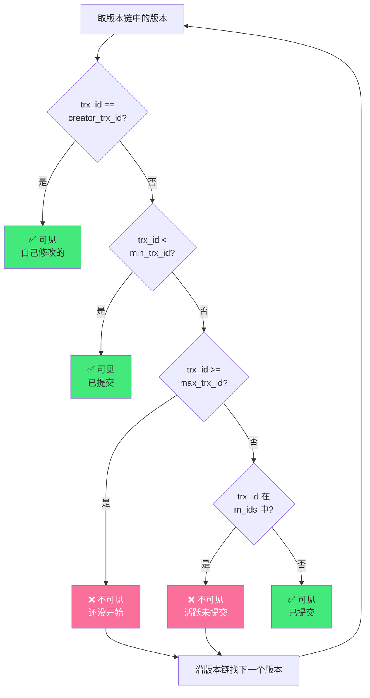

# 🔒 事务隔离级别与 MVCC 详解

> **文档说明**：深入讲解数据库事务 ACID 特性、四种隔离级别、三大并发问题（脏读/不可重复读/幻读）、MySQL InnoDB 的 MVCC 实现原理（隐藏字段/版本链/ReadView/可见性判断）、锁机制（共享锁/排他锁/记录锁/间隙锁/临键锁）、快照读与当前读、死锁排查与预防、最佳实践。MVCC 是数据库并发控制的核心，理解它才能写出正确的高并发代码。
>
> **适用人群**：后端开发者、DBA、架构师、面试备考者
>
> **前置知识**：[[MySQL基础与SQL实战]] · [[索引原理与SQL优化]]

---

## 一、概述

### 1.1 什么是事务

事务（Transaction）是一组**要么全部成功、要么全部失败**的 SQL 操作，是数据库并发控制的基本单位。

**经典案例：银行转账**
```text
事务：A 向 B 转账 100 元
  1. A 账户扣 100 元
  2. B 账户加 100 元
要么两步都成功，要么都失败（回滚），不能只扣不加。
```

### 1.2 ACID 四大特性

| 特性 | 英文 | 说明 | 实现方式 |
|------|------|------|---------|
| **原子性** | Atomicity | 事务要么全做，要么全不做 | undo log（回滚日志） |
| **一致性** | Consistency | 数据从一个一致状态到另一个一致状态 | 其他三个特性的共同保证 |
| **隔离性** | Isolation | 并发事务之间互不干扰 | 锁 + MVCC（多版本并发控制） |
| **持久性** | Durability | 事务提交后数据永久保存，不丢失 | redo log（重做日志）+ 刷盘机制 |

> **注意**：一致性是最终目标，原子性、隔离性、持久性是手段。

### 1.3 为什么需要隔离级别

在并发环境下，多个事务同时操作同一数据，可能产生各种问题。隔离级别定义了「事务之间的隔离程度」——隔离越高，并发问题越少，但性能越低。


| 隔离级别 | 脏读 | 不可重复读 | 幻读 | 性能 |
|---------|------|-----------|------|------|
| **读未提交** Read Uncommitted | ❌ 可能 | ❌ 可能 | ❌ 可能 | 最高 |
| **读已提交** Read Committed | ✅ 解决 | ❌ 可能 | ❌ 可能 | 高 |
| **可重复读** Repeatable Read | ✅ 解决 | ✅ 解决 | ❌ 可能（MySQL 用 MVCC+间隙锁解决） | 中 |
| **串行化** Serializable | ✅ 解决 | ✅ 解决 | ✅ 解决 | 最低 |

---

## 二、底层原理

### 2.1 三大并发问题详解

#### 脏读（Dirty Read）

读到了其他事务**未提交**的数据。如果那个事务回滚了，读到的就是「脏数据」。

```text
时间  事务A                      事务B
 T1   START TRANSACTION;
 T2   SELECT balance FROM account WHERE id=1;  -- 读到 1000
 T3                              START TRANSACTION;
 T4                              UPDATE account SET balance=500 WHERE id=1;  -- 未提交
 T5   SELECT balance FROM account WHERE id=1;  -- 读到 500（脏读！）
 T6                              ROLLBACK;  -- 回滚，实际还是 1000
 T7   -- A 以为是 500，实际是 1000，数据不一致
```

#### 不可重复读（Non-Repeatable Read）

同一事务内，两次读**同一行**，结果不同（被其他事务修改并提交了）。

```text
时间  事务A（RC级别）             事务B
 T1   START TRANSACTION;
 T2   SELECT balance FROM account WHERE id=1;  -- 读到 1000
 T3                              START TRANSACTION;
 T4                              UPDATE account SET balance=2000 WHERE id=1;
 T5                              COMMIT;
 T6   SELECT balance FROM account WHERE id=1;  -- 读到 2000（不可重复读！）
 T7   COMMIT;
```

#### 幻读（Phantom Read）

同一事务内，两次**范围查询**，结果行数不同（其他事务插入/删除了符合条件的行）。

```text
时间  事务A（RR级别）             事务B
 T1   START TRANSACTION;
 T2   SELECT * FROM account WHERE id > 5;  -- 查到 3 行
 T3                              START TRANSACTION;
 T4                              INSERT INTO account VALUES (6, '新用户', 100);
 T5                              COMMIT;
 T6   SELECT * FROM account WHERE id > 5;  -- 快照读：还是 3 行（MVCC保证）
 T7   SELECT * FROM account WHERE id > 5 FOR UPDATE;  -- 当前读：4 行（幻读！）
 T8   COMMIT;
```

> **不可重复读 vs 幻读**：不可重复读是「同一行数据被修改」，幻读是「范围内行数变化（插入/删除）」。解决不可重复读只需锁行，解决幻读需要锁范围（间隙锁）。

### 2.2 MVCC 核心原理

MVCC（Multi-Version Concurrency Control，多版本并发控制）是 InnoDB 实现隔离级别的核心机制。它让**读操作不加锁**，通过版本链实现并发安全，大幅提升并发性能。

#### 隐藏字段

每行数据除了用户定义的列，还有 3 个隐藏字段：

| 隐藏字段 | 大小 | 说明 |
|---------|------|------|
| `DB_TRX_ID` | 6 字节 | 最后一次修改（插入/更新）这行的事务 ID |
| `DB_ROLL_PTR` | 7 字节 | 回滚指针，指向 undo log 中的旧版本（形成版本链） |
| `DB_ROW_ID` | 6 字节 | 隐藏主键（用户没定义主键时自动生成） |

#### 版本链（Version Chain）


每次修改数据时：
1. 用**排他锁**锁住当前行
2. 把旧值写入 undo log
3. 修改当前行的值，更新 `DB_TRX_ID` 为当前事务 ID
4. 更新 `DB_ROLL_PTR` 指向 undo log 中的旧版本

这样就形成了一条版本链，链头是当前最新版本，链尾是最初版本。

#### ReadView（读视图）

事务进行**快照读**（普通 SELECT）时，会创建一个 ReadView，决定「能看到版本链中的哪个版本」。

ReadView 包含 4 个核心字段：

| 字段 | 说明 |
|------|------|
| `m_ids` | 创建 ReadView 时，当前活跃（未提交）的事务 ID 列表 |
| `min_trx_id` | m_ids 中的最小事务 ID |
| `max_trx_id` | 创建 ReadView 时，下一个要分配的事务 ID（= 最大活跃 ID + 1） |
| `creator_trx_id` | 创建这个 ReadView 的事务 ID |

#### 可见性判断规则

从版本链头开始，依次判断每个版本的 `trx_id`：



**简化记忆**：
1. 自己改的 → 可见
2. 比最小活跃事务还小 → 已提交，可见
3. 比最大事务还大 → 还没开始，不可见
4. 在活跃事务列表中 → 未提交，不可见
5. 不在活跃列表中 → 已提交，可见

#### RC vs RR 的本质区别

| 隔离级别 | ReadView 创建时机 | 效果 |
|---------|-----------------|------|
| **读已提交（RC）** | **每次 SELECT 都创建新的 ReadView** | 能读到其他事务刚提交的数据 → 不可重复读 |
| **可重复读（RR）** | **只在第一次 SELECT 创建 ReadView，后续复用** | 同一事务内读到的数据一致 → 可重复读 |

> **这就是 RC 和 RR 的唯一本质区别**：ReadView 的创建时机不同。其他机制（版本链、可见性判断）完全一样。

### 2.3 快照读 vs 当前读

| 读类型 | SQL 示例 | 实现方式 | 是否加锁 |
|--------|---------|---------|---------|
| **快照读** | `SELECT * FROM t WHERE ...` | MVCC 版本链 + ReadView | ❌ 不加锁 |
| **当前读** | `SELECT ... FOR UPDATE` | 读取最新版本 + 加锁 | ✅ 加锁 |
| **当前读** | `SELECT ... LOCK IN SHARE MODE` | 读取最新版本 + 加共享锁 | ✅ 加 S 锁 |
| **当前读** | `INSERT / UPDATE / DELETE` | 先当前读，再修改 | ✅ 加 X 锁 |

> **关键**：MVCC 只保证「快照读」的可重复读。「当前读」看到的是最新数据，需要靠锁（Next-Key Lock）防止幻读。

### 2.4 InnoDB 锁机制

| 锁类型 | 英文 | 说明 | 兼容性 |
|--------|------|------|--------|
| **共享锁** | S Lock / Read Lock | 读锁，多个事务可同时加 | S 与 S 兼容，S 与 X 互斥 |
| **排他锁** | X Lock / Write Lock | 写锁，独占 | X 与所有锁互斥 |
| **记录锁** | Record Lock | 锁单行索引记录 | - |
| **间隙锁** | Gap Lock | 锁索引之间的间隙，防止插入 | 间隙锁之间兼容（都不允许插入） |
| **临键锁** | Next-Key Lock | 记录锁 + 间隙锁（左开右闭区间） | RR 级别默认的行锁算法 |

**Next-Key Lock 如何解决幻读**：
```text
索引：1, 5, 10, 20
临键锁区间：(-∞,1], (1,5], (5,10], (10,20], (20,+∞]

事务A：SELECT * FROM t WHERE id > 5 FOR UPDATE;
  → 锁住 (5,10], (10,20], (20,+∞] 三个区间
  → 其他事务无法在这些区间插入新行
  → 防止幻读
```

---

## 三、实操示例

### 3.1 查看和设置隔离级别

```sql
-- 查看当前隔离级别
SELECT @@transaction_isolation;
-- 结果：REPEATABLE-READ（MySQL 默认）

-- 查看全局隔离级别
SELECT @@global.transaction_isolation;

-- 设置当前会话隔离级别
SET SESSION TRANSACTION ISOLATION LEVEL READ UNCOMMITTED;
SET SESSION TRANSACTION ISOLATION LEVEL READ COMMITTED;
SET SESSION TRANSACTION ISOLATION LEVEL REPEATABLE READ;   -- 默认
SET SESSION TRANSACTION ISOLATION LEVEL SERIALIZABLE;

-- 设置全局隔离级别（需要重启或新连接生效）
SET GLOBAL TRANSACTION ISOLATION LEVEL READ COMMITTED;
```

### 3.2 演示脏读（读未提交级别）

```sql
-- ===== 会话A：读未提交级别 =====
SET SESSION TRANSACTION ISOLATION LEVEL READ UNCOMMITTED;
START TRANSACTION;
SELECT balance FROM account WHERE id = 1;  -- 1000

-- ===== 会话B：修改但不提交 =====
START TRANSACTION;
UPDATE account SET balance = 500 WHERE id = 1;  -- 未提交

-- ===== 会话A：再次读（脏读） =====
SELECT balance FROM account WHERE id = 1;  -- 500（脏读！读到了未提交的数据）

-- ===== 会话B：回滚 =====
ROLLBACK;  -- 实际还是 1000

-- ===== 会话A：数据不一致 =====
SELECT balance FROM account WHERE id = 1;  -- 1000
COMMIT;
```

### 3.3 演示不可重复读（RC 级别）

```sql
-- ===== 会话A：RC级别 =====
SET SESSION TRANSACTION ISOLATION LEVEL READ COMMITTED;
START TRANSACTION;
SELECT balance FROM account WHERE id = 1;  -- 1000

-- ===== 会话B：修改并提交 =====
START TRANSACTION;
UPDATE account SET balance = 2000 WHERE id = 1;
COMMIT;

-- ===== 会话A：再次读（不可重复读） =====
SELECT balance FROM account WHERE id = 1;  -- 2000（不可重复读！RC级别正常现象）
COMMIT;

-- ===== 对比：RR级别 =====
SET SESSION TRANSACTION ISOLATION LEVEL REPEATABLE READ;
START TRANSACTION;
SELECT balance FROM account WHERE id = 1;  -- 2000
-- 会话B修改为3000并提交
SELECT balance FROM account WHERE id = 1;  -- 还是2000（可重复读！MVCC保证）
COMMIT;
```

### 3.4 演示幻读与 Next-Key Lock

```sql
-- ===== 会话A：RR级别，当前读 =====
START TRANSACTION;
SELECT * FROM account WHERE id > 5 FOR UPDATE;
-- 结果：id=6, id=8（2行）
-- 加了 Next-Key Lock：锁住 (5,6], (6,8], (8,+∞]

-- ===== 会话B：尝试插入 =====
INSERT INTO account VALUES (7, '新用户', 100);
-- 阻塞！等待锁释放（因为 7 在 (6,8] 区间内）

-- ===== 会话A：再次当前读 =====
SELECT * FROM account WHERE id > 5 FOR UPDATE;
-- 还是 2 行（没有幻读，因为间隙锁阻止了插入）

COMMIT;  -- 释放锁，会话B的插入才执行
```

### 3.5 死锁演示与排查

```sql
-- ===== 死锁产生：加锁顺序不一致 =====

-- 会话A
START TRANSACTION;
UPDATE account SET balance = balance - 100 WHERE id = 1;  -- 获得 id=1 的 X 锁
-- 此时会话B获得了 id=2 的 X 锁
UPDATE account SET balance = balance + 100 WHERE id = 2;  -- 等待 id=2 的锁 → 阻塞

-- 会话B
START TRANSACTION;
UPDATE account SET balance = balance - 100 WHERE id = 2;  -- 获得 id=2 的 X 锁
UPDATE account SET balance = balance + 100 WHERE id = 1;  -- 等待 id=1 的锁 → 死锁！

-- MySQL 自动检测死锁，选择一个事务回滚（通常是回滚代价小的）
-- 报错：Deadlock found when trying to get lock; try restarting transaction

-- ===== 查看死锁日志 =====
SHOW ENGINE INNODB STATUS;
-- 查看 LATEST DETECTED DEADLOCK 部分

-- ===== 查看当前锁等待 =====
SELECT * FROM information_schema.innodb_trx;       -- 当前事务
SELECT * FROM performance_schema.data_locks;        -- 当前锁
SELECT * FROM performance_schema.data_lock_waits;   -- 锁等待关系

-- ===== 预防死锁 =====
-- 1. 统一加锁顺序（都按 id 从小到大加锁）
-- 2. 缩短事务，减少锁持有时间
-- 3. 避免大事务
-- 4. 合理使用索引（无索引会锁全表）
-- 5. 必要时用 SELECT ... FOR UPDATE 显式加锁
```

### 3.6 MVCC 实战：长事务问题

```sql
-- ===== 长事务导致 undo log 膨胀 =====

-- 会话A：开启一个长事务
START TRANSACTION;
SELECT * FROM account WHERE id = 1;  -- 创建 ReadView，此时活跃事务列表为空

-- 接下来 1 小时内，其他事务不断修改数据
-- 但会话A的 ReadView 不变，它需要能看到事务开始时的版本
-- 所以这些修改产生的 undo log 都不能被 purge（清理）
-- 导致 undo log 不断膨胀，占用大量磁盘空间

-- 查看长事务
SELECT * FROM information_schema.innodb_trx 
WHERE TIME_TO_SEC(TIMEDIFF(NOW(), trx_started)) > 60;  -- 超过60秒的事务

-- 解决方案：
-- 1. 避免长事务，事务尽量短小
-- 2. 监控长事务，及时告警
-- 3. 只读事务可以用 START TRANSACTION READ ONLY
```

---

## 四、常见问题与排查

| 问题现象 | 可能原因 | 解决方案 |
|---------|---------|---------|
| **脏读** | 隔离级别太低（读未提交） | 使用 RC 及以上级别，MySQL 默认 RR |
| **不可重复读** | RC 级别正常现象 | 用 RR 级别；或对读操作加锁（`FOR UPDATE`） |
| **幻读（当前读）** | 当前读没加范围锁 | RR 级别用 `FOR UPDATE` 触发 Next-Key Lock |
| **死锁** | 加锁顺序不一致；长事务 | 统一加锁顺序；缩短事务；`SHOW ENGINE INNODB STATUS` 排查 |
| **锁等待超时** | 长事务持锁；锁冲突 | 优化事务，减少锁持有时间；`innodb_lock_wait_timeout` 调整 |
| **undo log 膨胀** | 长事务持有旧版本 ReadView | 避免长事务；监控 `innodb_trx`；及时提交 |
| **CPU 飙高** | 大量锁等待自旋 | 检查锁冲突；优化 SQL；增加索引 |
| **更新丢失** | 应用层没加乐观锁/悲观锁 | 用 `version` 字段乐观锁；或 `SELECT ... FOR UPDATE` |
| **全表锁** | UPDATE/DELETE 没走索引 | 确保 WHERE 条件有索引；`EXPLAIN` 检查执行计划 |
| **间隙锁导致插入慢** | RR 级别 Next-Key Lock 范围大 | 业务允许的话用 RC 级别；优化查询条件 |
| **主从数据不一致** | 隔离级别/复制模式问题 | 用 `ROW` 格式复制；检查主从隔离级别一致 |
| **MVCC 不生效** | 用了当前读（FOR UPDATE） | 普通 SELECT 才是快照读，当前读走锁机制 |

---

## 五、进阶与最佳实践

### 5.1 隔离级别选择指南

| 场景 | 推荐隔离级别 | 原因 |
|------|------------|------|
| **大多数 OLTP 系统** | RR（MySQL 默认） | 平衡并发和一致性，MVCC 性能好 |
| **Oracle/PostgreSQL 默认** | RC | 减少间隙锁，并发更高，靠应用层保证一致性 |
| **金融/账务系统** | RR + 显式锁 | 数据一致性要求高，关键操作 `FOR UPDATE` |
| **报表/数据分析** | RC 或 RR | 读多写少，对一致性要求不高 |
| **数据迁移/批量处理** | RC | 减少锁冲突，提高并发 |
| **极端一致性要求** | Serializable | 完全串行，性能最低，极少使用 |

> **经验**：MySQL 默认 RR 对大多数场景够用。如果遇到大量间隙锁导致的插入冲突，可以考虑切到 RC（互联网公司常用做法），但要在应用层处理不可重复读的问题。

### 5.2 并发控制最佳实践

```text
✅ 事务尽量短小：只把必须原子的操作放在事务里
✅ 统一加锁顺序：所有事务按相同顺序加锁，避免死锁
✅ 避免大事务：大事务导致 undo log 膨胀、锁持有时间长
✅ 索引覆盖：UPDATE/DELETE 的 WHERE 条件必须有索引，否则锁全表
✅ 显式加锁：关键更新用 SELECT ... FOR UPDATE 先锁行
✅ 乐观锁：高并发读多写少场景用 version 字段乐观锁
✅ 监控长事务：超过 60 秒的事务告警
✅ 合理设置超时：innodb_lock_wait_timeout=50（默认50秒）
✅ 避免在事务中做外部调用：HTTP/RPC 调用会拉长事务
✅ 批量操作分批：大更新拆成小批次，每批一个事务
```

### 5.3 乐观锁 vs 悲观锁

| 维度 | 乐观锁 | 悲观锁（MVCC/锁） |
|------|--------|-----------------|
| **思想** | 假设冲突少，提交时检查 | 假设冲突多，先加锁再操作 |
| **实现** | version 字段 / CAS | `SELECT ... FOR UPDATE` / MVCC |
| **适用** | 读多写少，冲突概率低 | 写多，冲突概率高 |
| **性能** | 无锁，并发高 | 有锁等待，并发较低 |
| **缺点** | 冲突多时重试成本高 | 锁等待、死锁风险 |

```sql
-- 乐观锁示例
UPDATE account SET balance = balance - 100, version = version + 1
WHERE id = 1 AND version = 5;  -- 只有 version 匹配才更新
-- 影响行数为 0 说明被别人改了，需要重试
```

### 5.4 生产环境 Checklist

| 类别 | 检查项 | 说明 |
|------|--------|------|
| **配置** | 隔离级别 | 默认 RR，根据业务评估是否切 RC |
| **配置** | `innodb_lock_wait_timeout` | 锁等待超时，默认 50 秒 |
| **配置** | `innodb_deadlock_detect` | 死锁检测，默认开启 |
| **监控** | 长事务 | 超过 60 秒告警 |
| **监控** | 死锁次数 | `SHOW ENGINE INNODB STATUS` |
| **监控** | 锁等待 | `performance_schema.data_lock_waits` |
| **监控** | undo log 大小 | 防止膨胀 |
| **开发** | 事务大小 | 避免大事务，事务内不做外部调用 |
| **开发** | 加锁顺序 | 统一顺序，防止死锁 |
| **开发** | 索引 | 写操作必须走索引 |
| **开发** | 重试机制 | 死锁/锁等待时应用层重试 |
| **开发** | 乐观锁 | 高并发场景用 version 字段 |

---

## 六、关联笔记

### 数据库
- [[MySQL基础与SQL实战]] · [[索引原理与SQL优化]] · [[数据库分库分表策略]]
- [[Redis-分布式锁与缓存穿透]] · [[MySQL主从复制与读写分离]]

### 并发与分布式
- [[Java并发编程核心]] · [[分布式事务解决方案]] · [[Redis-分布式锁与缓存穿透]]

### 计算机基础
- [[操作系统-进程与线程]] · [[计算机网络-TCPIP]]

### 导航
- [[MOC-计算机基础]] · [[MOC-数据库原理]] · [[MOC-综合导航]] · [[Home]]

> 🔍 **知识点深度解析**
>
> **作用**：事务隔离级别与 MVCC 解决的是「数据库并发操作时如何保证数据一致性，同时最大化并发性能」的问题，是所有后端开发者必须掌握的核心知识。
>
> **底层原理**：InnoDB 通过 undo log 保存数据的历史版本，形成版本链；事务读取时创建 ReadView（包含活跃事务列表），按可见性规则从版本链中找到「应该看到的版本」，实现「读不加锁」。RC 和 RR 的唯一区别是 ReadView 创建时机：RC 每次读都创建新 ReadView（能看到最新提交），RR 只在第一次读创建（看到事务开始时的快照）。当前读（FOR UPDATE/INSERT/UPDATE/DELETE）走锁机制，RR 级别用 Next-Key Lock（记录锁+间隙锁）防止幻读。
>
> **用法要点**：① MySQL 默认 RR，大多数场景够用 ② 普通 SELECT 是快照读（MVCC，不加锁），FOR UPDATE 是当前读（加锁） ③ 事务尽量短小，避免长事务导致 undo log 膨胀 ④ 统一加锁顺序防止死锁 ⑤ UPDATE/DELETE 必须走索引，否则锁全表 ⑥ 死锁时 `SHOW ENGINE INNODB STATUS` 排查 ⑦ 高并发读多写少用乐观锁（version 字段） ⑧ 理解 RC 和 RR 的本质区别是 ReadView 创建时机。

> 💡 **深度讲解**：MVCC 是数据库最精妙的设计之一——它让读操作完全不加锁，通过版本链实现了「每个事务看到自己的快照」，大幅提升了并发性能。理解 MVCC 的关键是理解「每个事务看到的是哪个版本的数据」：当你执行 SELECT 时，InnoDB 不是直接返回当前最新值，而是沿着版本链找第一个「对你可见」的版本。可见性由 ReadView 决定——它记录了「你开始读的时候，哪些事务还没提交」，那些事务的修改对你不可见。RC 和 RR 的区别就在于「什么时候拍这张快照」：RC 每次读都重新拍（所以能看到别人刚提交的），RR 只拍一次（所以看到的始终是开始时的样子）。这就是为什么 RR 能可重复读——不是锁住了数据，而是你一直在看同一个旧快照。

> 📝 **精简总结**：事务 = ACID（原子性 undo log / 持久性 redo log / 隔离性 锁+MVCC）。隔离级别：读未提交→读已提交→可重复读→串行化，逐级解决脏读→不可重复读→幻读。MVCC = 隐藏字段（trx_id/roll_ptr）+ 版本链（undo log）+ ReadView（活跃事务列表）+ 可见性判断。RC 每次读创建新 ReadView，RR 只创建一次。当前读用 Next-Key Lock 防幻读。默认 RR，事务短小，统一加锁顺序，写操作走索引。

> **学习路径建议**：先学习 [[MySQL基础与SQL实战]] 掌握 SQL 基础 → 学习本文档深入理解事务和 MVCC → 学习 [[索引原理与SQL优化]] 掌握索引和锁的关系 → 学习 [[分布式事务解决方案]] 扩展到分布式场景 → 学习 [[Redis-分布式锁与缓存穿透]] 掌握分布式并发控制 → 在高并发项目中实践事务设计和优化。

---

> **MVCC 的本质是「每个事务看到的是自己的快照」——不是锁住了世界，而是你一直在看一张旧照片。理解了这一点，就理解了数据库并发控制的核心。**
