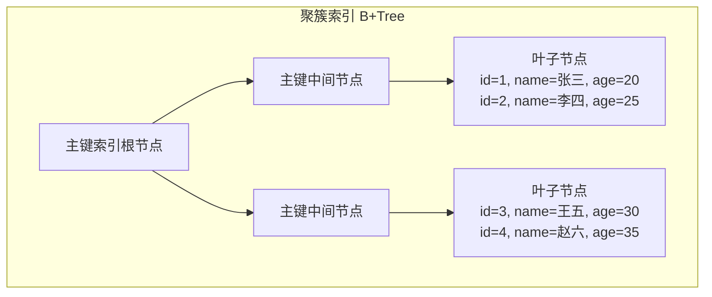
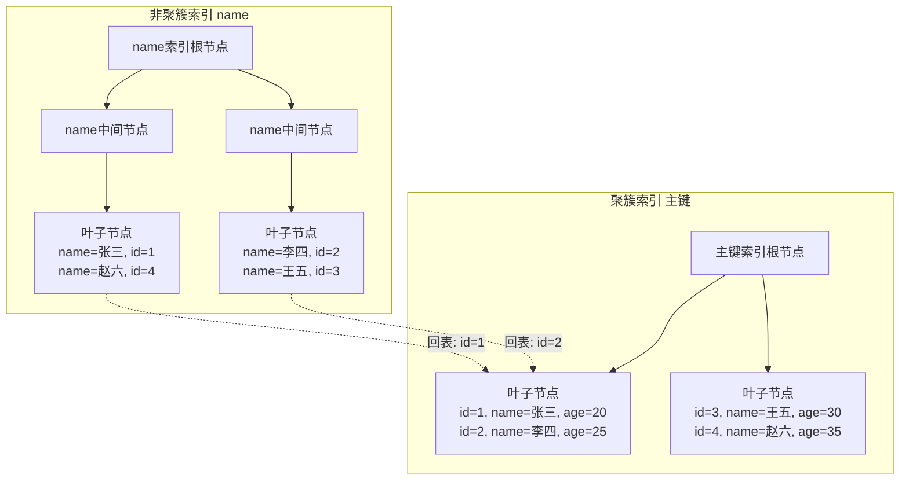

# 关系型数据库索引原理

> **文档说明**：深入讲解关系型数据库（以 MySQL InnoDB 为主）索引的底层原理，包括 B+Tree 数据结构、聚簇索引与非聚簇索引、联合索引与最左前缀匹配、索引选择性、覆盖索引、索引下推、失效场景，以及索引设计与优化的最佳实践。
>
> **适用人群**：后端开发工程师、需要优化数据库查询性能的开发者、准备面试的同学
>
> **前置知识**：[[数据库基础概念]]、[[事务隔离级别与MVCC]]

---

## 一、概述

**索引（Index）** 是数据库中用于加速数据检索的数据结构，类似于书籍的目录——通过目录可以快速定位到内容所在的页码，而不需要逐页翻阅。没有索引时，数据库查询需要全表扫描（逐行比对），数据量大时性能极差。

### 1. 索引的本质

索引的本质是**空间换时间**：通过额外维护一个有序的数据结构（B+Tree），将查询复杂度从 O(N)（全表扫描）降低到 O(logN)（树查找）。

| 查询方式 | 时间复杂度 | 1000万行数据 | 说明 |
|---------|-----------|-------------|------|
| 全表扫描 | O(N) | 约 1000 万次比较 | 逐行扫描，无索引 |
| B+Tree 索引 | O(logN) | 约 23 次比较 | 树高约 3-4 层，每次 IO 读一页 |
| 哈希索引 | O(1) | 1 次计算 | 仅支持等值查询，不支持范围 |

### 2. MySQL 索引类型总览

| 索引类型 | 数据结构 | 存储引擎 | 特点 |
|---------|---------|---------|------|
| **B+Tree 索引** | B+Tree | InnoDB/MyISAM | 最常用，支持等值/范围/排序 |
| **哈希索引** | Hash 表 | Memory/NDB | 仅等值查询，O(1)，不支持范围 |
| **全文索引** | 倒排索引 | InnoDB/MyISAM | 文本全文检索（FULLTEXT） |
| **空间索引** | R-Tree | MyISAM/InnoDB | 地理空间数据（SPATIAL） |

> InnoDB 引擎中，**B+Tree 索引是绝对主力**，本文重点讲解 B+Tree 索引。

### 3. 索引的优缺点

| 优点 | 缺点 |
|------|------|
| 加速数据检索（核心） | 占用额外存储空间 |
| 加速排序和分组（ORDER BY/GROUP BY） | 降低写入性能（INSERT/UPDATE/DELETE 需维护索引） |
| 加速表连接（JOIN） | 过多索引增加优化器选择时间 |
| 唯一性约束（唯一索引） | 索引维护成本随数据量增长 |

---

## 二、B+Tree 数据结构

### 1. 为什么是 B+Tree

数据库索引需要满足以下要求：
1. **支持等值查询**（`WHERE id = 1`）
2. **支持范围查询**（`WHERE id BETWEEN 1 AND 100`）
3. **支持排序**（`ORDER BY id`）
4. **磁盘 IO 次数少**（磁盘 IO 是性能瓶颈）
5. **树高低**（数据量大时树不能太高）

| 数据结构 | 等值查询 | 范围查询 | 排序 | 磁盘IO | 树高 | 结论 |
|---------|---------|---------|------|--------|------|------|
| 数组 | O(logN) 二分 | O(logN) | ✅ | 插入删除慢 | - | 不适合动态数据 |
| 链表 | O(N) | O(N) | ❌ | - | - | 查询太慢 |
| 二叉搜索树 | O(logN) | O(N) 中序 | ✅ | 树高可能很高 | 高 | 不平衡时退化为链表 |
| 平衡二叉树(AVL) | O(logN) | O(N) | ✅ | 树高较高 | 中 | 每个节点只存一个key，IO多 |
| 红黑树 | O(logN) | O(N) | ✅ | 树高较高 | 中 | 同上，节点扇出小 |
| **B-Tree** | O(logN) | O(logN) | ✅ | 少（多叉） | 低 | 数据存在所有节点，范围查询需中序 |
| **B+Tree** | O(logN) | O(logN) | ✅ | 最少 | 最低 | **所有数据在叶子节点，叶子链表相连，范围查询最优** |

**B+Tree 是数据库索引的最优选择**，原因：
1. **多叉树**：每个节点存储多个 key，扇出大（通常 1000+），树高低（3-4 层可存千万级数据）
2. **数据只在叶子节点**：非叶子节点只存索引 key，单个节点能存更多 key，进一步降低树高
3. **叶子节点链表相连**：范围查询只需找到起点，沿链表顺序遍历，无需回溯
4. **查询稳定**：每次查询都走到叶子节点，IO 次数稳定（=树高）

### 2. B+Tree 结构

```mermaid
graph TB
    subgraph 根节点（第1层）
        Root[30 | 60]
    end

    subgraph 中间节点（第2层）
        N1[10 | 20]
        N2[40 | 50]
        N3[70 | 80 | 90]
    end

    subgraph 叶子节点（第3层，数据+链表）
        L1[1,5,10] <--> L2[15,20,25]
        L2 <--> L3[30,35,40]
        L3 <--> L4[45,50,55]
        L4 <--> L5[60,65,70]
        L5 <--> L6[75,80,85]
        L6 <--> L7[90,95,100]
    end

    Root --> N1
    Root --> N2
    Root --> N3
    N1 --> L1
    N1 --> L2
    N2 --> L3
    N2 --> L4
    N3 --> L5
    N3 --> L6
    N3 --> L7
```

**B+Tree vs B-Tree 核心区别**：

| 特性 | B-Tree | B+Tree |
|------|--------|--------|
| 数据存储 | 所有节点都存数据 | 只有叶子节点存数据 |
| 叶子节点链表 | 无 | 有（双向链表） |
| 查询稳定性 | 不稳定（可能在非叶子节点命中） | 稳定（每次都走到叶子） |
| 范围查询 | 需中序遍历，回溯多 | 沿叶子链表顺序遍历，高效 |
| 非叶子节点容量 | 小（存数据占空间） | 大（只存索引 key） |
| 树高 | 较高 | 更低 |

### 3. InnoDB 页结构

InnoDB 中 B+Tree 的每个节点对应一个**数据页（Page）**，默认大小 16KB。

```text
一个 16KB 的页能存多少索引 key？
- 假设索引 key 是 BIGINT（8字节）+ 指针（6字节）= 14字节/项
- 16KB / 14字节 ≈ 1170 项（非叶子节点扇出约 1170）

树高与数据量的关系：
- 1层（根节点=叶子）：约 1170 条记录
- 2层：1170 × 1170 ≈ 137 万条
- 3层：1170 × 1170 × 1170 ≈ 16 亿条
- 4层：约 1.9 万亿条

实际中叶子节点存完整数据（一行可能几百字节），所以：
- 假设一行数据 1KB，一个叶子页存约 16 行
- 3层 B+Tree 可存：1170 × 1170 × 16 ≈ 2190 万行
- 4层可存：约 256 亿行

所以千万级数据的表，B+Tree 高度通常是 3-4 层，查询只需 3-4 次磁盘 IO。
```

**InnoDB 页结构**：
| 部分 | 大小 | 说明 |
|------|------|------|
| File Header | 38字节 | 文件头，页类型、上一页/下一页指针 |
| Page Header | 56字节 | 页头，记录数、目录起始位置等 |
| Infimum + Supremum | 26字节 | 虚拟最小/最大记录（链表头尾） |
| User Records | 可变 | 用户记录（实际数据） |
| Free Space | 可变 | 空闲空间 |
| Page Directory | 可变 | 页目录（槽位，加速页内查找） |
| File Trailer | 8字节 | 文件尾，校验页完整性 |

---

## 三、聚簇索引与非聚簇索引

### 1. 聚簇索引（Clustered Index）

**聚簇索引**是 InnoDB 中数据的物理存储方式——**索引和数据存在一起**，叶子节点存储完整的行数据。一张表只能有一个聚簇索引（因为数据只能按一种方式物理排序）。



**聚簇索引的选择规则**（InnoDB）：
1. 如果定义了**主键（PRIMARY KEY）**，主键就是聚簇索引
2. 如果没有主键，选择第一个**唯一非空索引（UNIQUE NOT NULL）**作为聚簇索引
3. 如果都没有，InnoDB 自动生成一个隐藏的 **6 字节自增 ID（ROW_ID）** 作为聚簇索引

**最佳实践**：
- ✅ 每张表都应该显式定义主键
- ✅ 主键用自增整数（BIGINT AUTO_INCREMENT），插入时顺序追加，页分裂少
- ❌ 不要用 UUID 作为主键（随机无序，插入时频繁页分裂，性能差，空间大）
- ❌ 不要用过长的字段作为主键（非聚簇索引的叶子节点存主键值，主键越大索引越大）

### 2. 非聚簇索引（Secondary Index / 二级索引）

**非聚簇索引**（也叫二级索引、辅助索引）的叶子节点存储的是**索引列的值 + 主键值**，而不是完整的行数据。通过非聚簇索引查询时，需要先找到主键值，再通过聚簇索引找到完整行数据——这个过程叫做**回表**。



**回表过程**：
1. 在非聚簇索引 B+Tree 中查找，找到索引列值匹配的叶子节点
2. 从叶子节点获取主键值
3. 用主键值在聚簇索引 B+Tree 中查找，找到完整行数据
4. 返回结果

**回表的代价**：需要两次 B+Tree 查找（非聚簇索引 + 聚簇索引），即两次磁盘 IO。如果查询的列都在非聚簇索引中（覆盖索引），则不需要回表。

### 3. 聚簇索引 vs 非聚簇索引

| 特性 | 聚簇索引 | 非聚簇索引 |
|------|---------|-----------|
| 叶子节点存储 | 完整行数据 | 索引列值 + 主键值 |
| 数量 | 一张表只能一个 | 一张表可以有多个 |
| 是否回表 | 否（数据就在叶子节点） | 是（需通过主键回表） |
| 物理排序 | 数据按索引键物理排序 | 逻辑排序，物理不排序 |
| 插入性能 | 主键有序时插入快，无序时页分裂 | 插入需维护所有非聚簇索引 |
| 空间占用 | 数据本身 | 额外的索引结构 |

---

## 四、联合索引与最左前缀匹配

### 1. 联合索引（Composite Index）

**联合索引**是指包含多个列的索引，如 `INDEX idx_name_age(name, age)`。联合索引的 B+Tree 按索引列的顺序依次排序——先按第一列排序，第一列相同时按第二列排序，以此类推。

```text
联合索引 (name, age) 的排序规则：
name=张三, age=20  →  排在前面
name=张三, age=25  →  name相同，按age排序
name=李四, age=22  →  name不同，按name排序
name=王五, age=30  →  ...
```

### 2. 最左前缀匹配原则

**最左前缀匹配（Leftmost Prefix Matching）** 是联合索引的核心规则：查询条件必须从索引的最左列开始，且不能跳过中间列，才能有效利用联合索引。

```sql
联合索引：INDEX idx_a_b_c(a, b, c)

✅ 能使用索引的查询：
WHERE a = 1                    → 使用 a
WHERE a = 1 AND b = 2          → 使用 a, b
WHERE a = 1 AND b = 2 AND c = 3 → 使用 a, b, c
WHERE a = 1 AND c = 3          → 只使用 a（b 被跳过，c 无法用索引）
WHERE a > 1 AND b = 2          → 只使用 a（a 是范围查询，后面的 b 无法用索引）

❌ 不能使用索引的查询：
WHERE b = 2                    → 缺少最左列 a
WHERE c = 3                    → 缺少最左列 a
WHERE b = 2 AND c = 3          → 缺少最左列 a
```

**最左前缀匹配的底层原因**：
联合索引的 B+Tree 是按 (a, b, c) 顺序排序的。如果查询条件没有 a，就无法在 B+Tree 中定位起始位置；如果 a 是范围查询（>、<、BETWEEN、LIKE '%...'），a 相同的范围确定了，但 b 在这个范围内不是有序的（因为 a 不同），所以 b 无法用索引。

### 3. 联合索引的列顺序

联合索引的列顺序至关重要，遵循以下原则：

| 原则 | 说明 | 示例 |
|------|------|------|
| **等值查询列在前** | 等值查询（=）的列放在前面，范围查询列放在后面 | `WHERE a=1 AND b>2` → 索引 (a, b) |
| **高选择性列在前** | 区分度高（值不重复多）的列放在前面 | 用户表中，email 比 gender 选择性高 |
| **常用查询列在前** | 经常出现在 WHERE 中的列放在前面 | 如果 80% 查询带 a，20% 带 b，a 在前 |
| **覆盖索引优先** | 尽量让查询的列都在索引中，避免回表 | 查询 SELECT a,b,c → 索引 (a,b,c) |

**选择性（Selectivity）**：
```text
选择性 = 不重复值数量 / 总行数
- 选择性越高（越接近1），索引过滤效果越好
- 选择性越低（越接近0），索引过滤效果越差

示例：
- email 列：100万行，100万个不同值 → 选择性=1.0（极高）
- gender 列：100万行，2个不同值 → 选择性=0.000002（极低，不适合建索引）
- status 列：100万行，5个不同值 → 选择性=0.000005（低，需结合其他列）
```

### 4. 索引下推（Index Condition Pushdown, ICP）

**索引下推**是 MySQL 5.6 引入的优化，在使用联合索引时，将 WHERE 条件中可以用索引判断的部分下推到存储引擎层（InnoDB），在索引遍历过程中就过滤掉不满足条件的记录，减少回表次数。

```text
没有索引下推（MySQL 5.5 及以前）：
1. 存储引擎根据索引最左列找到匹配的记录
2. 每找到一条就回表，返回完整行给 Server 层
3. Server 层根据 WHERE 其他条件过滤

有索引下推（MySQL 5.6+）：
1. 存储引擎根据索引最左列找到匹配的记录
2. 在索引层面判断 WHERE 中其他索引列的条件（不满足直接跳过，不回表）
3. 满足条件的才回表，返回完整行
```

**示例**：
```sql
-- 联合索引 (name, age)
SELECT * FROM user WHERE name LIKE '张%' AND age = 25;

-- 没有 ICP：找到所有 name 以'张'开头的记录，逐条回表，再在Server层过滤 age=25
-- 有 ICP：找到 name 以'张'开头的记录后，在索引层判断 age=25，满足才回表
-- 回表次数大幅减少！
```

**索引下推的限制**：
- 只能用于非聚簇索引（二级索引）
- 只能下推索引中包含的列的条件
- 子查询条件不能下推
- 存储函数不能下推

---

## 五、覆盖索引

### 1. 概念

**覆盖索引（Covering Index）** 是指查询所需的所有列都包含在索引中，不需要回表就能返回结果。覆盖索引是非常重要的优化手段，可以将查询性能提升数倍。

```sql
-- 联合索引 (name, age)
SELECT name, age FROM user WHERE name = '张三';
-- ✅ 覆盖索引：name 和 age 都在索引中，不需要回表

SELECT name, age, email FROM user WHERE name = '张三';
-- ❌ 不是覆盖索引：email 不在索引中，需要回表
```

### 2. 如何判断是否使用了覆盖索引

使用 `EXPLAIN` 查看执行计划，如果 `Extra` 列显示 `Using index`，说明使用了覆盖索引。

```sql
EXPLAIN SELECT name, age FROM user WHERE name = '张三';
-- id | select_type | table | type | key         | Extra
-- 1  | SIMPLE      | user  | ref  | idx_name_age| Using index  ← 覆盖索引！

EXPLAIN SELECT name, age, email FROM user WHERE name = '张三';
-- id | select_type | table | type | key         | Extra
-- 1  | SIMPLE      | user  | ref  | idx_name_age| (空)  ← 需要回表
```

### 3. 覆盖索引的应用场景

| 场景 | 优化方式 |
|------|---------|
| 计数查询 | `SELECT COUNT(*) FROM user WHERE status=1` → 索引 (status) 即可覆盖 |
| 列表查询只显示部分字段 | 商品列表只显示 id/name/price → 索引 (status, id, name, price) |
| 排序查询 | `SELECT id FROM user ORDER BY create_time` → 索引 (create_time, id) |
| 关联查询 | JOIN 时被驱动表的关联列和查询列都在索引中 |

### 4. 覆盖索引的权衡

覆盖索引虽然好，但不是万能的：
- **索引列不能太多**：联合索引列太多（>5列）会导致索引体积大，写入性能下降
- **长字符串列不适合**：VARCHAR(500) 列放在索引中会导致索引很大
- **更新频繁的列不适合**：覆盖索引包含更新频繁的列会导致索引维护成本高

---

## 六、索引失效场景

索引不是建了就一定能用，以下场景会导致索引失效或部分失效：

### 1. 索引失效场景汇总

| 场景 | 示例 | 原因 |
|------|------|------|
| **函数/运算操作索引列** | `WHERE YEAR(create_time) = 2026` | 对索引列使用函数，无法使用索引有序性 |
| **隐式类型转换** | `WHERE varchar_col = 123` | 字符串列与数字比较，MySQL 自动转换导致索引失效 |
| **LIKE 以通配符开头** | `WHERE name LIKE '%张三'` | 前缀不确定，无法利用 B+Tree 有序性 |
| **OR 连接非索引列** | `WHERE indexed_col = 1 OR non_indexed_col = 2` | 非索引列需要全表扫描，索性全表扫描 |
| **联合索引不满足最左前缀** | `WHERE b = 2`（索引 a,b,c） | 缺少最左列 a |
| **索引列上使用 NOT != <>** | `WHERE status != 1` | 不等于查询优化器可能选择全表扫描（取决于选择性） |
| **IS NOT NULL** | `WHERE col IS NOT NULL` | 取决于选择性，可能全表扫描 |
| **字符集不一致** | 关联查询两表字符集不同 | 隐式转换导致索引失效 |
| **优化器选择全表扫描** | 索引选择性太低 | 优化器认为全表扫描更快（如查询返回 50% 以上行） |

### 2. 详细说明

**场景1：函数/运算操作索引列**
```sql
-- ❌ 索引失效：对索引列使用函数
SELECT * FROM user WHERE YEAR(create_time) = 2026;

-- ✅ 改写为范围查询，使用索引
SELECT * FROM user WHERE create_time >= '2026-01-01' AND create_time < '2027-01-01';

-- ❌ 索引失效：运算操作
SELECT * FROM user WHERE age + 1 = 20;

-- ✅ 改写
SELECT * FROM user WHERE age = 19;
```

**场景2：隐式类型转换**
```sql
-- phone 是 VARCHAR 类型
-- ❌ 索引失效：字符串列与数字比较，MySQL 自动将 phone 转为数字
SELECT * FROM user WHERE phone = 13800138000;

-- ✅ 使用字符串比较
SELECT * FROM user WHERE phone = '13800138000';
```

**场景3：LIKE 通配符**
```sql
-- ❌ 索引失效：以 % 开头
SELECT * FROM user WHERE name LIKE '%张三';

-- ✅ 前缀匹配，可以使用索引
SELECT * FROM user WHERE name LIKE '张三%';

-- ✅ 全文检索需求用全文索引或搜索引擎（ES）
```

**场景4：OR 连接**
```sql
-- ❌ 如果 name 有索引但 age 没有，OR 会导致全表扫描
SELECT * FROM user WHERE name = '张三' OR age = 25;

-- ✅ 确保 OR 两边的列都有索引，或改写为 UNION
SELECT * FROM user WHERE name = '张三'
UNION
SELECT * FROM user WHERE age = 25;
```

**场景5：优化器选择全表扫描**
```sql
-- status 列只有 2 个值（0/1），选择性极低
-- 查询 status=0 的行占 80%，优化器认为全表扫描比索引更快
SELECT * FROM user WHERE status = 0;
-- 这种情况索引可能不被使用，是正常的优化器决策
```

---

## 七、索引设计最佳实践

### 1. 索引设计原则

- [ ] **优先为 WHERE、JOIN、ORDER BY、GROUP BY 涉及的列建索引**
- [ ] **联合索引遵循最左前缀匹配，等值列在前、范围列在后**
- [ ] **高选择性列优先，低选择性列（如 gender/status）不单独建索引**
- [ ] **尽量使用覆盖索引，避免回表**
- [ ] **控制索引数量**：单表索引不超过 5-6 个，过多索引影响写入性能
- [ ] **避免冗余索引**：如已有 (a,b) 就不需要 (a)（最左前缀已覆盖）
- [ ] **字符串列建索引考虑前缀索引**：长字符串列用前缀索引减少索引大小
- [ ] **定期检查慢查询，根据实际查询模式建索引**（不要凭想象建索引）
- [ ] **删除无用索引**：定期分析索引使用情况，删除从未使用的索引

### 2. 前缀索引

对于长字符串列（如 VARCHAR(255) 的 email），可以使用前缀索引，只索引前 N 个字符，减少索引大小。

```sql
-- 创建前缀索引：索引 email 前 10 个字符
ALTER TABLE user ADD INDEX idx_email_prefix(email(10));

-- 前缀长度选择：区分度足够即可
-- 计算不同前缀长度的区分度
SELECT
  COUNT(DISTINCT LEFT(email, 5)) / COUNT(*) AS sel_5,
  COUNT(DISTINCT LEFT(email, 10)) / COUNT(*) AS sel_10,
  COUNT(DISTINCT LEFT(email, 20)) / COUNT(*) AS sel_20,
  COUNT(DISTINCT email) / COUNT(*) AS sel_full
FROM user;
-- 选择区分度接近 full 的最小前缀长度
```

**前缀索引的限制**：
- 不能用于 ORDER BY/GROUP BY
- 不能用于覆盖索引
- 前缀太短区分度不够，太长索引体积大

### 3. 唯一索引 vs 普通索引

| 特性 | 唯一索引（UNIQUE） | 普通索引（INDEX） |
|------|-------------------|------------------|
| 约束 | 保证列值唯一 | 无约束 |
| 查询性能 | 相同（B+Tree 结构相同） | 相同 |
| 插入性能 | 略低（需检查唯一性） | 略高 |
| Change Buffer | 不适用（唯一索引不能用 Change Buffer） | 适用（写入性能更好） |
| 适用场景 | 业务上需要唯一约束的列（email、手机号） | 普通查询加速列 |

**Change Buffer**：InnoDB 对非唯一二级索引的写入优化——写入时如果索引页不在内存中，先将变更记录在 Change Buffer 中，后续读取时再合并到索引页，减少随机 IO。唯一索引因为需要检查唯一性，无法使用 Change Buffer。

### 4. 索引监控与维护

```sql
-- 查看表的索引
SHOW INDEX FROM user;

-- 查看索引使用情况（sys 库）
SELECT * FROM sys.schema_unused_indexes;  -- 未使用的索引
SELECT * FROM sys.schema_index_statistics;  -- 索引使用统计

-- 分析表（更新索引统计信息，帮助优化器选择正确索引）
ANALYZE TABLE user;

-- 检查索引碎片
SELECT * FROM sys.schema_redundant_indexes;  -- 冗余索引

-- 优化表（重建索引，减少碎片）
OPTIMIZE TABLE user;  -- 会锁表，大表慎用，建议用 pt-online-schema-change
```

### 5. EXPLAIN 执行计划解读

`EXPLAIN` 是索引优化的核心工具，关键字段：

| 字段 | 说明 | 关注值 |
|------|------|--------|
| **type** | 访问类型 | system > const > eq_ref > ref > range > index > ALL（越左越好） |
| **key** | 实际使用的索引 | 应为预期的索引名，NULL 表示未用索引 |
| **key_len** | 使用的索引长度 | 可判断联合索引用了几列 |
| **rows** | 预估扫描行数 | 越小越好 |
| **Extra** | 额外信息 | Using index（覆盖索引）、Using where、Using filesort（需优化）、Using temporary（需优化） |

**type 类型详解**：

| type | 说明 | 性能 |
|------|------|------|
| **system** | 表只有一行（系统表） | 最优 |
| **const** | 主键或唯一索引等值查询，最多匹配一行 | 极优 |
| **eq_ref** | 主键或唯一索引关联查询，每行匹配一行 | 优 |
| **ref** | 非唯一索引等值查询 | 良 |
| **range** | 索引范围查询（>、<、BETWEEN、IN） | 中 |
| **index** | 全索引扫描（比全表扫描快，因为索引小） | 差 |
| **ALL** | 全表扫描 | 最差，需优化 |

**Extra 需优化的情况**：

| Extra | 说明 | 优化方向 |
|-------|------|---------|
| **Using filesort** | 无法利用索引排序，需额外排序 | 建联合索引使 ORDER BY 列有序 |
| **Using temporary** | 使用临时表（GROUP BY/DISTINCT 时） | 建索引使分组列有序 |
| **Using where** | 需在 Server 层过滤（回表后过滤） | 尽量用覆盖索引或索引下推 |

---

## 八、常见问题与排查

| 问题 | 原因 | 解决方案 |
|------|------|---------|
| 索引建了但没用 | 隐式类型转换 / 函数操作 / 选择性太低 | EXPLAIN 分析，改写 SQL，检查类型 |
| 查询慢但 EXPLAIN 显示用了索引 | 回表次数多 / 索引扫描行数多 | 建覆盖索引，优化 WHERE 条件 |
| ORDER BY 慢 | Using filesort | 建联合索引，使 ORDER BY 列在索引中有序 |
| GROUP BY 慢 | Using temporary | 建联合索引，使 GROUP BY 列在索引中有序 |
| 联合索引只用到第一列 | 后面的列是范围查询 / 跳过了中间列 | 调整列顺序，等值列在前 |
| 写入性能差 | 索引太多 / 随机 IO | 减少索引数量，主键自增，使用 Change Buffer |
| 索引体积大 | 长字符串列 / 联合索引列太多 | 用前缀索引，减少索引列数 |
| 主从延迟 | 大表加索引导致锁表 | 用 pt-online-schema-change / gh-ost 在线加索引 |
| 索引统计信息不准 | 数据变化大但未 ANALYZE | 定期 ANALYZE TABLE，或开启 innodb_stats_auto_recalc |
| 死锁 | 索引顺序不一致导致加锁顺序不同 | 统一索引访问顺序，优化事务 |

---

## 九、关联笔记

### 数据库
- [[事务隔离级别与MVCC]] · [[数据库分库分表策略]] · [[MySQL-性能优化实战]]
- [[Redis数据结构与应用场景]] · [[数据库连接池-HikariCP与Druid]]

### 后端
- [[SpringBoot-自动装配原理]] · [[MyBatis-核心原理与插件]] · [[SpringCache-缓存抽象]]
- [[Gateway-网关路由与鉴权]]

### 架构
- [[高并发系统设计案例]] · [[秒杀系统架构设计]] · [[高可用架构设计]]
- [[技术选型决策指南]]

### 计算机基础
- [[数据结构与算法核心]] · [[操作系统核心概念]]

### 导航
- [[MOC-后端开发]] · [[全栈+AI工程双轨融合学习路线图]]

> **学习路径建议**：先掌握 [[数据库基础概念]] → 深入本文索引原理 → 学习 [[事务隔离级别与MVCC]] 事务机制 → 实践 [[MySQL-性能优化实战]] SQL 优化 → 研究 [[数据库分库分表策略]] 大数据量方案 → 结合 [[高并发系统设计案例]] 架构优化。

---

## 💡 全文深度讲解

本文系统梳理了关系型数据库索引原理的核心知识体系，从概述入手，深入B+Tree 数据结构的底层机制，再通过聚簇索引与非聚簇索引掌握实战应用，最后涵盖常见问题与排查与关联笔记。学习时建议先建立整体认知，再动手实践，最后结合常见问题深化理解。

## 📝 全文精简总结

- **概述**：掌握本模块的核心概念与关键要点
- **B+Tree 数据结构**：掌握本模块的核心概念与关键要点
- **聚簇索引与非聚簇索引**：掌握本模块的核心概念与关键要点
- **联合索引与最左前缀匹配**：掌握本模块的核心概念与关键要点
- **覆盖索引**：掌握本模块的核心概念与关键要点
- **索引失效场景**：掌握本模块的核心概念与关键要点
- **索引设计最佳实践**：掌握本模块的核心概念与关键要点
- **常见问题与排查**：掌握本模块的核心概念与关键要点
- 其余1个模块涵盖进阶主题与拓展内容

