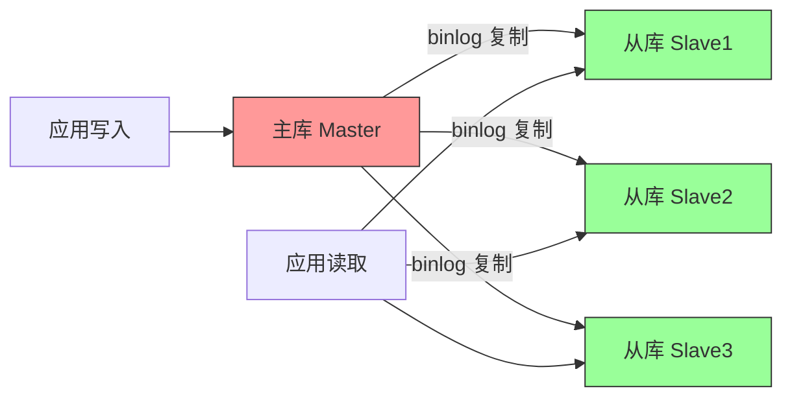
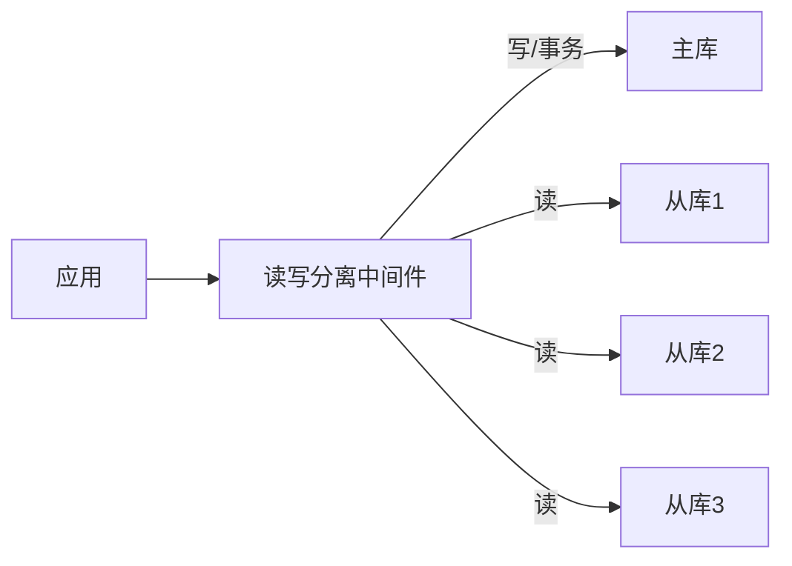

# 数据库主从复制与读写分离

> **文档说明**：系统讲解数据库主从复制原理、MySQL 主从配置、复制模式、读写分离架构、ShardingSphere 实现、主从延迟与一致性、故障转移、监控运维，以及生产级最佳实践和常见问题排查。
>
> **适用人群**：后端开发工程师、DBA、架构师、需要构建高可用数据库系统的开发者
>
> **前置知识**：[[数据库性能优化实战]]、[[分布式系统-高可用架构设计]]、[[MySQL索引与查询优化]]、[[分库分表实战指南]]

---

## 一、概述

### 1. 为什么需要主从复制

| 需求 | 说明 |
|------|------|
| **高可用** | 主库故障时从库可提升为主库，减少停机时间 |
| **读写分离** | 写操作主库，读操作从库，提升读性能 |
| **数据备份** | 从库作为实时备份，可用于灾难恢复 |
| **数据分析** | 从库用于报表/分析，不影响主库性能 |
| **地理分布** | 就近读取，降低跨地域延迟 |

### 2. 主从复制架构



### 3. 复制类型对比

| 复制类型 | 数据一致性 | 性能 | 适用场景 |
|---------|-----------|------|---------|
| **异步复制** | 可能丢失数据 | 最高 | 一般业务、可容忍少量丢失 |
| **半同步复制** | 至少一个从库确认 | 中等 | 重要业务、要求较高一致性 |
| **全同步复制** | 所有从库确认 | 最低 | 金融级、强一致性要求 |
| **组复制（MGR）** | 强一致 | 中等 | 高可用集群、自动故障转移 |

---

## 二、MySQL 主从复制原理

### 1. 复制流程


### 2. 三个核心线程

| 线程 | 位置 | 作用 |
|------|------|------|
| **Binlog Dump Thread** | 主库 | 读取 binlog，发送给从库 |
| **IO Thread** | 从库 | 接收 binlog，写入 relay log |
| **SQL Thread** | 从库 | 读取 relay log，重放事务 |

### 3. binlog 三种格式

| 格式 | 说明 | 优点 | 缺点 |
|------|------|------|------|
| **STATEMENT** | 记录 SQL 语句 | 日志量小 | 不确定函数（now()、uuid()）可能不一致 |
| **ROW** | 记录行变更 | 数据一致、无不确定问题 | 日志量大（大表批量更新） |
| **MIXED** | 混合模式，自动选择 | 兼顾两者 | 复杂场景可能切换为 ROW |

> **推荐**：MySQL 5.7+ 默认使用 ROW 格式，数据一致性最好。

### 4. 主库配置

```ini
# my.cnf 主库配置
[mysqld]
server-id=1                    # 唯一 ID，主从必须不同
log-bin=mysql-bin              # 开启 binlog
binlog-format=ROW              # binlog 格式
binlog-do-db=mydb              # 需复制的数据库（可选，不推荐）
binlog-ignore-db=mysql         # 不复制的数据库
expire-logs-days=7             # binlog 保留天数
max-binlog-size=500M           # 单个 binlog 最大大小
sync-binlog=1                  # 每次事务提交刷盘（最安全）
```

### 5. 从库配置

```ini
# my.cnf 从库配置
[mysqld]
server-id=2                    # 唯一 ID，与主库不同
relay-log=relay-bin            # relay log 文件名
read-only=1                    # 只读（超级用户仍可写）
super-read-only=1              # 超级用户也只读（MySQL 5.7+）
relay-log-recovery=1           # 崩溃后自动恢复 relay log
log-slave-updates=1            # 从库也写 binlog（级联复制需要）
```

### 6. 配置复制

```sql
-- 主库：创建复制用户
CREATE USER 'repl'@'%' IDENTIFIED BY 'repl_password';
GRANT REPLICATION SLAVE ON *.* TO 'repl'@'%';
FLUSH PRIVILEGES;

-- 主库：查看 binlog 位置
SHOW MASTER STATUS;
-- +------------------+----------+--------------+------------------+
-- | File             | Position | Binlog_Do_DB | Binlog_Ignore_DB |
-- +------------------+----------+--------------+------------------+
-- | mysql-bin.000001 |     1234 | mydb         |                  |
-- +------------------+----------+--------------+------------------+

-- 从库：配置复制
CHANGE MASTER TO
    MASTER_HOST='master-host',
    MASTER_USER='repl',
    MASTER_PASSWORD='repl_password',
    MASTER_LOG_FILE='mysql-bin.000001',
    MASTER_LOG_POS=1234;

-- 从库：启动复制
START SLAVE;

-- 从库：查看复制状态
SHOW SLAVE STATUS\G
-- 关键指标：
-- Slave_IO_Running: Yes
-- Slave_SQL_Running: Yes
-- Seconds_Behind_Master: 0  （主从延迟秒数）
```

### 7. 数据初始化

```bash
# 方法1：mysqldump（适合小数据量）
# 主库导出
mysqldump -u root -p --master-data=2 --single-transaction --routines --triggers mydb > mydb.sql

# 从库导入
mysql -u root -p mydb < mydb.sql

# 方法2：xtrabackup（适合大数据量，物理备份）
# 主库备份
xtrabackup --backup --target-dir=/data/backup

# 从库恢复
xtrabackup --prepare --target-dir=/data/backup
xtrabackup --copy-back --target-dir=/data/backup
```

---

## 三、半同步复制

### 1. 半同步原理

```text
异步复制：主库提交 → 立即返回成功（从库可能未收到）
半同步复制：主库提交 → 等待至少一个从库确认收到 → 返回成功
全同步复制：主库提交 → 等待所有从库确认 → 返回成功
```

### 2. 半同步配置

```sql
-- 主库安装插件
INSTALL PLUGIN rpl_semi_sync_master SONAME 'semisync_master.so';
SET GLOBAL rpl_semi_sync_master_enabled = 1;
SET GLOBAL rpl_semi_sync_master_timeout = 3000;  -- 3秒超时降级为异步

-- 从库安装插件
INSTALL PLUGIN rpl_semi_sync_slave SONAME 'semisync_slave.so';
SET GLOBAL rpl_semi_sync_slave_enabled = 1;
STOP SLAVE IO_THREAD;
START SLAVE IO_THREAD;

-- 查看半同步状态
SHOW STATUS LIKE 'Rpl_semi_sync_master%';
-- Rpl_semi_sync_master_clients：连接的半同步从库数
-- Rpl_semi_sync_master_yes_tx：半同步成功的事务数
-- Rpl_semi_sync_master_no_tx：超时降级为异步的事务数
```

---

## 四、读写分离

### 1. 读写分离架构



### 2. 实现方式对比

| 方式 | 说明 | 优点 | 缺点 |
|------|------|------|------|
| **应用层** | 代码中手动选择数据源 | 灵活、可控 | 代码侵入、维护成本高 |
| **中间件** | ShardingSphere/MyCat 代理 | 透明、功能丰富 | 增加组件、单点风险 |
| **驱动层** | MySQL Router/ProxySQL | 轻量、高性能 | 功能有限 |
| **框架支持** | Spring AbstractRoutingDataSource | 简单、注解切换 | 需手动标注 |

### 3. ShardingSphere 实现读写分离

```yaml
# application.yml（ShardingSphere-JDBC）
spring:
  shardingsphere:
    datasource:
      names: master,slave1,slave2
      master:
        type: com.zaxxer.hikari.HikariDataSource
        driver-class-name: com.mysql.cj.jdbc.Driver
        jdbc-url: jdbc:mysql://master:3306/mydb
        username: root
        password: password
      slave1:
        type: com.zaxxer.hikari.HikariDataSource
        driver-class-name: com.mysql.cj.jdbc.Driver
        jdbc-url: jdbc:mysql://slave1:3306/mydb
        username: root
        password: password
      slave2:
        type: com.zaxxer.hikari.HikariDataSource
        driver-class-name: com.mysql.cj.jdbc.Driver
        jdbc-url: jdbc:mysql://slave2:3306/mydb
        username: root
        password: password
    rules:
      readwrite-splitting:
        data-sources:
          myds:
            type: Static
            props:
              write-data-source-name: master
              read-data-source-names: slave1,slave2
              load-balancer-name: round_robin  # 轮询
        load-balancers:
          round_robin:
            type: ROUND_ROBIN
    props:
      sql-show: true
```

### 4. 强制走主库（解决主从延迟）

```java
// ShardingSphere 注解：强制走主库
@Service
public class UserService {

    @Autowired
    private UserMapper userMapper;

    // 写操作自动走主库
    public void createUser(User user) {
        userMapper.insert(user);
    }

    // 读操作默认走从库
    public User getUser(Long id) {
        return userMapper.selectById(id);
    }

    // 强制走主库（刚写入后立即读取，避免延迟）
    @Hint(value = "master", dataSourceName = "master")
    public User getUserAfterWrite(Long id) {
        return userMapper.selectById(id);
    }
}

// 或使用 HintManager
public User getUserForceMaster(Long id) {
    HintManager hintManager = HintManager.getInstance();
    try {
        hintManager.setWriteRouteOnly();  // 强制走主库
        return userMapper.selectById(id);
    } finally {
        hintManager.close();
    }
}
```

### 5. Spring 动态数据源

```java
// 自定义数据源路由
public class DynamicDataSource extends AbstractRoutingDataSource {
    @Override
    protected Object determineCurrentLookupKey() {
        return DataSourceContextHolder.getDataSourceType();
    }
}

// 上下文持有器
public class DataSourceContextHolder {
    private static final ThreadLocal<String> contextHolder = new ThreadLocal<>();

    public static void setMaster() { contextHolder.set("master"); }
    public static void setSlave() { contextHolder.set("slave"); }
    public static String getDataSourceType() { return contextHolder.get(); }
    public static void clear() { contextHolder.remove(); }
}

// AOP 切面自动切换
@Aspect
@Component
public class DataSourceAspect {
    @Before("@annotation(ReadOnly)")
    public void setReadDataSource() {
        DataSourceContextHolder.setSlave();
    }

    @After("@annotation(ReadOnly)")
    public void clearDataSource() {
        DataSourceContextHolder.clear();
    }
}
```

---

## 五、主从延迟

### 1. 延迟原因

| 原因 | 说明 |
|------|------|
| **从库性能差** | 从库硬件配置低于主库 |
| **大事务** | 主库大事务执行时间长，从库重放也慢 |
| **单线程重放** | MySQL 5.6 前 SQL 线程单线程 |
| **锁等待** | 从库查询与重放冲突 |
| **网络延迟** | 主从跨地域网络慢 |
| **binlog 写入慢** | 从库 IO 性能差 |

### 2. 延迟解决方案

```text
1. 硬件优化：从库配置不低于主库
2. 并行复制：MySQL 5.7+ 开启基于组提交的并行复制
3. 避免大事务：拆分为小事务
4. 读写分离策略：写后读走主库
5. 网络优化：主从同机房、低延迟网络
6. 监控告警：延迟超过阈值告警
```

### 3. 并行复制配置

```ini
# MySQL 5.7+ 并行复制（基于组提交）
[mysqld]
slave-parallel-type=LOGICAL_CLOCK   # 逻辑时钟并行
slave-parallel-workers=4            # 并行线程数（CPU核心数）
slave_preserve_commit_order=1       # 保持提交顺序

# MySQL 8.0+ 增强并行复制
slave-parallel-type=LOGICAL_CLOCK
slave-parallel-workers=8
binlog-transaction-dependency-tracking=WRITESET  # 基于写集合
```

### 4. 写后读一致性

```java
// 策略1：写后一定时间内读主库
public User createAndGet(User user) {
    userMapper.insert(user);
    // 写入后 3 秒内强制读主库
    DataSourceContextHolder.setMaster();
    try {
        return userMapper.selectById(user.getId());
    } finally {
        DataSourceContextHolder.clear();
    }
}

// 策略2：根据主从延迟动态决定
public User getUserWithDelayCheck(Long id) {
    long delay = getReplicationDelay();  // 秒
    if (delay > 5) {
        // 延迟超过 5 秒，走主库
        return queryFromMaster(id);
    }
    return queryFromSlave(id);
}
```

---

## 六、故障转移

### 1. 手动故障转移

```bash
# 1. 确认主库故障，选择新主库（数据最新的从库）
SHOW SLAVE STATUS\G  -- 选择 Relay_Master_Log_File 和 Exec_Master_Log_Pos 最新的

# 2. 在新主库上执行
STOP SLAVE;
RESET MASTER;
-- 取消只读
SET GLOBAL read_only = 0;
SET GLOBAL super_read_only = 0;

# 3. 在其他从库上执行
STOP SLAVE;
CHANGE MASTER TO MASTER_HOST='new-master', MASTER_AUTO_POSITION=1;
START SLAVE;

# 4. 应用切换数据源到新主库
```

### 2. 自动故障转移工具

| 工具 | 说明 | 特点 |
|------|------|------|
| **MHA** | Master High Availability | 成熟、Perl 编写、需 VIP |
| **Orchestrator** | MySQL 高可用管理 | Web 界面、智能故障转移 |
| **MGR** | MySQL Group Replication | 官方组复制、内置高可用 |
| **ProxySQL** | 代理层故障转移 | 配合 MHA/Orchestrator |
| **Keepalived+VIP** | 虚拟 IP 漂移 | 简单、配合 MHA |

### 3. MGR（MySQL Group Replication）

```ini
# MGR 配置（组复制，内置高可用）
[mysqld]
plugin-load-add=group_replication.so
group_replication_group_name="aaaaaaaa-aaaa-aaaa-aaaa-aaaaaaaaaaaa"
group_replication_start_on_boot=off
group_replication_local_address="node1:33061"
group_replication_group_seeds="node1:33061,node2:33061,node3:33061"
group_replication_bootstrap_group=off
loose-group_replication_single_primary_mode=on  # 单主模式
loose-group_replication_enforce_update_everywhere_checks=off
```

---

## 七、监控与运维

### 1. 关键监控指标

| 指标 | 说明 | 告警阈值 |
|------|------|---------|
| **Seconds_Behind_Master** | 主从延迟（秒） | > 30 告警，> 300 严重 |
| **Slave_IO_Running** | IO 线程状态 | No 立即告警 |
| **Slave_SQL_Running** | SQL 线程状态 | No 立即告警 |
| **Last_Error** | 最后错误 | 非空告警 |
| **binlog 大小** | binlog 增长速度 | 异常增长告警 |
| **连接数** | 主从连接状态 | 断开告警 |
| **半同步状态** | 半同步客户端数 | 0 告警（降级为异步） |

### 2. 监控脚本

```bash
#!/bin/bash
# 从库复制状态监控
STATUS=$(mysql -e "SHOW SLAVE STATUS\G" 2>/dev/null)
IO_RUNNING=$(echo "$STATUS" | grep "Slave_IO_Running:" | awk '{print $2}')
SQL_RUNNING=$(echo "$STATUS" | grep "Slave_SQL_Running:" | awk '{print $2}')
DELAY=$(echo "$STATUS" | grep "Seconds_Behind_Master:" | awk '{print $2}')

if [ "$IO_RUNNING" != "Yes" ] || [ "$SQL_RUNNING" != "Yes" ]; then
    echo "CRITICAL: 复制线程停止"
    exit 2
fi

if [ "$DELAY" -gt 30 ]; then
    echo "WARNING: 主从延迟 ${DELAY} 秒"
    exit 1
fi

echo "OK: 复制正常，延迟 ${DELAY} 秒"
exit 0
```

### 3. 日常运维

```sql
-- 查看复制状态
SHOW SLAVE STATUS\G

-- 跳过错误（谨慎使用）
STOP SLAVE;
SET GLOBAL sql_slave_skip_counter = 1;  -- 跳过 1 个事务
START SLAVE;

-- 重置复制
RESET SLAVE ALL;

-- 查看 binlog 内容
mysqlbinlog mysql-bin.000001 | head -100

-- 清理旧 binlog
PURGE BINARY LOGS BEFORE '2026-01-01 00:00:00';
PURGE BINARY LOGS TO 'mysql-bin.000010';
```

---

## 八、最佳实践

### 1. 配置规范

- [ ] **server-id 唯一**：所有节点 server-id 必须不同
- [ ] **ROW 格式 binlog**：数据一致性最好
- [ ] **sync-binlog=1**：每次提交刷盘，防止 binlog 丢失
- [ ] **innodb_flush_log_at_trx_commit=1**：事务安全
- [ ] **从库只读**：read_only + super_read_only
- [ ] **半同步复制**：重要业务开启半同步
- [ ] **并行复制**：MySQL 5.7+ 开启并行复制
- [ ] **binlog 保留**：至少保留 7 天，便于恢复

### 2. 读写分离规范

- [ ] **写操作走主库**：INSERT/UPDATE/DELETE/DDL
- [ ] **事务内走主库**：事务中的所有操作走主库
- [ ] **写后读走主库**：写入后立即读取走主库
- [ ] **强一致读走主库**：对一致性要求高的查询走主库
- [ ] **非实时读走从库**：报表、统计、列表页可走从库
- [ ] **从库负载均衡**：轮询或最少连接
- [ ] **从库健康检查**：故障从库自动剔除

### 3. 高可用规范

- [ ] **至少一主两从**：一个从库用于备份，一个用于读
- [ ] **跨机房部署**：主从跨机房，防止机房故障
- [ ] **自动故障转移**：MHA/Orchestrator/MGR
- [ ] **定期演练**：每季度故障转移演练
- [ ] **备份验证**：定期验证备份可恢复
- [ ] **监控告警**：复制状态、延迟、错误实时监控

---

## 九、常见问题与排查

| 问题 | 原因 | 解决方案 |
|------|------|---------|
| **Slave_IO_Running: No** | 网络不通 / 账号密码错 / binlog 不存在 | 检查网络、账号、MASTER_LOG_FILE/POS |
| **Slave_SQL_Running: No** | 重放出错 / 数据不一致 | 查看 Last_Error，跳过或重新同步 |
| **主从延迟大** | 大事务 / 从库性能差 / 单线程 | 并行复制、拆分大事务、提升从库配置 |
| **数据不一致** | 从库被写入 / 复制中断 / 不确定函数 | 从库设只读、检查复制状态、ROW 格式 |
| **从库读不到刚写的数据** | 主从延迟 | 写后读走主库、延迟检测 |
| **binlog 磁盘满** | 未设置过期时间 / 大事务 | expire_logs_days、PURGE BINARY LOGS |
| **半同步降级为异步** | 从库响应超时 / 网络抖动 | 检查网络、调整超时时间、增加从库 |
| **主库故障无法切换** | 无自动故障转移 / 从库数据落后 | MHA/MGR、定期演练、半同步保证 |
| **读写分离路由错误** | 中间件配置错误 / 事务边界 | 检查配置、事务内强制主库 |
| **从库查询慢** | 从库索引缺失 / 重放占用资源 | 从库建索引、优化查询、读写分离 |
| **GTID 复制问题** | GTID 不连续 / 事务冲突 | gtid_executed 对比、reset master 重建 |
| **级联复制延迟** | 中间从库瓶颈 | log-slave-updates、并行复制 |
| **大表 DDL 阻塞** | DDL 长时间锁表 | pt-online-schema-change、gh-ost |
| **连接数打满** | 从库连接数不足 / 应用未释放 | max_connections、连接池配置 |
| **跨地域复制慢** | 网络带宽/延迟 | 压缩 binlog、就近部署、异步复制 |

---

## 十、关联笔记

### 数据库
- [[数据库性能优化实战]] · [[MySQL索引与查询优化]] · [[分库分表实战指南]]
- [[Redis高级数据结构实战]] · [[Elasticsearch-全文检索引擎]]

### 分布式
- [[分布式系统-高可用架构设计]] · [[分布式系统-CAP定理与一致性]] · [[分布式系统-服务网格ServiceMesh]]

### 运维
- [[SkyWalking-分布式链路追踪]] · [[Prometheus监控体系]] · [[K8s-核心概念与架构]]

### 导航
- [[MOC-计算机基础]] · [[MOC-云原生与运维]] · [[全栈+AI工程双轨融合学习路线图]]

> **学习路径建议**：先掌握 [[MySQL索引与查询优化]] 数据库基础 → 学习 [[数据库性能优化实战]] 性能优化 → 深入本文主从复制与读写分离 → 实践 [[分库分表实战指南]] 分库分表 → 研究 [[分布式系统-高可用架构设计]] 高可用架构 → 构建完整的数据库高可用体系。

---

## 💡 全文深度讲解

本文系统梳理了数据库主从复制与读写分离的核心知识体系，从概述入手，深入MySQL 主从复制原理的底层机制，再通过半同步复制掌握实战应用，最后涵盖常见问题与排查与关联笔记。学习时建议先建立整体认知，再动手实践，最后结合常见问题深化理解。

## 📝 全文精简总结

- **概述**：掌握本模块的核心概念与关键要点
- **MySQL 主从复制原理**：掌握本模块的核心概念与关键要点
- **半同步复制**：掌握本模块的核心概念与关键要点
- **读写分离**：掌握本模块的核心概念与关键要点
- **主从延迟**：掌握本模块的核心概念与关键要点
- **故障转移**：掌握本模块的核心概念与关键要点
- **监控与运维**：掌握本模块的核心概念与关键要点
- **最佳实践**：掌握本模块的核心概念与关键要点
- 其余2个模块涵盖进阶主题与拓展内容

