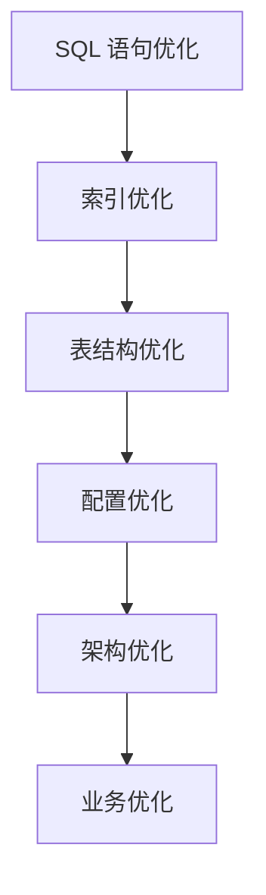

# 数据库性能优化实战

> **文档说明**：系统讲解数据库性能优化的完整体系，包括索引优化（索引设计/失效场景/覆盖索引）、SQL 优化（执行计划/慢查询/SQL 改写）、表结构优化（数据类型/范式/反范式）、查询优化（分页/关联/子查询）、配置优化（连接池/缓存/参数）、架构优化（读写分离/分库分表/缓存）、性能监控诊断，以及生产级最佳实践和常见问题。
>
> **适用人群**：后端开发工程师、全栈开发者、DBA、数据库性能优化工程师
>
> **前置知识**：[[MySQL-InnoDB存储引擎]]、[[MySQL-索引优化与执行计划]]、[[分库分表实战指南]]、[[Redis高级数据结构实战]]

---

## 一、概述

### 1. 性能优化目标

| 目标 | 说明 | 指标 |
|------|------|------|
| **降低延迟** | 减少查询响应时间 | P99 < 100ms |
| **提升吞吐量** | 增加单位时间处理能力 | QPS/TPS |
| **降低资源消耗** | 减少 CPU/IO/内存 | CPU 使用率、IOPS |
| **提升并发能力** | 支持更多并发连接 | 连接数、并发查询数 |
| **保障稳定性** | 避免性能抖动和雪崩 | 响应时间稳定性 |

### 2. 优化层次



| 层次 | 优化手段 | 投入产出比 |
|------|---------|-----------|
| **SQL 优化** | 改写 SQL、避免全表扫描 | ⭐⭐⭐⭐⭐ 最高 |
| **索引优化** | 合理建索引、避免索引失效 | ⭐⭐⭐⭐⭐ 最高 |
| **表结构** | 数据类型、范式设计 | ⭐⭐⭐⭐ 高 |
| **配置优化** | 连接池、缓存、参数 | ⭐⭐⭐ 中 |
| **架构优化** | 读写分离、分库分表 | ⭐⭐ 高成本 |
| **业务优化** | 减少查询、异步化 | ⭐⭐⭐⭐ 高 |

> **优化原则**：先优化 SQL 和索引（成本低、收益大），再考虑架构优化（成本高、收益大）。

---

## 二、索引优化

### 1. 索引类型

| 索引类型 | 说明 | 适用场景 |
|---------|------|---------|
| **B+树索引** | InnoDB 默认，有序树结构 | 等值查询、范围查询、排序 |
| **哈希索引** | 哈希表，O(1) 查找 | 等值查询（Memory 引擎） |
| **全文索引** | 分词倒排索引 | 文本搜索（FULLTEXT） |
| **空间索引** | R-Tree，地理数据 | GIS 地理位置查询 |
| **联合索引** | 多列组合索引 | 多条件查询 |
| **覆盖索引** | 索引包含所有查询列 | 避免回表 |
| **唯一索引** | 索引列值唯一 | 唯一性约束 + 查询 |

### 2. 索引设计原则

- [ ] **最左前缀**：联合索引按最左列开始匹配
- [ ] **高选择性**：优先在区分度高的列建索引
- [ ] **覆盖索引**：索引包含查询所需所有列，避免回表
- [ ] **避免过多索引**：每个索引增加写入开销，通常 ≤5 个
- [ ] **联合索引顺序**：等值查询列在前，范围查询列在后
- [ ] **索引列不参与计算**：索引列上不使用函数/运算
- [ ] **短索引优先**：字符串列用前缀索引
- [ ] **避免冗余索引**：已有 (a,b) 就不需 (a)

### 3. 联合索引设计

```sql
-- 查询：WHERE name = ? AND age > ? ORDER BY created_at
-- 联合索引设计：(name, age, created_at)
-- name 等值 → age 范围 → created_at 排序
CREATE INDEX idx_name_age_created ON users(name, age, created_at);

-- 最左前缀匹配：
-- ✅ WHERE name = ?           → 用到 name
-- ✅ WHERE name = ? AND age = ? → 用到 name, age
-- ✅ WHERE name = ? AND age > ? → 用到 name, age
-- ❌ WHERE age = ?            → 用不到（缺最左列 name）
-- ❌ WHERE age = ? AND name = ? → 优化器会重排，能用到
```

### 4. 覆盖索引

```sql
-- 查询只需要 id, name, email
SELECT id, name, email FROM users WHERE name = ?;

-- 建立覆盖索引，无需回表
CREATE INDEX idx_name_email ON users(name, email);
-- Extra: Using index 表示使用覆盖索引
```

### 5. 索引失效场景

| 失效场景 | 示例 | 解决方案 |
|---------|------|---------|
| **索引列用函数** | `WHERE YEAR(created_at) = 2026` | 改为范围：`WHERE created_at >= '2026-01-01'` |
| **隐式类型转换** | `WHERE phone = 13800000000`（phone 是字符串） | 加引号：`WHERE phone = '13800000000'` |
| **LIKE 左模糊** | `WHERE name LIKE '%张%'` | 改为右模糊 `'张%'` 或全文索引 |
| **OR 连接非索引列** | `WHERE name = ? OR status = ?`（status 无索引） | status 加索引或改为 UNION |
| **!= 或 <>** | `WHERE status != 1` | 优化器可能放弃索引，考虑枚举值 |
| **IS NOT NULL** | `WHERE name IS NOT NULL` | 优化器可能放弃索引 |
| **联合索引不满足最左前缀** | `WHERE age = ?`（索引是 name,age） | 调整索引顺序或加单独索引 |
| **索引列参与运算** | `WHERE price * 2 = 100` | 改为 `WHERE price = 50` |

### 6. 索引监控

```sql
-- 查看索引使用情况（sys.schema_unused_indexes）
SELECT * FROM sys.schema_unused_indexes;

-- 查看索引统计
SELECT * FROM sys.schema_index_statistics
WHERE table_schema = 'mydb' ORDER BY rows_searched DESC;

-- 分析表统计信息（优化器依赖统计信息）
ANALYZE TABLE users;

-- 查看索引基数（区分度）
SHOW INDEX FROM users;
-- Cardinality 越高，区分度越好
```

---

## 三、SQL 优化

### 1. EXPLAIN 执行计划

```sql
EXPLAIN SELECT * FROM users WHERE name = '张三';

-- 关键字段说明：
-- id: 查询执行顺序
-- select_type: 查询类型（SIMPLE/PRIMARY/SUBQUERY等）
-- table: 操作的表
-- type: 访问类型（重要！）
-- possible_keys: 可能使用的索引
-- key: 实际使用的索引
-- key_len: 使用的索引长度
-- rows: 预估扫描行数
-- Extra: 额外信息
```

### 2. type 访问类型（性能从好到差）

| type | 说明 | 性能 |
|------|------|------|
| **system** | 系统表，只有一行 | 最好 |
| **const** | 主键/唯一索引等值查询 | 极好 |
| **eq_ref** | 联合查询使用主键/唯一索引 | 很好 |
| **ref** | 非唯一索引等值查询 | 好 |
| **range** | 索引范围查询 | 较好 |
| **index** | 全索引扫描 | 一般 |
| **ALL** | 全表扫描 | 最差，需优化 |

> **目标**：查询 type 至少达到 range，最好是 ref/eq_ref/const。

### 3. Extra 关键信息

| Extra | 说明 | 优化方向 |
|-------|------|---------|
| **Using index** | 覆盖索引，无需回表 | ✅ 好 |
| **Using where** | 存储层过滤后再返回 | 正常 |
| **Using index condition** | 索引下推（ICP） | ✅ 好 |
| **Using temporary** | 使用临时表 | ❌ 优化排序/分组 |
| **Using filesort** | 文件排序（非索引排序） | ❌ 加索引或优化 ORDER BY |
| **Using join buffer** | 连接使用缓存 | ❌ 加连接索引 |
| **Impossible WHERE** | WHERE 条件永远为假 | 检查条件 |

### 4. 慢查询优化

```sql
-- 开启慢查询日志
SET GLOBAL slow_query_log = 'ON';
SET GLOBAL long_query_time = 1;  -- 超过 1 秒记录
SET GLOBAL slow_query_log_file = '/var/log/mysql/slow.log';

-- 分析慢查询日志
-- mysqldumpslow / pt-query-digest
mysqldumpslow -s t -t 10 /var/log/mysql/slow.log  # 按时间排序，前10条

-- 查看当前正在执行的查询
SHOW PROCESSLIST;
SHOW FULL PROCESSLIST;

-- 查看 InnoDB 状态（锁等待、死锁）
SHOW ENGINE INNODB STATUS;
```

### 5. 常见 SQL 优化

```sql
-- ❌ 避免 SELECT *
SELECT * FROM users;
-- ✅ 只查需要的列
SELECT id, name, email FROM users;

-- ❌ 深分页（OFFSET 大）
SELECT * FROM orders ORDER BY id LIMIT 1000000, 20;
-- ✅ 延迟关联 / 游标分页
SELECT o.* FROM orders o
INNER JOIN (SELECT id FROM orders ORDER BY id LIMIT 1000000, 20) t
ON o.id = t.id;

-- ❌ 子查询（IN 子查询可能效率低）
SELECT * FROM orders WHERE user_id IN (SELECT id FROM users WHERE status = 1);
-- ✅ 改为 JOIN
SELECT o.* FROM orders o JOIN users u ON o.user_id = u.id WHERE u.status = 1;

-- ❌ COUNT(*) 大表无索引
SELECT COUNT(*) FROM orders WHERE status = 'pending';
-- ✅ 状态列加索引，或使用近似计数
-- 对于精确计数，确保有覆盖索引

-- ❌ 大事务
BEGIN;
-- 大量更新操作...
COMMIT;
-- ✅ 分批处理，避免长事务
-- 每批 1000 条，分批提交

-- ❌ 模糊查询左通配
SELECT * FROM users WHERE name LIKE '%张%';
-- ✅ 右通配可用索引，或使用全文索引/ES
SELECT * FROM users WHERE name LIKE '张%';

-- ❌ ORDER BY 无索引
SELECT * FROM users ORDER BY created_at DESC;
-- ✅ created_at 加索引，或使用主键排序
```

### 6. JOIN 优化

```sql
-- JOIN 优化原则：
-- 1. 小表驱动大表
-- 2. 连接列加索引
-- 3. 避免 JOIN 过多表（通常 ≤3 个）
-- 4. 避免 JOIN 列类型不一致

-- ✅ 小表驱动大表
SELECT u.name, o.order_no
FROM users u          -- 小表（驱动表）
JOIN orders o ON u.id = o.user_id  -- 大表，user_id 有索引
WHERE u.status = 1;

-- 查看 JOIN 类型
EXPLAIN SELECT ...;
-- type=ALL 表示被驱动表全表扫描，需加索引
```

---

## 四、表结构优化

### 1. 数据类型选择

| 原则 | 说明 | 示例 |
|------|------|------|
| **越小越好** | 够用的最小数据类型 | 年龄用 TINYINT 不用 INT |
| **简单就好** | 整数比字符串快 | IP 用 INT 不用 VARCHAR |
| **避免 NULL** | NULL 占用额外空间，索引复杂 | 用默认值代替 NULL |
| **精确小数** | 金额用 DECIMAL 不用 FLOAT | `DECIMAL(10,2)` |
| **字符串长度** | VARCHAR 按需分配 | 姓名 VARCHAR(50) |
| **时间类型** | 时间用 DATETIME/TIMESTAMP | 不用字符串存时间 |
| **枚举用 ENUM** | 固定枚举值用 ENUM/TINYINT | 状态用 TINYINT |

```sql
-- ❌ 不合理设计
CREATE TABLE bad_example (
    id VARCHAR(36),           -- UUID 字符串，主键大
    age INT,                  -- 用 INT 存年龄
    price FLOAT,              -- 浮点存金额
    status VARCHAR(10),       -- 字符串存状态
    created_at VARCHAR(20)    -- 字符串存时间
);

-- ✅ 合理设计
CREATE TABLE good_example (
    id BIGINT UNSIGNED AUTO_INCREMENT PRIMARY KEY,
    age TINYINT UNSIGNED NOT NULL DEFAULT 0,
    price DECIMAL(10,2) NOT NULL DEFAULT 0.00,
    status TINYINT NOT NULL DEFAULT 0 COMMENT '0待处理1完成2取消',
    created_at DATETIME NOT NULL DEFAULT CURRENT_TIMESTAMP,
    INDEX idx_status_created(status, created_at)
);
```

### 2. 范式与反范式

| 范式 | 说明 | 优点 | 缺点 |
|------|------|------|------|
| **第三范式（3NF）** | 属性不传递依赖主键 | 数据一致、无冗余 | 查询需 JOIN |
| **反范式** | 适当冗余字段 | 减少 JOIN、查询快 | 数据可能不一致 |

```sql
-- 反范式示例：订单表冗余用户名，避免 JOIN 用户表
CREATE TABLE orders (
    id BIGINT PRIMARY KEY,
    user_id BIGINT NOT NULL,
    user_name VARCHAR(50) NOT NULL,  -- 冗余用户名
    total_amount DECIMAL(10,2),
    created_at DATETIME
);
-- 查询订单时不需 JOIN users 表获取用户名
-- 代价：用户名变更时需同步更新
```

### 3. 表结构优化

- [ ] **适度拆分大表**：宽表拆为多表，冷热数据分离
- [ ] **归档历史数据**：历史数据归档到归档表
- [ ] **合理字符集**：utf8mb4 支持 emoji，但比 utf8 占空间
- [ ] **主键自增**：InnoDB 聚簇索引，自增主键插入性能好
- [ ] **避免大字段**：TEXT/BLOB 字段单独拆表
- [ ] **注释完整**：表和字段加 COMMENT

---

## 五、查询优化

### 1. 分页优化

```sql
-- 深分页问题：LIMIT 1000000, 20 需要扫描 1000020 行

-- 方案1：延迟关联
SELECT o.* FROM orders o
INNER JOIN (SELECT id FROM orders ORDER BY id LIMIT 1000000, 20) t
ON o.id = t.id;

-- 方案2：游标分页（推荐，无深分页问题）
SELECT * FROM orders WHERE id > 1000000 ORDER BY id LIMIT 20;

-- 方案3：记录最大 ID，下一页用 id > max_id
-- 前端传 last_id，后端 WHERE id > last_id LIMIT 20
```

### 2. 聚合查询优化

```sql
-- ❌ 每次查询都 COUNT
SELECT COUNT(*) FROM orders WHERE status = 1;

-- ✅ 预聚合 / 缓存
-- 1. 维护计数表，写入时更新
-- 2. Redis 缓存计数，定时刷新
-- 3. 近似值：对于不精确场景用估算

-- ✅ GROUP BY 优化
-- 确保 GROUP BY 列有索引，避免 Using temporary
SELECT status, COUNT(*) FROM orders GROUP BY status;
-- status 列加索引
```

### 3. 子查询优化

```sql
-- ❌ 相关子查询（每行执行一次）
SELECT * FROM orders o
WHERE (SELECT COUNT(*) FROM order_items oi WHERE oi.order_id = o.id) > 5;

-- ✅ 改为 JOIN + GROUP BY
SELECT o.* FROM orders o
JOIN order_items oi ON o.id = oi.order_id
GROUP BY o.id
HAVING COUNT(oi.id) > 5;
```

---

## 六、配置优化

### 1. 连接池配置

| 参数 | 建议值 | 说明 |
|------|--------|------|
| **maximumPoolSize** | CPU核数 * 2 + 有效磁盘数 | HikariCP 最大连接数 |
| **minimumIdle** | = maximumPoolSize | 保持固定连接数 |
| **connectionTimeout** | 30000ms | 获取连接超时 |
| **idleTimeout** | 600000ms | 空闲连接超时 |
| **maxLifetime** | 1800000ms | 连接最大生命周期（小于数据库 wait_timeout） |

```yaml
# HikariCP 配置
spring:
  datasource:
    hikari:
      maximum-pool-size: 20
      minimum-idle: 20
      connection-timeout: 30000
      idle-timeout: 600000
      max-lifetime: 1800000
      leak-detection-threshold: 60000  # 连接泄漏检测
```

### 2. MySQL 关键参数

```ini
[mysqld]
# InnoDB 缓冲池（建议物理内存的 50-70%）
innodb_buffer_pool_size = 4G
innodb_buffer_pool_instances = 4  # 多实例减少锁竞争

# 日志
innodb_log_file_size = 1G        # 重做日志大小
innodb_log_buffer_size = 64M     # 日志缓冲区
innodb_flush_log_at_trx_commit = 1  # 1=最安全，0/2=高性能

# 连接
max_connections = 500
wait_timeout = 600
interactive_timeout = 600

# 排序/临时表
sort_buffer_size = 4M
tmp_table_size = 64M
max_heap_table_size = 64M

# 查询缓存（8.0 已移除）
# query_cache_type = 0

# 字符集
character-set-server = utf8mb4
collation-server = utf8mb4_unicode_ci
```

### 3. 缓存策略

| 缓存层 | 说明 | 工具 |
|--------|------|------|
| **应用缓存** | 本地缓存（Caffeine/Guava） | Caffeine |
| **分布式缓存** | Redis 缓存热点数据 | Redis |
| **数据库缓存** | InnoDB Buffer Pool、查询缓存 | MySQL 内置 |
| **CDN 缓存** | 静态资源、接口缓存 | Cloudflare/阿里云 CDN |

```text
缓存模式：
1. Cache-Aside：先查缓存，没有查 DB，写缓存
2. Write-Through：写缓存同时写 DB
3. Write-Behind：写缓存，异步写 DB
4. Read-Through：缓存层自动加载 DB

缓存问题：
- 缓存穿透：布隆过滤器、空值缓存
- 缓存击穿：互斥锁、永不过期
- 缓存雪崩：随机过期时间、多级缓存
```

---

## 七、架构优化

### 1. 读写分离

```text
读写分离架构：
    写请求 → 主库（Master）
    读请求 → 从库（Slave1, Slave2, ...）

实现方式：
1. 中间件：ShardingSphere、MyCat
2. 应用层：动态数据源、AbstractRoutingDataSource
3. 数据库代理：ProxySQL、MaxScale

注意：
- 主从延迟问题（关键读走主库）
- 强制走主库注解（@Master）
```

### 2. 分库分表

详细参考 [[分库分表实战指南]]。

| 策略 | 说明 | 适用场景 |
|------|------|---------|
| **垂直分库** | 按业务模块拆分数据库 | 业务解耦 |
| **垂直分表** | 宽表拆为多表（冷热分离） | 大宽表 |
| **水平分库** | 同一表数据分散到多库 | 数据量大 |
| **水平分表** | 同一表数据分散到多表 | 单表数据大 |

### 3. 数据库中间件

| 中间件 | 说明 | 特点 |
|--------|------|------|
| **ShardingSphere** | Apache 顶级项目 | 功能全、分库分表+读写分离+加密 |
| **MyCat** | 开源数据库代理 | 老牌、社区活跃 |
| **ProxySQL** | MySQL 代理 | 读写分离、查询路由 |
| **Vitess** | YouTube 开源 | 云原生、水平扩展 |

---

## 八、性能监控与诊断

### 1. 性能指标

| 指标 | 说明 | 告警阈值 |
|------|------|---------|
| **QPS/TPS** | 每秒查询/事务数 | 突增 50% |
| **慢查询数** | 超过 long_query_time 的查询 | > 10/分钟 |
| **连接数** | 当前活跃连接数 | > max_connections * 80% |
| **Buffer Pool 命中率** | 缓存命中率 | < 95% |
| **锁等待时间** | InnoDB 行锁等待 | > 1秒 |
| **主从延迟** | 主从同步延迟 | > 5秒 |
| **CPU/IO** | 数据库服务器资源 | CPU > 80%, IO util > 80% |

### 2. 诊断工具

| 工具 | 说明 |
|------|------|
| **EXPLAIN** | 查看执行计划 |
| **SHOW PROCESSLIST** | 查看当前查询 |
| **SHOW ENGINE INNODB STATUS** | InnoDB 状态（锁、事务） |
| **慢查询日志** | 记录慢查询 |
| **pt-query-digest** | 分析慢查询日志 |
| **Performance Schema** | MySQL 性能监控 |
| **sys schema** | 系统视图，简化监控 |
| **Prometheus + Grafana** | 可视化监控 |

### 3. 性能诊断流程

```text
1. 发现问题：监控告警 / 用户反馈
2. 定位慢查询：慢查询日志 / SHOW PROCESSLIST
3. 分析执行计划：EXPLAIN 查看 type/key/Extra
4. 确认瓶颈：CPU / IO / 锁 / 连接
5. 优化实施：加索引 / 改写 SQL / 调参数
6. 验证效果：再次 EXPLAIN / 监控指标
7. 持续监控：防止性能退化
```

---

## 九、最佳实践

### 1. 开发规范

- [ ] **禁止 SELECT ***：只查询需要的列
- [ ] **必须有 WHERE**：更新删除必须有 WHERE
- [ ] **批量操作**：批量插入/更新，减少往返
- [ ] **避免大事务**：事务尽量短，避免长事务
- [ ] **分页限制**：限制最大分页深度，用游标分页
- [ ] **索引评审**：新 SQL 必须评审索引使用
- [ ] **慢查询告警**：慢查询自动告警和跟进
- [ ] **ORM 注意**：避免 N+1 查询、懒加载陷阱

### 2. 索引规范

- [ ] **表必须有主键**：自增 BIGINT 主键
- [ ] **索引数量控制**：单表索引 ≤ 5 个
- [ ] **联合索引顺序**：等值在前，范围在后
- [ ] **字符串前缀索引**：长字符串用前缀索引
- [ ] **定期清理无用索引**：删除未使用索引
- [ ] **避免重复索引**：已有 (a,b) 不需 (a)

### 3. 运维规范

- [ ] **定期 ANALYZE TABLE**：更新统计信息
- [ ] **定期 OPTIMIZE TABLE**：整理碎片（大表慎用）
- [ ] **备份恢复演练**：定期验证备份可恢复
- [ ] **主从延迟监控**：实时监控主从延迟
- [ ] **容量规划**：提前规划磁盘、连接数
- [ ] **变更灰度**：DDL 变更使用 gh-ost/pt-online-schema-change

---

## 十、常见问题与排查

| 问题 | 原因 | 解决方案 |
|------|------|---------|
| **查询慢（全表扫描）** | 无索引 / 索引失效 | EXPLAIN 分析，加索引或改写 SQL |
| **CPU 高** | 复杂查询 / 排序 / 函数运算 | 优化 SQL、加索引、减少计算 |
| **IO 高** | 全表扫描 / 大量写 / Buffer Pool 小 | 加索引、增大 Buffer Pool、优化写 |
| **连接数满** | 慢查询占用连接 / 连接泄漏 | 优化慢查询、连接池配置、泄漏检测 |
| **死锁** | 事务加锁顺序不一致 | 统一加锁顺序、缩短事务、查看死锁日志 |
| **主从延迟大** | 大事务 / DDL / 从库性能差 | 避免大事务、并行复制、提升从库配置 |
| **锁等待超时** | 长事务持有锁 / 热点行 | 缩短事务、优化索引、减少热点 |
| **内存不足** | Buffer Pool 过大 / 连接数多 | 调整 Buffer Pool、限制连接数 |
| **磁盘满** | 日志大 / 数据增长快 | 清理 binlog、归档数据、扩容 |
| **插入慢** | 索引多 / 大事务 / 同步刷盘 | 减少索引、批量插入、调整刷盘策略 |
| **排序慢（filesort）** | ORDER BY 无索引 / 多表排序 | 加排序索引、减少排序字段 |
| **分组慢（temporary）** | GROUP BY 无索引 | 加分组索引、预聚合 |
| **深分页慢** | OFFSET 太大 | 游标分页、延迟关联 |
| **索引不生效** | 隐式转换 / 函数 / 左模糊 | 改写条件、检查类型、避免函数 |
| **数据不一致** | 主从延迟 / 缓存不一致 | 关键读走主库、缓存更新策略 |

---

## 十一、关联笔记

### 数据库
- [[MySQL-InnoDB存储引擎]] · [[MySQL-索引优化与执行计划]] · [[分库分表实战指南]]
- [[数据库主从复制与读写分离]] · [[Redis高级数据结构实战]] · [[Elasticsearch-全文检索引擎]]
- [[Kafka-消息队列与消费模型]]

### 后端
- [[SpringBoot-Web层设计]] · [[SpringBoot-配置管理与多环境]] · [[Java-并发编程JUC]]
- [[JVM-内存模型与GC调优]] · [[后端性能优化实战]]

### 运维
- [[Prometheus监控体系]] · [[K8s-核心概念与架构]] · [[云原生架构设计]]

### 导航
- [[MOC-计算机基础]] · [[MOC-后端开发]] · [[全栈+AI工程双轨融合学习路线图]]

> **学习路径建议**：先掌握 [[MySQL-InnoDB存储引擎]] 存储引擎原理 → 学习 [[MySQL-索引优化与执行计划]] 索引和执行计划 → 深入本文数据库性能优化实战 → 实践慢查询分析和索引优化 → 研究 [[分库分表实战指南]] 架构层优化 → 应用于生产系统的性能调优。

---

## 💡 全文深度讲解

本文系统梳理了数据库性能优化实战的核心知识体系，从概述入手，深入索引优化的底层机制，再通过SQL 优化掌握实战应用，最后涵盖常见问题与排查与关联笔记。学习时建议先建立整体认知，再动手实践，最后结合常见问题深化理解。

## 📝 全文精简总结

- **概述**：掌握本模块的核心概念与关键要点
- **索引优化**：掌握本模块的核心概念与关键要点
- **SQL 优化**：掌握本模块的核心概念与关键要点
- **表结构优化**：掌握本模块的核心概念与关键要点
- **查询优化**：掌握本模块的核心概念与关键要点
- **配置优化**：掌握本模块的核心概念与关键要点
- **架构优化**：掌握本模块的核心概念与关键要点
- **性能监控与诊断**：掌握本模块的核心概念与关键要点
- 其余3个模块涵盖进阶主题与拓展内容

