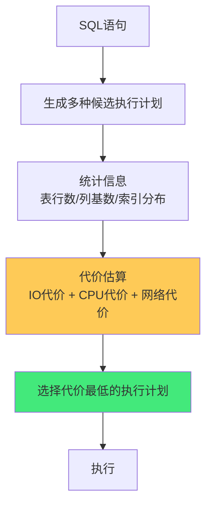
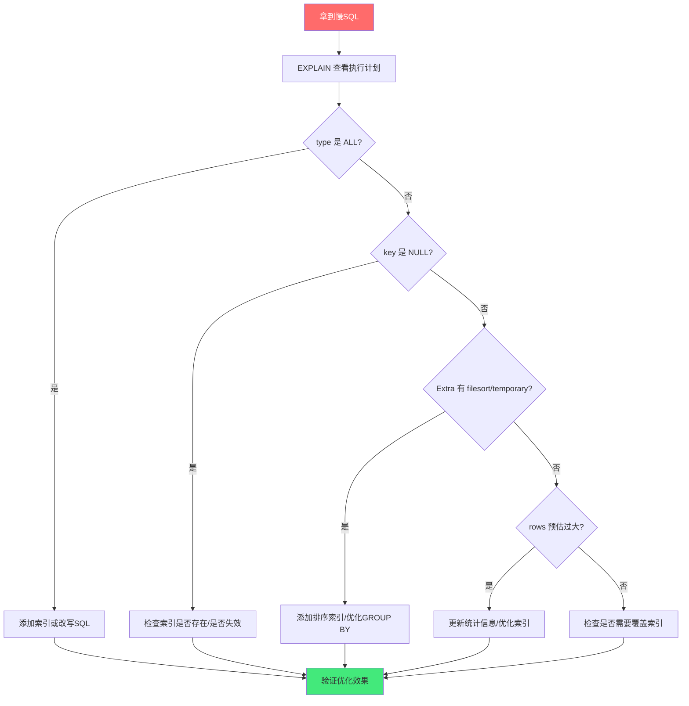
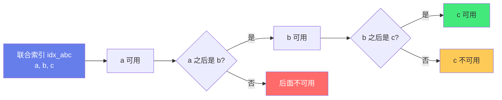

# 📊 数据库执行计划分析

> **文档说明**：系统讲解关系型数据库执行计划（Execution Plan）的完整知识体系，涵盖执行计划的核心概念与作用、查询优化器的工作原理（基于代价的优化器CBO、统计信息、代价估算）、MySQL EXPLAIN 详解（id/select_type/table/type/possible_keys/key/key_len/ref/rows/filtered/Extra 各字段含义）、访问类型对比（system/const/eq_ref/ref/range/index/ALL 性能从好到差）、Extra 字段关键信息（Using index/Using where/Using filesort/Using temporary/Using join buffer 等）、PostgreSQL EXPLAIN 详解、Oracle 执行计划查看方法、执行计划分析的标准流程、慢查询优化实战案例、索引失效场景与优化、SQL 改写技巧、执行计划缓存与稳定性、各数据库执行计划差异对比。
>
> **适用人群**：后端开发者、DBA、数据库性能优化工程师、全栈开发者
>
> **前置知识**：[[索引原理与SQL优化]] · [[MySQL架构与存储引擎]] · [[事务与锁机制]]

---

## 一、概述

### 1.1 什么是执行计划

执行计划（Execution Plan）是数据库查询优化器（Query Optimizer）根据 SQL 语句和数据库统计信息，生成的**具体执行步骤的描述**。它告诉我们：数据库将以什么顺序访问表、使用什么索引、采用什么连接方式、预估扫描多少行数据。


**为什么需要执行计划**：
| 问题 | 执行计划的作用 |
|------|--------------|
| SQL 为什么慢？ | 查看是否全表扫描、是否走索引、是否有临时表/文件排序 |
| 索引有没有生效？ | 查看 key 字段是否使用了期望的索引 |
| 表连接顺序对不对？ | 查看 id 和执行顺序，小表是否先驱动大表 |
| 预估行数准不准？ | 查看 rows 字段和实际行数的差异，判断统计信息是否过期 |
| 有没有额外开销？ | 查看 Extra 字段是否有 Using filesort/Using temporary |

### 1.2 查询优化器原理

现代关系型数据库使用**基于代价的优化器（CBO - Cost-Based Optimizer）**：



**代价模型的核心因素**：
| 因素 | 说明 |
|------|------|
| **IO 代价** | 从磁盘读取数据页的代价（最主要，磁盘比内存慢 10^5 倍） |
| **CPU 代价** | 比较、排序、连接等计算的代价 |
| **网络代价** | 分布式数据库中数据传输的代价 |
| **统计信息** | 表行数、列基数（distinct值数）、索引选择性、数据分布直方图 |

**优化器的局限**：
- 统计信息可能过期（导致代价估算不准）
- 数据分布不均匀（直方图可能不准确）
- 复杂查询的候选计划空间巨大（不可能穷举所有计划）
- 优化器不了解应用层语义（如某些列值的业务含义）

> **关键认知**：执行计划是优化器「基于当前统计信息的最优猜测」，不一定是真正最优的。DBA 的工作就是通过分析执行计划，发现优化器的误判，通过索引、SQL改写、统计信息更新等手段，引导优化器生成更好的计划。

---

## 二、MySQL EXPLAIN 详解

### 2.1 EXPLAIN 基本用法

```sql
-- 查看执行计划
EXPLAIN SELECT * FROM users WHERE id = 1;

-- 查看执行计划（JSON格式，更详细）
EXPLAIN FORMAT=JSON SELECT * FROM users WHERE id = 1;

-- 查看执行计划并实际执行（MySQL 8.0.18+）
EXPLAIN ANALYZE SELECT * FROM users WHERE id = 1;

-- 查看执行计划（传统格式）
EXPLAIN EXTENDED SELECT * FROM users WHERE id = 1;
SHOW WARNINGS;  -- 查看优化后的SQL
```

**EXPLAIN 输出字段**：
| 字段 | 含义 | 重要性 |
|------|------|--------|
| `id` | 查询中每个 SELECT 的标识符（执行顺序） | ⭐⭐⭐ |
| `select_type` | SELECT 的类型（SIMPLE/PRIMARY/SUBQUERY 等） | ⭐⭐ |
| `table` | 访问的表名 | ⭐ |
| `partitions` | 匹配的分区 | ⭐ |
| `type` | 访问类型（ALL/index/range/ref/eq_ref/const/system） | ⭐⭐⭐⭐⭐ |
| `possible_keys` | 可能使用的索引 | ⭐⭐ |
| `key` | 实际使用的索引 | ⭐⭐⭐⭐⭐ |
| `key_len` | 使用的索引长度（字节数） | ⭐⭐⭐ |
| `ref` | 与索引比较的列或常量 | ⭐⭐ |
| `rows` | 预估需要扫描的行数 | ⭐⭐⭐⭐ |
| `filtered` | 按表条件过滤的行百分比 | ⭐⭐ |
| `Extra` | 额外信息（Using index/filesort/temporary 等） | ⭐⭐⭐⭐⭐ |

### 2.2 type 访问类型详解

`type` 是执行计划中**最重要的字段之一**，表示数据库访问表的方式，性能从好到差排列：

| type | 名称 | 说明 | 性能 |
|------|------|------|------|
| `system` | 系统表 | 表只有一行（系统表），const 的特例 | 最优 |
| `const` | 常量 | 通过主键或唯一索引一次命中，最多一行 | 极快 |
| `eq_ref` | 等值引用 | 多表连接时，使用主键或唯一索引，每行最多匹配一行 | 极快 |
| `ref` | 非唯一引用 | 使用非唯一索引，可能匹配多行 | 快 |
| `ref_or_null` | 引用或空 | 类似 ref，但额外搜索 NULL 值 | 较快 |
| `range` | 范围扫描 | 索引范围扫描（BETWEEN/>/</IN/OR） | 中等 |
| `index_merge` | 索引合并 | 使用多个索引合并结果 | 中等 |
| `index` | 索引全扫描 | 扫描整个索引树（比 ALL 快，索引通常比表小） | 较慢 |
| `ALL` | 全表扫描 | 扫描整个表（最坏情况） | 最差 |

**各类型示例**：

```sql
-- const：主键或唯一索引等值查询
EXPLAIN SELECT * FROM users WHERE id = 1;
-- type=const, key=PRIMARY

-- eq_ref：多表连接使用主键/唯一索引
EXPLAIN SELECT * FROM orders o JOIN users u ON o.user_id = u.id;
-- users 表 type=eq_ref, key=PRIMARY

-- ref：非唯一索引等值查询
EXPLAIN SELECT * FROM users WHERE email = 'test@example.com';
-- type=ref, key=idx_email（email 有普通索引）

-- range：索引范围查询
EXPLAIN SELECT * FROM orders WHERE created_at BETWEEN '2024-01-01' AND '2024-12-31';
EXPLAIN SELECT * FROM users WHERE id IN (1, 2, 3);
EXPLAIN SELECT * FROM users WHERE age > 18;
-- type=range

-- index：全索引扫描（查询列都在索引中，但需要扫描整个索引）
EXPLAIN SELECT id FROM users;  -- id 是主键，聚簇索引
-- type=index

-- ALL：全表扫描（没有可用索引或优化器选择全表扫描）
EXPLAIN SELECT * FROM users WHERE name LIKE '%张%';
-- type=ALL（前导通配符无法使用索引）
```

**性能优化目标**：
- 至少达到 `range` 级别
- 理想是 `ref` 或 `eq_ref`
- 避免 `ALL`（全表扫描），特别是大表
- `index` 比 `ALL` 好，但大表仍需优化

### 2.3 key 与 key_len

**key（实际使用的索引）**：
- `NULL` 表示没有使用索引（通常是 ALL 或 index 类型）
- `PRIMARY` 表示使用主键索引
- 其他值表示使用的索引名

**key_len（索引使用长度）**：
表示查询中使用了索引的多少个字节，用于判断**联合索引的使用情况**。

```sql
-- 联合索引 idx_abc(a, b, c)
-- key_len 可以判断用到了联合索引的哪些列

-- 只用到 a 列
EXPLAIN SELECT * FROM t WHERE a = 1;
-- key_len = a列的长度

-- 用到 a, b 列
EXPLAIN SELECT * FROM t WHERE a = 1 AND b = 2;
-- key_len = a列长度 + b列长度

-- 用到 a, b, c 列（最左前缀全部用到）
EXPLAIN SELECT * FROM t WHERE a = 1 AND b = 2 AND c = 3;
-- key_len = a+b+c 列长度
```

**key_len 计算规则**：
| 列类型 | 长度计算 | 示例 |
|--------|---------|------|
| `int` | 4 字节 | key_len=4 |
| `bigint` | 8 字节 | key_len=8 |
| `char(n)` | n × 字符集字节数 | char(10) utf8mb4 → 40 |
| `varchar(n)` | n × 字符集字节数 + 2（变长） | varchar(10) utf8mb4 → 42 |
| `datetime` | 5 字节（MySQL 5.6+） | key_len=5 |
| `timestamp` | 4 字节 | key_len=4 |
| `NULL` 列 | +1 字节（标记是否为NULL） | 允许NULL的int → 5 |

> **字符集影响**：utf8 每个字符 3 字节，utf8mb4 每个字符 4 字节。同样 varchar(100)，utf8mb4 的 key_len 是 utf8 的 1.33 倍。

### 2.4 Extra 字段详解

`Extra` 是执行计划中**信息量最大的字段**，包含了很多关键的性能提示：

| Extra | 含义 | 性能影响 |
|-------|------|---------|
| `Using index` | 覆盖索引（查询列都在索引中，无需回表） | ✅ 好 |
| `Using where` | 使用 WHERE 过滤（在存储引擎层过滤后返回给Server层） | 中性 |
| `Using index condition` | 索引条件下推（ICP，在存储引擎层用索引条件过滤） | ✅ 好 |
| `Using filesort` | 需要额外的排序操作（无法利用索引排序） | ❌ 差 |
| `Using temporary` | 需要使用临时表（GROUP BY/DISTINCT/UNION 等） | ❌ 差 |
| `Using join buffer` | 连接使用了连接缓存（被驱动表无索引） | ⚠️ 需优化 |
| `Using sort_union`/`Using union`/`Using intersect` | 索引合并的具体方式 | 中性 |
| `Impossible WHERE` | WHERE 条件永远为 FALSE | 提示 |
| `No tables used` | 没有 FROM 子句（如 SELECT 1） | 提示 |
| `Select tables optimized away` | MIN/MAX 优化，无需访问表 | ✅ 好 |
| `Full scan on NULL key` | 子查询优化的一种方式 | 中性 |

**关键 Extra 详解**：

**1. Using index（覆盖索引）**：
查询所需的所有列都包含在索引中，不需要回表查询聚簇索引，性能极好。

```sql
-- 联合索引 idx_user_age(user_id, age)
SELECT user_id, age FROM orders WHERE user_id = 1;
-- Extra=Using index（user_id 和 age 都在索引中）

SELECT user_id, age, amount FROM orders WHERE user_id = 1;
-- Extra 无 Using index（amount 不在索引中，需要回表）
```

**2. Using filesort（文件排序）**：
无法利用索引完成排序，需要额外的排序操作（内存中排序或临时文件排序）。

```sql
-- 没有索引支持排序
SELECT * FROM users ORDER BY created_at DESC;
-- Extra=Using filesort（created_at 无索引）

-- 有索引支持排序（无 filesort）
-- 假设 created_at 有索引 idx_created_at
SELECT * FROM users ORDER BY created_at DESC;
-- Extra 无 Using filesort（利用索引有序性）
```

> **filesort 不一定用文件**：MySQL 会先尝试在内存中排序（sort_buffer），如果数据量超过 sort_buffer_size 才会使用临时文件。但即使在内存中排序，也有 CPU 开销。

**3. Using temporary（临时表）**：
查询需要使用临时表来存储中间结果，常见于 GROUP BY、DISTINCT、UNION 等操作。

```sql
-- GROUP BY 无索引
SELECT department, COUNT(*) FROM users GROUP BY department;
-- Extra=Using temporary; Using filesort（department 无索引）

-- GROUP BY 有索引
-- 假设 department 有索引
SELECT department, COUNT(*) FROM users GROUP BY department;
-- Extra 无 Using temporary（利用索引有序性分组）
```

**4. Using index condition（索引条件下推 ICP）**：
将 WHERE 条件中可以用索引过滤的部分下推到存储引擎层，减少回表次数。

```sql
-- 联合索引 idx_name_age(name, age)
SELECT * FROM users WHERE name LIKE '张%' AND age = 25;
-- 无ICP：先用 name 索引找到所有姓张的，回表后再过滤 age=25
-- 有ICP：在索引层面同时用 name 和 age 过滤，减少回表
-- Extra=Using index condition
```

### 2.5 id 与执行顺序

`id` 字段表示查询中每个 SELECT 的标识符，**id 越大越先执行，id 相同从上到下执行**。

```sql
-- 示例：子查询
EXPLAIN SELECT * FROM users 
WHERE department_id IN (SELECT id FROM departments WHERE name = '技术部');

-- id=2（子查询，先执行）：departments 表
-- id=1（主查询，后执行）：users 表

-- 示例：连接查询（id 相同，从上到下）
EXPLAIN SELECT * FROM users u 
JOIN orders o ON u.id = o.user_id 
JOIN products p ON o.product_id = p.id;

-- id 都为 1，执行顺序：u → o → p（从上到下）
-- 第一行是驱动表，后面是被驱动表
```

| id 情况 | 执行顺序 |
|---------|---------|
| id 相同 | 从上到下执行 |
| id 不同 | id 越大越先执行 |
| id 为 NULL | 结果集（如 UNION 的合并结果） |

### 2.6 select_type 详解

| select_type | 含义 |
|-------------|------|
| `SIMPLE` | 简单查询（不包含子查询或 UNION） |
| `PRIMARY` | 主查询（包含子查询时的最外层查询） |
| `SUBQUERY` | 子查询（不在 FROM 子句中） |
| `DERIVED` | 派生表（FROM 子句中的子查询） |
| `UNION` | UNION 中的第二个或后面的 SELECT |
| `UNION RESULT` | UNION 的结果集（id 为 NULL） |
| `DEPENDENT SUBQUERY` | 依赖外部查询的子查询（相关子查询） |
| `MATERIALIZED` | 物化子查询（子查询结果物化为临时表） |

---

## 三、PostgreSQL EXPLAIN 详解

### 3.1 基本用法

```sql
-- 基本执行计划
EXPLAIN SELECT * FROM users WHERE id = 1;

-- 查看实际执行时间和行数（ANALYZE）
EXPLAIN ANALYZE SELECT * FROM users WHERE id = 1;

-- 查看详细信息（VERBOSE）
EXPLAIN (ANALYZE, BUFFERS, VERBOSE) SELECT * FROM users WHERE id = 1;

-- 常用选项
-- ANALYZE: 实际执行并显示真实时间和行数
-- BUFFERS: 显示缓冲区使用情况（共享块读/命中）
-- VERBOSE: 显示额外信息（列名、触发器等）
-- COSTS: 显示代价估算（默认开启）
-- FORMAT: 输出格式（TEXT/JSON/XML/YAML）
```

### 3.2 输出解读

```text
                            QUERY PLAN
-------------------------------------------------------------------
 Nested Loop  (cost=0.28..234.56 rows=10 width=100)
   ->  Index Scan using idx_email on users u  
       (cost=0.28..8.30 rows=1 width=50)
       Index Cond: (email = 'test@example.com'::text)
   ->  Seq Scan on orders o  
       (cost=0.00..226.00 rows=10 width=50)
       Filter: (user_id = u.id)
```

**关键字段**：
| 字段 | 含义 |
|------|------|
| `cost=0.28..234.56` | 启动代价..总代价（相对值，不是毫秒） |
| `rows=10` | 预估返回行数 |
| `width=100` | 预估每行平均字节数 |
| `actual time=0.05..0.10` | ANALYZE 时的实际时间（毫秒） |
| `rows=10` | ANALYZE 时的实际行数 |
| `loops=1` | 该节点执行次数 |

### 3.3 节点类型

| 节点类型 | 含义 | MySQL 对应 |
|---------|------|-----------|
| `Seq Scan` | 顺序扫描（全表扫描） | ALL |
| `Index Scan` | 索引扫描（需要回表） | ref/range |
| `Index Only Scan` | 仅索引扫描（覆盖索引，无需回表） | Using index |
| `Bitmap Index Scan` | 位图索引扫描 | index_merge |
| `Bitmap Heap Scan` | 位图堆扫描 | - |
| `Nested Loop` | 嵌套循环连接 | - |
| `Hash Join` | 哈希连接 | - |
| `Merge Join` | 归并连接 | - |
| `Sort` | 排序操作 | Using filesort |
| `Hash` | 哈希操作 | - |
| `Aggregate` | 聚合操作 | - |
| `Group` | 分组操作 | - |
| `Limit` | 限制行数 | - |
| `CTE Scan` | CTE 扫描 | - |

**连接方式对比**：
| 连接方式 | 原理 | 适用场景 |
|---------|------|---------|
| `Nested Loop` | 外层每行扫描内层 | 小表驱动大表，内层有索引 |
| `Hash Join` | 小表建哈希表，大表探测 | 大表连接，无索引时 |
| `Merge Join` | 两个有序表归并 | 两个表都有序（索引排序） |

---

## 四、Oracle 执行计划

### 4.1 查看执行计划

```sql
-- 方法1：EXPLAIN PLAN
EXPLAIN PLAN FOR SELECT * FROM users WHERE id = 1;
SELECT * FROM TABLE(DBMS_XPLAN.DISPLAY);

-- 方法2：AUTOTRACE（SQL*Plus）
SET AUTOTRACE ON;
SELECT * FROM users WHERE id = 1;
SET AUTOTRACE OFF;

-- 方法3：V$SQL_PLAN（已执行的SQL）
SELECT * FROM V$SQL_PLAN WHERE SQL_ID = 'abc123';

-- 方法4：DBMS_XPLAN.DISPLAY_CURSOR（实际执行计划）
SELECT * FROM TABLE(DBMS_XPLAN.DISPLAY_CURSOR('abc123', NULL, 'ALLSTATS LAST'));

-- 方法5：SQL Trace / TKPROF
ALTER SESSION SET SQL_TRACE = TRUE;
-- 执行SQL
ALTER SESSION SET SQL_TRACE = FALSE;
-- 用 tkprof 格式化 trace 文件
```

### 4.2 执行计划解读

```text
--------------------------------------------------------------------------
| Id  | Operation                   | Name    | Rows  | Bytes | Cost  |
--------------------------------------------------------------------------
|   0 | SELECT STATEMENT            |         |     1 |    50 |     2 |
|   1 |  TABLE ACCESS BY INDEX ROWID| USERS  |     1 |    50 |     2 |
|*  2 |   INDEX UNIQUE SCAN         | PK_USERS|     1 |       |     1 |
--------------------------------------------------------------------------
Predicate Information (identified by operation id):
---------------------------------------------------
   2 - access("ID"=1)
```

| Operation | 含义 |
|-----------|------|
| `TABLE ACCESS FULL` | 全表扫描 |
| `TABLE ACCESS BY INDEX ROWID` | 通过索引 ROWID 回表 |
| `INDEX UNIQUE SCAN` | 唯一索引扫描 |
| `INDEX RANGE SCAN` | 索引范围扫描 |
| `INDEX FULL SCAN` | 索引全扫描 |
| `INDEX FAST FULL SCAN` | 索引快速全扫描 |
| `NESTED LOOPS` | 嵌套循环连接 |
| `HASH JOIN` | 哈希连接 |
| `SORT ORDER BY` | 排序 |
| `HASH GROUP BY` | 哈希分组 |
| `SORT GROUP BY` | 排序分组 |

---

## 五、执行计划分析标准流程

### 5.1 分析步骤



**详细步骤**：

1. **看 type**：是否有 ALL（全表扫描）？大表全表扫描是最常见的性能问题。
2. **看 key**：实际使用了什么索引？是否是期望的索引？key 为 NULL 说明没走索引。
3. **看 key_len**：联合索引用到了哪些列？是否只用到了部分列？
4. **看 rows**：预估扫描行数是否合理？和实际行数差异大说明统计信息过期。
5. **看 Extra**：
   - `Using filesort` → 需要排序索引
   - `Using temporary` → 需要优化 GROUP BY/DISTINCT
   - `Using index` → 覆盖索引，好现象
   - `Using index condition` → ICP，好现象
6. **看执行顺序（id）**：驱动表是否是小表？子查询是否先执行？
7. **验证**：优化后再次 EXPLAIN，对比 type/key/rows/Extra 的变化。

### 5.2 常见问题与优化

| 问题现象 | 原因 | 优化方案 |
|---------|------|---------|
| `type=ALL` 全表扫描 | 无索引/索引失效/小表优化器选择全表 | 添加索引、修复索引失效、大表必须优化 |
| `key=NULL` | 无可用索引或索引失效 | 检查 WHERE 条件列是否有索引 |
| `Using filesort` | ORDER BY 列无索引或索引无法用于排序 | 给 ORDER BY 列加索引、利用联合索引排序 |
| `Using temporary` | GROUP BY/DISTINCT 无索引 | 给 GROUP BY 列加索引 |
| `rows` 预估过大 | 统计信息过期 | ANALYZE TABLE 更新统计信息 |
| `key_len` 过短 | 联合索引只用到部分列 | 调整 WHERE 条件使用最左前缀 |
| 回表过多 | 非覆盖索引 | 添加覆盖索引（查询列都加入索引） |
| `type=index` | 全索引扫描 | 优化 WHERE 条件或添加更合适的索引 |

---

## 六、索引失效场景

### 6.1 常见索引失效

```sql
-- 1. 前导通配符 LIKE
SELECT * FROM users WHERE name LIKE '%张%';  -- 失效
SELECT * FROM users WHERE name LIKE '张%';   -- 有效（范围扫描）

-- 2. 索引列使用函数/运算
SELECT * FROM users WHERE YEAR(created_at) = 2024;  -- 失效
SELECT * FROM users WHERE created_at >= '2024-01-01' AND created_at < '2025-01-01';  -- 有效
SELECT * FROM users WHERE id + 1 = 10;  -- 失效
SELECT * FROM users WHERE id = 9;         -- 有效

-- 3. 隐式类型转换
-- phone 是 varchar 类型
SELECT * FROM users WHERE phone = 13800138000;  -- 失效（数字转字符串）
SELECT * FROM users WHERE phone = '13800138000';  -- 有效

-- 4. OR 条件中有非索引列
SELECT * FROM users WHERE name = '张三' OR age = 25;
-- 如果 age 没有索引，整个查询不走索引
-- 优化：给 age 加索引，或用 UNION 拆分

-- 5. 联合索引不满足最左前缀
-- 联合索引 idx(a, b, c)
SELECT * FROM t WHERE b = 2;           -- 失效（跳过 a）
SELECT * FROM t WHERE a = 1 AND c = 3; -- 只用到 a（b 中间断了）
SELECT * FROM t WHERE a = 1 AND b = 2; -- 有效（a, b）
SELECT * FROM t WHERE a = 1 AND b = 2 AND c = 3;  -- 有效（全部）

-- 6. NOT / != / <>
SELECT * FROM users WHERE status != 1;  -- 可能失效（优化器可能选择全表扫描）
-- 优化：用 IN 枚举有效值，或用 >/< 范围

-- 7. IS NOT NULL
SELECT * FROM users WHERE email IS NOT NULL;  -- 可能失效
-- IS NULL 可以使用索引，IS NOT NULL 通常不走索引

-- 8. 数据类型不匹配
-- 见上面第3点隐式类型转换
```

### 6.2 联合索引最左前缀原则



**联合索引设计原则**：
1. **等值查询列在前**：等值条件（=）的列放在前面，范围条件（BETWEEN/>/<）的列放在后面
2. **高选择性列在前**：区分度高（基数大）的列放在前面
3. **覆盖索引**：尽量让查询列都在联合索引中，避免回表
4. **排序/分组列考虑**：ORDER BY/GROUP BY 的列如果在索引中，可以避免 filesort/temporary

```sql
-- 好的联合索引设计
-- 查询：WHERE a = 1 AND b > 10 ORDER BY c
-- 索引：idx(a, b, c) —— a等值，b范围，c排序（利用索引有序性）

-- 查询：WHERE status = 1 AND created_at > '2024-01-01'
-- 索引：idx(status, created_at) —— status等值在前，created_at范围在后
```

---

## 七、慢查询优化实战

### 7.1 案例1：全表扫描优化

**慢 SQL**：
```sql
SELECT * FROM orders WHERE user_id = 12345 AND status = 'PAID';
-- 执行计划：type=ALL, rows=1000000, key=NULL
```

**问题**：user_id 和 status 都没有索引，全表扫描 100 万行。

**优化**：
```sql
-- 添加联合索引
ALTER TABLE orders ADD INDEX idx_user_status(user_id, status);

-- 优化后执行计划：type=ref, rows=10, key=idx_user_status
```

### 7.2 案例2：文件排序优化

**慢 SQL**：
```sql
SELECT * FROM users WHERE department = '技术部' ORDER BY created_at DESC LIMIT 20;
-- 执行计划：type=ref, key=idx_department, Extra=Using filesort
```

**问题**：department 有索引，但 ORDER BY created_at 需要额外排序。

**优化**：
```sql
-- 添加联合索引（department 等值，created_at 排序）
ALTER TABLE users ADD INDEX idx_dept_created(department, created_at);

-- 优化后：利用索引有序性，无需 filesort
-- 注意：如果 SELECT * 需要回表，可能优化器仍选择旧索引
-- 可以用覆盖索引或强制索引验证
```

### 7.3 案例3：临时表优化

**慢 SQL**：
```sql
SELECT category, COUNT(*) FROM products GROUP BY category;
-- 执行计划：Extra=Using temporary; Using filesort
```

**问题**：category 无索引，GROUP BY 需要临时表和排序。

**优化**：
```sql
-- 给 GROUP BY 列加索引
ALTER TABLE products ADD INDEX idx_category(category);

-- 优化后：利用索引有序性分组，无需临时表
```

### 7.4 案例4：子查询优化

**慢 SQL**：
```sql
SELECT * FROM orders WHERE user_id IN (SELECT id FROM users WHERE status = 1);
-- 执行计划：DEPENDENT SUBQUERY，可能每行执行一次子查询
```

**优化**：
```sql
-- 改为 JOIN（MySQL 优化器通常能更好地优化 JOIN）
SELECT o.* FROM orders o 
INNER JOIN users u ON o.user_id = u.id 
WHERE u.status = 1;
```

### 7.5 案例5：深分页优化

**慢 SQL**：
```sql
SELECT * FROM orders ORDER BY id LIMIT 1000000, 20;
-- 需要扫描 1000020 行，丢弃前 1000000 行
```

**优化**：
```sql
-- 方法1：延迟关联（先用覆盖索引定位 id，再回表）
SELECT o.* FROM orders o
INNER JOIN (SELECT id FROM orders ORDER BY id LIMIT 1000000, 20) t
ON o.id = t.id;

-- 方法2：游标分页（记录上一页最后一个 id）
SELECT * FROM orders WHERE id > 1000000 ORDER BY id LIMIT 20;
-- 适用于可以用游标分页的场景（如信息流）
```

---

## 八、统计信息与执行计划稳定性

### 8.1 统计信息更新

```sql
-- MySQL：更新表统计信息
ANALYZE TABLE users;
ANALYZE TABLE users, orders, products;  -- 多张表

-- 查看统计信息
SHOW INDEX FROM users;  -- 索引基数（Cardinality）
SELECT * FROM INFORMATION_SCHEMA.STATISTICS WHERE table_name = 'users';

-- 自动统计信息更新（MySQL 8.0）
-- innodb_stats_auto_recalc = ON（默认，表数据变化超过10%自动更新）
-- innodb_stats_persistent = ON（默认，统计信息持久化）

-- PostgreSQL
ANALYZE users;
ANALYZE;  -- 所有表
VACUUM ANALYZE users;  -- 清理并更新统计信息

-- Oracle
DBMS_STATS.GATHER_TABLE_STATS('SCHEMA', 'USERS');
DBMS_STATS.GATHER_SCHEMA_STATS('SCHEMA');
```

### 8.2 执行计划缓存

```sql
-- MySQL：查看执行计划缓存
-- MySQL 8.0 没有执行计划缓存（每次硬解析），但有查询缓存（已废弃）

-- PostgreSQL：执行计划缓存
-- 预备语句（Prepared Statement）会缓存执行计划
PREPARE stmt(int) AS SELECT * FROM users WHERE id = $1;
EXECUTE stmt(1);

-- Oracle：库缓存（Library Cache）
-- 执行计划缓存在共享池中，SQL 文本相同则复用
-- 查看缓存的执行计划
SELECT * FROM V$SQL_PLAN WHERE SQL_ID = 'abc123';
```

### 8.3 执行计划稳定性保障

| 技术 | 数据库 | 说明 |
|------|--------|------|
| `ANALYZE` | 通用 | 定期更新统计信息，防止优化器误判 |
| 索引提示 | MySQL | `USE INDEX`/`FORCE INDEX`/`IGNORE INDEX` |
| Hint | Oracle/PG | `/*+ INDEX(users idx_name) */` |
| SQL Plan Baseline | Oracle | 固定执行计划，防止退化 |
| pg_hint_plan | PG | 扩展插件，支持 Hint |
| 存储大纲 | MySQL | `CREATE OUTLINE`（较少用） |

```sql
-- MySQL 索引提示
SELECT * FROM users USE INDEX (idx_name) WHERE name = '张三';
SELECT * FROM users FORCE INDEX (idx_name) WHERE name = '张三';
SELECT * FROM users IGNORE INDEX (idx_name) WHERE name = '张三';

-- Oracle Hint
SELECT /*+ INDEX(users idx_name) */ * FROM users WHERE name = '张三';
SELECT /*+ FULL(users) */ * FROM users WHERE name = '张三';
```

> **谨慎使用 Hint**：Hint 会强制优化器选择特定执行计划，短期可能提升性能，但长期可能因为数据分布变化而变成性能瓶颈。优先通过索引和 SQL 改写优化，Hint 作为最后手段。

---

## 九、各数据库执行计划差异

| 特性 | MySQL | PostgreSQL | Oracle |
|------|-------|------------|--------|
| **查看命令** | `EXPLAIN` | `EXPLAIN [ANALYZE]` | `EXPLAIN PLAN FOR` |
| **实际执行** | `EXPLAIN ANALYZE`（8.0.18+） | `EXPLAIN ANALYZE` | `AUTOTRACE`/`TKPROF` |
| **输出格式** | 表格/JSON | 文本/JSON/XML/YAML | 表格/XML |
| **访问类型** | type 字段（ALL/index/range/ref...） | 节点类型（Seq Scan/Index Scan...） | Operation 列 |
| **索引信息** | key/key_len | Index Name | Index Name + access/filter |
| **排序提示** | Extra=Using filesort | Sort 节点 | SORT ORDER BY |
| **临时表** | Extra=Using temporary | Hash/Aggregate 节点 | HASH/TEMP TABLE |
| **覆盖索引** | Extra=Using index | Index Only Scan | INDEX FAST FULL SCAN |
| **代价单位** | 相对值 | 相对值（cost） | 相对值（cost+cardinality） |
| **统计信息** | `ANALYZE TABLE` | `ANALYZE` | `DBMS_STATS` |
| **Hint** | 索引提示（弱） | pg_hint_plan 扩展 | 强大的 Hint 体系 |
| **计划稳定性** | 较弱 | 较弱 | SQL Plan Baseline |

---

## 十、关联笔记

### 数据库
- [[索引原理与SQL优化]] · [[MySQL架构与存储引擎]] · [[事务与锁机制]]
- [[MySQL高可用与主从复制]] · [[Redis缓存设计]] · [[分库分表实践]]

### 性能优化
- [[慢查询分析与优化]] · [[数据库连接池]] · [[SQL编写规范]]

### 导航
- [[MOC-数据库与缓存]] · [[MOC-计算机基础]] · [[MOC-综合导航]] · [[Home]]

> 🔍 **知识点深度解析**
>
> **作用**：数据库执行计划分析解决的是「SQL 性能问题的定位和优化问题」——一条 SQL 为什么慢？是全表扫描还是索引没生效？是排序开销大还是临时表太多？是预估行数不准还是连接顺序不对？这些问题无法通过「看 SQL 代码」直接回答，必须通过执行计划来了解数据库「实际打算怎么执行这条 SQL」。执行计划是数据库优化器的「思考过程可视化」，是 DBA 和开发者优化 SQL 的核心工具——没有执行计划，SQL 优化就是盲人摸象；有了执行计划，就能精准定位性能瓶颈，有针对性地添加索引、改写 SQL、更新统计信息。
>
> **底层原理**：①执行计划的生成基于「基于代价的优化器（CBO）」——优化器会为一条 SQL 生成多种候选执行计划（不同的表访问方式、不同的连接顺序、不同的连接算法），然后根据统计信息（表行数、列基数、索引选择性、数据分布）估算每种计划的代价（IO 代价 + CPU 代价），选择代价最低的计划执行。这就是为什么同一条 SQL 在数据量不同时可能有不同的执行计划——统计信息变了，代价估算就变了。②索引访问的本质是「B+ 树查找 + 回表」——InnoDB 的聚簇索引叶子节点存储完整行数据，二级索引叶子节点存储主键值。通过二级索引查找时，先在 B+ 树中找到匹配的主键值，再用主键值去聚簇索引中查找完整行数据（回表）。如果查询列都在二级索引中（覆盖索引），就不需要回表，性能大大提升。③filesort 的本质是「无法利用索引有序性时的额外排序」——如果 ORDER BY 列有索引，B+ 树本身就是有序的，直接按顺序读取即可；如果没有索引，就需要把符合条件的数据取出来，在内存（sort_buffer）或临时文件中排序，这就是 filesort。④临时表的本质是「GROUP BY/DISTINCT 等操作需要存储中间结果」——如果 GROUP BY 列有索引，数据本身就是按该列有序的，可以流式分组（读到一组就输出一组）；如果没有索引，就需要把所有数据读入临时表，分组聚合后再输出。⑤统计信息的准确性直接影响执行计划——优化器根据统计信息估算行数和代价，如果统计信息过期（如数据量增长了 10 倍但统计信息还是旧的），优化器可能误判（如认为全表扫描比索引扫描更快），导致选错执行计划。这就是为什么定期 ANALYZE TABLE 很重要。
>
> **用法要点**：① MySQL EXPLAIN 关键字段：type（访问类型，目标至少range，理想ref/eq_ref，避免ALL）、key（实际索引，NULL表示没走索引）、key_len（索引长度，判断联合索引用到几列）、rows（预估扫描行数）、Extra（Using index覆盖索引好/Using filesort排序差/Using temporary临时表差/Using index condition索引下推好） ② 访问类型性能排序：system > const > eq_ref > ref > range > index > ALL，大表必须避免ALL ③ 索引失效场景：前导通配符LIKE '%x'、索引列用函数/运算、隐式类型转换、OR有非索引列、联合索引不满足最左前缀、NOT/!=、IS NOT NULL ④ 联合索引最左前缀：等值列在前、范围列在后、高选择性在前、考虑排序分组列 ⑤ 优化手段：添加索引（单字段/联合/覆盖）、SQL改写（子查询改JOIN、深分页用游标/延迟关联、OR改UNION）、更新统计信息（ANALYZE TABLE）、索引提示（USE/FORCE INDEX，谨慎使用） ⑥ PostgreSQL：EXPLAIN ANALYZE看实际执行、节点类型（Seq Scan/Index Scan/Index Only Scan/Nested Loop/Hash Join/Merge Join）、cost是相对值 ⑦ Oracle：EXPLAIN PLAN FOR + DBMS_XPLAN.DISPLAY、AUTOTRACE、V$SQL_PLAN、SQL Plan Baseline固定计划 ⑧ 分析流程：看type是否ALL→看key是否NULL→看Extra是否有filesort/temporary→看rows是否过大→看执行顺序→优化后验证 ⑨ 常见优化：全表扫描加索引、filesort加排序索引、temporary加分组索引、回表多用覆盖索引、统计信息过期ANALYZE、深分页用延迟关联/游标。

> 💡 **深度讲解**：执行计划分析最核心的智慧是「理解优化器的代价模型，而不是死记规则」——很多人学 SQL 优化时会背一堆「索引失效场景」（前导%不行、函数不行、类型转换不行），但这些规则的本质是什么？本质是「优化器无法通过索引快速定位数据，所以选择全表扫描或其他低效方式」。理解了这个本质，你就能推导出所有索引失效场景，而不需要死记。比如「为什么前导通配符 LIKE '%张' 不能用索引？」因为 B+ 树是按前缀有序的，你不知道前缀就无法在树中定位，只能全表扫描。「为什么索引列用函数 YEAR(created_at) 不能用索引？」因为索引存储的是 created_at 的原始值，不是 YEAR(created_at) 的值，函数计算后的值不在索引中，无法用索引查找。理解了「索引是原始值的有序结构」这个本质，所有索引失效规则都能自己推导出来。「执行计划是优化器的猜测，不是真理」——这是很多人忽略的关键点。优化器根据统计信息估算代价，选择「它认为」最优的计划，但统计信息可能过期、数据分布可能不均匀、代价模型可能有偏差，所以优化器的选择不一定是真正最优的。DBA 的价值就在于：通过分析执行计划，发现优化器的误判（如该走索引却走了全表扫描、该用小表驱动却用了大表驱动），然后通过添加索引、更新统计信息、SQL改写等手段，引导优化器生成更好的计划。这也是为什么「Hint 是最后手段」——Hint 强制优化器选择特定计划，短期可能有效，但长期可能因为数据变化而变成瓶颈。最好的优化是「让优化器自己做出正确选择」（通过好的索引和准确的统计信息），而不是「替优化器做选择」（Hint）。「覆盖索引是 SQL 优化的银弹」——在所有优化手段中，覆盖索引（Using index / Index Only Scan）往往能带来数量级的性能提升。普通索引查找需要「索引查找 + 回表」两步，回表是随机 IO（在聚簇索引中跳跃查找），性能较差；覆盖索引只需要「索引查找」一步，不需要回表，而且索引通常比表小很多，可以全部缓存在内存中，性能极好。设计索引时，应该优先考虑「让查询列都在索引中」——如果 SELECT 的列不多，可以把它们都加入联合索引，形成覆盖索引。这就是为什么很多慢查询优化的最终方案是「把 SELECT 的列加入索引」。

> 📝 **精简总结**：执行计划=优化器生成的SQL执行步骤描述，是SQL优化的核心工具。MySQL EXPLAIN关键字段：type(访问类型，system>const>eq_ref>ref>range>index>ALL，避免ALL)、key(实际索引)、key_len(索引长度，判断联合索引)、rows(预估行数)、Extra(Using index覆盖索引好/Using filesort排序差/Using temporary临时表差)。索引失效：前导%、函数/运算、隐式类型转换、OR非索引列、最左前缀不满足、NOT/!=。联合索引：等值在前范围在后、高选择性在前、覆盖索引、考虑排序分组。优化手段：加索引、SQL改写(子查询改JOIN/深分页游标/OR改UNION)、ANALYZE更新统计信息、索引提示(谨慎)。PG用EXPLAIN ANALYZE，节点类型Seq Scan/Index Scan/Hash Join等。Oracle用EXPLAIN PLAN FOR+DBMS_XPLAN，有SQL Plan Baseline。分析流程：type→key→Extra→rows→执行顺序→优化验证。

> **学习路径建议**：先学习 [[MySQL架构与存储引擎]] 理解 InnoDB 存储结构 → 学习 [[索引原理与SQL优化]] 掌握 B+ 树索引和索引设计 → 学习本文档掌握执行计划分析 → 实践：在测试环境用 EXPLAIN 分析各种 SQL，对比不同索引下的执行计划差异 → 学习 [[慢查询分析与优化]] 掌握慢查询定位和优化方法 → 学习 [[事务与锁机制]] 理解并发控制 → 学习 [[分库分表实践]] 掌握大规模数据优化 → 学习 PostgreSQL/Oracle 执行计划扩展知识面 → 在实际项目中积累优化案例，形成自己的优化方法论。

---

> **数据库执行计划分析的本质是「将数据库优化器的黑盒决策过程可视化，让开发者能够理解、验证和干预 SQL 的执行方式」——在没有执行计划的时代，SQL 优化靠「猜」和「试」：加个索引试试，改个 SQL 试试，运气好就快了，运气不好就更慢了。执行计划把这个过程变成了「科学」：你可以看到数据库打算怎么执行这条 SQL，用了什么索引，扫描了多少行，有没有排序和临时表，然后精准定位问题，有针对性地优化。这就像医生看病——没有 CT 扫描（执行计划），医生只能靠症状猜测病因；有了 CT 扫描，就能看到病灶在哪里，精准治疗。执行计划就是数据库的「CT 扫描」，它让 SQL 优化从「经验主义」变成「数据驱动」。当你掌握了执行计划分析，你就不再是「SQL 写出来能跑就行」的初级开发者，而是「能写出高性能 SQL、能定位和优化慢查询、能设计高效索引」的高级工程师。这是后端开发者和 DBA 的核心竞争力之一——在数据量越来越大的今天，SQL 性能直接决定了系统的响应速度和稳定性，而执行计划分析就是 SQL 性能优化的「屠龙刀」。**
