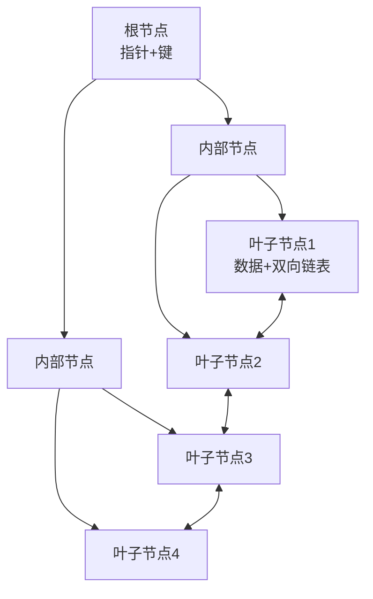

# 索引原理与 SQL 优化

> **文档说明**：深入理解MySQL索引底层原理（B+树），掌握执行计划分析和SQL优化方法，解决慢查询问题。
>
> **前置知识**：[[MySQL基础与SQL实战]]

---

## 一、概述

索引是数据库性能优化的核心。没有索引的查询是全表扫描（O(n)），有了B+树索引可以做到O(log n)。但索引不是万能的——错误的索引设计反而会降低写入性能。

### 索引的本质

索引是一种**空间换时间**的数据结构，通过额外的存储空间来加速查询。

---

## 二、底层原理

### B+树索引结构



**B+树特点**：
- 非叶子节点只存键值和指针，不存数据 → 每层能存更多节点 → 树更矮
- 叶子节点存完整数据，通过双向链表连接 → 范围查询高效
- 树高通常3-4层，就能支撑千万级数据

### 聚簇索引 vs 非聚簇索引

| 类型 | 叶子节点存什么 | 说明 |
|------|--------------|------|
| 聚簇索引（主键） | 完整行数据 | 一张表只有一个，数据按主键排序存储 |
| 非聚簇索引（二级索引） | 主键值 | 查询需要回表（再查主键索引） |

### 回表过程

```text
查询：SELECT * FROM users WHERE email = 'test@test.com'
1. 在email索引的B+树中找到email对应的主键ID
2. 用主键ID在聚簇索引中找到完整行数据（回表）
3. 返回结果
```

### 覆盖索引

如果查询的字段都在索引中，就不需要回表：
```sql
-- email索引包含email字段，查询只需要email，不需要回表
SELECT email FROM users WHERE email = 'test@test.com';
-- 这就是覆盖索引，性能更好
```

### 最左前缀原则

联合索引`(a, b, c)`，查询条件必须从最左列开始：
- ✅ `WHERE a = 1`
- ✅ `WHERE a = 1 AND b = 2`
- ✅ `WHERE a = 1 AND b = 2 AND c = 3`
- ❌ `WHERE b = 2`（跳过了a，用不到索引）
- ✅ `WHERE a = 1 AND c = 3`（只用到a）

---

## 三、实操示例

### 1. 索引操作

```sql
-- 创建索引
CREATE INDEX idx_username ON users(username);
CREATE INDEX idx_status_age ON users(status, age);  -- 联合索引

-- 查看索引
SHOW INDEX FROM users;

-- 删除索引
DROP INDEX idx_username ON users;
```

### 2. 执行计划分析（EXPLAIN）

```sql
EXPLAIN SELECT * FROM users WHERE age > 25;

-- 关键字段解读：
-- type：访问类型，性能从好到差：
--   system > const > eq_ref > ref > range > index > ALL
--   目标：至少达到range级别，避免ALL（全表扫描）
-- key：实际使用的索引
-- rows：预计扫描的行数（越小越好）
-- Extra：额外信息
--   Using index：覆盖索引，好
--   Using where：需要回表过滤
--   Using filesort：需要额外排序，不好
--   Using temporary：使用临时表，不好
```

### 3. 常见慢查询优化

```sql
-- ❌ 慢：函数操作导致索引失效
SELECT * FROM users WHERE YEAR(created_at) = 2026;
-- ✅ 快：改成范围查询
SELECT * FROM users WHERE created_at >= '2026-01-01' AND created_at < '2027-01-01';

-- ❌ 慢：LIKE以%开头
SELECT * FROM users WHERE username LIKE '%张%';
-- ✅ 快：前缀匹配可以用索引
SELECT * FROM users WHERE username LIKE '张%';

-- ❌ 慢：隐式类型转换
SELECT * FROM users WHERE phone = 13800138000;  -- phone是VARCHAR
-- ✅ 快：类型匹配
SELECT * FROM users WHERE phone = '13800138000';

-- ❌ 慢：OR条件
SELECT * FROM users WHERE age = 25 OR status = 1;
-- ✅ 快：改成UNION（如果两个字段都有索引）
SELECT * FROM users WHERE age = 25
UNION
SELECT * FROM users WHERE status = 1;

-- ❌ 慢：SELECT *
SELECT * FROM users;
-- ✅ 快：只查需要的字段
SELECT id, username, email FROM users;
```

### 4. 分页优化

```sql
-- ❌ 深分页慢：OFFSET大时需要扫描大量行
SELECT * FROM users ORDER BY id LIMIT 1000000, 10;

-- ✅ 优化：基于上一页最后一条ID
SELECT * FROM users WHERE id > 1000000 ORDER BY id LIMIT 10;

-- ✅ 延迟关联：先查ID再回表
SELECT u.* FROM users u
INNER JOIN (SELECT id FROM users ORDER BY id LIMIT 1000000, 10) t ON u.id = t.id;
```

### 5. 索引设计原则

```sql
-- 好的索引：
-- 1. WHERE/GROUP BY/ORDER BY的字段
-- 2. 区分度高的字段（如email，而不是status只有0/1）
-- 3. 联合索引按区分度从高到低排列
-- 4. 长度合适的索引（字符串前缀索引）

-- 前缀索引
CREATE INDEX idx_email_prefix ON users(email(20));

-- 不适合建索引：
-- 1. 数据量小的表
-- 2. 频繁更新的字段（索引维护成本高）
-- 3. 区分度低的字段（如性别）
```

---

## 四、常见问题与排查

| 问题 | 原因 | 解决方案 |
|------|------|---------|
| 索引不生效 | 违反最左前缀/函数操作/类型转换 | 用EXPLAIN分析，改写SQL |
| 加了索引还是慢 | 索引区分度低/回表太多 | 用覆盖索引，优化联合索引顺序 |
| ORDER BY慢 | 没有利用索引排序 | 建ORDER BY字段的索引，避免filesort |
| 写入变慢 | 索引太多 | 合并冗余索引，删除无用索引 |
| 死锁 | 事务加锁顺序不一致 | 统一加锁顺序，缩短事务 |

---

## 五、进阶与最佳实践

- **慢查询日志**：开启slow_query_log，分析long_query_time超过阈值的SQL
- **索引监控**：用`sys.schema_unused_indexes`查看未使用的索引
- **联合索引顺序**：等值查询字段在前，范围查询字段在后
- **避免索引失效**：不用函数、不用!=、不用OR、类型匹配
- **定期分析**：用`ANALYZE TABLE`更新统计信息，让优化器选择正确执行计划

---

## 六、关联笔记

[[MySQL基础与SQL实战]] · [[数据库执行计划分析]] · [[事务隔离级别与MVCC]] · [[数据库分库分表策略]]

> 🔍 **知识点深度解析**
>
> **作用**：索引是数据库性能的关键，掌握索引原理和优化能解决90%的慢查询问题。
>
> **原理**：InnoDB使用B+树索引，聚簇索引存完整数据，二级索引存主键值需要回表。
>
> **用法要点**：① 用EXPLAIN分析执行计划 ② 遵循最左前缀原则 ③ 避免索引失效（函数/类型转换/前导%） ④ 用覆盖索引减少回表 ⑤ 深分页用游标分页

---

> 💡 **深度讲解**：索引优化的核心思维是"减少扫描行数"。每一条慢SQL都可以问：能不能用索引？能不能用覆盖索引？能不能减少回表？B+树的结构决定了它适合等值查询和范围查询，但不适合前模糊匹配。理解了B+树的特点，就能自然推导出各种索引使用规则，而不是死记硬背。
>
> **📝 精简总结**：索引 = B+树 + 最左前缀 + 覆盖索引，优化 = EXPLAIN分析 + 减少扫描行数 + 避免索引失效。
