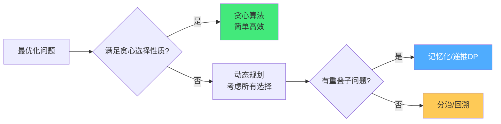
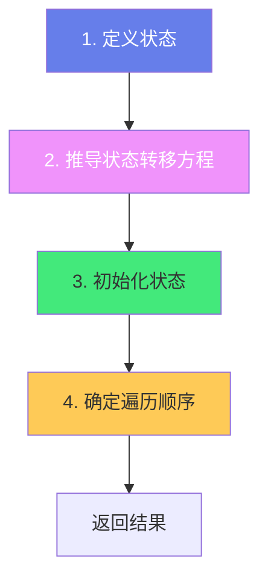
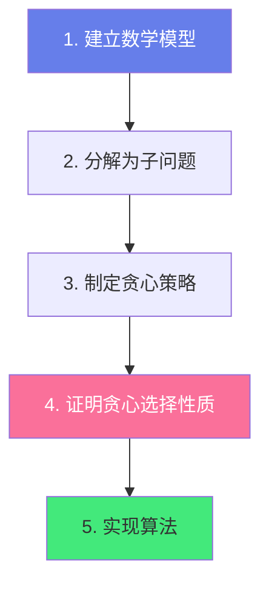
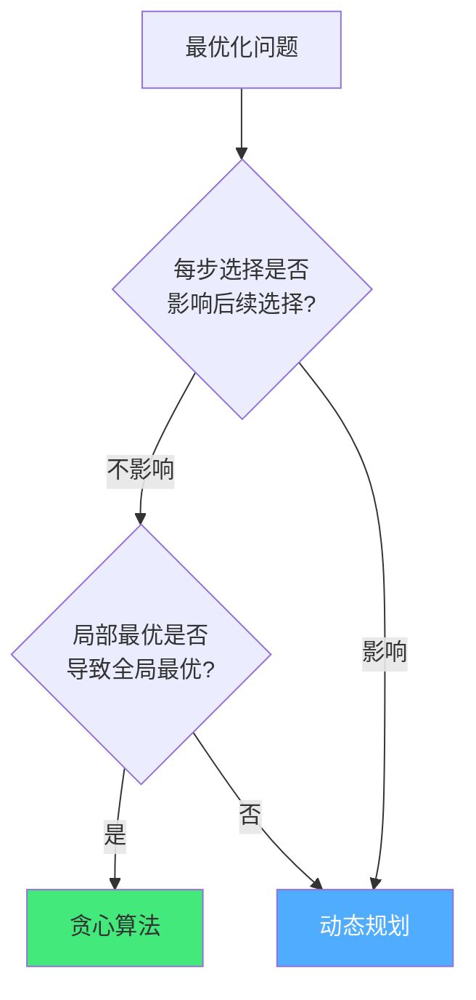

# 🧮 动态规划与贪心

> **文档说明**：系统讲解动态规划（DP）与贪心算法的完整知识体系，涵盖算法思想对比、动态规划核心要素（最优子结构/重叠子问题/状态转移方程）、DP 解题四步法（定义状态→状态转移→初始化→遍历顺序）、经典 DP 题型（线性DP/背包DP/区间DP/树形DP/状态压缩DP/数位DP）、贪心算法核心（贪心选择性质/最优子结构）、经典贪心题型（区间调度/霍夫曼编码/最小生成树/任务调度）、DP 与贪心的选择判断、空间优化（滚动数组）、记忆化搜索、大量 LeetCode 经典题解与代码模板。
>
> **适用人群**：算法学习者、面试准备者、后端开发者、计算机专业学生
>
> **前置知识**：[[排序算法全景对比]] · [[算法复杂度分析]] · [[递归与分治]]

---

## 一、概述

### 1.1 两种算法思想

动态规划（Dynamic Programming, DP）和贪心算法（Greedy）都是解决**最优化问题**的核心算法思想，它们都依赖「最优子结构」性质，但决策方式不同：

| 维度 | 动态规划（DP） | 贪心算法（Greedy） |
|------|---------------|-------------------|
| **决策方式** | 考虑所有可能的选择，取最优 | 每一步只做当前看起来最优的选择 |
| **是否回溯** | 记录所有状态，可回溯 | 不回溯，一条路走到黑 |
| **依赖性质** | 最优子结构 + 重叠子问题 | 最优子结构 + 贪心选择性质 |
| **结果保证** | 一定能得到全局最优解 | 不一定，需要证明贪心选择性质 |
| **时间复杂度** | 通常 O(n²) / O(n³) / O(2ⁿ→多项式) | 通常 O(n log n) / O(n) |
| **空间复杂度** | 通常 O(n) / O(n²) | 通常 O(1) / O(n) |
| **适用范围** | 广，大部分最优化问题 | 窄，只有满足贪心选择性质的问题 |



### 1.2 解决的问题类型

**动态规划适用问题**：
- ✅ 计数类：有多少种方式/路径/方案
- ✅ 求最值类：最大/最小/最长/最短
- ✅ 求存在性类：是否存在某种方案
- ✅ 博弈类：先手/后手胜负

**贪心适用问题**：
- ✅ 区间调度：最多不重叠区间
- ✅ 霍夫曼编码：最优前缀编码
- ✅ 最小生成树：Kruskal/Prim
- ✅ 最短路径：Dijkstra
- ✅ 任务调度：最优调度顺序
- ✅ 分数背包：可分割物品的背包问题

### 1.3 经典问题对比

| 问题 | 贪心是否可行 | 推荐方法 | 原因 |
|------|------------|---------|------|
| 分数背包（可分割） | ✅ 可行 | 贪心 | 按单位价值排序，贪心选择最优 |
| 0-1 背包（不可分割） | ❌ 不可行 | DP | 贪心可能选了大价值但占满空间，错过组合更优 |
| 活动选择（最多不重叠） | ✅ 可行 | 贪心 | 按结束时间排序，贪心选择最早结束 |
| 最长递增子序列 | ❌ 不可行 | DP / 贪心+二分 | 贪心选最小可能不最优，需 DP 或贪心+二分 |
| 最短路径（非负权） | ✅ 可行 | Dijkstra（贪心） | 每次选最近未访问节点 |
| 最小生成树 | ✅ 可行 | Kruskal/Prim（贪心） | 每次选最小边/最近节点 |
| 硬币找零（特定面额） | ⚠️ 部分可行 | DP（通用） | 标准面额可用贪心，非标准面额需 DP |
| 编辑距离 | ❌ 不可行 | DP | 需要考虑所有操作组合 |
| 最长公共子序列 | ❌ 不可行 | DP | 需要考虑所有匹配组合 |

---

## 二、动态规划核心原理

### 2.1 DP 三大要素

| 要素 | 说明 | 判断方法 |
|------|------|---------|
| **最优子结构** | 问题的最优解包含子问题的最优解 | 能否将大问题拆分为小问题，且大问题最优由小问题最优组合 |
| **重叠子问题** | 递归求解时会重复计算相同的子问题 | 画递归树，看是否有相同节点重复出现 |
| **无后效性** | 某状态一旦确定，不受后续决策影响 | 当前状态只依赖之前的状态，不依赖未来的选择 |

**最优子结构示例**（斐波那契）：
- `f(n) = f(n-1) + f(n-2)`
- f(n) 的最优解（值）由 f(n-1) 和 f(n-2) 的最优解组合而成

**重叠子问题示例**（斐波那契递归树）：
```text
        f(5)
       /    \
    f(4)    f(3)
   /   \    /  \
 f(3) f(2) f(2) f(1)
 / \
f(2) f(1)
```
f(3) 被计算了 2 次，f(2) 被计算了 3 次——大量重复计算，DP 通过记忆化避免。

### 2.2 DP 解题四步法



**第一步：定义状态**
- 明确 `dp[i]` 或 `dp[i][j]` 表示什么含义
- 状态定义要能覆盖所有子问题
- 常见定义方式：
  - `dp[i]`：前 i 个元素的最优解
  - `dp[i][j]`：第一个序列前 i 个、第二个序列前 j 个的最优解
  - `dp[i][j]`：从位置 (0,0) 到 (i,j) 的最优解
  - `dp[state]`：状态为 state 时的最优解

**第二步：推导状态转移方程**
- 考虑最后一步的选择，从子问题推导当前问题
- 常见形式：
  - 取最值：`dp[i] = max(dp[i-1], dp[i-2] + nums[i])`
  - 求和/计数：`dp[i] = dp[i-1] + dp[i-2]`
  - 条件转移：`if (条件) dp[i] = dp[j] + 1`

**第三步：初始化状态**
- 确定 base case（最小子问题的解）
- 常见初始化：
  - `dp[0] = 0` / `dp[1] = 1`
  - `dp[i][0] = 0` / `dp[0][j] = 0`
  - 第一行/第一列单独初始化

**第四步：确定遍历顺序**
- 根据状态转移方程确定遍历方向
- 确保计算 `dp[i]` 时，依赖的 `dp[i-1]`/`dp[i-2]` 已经计算好
- 常见顺序：
  - 一维：从小到大（0→n）
  - 二维：先 i 后 j，或先 j 后 i（根据依赖关系）
  - 背包（0-1）：一维倒序（n→0），避免重复使用

### 2.3 DP 两种实现方式

| 方式 | 说明 | 优点 | 缺点 |
|------|------|------|------|
| **自顶向下（记忆化搜索）** | 递归 + 备忘录，从大问题递归到小问题，缓存结果 | 思路自然，按需要计算，不会计算不需要的状态 | 递归栈深度限制，函数调用开销 |
| **自底向上（递推）** | 从最小子问题开始，迭代计算到大问题 | 无递归开销，可空间优化，效率高 | 需要确定遍历顺序，可能计算不需要的状态 |

**自顶向下示例（斐波那契）**：
```python
memo = {}
def fib(n):
    if n <= 1:
        return n
    if n in memo:
        return memo[n]
    memo[n] = fib(n-1) + fib(n-2)
    return memo[n]
```

**自底向上示例（斐波那契）**：
```python
def fib(n):
    if n <= 1:
        return n
    dp = [0] * (n + 1)
    dp[0], dp[1] = 0, 1
    for i in range(2, n + 1):
        dp[i] = dp[i-1] + dp[i-2]
    return dp[n]
```

### 2.4 空间优化：滚动数组

很多 DP 问题中，`dp[i]` 只依赖 `dp[i-1]` 和 `dp[i-2]`，不需要保存整个数组，可以用滚动数组（变量）优化空间：

```python
# 原始 O(n) 空间
def fib(n):
    dp = [0] * (n + 1)
    dp[0], dp[1] = 0, 1
    for i in range(2, n + 1):
        dp[i] = dp[i-1] + dp[i-2]
    return dp[n]

# 优化后 O(1) 空间
def fib(n):
    if n <= 1:
        return n
    prev2, prev1 = 0, 1  # dp[i-2], dp[i-1]
    for _ in range(2, n + 1):
        curr = prev1 + prev2
        prev2 = prev1
        prev1 = curr
    return prev1
```

**二维 DP 优化为一维**（背包问题）：
```python
# 原始二维 O(n*capacity)
def knapsack(weights, values, capacity):
    n = len(weights)
    dp = [[0] * (capacity + 1) for _ in range(n + 1)]
    for i in range(1, n + 1):
        for j in range(capacity + 1):
            dp[i][j] = dp[i-1][j]
            if j >= weights[i-1]:
                dp[i][j] = max(dp[i][j], dp[i-1][j-weights[i-1]] + values[i-1])
    return dp[n][capacity]

# 优化为一维 O(capacity)，倒序遍历
def knapsack(weights, values, capacity):
    dp = [0] * (capacity + 1)
    for i in range(len(weights)):
        for j in range(capacity, weights[i] - 1, -1):  # 倒序！
            dp[j] = max(dp[j], dp[j-weights[i]] + values[i])
    return dp[capacity]
```

---

## 三、动态规划经典题型

### 3.1 线性 DP

线性 DP 是最基础的 DP，状态沿线性方向转移。

| 问题 | 状态定义 | 状态转移 | 复杂度 |
|------|---------|---------|--------|
| 爬楼梯 | `dp[i]` = 到第 i 阶的方法数 | `dp[i] = dp[i-1] + dp[i-2]` | O(n) |
| 打家劫舍 | `dp[i]` = 前 i 间房屋最大金额 | `dp[i] = max(dp[i-1], dp[i-2] + nums[i])` | O(n) |
| 最大子数组和 | `dp[i]` = 以 i 结尾的最大子数组和 | `dp[i] = max(nums[i], dp[i-1] + nums[i])` | O(n) |
| 最长递增子序列 | `dp[i]` = 以 i 结尾的最长递增子序列长度 | `dp[i] = max(dp[j] + 1) for j < i and nums[j] < nums[i]` | O(n²) |
| 单词拆分 | `dp[i]` = 前 i 个字符能否拆分 | `dp[i] = any(dp[j] and s[j:i] in wordDict)` | O(n²) |

**打家劫舍代码模板**：
```python
def rob(nums):
    """
    dp[i] = 前 i 间房屋能偷窃的最大金额
    状态转移：第 i 间偷 → dp[i-2] + nums[i]
              第 i 间不偷 → dp[i-1]
    """
    if not nums:
        return 0
    n = len(nums)
    if n == 1:
        return nums[0]
    
    # 空间优化：只需要前两个状态
    prev2 = nums[0]                    # dp[0]
    prev1 = max(nums[0], nums[1])     # dp[1]
    
    for i in range(2, n):
        curr = max(prev1, prev2 + nums[i])
        prev2 = prev1
        prev1 = curr
    
    return prev1
```

**最长递增子序列（O(n²) DP + O(n log n) 贪心+二分）**：
```python
def lengthOfLIS_DP(nums):
    """DP 解法 O(n²)"""
    n = len(nums)
    dp = [1] * n  # dp[i] = 以 nums[i] 结尾的最长递增子序列长度
    for i in range(n):
        for j in range(i):
            if nums[j] < nums[i]:
                dp[i] = max(dp[i], dp[j] + 1)
    return max(dp)

def lengthOfLIS_Greedy(nums):
    """贪心 + 二分 O(n log n)
    维护一个 tails 数组，tails[i] 表示长度为 i+1 的递增子序列的最小末尾元素
    每次用二分查找替换第一个 >= nums[i] 的元素
    """
    tails = []
    for num in nums:
        # 二分查找 tails 中第一个 >= num 的位置
        left, right = 0, len(tails)
        while left < right:
            mid = (left + right) // 2
            if tails[mid] < num:
                left = mid + 1
            else:
                right = mid
        if left == len(tails):
            tails.append(num)
        else:
            tails[left] = num
    return len(tails)
```

### 3.2 背包 DP

背包问题是 DP 的经典大类，核心是「有限容量下选择物品最大化价值」。

| 类型 | 特点 | 状态转移 | 遍历顺序 |
|------|------|---------|---------|
| **0-1 背包** | 每个物品最多选一次 | `dp[j] = max(dp[j], dp[j-w[i]] + v[i])` | 容量倒序 |
| **完全背包** | 每个物品可选无限次 | `dp[j] = max(dp[j], dp[j-w[i]] + v[i])` | 容量正序 |
| **多重背包** | 每个物品有限次数 | 拆分为 0-1 背包或二进制优化 | 容量倒序 |
| **分组背包** | 每组最多选一个 | 每组内 0-1 背包 | 容量倒序 |

**0-1 背包模板**：
```python
def knapsack_01(weights, values, capacity):
    """
    0-1 背包：每个物品最多选一次
    dp[j] = 容量为 j 时的最大价值
    """
    dp = [0] * (capacity + 1)
    for i in range(len(weights)):
        # 倒序遍历，避免物品 i 被重复使用
        for j in range(capacity, weights[i] - 1, -1):
            dp[j] = max(dp[j], dp[j - weights[i]] + values[i])
    return dp[capacity]
```

**完全背包模板**：
```python
def knapsack_complete(weights, values, capacity):
    """
    完全背包：每个物品可选无限次
    dp[j] = 容量为 j 时的最大价值
    """
    dp = [0] * (capacity + 1)
    for i in range(len(weights)):
        # 正序遍历，允许物品 i 被重复使用
        for j in range(weights[i], capacity + 1):
            dp[j] = max(dp[j], dp[j - weights[i]] + values[i])
    return dp[capacity]

# 完全背包变体：零钱兑换（最少硬币数）
def coinChange(coins, amount):
    dp = [float('inf')] * (amount + 1)
    dp[0] = 0
    for coin in coins:
        for j in range(coin, amount + 1):
            dp[j] = min(dp[j], dp[j - coin] + 1)
    return dp[amount] if dp[amount] != float('inf') else -1

# 完全背包变体：零钱兑换 II（组合数）
def change(amount, coins):
    dp = [0] * (amount + 1)
    dp[0] = 1
    for coin in coins:          # 外层物品 → 组合数（不考虑顺序）
        for j in range(coin, amount + 1):
            dp[j] += dp[j - coin]
    return dp[amount]
```

### 3.3 区间 DP

区间 DP 用于处理区间内的最优解问题，状态通常是 `dp[i][j]` 表示区间 [i,j] 的最优解。

| 问题 | 状态定义 | 复杂度 |
|------|---------|--------|
| 最长回文子序列 | `dp[i][j]` = s[i..j] 的最长回文子序列长度 | O(n²) |
| 石子游戏 | `dp[i][j]` = 区间 [i,j] 先手能赢的最大分差 | O(n²) |
| 戳气球 | `dp[i][j]` = 戳破 (i,j) 区间内气球的最大硬币数 | O(n³) |
| 矩阵链乘法 | `dp[i][j]` = 矩阵 i 到 j 相乘的最小标量乘法数 | O(n³) |

**区间 DP 遍历顺序**：先枚举区间长度，再枚举起点。

```python
def longestPalindromeSubseq(s):
    """
    最长回文子序列（区间 DP）
    dp[i][j] = s[i..j] 的最长回文子序列长度
    状态转移：
      s[i] == s[j] → dp[i][j] = dp[i+1][j-1] + 2
      s[i] != s[j] → dp[i][j] = max(dp[i+1][j], dp[i][j-1])
    """
    n = len(s)
    dp = [[0] * n for _ in range(n)]
    
    # 初始化：长度为 1 的区间
    for i in range(n):
        dp[i][i] = 1
    
    # 枚举区间长度（从 2 到 n）
    for length in range(2, n + 1):
        # 枚举起点
        for i in range(n - length + 1):
            j = i + length - 1  # 终点
            if s[i] == s[j]:
                dp[i][j] = dp[i+1][j-1] + 2
            else:
                dp[i][j] = max(dp[i+1][j], dp[i][j-1])
    
    return dp[0][n-1]
```

### 3.4 树形 DP

树形 DP 在树结构上进行 DP，通常用后序遍历（先处理子节点，再处理父节点）。

| 问题 | 状态定义 | 复杂度 |
|------|---------|--------|
| 二叉树最大路径和 | `dp[node]` = 以 node 为起点的最大路径和 | O(n) |
| 打家劫舍 III | `dp[node][0/1]` = node 不偷/偷时的最大金额 | O(n) |
| 树的直径 | `dp[node]` = 以 node 为根的最大深度 | O(n) |
| 独立集（树） | `dp[node][0/1]` = node 不选/选时的最大权值和 | O(n) |

**打家劫舍 III（树形 DP）**：
```python
def rob(root):
    """
    树形 DP：后序遍历
    返回 [不偷当前节点的最大金额, 偷当前节点的最大金额]
    """
    def dfs(node):
        if not node:
            return [0, 0]
        
        left = dfs(node.left)
        right = dfs(node.right)
        
        # 不偷当前节点：子节点可偷可不偷，取最大值
        not_rob = max(left) + max(right)
        
        # 偷当前节点：子节点不能偷
        rob = node.val + left[0] + right[0]
        
        return [not_rob, rob]
    
    return max(dfs(root))
```

### 3.5 状态压缩 DP

状态压缩 DP 用二进制表示状态，适用于状态数量有限但组合多的问题（通常 n ≤ 20）。

| 问题 | 状态定义 | 复杂度 |
|------|---------|--------|
| 旅行商问题（TSP） | `dp[mask][i]` = 访问集合为 mask，当前在 i 的最短路径 | O(2ⁿ × n²) |
| 最短 Hamilton 路径 | 同上 | O(2ⁿ × n²) |
| 蒙德里安的梦想 | 棋盘状态压缩 | O(2ⁿ × m) |
| 集合覆盖 | 子集状态 | O(2ⁿ × n) |

**TSP 模板**：
```python
def tsp(graph):
    """
    旅行商问题：从 0 出发，经过所有节点恰好一次，回到 0 的最短路径
    dp[mask][i] = 访问过的节点集合为 mask，当前在 i 的最短路径
    mask 是二进制，第 i 位为 1 表示节点 i 已访问
    """
    n = len(graph)
    INF = float('inf')
    
    # dp[mask][i]
    dp = [[INF] * n for _ in range(1 << n)]
    dp[1][0] = 0  # 初始状态：只访问了 0，在 0 节点
    
    # 枚举所有状态
    for mask in range(1 << n):
        for i in range(n):
            if dp[mask][i] == INF:
                continue
            # 尝试访问下一个节点 j
            for j in range(n):
                if mask & (1 << j):  # j 已访问
                    continue
                new_mask = mask | (1 << j)
                dp[new_mask][j] = min(dp[new_mask][j], 
                                        dp[mask][i] + graph[i][j])
    
    # 回到起点 0
    full_mask = (1 << n) - 1
    return min(dp[full_mask][i] + graph[i][0] for i in range(1, n))
```

---

## 四、贪心算法核心原理

### 4.1 贪心两大要素

| 要素 | 说明 | 证明方法 |
|------|------|---------|
| **贪心选择性质** | 全局最优解可以通过一系列局部最优选择得到 | 交换论证：假设存在不包含贪心选择的最优解，交换为贪心选择后不劣 |
| **最优子结构** | 问题的最优解包含子问题的最优解 | 同 DP，将大问题拆分为小问题 |

**贪心选择性质证明（交换论证法）**：
1. 假设存在一个最优解，它的第一步选择不是贪心选择
2. 将第一步替换为贪心选择，证明新解不劣于原最优解
3. 归纳可得，每一步都用贪心选择能得到全局最优解

### 4.2 贪心解题步骤



**常见贪心策略**：
| 策略 | 说明 | 典型问题 |
|------|------|---------|
| **按结束时间排序** | 优先选结束最早的 | 活动选择、区间调度 |
| **按单位价值排序** | 优先选单位价值最高的 | 分数背包 |
| **按频率排序** | 频率高的用短编码 | 霍夫曼编码 |
| **每次选最小边** | 不形成环的最小边 | Kruskal 最小生成树 |
| **每次选最近节点** | 离已选集合最近的节点 | Prim 最小生成树、Dijkstra |
| **从大到小尝试** | 优先用大面额 | 硬币找零（标准面额） |
| **按截止时间排序** | 优先做截止早的 | 任务调度 |

---

## 五、贪心经典题型

### 5.1 区间调度

**问题**：给定 n 个区间 [start, end]，选择最多的不重叠区间。

**贪心策略**：按结束时间排序，每次选结束最早且与已选不重叠的区间。

```python
def eraseOverlapIntervals(intervals):
    """
    无重叠区间：最少需要移除多少区间使剩余不重叠
    等价于：最多保留多少不重叠区间
    贪心：按结束时间排序，选结束最早的
    """
    if not intervals:
        return 0
    
    # 按结束时间排序
    intervals.sort(key=lambda x: x[1])
    
    count = 1  # 至少保留第一个
    end = intervals[0][1]
    
    for i in range(1, len(intervals)):
        if intervals[i][0] >= end:  # 不重叠
            count += 1
            end = intervals[i][1]
    
    return len(intervals) - count  # 需要移除的数量
```

### 5.2 分数背包

**问题**：背包容量 W，n 个物品（重量 w[i]，价值 v[i]），物品可分割，求最大价值。

**贪心策略**：按单位价值（v[i]/w[i]）降序排序，优先拿单位价值高的。

```python
def fractional_knapsack(weights, values, capacity):
    """
    分数背包：物品可分割，贪心按单位价值排序
    时间 O(n log n)，空间 O(n)
    """
    n = len(weights)
    # 计算单位价值，按降序排序
    items = [(values[i] / weights[i], weights[i], values[i]) for i in range(n)]
    items.sort(reverse=True)
    
    total_value = 0
    remaining = capacity
    
    for unit_value, weight, value in items:
        if remaining >= weight:
            # 整个物品都能装下
            total_value += value
            remaining -= weight
        else:
            # 只能装一部分
            total_value += unit_value * remaining
            break
    
    return total_value
```

> **对比 0-1 背包**：0-1 背包物品不可分割，贪心不可行（可能选了高价值但占满空间，错过组合更优），必须用 DP。

### 5.3 霍夫曼编码

**问题**：给定字符频率，构造最优前缀编码（总编码长度最短）。

**贪心策略**：每次选频率最小的两个节点合并，新节点频率为两者之和，重复直到只剩一个节点。

```python
import heapq

class HuffmanNode:
    def __init__(self, char, freq):
        self.char = char
        self.freq = freq
        self.left = None
        self.right = None
    
    def __lt__(self, other):
        return self.freq < other.freq

def huffman_encoding(chars, freqs):
    """
    霍夫曼编码：最优前缀编码
    贪心：每次合并频率最小的两个节点
    时间 O(n log n)，空间 O(n)
    """
    # 初始化最小堆
    heap = []
    for char, freq in zip(chars, freqs):
        heapq.heappush(heap, HuffmanNode(char, freq))
    
    # 合并直到只剩一个节点
    while len(heap) > 1:
        left = heapq.heappop(heap)   # 频率最小
        right = heapq.heappop(heap)  # 频率次小
        
        # 合并为新节点
        merged = HuffmanNode(None, left.freq + right.freq)
        merged.left = left
        merged.right = right
        heapq.heappush(heap, merged)
    
    # 生成编码
    root = heap[0]
    codes = {}
    
    def generate_codes(node, code=""):
        if node is None:
            return
        if node.char is not None:  # 叶子节点
            codes[node.char] = code if code else "0"
            return
        generate_codes(node.left, code + "0")
        generate_codes(node.right, code + "1")
    
    generate_codes(root)
    return codes, root
```

### 5.4 最小生成树（Kruskal / Prim）

**Kruskal 算法**：每次选不形成环的最小边（贪心 + 并查集）。

```python
class UnionFind:
    def __init__(self, n):
        self.parent = list(range(n))
        self.rank = [0] * n
    
    def find(self, x):
        if self.parent[x] != x:
            self.parent[x] = self.find(self.parent[x])
        return self.parent[x]
    
    def union(self, x, y):
        px, py = self.find(x), self.find(y)
        if px == py:
            return False
        if self.rank[px] < self.rank[py]:
            px, py = py, px
        self.parent[py] = px
        if self.rank[px] == self.rank[py]:
            self.rank[px] += 1
        return True

def kruskal(n, edges):
    """
    Kruskal 最小生成树：贪心选最小边 + 并查集判环
    edges: [(u, v, weight), ...]
    时间 O(E log E)，空间 O(V)
    """
    edges.sort(key=lambda x: x[2])  # 按权重升序
    uf = UnionFind(n)
    mst = []
    total_weight = 0
    
    for u, v, w in edges:
        if uf.union(u, v):  # 不形成环
            mst.append((u, v, w))
            total_weight += w
            if len(mst) == n - 1:
                break
    
    return total_weight, mst
```

**Prim 算法**：每次选离已选集合最近的节点（贪心）。

```python
import heapq

def prim(n, graph):
    """
    Prim 最小生成树：从任意节点出发，每次选离已选集合最近的节点
    graph: 邻接表 graph[u] = [(v, weight), ...]
    时间 O(E log V)，空间 O(V)
    """
    visited = [False] * n
    min_heap = [(0, 0)]  # (weight, node)，从节点 0 开始
    total_weight = 0
    edges_used = 0
    
    while min_heap and edges_used < n:
        weight, node = heapq.heappop(min_heap)
        if visited[node]:
            continue
        visited[node] = True
        total_weight += weight
        edges_used += 1
        
        for neighbor, w in graph[node]:
            if not visited[neighbor]:
                heapq.heappush(min_heap, (w, neighbor))
    
    return total_weight
```

### 5.5 Dijkstra 最短路径

**贪心策略**：每次选未访问节点中距离起点最近的，更新其邻居距离。

```python
import heapq

def dijkstra(n, graph, start):
    """
    Dijkstra 最短路径（非负权图）
    贪心：每次选距离最近的未访问节点
    graph: 邻接表 graph[u] = [(v, weight), ...]
    时间 O(E log V)，空间 O(V)
    """
    INF = float('inf')
    dist = [INF] * n
    dist[start] = 0
    min_heap = [(0, start)]  # (distance, node)
    visited = [False] * n
    
    while min_heap:
        d, node = heapq.heappop(min_heap)
        if visited[node]:
            continue
        visited[node] = True
        
        for neighbor, weight in graph[node]:
            if not visited[neighbor] and d + weight < dist[neighbor]:
                dist[neighbor] = d + weight
                heapq.heappush(min_heap, (dist[neighbor], neighbor))
    
    return dist
```

---

## 六、DP 与贪心的选择判断

### 6.1 判断流程



### 6.2 快速判断表

| 特征 | 贪心 | DP |
|------|------|-----|
| 每步选择不影响后续 | ✅ 可能 | — |
| 需要考虑所有组合 | ❌ 不可行 | ✅ |
| 子问题重叠 | — | ✅ 适合 |
| 无后效性 | — | ✅ 必须 |
| 求全局最优 | 需证明 | ✅ 保证 |
| 时间要求高 | ✅ 优先 | 次选 |
| 问题规模大 | ✅ | 可能超时 |

### 6.3 硬币找零：贪心 vs DP 对比

```python
def coin_change_greedy(coins, amount):
    """
    贪心找零：每次选最大面额
    仅对标准面额（如 1,5,10,25,50,100）有效
    对非标准面额（如 1,3,4，找 6）会失败（贪心选 4+1+1=3 枚，最优 3+3=2 枚）
    """
    coins.sort(reverse=True)
    count = 0
    for coin in coins:
        while amount >= coin:
            amount -= coin
            count += 1
    return count if amount == 0 else -1

def coin_change_dp(coins, amount):
    """
    DP 找零：通用解法，对任何面额都有效
    dp[i] = 凑成金额 i 的最少硬币数
    """
    dp = [float('inf')] * (amount + 1)
    dp[0] = 0
    for i in range(1, amount + 1):
        for coin in coins:
            if coin <= i:
                dp[i] = min(dp[i], dp[i - coin] + 1)
    return dp[amount] if dp[amount] != float('inf') else -1

# 测试
coins = [1, 3, 4]
amount = 6
print(coin_change_greedy(coins, amount))  # 3（4+1+1），不是最优！
print(coin_change_dp(coins, amount))      # 2（3+3），最优！
```

---

## 七、常见问题与排查

| 问题现象 | 可能原因 | 解决方案 |
|---------|---------|---------|
| DP 结果错误 | 状态定义错误；状态转移遗漏情况；初始化错误 | 手动推导小例子；打印 DP 表检查；检查边界条件 |
| DP 超时 | 状态数过多；转移复杂；未优化 | 空间优化（滚动数组）；状态压缩；二分优化（LIS）；单调队列优化 |
| DP 空间超限 | 二维/三维 DP 数组过大 | 滚动数组降维；状态压缩；只保存需要的状态 |
| 贪心结果不是最优 | 问题不满足贪心选择性质 | 改用 DP；证明贪心性质；检查排序策略 |
| 背包结果错误 | 遍历顺序错误（0-1 用了正序） | 0-1 背包倒序；完全背包正序；检查初始化 |
| 区间 DP 结果错误 | 遍历顺序错误（长度/起点） | 先枚举长度再枚举起点；确保子区间已计算 |
| 记忆化搜索栈溢出 | 递归深度过大 | 改用自底向上递推；增加递归深度限制 |
| 状态压缩 DP 超时 | n 过大（>20） | 检查是否有更优算法；剪枝；meet-in-the-middle |

---

## 八、进阶与最佳实践

### 8.1 DP 优化技巧

| 优化方法 | 适用场景 | 效果 |
|---------|---------|------|
| **滚动数组** | dp[i] 只依赖前 1-2 个状态 | O(n)→O(1) 空间 |
| **二维降一维** | 背包类问题 | O(n²)→O(n) 空间 |
| **二分优化** | 转移方程有单调性（LIS） | O(n²)→O(n log n) |
| **单调队列优化** | 转移方程是滑动窗口最值 | O(n²)→O(n) |
| **斜率优化** | 转移方程可化为线性形式 | O(n²)→O(n) |
| **状态压缩** | 状态数有限但组合多 | 指数级状态可枚举 |
| **记忆化搜索** | 不需要计算所有状态 | 按需计算，减少无用状态 |
| **打表** | 输入范围有限 | 预处理所有结果，O(1) 查询 |

### 8.2 面试解题策略

```text
算法面试 DP/贪心 解题策略：

1. 识别题型
   - 求最值/计数/存在性 → 考虑 DP
   - 每步做选择且不回溯 → 考虑贪心
   - 先想贪心，不行再 DP（贪心更简单高效）

2. DP 四步法
   - 定义状态：dp[i] / dp[i][j] 表示什么
   - 状态转移：最后一步怎么选
   - 初始化：base case
   - 遍历顺序：确保依赖已计算

3. 验证
   - 手动推导小例子（n=1,2,3）
   - 检查边界条件（空数组、单个元素）
   - 检查是否有遗漏的转移情况

4. 优化
   - 空间优化（滚动数组）
   - 时间优化（二分、单调队列）
   - 代码简洁性

5. 贪心验证
   - 尝试构造反例（能否找到贪心失败的情况）
   - 交换论证证明贪心选择性质
   - 与 DP 结果对比验证
```

### 8.3 代码模板速查

```python
# ===== DP 通用模板 =====
def dp_solution(nums):
    n = len(nums)
    # 1. 定义状态
    dp = [0] * (n + 1)
    # 2. 初始化
    dp[0] = 0
    if n >= 1:
        dp[1] = nums[0]
    # 3. 状态转移
    for i in range(2, n + 1):
        dp[i] = max(dp[i-1], dp[i-2] + nums[i-1])
    # 4. 返回结果
    return dp[n]

# ===== 贪心通用模板 =====
def greedy_solution(items):
    # 1. 排序（按贪心策略）
    items.sort(key=lambda x: x[1])  # 按结束时间
    # 2. 贪心选择
    result = []
    last_end = -float('inf')
    for item in items:
        if item[0] >= last_end:  # 满足条件
            result.append(item)
            last_end = item[1]
    return len(result)

# ===== 记忆化搜索模板 =====
from functools import lru_cache

def memoization_solution(n):
    @lru_cache(maxsize=None)
    def dp(i):
        if i <= 1:
            return i
        return dp(i-1) + dp(i-2)
    return dp(n)
```

---

## 九、关联笔记

### 算法基础
- [[排序算法全景对比]] · [[算法复杂度分析]] · [[递归与分治]]
- [[树与二叉树核心]] · [[图论基础与遍历]] · [[哈希表与散列]]

### 算法进阶
- [[回溯算法详解]] · [[滑动窗口与双指针]] · [[单调栈与单调队列]]

### 导航
- [[MOC-计算机基础]] · [[MOC-算法与数据结构]] · [[MOC-综合导航]] · [[Home]]

> 🔍 **知识点深度解析**
>
> **作用**：动态规划与贪心解决的是「最优化问题的高效求解」问题——当问题需要在多种选择中找到最优解时，暴力枚举所有可能通常是指数级复杂度，DP 通过记录子问题结果将指数级降为多项式级，贪心通过每步局部最优选择将复杂度降为 O(n log n) 或 O(n)。
>
> **底层原理**：动态规划的核心是「最优子结构 + 重叠子问题」——最优子结构保证大问题的最优解由小问题的最优解组合而成（可以递推），重叠子结构保证递归时会重复计算相同子问题（记忆化有价值）。DP 通过状态定义和状态转移方程将问题转化为填表过程，自底向上递推或自顶向下记忆化搜索。贪心的核心是「贪心选择性质 + 最优子结构」——贪心选择性质保证每步局部最优能导致全局最优（需要证明，常用交换论证法），贪心不回溯，一条路走到黑，所以更简单高效，但适用范围更窄。
>
> **用法要点**：① DP 四步法：定义状态→状态转移→初始化→遍历顺序 ② DP 状态定义要能覆盖所有子问题，状态转移考虑最后一步的所有选择 ③ 0-1 背包一维倒序遍历，完全背包正序遍历 ④ 区间 DP 先枚举长度再枚举起点 ⑤ 树形 DP 后序遍历（先子后父） ⑥ 状态压缩 DP 用二进制表示集合，n 通常 ≤ 20 ⑦ 空间优化：dp[i] 只依赖前 1-2 个状态时用滚动数组 ⑧ 贪心先验证：能否找到反例？标准面额硬币可用贪心，非标准面额需 DP ⑨ 贪心常见策略：按结束时间排序（区间调度）、按单位价值排序（分数背包）、按频率排序（霍夫曼）、选最小边（Kruskal）、选最近节点（Prim/Dijkstra） ⑩ 解题顺序：先想贪心（简单高效），不行再 DP（保证最优），DP 先暴力递归→记忆化→递推→空间优化。

> 💡 **深度讲解**：动态规划最难的不是写代码，而是「定义状态」和「推导状态转移方程」——很多初学者拿到 DP 题不知道 dp[i] 该表示什么。一个实用技巧是「从最后一步倒推」：假设已经知道了前 i-1 个元素的最优解，第 i 个元素有哪些选择？每种选择如何从子问题转移？比如打家劫舍，最后一间房屋 i 有两种选择：偷（则 i-1 不能偷，最大金额 = dp[i-2] + nums[i]）或不偷（最大金额 = dp[i-1]），取最大值就是 dp[i]。这样自然就推导出了状态转移方程。贪心最容易犯的错是「想当然认为贪心可行」——很多问题看起来每步选最优就能得到全局最优，但实际上可能不是。经典反例是 0-1 背包：物品 A（重量 3，价值 4）、物品 B（重量 2，价值 3）、物品 C（重量 2，价值 3），容量 4。按单位价值贪心选 A（4/3≈1.33），占满容量，总价值 4；但选 B+C 总价值 6，更优。所以贪心必须证明「贪心选择性质」，不能想当然。硬币找零也是经典对比：标准面额（1,5,10,25）贪心有效，但非标准面额（1,3,4）找 6，贪心选 4+1+1=3 枚，最优是 3+3=2 枚。

> 📝 **精简总结**：DP = 最优子结构 + 重叠子问题，四步法（定义状态→转移→初始化→遍历），保证全局最优，复杂度通常 O(n²)/O(n³)。贪心 = 贪心选择性质 + 最优子结构，每步局部最优不回溯，简单高效 O(n log n)/O(n)，但需证明性质。经典 DP：爬楼梯、打家劫舍、背包、LIS、编辑距离、LCS、区间 DP、树形 DP。经典贪心：区间调度、分数背包、霍夫曼编码、Kruskal、Prim、Dijkstra。解题：先想贪心，不行再 DP；DP 先暴力→记忆化→递推→优化。

> **学习路径建议**：先学习 [[算法复杂度分析]] 理解时间空间复杂度 → 学习 [[递归与分治]] 理解递归思想 → 学习本文档掌握 DP 与贪心 → 学习 [[回溯算法详解]] 理解暴力搜索与剪枝 → 刷 LeetCode DP/贪心专题（按题型分类练习）→ 学习 [[图论基础与遍历]] 掌握图算法中的贪心（Dijkstra/Prim/Kruskal）。

---

> **动态规划的本质是「用空间换时间，用记录避免重复」——当你发现递归树中有大量重复计算时，DP 就是答案。贪心的本质是「相信每一步的最优选择能通向全局最优」——但这种相信需要证明，不能盲目。算法之美在于：在正确的时间选择正确的方法。**
