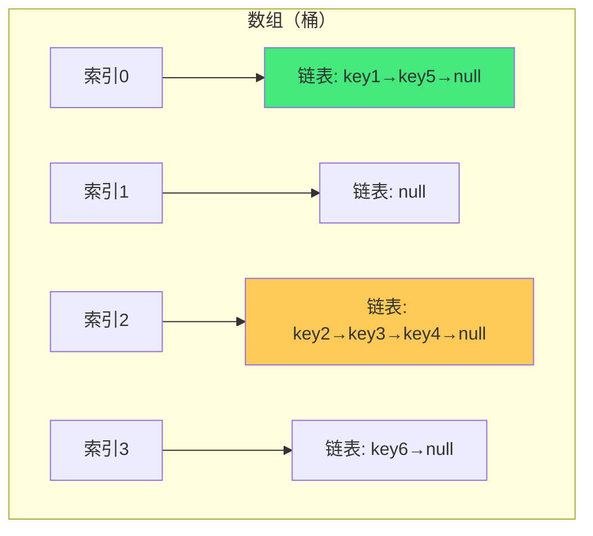
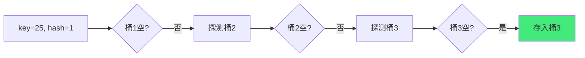
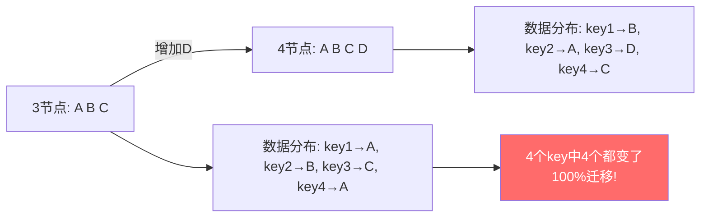
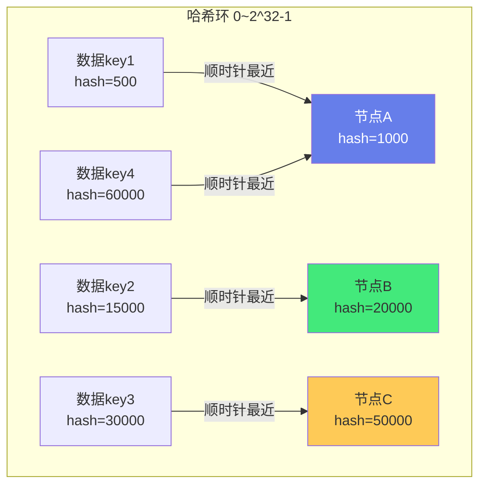
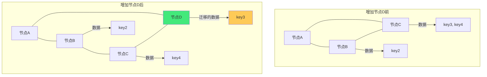
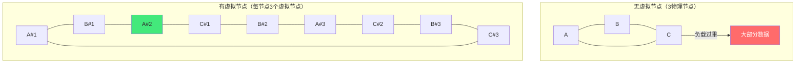

# 🗂️ 哈希表与一致性哈希

> **文档说明**：系统讲解哈希表与一致性哈希的完整知识体系，涵盖哈希表核心概念（键值存储/O(1)查找）、哈希函数设计（直接定址/数字分析/平方取中/折叠/除留余数/随机数）、哈希冲突解决（链地址法/开放寻址法-线性探测/二次探测/双重散列/再哈希法/建立公共溢出区）、负载因子与扩容（rehash）、Java HashMap 源码级实现（数组+链表+红黑树/扰动函数/树化阈值/扩容机制/线程安全问题）、ConcurrentHashMap 实现（分段锁/CAS+synchronized）、Redis Hash 实现（ziplist/hashtable编码）、一致性哈希原理（哈希环/数据分布/节点增减影响）、虚拟节点（解决数据倾斜）、一致性哈希在分布式系统中的应用（分布式缓存/负载均衡/分库分表）、一致性哈希算法实现（Java/Python）、Ketama 算法、带虚拟节点的一致性哈希、哈希表与其他数据结构对比、各语言哈希表实现对比、常见面试题。
>
> **适用人群**：后端开发者、算法学习者、分布式系统工程师、面试准备者
>
> **前置知识**：[[线性结构-数组链表栈队列]] · [[排序算法全景对比]] · [[树与二叉树核心_backup_skeleton]]

---

## 一、哈希表概述

### 1.1 什么是哈希表

哈希表（Hash Table，也叫散列表）是一种根据**键（Key）直接访问值（Value）**的数据结构，核心思想是通过**哈希函数**将键映射到数组的一个索引位置，从而实现 O(1) 时间复杂度的查找、插入和删除。

```mermaid
graph LR
    A[Key: 'apple'] --> B[哈希函数<br/>hash('apple')]
    B --> C[索引: 2]
    C --> D[数组<br/>索引0: null<br/>索引1: null<br/>索引2: '苹果'<br/>索引3: null<br/>...]
    
    style B fill:#667eea,color:#fff
    style D fill:#43e97b,color:#333
```

**哈希表的核心要素**：
| 要素 | 说明 |
|------|------|
| **哈希函数（Hash Function）** | 将任意长度的键转换为固定长度的数组索引 |
| **桶（Bucket/Slot）** | 数组中的每个位置，存储一个或多个键值对 |
| **冲突（Collision）** | 不同的键映射到同一个索引位置 |
| **冲突解决策略** | 处理冲突的方法（链地址法/开放寻址法等） |
| **负载因子（Load Factor）** | 已存储元素数 / 桶总数，决定何时扩容 |
| **扩容（Rehash）** | 负载因子超过阈值时，扩大数组并重新哈希所有元素 |

**哈希表 vs 其他数据结构**：
| 数据结构 | 查找 | 插入 | 删除 | 说明 |
|---------|------|------|------|------|
| **数组** | O(1)（按索引）/ O(n)（按值） | O(n) | O(n) | 按索引快，按值慢 |
| **链表** | O(n) | O(1)（头部） | O(1)（已知节点） | 查找慢 |
| **有序数组** | O(log n)（二分） | O(n) | O(n) | 插入删除慢 |
| **二叉搜索树** | O(log n) ~ O(n) | O(log n) ~ O(n) | O(log n) ~ O(n) | 不平衡时退化 |
| **红黑树** | O(log n) | O(log n) | O(log n) | 平衡，稳定 |
| **哈希表** | O(1) 平均 / O(n) 最坏 | O(1) 平均 / O(n) 最坏 | O(1) 平均 / O(n) 最坏 | 平均最快，无序 |

> **哈希表的特点**：平均时间复杂度 O(1)，是最快的查找数据结构；但不支持顺序遍历（无序），最坏情况（所有键冲突）退化为 O(n)；需要额外空间存储数组。

### 1.2 哈希函数设计

**好的哈希函数的要求**：
| 要求 | 说明 |
|------|------|
| **一致性** | 相同的输入总是产生相同的输出 |
| **均匀性** | 输出值均匀分布在整个索引范围内，减少冲突 |
| **高效性** | 计算速度快，开销小 |
| **雪崩效应** | 输入的微小变化导致输出的巨大变化（密码学哈希） |

**常见哈希函数构造方法**：

| 方法 | 原理 | 示例 | 适用场景 |
|------|------|------|---------|
| **直接定址法** | 键本身或线性函数作为索引 | `hash(key) = key` 或 `a*key+b` | 键连续且范围小（如年龄、月份） |
| **数字分析法** | 分析键的数字分布，选择分布均匀的几位 | 手机号取后4位 | 键位数多且已知分布 |
| **平方取中法** | 键平方后取中间几位 | `hash(123) = 123²=15129 → 取512` | 键位数少，分布不均 |
| **折叠法** | 将键分成几部分，叠加后取模 | `123-456-789 → 123+456+789=1368 → 取368` | 键位数多 |
| **除留余数法** | 键除以质数取余 | `hash(key) = key % p`（p为质数） | 最常用，简单高效 |
| **随机数法** | 用随机数函数生成哈希 | `hash(key) = random(key)` | 键长度不等 |

**除留余数法的质数选择**：
- 数组长度（桶数）通常选质数或 2 的幂
- 质数：分布更均匀，但取模运算慢
- 2 的幂：`hash & (length-1)` 位运算快，但分布可能不均（需配合扰动函数）
- Java HashMap 使用 2 的幂 + 扰动函数

**字符串哈希函数**：
```java
// Java String.hashCode()
// s[0]*31^(n-1) + s[1]*31^(n-2) + ... + s[n-1]
public int hashCode() {
    int h = hash;
    if (h == 0 && value.length > 0) {
        char val[] = value;
        for (int i = 0; i < value.length; i++) {
            h = 31 * h + val[i];  // 31是奇质数，31*i = (i<<5)-i 乘法优化
        }
        hash = h;
    }
    return h;
}
```

> **为什么用 31？** 31 是奇质数，乘法可以优化为移位和减法（`31*i = (i<<5)-i`），且实验表明 31 产生的冲突较少。

**经典哈希函数**：
| 哈希函数 | 输出长度 | 特点 |
|---------|---------|------|
| **MD5** | 128位 | 密码学哈希，已不安全（碰撞攻击） |
| **SHA-1** | 160位 | 密码学哈希，已不安全 |
| **SHA-256** | 256位 | 安全，区块链常用 |
| **MurmurHash** | 32/64/128位 | 非密码学，速度极快，分布均匀 |
| **CityHash** | 64/128位 | Google开发，速度快 |
| **xxHash** | 32/64位 | 极快，Redis使用 |
| **FNV Hash** | 32/64位 | 简单，适合短字符串 |

---

## 二、哈希冲突解决

### 2.1 链地址法（Separate Chaining）

每个桶存储一个链表（或红黑树），冲突的元素追加到链表中。



**链地址法的特点**：
| 优点 | 缺点 |
|------|------|
| 处理冲突简单，无堆积现象 | 指针需要额外空间 |
| 插入删除方便（链表操作） | 链表长时查找退化（O(n)） |
| 适合频繁插入删除的场景 | 缓存不友好（链表节点分散） |
| 负载因子可以大于1 | - |

**Java HashMap 的链地址法优化**：
- 链表长度超过 8 且数组长度 ≥ 64 时，链表转为红黑树（O(log n)）
- 红黑树节点数少于 6 时，转回链表
- 解决了链表过长导致的性能退化

### 2.2 开放寻址法（Open Addressing）

所有元素都存储在数组中，冲突时按照某种探测序列寻找下一个空桶。

**线性探测（Linear Probing）**：
```text
hash(key) = key % m
探测序列：h, h+1, h+2, ..., h+m-1（模m）
```



**线性探测的问题**：
- **一次聚集（Primary Clustering）**：连续占用的桶形成聚集，新元素容易落在聚集中，进一步扩大聚集，导致探测次数增加

**二次探测（Quadratic Probing）**：
```text
探测序列：h, h+1², h+2², h+3², ...
即 h, h+1, h+4, h+9, h+16, ...
```

- 缓解了一次聚集问题
- 但可能出现**二次聚集（Secondary Clustering）**：哈希值相同的元素探测序列相同

**双重散列（Double Hashing）**：
```text
探测序列：h1(key), h1(key)+h2(key), h1(key)+2*h2(key), ...
h2(key) 是另一个哈希函数，通常 h2(key) = prime - (key % prime)
```

- 最好的开放寻址法，聚集最少
- 两个哈希函数需要精心设计
- 探测序列与键相关，不同键的探测序列不同

**开放寻址法的特点**：
| 优点 | 缺点 |
|------|------|
| 无需指针，空间利用率高 | 删除复杂（需要标记删除，不能直接删） |
| 缓存友好（数组连续存储） | 负载因子不能太大（通常 < 0.7） |
| 实现简单 | 容易产生聚集 |
| - | 扩容代价大 |

### 2.3 其他冲突解决方法

| 方法 | 说明 |
|------|------|
| **再哈希法（Rehashing）** | 准备多个哈希函数，冲突时换一个哈希函数 |
| **建立公共溢出区** | 基本表存储不冲突的元素，所有冲突元素存入溢出区 |

### 2.4 冲突解决方法对比

| 方法 | 查找 | 插入 | 删除 | 空间 | 聚集 | 适用 |
|------|------|------|------|------|------|------|
| **链地址法** | O(1)~O(n) | O(1) | O(1) | 额外指针 | 无 | 通用（Java HashMap） |
| **线性探测** | O(1)~O(n) | O(1) | 复杂 | 高 | 一次聚集 | 简单场景 |
| **二次探测** | O(1)~O(n) | O(1) | 复杂 | 高 | 二次聚集 | 中等 |
| **双重散列** | O(1)~O(n) | O(1) | 复杂 | 高 | 最少 | 高性能（ThreadLocalMap） |
| **再哈希** | O(1)~O(n) | O(1) | 复杂 | 高 | 较少 | 备选 |

---

## 三、负载因子与扩容

### 3.1 负载因子

```text
负载因子 α = 已存储元素数 n / 桶总数 m
```

| 负载因子 | 冲突概率 | 查找效率 | 空间利用率 |
|---------|---------|---------|-----------|
| α = 0.1 | 很低 | 极高 | 低（浪费90%空间） |
| α = 0.5 | 较低 | 高 | 中等 |
| α = 0.75 | 中等 | 较好 | 较高（Java HashMap默认） |
| α = 1.0 | 高 | 下降 | 高 |
| α > 1 | 很高 | 差（链地址法可支持） | 极高 |

> **Java HashMap 默认负载因子 0.75**：在时间和空间成本之间的良好折中。负载因子过高节省空间但冲突增加，过低冲突少但浪费空间。

### 3.2 扩容（Rehash）

当元素数超过 `负载因子 × 桶总数` 时，触发扩容：
1. 创建新数组，长度为原来的 2 倍
2. 遍历旧数组的每个元素，重新计算哈希（对新长度取模）
3. 将元素放入新数组
4. 新数组替换旧数组

```mermaid
graph TB
    A[旧数组长度16<br/>元素数13<br/>13/16=0.8125 > 0.75] --> B[触发扩容]
    B --> C[创建新数组长度32]
    C --> D[遍历旧数组元素]
    D --> E[重新计算哈希索引<br/>hash & (32-1)]
    E --> F[放入新数组]
    F --> G{还有元素?}
    G -->|是| D
    G -->|否| H[新数组替换旧数组]
    
    style A fill:#ff6b6b,color:#fff
    style H fill:#43e97b,color:#333
```

**Java HashMap 扩容优化**：
- 数组长度总是 2 的幂，扩容时元素的新索引只有两种可能：原索引 或 原索引+旧容量
- 通过判断哈希值的新增位（旧容量对应的位）是 0 还是 1，决定元素位置
- 不需要重新计算哈希，只需判断一个 bit，大大加快扩容速度

```java
// Java HashMap 扩容时的元素重定位
// 原索引位置不变（新增位为0）
// 新索引 = 原索引 + oldCap（新增位为1）
if ((e.hash & oldCap) == 0) {
    // 保持原索引
} else {
    // 移到原索引 + oldCap
}
```

**扩容的性能问题**：
- 扩容是 O(n) 操作，大表扩容可能导致卡顿
- 解决方案：
  - 预估容量，创建 HashMap 时指定初始容量，减少扩容次数
  - 渐进式 rehash（Redis Dict 实现，扩容期间新旧表同时存在，每次操作迁移一部分）

---

## 四、Java HashMap 源码级解析

### 4.1 数据结构

Java HashMap（JDK 1.8+）使用**数组 + 链表 + 红黑树**的结构：

```mermaid
graph TB
    A[Node[] table<br/>哈希数组] --> B[索引0: null]
    A --> C[索引1: Node→Node→Node<br/>链表]
    A --> D[索引2: TreeNode<br/>红黑树]
    A --> E[索引3: Node<br/>单节点]
    A --> F[...]
    
    style C fill:#feca57,color:#333
    style D fill:#43e97b,color:#333
```

**树化条件**：
- 链表长度 > 8（TREEIFY_THRESHOLD = 8）
- 且数组长度 ≥ 64（MIN_TREEIFY_CAPACITY = 64）
- 数组长度 < 64 时，优先扩容而不是树化

**退化条件**：
- 红黑树节点数 ≤ 6（UNTREEIFY_THRESHOLD = 6）时，转回链表

> **为什么阈值是 8 和 6？** 8 是泊松分布下链表长度达到 8 的概率极低（约 0.00000006），超过 8 说明哈希函数有问题或遭遇恶意哈希碰撞攻击，转红黑树保证性能。6 是为了避免链表和红黑树频繁转换（ hysteresis 滞后效应）。

### 4.2 核心参数

```java
public class HashMap<K,V> extends AbstractMap<K,V> {
    // 默认初始容量 16
    static final int DEFAULT_INITIAL_CAPACITY = 1 << 4;
    
    // 最大容量 2^30
    static final int MAXIMUM_CAPACITY = 1 << 30;
    
    // 默认负载因子
    static final float DEFAULT_LOAD_FACTOR = 0.75f;
    
    // 树化阈值
    static final int TREEIFY_THRESHOLD = 8;
    
    // 退化阈值
    static final int UNTREEIFY_THRESHOLD = 6;
    
    // 最小树化容量
    static final int MIN_TREEIFY_CAPACITY = 64;
    
    // 哈希数组
    transient Node<K,V>[] table;
    
    // 元素个数
    transient int size;
    
    // 修改次数（fail-fast）
    transient int modCount;
    
    // 扩容阈值 = capacity * loadFactor
    int threshold;
    
    // 负载因子
    final float loadFactor;
}
```

### 4.3 扰动函数（Hash）

```java
static final int hash(Object key) {
    int h;
    // key.hashCode() 是 32 位 int
    // 高16位与低16位异或，让高位也参与索引计算
    return (key == null) ? 0 : (h = key.hashCode()) ^ (h >>> 16);
}

// 计算索引：(n-1) & hash 等价于 hash % n（n是2的幂）
// 扰动函数的作用：因为 n 通常较小（16/32/64），
// hash & (n-1) 只用到了 hash 的低几位，
// 如果不扰动，高位不同但低位相同的键会大量冲突
```

```mermaid
graph LR
    A[hashCode: 32位] --> B[高16位]
    A --> C[低16位]
    B --> D[异或 ^]
    C --> D
    D --> E[扰动后的hash<br/>高低位都参与]
    E --> F[& (n-1)]
    F --> G[数组索引]
    
    style D fill:#667eea,color:#fff
    style E fill:#43e97b,color:#333
```

### 4.4 put 方法流程

```mermaid
flowchart TB
    A[put(key, value)] --> B[计算hash = hash(key)]
    B --> C{table为空?}
    C -->|是| D[扩容 resize()]
    C -->|否| E[计算索引 i = (n-1)&hash]
    D --> E
    E --> F{table[i]为空?}
    F -->|是| G[直接插入新节点]
    F -->|否| H{key已存在?}
    H -->|是| I[覆盖value]
    H -->|否| J{是红黑树?}
    J -->|是| K[红黑树插入]
    J -->|否| L[遍历链表]
    L --> M{找到相同key?}
    M -->|是| I
    M -->|否| N[追加到链表尾部]
    N --> O{链表长度>8?}
    O -->|是| P{数组长度≥64?}
    P -->|是| Q[链表转红黑树]
    P -->|否| R[扩容]
    O -->|否| S[结束]
    G --> T{size > threshold?}
    I --> T
    K --> T
    Q --> T
    R --> T
    T -->|是| U[扩容 resize()]
    T -->|否| S
    
    style G fill:#43e97b,color:#333
    style Q fill:#feca57,color:#333
    style U fill:#ff6b6b,color:#fff
```

### 4.5 get 方法流程

```java
public V get(Object key) {
    Node<K,V> e;
    return (e = getNode(hash(key), key)) == null ? null : e.value;
}

final Node<K,V> getNode(int hash, Object key) {
    Node<K,V>[] tab; Node<K,V> first, e; int n; K k;
    if ((tab = table) != null && (n = tab.length) > 0 &&
        (first = tab[(n - 1) & hash]) != null) {
        // 检查第一个节点
        if (first.hash == hash && ((k = first.key) == key || (key != null && key.equals(k))))
            return first;
        if ((e = first.next) != null) {
            // 红黑树查找
            if (first instanceof TreeNode)
                return ((TreeNode<K,V>)first).getTreeNode(hash, key);
            // 链表遍历
            do {
                if (e.hash == hash && ((k = e.key) == key || (key != null && key.equals(k))))
                    return e;
            } while ((e = e.next) != null);
        }
    }
    return null;
}
```

### 4.6 线程安全问题

HashMap 不是线程安全的，多线程并发操作可能导致：
- **数据丢失**：并发 put 覆盖
- **死循环**：JDK 1.7 扩容时链表头插法可能形成环形链表（JDK 1.8 改为尾插法修复，但仍非线程安全）
- **size 不准确**：并发修改 size

**线程安全的 Map**：
| 实现 | 线程安全 | 性能 | 说明 |
|------|---------|------|------|
| **HashMap** | ❌ | 最高 | 单线程使用 |
| **Hashtable** | ✅（synchronized方法） | 低（全表锁） | 过时，不推荐 |
| **Collections.synchronizedMap** | ✅（包装synchronized） | 低（全表锁） | 简单包装 |
| **ConcurrentHashMap** | ✅（分段锁/CAS） | 高 | 推荐并发使用 |

### 4.7 ConcurrentHashMap 实现

**JDK 1.7**：分段锁（Segment），每个 Segment 是一个小 HashMap，默认 16 个 Segment，并发度 16。

**JDK 1.8**：取消 Segment，使用 `CAS + synchronized`：
- 数组空时用 CAS 插入
- 数组非空时，锁住桶的头节点（链表头或红黑树根）
- 锁粒度更细（每个桶一把锁），并发度更高
- 同样使用数组 + 链表 + 红黑树

```java
// ConcurrentHashMap put 核心逻辑
final V putVal(K key, V value, boolean onlyIfAbsent) {
    int hash = spread(key.hashCode());  // 扰动函数
    for (Node<K,V>[] tab = table;;) {
        Node<K,V> f; int n, i, fh;
        if (tab == null || (n = tab.length) == 0)
            tab = initTable();  // 初始化
        else if ((f = tabAt(tab, i = (n - 1) & hash)) == null) {
            // 桶为空，CAS插入
            if (casTabAt(tab, i, null, new Node<K,V>(hash, key, value)))
                break;
        } else if ((fh = f.hash) == MOVED)
            tab = helpTransfer(tab, f);  // 帮助扩容
        else {
            V oldVal = null;
            synchronized (f) {  // 锁住桶头节点
                // 链表/红黑树插入（与HashMap类似）
            }
            // ...
        }
    }
    addCount(1L, binCount);  // 原子增加size，可能触发扩容
    return null;
}
```

---

## 五、Redis Hash 实现

Redis 的 Hash 类型有两种编码方式：

| 编码 | 条件 | 数据结构 |
|------|------|---------|
| **ziplist（压缩列表）** | 字段数 < 128 且 每个值长度 < 64字节 | 连续内存，节省空间 |
| **hashtable（哈希表）** | 超过上述阈值 | 字典（Dict），O(1)查找 |

**Redis Dict（字典）实现**：
- 使用链地址法解决冲突
- 两个哈希表（ht[0] 和 ht[1]），用于渐进式 rehash
- 扩容时不一次性迁移，而是每次操作迁移一部分

**渐进式 rehash**：
```mermaid
graph TB
    A[触发扩容] --> B[ht[1]分配新空间]
    B --> C[rehashidx = 0]
    C --> D[每次增删改查时<br/>迁移ht[0][rehashidx]到ht[1]]
    D --> E[rehashidx++]
    E --> F{ht[0]全部迁移?}
    F -->|否| D
    F -->|是| G[ht[0] = ht[1], ht[1] = null]
    
    style C fill:#feca57,color:#333
    style G fill:#43e97b,color:#333
```

> **渐进式 rehash 的优势**：避免一次性迁移大字典导致的卡顿，将迁移开销分摊到每次操作中。

---

## 六、一致性哈希

### 6.1 传统哈希的问题

在分布式系统中（如分布式缓存、负载均衡），通常用 `hash(key) % 节点数` 决定数据存储在哪个节点。

**问题：节点增减时，几乎所有数据都需要重新映射**：

```text
3个节点：hash(key) % 3
4个节点：hash(key) % 4

增加1个节点后，约 75% 的数据需要迁移（只有 1/4 保持不变）
n 个节点增加到 n+1 个，约 n/(n+1) 的数据需要迁移
```



### 6.2 一致性哈希原理

一致性哈希（Consistent Hashing）将哈希空间组织成一个**环**（0 ~ 2^32-1），节点和数据都映射到环上，数据存储在**顺时针方向最近的节点**上。



**一致性哈希的特性**：
| 特性 | 说明 |
|------|------|
| **单调性（Monotonicity）** | 节点增减时，数据只在相邻节点间迁移，不会全部重新映射 |
| **平衡性（Balance）** | 数据应均匀分布在所有节点上 |
| **分散性（Spread）** | 相同数据在不同视图中应映射到相同节点 |
| **负载（Load）** | 节点负载应均衡 |

### 6.3 节点增减的影响

**增加节点 D（hash=35000）**：
```text
原来：key3(hash=30000) → 节点C
现在：key3(hash=30000) → 节点D（顺时针最近的是D）

只有节点C和D之间的数据需要迁移（从C迁移到D）
其他数据不受影响
```



**删除节点 B**：
```text
节点B的数据（key2）迁移到顺时针下一个节点C
其他数据不受影响
```

> **一致性哈希的优势**：节点增减时，只有约 `1/n` 的数据需要迁移（n 为节点数），而传统哈希需要迁移几乎所有数据。节点越多，优势越明显。

### 6.4 数据倾斜与虚拟节点

**问题：数据倾斜（Data Skew）**
- 节点数量少时，节点在环上分布不均匀，导致某些节点负载过高
- 极端情况：3 个节点挤在环的一小段，大部分数据都映射到同一个节点

**解决方案：虚拟节点（Virtual Node）**
- 每个物理节点对应多个虚拟节点（如 150 个）
- 虚拟节点均匀分布在环上
- 数据先映射到虚拟节点，再映射到物理节点



**虚拟节点的效果**：
| 虚拟节点数 | 数据分布 | 节点增减影响 |
|-----------|---------|------------|
| 1（无虚拟节点） | 可能不均匀 | 约 1/n 数据迁移 |
| 10~50 | 较均匀 | 更均匀的迁移 |
| 100~200 | 非常均匀 | 接近理想分布 |
| 1000+ | 几乎完美均匀 | 开销增大 |

> **Memcached 客户端默认 160 个虚拟节点/物理节点**，Ketama 算法使用 160 个虚拟节点。

### 6.5 一致性哈希算法实现

**Java 实现（带虚拟节点）**：
```java
import java.util.*;

public class ConsistentHash<T> {
    // 哈希函数（使用 FNV1_32_HASH）
    private final HashFunction hashFunction;
    // 每个物理节点的虚拟节点数
    private final int numberOfReplicas;
    // 哈希环：虚拟节点hash → 物理节点
    private final SortedMap<Integer, T> circle = new TreeMap<>();

    public ConsistentHash(HashFunction hashFunction, int numberOfReplicas, Collection<T> nodes) {
        this.hashFunction = hashFunction;
        this.numberOfReplicas = numberOfReplicas;
        for (T node : nodes) {
            add(node);
        }
    }

    // 添加节点（创建虚拟节点）
    public void add(T node) {
        for (int i = 0; i < numberOfReplicas; i++) {
            int hash = hashFunction.hash(node.toString() + i);
            circle.put(hash, node);
        }
    }

    // 删除节点
    public void remove(T node) {
        for (int i = 0; i < numberOfReplicas; i++) {
            int hash = hashFunction.hash(node.toString() + i);
            circle.remove(hash);
        }
    }

    // 获取数据对应的节点
    public T get(Object key) {
        if (circle.isEmpty()) return null;
        int hash = hashFunction.hash(key.toString());
        // 找到顺时针最近的虚拟节点
        if (!circle.containsKey(hash)) {
            SortedMap<Integer, T> tailMap = circle.tailMap(hash);
            // 如果到了环尾，从头开始
            hash = tailMap.isEmpty() ? circle.firstKey() : tailMap.firstKey();
        }
        return circle.get(hash);
    }

    // FNV1_32_HASH 哈希函数
    public interface HashFunction {
        int hash(String key);
    }

    public static class FNV1Hash implements HashFunction {
        @Override
        public int hash(String key) {
            final int p = 16777619;
            int hash = (int) 2166136261L;
            for (int i = 0; i < key.length(); i++) {
                hash = (hash ^ key.charAt(i)) * p;
            }
            hash += hash << 13;
            hash ^= hash >> 7;
            hash += hash << 3;
            hash ^= hash >> 17;
            hash += hash << 5;
            return hash < 0 ? -hash : hash;
        }
    }
}
```

**使用示例**：
```java
// 创建一致性哈希环，每节点150个虚拟节点
List<String> nodes = Arrays.asList("NodeA", "NodeB", "NodeC");
ConsistentHash<String> ch = new ConsistentHash<>(
    new ConsistentHash.FNV1Hash(), 150, nodes);

// 获取数据对应的节点
String node = ch.get("user:12345");
System.out.println("user:12345 → " + node);

// 增加节点
ch.add("NodeD");

// 删除节点
ch.remove("NodeA");
```

### 6.6 Ketama 算法

Ketama 是一致性哈希的经典实现（Memcached 客户端使用）：
- 使用 MD5 哈希函数
- 每个物理节点 160 个虚拟节点（4 个虚拟节点组，每组 40 个）
- 虚拟节点 key 格式：`节点IP:端口-索引`
- MD5 结果的 4 个 32 位整数分别作为 4 个虚拟节点的哈希

### 6.7 一致性哈希的应用

| 应用场景 | 说明 |
|---------|------|
| **分布式缓存** | Memcached/Redis Cluster 客户端分片，决定 key 存储在哪个节点 |
| **负载均衡** | 分布式系统中请求路由到后端节点（如 Nginx consistent_hash 模块） |
| **分库分表** | 决定数据路由到哪个数据库/表（ShardingSphere 支持一致性哈希） |
| **分布式存储** | Dynamo/Cassandra 的数据分区和副本放置 |
| **CDN 内容路由** | 用户请求路由到最近的 CDN 节点 |
| **P2P 网络** | BitTorrent DHT 网络的节点发现和内容定位 |

**Redis Cluster 的哈希槽（Hash Slot）**：
Redis Cluster 没有直接使用一致性哈希，而是使用**哈希槽**：
- 16384 个哈希槽（0~16383）
- `slot = CRC16(key) % 16384`
- 每个节点负责一部分哈希槽
- 节点增减时，迁移哈希槽（而不是 key）
- 本质上是一致性哈希的变体（固定数量的槽，更易管理）

---

## 七、常见面试题

### 7.1 哈希表相关

| 问题 | 要点 |
|------|------|
| **HashMap 底层实现？** | JDK1.8：数组+链表+红黑树；JDK1.7：数组+链表 |
| **HashMap 扩容机制？** | 负载因子0.75，超过阈值扩容2倍；JDK1.8优化：元素新位置只有原索引或原索引+旧容量两种 |
| **HashMap 为什么线程不安全？** | 并发put可能数据丢失；JDK1.7扩容可能死循环（JDK1.8修复但仍不安全）；size不准确 |
| **HashMap 和 HashTable 区别？** | HashMap非线程安全/允许null/性能高；HashTable线程安全(synchronized)/不允许null/性能低/过时 |
| **HashMap 和 ConcurrentHashMap 区别？** | ConcurrentHashMap线程安全；JDK1.7分段锁；JDK1.8 CAS+synchronized锁桶头；不允许null |
| **HashMap 初始容量为什么是16？** | 2的幂，方便位运算计算索引；16是经验值（太小频繁扩容，太大浪费） |
| **HashMap 负载因子为什么是0.75？** | 时间和空间的折中；泊松分布下0.75时冲突概率可接受 |
| **链表转红黑树阈值为什么是8？** | 泊松分布下链表长度8的概率极低(0.00000006)；超过8说明异常，转树保证性能 |
| **红黑树退化为链表阈值为什么是6？** | 滞后效应，避免频繁转换；8转树，6退化，中间有7的缓冲 |
| **HashMap 的 hash 函数为什么要扰动？** | 数组小时索引只用到低几位，高16位异或低16位让高位也参与，减少冲突 |
| **HashMap 可以用自定义对象作key吗？** | 可以，必须重写hashCode()和equals()；相等的对象必须有相同的hashCode |

### 7.2 一致性哈希相关

| 问题 | 要点 |
|------|------|
| **一致性哈希解决什么问题？** | 分布式系统中节点增减时大量数据迁移的问题；传统哈希n→n+1节点约n/(n+1)数据迁移，一致性哈希只有约1/n迁移 |
| **一致性哈希原理？** | 哈希环；节点和数据都映射到环上；数据存在顺时针最近的节点 |
| **一致性哈希的特性？** | 单调性、平衡性、分散性、负载 |
| **数据倾斜怎么解决？** | 虚拟节点；每个物理节点对应多个虚拟节点均匀分布在环上 |
| **虚拟节点数量怎么选？** | 通常100~200个/物理节点；Memcached默认160；节点越少需要越多虚拟节点 |
| **Redis Cluster 用一致性哈希吗？** | 不用，用哈希槽（16384个）；本质是一致性哈希的变体，固定槽数更易管理 |
| **一致性哈希有哪些应用？** | 分布式缓存(Memcached)、负载均衡(Nginx)、分库分表(ShardingSphere)、分布式存储(Dynamo/Cassandra)、CDN、P2P |

---

## 八、关联笔记

### 数据结构与算法
- [[线性结构-数组链表栈队列]] · [[树与二叉树核心_backup_skeleton]] · [[排序算法全景对比]]
- [[红黑树详解]] · [[跳跃表原理]] · [[布隆过滤器原理]]

### 分布式系统
- [[Redis缓存设计]] · [[分布式缓存架构]] · [[分库分表实践]]
- [[负载均衡原理]] · [[分布式系统基础理论]]

### 语言相关
- [[Java-集合框架源码分析]] · [[Java-并发编程JUC_backup_skeleton]] · [[JVM-内存模型与GC调优]]

### 导航
- [[MOC-计算机基础]] · [[MOC-算法与数据结构]] · [[MOC-综合导航]] · [[Home]]

> 🔍 **知识点深度解析**
>
> **作用**：哈希表与一致性哈希解决的是「快速键值查找和分布式数据路由的问题」——哈希表通过哈希函数将键映射到数组索引，实现平均 O(1) 的查找/插入/删除，是计算机科学中最重要的数据结构之一（几乎所有编程语言的内置 Map/Dict 都基于哈希表）。一致性哈希解决分布式系统中「节点增减时大量数据重新映射」的问题——传统哈希 `hash(key) % n` 在节点数变化时几乎所有数据都要迁移，一致性哈希通过哈希环和顺时针最近节点映射，将迁移量降到约 1/n，是分布式缓存、负载均衡、分库分表的核心算法。
>
> **底层原理**：①哈希表的核心是「哈希函数 + 数组 + 冲突解决」——哈希函数将任意键转换为固定长度的索引，数组提供 O(1) 的随机访问，冲突解决策略处理不同键映射到同一索引的情况。链地址法用链表（或红黑树）存储冲突元素，开放寻址法用探测序列找下一个空桶。②哈希冲突是不可避免的（鸽巢原理：键的空间远大于索引空间），好的哈希函数通过均匀分布减少冲突，但无法消除。冲突解决策略决定了哈希表的最坏性能——链地址法链表过长时退化为 O(n)，Java HashMap 通过链表转红黑树（阈值8）将最坏情况降到 O(log n)。③负载因子是「空间和时间的权衡」——负载因子低则冲突少查找快但浪费空间，负载因子高则空间利用率高但冲突多查找慢。0.75 是经验最优值（泊松分布下冲突概率可接受）。超过阈值时扩容（rehash），创建更大的数组并重新哈希所有元素，Java HashMap 通过 2 的幂容量和位运算优化扩容速度。④Java HashMap 的扰动函数解决「高位不参与索引计算」的问题——数组容量小时（如16），`hash & (n-1)` 只用到 hash 的低 4 位，如果不扰动，高位不同但低位相同的键会大量冲突。扰动函数将高 16 位与低 16 位异或，让高位也参与索引计算，大大减少冲突。⑤一致性哈希的核心是「哈希环 + 顺时针最近节点」——将 0~2^32 的哈希空间组织成环，节点和数据都映射到环上，数据存储在顺时针方向最近的节点。节点增减时，只有该节点与相邻节点之间的数据需要迁移（约 1/n），而不是全部重新映射。⑥虚拟节点解决「数据倾斜」——物理节点少时，节点在环上分布可能不均匀（挤在一起），导致某些节点负载过高。每个物理节点对应多个虚拟节点（如150个），虚拟节点均匀分布在环上，数据先映射到虚拟节点再映射到物理节点，实现负载均衡。⑦Redis Cluster 的哈希槽是一致性哈希的「工程化变体」——固定 16384 个槽，节点负责一部分槽，节点增减时迁移槽而不是 key，管理更简单（槽数固定，不需要动态计算虚拟节点），但灵活性稍差。
>
> **用法要点**：① 哈希表核心：哈希函数（均匀/一致/高效）、冲突解决（链地址法/开放寻址法-线性探测/二次探测/双重散列）、负载因子（0.75默认）、扩容rehash（2倍容量） ② Java HashMap：数组+链表+红黑树（JDK1.8）、扰动函数（高16位异或低16位）、树化阈值8/退化6/最小树化容量64、2的幂容量、非线程安全 ③ ConcurrentHashMap：JDK1.7分段锁（Segment）、JDK1.8 CAS+synchronized锁桶头、不允许null、线程安全 ④ Redis Hash：ziplist（小数据，连续内存）/hashtable（大数据，字典）、渐进式rehash（两个哈希表，每次操作迁移一部分） ⑤ 一致性哈希：哈希环（0~2^32）、顺时针最近节点、节点增减只迁移约1/n数据、虚拟节点解决数据倾斜（100~200个/物理节点）、Ketama算法（MD5+160虚拟节点） ⑥ 实现：TreeMap存储哈希环（tailMap找顺时针最近节点）、FNV1/MD5/MurmurHash哈希函数、add/remove/get三个核心方法 ⑦ 应用：分布式缓存（Memcached/Redis客户端分片）、负载均衡（Nginx consistent_hash）、分库分表（ShardingSphere）、分布式存储（Dynamo/Cassandra）、CDN、P2P ⑧ 面试要点：HashMap底层实现/扩容/线程安全/与HashTable和ConcurrentHashMap区别/哈希函数扰动/树化阈值；一致性哈希原理/解决什么问题/虚拟节点/Redis哈希槽/应用场景 ⑨ 使用建议：创建HashMap时指定初始容量（减少扩容）、自定义对象作key必须重写hashCode和equals、并发场景用ConcurrentHashMap、分布式系统路由考虑一致性哈希。

> 💡 **深度讲解**：哈希表最核心的智慧是「用空间换时间，用哈希函数创造随机」——在没有哈希表的时代，查找一个元素需要遍历数组（O(n)）或二分查找有序数组（O(log n)），都不够快。哈希表的思路是「反其道而行之」：不是去查找元素，而是用哈希函数直接计算出元素应该在哪个位置，然后直接去那个位置取——这就是 O(1) 查找的本质。但这个魔法有两个代价：一是需要额外的数组空间（空间换时间），二是不同的键可能映射到同一个位置（哈希冲突）。哈希表的所有设计（冲突解决策略、负载因子、扩容、扰动函数、红黑树优化）都是围绕「如何在有限空间内处理冲突，保持接近 O(1) 的性能」展开的。理解了这一点，你就理解了哈希表的一切设计决策。「一致性哈希是分布式系统的『优雅妥协』」——在分布式系统中，我们希望数据均匀分布在所有节点上，且节点增减时尽量少迁移数据。传统的取模哈希 `hash(key) % n` 简单高效，但有一个致命缺陷：节点数变化时几乎所有数据都要重新映射（n 个节点变 n+1 个，约 n/(n+1) 的数据迁移，3个节点变4个就是75%）。这在大规模分布式系统中是不可接受的——缓存系统加一个节点可能导致缓存雪崩（大量缓存失效，请求打到数据库）。一致性哈希用「哈希环」优雅地解决了这个问题：节点和数据都在环上，数据只属于顺时针最近的节点，节点增减时只有相邻节点间的数据需要迁移（约 1/n）。这个设计的精妙之处在于「将全局映射变为局部映射」——数据不再依赖全局的节点数，而是依赖环上的局部位置，节点数变化只影响局部。这就是分布式系统设计的智慧：通过巧妙的数据结构和算法，将全局变化的影响局部化。「虚拟节点是用『数量』换『均匀』」——一致性哈希有一个隐患：物理节点少时，节点在环上的位置可能不均匀（比如3个节点碰巧都在环的同一侧），导致数据倾斜（某个节点负载是其他节点的几倍）。虚拟节点的思路很简单：一个物理节点不够均匀，那就放一百个——每个物理节点对应100~200个虚拟节点，虚拟节点均匀撒在环上，数据先映射到虚拟节点再映射到物理节点。这本质上是「通过增加样本数量来提高分布均匀性」——就像统计抽样，样本越多越接近真实分布。虚拟节点的数量是一个权衡：太少不均匀，太多增加内存和计算开销。150~200 是经验值，能在大多数场景下达到可接受的均匀度。

> 📝 **精简总结**：哈希表=哈希函数+数组+冲突解决，平均O(1)查找。哈希函数要求一致/均匀/高效，常用除留余数法。冲突解决：链地址法（链表/红黑树，Java HashMap）、开放寻址法（线性探测/二次探测/双重散列，ThreadLocalMap）。负载因子0.75，超过扩容2倍rehash。Java HashMap：数组+链表+红黑树（JDK1.8）、扰动函数、树化阈值8、非线程安全。ConcurrentHashMap：JDK1.8 CAS+synchronized锁桶头，线程安全。Redis Hash：ziplist/hashtable，渐进式rehash。一致性哈希：哈希环+顺时针最近节点，节点增减只迁移约1/n数据，虚拟节点解决数据倾斜（100~200个/节点），Ketama算法，应用于分布式缓存/负载均衡/分库分表。Redis Cluster用哈希槽（16384个）替代一致性哈希。

> **学习路径建议**：先学习 [[线性结构-数组链表栈队列]] 掌握基础数据结构 → 学习本文档掌握哈希表和一致性哈希 → 学习 [[树与二叉树核心_backup_skeleton]] 和 [[红黑树详解]] 理解树化优化 → 学习 [[布隆过滤器原理]] 和 [[跳跃表原理]] 扩展哈希相关数据结构 → 学习 [[Java-集合框架源码分析]] 和 [[Java-并发编程JUC_backup_skeleton]] 理解 Java 实现 → 学习 [[Redis缓存设计]] 和 [[分布式缓存架构]] 理解分布式应用 → 学习 [[分库分表实践]] 和 [[负载均衡原理]] 理解一致性哈希应用 → 动手实现一个简单的哈希表和一致性哈希算法 → 准备相关面试题。

---

> **哈希表与一致性哈希的本质是「通过哈希函数将无序的键映射为有序的索引，从而实现 O(1) 的查找和可扩展的分布式路由」——哈希表是单机时代的伟大发明，它用一个简单的数组和一个哈希函数，将查找复杂度从 O(n) 降到 O(1)，彻底改变了数据存储和查找的方式。今天，几乎所有编程语言的内置 Map、数据库的索引、缓存系统的 key 查找，都建立在哈希表之上。一致性哈希是分布式时代的伟大发明，它用一个优雅的哈希环，解决了分布式系统中「节点增减时大量数据迁移」的难题，让分布式缓存、负载均衡、分库分表成为可能。从单机的哈希表到分布式的一致性哈希，我们看到的是同一个核心思想的演进：用哈希函数将数据映射到位置，用巧妙的数据结构（数组/环）组织位置，用冲突解决和虚拟节点处理不均匀。当你理解了哈希表和一致性哈希，你就理解了现代计算机系统中最核心的数据存储和路由机制——从一个简单的 HashMap，到一个全球分布式的 CDN 网络，底层都是同一个原理在发挥作用。这就是计算机科学的魅力：简单的原理，通过巧妙的设计，可以支撑起无比复杂的系统。**
