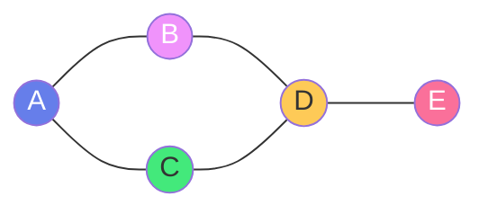
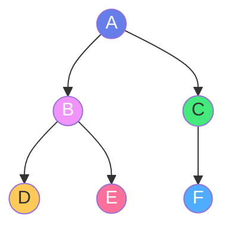
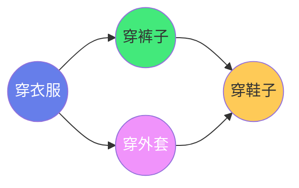

# 🕸️ 图论基础与遍历

> **文档说明**：系统讲解图论基础与图遍历算法的完整知识体系，涵盖图的基本概念（顶点/边/有向/无向/加权/度）、图的存储结构（邻接矩阵/邻接表/十字链表/前向星）、深度优先搜索（DFS）原理与实现、广度优先搜索（BFS）原理与实现、DFS/BFS 应用（连通分量/路径查找/环检测/二分图）、拓扑排序（Kahn 算法/DFS 算法）、最短路径入门（BFS 无权图/Dijkstra）、最小生成树（Kruskal/Prim）、图的应用场景与代码模板。
>
> **适用人群**：算法学习者、面试准备者、后端开发者、计算机专业学生
>
> **前置知识**：[[树与二叉树核心]] · [[算法复杂度分析]] · [[递归与分治]]

---

## 一、概述

### 1.1 什么是图

图（Graph）是由**顶点（Vertex）**和连接顶点的**边（Edge）**组成的数据结构，用于描述对象之间的关系。图是比树更通用的数据结构——树是无环的连通图，图可以有环、可以不连通、可以有方向。



**图 vs 树**：
| 特征 | 树 | 图 |
|------|-----|-----|
| 环 | 无环 | 可以有环 |
| 连通性 | 必须连通 | 可以不连通（多个连通分量） |
| 边数 | n-1 条边（n 个顶点） | 0 到 n(n-1)/2 条边 |
| 方向 | 无向（根到叶子有方向） | 可以有向或无向 |
| 根 | 有唯一根节点 | 无根概念 |

### 1.2 图的分类

| 分类维度 | 类型 | 说明 |
|---------|------|------|
| **边的方向** | 无向图 | 边没有方向，A-B 等价于 B-A |
| | 有向图 | 边有方向，A→B 不等于 B→A |
| **边的权重** | 无权图 | 边没有权重（或权重都为 1） |
| | 加权图 | 边有权重（距离、成本、时间等） |
| **连通性** | 连通图 | 任意两顶点之间都有路径 |
| | 非连通图 | 存在顶点之间没有路径（多个连通分量） |
| **环** | 有环图 | 存在至少一个环 |
| | 无环图 | 没有环（DAG：有向无环图） |
| **完全图** | 完全图 | 任意两顶点之间都有边（n(n-1)/2 条边） |
| **稀疏/稠密** | 稀疏图 | 边数远小于 n²（通常用邻接表） |
| | 稠密图 | 边数接近 n²（通常用邻接矩阵） |

### 1.3 基本概念

| 概念 | 说明 |
|------|------|
| **顶点（Vertex）** | 图中的节点，用 V 表示顶点集合 |
| **边（Edge）** | 连接两个顶点的线，用 E 表示边集合 |
| **度（Degree）** | 与顶点相连的边数；有向图分入度（in-degree）和出度（out-degree） |
| **路径（Path）** | 从顶点 A 到顶点 B 的顶点序列 |
| **路径长度** | 路径上边的数量（无权图）或边权重之和（加权图） |
| **简单路径** | 顶点不重复的路径 |
| **环（Cycle）** | 起点和终点相同的路径 |
| **连通分量** | 无向图中极大连通子图 |
| **强连通分量** | 有向图中任意两顶点互相可达的极大子图 |
| **邻接（Adjacent）** | 两顶点之间有边直接相连 |
| **子图** | 顶点和边都是原图子集的图 |

### 1.4 图的应用场景

| 场景 | 说明 |
|------|------|
| **社交网络** | 用户是顶点，好友关系是边 |
| **地图导航** | 地点是顶点，道路是边，权重是距离/时间 |
| **网络拓扑** | 路由器是顶点，网络连接是边 |
| **依赖关系** | 任务是顶点，依赖是边（DAG，拓扑排序） |
| **推荐系统** | 用户和物品是顶点，行为是边（二分图） |
| **编译原理** | 变量/函数是顶点，引用是边（调用图/依赖图） |
| **状态空间** | 状态是顶点，转移是边（搜索问题） |
| **知识图谱** | 实体是顶点，关系是边 |

---

## 二、图的存储结构

### 2.1 邻接矩阵（Adjacency Matrix）

用二维数组表示图，`matrix[i][j]` 表示顶点 i 到顶点 j 是否有边（无权图为 0/1，加权图为权重）。

```text
无向图（5 个顶点）：
    0  1  2  3  4
0 [ 0  1  1  0  0 ]
1 [ 1  0  0  1  0 ]
2 [ 1  0  0  1  0 ]
3 [ 0  1  1  0  1 ]
4 [ 0  0  0  1  0 ]
```

```python
class GraphMatrix:
    """邻接矩阵表示的图"""
    def __init__(self, n, directed=False):
        self.n = n                    # 顶点数
        self.directed = directed      # 是否有向
        self.matrix = [[0] * n for _ in range(n)]  # 邻接矩阵
    
    def add_edge(self, u, v, weight=1):
        """添加边 u-v，权重为 weight"""
        self.matrix[u][v] = weight
        if not self.directed:
            self.matrix[v][u] = weight
    
    def remove_edge(self, u, v):
        """删除边 u-v"""
        self.matrix[u][v] = 0
        if not self.directed:
            self.matrix[v][u] = 0
    
    def has_edge(self, u, v):
        """判断是否有边 u-v"""
        return self.matrix[u][v] != 0
    
    def get_neighbors(self, u):
        """获取顶点 u 的所有邻居"""
        return [v for v in range(self.n) if self.matrix[u][v] != 0]
```

**复杂度分析**：
| 操作 | 时间复杂度 | 空间复杂度 |
|------|-----------|-----------|
| 添加边 | O(1) | O(n²) |
| 删除边 | O(1) | |
| 查询边 | O(1) | |
| 获取邻居 | O(n) | |
| 遍历所有边 | O(n²) | |

**适用场景**：稠密图（边数接近 n²）、需要快速查询边是否存在。

### 2.2 邻接表（Adjacency List）

用数组+链表表示图，每个顶点维护一个邻居列表。

```text
无向图（5 个顶点）：
0: [1, 2]
1: [0, 3]
2: [0, 3]
3: [1, 2, 4]
4: [3]
```

```python
from collections import defaultdict

class GraphList:
    """邻接表表示的图"""
    def __init__(self, directed=False):
        self.directed = directed
        self.adj = defaultdict(list)  # 邻接表：顶点 -> 邻居列表
        self.vertices = set()          # 所有顶点
    
    def add_vertex(self, v):
        """添加顶点"""
        self.vertices.add(v)
    
    def add_edge(self, u, v, weight=1):
        """添加边 u-v，权重为 weight"""
        self.vertices.add(u)
        self.vertices.add(v)
        self.adj[u].append((v, weight))
        if not self.directed:
            self.adj[v].append((u, weight))
    
    def get_neighbors(self, u):
        """获取顶点 u 的所有邻居（返回 (顶点, 权重) 列表）"""
        return self.adj[u]
    
    def has_edge(self, u, v):
        """判断是否有边 u-v（O(degree)）"""
        return any(neighbor == v for neighbor, _ in self.adj[u])
```

**复杂度分析**：
| 操作 | 时间复杂度 | 空间复杂度 |
|------|-----------|-----------|
| 添加边 | O(1) | O(V + E) |
| 查询边 | O(degree) | |
| 获取邻居 | O(1)（返回列表） | |
| 遍历所有边 | O(V + E) | |

**适用场景**：稀疏图（边数远小于 n²）、大多数实际应用（社交网络、地图等都是稀疏图）。

### 2.3 存储结构对比

| 维度 | 邻接矩阵 | 邻接表 |
|------|---------|--------|
| **空间** | O(n²) | O(V + E) |
| **添加边** | O(1) | O(1) |
| **查询边** | O(1) | O(degree) |
| **获取邻居** | O(n) | O(1) |
| **遍历边** | O(n²) | O(V + E) |
| **适用** | 稠密图 | 稀疏图 |
| **实现** | 简单 | 稍复杂 |
| **缓存友好** | 是（连续内存） | 否（链表分散） |

> **选择建议**：实际工程中绝大多数图是稀疏图，优先用邻接表。只有当图很稠密（边数 > n²/4）或需要 O(1) 查询边时才用邻接矩阵。

---

## 三、深度优先搜索（DFS）

### 3.1 DFS 原理

深度优先搜索（Depth-First Search）是一种图遍历算法，从起始顶点出发，沿着一条路径尽可能深地探索，直到无法继续，然后回溯到上一个顶点，探索其他未访问的分支。



DFS 遍历顺序（从 A 出发）：A → B → D → E → C → F

**核心思想**：
- 使用**栈**（递归调用栈或显式栈）保存待访问的顶点
- 访问一个顶点后，立即深入访问其未访问的邻居
- 所有邻居都访问过后，回溯到上一层

### 3.2 DFS 实现

**递归实现**：
```python
def dfs_recursive(graph, start):
    """
    DFS 递归实现
    graph: 邻接表，graph[u] = [(v, weight), ...]
    start: 起始顶点
    """
    visited = set()
    result = []
    
    def dfs(node):
        if node in visited:
            return
        visited.add(node)
        result.append(node)
        # 递归访问所有未访问的邻居
        for neighbor, _ in graph.get(node, []):
            if neighbor not in visited:
                dfs(neighbor)
    
    dfs(start)
    return result
```

**迭代实现（显式栈）**：
```python
def dfs_iterative(graph, start):
    """
    DFS 迭代实现（用显式栈）
    注意：迭代 DFS 的访问顺序可能与递归不同（取决于入栈顺序）
    """
    visited = set()
    stack = [start]
    result = []
    
    while stack:
        node = stack.pop()  # 栈：后进先出
        if node in visited:
            continue
        visited.add(node)
        result.append(node)
        # 邻居逆序入栈，保证访问顺序与递归一致（可选）
        for neighbor, _ in reversed(graph.get(node, [])):
            if neighbor not in visited:
                stack.append(neighbor)
    
    return result
```

**复杂度分析**：
| 维度 | 邻接表 | 邻接矩阵 |
|------|--------|---------|
| 时间 | O(V + E) | O(V²) |
| 空间 | O(V)（递归栈/访问标记） | O(V) |

### 3.3 DFS 应用

**1. 连通分量**：
```python
def count_connected_components(graph, vertices):
    """统计无向图的连通分量数量"""
    visited = set()
    count = 0
    
    def dfs(node):
        visited.add(node)
        for neighbor, _ in graph.get(node, []):
            if neighbor not in visited:
                dfs(neighbor)
    
    for v in vertices:
        if v not in visited:
            dfs(v)
            count += 1
    return count
```

**2. 路径查找**：
```python
def find_path_dfs(graph, start, end):
    """DFS 查找从 start 到 end 的路径（找到一条即可）"""
    visited = set()
    path = []
    
    def dfs(node):
        if node == end:
            return True
        visited.add(node)
        path.append(node)
        for neighbor, _ in graph.get(node, []):
            if neighbor not in visited:
                if dfs(neighbor):
                    return True
        path.pop()  # 回溯
        return False
    
    if dfs(start):
        path.append(end)
        return path
    return None
```

**3. 环检测（无向图）**：
```python
def has_cycle_undirected(graph, vertices):
    """检测无向图是否有环"""
    visited = set()
    
    def dfs(node, parent):
        visited.add(node)
        for neighbor, _ in graph.get(node, []):
            if neighbor not in visited:
                if dfs(neighbor, node):
                    return True
            elif neighbor != parent:  # 遇到已访问的非父节点，说明有环
                return True
        return False
    
    for v in vertices:
        if v not in visited:
            if dfs(v, -1):
                return True
    return False
```

**4. 二分图检测**：
```python
def is_bipartite(graph, vertices):
    """检测图是否为二分图（用两种颜色染色，相邻顶点颜色不同）"""
    color = {}  # -1: 未染色, 0/1: 两种颜色
    
    def dfs(node, c):
        color[node] = c
        for neighbor, _ in graph.get(node, []):
            if neighbor not in color:
                if not dfs(neighbor, 1 - c):
                    return False
            elif color[neighbor] == c:  # 相邻顶点颜色相同，不是二分图
                return False
        return True
    
    for v in vertices:
        if v not in color:
            if not dfs(v, 0):
                return False
    return True
```

---

## 四、广度优先搜索（BFS）

### 4.1 BFS 原理

广度优先搜索（Breadth-First Search）是一种图遍历算法，从起始顶点出发，先访问所有距离为 1 的邻居，再访问距离为 2 的顶点，依此类推，按层次逐层扩展。

BFS 遍历顺序（从 A 出发）：A → B → C → D → E → F

**核心思想**：
- 使用**队列**保存待访问的顶点
- 访问一个顶点后，将其所有未访问的邻居加入队列
- 按队列顺序依次处理（先进先出）

### 4.2 BFS 实现

```python
from collections import deque

def bfs(graph, start):
    """
    BFS 实现（用队列）
    graph: 邻接表
    start: 起始顶点
    """
    visited = set()
    queue = deque([start])
    visited.add(start)
    result = []
    
    while queue:
        node = queue.popleft()  # 队列：先进先出
        result.append(node)
        for neighbor, _ in graph.get(node, []):
            if neighbor not in visited:
                visited.add(neighbor)
                queue.append(neighbor)
    
    return result
```

**复杂度分析**：
| 维度 | 邻接表 | 邻接矩阵 |
|------|--------|---------|
| 时间 | O(V + E) | O(V²) |
| 空间 | O(V)（队列/访问标记） | O(V) |

### 4.3 BFS 应用

**1. 无权图最短路径**：
```python
def shortest_path_bfs(graph, start, end):
    """
    BFS 求无权图从 start 到 end 的最短路径长度和路径
    BFS 按层次遍历，第一次到达 end 时就是最短路径
    """
    if start == end:
        return 0, [start]
    
    visited = {start: None}  # 记录每个顶点的前驱，用于重建路径
    queue = deque([start])
    
    while queue:
        node = queue.popleft()
        for neighbor, _ in graph.get(node, []):
            if neighbor not in visited:
                visited[neighbor] = node
                if neighbor == end:
                    # 重建路径
                    path = []
                    curr = end
                    while curr is not None:
                        path.append(curr)
                        curr = visited[curr]
                    path.reverse()
                    return len(path) - 1, path
                queue.append(neighbor)
    
    return -1, None  # 不可达
```

**2. 层序遍历/层次信息**：
```python
def bfs_levels(graph, start):
    """BFS 按层遍历，返回每层的顶点"""
    visited = {start}
    queue = deque([start])
    levels = []
    
    while queue:
        level_size = len(queue)
        current_level = []
        for _ in range(level_size):
            node = queue.popleft()
            current_level.append(node)
            for neighbor, _ in graph.get(node, []):
                if neighbor not in visited:
                    visited.add(neighbor)
                    queue.append(neighbor)
        levels.append(current_level)
    
    return levels
```

### 4.4 DFS vs BFS 对比

| 维度 | DFS | BFS |
|------|-----|-----|
| **数据结构** | 栈（递归/显式） | 队列 |
| **遍历顺序** | 深度优先，一条路走到黑 | 广度优先，逐层扩展 |
| **空间复杂度** | O(V)（递归栈深度） | O(V)（队列宽度） |
| **最短路径** | 不保证（可能找到更长的路径） | 无权图保证最短 |
| **适用场景** | 路径查找、环检测、拓扑排序、连通分量 | 最短路径、层序遍历、最近邻 |
| **实现** | 递归简洁，迭代稍复杂 | 迭代实现，无递归栈溢出风险 |
| **栈溢出风险** | 有（深图递归可能溢出） | 无 |

> **选择建议**：求最短路径用 BFS；求所有路径/连通分量/环检测用 DFS；图很深时用 BFS 避免栈溢出；图很宽时用 DFS 节省空间。

---

## 五、拓扑排序

### 5.1 拓扑排序原理

拓扑排序（Topological Sort）是对**有向无环图（DAG）**的顶点进行排序，使得对于任意有向边 u→v，顶点 u 都排在顶点 v 之前。

拓扑排序不唯一——一个 DAG 可以有多个合法的拓扑序列。



合法拓扑序列：穿衣服 → 穿裤子 → 穿外套 → 穿鞋子，或 穿衣服 → 穿外套 → 穿裤子 → 穿鞋子

**应用场景**：
- 任务调度（有依赖关系的任务执行顺序）
- 编译系统（源文件依赖关系）
- 课程安排（先修课依赖）
- 数据处理管道（ETL 依赖）

### 5.2 Kahn 算法（BFS 法）

**核心思想**：不断找入度为 0 的顶点，输出后删除其出边，更新邻居入度。

```python
from collections import deque

def topological_sort_kahn(graph, vertices):
    """
    Kahn 算法（BFS 法）拓扑排序
    graph: 邻接表（有向图）
    返回拓扑序列，如果有环则返回空列表
    """
    # 1. 计算每个顶点的入度
    in_degree = {v: 0 for v in vertices}
    for u in vertices:
        for v, _ in graph.get(u, []):
            in_degree[v] += 1
    
    # 2. 入度为 0 的顶点入队
    queue = deque([v for v in vertices if in_degree[v] == 0])
    result = []
    
    # 3. 不断处理入度为 0 的顶点
    while queue:
        node = queue.popleft()
        result.append(node)
        # 删除 node 的所有出边，更新邻居入度
        for neighbor, _ in graph.get(node, []):
            in_degree[neighbor] -= 1
            if in_degree[neighbor] == 0:
                queue.append(neighbor)
    
    # 4. 如果结果长度不等于顶点数，说明有环
    if len(result) != len(vertices):
        return []  # 有环，无法拓扑排序
    
    return result
```

### 5.3 DFS 法拓扑排序

**核心思想**：DFS 遍历，顶点所有邻居都访问完后，将该顶点加入结果，最后逆序输出。

```python
def topological_sort_dfs(graph, vertices):
    """
    DFS 法拓扑排序
    返回拓扑序列，如果有环则返回空列表
    """
    WHITE, GRAY, BLACK = 0, 1, 2  # 未访问/访问中/已完成
    color = {v: WHITE for v in vertices}
    result = []
    has_cycle = False
    
    def dfs(node):
        nonlocal has_cycle
        if has_cycle:
            return
        color[node] = GRAY  # 标记为访问中
        for neighbor, _ in graph.get(node, []):
            if color[neighbor] == GRAY:  # 遇到访问中的顶点，说明有环
                has_cycle = True
                return
            elif color[neighbor] == WHITE:
                dfs(neighbor)
        color[node] = BLACK  # 标记为已完成
        result.append(node)  # 后序位置加入结果
    
    for v in vertices:
        if color[v] == WHITE:
            dfs(v)
            if has_cycle:
                return []
    
    result.reverse()  # 逆序输出
    return result
```

**复杂度**：两种算法时间 O(V + E)，空间 O(V)。

---

## 六、最短路径算法

### 6.1 BFS（无权图）

BFS 是无权图（所有边权重为 1）最短路径的最优解法，时间 O(V + E)。实现见 4.3 节。

### 6.2 Dijkstra 算法（非负权图）

**核心思想**：贪心策略，每次选距离起点最近的未访问顶点，更新其邻居距离。

```python
import heapq

def dijkstra(graph, start, vertices):
    """
    Dijkstra 最短路径（非负权图）
    graph: 邻接表，graph[u] = [(v, weight), ...]
    返回从 start 到所有顶点的最短距离
    时间 O(E log V)，空间 O(V)
    """
    INF = float('inf')
    dist = {v: INF for v in vertices}
    dist[start] = 0
    min_heap = [(0, start)]  # (distance, node)
    visited = set()
    
    while min_heap:
        d, node = heapq.heappop(min_heap)
        if node in visited:
            continue
        visited.add(node)
        
        for neighbor, weight in graph.get(node, []):
            if neighbor not in visited and d + weight < dist[neighbor]:
                dist[neighbor] = d + weight
                heapq.heappush(min_heap, (dist[neighbor], neighbor))
    
    return dist
```

> **注意**：Dijkstra 不能处理负权边。有负权边用 Bellman-Ford 或 SPFA。

---

## 七、最小生成树

### 7.1 Kruskal 算法

**核心思想**：将所有边按权重排序，依次选不形成环的最小边（贪心 + 并查集判环）。

实现见 [[动态规划与贪心]] 5.4 节。时间 O(E log E)。

### 7.2 Prim 算法

**核心思想**：从任意顶点出发，每次选离已选集合最近的顶点加入。

实现见 [[动态规划与贪心]] 5.4 节。时间 O(E log V)。

---

## 八、常见问题与排查

| 问题现象 | 可能原因 | 解决方案 |
|---------|---------|---------|
| DFS 栈溢出 | 图太深，递归深度过大 | 改用迭代 DFS；增加递归深度限制 `sys.setrecursionlimit` |
| BFS/DFS 结果不完整 | 图不连通，只遍历了一个连通分量 | 对所有未访问顶点循环调用 BFS/DFS |
| 拓扑排序返回空 | 图中有环（不是 DAG） | 检查图是否有环；删除环边 |
| Dijkstra 结果错误 | 图中有负权边 | 改用 Bellman-Ford/SPFA |
| 邻接表内存溢出 | 图太稠密 | 改用邻接矩阵；压缩存储 |
| 环检测误判 | 无向图未排除父节点 | DFS 时传入 parent，跳过父节点 |
| 最短路径找不到 | 起点终点不连通 | 检查连通性；返回不可达标记 |

---

## 九、进阶与最佳实践

### 9.1 图算法选择速查

| 问题 | 推荐算法 | 时间复杂度 |
|------|---------|-----------|
| 图遍历 | DFS / BFS | O(V + E) |
| 连通分量 | DFS / BFS / 并查集 | O(V + E) |
| 无权图最短路径 | BFS | O(V + E) |
| 非负权图最短路径 | Dijkstra | O(E log V) |
| 有负权边最短路径 | Bellman-Ford / SPFA | O(VE) / O(E) 平均 |
| 全源最短路径 | Floyd-Warshall | O(V³) |
| 最小生成树 | Kruskal / Prim | O(E log E) / O(E log V) |
| 拓扑排序 | Kahn / DFS | O(V + E) |
| 环检测 | DFS / 并查集 | O(V + E) |
| 二分图检测 | DFS 染色 / BFS 染色 | O(V + E) |
| 强连通分量 | Tarjan / Kosaraju | O(V + E) |
| 关键路径 | 拓扑排序 + DP | O(V + E) |

### 9.2 代码模板速查

```python
# ===== 图遍历模板 =====
from collections import deque

def traverse(graph, start, method='bfs'):
    visited = set()
    result = []
    
    if method == 'bfs':
        queue = deque([start])
        visited.add(start)
        while queue:
            node = queue.popleft()
            result.append(node)
            for neighbor, _ in graph.get(node, []):
                if neighbor not in visited:
                    visited.add(neighbor)
                    queue.append(neighbor)
    else:  # dfs
        def dfs(node):
            visited.add(node)
            result.append(node)
            for neighbor, _ in graph.get(node, []):
                if neighbor not in visited:
                    dfs(neighbor)
        dfs(start)
    
    return result
```

### 9.3 面试解题策略

```text
图论面试题解题策略：

1. 建图
   - 明确顶点和边是什么
   - 选择邻接表（稀疏图）或邻接矩阵（稠密图）
   - 有向/无向、加权/无权

2. 选择算法
   - 遍历/连通 → DFS/BFS
   - 最短路径 → BFS（无权）/ Dijkstra（非负权）
   - 依赖/排序 → 拓扑排序
   - 最小连接 → 最小生成树
   - 环/二分图 → DFS

3. 注意细节
   - 图不连通 → 循环所有顶点
   - 有向图无向图处理不同
   - 加权图权重可能为 0 或负
   - 顶点编号可能不连续（用字典而非数组）

4. 复杂度分析
   - 邻接表：O(V + E)
   - 邻接矩阵：O(V²)
   - 堆优化：O(E log V)
```

---

## 十、关联笔记

### 算法基础
- [[树与二叉树核心]] · [[算法复杂度分析]] · [[递归与分治]]
- [[排序算法全景对比]] · [[哈希表与散列]]

### 算法进阶
- [[动态规划与贪心]] · [[回溯算法详解]] · [[滑动窗口与双指针]]

### 导航
- [[MOC-计算机基础]] · [[MOC-算法与数据结构]] · [[MOC-综合导航]] · [[Home]]

> 🔍 **知识点深度解析**
>
> **作用**：图论基础与遍历解决的是「对象关系建模与搜索」问题——现实世界中很多问题可以抽象为图（社交关系、地图导航、依赖关系、网络拓扑），图遍历（DFS/BFS）是所有图算法的基础，拓扑排序解决依赖关系的执行顺序，最短路径和最小生成树解决优化问题。
>
> **底层原理**：图由顶点和边组成，存储结构有邻接矩阵（O(n²) 空间，O(1) 查询边）和邻接表（O(V+E) 空间，O(degree) 查询边）。DFS 用栈（递归调用栈）实现，沿着一条路径深入到无法继续再回溯，适合路径查找、环检测、连通分量；BFS 用队列实现，按层次逐层扩展，第一次到达目标时就是无权图最短路径。拓扑排序针对 DAG，Kahn 算法用 BFS（不断选入度为 0 的顶点），DFS 法用后序遍历逆序输出。最短路径：无权图用 BFS，非负权图用 Dijkstra（贪心+堆），有负权边用 Bellman-Ford。最小生成树用 Kruskal（贪心+并查集）或 Prim（贪心）。
>
> **用法要点**：① 存储选择：稀疏图用邻接表，稠密图用邻接矩阵，实际工程大多用邻接表 ② DFS 递归注意栈溢出，深图改用迭代 ③ BFS 求无权图最短路径，记录前驱重建路径 ④ 图不连通时循环所有顶点调用遍历 ⑤ 拓扑排序只适用于 DAG，有环返回空 ⑥ 无向图环检测 DFS 要传入 parent 排除父节点 ⑦ Dijkstra 不能处理负权边 ⑧ Kruskal 用并查集判环，Prim 用堆选最近顶点 ⑨ 二分图检测用 DFS/BFS 染色，相邻顶点颜色不同 ⑩ 复杂度：邻接表遍历 O(V+E)，邻接矩阵 O(V²)，堆优化 O(E log V)。

> 💡 **深度讲解**：图论最难的不是算法实现，而是「建图」——很多问题表面上不是图论问题，但抽象后可以转化为图。比如课程安排（课程是顶点，先修关系是边，拓扑排序）、单词接龙（单词是顶点，能转换的单词之间有边，BFS 求最短路径）、岛屿数量（格子是顶点，相邻陆地有边，DFS/BFS 求连通分量）。培养「图抽象思维」是关键。DFS 和 BFS 是图算法的基石，几乎所有图算法都基于遍历。DFS 的精髓是「回溯」——深入到无法继续时回退，尝试其他分支，这种思想也是回溯算法、八皇后、全排列的核心。BFS 的精髓是「层次」——按距离分层，第一次到达就是最短，这种思想在最短路径、层序遍历、最近邻搜索中广泛应用。拓扑排序是 DAG 的专属算法，Kahn 算法的入度思想很巧妙——入度为 0 意味着没有依赖，可以先执行，执行完后减少其邻居的入度，这就是任务调度的本质。

> 📝 **精简总结**：图 = 顶点 + 边，存储用邻接表（稀疏）或邻接矩阵（稠密）。DFS 用栈深入遍历，适合路径/环/连通分量；BFS 用队列逐层遍历，适合无权图最短路径。拓扑排序（DAG）：Kahn（BFS 入度）或 DFS 后序逆序。最短路径：BFS（无权）/Dijkstra（非负权）。最小生成树：Kruskal（并查集）/Prim（堆）。选择：先建图，再选算法，注意不连通和有向无向区别。

> **学习路径建议**：先学习 [[树与二叉树核心]] 理解树结构（图的特例）→ 学习本文档掌握图论基础与遍历 → 学习 [[动态规划与贪心]] 中的 Dijkstra/Kruskal/Prim → 学习 [[回溯算法详解]] 理解 DFS 回溯思想 → 刷 LeetCode 图论专题（岛屿问题、课程表、最短路径）→ 学习高级图算法（Tarjan 强连通分量、网络流最大流）。

---

> **图论的本质是「关系的数学」——当你学会把世界抽象为顶点和边，很多复杂问题就变成了图上的搜索和优化。DFS 教你深入探索不放弃，BFS 教你稳扎稳打步步为营，拓扑排序教你理清依赖有条不紊——算法不仅是技术，也是思考问题的方式。**
