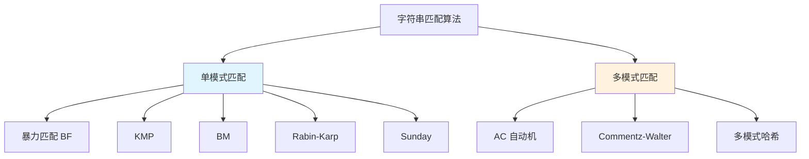

# 字符串匹配-KMP-AC自动机

> **文档说明**：系统讲解字符串匹配算法，从暴力匹配到 KMP、BM、Rabin-Karp，再到多模式匹配的 AC 自动机，涵盖原理推导、代码实现、应用场景和性能对比。
>
> **适用人群**：算法学习者、后端开发者、需要处理文本匹配的开发者
>
> **前置知识**：[[算法复杂度分析]]、[[数据结构-树与图]]、[[哈希表与哈希算法]]

---

## 一、概述

### 1. 字符串匹配问题

```text
字符串匹配（String Matching）：
- 给定文本串 T（长度 n）和模式串 P（长度 m）
- 找出 P 在 T 中所有出现的位置
- 单模式匹配：一个模式串
- 多模式匹配：多个模式串同时匹配

应用场景：
- 文本编辑器查找替换
- 搜索引擎关键词匹配
- 入侵检测（特征匹配）
- 垃圾邮件过滤
- DNA 序列匹配
- 日志分析
- 敏感词过滤
```

### 2. 算法分类



### 3. 性能对比

| 算法 | 平均时间 | 最坏时间 | 空间 | 特点 |
|------|---------|---------|------|------|
| **BF** | O(nm) | O(nm) | O(1) | 简单、小文本够用 |
| **KMP** | O(n+m) | O(n+m) | O(m) | 稳定、不回溯主串 |
| **BM** | O(n/m) | O(nm) | O(m+Σ) | 平均最快、从后往前 |
| **Rabin-Karp** | O(n+m) | O(nm) | O(1) | 哈希、多模式友好 |
| **AC自动机** | O(n+m×k) | O(n+m×k) | O(m×k) | 多模式、一次扫描 |

---

## 二、暴力匹配（BF）

### 1. 算法思想

```text
暴力匹配（Brute Force）：
- 主串 T 的每个位置都尝试匹配模式串 P
- 匹配失败则主串指针回退到下一个位置
- 时间复杂度 O(n×m)

示例：
T: a b a b a b c a
P: a b c

i=0: a b a...  匹配 a b，第3位 a≠c 失败
i=1: b a b...  第1位 b≠a 失败
i=2: a b c     匹配成功！位置 2
```

### 2. 代码实现

```python
def brute_force(text: str, pattern: str) -> int:
    """暴力匹配，返回首次匹配位置，未匹配返回 -1"""
    n, m = len(text), len(pattern)
    for i in range(n - m + 1):
        j = 0
        while j < m and text[i + j] == pattern[j]:
            j += 1
        if j == m:
            return i
    return -1

# 查找所有匹配
def brute_force_all(text: str, pattern: str) -> list[int]:
    n, m = len(text), len(pattern)
    result = []
    for i in range(n - m + 1):
        if text[i:i+m] == pattern:
            result.append(i)
    return result
```

---

## 三、KMP 算法

### 1. 核心思想

```text
KMP（Knuth-Morris-Pratt）：
- 利用已匹配的信息，避免主串指针回溯
- 匹配失败时，模式串指针不回到 0，而是回到 next[j]
- 主串指针 i 永远不回退
- 时间复杂度 O(n+m)

关键：next 数组（最长相等前后缀）
- next[j] 表示 pattern[0..j-1] 中最长相等前后缀的长度
- 匹配失败在 j 位置时，模式串指针跳到 next[j]
```

### 2. next 数组推导

```text
模式串 P = "a b a b a c"

下标:    0  1  2  3  4  5
字符:    a  b  a  b  a  c
next:   -1  0  0  1  2  3

推导过程：
next[0] = -1（约定，方便统一处理）
next[1] = 0（"a" 无前后缀）
next[2]: "ab" 最长相等前后缀 = 0
next[3]: "aba" 最长相等前后缀 = 1（"a"）
next[4]: "abab" 最长相等前后缀 = 2（"ab"）
next[5]: "ababa" 最长相等前后缀 = 3（"aba"）

匹配失败在 j=5（c），跳到 next[5]=3
即从 pattern[3]（b）开始继续比较
```

### 3. next 数组构建

```python
def build_next(pattern: str) -> list[int]:
    """构建 next 数组"""
    m = len(pattern)
    next_arr = [0] * m
    next_arr[0] = -1
    i, j = 0, -1
    while i < m - 1:
        if j == -1 or pattern[i] == pattern[j]:
            i += 1
            j += 1
            # 优化：如果 next 位置字符相同，继续跳
            if pattern[i] == pattern[j]:
                next_arr[i] = next_arr[j]
            else:
                next_arr[i] = j
        else:
            j = next_arr[j]
    return next_arr
```

### 4. KMP 匹配

```python
def kmp_search(text: str, pattern: str) -> int:
    """KMP 单模式匹配，返回首次匹配位置"""
    n, m = len(text), len(pattern)
    if m == 0:
        return 0
    next_arr = build_next(pattern)
    i = j = 0
    while i < n and j < m:
        if j == -1 or text[i] == pattern[j]:
            i += 1
            j += 1
        else:
            j = next_arr[j]  # 模式串回退，主串不动
    if j == m:
        return i - j
    return -1

def kmp_search_all(text: str, pattern: str) -> list[int]:
    """查找所有匹配位置"""
    n, m = len(text), len(pattern)
    if m == 0:
        return []
    next_arr = build_next(pattern)
    i = j = 0
    result = []
    while i < n:
        if j == -1 or text[i] == pattern[j]:
            i += 1
            j += 1
        else:
            j = next_arr[j]
        if j == m:
            result.append(i - j)
            j = next_arr[j - 1]  # 继续找下一个匹配
    return result
```

### 5. 匹配过程演示

```text
T = "a b a b a b c a"
P = "a b c"  next = [-1, 0, 0]

i=0,j=0: T[0]=a == P[0]=a → i=1,j=1
i=1,j=1: T[1]=b == P[1]=b → i=2,j=2
i=2,j=2: T[2]=a != P[2]=c → j=next[2]=0
i=2,j=0: T[2]=a == P[0]=a → i=3,j=1
i=3,j=1: T[3]=b == P[1]=b → i=4,j=2
i=4,j=2: T[4]=a != P[2]=c → j=next[2]=0
i=4,j=0: T[4]=a == P[0]=a → i=5,j=1
i=5,j=1: T[5]=b == P[1]=b → i=6,j=2
i=6,j=2: T[6]=c == P[2]=c → i=7,j=3 匹配成功！位置 7-3=4
```

---

## 四、BM 算法

### 1. 核心思想

```text
BM（Boyer-Moore）：
- 从模式串末尾开始比较（从右往左）
- 两个启发式规则：
  1. 坏字符规则（Bad Character）
  2. 好后缀规则（Good Suffix）
- 平均时间复杂度 O(n/m)，实际应用最快
- Linux grep、文本编辑器常用 BM 变体

坏字符规则：
- 匹配失败时，主串中不匹配的字符叫"坏字符"
- 在模式串中找坏字符最右出现位置
- 模式串右移，使坏字符对齐

好后缀规则：
- 已匹配的后缀叫"好后缀"
- 在模式串中找好后缀的另一个出现位置
- 模式串右移，使好后缀对齐
```

### 2. 简化实现

```python
def boyer_moore(text: str, pattern: str) -> int:
    """简化版 BM（坏字符规则）"""
    n, m = len(text), len(pattern)
    if m == 0:
        return 0

    # 坏字符表：每个字符在模式串中最右出现位置
    bad_char = {}
    for i, ch in enumerate(pattern):
        bad_char[ch] = i

    i = 0
    while i <= n - m:
        j = m - 1
        # 从右往左比较
        while j >= 0 and text[i + j] == pattern[j]:
            j -= 1
        if j < 0:
            return i  # 匹配成功
        # 坏字符规则移动
        bad_shift = j - bad_char.get(text[i + j], -1)
        i += max(1, bad_shift)
    return -1
```

---

```text
## 五、Rabin-Karp 算法
```

### 1. 核心思想

```text
Rabin-Karp（滚动哈希）：
- 计算模式串的哈希值
- 计算主串中每个长度为 m 的子串哈希值
- 用滚动哈希（Rolling Hash）在 O(1) 时间更新哈希
- 哈希相等时再逐字符比较（避免哈希冲突）
- 时间复杂度平均 O(n+m)，最坏 O(nm)

滚动哈希公式（以十进制为例）：
hash("abc") = a*10^2 + b*10^1 + c*10^0
hash("bcd") = (hash("abc") - a*10^2) * 10 + d

实际用大素数取模，避免溢出：
hash = (hash * base + char) % mod
```

### 2. 代码实现

```python
def rabin_karp(text: str, pattern: str) -> int:
    """Rabin-Karp 字符串匹配"""
    n, m = len(text), len(pattern)
    if m == 0 or m > n:
        return 0 if m == 0 else -1

    BASE = 256
    MOD = 10**9 + 7

    # 计算 BASE^(m-1) % MOD
    h = 1
    for _ in range(m - 1):
        h = (h * BASE) % MOD

    # 计算模式串和主串第一个窗口的哈希
    p_hash = 0
    t_hash = 0
    for i in range(m):
        p_hash = (p_hash * BASE + ord(pattern[i])) % MOD
        t_hash = (t_hash * BASE + ord(text[i])) % MOD

    for i in range(n - m + 1):
        if p_hash == t_hash:
            # 哈希相等，逐字符验证
            if text[i:i+m] == pattern:
                return i
        # 滚动哈希
        if i < n - m:
            t_hash = ((t_hash - ord(text[i]) * h) * BASE + ord(text[i + m])) % MOD
            t_hash = (t_hash + MOD) % MOD  # 确保非负
    return -1
```

---

## 六、AC 自动机

### 1. 核心思想

```text
AC 自动机（Aho-Corasick）：
- 多模式匹配算法，一次扫描主串匹配所有模式串
- 基于 Trie 树 + 失败指针（类似 KMP 的 next）
- 时间复杂度 O(n + m×k + z)，z 为匹配次数
- 应用：敏感词过滤、入侵检测、日志分析

三个核心步骤：
1. 构建 Trie 树：所有模式串插入 Trie
2. 构建失败指针：BFS 层序遍历，类似 KMP next
3. 匹配：主串逐字符走 Trie，失败时走失败指针
```

### 2. Trie 树构建

```text
模式串集合：["he", "she", "his", "hers"]

Trie 结构：
        root
       / | \
      h  s  ...
     / \  \
    e   i  h
    |   |  |
    r   s  e
    |
    s

节点包含：
- children: 子节点映射
- fail: 失败指针
- is_end: 是否是某个模式串结尾
- output: 该节点结尾的模式串列表
```

### 3. 失败指针构建

```json
失败指针（类似 KMP 的 next）：
- 指向当前节点的最长后缀所对应的节点
- 用 BFS 层序构建
- root 的子节点 fail 指向 root

示例：
"she" 的 e 节点，最长后缀是 "he"
所以 fail 指向 "he" 的 e 节点

匹配时如果当前节点没有对应子节点：
- 沿着 fail 指针走，直到找到有该子节点的节点
- 或走到 root
```

### 4. 完整实现

```python
from collections import deque

class ACNode:
    def __init__(self):
        self.children = {}       # 子节点
        self.fail = None         # 失败指针
        self.is_end = False      # 是否是模式串结尾
        self.output = []         # 输出的模式串列表
        self.length = 0          # 模式串长度

class ACAutomaton:
    def __init__(self):
        self.root = ACNode()

    def insert(self, pattern: str):
        """插入模式串"""
        node = self.root
        for ch in pattern:
            if ch not in node.children:
                node.children[ch] = ACNode()
            node = node.children[ch]
        node.is_end = True
        node.output.append(pattern)
        node.length = len(pattern)

    def build(self):
        """构建失败指针（BFS）"""
        queue = deque()
        # root 的子节点 fail 指向 root
        for child in self.root.children.values():
            child.fail = self.root
            queue.append(child)

        while queue:
            current = queue.popleft()
            for ch, child in current.children.items():
                queue.append(child)
                # 找 fail 节点
                fail_node = current.fail
                while fail_node and ch not in fail_node.children:
                    fail_node = fail_node.fail
                if fail_node:
                    child.fail = fail_node.children[ch]
                else:
                    child.fail = self.root
                # 合并输出（fail 链上的输出也要收集）
                child.output += child.fail.output

    def search(self, text: str) -> list[tuple[str, int]]:
        """多模式匹配，返回 (模式串, 起始位置) 列表"""
        results = []
        node = self.root
        for i, ch in enumerate(text):
            # 失败时走 fail 指针
            while node and ch not in node.children:
                node = node.fail
            if not node:
                node = self.root
                continue
            node = node.children[ch]
            # 收集所有匹配
            for pattern in node.output:
                results.append((pattern, i - len(pattern) + 1))
        return results

# 使用示例
ac = ACAutomaton()
for p in ["he", "she", "his", "hers"]:
    ac.insert(p)
ac.build()

text = "ushers"
matches = ac.search(text)
# [('she', 1), ('he', 2), ('hers', 2)]
```

### 5. 匹配过程演示

```text
text = "ushers"
patterns = ["he", "she", "his", "hers"]

i=0 'u': root 无 u → root
i=1 's': root→s
i=2 'h': s→h
i=3 'e': h→e，output=["she"]，fail→he的e，output+=["he"]
         匹配：she@1, he@2
i=4 'r': e→r
i=5 's': r→s，output=["hers"]
         匹配：hers@2

结果：she(1), he(2), hers(2)
```

---

## 七、应用场景

### 1. 敏感词过滤

```python
# 敏感词过滤
class SensitiveFilter:
    def __init__(self, words: list[str]):
        self.ac = ACAutomaton()
        for w in words:
            self.ac.insert(w)
        self.ac.build()

    def filter(self, text: str, replace_char: str = '*') -> str:
        matches = self.ac.search(text)
        result = list(text)
        for word, pos in matches:
            for i in range(pos, pos + len(word)):
                result[i] = replace_char
        return ''.join(result)

    def contains_sensitive(self, text: str) -> bool:
        return len(self.ac.search(text)) > 0

# 使用
filter = SensitiveFilter(["违禁词1", "违禁词2"])
filter.filter("这是违禁词1的内容")  # "这是***的内容"
```

### 2. 日志分析

```python
# 日志关键词告警
keywords = ["ERROR", "FATAL", "Exception", "Timeout"]
ac = ACAutomaton()
for kw in keywords:
    ac.insert(kw)
ac.build()

with open("app.log") as f:
    for line_no, line in enumerate(f, 1):
        matches = ac.search(line)
        if matches:
            print(f"Line {line_no}: {[m[0] for m in matches]} - {line.strip()}")
```

---

## 八、最佳实践

### 1. 算法选择

- [ ] **短文本/短模式**：暴力匹配足够，简单可靠
- [ ] **单模式长文本**：KMP 稳定，BM 平均更快
- [ ] **多模式匹配**：AC 自动机，一次扫描
- [ ] **模糊匹配**：Rabin-Karp 或编辑距离
- [ ] **正则表达式**：用正则引擎（NFA/DFA）
- [ ] **超大文本**：考虑倒排索引（搜索引擎）

### 2. 工程实践

- [ ] **优先用标准库**：Python str.find、Java indexOf 已优化
- [ ] **预处理模式串**：多次匹配时预构建 next/Trie
- [ ] **字符集优化**：ASCII 用数组，Unicode 用字典
- [ ] **流式匹配**：大文件分块读取，注意跨块匹配
- [ ] **大小写处理**：统一转小写或大小写不敏感匹配
- [ ] **编码处理**：注意 UTF-8 多字节字符

---

## 九、常见问题与排查

| 问题 | 原因 | 解决方案 |
|------|------|---------|
| **KMP 匹配结果不对** | next 数组构建错误 | 检查 next 推导、用优化版 next |
| **AC 自动机漏匹配** | fail 链 output 未合并 | 构建时 child.output += fail.output |
| **Rabin-Karp 误匹配** | 哈希冲突 | 哈希相等后逐字符验证 |
| **BM 移动负数** | 坏字符在模式串右侧 | max(1, shift) 确保至少移动 1 |
| **中文匹配乱码** | 编码问题 | 统一 UTF-8、按字符而非字节匹配 |
| **大文本内存溢出** | 一次性加载 | 流式读取、分块匹配 |
| **多模式性能差** | 模式串太多 | AC 自动机、过滤短模式 |
| **正则回溯爆炸** | 嵌套量词 | 优化正则、用 possessive 量词 |
| **Trie 内存大** | 字符集大 | 用字典存子节点、压缩路径 |
| **匹配位置偏移** | 长度计算错误 | 位置 = i - pattern.length + 1 |
| **重叠匹配遗漏** | 匹配后未继续 | j=next[j-1] 继续查找 |
| **空模式串** | 边界未处理 | m==0 时返回 0 或特殊处理 |
| **主串比模式短** | 循环越界 | n<m 时直接返回 -1 |
| **失败指针死循环** | root.fail 未设为 None | root.fail=None，循环条件检查 |
| **并发安全** | 多线程共享 AC | 构建后只读，无需锁；动态更新需锁 |

---

## 十、关联笔记

### 算法与数据结构
- [[算法复杂度分析]] · [[数据结构-树与图]] · [[哈希表与哈希算法]]
- [[排序算法全解析]] · [[动态规划入门到进阶]]

### 文本处理
- [[Python-正则表达式与文本处理]] · [[Python-文件IO与序列化]]
- [[搜索引擎原理与倒排索引]]

### 导航
- [[MOC-计算机基础]] · [[全栈+AI工程双轨融合学习路线图]]

> **学习路径建议**：先掌握 [[算法复杂度分析]] 复杂度基础 → 学习本文字符串匹配算法 → 深入 [[数据结构-树与图]] Trie 树 → 实践 [[Python-正则表达式与文本处理]] 文本处理 → 研究 [[搜索引擎原理与倒排索引]] 大规模检索 → 构建完整的算法与文本处理能力。

---

## 💡 全文深度讲解

本文系统梳理了字符串匹配-KMP-AC自动机的核心知识体系，从概述入手，深入暴力匹配（BF）的底层机制，再通过KMP 算法掌握实战应用，最后涵盖常见问题与排查与关联笔记。学习时建议先建立整体认知，再动手实践，最后结合常见问题深化理解。

## 📝 全文精简总结

- **概述**：掌握本模块的核心概念与关键要点
- **暴力匹配（BF）**：掌握本模块的核心概念与关键要点
- **KMP 算法**：掌握本模块的核心概念与关键要点
- **BM 算法**：掌握本模块的核心概念与关键要点
- **AC 自动机**：掌握本模块的核心概念与关键要点
- **应用场景**：掌握本模块的核心概念与关键要点
- **最佳实践**：掌握本模块的核心概念与关键要点
- **常见问题与排查**：掌握本模块的核心概念与关键要点
- 其余1个模块涵盖进阶主题与拓展内容

