# 📊 排序算法全景对比

> **文档说明**：系统讲解排序算法的完整知识体系，涵盖排序算法的分类维度（比较/非比较、原地/非原地、稳定/不稳定、内部/外部）、十大经典排序算法的原理与实现（冒泡/选择/插入/希尔/归并/快速/堆/计数/桶/基数）、各算法的时间复杂度（最好/最坏/平均）与空间复杂度对比、稳定性分析、适用场景选择、各语言标准库排序实现（Java Arrays.sort/Python sorted/Go sort/C++ std::sort）、排序算法的工程实践（小数据用插入排序、大数据用快速/归并、整数用计数/基数）、常见面试题与易错点、排序算法可视化理解。
>
> **适用人群**：计算机专业学生、算法学习者、后端开发者、面试准备者
>
> **前置知识**：[[线性结构-数组链表栈队列]] · [[算法复杂度分析]]

---

## 一、概述

### 1.1 什么是排序算法

排序算法（Sorting Algorithm）是将一组数据按照特定顺序（升序或降序）重新排列的算法。排序是计算机科学中最基础、最重要的算法之一，是搜索、去重、统计、数据压缩等操作的基础。

**排序的应用场景**：
- 数据库查询结果排序（ORDER BY）
- 搜索引擎结果排名
- 数据分析与统计（中位数、百分位数）
- 算法预处理（二分查找需要有序数组）
- 排行榜系统
- 文件系统文件排序
- 编译器符号表排序

### 1.2 排序算法的分类维度

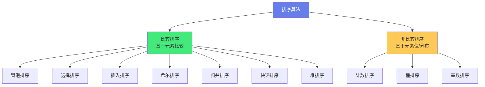

| 分类维度 | 类别 | 说明 | 代表算法 |
|---------|------|------|---------|
| **是否比较** | 比较排序 | 通过比较元素大小决定顺序，通用但有 O(nlogn) 下界 | 冒泡/选择/插入/归并/快排/堆排 |
| | 非比较排序 | 利用元素值或分布特征，可突破 O(nlogn)，但有适用限制 | 计数/桶/基数 |
| **是否原地** | 原地排序 | 空间复杂度 O(1)，在原数组上操作 | 冒泡/选择/插入/希尔/快排/堆排 |
| | 非原地排序 | 需要额外空间 | 归并/计数/桶/基数 |
| **是否稳定** | 稳定排序 | 相等元素的相对顺序不变 | 冒泡/插入/归并/计数/桶/基数 |
| | 不稳定排序 | 相等元素的相对顺序可能改变 | 选择/希尔/快排/堆排 |
| **数据规模** | 内部排序 | 数据量小，全部在内存中排序 | 以上所有 |
| | 外部排序 | 数据量大，需要借助外部存储（磁盘） | 归并排序（多路归并） |
| **时间复杂度** | O(n²) | 简单排序，适合小数据 | 冒泡/选择/插入 |
| | O(nlogn) | 高效排序，适合大数据 | 归并/快排/堆排 |
| | O(n+k) | 线性排序，有适用条件 | 计数/桶/基数 |

### 1.3 核心概念

| 概念 | 说明 |
|------|------|
| **稳定性（Stability）** | 相等元素排序后相对顺序是否保持不变。稳定排序：a=b 且 a 在 b 前，排序后 a 仍在 b 前 |
| **原地排序（In-place）** | 排序过程中只需要 O(1) 额外空间，在原数组上操作 |
| **时间复杂度** | 最好/最坏/平均情况下的比较次数和交换次数 |
| **空间复杂度** | 排序过程中需要的额外存储空间 |
| **自适应（Adaptive）** | 算法能利用输入数据已有的顺序性（如部分有序时更快） |
| **比较排序下界** | 基于比较的排序算法，最坏情况下至少需要 O(nlogn) 次比较（决策树模型证明） |

---

## 二、十大经典排序算法

### 2.1 冒泡排序（Bubble Sort）

**原理**：重复遍历数组，比较相邻元素，如果顺序错误就交换，每轮将最大的元素「冒泡」到末尾。

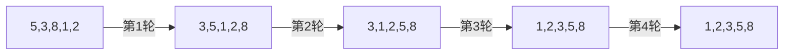

**代码实现**：
```java
public static void bubbleSort(int[] arr) {
    int n = arr.length;
    for (int i = 0; i < n - 1; i++) {
        boolean swapped = false;  // 优化：如果某轮没有交换，说明已有序
        for (int j = 0; j < n - 1 - i; j++) {
            if (arr[j] > arr[j + 1]) {
                int temp = arr[j];
                arr[j] = arr[j + 1];
                arr[j + 1] = temp;
                swapped = true;
            }
        }
        if (!swapped) break;  // 已有序，提前结束
    }
}
```

**复杂度**：
| 维度 | 值 |
|------|-----|
| 最好时间 | O(n)（已有序，一轮无交换） |
| 最坏时间 | O(n²)（逆序） |
| 平均时间 | O(n²) |
| 空间 | O(1) |
| 稳定 | ✅ 稳定 |
| 原地 | ✅ 原地 |
| 自适应 | ✅ 是（优化后） |

### 2.2 选择排序（Selection Sort）

**原理**：每轮从未排序部分选择最小元素，放到已排序部分的末尾。

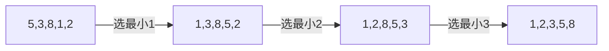

**代码实现**：
```java
public static void selectionSort(int[] arr) {
    int n = arr.length;
    for (int i = 0; i < n - 1; i++) {
        int minIdx = i;
        for (int j = i + 1; j < n; j++) {
            if (arr[j] < arr[minIdx]) {
                minIdx = j;
            }
        }
        if (minIdx != i) {
            int temp = arr[i];
            arr[i] = arr[minIdx];
            arr[minIdx] = temp;
        }
    }
}
```

**复杂度**：
| 维度 | 值 |
|------|-----|
| 最好/最坏/平均时间 | O(n²) |
| 空间 | O(1) |
| 稳定 | ❌ 不稳定（交换可能改变相等元素顺序） |
| 原地 | ✅ 原地 |
| 特点 | 交换次数最少（最多 n-1 次），适合交换成本高的场景 |

### 2.3 插入排序（Insertion Sort）

**原理**：将未排序元素逐个插入到已排序部分的正确位置，类似整理扑克牌。

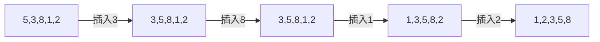

**代码实现**：
```java
public static void insertionSort(int[] arr) {
    int n = arr.length;
    for (int i = 1; i < n; i++) {
        int key = arr[i];
        int j = i - 1;
        while (j >= 0 && arr[j] > key) {
            arr[j + 1] = arr[j];
            j--;
        }
        arr[j + 1] = key;
    }
}
```

**复杂度**：
| 维度 | 值 |
|------|-----|
| 最好时间 | O(n)（已有序） |
| 最坏时间 | O(n²)（逆序） |
| 平均时间 | O(n²) |
| 空间 | O(1) |
| 稳定 | ✅ 稳定 |
| 原地 | ✅ 原地 |
| 自适应 | ✅ 是 |
| 特点 | 小数据/近乎有序时极快，是高级排序的子过程（快排小数组、归并小数组） |

### 2.4 希尔排序（Shell Sort）

**原理**：插入排序的改进版，先按增量（gap）分组进行插入排序，逐步缩小增量，最后增量为 1 时就是普通插入排序。

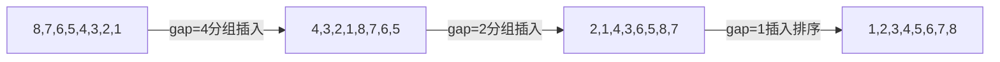

**代码实现**：
```java
public static void shellSort(int[] arr) {
    int n = arr.length;
    for (int gap = n / 2; gap > 0; gap /= 2) {
        for (int i = gap; i < n; i++) {
            int temp = arr[i];
            int j;
            for (j = i; j >= gap && arr[j - gap] > temp; j -= gap) {
                arr[j] = arr[j - gap];
            }
            arr[j] = temp;
        }
    }
}
```

**复杂度**：
| 维度 | 值 |
|------|-----|
| 最好时间 | O(n log n) |
| 最坏时间 | O(n²)（取决于增量序列） |
| 平均时间 | O(n^1.3) ~ O(n log²n) |
| 空间 | O(1) |
| 稳定 | ❌ 不稳定（分组交换可能改变相等元素顺序） |
| 原地 | ✅ 原地 |
| 特点 | 中等数据量表现好，增量序列选择影响性能（Knuth 序列/Sedgewick 序列） |

### 2.5 归并排序（Merge Sort）

**原理**：分治法，将数组递归分成两半，分别排序后合并（merge）两个有序数组。

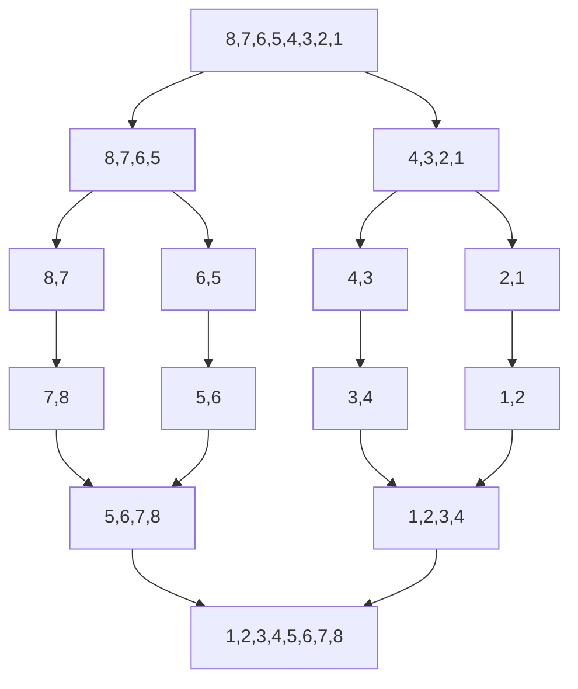

**代码实现**：
```java
public static void mergeSort(int[] arr) {
    if (arr.length > 1) {
        int mid = arr.length / 2;
        int[] left = Arrays.copyOfRange(arr, 0, mid);
        int[] right = Arrays.copyOfRange(arr, mid, arr.length);
        
        mergeSort(left);
        mergeSort(right);
        merge(arr, left, right);
    }
}

private static void merge(int[] arr, int[] left, int[] right) {
    int i = 0, j = 0, k = 0;
    while (i < left.length && j < right.length) {
        if (left[i] <= right[j]) {
            arr[k++] = left[i++];
        } else {
            arr[k++] = right[j++];
        }
    }
    while (i < left.length) arr[k++] = left[i++];
    while (j < right.length) arr[k++] = right[j++];
}
```

**复杂度**：
| 维度 | 值 |
|------|-----|
| 最好/最坏/平均时间 | O(n log n) |
| 空间 | O(n) |
| 稳定 | ✅ 稳定 |
| 原地 | ❌ 非原地（需要额外数组） |
| 特点 | 性能稳定，适合大数据/外部排序/链表排序，Java 对象排序（TimSort）基于归并 |

### 2.6 快速排序（Quick Sort）

**原理**：分治法，选择一个基准（pivot），将数组分为小于基准和大于基准两部分，递归排序两部分。

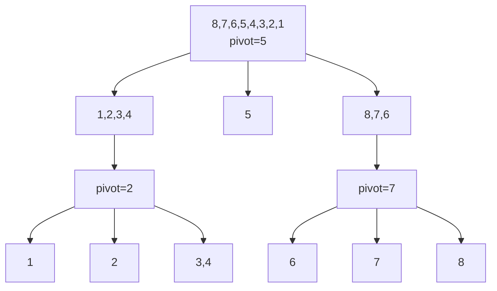

**代码实现**：
```java
public static void quickSort(int[] arr) {
    quickSort(arr, 0, arr.length - 1);
}

private static void quickSort(int[] arr, int low, int high) {
    if (low < high) {
        int pi = partition(arr, low, high);
        quickSort(arr, low, pi - 1);
        quickSort(arr, pi + 1, high);
    }
}

private static int partition(int[] arr, int low, int high) {
    int pivot = arr[high];  // 选最后一个元素为基准
    int i = low - 1;
    for (int j = low; j < high; j++) {
        if (arr[j] < pivot) {
            i++;
            int temp = arr[i];
            arr[i] = arr[j];
            arr[j] = temp;
        }
    }
    int temp = arr[i + 1];
    arr[i + 1] = arr[high];
    arr[high] = temp;
    return i + 1;
}
```

**复杂度**：
| 维度 | 值 |
|------|-----|
| 最好/平均时间 | O(n log n) |
| 最坏时间 | O(n²)（每次选到最大/最小基准，如已有序选末尾） |
| 空间 | O(log n)（递归栈） |
| 稳定 | ❌ 不稳定 |
| 原地 | ✅ 原地 |
| 特点 | 平均性能最好，是大多数语言标准库的默认排序（优化后） |

**快速排序优化**：
1. **基准选择优化**：三数取中法（选首/中/尾的中位数）、随机选择基准
2. **小数组优化**：数组长度 < 阈值（如 10）时改用插入排序
3. **三路快排**：将数组分为小于/等于/大于基准三部分，处理大量重复元素
4. **尾递归优化**：减少递归深度
5. **内省排序（Introsort）**：快排+堆排+插入排序混合，递归深度超阈值时转堆排，避免最坏 O(n²)

### 2.7 堆排序（Heap Sort）

**原理**：利用堆数据结构，先构建大顶堆，然后依次将堆顶（最大元素）与末尾交换，调整堆，重复直到有序。

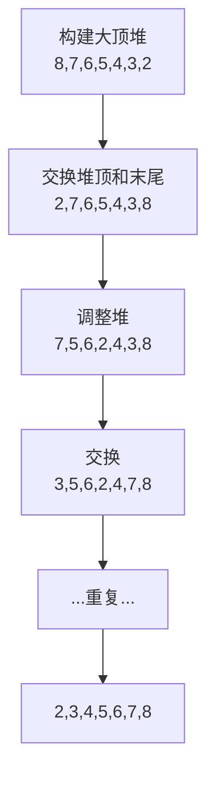

**代码实现**：
```java
public static void heapSort(int[] arr) {
    int n = arr.length;
    // 构建大顶堆
    for (int i = n / 2 - 1; i >= 0; i--) {
        heapify(arr, n, i);
    }
    // 依次取出堆顶
    for (int i = n - 1; i > 0; i--) {
        int temp = arr[0];
        arr[0] = arr[i];
        arr[i] = temp;
        heapify(arr, i, 0);
    }
}

private static void heapify(int[] arr, int n, int i) {
    int largest = i;
    int left = 2 * i + 1;
    int right = 2 * i + 2;
    if (left < n && arr[left] > arr[largest]) largest = left;
    if (right < n && arr[right] > arr[largest]) largest = right;
    if (largest != i) {
        int temp = arr[i];
        arr[i] = arr[largest];
        arr[largest] = temp;
        heapify(arr, n, largest);
    }
}
```

**复杂度**：
| 维度 | 值 |
|------|-----|
| 最好/最坏/平均时间 | O(n log n) |
| 空间 | O(1) |
| 稳定 | ❌ 不稳定 |
| 原地 | ✅ 原地 |
| 特点 | 性能稳定（无最坏情况），适合 Top K 问题、优先队列 |

### 2.8 计数排序（Counting Sort）

**原理**：非比较排序，统计每个元素出现的次数，然后按顺序输出。要求元素是整数且范围不大。

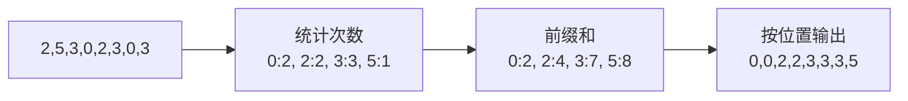

**代码实现**：
```java
public static void countingSort(int[] arr) {
    int max = Arrays.stream(arr).max().getAsInt();
    int min = Arrays.stream(arr).min().getAsInt();
    int range = max - min + 1;
    int[] count = new int[range];
    int[] output = new int[arr.length];
    
    for (int num : arr) count[num - min]++;
    for (int i = 1; i < range; i++) count[i] += count[i - 1];
    for (int i = arr.length - 1; i >= 0; i--) {
        output[count[arr[i] - min] - 1] = arr[i];
        count[arr[i] - min]--;
    }
    System.arraycopy(output, 0, arr, 0, arr.length);
}
```

**复杂度**：
| 维度 | 值 |
|------|-----|
| 时间 | O(n + k)，k 为数据范围 |
| 空间 | O(n + k) |
| 稳定 | ✅ 稳定（反向遍历保证） |
| 原地 | ❌ 非原地 |
| 限制 | 只能排序整数，且范围 k 不能太大（否则空间爆炸） |

### 2.9 桶排序（Bucket Sort）

**原理**：将元素分配到多个桶中，每个桶内单独排序（用其他排序算法），然后按桶顺序输出。

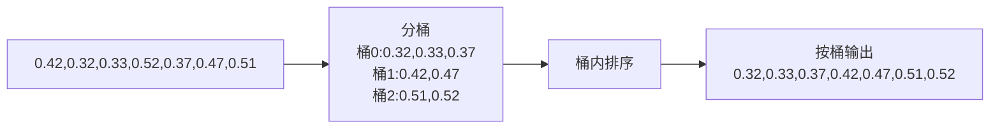

**代码实现**：
```java
public static void bucketSort(float[] arr) {
    int n = arr.length;
    List<Float>[] buckets = new ArrayList[n];
    for (int i = 0; i < n; i++) buckets[i] = new ArrayList<>();
    
    for (float num : arr) {
        int idx = (int) (num * n);
        buckets[idx].add(num);
    }
    for (List<Float> bucket : buckets) {
        Collections.sort(bucket);  // 桶内用其他排序
    }
    int idx = 0;
    for (List<Float> bucket : buckets) {
        for (float num : bucket) arr[idx++] = num;
    }
}
```

**复杂度**：
| 维度 | 值 |
|------|-----|
| 最好/平均时间 | O(n + k)，数据均匀分布时 |
| 最坏时间 | O(n²)（数据集中在一个桶） |
| 空间 | O(n + k) |
| 稳定 | ✅ 稳定 |
| 限制 | 适合数据分布均匀的场景，通常用于浮点数排序 |

### 2.10 基数排序（Radix Sort）

**原理**：非比较排序，按位数从低到高（或从高到低）逐位排序，每一位用计数排序（稳定排序）。

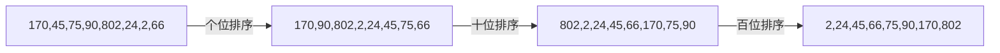

**代码实现**：
```java
public static void radixSort(int[] arr) {
    int max = Arrays.stream(arr).max().getAsInt();
    for (int exp = 1; max / exp > 0; exp *= 10) {
        countingSortByDigit(arr, exp);
    }
}

private static void countingSortByDigit(int[] arr, int exp) {
    int n = arr.length;
    int[] output = new int[n];
    int[] count = new int[10];
    for (int num : arr) count[(num / exp) % 10]++;
    for (int i = 1; i < 10; i++) count[i] += count[i - 1];
    for (int i = n - 1; i >= 0; i--) {
        output[count[(arr[i] / exp) % 10] - 1] = arr[i];
        count[(arr[i] / exp) % 10]--;
    }
    System.arraycopy(output, 0, arr, 0, n);
}
```

**复杂度**：
| 维度 | 值 |
|------|-----|
| 时间 | O(d × (n + k))，d 为位数，k 为基数（十进制为 10） |
| 空间 | O(n + k) |
| 稳定 | ✅ 稳定 |
| 限制 | 只能排序整数（或可转为整数的类型），每一位必须用稳定排序 |

---

## 三、全景对比

### 3.1 复杂度总表

| 算法 | 最好时间 | 平均时间 | 最坏时间 | 空间 | 稳定 | 原地 |
|------|---------|---------|---------|------|------|------|
| 冒泡排序 | O(n) | O(n²) | O(n²) | O(1) | ✅ | ✅ |
| 选择排序 | O(n²) | O(n²) | O(n²) | O(1) | ❌ | ✅ |
| 插入排序 | O(n) | O(n²) | O(n²) | O(1) | ✅ | ✅ |
| 希尔排序 | O(n log n) | O(n^1.3) | O(n²) | O(1) | ❌ | ✅ |
| 归并排序 | O(n log n) | O(n log n) | O(n log n) | O(n) | ✅ | ❌ |
| 快速排序 | O(n log n) | O(n log n) | O(n²) | O(log n) | ❌ | ✅ |
| 堆排序 | O(n log n) | O(n log n) | O(n log n) | O(1) | ❌ | ✅ |
| 计数排序 | O(n+k) | O(n+k) | O(n+k) | O(n+k) | ✅ | ❌ |
| 桶排序 | O(n+k) | O(n+k) | O(n²) | O(n+k) | ✅ | ❌ |
| 基数排序 | O(d(n+k)) | O(d(n+k)) | O(d(n+k)) | O(n+k) | ✅ | ❌ |

### 3.2 适用场景选择

| 场景 | 推荐算法 | 原因 |
|------|---------|------|
| **小数据（n < 50）** | 插入排序 | 常数因子小，代码简单，近乎有序时 O(n) |
| **通用大数据** | 快速排序（优化版） | 平均性能最好，缓存友好 |
| **要求稳定** | 归并排序 | 稳定且 O(n log n)，性能稳定 |
| **要求最坏 O(nlogn)** | 堆排序 / 归并排序 | 无最坏情况 |
| **整数且范围小** | 计数排序 | O(n+k) 线性时间 |
| **整数且位数少** | 基数排序 | O(d(n+k)) 线性时间 |
| **浮点数均匀分布** | 桶排序 | 平均 O(n+k) |
| **链表排序** | 归并排序 | 链表归并不需额外空间，且稳定 |
| **外部排序（磁盘）** | 多路归并排序 | 适合分批加载到内存 |
| **近乎有序数据** | 插入排序 | 自适应，接近 O(n) |
| **大量重复元素** | 三路快排 | 等于基准的部分无需再排序 |
| **Top K 问题** | 堆排序（小顶堆） | 维护大小为 K 的堆，O(n log K) |
| **Java 基本类型排序** | 双轴快排（DualPivotQuicksort） | JDK 内部实现 |
| **Java 对象排序** | TimSort（归并+插入） | 稳定，利用已有顺序 |

### 3.3 各语言标准库排序实现

| 语言 | 排序函数 | 实现算法 | 说明 |
|------|---------|---------|------|
| **Java** | `Arrays.sort(int[])` | 双轴快排（DualPivotQuicksort） | 基本类型，小数组用插入排序 |
| **Java** | `Arrays.sort(Object[])` | TimSort | 对象类型，稳定，归并+插入混合 |
| **Java** | `Collections.sort()` | TimSort | 基于 List，调用 Object[] 排序 |
| **Python** | `sorted()` / `list.sort()` | TimSort | 稳定，归并+插入混合 |
| **Go** | `sort.Ints()` / `sort.Slice()` | pdqsort（Pattern-Defeating Quicksort） | Go 1.19+，快排+堆排+插入混合 |
| **C++** | `std::sort()` | Introsort | 快排+堆排+插入混合，递归过深转堆排 |
| **C++** | `std::stable_sort()` | 归并排序 | 稳定版本 |
| **JavaScript** | `Array.prototype.sort()` | 因引擎而异 | V8：TimSort；旧版：快排+插入 |
| **Rust** | `slice::sort()` | pdqsort | 不稳定，快排+堆排+插入 |
| **Rust** | `slice::sort_stable()` | TimSort | 稳定版本 |
| **C#** | `Array.Sort()` | Introsort | .NET，快排+堆排+插入 |

---

## 四、常见问题与面试题

### 4.1 常见问题

| 问题 | 解答 |
|------|------|
| **为什么快排比归并快？** | 快排是原地排序，缓存命中率高（顺序访问）；归并需要额外数组和合并拷贝，常数因子大。虽然平均复杂度都是 O(nlogn)，但快排的常数因子更小 |
| **快排最坏情况是什么？如何避免？** | 每次选到最大/最小元素作为基准（如已有序数组选末尾为基准），退化为 O(n²)。避免：三数取中/随机选基准/三路快排/内省排序（递归过深转堆排） |
| **哪些排序是稳定的？** | 冒泡、插入、归并、计数、桶、基数。选择、希尔、快排、堆排不稳定 |
| **稳定性有什么用？** | 多关键字排序时（如先按年龄排，再按姓名排），稳定排序能保持第一次排序的结果。数据库 ORDER BY 多列排序依赖稳定性 |
| **比较排序的下界为什么是 O(nlogn)？** | 决策树模型：n 个元素有 n! 种排列，决策树至少有 n! 个叶子节点，树高至少 log₂(n!) ≈ nlogn |
| **什么时候用非比较排序？** | 数据是整数且范围不大（计数排序）、整数且位数少（基数排序）、浮点数均匀分布（桶排序）。非比较排序可以突破 O(nlogn) 下界 |
| **外部排序用什么算法？** | 多路归并排序。数据分批加载到内存排序，写入临时文件，最后多路归并所有有序文件 |
| **链表排序为什么用归并？** | 链表节点不连续，快排的随机访问效率低；归并排序对链表不需要额外空间（指针重组），且稳定 |
| **小数据为什么用插入排序？** | 插入排序的常数因子极小（简单的比较和移动），n < 约 50 时比 O(nlogn) 算法更快。这也是高级排序（快排/归并）在小数组时回退到插入排序的原因 |
| **堆排序为什么实际不如快排？** | 堆排序的访问模式是跳跃式的（父节点 i → 子节点 2i+1），缓存不友好；快排是顺序访问，缓存命中率高。虽然都是 O(nlogn)，但堆排的常数因子更大 |

### 4.2 经典面试题

1. **手写快速排序**（必考，注意基准选择和分区实现）
2. **手写归并排序**（注意合并过程和空间优化）
3. **手写堆排序**（注意建堆和调整堆）
4. **数组中第 K 大的元素**（快速选择算法，快排分区思想，O(n) 平均）
5. **合并 K 个有序链表**（最小堆，O(n log K)）
6. **出现频率最高的 K 个元素**（哈希计数+小顶堆）
7. **排序一个几乎有序的数组**（插入排序，接近 O(n)）
8. **排序大量重复元素的数组**（三路快排）
9. **10GB 数据内存只有 1GB 怎么排序**（外部排序，多路归并）
10. **判断链表是否有环并找环入口**（快慢指针，不是排序但常一起考）

---

## 五、关联笔记

### 算法与数据结构
- [[线性结构-数组链表栈队列]] · [[算法复杂度分析]] · [[树与二叉树核心_backup_skeleton]]
- [[图算法基础]] · [[动态规划入门]] · [[贪心算法]]
- [[哈希表与散列]] · [[堆与优先队列]]

### 计算机基础
- [[计算机组成原理]] · [[操作系统-进程与线程]]

### 导航
- [[MOC-计算机基础]] · [[MOC-算法与数据结构]] · [[MOC-综合导航]] · [[Home]]

> 🔍 **知识点深度解析**
>
> **作用**：排序算法解决的是「将无序数据按特定顺序重新排列」的基础问题——排序是计算机科学中最基础的操作之一，几乎所有数据处理（搜索、去重、统计、分析、压缩）都依赖有序数据。不同排序算法在时间复杂度、空间复杂度、稳定性、适用场景上各有取舍，理解它们的原理和差异，才能在实际工程中选择最合适的排序算法（而非无脑用快排），也是算法面试的核心考点。
>
> **底层原理**：排序算法分为「比较排序」和「非比较排序」两大类。比较排序通过比较元素大小决定顺序，其理论下界是 O(nlogn)（决策树模型证明：n 个元素有 n! 种排列，决策树至少 n! 个叶子，树高 ≥ log₂(n!) ≈ nlogn）。比较排序的核心思想主要有三种：①交换（冒泡/快排）——通过交换逆序对来排序；②插入（插入/希尔）——将元素插入到已排序部分的正确位置；③选择（选择/堆排）——每次选择最小/最大元素放到正确位置；④分治（归并/快排）——将大问题分解为小问题递归解决。非比较排序利用元素值或分布特征，可突破 O(nlogn) 下界：①计数排序——统计每个值出现次数，适用于整数且范围小；②基数排序——按位逐位排序（每一位用稳定的计数排序），适用于整数且位数少；③桶排序——将元素分到多个桶，桶内排序后按桶输出，适用于数据分布均匀的场景。稳定性的本质是「相等元素的相对顺序是否保持」——如果排序过程中相等元素可能被交换（如选择排序的跨距离交换、快排的分区交换），就是不稳定的；如果只交换相邻逆序对（冒泡/插入）或按顺序合并（归并），就是稳定的。原地排序的本质是「是否需要 O(n) 额外空间」——归并需要额外数组合并，计数/桶/基数需要额外计数/桶空间，都是非原地；冒泡/选择/插入/快排/堆排在原数组上操作，是原地。
>
> **用法要点**：① 十大算法原理：冒泡（相邻比较交换）、选择（选最小放前面）、插入（插入到已排序部分）、希尔（增量分组插入）、归并（分治+合并）、快排（分治+分区）、堆排（大顶堆+交换）、计数（统计次数）、桶（分桶+桶内排序）、基数（逐位计数排序） ② 复杂度记忆：O(n²) 简单排序（冒泡/选择/插入）、O(nlogn) 高效排序（归并/快排/堆排）、O(n+k) 线性排序（计数/桶/基数） ③ 稳定性记忆：稳定=冒泡/插入/归并/计数/桶/基数；不稳定=选择/希尔/快排/堆排 ④ 原地记忆：原地=冒泡/选择/插入/希尔/快排/堆排；非原地=归并/计数/桶/基数 ⑤ 场景选择：小数据→插入排序；通用大数据→优化快排；要求稳定→归并/TimSort；要求最坏O(nlogn)→堆排/归并；整数范围小→计数排序；整数位数少→基数排序；浮点数均匀→桶排序；链表→归并；外部排序→多路归并；Top K→小顶堆 ⑥ 快排优化：三数取中/随机基准、小数组转插入、三路快排（重复元素）、内省排序（递归过深转堆排） ⑦ 标准库实现：Java基本类型=双轴快排，Java对象/Python=TimSort，C++=Introsort，Go/Rust=pdqsort ⑧ 面试必考：手写快排/归并/堆排、第K大（快速选择）、合并K个有序链表（堆）、外部排序（多路归并）、比较排序下界证明。

> 💡 **深度讲解**：排序算法最核心的智慧是「没有最好的排序算法，只有最合适的排序算法」——很多人以为快排是最快的，所以处处用快排，但实际上不同场景下最优算法完全不同：小数据（n<50）时插入排序比快排快（常数因子小），近乎有序的数据插入排序接近 O(n)，要求稳定的场景必须用归并/TimSort，整数范围小的场景计数排序是 O(n) 线性时间，链表排序归并比快排更适合。理解了「场景决定算法」，你就从「会写排序算法」升级到「会选排序算法」。「比较排序的 O(nlogn) 下界」是一个深刻的理论结果——它告诉我们，基于比较的排序算法不可能比 O(nlogn) 更快（最坏情况下），这不是因为我们不够聪明，而是信息论的本质限制：n 个元素有 n! 种可能的排列，每次比较只能排除一半的可能性，所以至少需要 log₂(n!) ≈ nlogn 次比较。但这个下界只适用于「比较排序」——如果我们能利用数据的额外信息（如整数值、分布特征），就能突破这个下界，这就是计数/桶/基数排序的意义。这告诉我们一个通用的算法设计原则：「利用问题的特殊性质，可以突破通用算法的理论下界」。「TimSort 是工业界排序算法的巅峰」——Java 对象排序和 Python 的默认排序都用 TimSort，它是归并排序和插入排序的混合算法，核心智慧是「利用数据中已有的有序段（run）」——真实世界的数据往往不是完全随机的，而是有部分有序的（如时间序列数据、日志数据），TimSort 先扫描数组找到已有的有序段，然后用归并合并这些有序段，小数组用插入排序。这种「自适应」的设计让 TimSort 在真实数据上的性能往往优于纯快排，而且是稳定的。这也是为什么工程界的标准库排序都不是单一算法，而是多种算法的混合（快排+插入+堆排的 Introsort，归并+插入的 TimSort，快排+堆排+插入的 pdqsort）——「没有银弹，组合最优」。

> 📝 **精简总结**：十大排序：冒泡/选择/插入（O(n²)简单）、希尔（O(n^1.3)改进插入）、归并/快排/堆排（O(nlogn)高效）、计数/桶/基数（O(n+k)线性非比较）。稳定：冒泡/插入/归并/计数/桶/基数；不稳定：选择/希尔/快排/堆排。原地：冒泡/选择/插入/希尔/快排/堆排；非原地：归并/计数/桶/基数。场景：小数据→插入，通用→快排，稳定→归并/TimSort，整数→计数/基数，链表→归并，外部→多路归并，TopK→堆。标准库：Java基本=双轴快排，Java对象/Python=TimSort，C++=Introsort，Go/Rust=pdqsort。面试：手写快排/归并/堆排，第K大（快速选择），比较排序下界O(nlogn)。

> **学习路径建议**：先学习 [[线性结构-数组链表栈队列]] 掌握数组基础 → 学习 [[算法复杂度分析]] 理解时间/空间复杂度 → 学习本文档掌握十大排序算法 → 实践：手写每种排序算法，用测试用例验证 → 学习 [[堆与优先队列]] 深入堆排序 → 学习 [[分治算法]] 深入快排/归并 → 学习 [[贪心算法]] 和 [[动态规划入门]] 扩展算法思维 → 刷 LeetCode 排序相关题目（Top K、合并区间、排序链表等）→ 阅读《算法导论》第2章和第7章深入理解。

---

> **排序算法的本质是「秩序的建立」——从无序到有序，是人类认识世界的基本方式。排序算法不仅仅是面试题，更是算法思维的训练基地：冒泡/选择/插入教会我们「暴力枚举」的基础思维，归并/快排教会我们「分治」的核心思想，堆排教会我们「数据结构优化算法」的思路，计数/桶/基数教会我们「利用问题特殊性突破通用下界」的智慧。当你深入理解了排序算法，你学到的不仅仅是「怎么排序」，更是「如何分析问题、如何选择策略、如何权衡取舍」——这才是算法学习的终极意义。在实际工程中，你几乎不需要自己写排序算法（标准库已经提供了最优实现），但你需要理解它们的原理和差异，才能在遇到性能问题时知道「为什么慢」「怎么优化」，才能在面试和架构设计中展现深度。排序算法是算法世界的「入门第一课」，也是「永远的经典」。**
