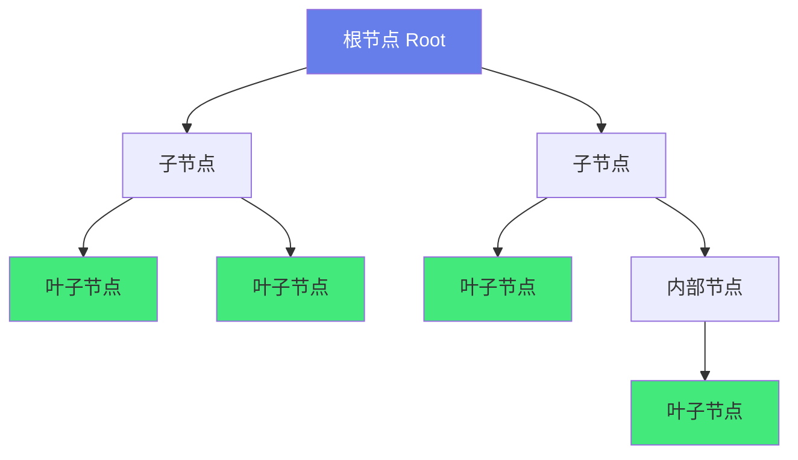
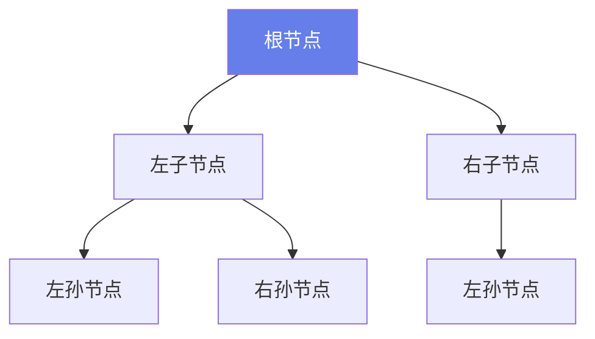
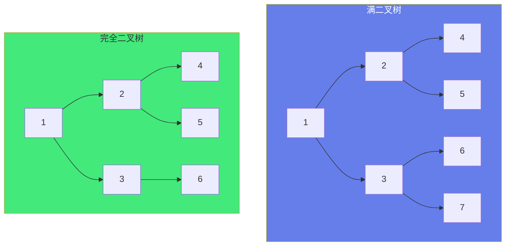
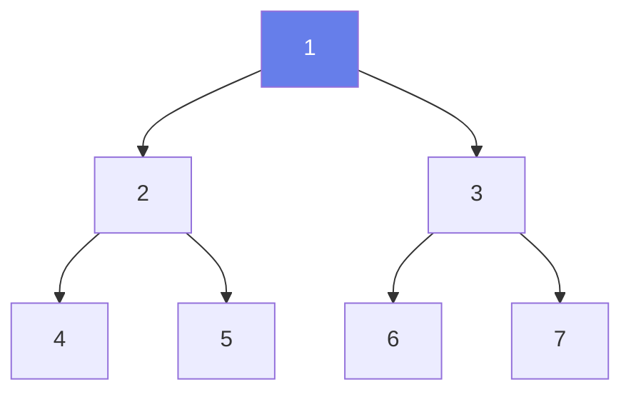
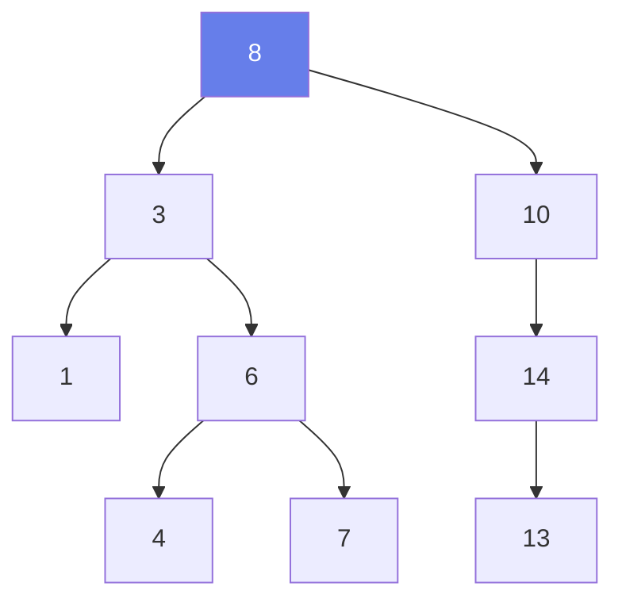
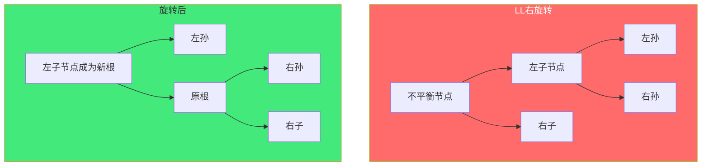
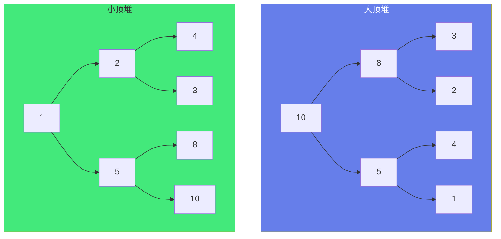
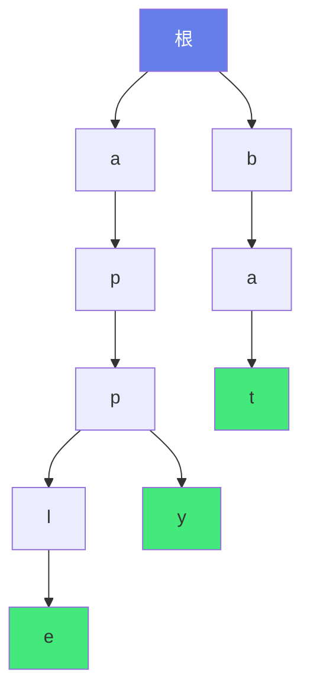

# 🌳 树与二叉树核心

> **文档说明**：系统讲解树与二叉树的完整知识体系，涵盖树的基本概念（节点/边/度/深度/高度/层）、二叉树性质与存储、四种遍历（前序/中序/后序/层序）的递归与迭代实现、二叉搜索树（BST）的查找/插入/删除、平衡二叉树（AVL）的旋转、红黑树原理、堆与优先队列、Trie 字典树、并查集、常见算法题（最近公共祖先/路径和/翻转/序列化）、复杂度分析与应用场景。
>
> **适用人群**：计算机专业学生、算法学习者、后端开发者、面试准备者
>
> **前置知识**：[[线性结构-数组链表栈队列]] · [[递归与分治]]

---

## 一、概述

### 1.1 什么是树

树（Tree）是一种**非线性**数据结构，由 n（n≥0）个有限节点组成的具有层次关系的集合。当 n=0 时称为空树。



**树的特点**：
- 每个节点有零个或多个子节点
- 没有父节点的节点称为**根节点**（Root）
- 每个非根节点有且只有一个父节点
- 除了根节点外，每个子节点可以分为多个不相交的子树
- 树中没有环（无回路）

### 1.2 基本术语

| 术语 | 说明 | 示例（上图） |
|------|------|-------------|
| **节点（Node）** | 树的基本元素，包含数据和指向子节点的指针 | A、B、C、D... |
| **根节点（Root）** | 没有父节点的节点，树的入口 | A |
| **叶子节点（Leaf）** | 没有子节点的节点（度为0） | D、E、F、H |
| **内部节点（Internal）** | 有子节点的非根节点 | B、C、G |
| **父节点（Parent）** | 有子节点的节点 | A 是 B、C 的父节点 |
| **子节点（Child）** | 父节点的后继 | B、C 是 A 的子节点 |
| **兄弟节点（Sibling）** | 具有相同父节点的节点 | B 和 C 是兄弟 |
| **度（Degree）** | 节点拥有的子节点数 | A 的度为 2，B 的度为 2 |
| **树的度** | 树中所有节点的度的最大值 | 上图树的度为 2 |
| **深度（Depth）** | 从根到该节点的路径长度（边数） | A 深度 0，B 深度 1，D 深度 2 |
| **高度（Height）** | 从该节点到最远叶子的路径长度 | D 高度 0，B 高度 1，A 高度 2 |
| **层（Level）** | 根在第 0 层（或第 1 层），子节点层号+1 | A 层 0，B/C 层 1，D/E/F/G 层 2 |
| **子树（Subtree）** | 某个节点及其所有后代构成的树 | B 及其后代构成一棵子树 |
| **路径（Path）** | 从一个节点到另一个节点的节点序列 | A→B→D 是一条路径 |

### 1.3 树的分类

| 类型 | 说明 | 特点 |
|------|------|------|
| **二叉树（Binary Tree）** | 每个节点最多有两个子节点（左子、右子） | 最常用，结构简单 |
| **满二叉树** | 所有层都满，叶子节点都在最后一层 | 节点数 = 2^h - 1 |
| **完全二叉树** | 除最后一层外其他层满，最后一层从左到右连续 | 堆的基础，可用数组存储 |
| **二叉搜索树（BST）** | 左子树 < 根 < 右子树 | 查找/插入/删除 O(log n) |
| **平衡二叉树（AVL）** | BST + 左右子树高度差 ≤ 1 | 严格平衡，旋转维护 |
| **红黑树** | BST + 颜色约束，近似平衡 | 插入删除快，广泛应用 |
| **堆（Heap）** | 完全二叉树，父节点 ≥（或 ≤）子节点 | 优先队列，TopK 问题 |
| **Trie（字典树）** | 多叉树，路径表示字符串 | 字符串检索、前缀匹配 |
| **B 树 / B+ 树** | 多路平衡查找树 | 数据库索引、文件系统 |
| **并查集** | 森林，支持合并和查找 | 连通性问题、Kruskal 算法 |

### 1.4 树的应用场景

| 应用 | 数据结构 | 说明 |
|------|---------|------|
| **文件系统** | 树 | 目录结构是树形 |
| **数据库索引** | B+ 树 | MySQL InnoDB 索引 |
| **路由表** | Trie 树 | 最长前缀匹配 |
| **优先队列** | 堆 | 任务调度、TopK |
| **编译器语法分析** | 语法树（AST） | 表达式解析 |
| **XML/JSON 解析** | 树 | DOM 树 |
| **机器学习** | 决策树 | 分类回归 |
| **游戏 AI** | 博弈树 | Minimax 算法 |
| **域名解析** | 树 | DNS 层级结构 |
| **组织架构** | 树 | 公司部门层级 |

---

## 二、二叉树

### 2.1 二叉树定义

二叉树是每个节点最多有两个子树的树结构，两个子树分别称为**左子树**和**右子树**，次序不能颠倒。



**二叉树的五种基本形态**：
1. 空二叉树
2. 只有一个根节点
3. 只有左子树
4. 只有右子树
5. 左右子树都有

### 2.2 二叉树性质

| 性质 | 说明 |
|------|------|
| **性质 1** | 二叉树第 i 层最多有 2^(i-1) 个节点（i≥1，根在第1层） |
| **性质 2** | 深度为 k 的二叉树最多有 2^k - 1 个节点 |
| **性质 3** | 对于任意二叉树，叶子节点数 n0 = 度为2的节点数 n2 + 1 |
| **性质 4** | 具有 n 个节点的完全二叉树的深度为 ⌊log2 n⌋ + 1 |
| **性质 5** | 完全二叉树中，节点 i 的左子节点为 2i，右子节点为 2i+1，父节点为 ⌊i/2⌋（数组下标从1开始） |

**性质 3 推导**：
- 总节点数 n = n0 + n1 + n2（n0叶子，n1度1，n2度2）
- 总边数 = n - 1 = n1 + 2*n2（每个度1节点贡献1边，度2贡献2边）
- 联立：n0 + n1 + n2 - 1 = n1 + 2*n2 → n0 = n2 + 1

### 2.3 满二叉树与完全二叉树

| 类型 | 定义 | 特点 |
|------|------|------|
| **满二叉树（Full）** | 深度为 k 且有 2^k - 1 个节点的二叉树 | 所有层都满，所有叶子在最后一层，所有内部节点度为2 |
| **完全二叉树（Complete）** | 深度为 k，前 k-1 层满，第 k 层节点从左到右连续 | 可以不满，但缺失的只能是最右边的节点；堆就是完全二叉树 |



### 2.4 二叉树的存储

**链式存储**（最常用）：
```python
class TreeNode:
    def __init__(self, val=0, left=None, right=None):
        self.val = val
        self.left = left    # 左子节点
        self.right = right  # 右子节点
```

**顺序存储（数组）**：适用于完全二叉树
```text
数组下标： 0  1  2  3  4  5  6
节点值：   1  2  3  4  5  6  7

下标从 0 开始：
  节点 i 的左子节点：2*i + 1
  节点 i 的右子节点：2*i + 2
  节点 i 的父节点：(i-1) // 2

下标从 1 开始：
  节点 i 的左子节点：2*i
  节点 i 的右子节点：2*i + 1
  节点 i 的父节点：i // 2
```

> 普通二叉树用数组存储会浪费空间（空节点也要占位），所以一般用链式存储。完全二叉树（如堆）用数组存储高效。

---

## 三、二叉树遍历

遍历是按某种规则访问二叉树的所有节点，每个节点恰好访问一次。

### 3.1 四种遍历方式

| 遍历方式 | 顺序 | 说明 |
|---------|------|------|
| **前序遍历（Pre-order）** | 根 → 左 → 右 | 先访问根，再前序遍历左子树，再前序遍历右子树 |
| **中序遍历（In-order）** | 左 → 根 → 右 | 先中序遍历左子树，再访问根，再中序遍历右子树 |
| **后序遍历（Post-order）** | 左 → 右 → 根 | 先后序遍历左子树，再后序遍历右子树，再访问根 |
| **层序遍历（Level-order）** | 按层从上到下，每层从左到右 | 广度优先（BFS），用队列实现 |



以上图二叉树为例：
- **前序**：1 → 2 → 4 → 5 → 3 → 6 → 7
- **中序**：4 → 2 → 5 → 1 → 6 → 3 → 7
- **后序**：4 → 5 → 2 → 6 → 7 → 3 → 1
- **层序**：1 → 2 → 3 → 4 → 5 → 6 → 7

### 3.2 递归实现

```python
# ===== 前序遍历（根左右）=====
def preorder(root):
    if not root:
        return
    print(root.val)        # 访问根
    preorder(root.left)    # 遍历左子树
    preorder(root.right)   # 遍历右子树

# ===== 中序遍历（左根右）=====
def inorder(root):
    if not root:
        return
    inorder(root.left)     # 遍历左子树
    print(root.val)        # 访问根
    inorder(root.right)    # 遍历右子树

# ===== 后序遍历（左右根）=====
def postorder(root):
    if not root:
        return
    postorder(root.left)   # 遍历左子树
    postorder(root.right)  # 遍历右子树
    print(root.val)        # 访问根
```

### 3.3 迭代实现（用栈）

```python
# ===== 前序遍历（迭代）=====
def preorder_iter(root):
    if not root:
        return []
    result = []
    stack = [root]
    while stack:
        node = stack.pop()
        result.append(node.val)
        # 右子节点先入栈（栈后进先出，保证左先处理）
        if node.right:
            stack.append(node.right)
        if node.left:
            stack.append(node.left)
    return result

# ===== 中序遍历（迭代）=====
def inorder_iter(root):
    if not root:
        return []
    result = []
    stack = []
    curr = root
    while curr or stack:
        # 一直往左走，把所有左节点入栈
        while curr:
            stack.append(curr)
            curr = curr.left
        curr = stack.pop()
        result.append(curr.val)  # 访问根
        curr = curr.right         # 处理右子树
    return result

# ===== 后序遍历（迭代）=====
def postorder_iter(root):
    if not root:
        return []
    result = []
    stack = [root]
    while stack:
        node = stack.pop()
        result.append(node.val)
        # 左先入栈，右后入栈 → 弹出顺序右→左 → 结果根右左 → 反转得左右根
        if node.left:
            stack.append(node.left)
        if node.right:
            stack.append(node.right)
    return result[::-1]  # 反转
```

### 3.4 层序遍历（BFS，用队列）

```python
from collections import deque

def levelorder(root):
    if not root:
        return []
    result = []
    queue = deque([root])
    while queue:
        level_size = len(queue)
        current_level = []
        for _ in range(level_size):
            node = queue.popleft()
            current_level.append(node.val)
            if node.left:
                queue.append(node.left)
            if node.right:
                queue.append(node.right)
        result.append(current_level)
    return result
```

### 3.5 遍历的应用

| 遍历方式 | 应用场景 |
|---------|---------|
| **前序** | 复制二叉树、前缀表达式、序列化二叉树 |
| **中序** | BST 中序遍历得到有序序列、中缀表达式 |
| **后序** | 删除二叉树、后缀表达式、计算目录大小 |
| **层序** | 按层打印、树的宽度、最短路径、BFS 相关 |

---

## 四、二叉搜索树（BST）

### 4.1 定义与性质

二叉搜索树（Binary Search Tree，BST）是一种特殊的二叉树，满足：
- 左子树所有节点的值 < 根节点的值
- 右子树所有节点的值 > 根节点的值
- 左右子树也都是 BST



**BST 的性质**：
- 中序遍历 BST 得到**升序序列**：1 → 3 → 4 → 6 → 7 → 8 → 10 → 13 → 14
- 查找/插入/删除平均时间复杂度 O(log n)，最坏 O(n)（退化成链表）

### 4.2 查找

```python
def search_bst(root, target):
    curr = root
    while curr:
        if target == curr.val:
            return curr
        elif target < curr.val:
            curr = curr.left   # 小于根，去左子树
        else:
            curr = curr.right  # 大于根，去右子树
    return None  # 未找到
```

### 4.3 插入

```python
def insert_bst(root, val):
    if not root:
        return TreeNode(val)
    curr = root
    while True:
        if val < curr.val:
            if not curr.left:
                curr.left = TreeNode(val)
                break
            curr = curr.left
        else:  # val > curr.val（假设不重复）
            if not curr.right:
                curr.right = TreeNode(val)
                break
            curr = curr.right
    return root
```

### 4.4 删除

删除 BST 节点分三种情况：
1. **叶子节点**：直接删除
2. **只有一个子节点**：用子节点替代
3. **有两个子节点**：用右子树的最小值（或左子树的最大值）替代，再删除该替代节点

```python
def delete_bst(root, key):
    if not root:
        return None
    
    if key < root.val:
        root.left = delete_bst(root.left, key)
    elif key > root.val:
        root.right = delete_bst(root.right, key)
    else:
        # 找到要删除的节点
        if not root.left:   # 只有右子节点或叶子
            return root.right
        if not root.right:  # 只有左子节点
            return root.left
        # 有两个子节点：找右子树最小值
        successor = root.right
        while successor.left:
            successor = successor.left
        root.val = successor.val
        root.right = delete_bst(root.right, successor.val)
    return root
```

### 4.5 BST 的问题

BST 在最坏情况下会退化成链表（如按顺序插入 1,2,3,4,5），导致查找/插入/删除变成 O(n)。

**解决方案**：平衡二叉树（AVL、红黑树），通过旋转保持树的平衡。

---

## 五、平衡二叉树

### 5.1 AVL 树

AVL 树是严格平衡的 BST，每个节点的左右子树高度差（平衡因子）不超过 1。

**平衡因子** = 左子树高度 - 右子树高度，取值 {-1, 0, 1}

**四种旋转**：

| 情况 | 说明 | 旋转方式 |
|------|------|---------|
| **LL** | 左子树的左子节点导致不平衡 | 右旋转 |
| **RR** | 右子树的右子节点导致不平衡 | 左旋转 |
| **LR** | 左子树的右子节点导致不平衡 | 先左旋再右旋 |
| **RL** | 右子树的左子节点导致不平衡 | 先右旋再左旋 |



**AVL 的优缺点**：
- 优点：严格平衡，查找效率高 O(log n)
- 缺点：插入删除需要频繁旋转，维护成本高

### 5.2 红黑树

红黑树是一种**近似平衡**的 BST，通过颜色约束保证最长路径不超过最短路径的 2 倍。

**红黑树的五条性质**：
1. 每个节点是红色或黑色
2. 根节点是黑色
3. 每个叶子节点（NIL 空节点）是黑色
4. 红色节点的两个子节点都是黑色（不能有连续红色）
5. 从任一节点到其每个叶子的所有路径包含相同数目的黑色节点

**红黑树 vs AVL**：
| 维度 | AVL | 红黑树 |
|------|-----|--------|
| 平衡严格度 | 严格（高度差≤1） | 近似（最长≤2倍最短） |
| 查找 | 更快 | 稍慢 |
| 插入删除 | 旋转多，开销大 | 旋转少，开销小 |
| 应用场景 | 读多写少 | 读多写也多（最常用） |
| 实际应用 | 较少 | Java TreeMap、C++ map、Linux 进程调度、epoll |

> 红黑树是工业界最常用的平衡 BST，因为插入删除的维护成本比 AVL 低，而查找效率损失很小。

---

## 六、堆与优先队列

### 6.1 堆的定义

堆（Heap）是一种**完全二叉树**，满足：
- **大顶堆（Max Heap）**：每个节点的值 ≥ 其子节点的值，根是最大值
- **小顶堆（Min Heap）**：每个节点的值 ≤ 其子节点的值，根是最小值



### 6.2 堆的存储与操作

堆用**数组**存储（完全二叉树的性质）：
```text
大顶堆数组：[10, 8, 5, 3, 2, 4, 1]
下标：       0   1  2  3  4  5  6

节点 i 的左子节点：2*i + 1
节点 i 的右子节点：2*i + 2
节点 i 的父节点：(i-1) // 2
```

**核心操作**：

| 操作 | 说明 | 时间复杂度 |
|------|------|-----------|
| **建堆** | 从最后一个非叶子节点开始下沉调整 | O(n) |
| **插入** | 加到末尾，然后上浮调整 | O(log n) |
| **删除堆顶** | 用末尾元素替换堆顶，然后下沉调整 | O(log n) |
| **获取堆顶** | 直接返回数组第一个元素 | O(1) |

```python
class MinHeap:
    def __init__(self):
        self.heap = []
    
    def push(self, val):
        """插入元素：加到末尾，上浮"""
        self.heap.append(val)
        self._sift_up(len(self.heap) - 1)
    
    def pop(self):
        """删除堆顶：用末尾替换，下沉"""
        if not self.heap:
            return None
        min_val = self.heap[0]
        last = self.heap.pop()
        if self.heap:
            self.heap[0] = last
            self._sift_down(0)
        return min_val
    
    def _sift_up(self, i):
        """上浮：与父节点比较，比父小就交换"""
        while i > 0:
            parent = (i - 1) // 2
            if self.heap[i] < self.heap[parent]:
                self.heap[i], self.heap[parent] = self.heap[parent], self.heap[i]
                i = parent
            else:
                break
    
    def _sift_down(self, i):
        """下沉：与子节点比较，比最小子大就交换"""
        n = len(self.heap)
        while True:
            smallest = i
            left = 2 * i + 1
            right = 2 * i + 2
            if left < n and self.heap[left] < self.heap[smallest]:
                smallest = left
            if right < n and self.heap[right] < self.heap[smallest]:
                smallest = right
            if smallest != i:
                self.heap[i], self.heap[smallest] = self.heap[smallest], self.heap[i]
                i = smallest
            else:
                break
```

### 6.3 堆的应用

| 应用 | 说明 |
|------|------|
| **优先队列** | 按优先级出队，而不是按入队顺序 |
| **TopK 问题** | 找前 K 大/小的元素（用大小为 K 的堆） |
| **堆排序** | 建堆 + 依次删除堆顶，O(n log n) |
| **合并 K 个有序链表** | 用小顶堆维护当前最小元素 |
| **任务调度** | 按优先级调度任务 |
| **Dijkstra 算法** | 用优先队列找最短路径 |
| **哈夫曼编码** | 用小顶堆构建哈夫曼树 |

**TopK 示例**：
```python
import heapq

def top_k_largest(nums, k):
    """找前 K 大的元素：用大小为 K 的小顶堆"""
    min_heap = []
    for num in nums:
        if len(min_heap) < k:
            heapq.heappush(min_heap, num)
        elif num > min_heap[0]:
            heapq.heapreplace(min_heap, num)
    return min_heap  # 堆中就是前 K 大的元素
```

---

## 七、其他树结构

### 7.1 Trie（字典树/前缀树）

Trie 是一种多叉树，用于高效存储和检索字符串集合。

**特点**：
- 根节点不包含字符，每个节点代表一个字符
- 从根到某节点的路径 = 一个字符串
- 公共前缀共享节点，节省空间
- 查找/插入时间 O(L)，L 为字符串长度



上图存储了：apple、apply、bat

**Trie 应用**：自动补全、拼写检查、前缀搜索、IP 路由最长前缀匹配、词频统计。

### 7.2 并查集（Union-Find）

并查集是一种树型数据结构（森林），用于处理**不相交集合**的合并和查询问题。

**核心操作**：
- `find(x)`：查找 x 所在集合的根（代表元素）
- `union(x, y)`：合并 x 和 y 所在的集合

**优化**：
- **路径压缩**：find 时把路径上的节点直接指向根
- **按秩合并**：把小树合并到大树下，保持树的平衡

```python
class UnionFind:
    def __init__(self, n):
        self.parent = list(range(n))  # 每个元素的父节点
        self.rank = [0] * n            # 树的高度（秩）
        self.count = n                 # 集合数量
    
    def find(self, x):
        """查找根 + 路径压缩"""
        if self.parent[x] != x:
            self.parent[x] = self.find(self.parent[x])  # 递归路径压缩
        return self.parent[x]
    
    def union(self, x, y):
        """按秩合并"""
        root_x = self.find(x)
        root_y = self.find(y)
        if root_x == root_y:
            return False  # 已在同一集合
        # 小树合并到大树
        if self.rank[root_x] < self.rank[root_y]:
            self.parent[root_x] = root_y
        elif self.rank[root_x] > self.rank[root_y]:
            self.parent[root_y] = root_x
        else:
            self.parent[root_y] = root_x
            self.rank[root_x] += 1
        self.count -= 1
        return True
    
    def connected(self, x, y):
        return self.find(x) == self.find(y)
```

**并查集应用**：连通分量、朋友圈、岛屿数量、Kruskal 最小生成树、检测图中是否有环。

### 7.3 B 树 / B+ 树

| 类型 | 说明 | 应用 |
|------|------|------|
| **B 树** | 多路平衡查找树，每个节点可存多个关键字和子节点 | 文件系统 |
| **B+ 树** | B 树的变种，数据只存在叶子节点，叶子节点用链表连接 | 数据库索引（MySQL InnoDB） |

**B+ 树的优势**：
- 非叶子节点只存索引，不存数据，能存更多关键字 → 树更矮 → IO 更少
- 叶子节点用链表连接，范围查询高效
- 所有查询都走到叶子节点，查询时间稳定

---

## 八、常见算法题

### 8.1 二叉树的最大深度

```python
def max_depth(root):
    if not root:
        return 0
    return 1 + max(max_depth(root.left), max_depth(root.right))
```

### 8.2 翻转二叉树

```python
def invert_tree(root):
    if not root:
        return None
    root.left, root.right = root.right, root.left  # 交换左右子树
    invert_tree(root.left)
    invert_tree(root.right)
    return root
```

### 8.3 最近公共祖先（LCA）

```python
def lowest_common_ancestor(root, p, q):
    if not root or root == p or root == q:
        return root
    left = lowest_common_ancestor(root.left, p, q)
    right = lowest_common_ancestor(root.right, p, q)
    if left and right:
        return root  # p 和 q 分别在左右子树，root 就是 LCA
    return left if left else right  # 都在一侧，返回非空的那个
```

### 8.4 路径总和

```python
def has_path_sum(root, target_sum):
    if not root:
        return False
    if not root.left and not root.right:  # 叶子节点
        return root.val == target_sum
    return (has_path_sum(root.left, target_sum - root.val) or
            has_path_sum(root.right, target_sum - root.val))
```

### 8.5 二叉树的序列化与反序列化

```python
class Codec:
    def serialize(self, root):
        """前序遍历序列化，空节点用 None 标记"""
        if not root:
            return "None"
        return f"{root.val},{self.serialize(root.left)},{self.serialize(root.right)}"
    
    def deserialize(self, data):
        vals = data.split(",")
        self.index = 0
        
        def build():
            if vals[self.index] == "None":
                self.index += 1
                return None
            node = TreeNode(int(vals[self.index]))
            self.index += 1
            node.left = build()
            node.right = build()
            return node
        
        return build()
```

### 8.6 判断 BST

```python
def is_valid_bst(root):
    def helper(node, min_val, max_val):
        if not node:
            return True
        if not (min_val < node.val < max_val):
            return False
        return (helper(node.left, min_val, node.val) and
                helper(node.right, node.val, max_val))
    
    return helper(root, float('-inf'), float('inf'))
```

---

## 九、复杂度总结

| 数据结构 | 查找 | 插入 | 删除 | 空间 |
|---------|------|------|------|------|
| **二叉树（一般）** | O(n) | O(n) | O(n) | O(n) |
| **BST（平均）** | O(log n) | O(log n) | O(log n) | O(n) |
| **BST（最坏）** | O(n) | O(n) | O(n) | O(n) |
| **AVL 树** | O(log n) | O(log n) | O(log n) | O(n) |
| **红黑树** | O(log n) | O(log n) | O(log n) | O(n) |
| **堆** | O(1)（堆顶） | O(log n) | O(log n)（堆顶） | O(n) |
| **Trie** | O(L) | O(L) | O(L) | O(n*L) |
| **并查集** | O(α(n)) | O(α(n)) | — | O(n) |
| **B+ 树** | O(log n) | O(log n) | O(log n) | O(n) |

> L = 字符串长度，α(n) = 反阿克曼函数（近似常数）

---

## 十、关联笔记

### 数据结构
- [[线性结构-数组链表栈队列]] · [[递归与分治]] · [[图论基础与遍历]]
- [[哈希表与散列]]

### 算法
- [[排序算法完整指南]] · [[动态规划与贪心]] · [[算法复杂度分析]]
- [[高频算法题分类]]

### 应用
- [[MySQL索引原理]] · [[Redis数据结构]] · [[Linux内核基础概念]]

### 导航
- [[MOC-计算机基础]] · [[MOC-算法与数据结构]] · [[MOC-综合导航]] · [[Home]]

> 🔍 **知识点深度解析**
>
> **作用**：树是一种非线性层次数据结构，解决的是「高效组织层次化数据」问题——相比线性结构（数组/链表），树能同时支持高效的查找、插入和删除（O(log n)），并且天然适合表达层次关系（文件系统、组织架构、语法结构）。二叉树是最基础的树结构，BST/AVL/红黑树/堆/Trie 等都是在二叉树基础上的变种和扩展，广泛应用于数据库索引、优先队列、字符串检索、编译器等核心系统。
>
> **底层原理**：树的核心是「递归定义」——一棵树由根节点和若干棵子树组成，子树本身也是树。这种递归结构使得树的大部分操作（遍历、查找、插入、删除）都可以用递归简洁实现。二叉树每个节点最多两个子节点，结构简单且性质丰富（第 i 层最多 2^(i-1) 节点、n0=n2+1 等）。BST 通过「左<根<右」的约束使得中序遍历有序，查找类似二分查找。但 BST 可能退化成链表（O(n)），所以需要平衡树：AVL 通过严格的高度差约束（≤1）和四种旋转（LL/RR/LR/RL）保持平衡；红黑树通过颜色约束（五条性质）保持近似平衡（最长路径≤2倍最短），插入删除旋转更少，工业界更常用。堆是完全二叉树用数组存储，通过「父≥子」（大顶堆）或「父≤子」（小顶堆）的约束，使得堆顶是最大/最小值，插入删除用上浮/下沉调整 O(log n)，是优先队列和 TopK 的核心。Trie 用多叉树路径表示字符串，公共前缀共享节点，字符串检索 O(L)。并查集用森林表示不相交集合，通过路径压缩和按秩合并，find/union 近似 O(1)。
>
> **用法要点**：① 遍历是基础：前序（根左右）/中序（左根右）/后序（左右根）用递归或栈迭代，层序用队列 BFS ② BST 中序遍历得升序，查找/插入/删除平均 O(log n)，最坏 O(n) ③ 删除 BST 节点：叶子直接删，一个子节点用子替代，两个子节点用右子树最小值（或左子树最大值）替代 ④ 平衡树：AVL 严格平衡适合读多写少，红黑树近似平衡适合读写均衡（最常用） ⑤ 堆：大顶堆找最大，小顶堆找最小，TopK 用大小为 K 的反向堆（找前K大用小顶堆） ⑥ 堆用数组存储，节点 i 的左子 2i+1、右子 2i+2、父 (i-1)/2 ⑦ Trie 适合前缀搜索和自动补全，查找 O(L) ⑧ 并查集适合连通性问题，路径压缩+按秩合并后近似 O(1) ⑨ 常见算法题：最大深度（递归）、翻转（交换左右）、LCA（递归分治）、路径和（递归减目标）、序列化（前序+None标记）、判断BST（递归传上下界） ⑩ 复杂度：平衡 BST/堆操作 O(log n)，Trie O(L)，并查集 O(α(n))。

> 💡 **深度讲解**：树结构最核心的思想是「分治」——把一个大问题分解成若干个相同结构的子问题。树的递归定义（根+子树）天然适合分治：处理一棵树 = 处理根 + 处理左子树 + 处理右子树。这就是为什么树的遍历、查找、插入、删除都可以用递归简洁实现。理解了这一点，你就能理解为什么树的题目大多可以用递归解决——因为树的结构本身就是递归的。另一个关键点是「平衡」：BST 的查找效率依赖于树的高度，平衡的树高度是 O(log n)，不平衡的树（退化成链表）高度是 O(n)，效率天差地别。所以各种平衡树（AVL、红黑树）的核心目标就是「在插入删除后保持树的平衡」，通过旋转操作调整结构。AVL 追求严格平衡（高度差≤1），所以查找快但插入删除旋转多；红黑树追求近似平衡（最长路径≤2倍最短），插入删除旋转少，查找效率损失很小，所以工业界几乎都用红黑树（Java TreeMap、C++ map、Linux 调度）。堆是另一个巧妙的设计：它不要求完全有序，只要求「父节点比子节点大/小」，这种弱约束使得插入删除只需要 O(log n) 的上浮/下沉，而获取最大/最小值是 O(1)。这种「部分有序」的设计在优先队列和 TopK 中非常高效——不需要全部排序，只需要找到前 K 个。Trie 的智慧在于「共享前缀」：多个字符串如果有公共前缀，前缀部分只存一份，这在字符串集合大、公共前缀多时非常省空间，而且查找只跟字符串长度有关，跟集合大小无关。并查集的精髓是「路径压缩」——find 时把路径上所有节点直接指向根，这样后续 find 就是 O(1)，加上按秩合并保持树矮，整体操作近似常数时间，是最高效的数据结构之一。

> 📝 **精简总结**：树=非线性层次结构，二叉树每个节点最多两子。遍历：前序（根左右）/中序（左根右）/后序（左右根）递归或栈，层序队列BFS。BST：左<根<右，中序有序，平均O(log n)最坏O(n)。平衡树：AVL严格平衡（高度差≤1，四种旋转），红黑树近似平衡（五条性质，工业界常用）。堆：完全二叉树+数组，大顶堆父≥子，小顶堆父≤子，插入删除上浮/下沉O(log n)，用于优先队列和TopK。Trie：多叉树路径存字符串，前缀共享，查找O(L)。并查集：森林+路径压缩+按秩合并，find/union近似O(1)。常见题：最大深度/翻转/LCA/路径和/序列化/判断BST。

> **学习路径建议**：先学习 [[线性结构-数组链表栈队列]] 掌握线性结构 → 学习 [[递归与分治]] 掌握递归思想 → 学习本文档掌握树与二叉树 → 学习 [[图论基础与遍历]] 掌握更复杂的非线性结构 → 学习 [[排序算法完整指南]] 和 [[动态规划与贪心]] 掌握算法 → 刷 [[高频算法题分类]] 巩固 → 在项目中应用（如数据库索引理解 B+ 树、优先队列理解堆）。

---

> **树的本质是「层次」——它把扁平的数据组织成有层级的结构，让查找从 O(n) 变成 O(log n)。从二叉树到 BST，从 BST 到平衡树，从平衡树到堆/Trie/B+树，每一种变种都是在特定场景下对「效率」和「结构」的权衡。理解了这些权衡，你就理解了为什么数据库用 B+ 树、为什么优先队列用堆、为什么字符串索引用 Trie——不是因为它们最复杂，而是因为它们在那个场景下最合适。数据结构的智慧，从来不是追求最强大，而是追求最适合。**
