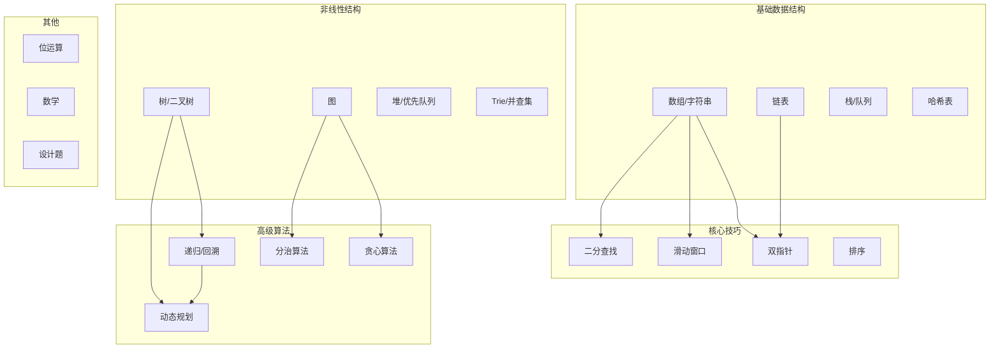
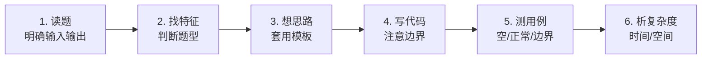

# 算法题分类解题模板

> **文档说明**：系统整理算法面试高频题型的解题模板，涵盖数组/字符串、链表、栈/队列、哈希表、双指针、滑动窗口、二分查找、排序、递归/回溯、动态规划、贪心、树、图、位运算等 15+ 大类，每类提供核心思路、代码模板（Python/Java）、复杂度分析、典型例题和常见陷阱，是算法刷题和面试准备的速查手册。
>
> **适用人群**：准备算法面试的开发者、刷 LeetCode 的学生、需要系统复习算法的全栈工程师
>
> **前置知识**：[[数据结构与算法核心]]、[[时间复杂度与空间复杂度]]、至少一门编程语言基础

---

## 一、概述

### 1. 算法题分类体系



### 2. 解题通用流程



| 步骤 | 关键动作 | 常见错误 |
|------|---------|---------|
| **读题** | 明确输入范围、输出格式、约束条件 | 忽略数据范围导致溢出/超时 |
| **找特征** | 关键词识别："连续子数组"→滑动窗口，"有序数组"→二分 | 题型判断错误 |
| **想思路** | 先暴力再优化，套用对应模板 | 直接想最优解，卡住 |
| **写代码** | 先写主逻辑，再处理边界 | 边界条件遗漏 |
| **测用例** | 空输入、单元素、最大输入、特殊值 | 只测正常用例 |
| **析复杂度** | 时间、空间、是否可优化 | 忽略常数因子和空间 |

### 3. 复杂度速查

| 数据规模 | 可接受时间复杂度 | 典型算法 |
|---------|----------------|---------|
| n ≤ 20 | O(2^n), O(n!) | 回溯、枚举 |
| n ≤ 100 | O(n^3) | 区间DP、Floyd |
| n ≤ 1000 | O(n^2) | 普通DP、双重循环 |
| n ≤ 10^5 | O(n log n) | 排序、二分、堆、树状数组 |
| n ≤ 10^6 | O(n), O(n log n) | 双指针、滑动窗口、线性扫描 |
| n ≤ 10^7 | O(n) | 极致优化的线性算法 |
| n ≤ 10^9 | O(log n), O(1) | 数学、二分 |

---

## 二、数组与字符串

### 1. 双指针

**适用场景**：有序数组、两数之和、回文判断、去重、合并

```python
# 模板：左右双指针
def two_pointers(arr):
    left, right = 0, len(arr) - 1
    while left < right:
        # 处理逻辑
        if condition(arr[left], arr[right]):
            left += 1
        else:
            right -= 1
    return result
```

```java
// Java 模板
public int twoPointers(int[] arr) {
    int left = 0, right = arr.length - 1;
    while (left < right) {
        if (condition(arr[left], arr[right])) {
            left++;
        } else {
            right--;
        }
    }
    return result;
}
```

| 例题 | 解法 | 复杂度 |
|------|------|--------|
| 两数之和 II（有序） | 左右指针 | O(n), O(1) |
| 三数之和 | 排序 + 固定一个 + 双指针 | O(n^2), O(1) |
| 盛最多水的容器 | 左右指针，移动短边 | O(n), O(1) |
| 验证回文串 | 左右指针比较 | O(n), O(1) |
| 移除元素 | 快慢指针 | O(n), O(1) |
| 有序数组去重 | 快慢指针 | O(n), O(1) |

**常见陷阱**：
- 数组无序时不能直接用双指针，需先排序
- 左右指针移动条件要正确，避免死循环
- 三数之和要注意去重（跳过相同元素）

### 2. 滑动窗口

**适用场景**：连续子数组/子串、最长/最短满足条件、包含所有字符

```python
# 模板：可变长度滑动窗口
def sliding_window(s):
    left = 0
    window = {}  # 或计数器
    result = 0
    
    for right in range(len(s)):
        # 1. 扩大窗口：加入 s[right]
        window[s[right]] = window.get(s[right], 0) + 1
        
        # 2. 缩小窗口：当不满足条件时
        while not valid(window):
            window[s[left]] -= 1
            if window[s[left]] == 0:
                del window[s[left]]
            left += 1
        
        # 3. 更新结果（窗口此时满足条件）
        result = max(result, right - left + 1)
    
    return result
```

```python
# 模板：固定长度滑动窗口
def fixed_window(arr, k):
    window_sum = sum(arr[:k])  # 初始窗口
    result = window_sum
    
    for i in range(k, len(arr)):
        window_sum += arr[i] - arr[i - k]  # 滑动
        result = max(result, window_sum)
    
    return result
```

| 例题 | 解法 | 复杂度 |
|------|------|--------|
| 无重复字符的最长子串 | 滑动窗口 + 哈希集合 | O(n), O(min(m,n)) |
| 最小覆盖子串 | 滑动窗口 + 需求计数器 | O(n+m), O(k) |
| 长度最小的子数组 | 滑动窗口（正整数） | O(n), O(1) |
| 找到字符串中所有字母异位词 | 固定窗口 + 计数器比较 | O(n), O(k) |
| 最大连续1的个数 III | 滑动窗口（0的个数≤k） | O(n), O(1) |
| 滑动窗口最大值 | 单调队列 | O(n), O(k) |

**常见陷阱**：
- 缩小窗口的条件要写在 while 中（不是 if）
- 计数器减到 0 时要删除，避免影响 valid 判断
- 结果更新的位置：在窗口满足条件时更新（while 之后）

### 3. 前缀和

**适用场景**：区间和查询、子数组和为K、二维矩阵区域和

```python
# 模板：一维前缀和
def prefix_sum(arr):
    n = len(arr)
    prefix = [0] * (n + 1)
    for i in range(n):
        prefix[i + 1] = prefix[i] + arr[i]
    # 区间 [l, r) 的和 = prefix[r] - prefix[l]
    return prefix

# 模板：前缀和 + 哈希表（子数组和为K）
def subarray_sum(arr, k):
    prefix = 0
    count = {0: 1}  # 前缀和为0出现1次
    result = 0
    for num in arr:
        prefix += num
        result += count.get(prefix - k, 0)
        count[prefix] = count.get(prefix, 0) + 1
    return result
```

```python
# 模板：二维前缀和
class NumMatrix:
    def __init__(self, matrix):
        m, n = len(matrix), len(matrix[0])
        self.prefix = [[0] * (n + 1) for _ in range(m + 1)]
        for i in range(m):
            for j in range(n):
                self.prefix[i+1][j+1] = (self.prefix[i][j+1] + 
                    self.prefix[i+1][j] - self.prefix[i][j] + matrix[i][j])
    
    def sum_region(self, row1, col1, row2, col2):
        return (self.prefix[row2+1][col2+1] - self.prefix[row1][col2+1] 
                - self.prefix[row2+1][col1] + self.prefix[row1][col1])
```

| 例题 | 解法 | 复杂度 |
|------|------|--------|
| 和为K的子数组 | 前缀和 + 哈希表 | O(n), O(n) |
| 区域和检索 - 数组不可变 | 前缀和 | O(1)查询, O(n)预处理 |
| 二维区域和检索 | 二维前缀和 | O(1)查询, O(mn)预处理 |
| 连续的子数组和 | 前缀和 + 取模 + 哈希表 | O(n), O(min(n,k)) |
| 和可被K整除的子数组 | 前缀和取模 + 哈希表 | O(n), O(k) |

### 4. 差分数组

**适用场景**：区间增减操作、航班预订、拼车

```python
# 模板：差分数组
def difference_array(n, updates):
    diff = [0] * (n + 1)
    for start, end, val in updates:
        diff[start] += val
        diff[end + 1] -= val
    # 还原
    result = [0] * n
    result[0] = diff[0]
    for i in range(1, n):
        result[i] = result[i-1] + diff[i]
    return result
```

---

## 三、链表

### 1. 链表操作模板

```python
# 链表节点定义
class ListNode:
    def __init__(self, val=0, next=None):
        self.val = val
        self.next = next

# 模板：虚拟头节点（统一处理头节点变更）
def use_dummy(head):
    dummy = ListNode(0, head)
    curr = dummy
    # 操作 curr.next
    return dummy.next

# 模板：反转链表
def reverse_list(head):
    prev = None
    curr = head
    while curr:
        next_node = curr.next
        curr.next = prev
        prev = curr
        curr = next_node
    return prev

# 模板：找中间节点（快慢指针）
def find_middle(head):
    slow = fast = head
    while fast and fast.next:
        slow = slow.next
        fast = fast.next.next
    return slow  # 前半部分的尾或后半部分的头

# 模板：判断环（快慢指针）
def has_cycle(head):
    slow = fast = head
    while fast and fast.next:
        slow = slow.next
        fast = fast.next.next
        if slow == fast:
            return True
    return False

# 模板：找环入口（快慢指针 + 数学推导）
def detect_cycle(head):
    slow = fast = head
    while fast and fast.next:
        slow = slow.next
        fast = fast.next.next
        if slow == fast:
            slow = head
            while slow != fast:
                slow = slow.next
                fast = fast.next
            return slow
    return None
```

| 例题 | 解法 | 复杂度 |
|------|------|--------|
| 反转链表 | 迭代/递归 | O(n), O(1) |
| 反转链表 II（区间反转） | 虚拟头 + 头插法 | O(n), O(1) |
| K个一组翻转链表 | 分组反转 + 连接 | O(n), O(1) |
| 合并两个有序链表 | 虚拟头 + 双指针 | O(n+m), O(1) |
| 合并K个升序链表 | 最小堆 / 分治合并 | O(n log k), O(k) |
| 环形链表 | 快慢指针 | O(n), O(1) |
| 环形链表 II | 快慢指针 + 数学 | O(n), O(1) |
| 相交链表 | 双指针（A+B = B+A） | O(n+m), O(1) |
| 删除链表的倒数第N个节点 | 快慢指针（快先走N步） | O(n), O(1) |
| 排序链表 | 归并排序（找中点+合并） | O(n log n), O(log n) |
| 回文链表 | 找中点+反转后半+比较 | O(n), O(1) |
| LRU缓存 | 哈希表 + 双向链表 | O(1), O(capacity) |

**常见陷阱**：
- 操作头节点时用虚拟头节点，避免特殊判断
- 反转链表时先保存 next，再改指针
- 快慢指针判断环时，fast 要走两步，注意 fast.next 不为空

---

## 四、栈与队列

### 1. 单调栈

**适用场景**：下一个更大/更小元素、每日温度、柱状图最大矩形、接雨水

```python
# 模板：单调递减栈（找下一个更大元素）
def next_greater_element(arr):
    n = len(arr)
    result = [-1] * n
    stack = []  # 存索引，栈底到栈顶递减
    
    for i in range(n):
        while stack and arr[stack[-1]] < arr[i]:
            idx = stack.pop()
            result[idx] = arr[i]
        stack.append(i)
    return result

# 模板：单调递增栈（找下一个更小元素）
def next_smaller_element(arr):
    n = len(arr)
    result = [-1] * n
    stack = []
    
    for i in range(n):
        while stack and arr[stack[-1]] > arr[i]:
            idx = stack.pop()
            result[idx] = arr[i]
        stack.append(i)
    return result
```

| 例题 | 解法 | 复杂度 |
|------|------|--------|
| 每日温度 | 单调递减栈 | O(n), O(n) |
| 下一个更大元素 I/II | 单调栈（循环数组取模） | O(n), O(n) |
| 柱状图中最大的矩形 | 单调递增栈（左右边界） | O(n), O(n) |
| 接雨水 | 单调递减栈 / 双指针 / 前缀最大 | O(n), O(1) |
| 去除重复字母 | 单调栈 + 计数 + 访问标记 | O(n), O(1) |
| 字符串解码 | 栈（数字栈+字符串栈） | O(n), O(n) |

### 2. 单调队列

**适用场景**：滑动窗口最大值

```python
from collections import deque

# 模板：单调递减队列（滑动窗口最大值）
def max_sliding_window(nums, k):
    result = []
    q = deque()  # 存索引，队首到队尾递减
    
    for i in range(len(nums)):
        # 1. 移除超出窗口的元素
        while q and q[0] <= i - k:
            q.popleft()
        # 2. 维护单调递减：移除队尾比当前小的
        while q and nums[q[-1]] < nums[i]:
            q.pop()
        q.append(i)
        # 3. 窗口形成后记录结果
        if i >= k - 1:
            result.append(nums[q[0]])
    return result
```

### 3. 堆（优先队列）

```python
import heapq

# Python heapq 是最小堆
# 模板：Top K 问题
def top_k_largest(nums, k):
    heap = []
    for num in nums:
        heapq.heappush(heap, num)
        if len(heap) > k:
            heapq.heappop(heap)
    return heap  # 堆中是前K大的元素（无序）

# 模板：最大堆（取负数）
class MaxHeap:
    def __init__(self):
        self.heap = []
    def push(self, val):
        heapq.heappush(self.heap, -val)
    def pop(self):
        return -heapq.heappop(self.heap)
    def peek(self):
        return -self.heap[0]
    def __len__(self):
        return len(self.heap)
```

| 例题 | 解法 | 复杂度 |
|------|------|--------|
| 数组中的第K个最大元素 | 最小堆（大小K） / 快速选择 | O(n log k), O(k) |
| 前K个高频元素 | 哈希计数 + 最小堆 | O(n log k), O(n) |
| 合并K个升序链表 | 最小堆 | O(n log k), O(k) |
| 数据流的中位数 | 最大堆（左半）+ 最小堆（右半） | O(log n), O(n) |
| 任务调度器 | 最大堆 + 冷却队列 | O(n), O(1) |
| 查找和最小的K对数字 | 最小堆 | O(k log k), O(k) |

---

## 五、二分查找

### 1. 二分查找模板

```python
# 模板1：标准二分（查找精确值）
def binary_search(arr, target):
    left, right = 0, len(arr) - 1
    while left <= right:
        mid = left + (right - left) // 2  # 防止溢出
        if arr[mid] == target:
            return mid
        elif arr[mid] < target:
            left = mid + 1
        else:
            right = mid - 1
    return -1

# 模板2：查找左边界（第一个 >= target）
def lower_bound(arr, target):
    left, right = 0, len(arr)
    while left < right:
        mid = left + (right - left) // 2
        if arr[mid] < target:
            left = mid + 1
        else:
            right = mid
    return left  # 可能等于 len(arr)（全部 < target）

# 模板3：查找右边界（第一个 > target）
def upper_bound(arr, target):
    left, right = 0, len(arr)
    while left < right:
        mid = left + (right - left) // 2
        if arr[mid] <= target:
            left = mid + 1
        else:
            right = mid
    return left

# 模板4：二分答案（最大化最小值/最小化最大值）
def binary_search_answer(arr):
    left, right = min_possible, max_possible
    while left < right:
        mid = left + (right - left) // 2
        if can_achieve(mid):  # 判断 mid 是否可行
            right = mid  # 或 left = mid + 1，取决于最大化还是最小化
        else:
            left = mid + 1  # 或 right = mid - 1
    return left
```

| 例题 | 解法 | 复杂度 |
|------|------|--------|
| 二分查找 | 标准二分 | O(log n), O(1) |
| 搜索插入位置 | 左边界二分 | O(log n), O(1) |
| 在排序数组中查找元素的第一个和最后一个位置 | 左边界+右边界 | O(log n), O(1) |
| 搜索旋转排序数组 | 二分（判断哪半有序） | O(log n), O(1) |
| 寻找旋转排序数组中的最小值 | 二分（比较 mid 和 right） | O(log n), O(1) |
| 搜索二维矩阵 | 二分（展平为一维） | O(log mn), O(1) |
| 寻找峰值 | 二分（比较 mid 和 mid+1） | O(log n), O(1) |
| 爱吃香蕉的珂珂 | 二分答案 | O(n log max), O(1) |
| 分割数组的最大值 | 二分答案 + 贪心判断 | O(n log sum), O(1) |
| x的平方根 | 二分答案 | O(log x), O(1) |

**常见陷阱**：
- `mid = left + (right - left) // 2` 防止整数溢出
- 左闭右闭 `[left, right]` 用 `left <= right`，左闭右开 `[left, right)` 用 `left < right`
- 二分答案时要明确是"最大化最小值"还是"最小化最大值"，决定 left/right 的更新方向

---

## 六、排序

### 1. 排序算法对比

| 算法 | 平均时间 | 最坏时间 | 空间 | 稳定性 | 适用场景 |
|------|---------|---------|------|--------|---------|
| 冒泡排序 | O(n^2) | O(n^2) | O(1) | 稳定 | 教学、小数据 |
| 选择排序 | O(n^2) | O(n^2) | O(1) | 不稳定 | 教学 |
| 插入排序 | O(n^2) | O(n^2) | O(1) | 稳定 | 近乎有序、小数据 |
| 归并排序 | O(n log n) | O(n log n) | O(n) | 稳定 | 链表排序、外部排序 |
| 快速排序 | O(n log n) | O(n^2) | O(log n) | 不稳定 | 通用、数组排序 |
| 堆排序 | O(n log n) | O(n log n) | O(1) | 不稳定 | Top K、优先队列 |
| 计数排序 | O(n+k) | O(n+k) | O(k) | 稳定 | 整数、范围小 |
| 桶排序 | O(n+k) | O(n^2) | O(n+k) | 稳定 | 数据均匀分布 |
| 基数排序 | O(d(n+k)) | O(d(n+k)) | O(n+k) | 稳定 | 整数、字符串 |

### 2. 快速排序模板

```python
def quick_sort(arr, left, right):
    if left >= right:
        return
    pivot = partition(arr, left, right)
    quick_sort(arr, left, pivot - 1)
    quick_sort(arr, pivot + 1, right)

def partition(arr, left, right):
    pivot_val = arr[right]  # 选最右为基准
    i = left - 1  # 小于基准的区域边界
    for j in range(left, right):
        if arr[j] <= pivot_val:
            i += 1
            arr[i], arr[j] = arr[j], arr[i]
    arr[i + 1], arr[right] = arr[right], arr[i + 1]
    return i + 1

# 快速选择（第K大/小）
def quick_select(arr, left, right, k):
    if left == right:
        return arr[left]
    pivot = partition(arr, left, right)
    if pivot == k:
        return arr[pivot]
    elif pivot < k:
        return quick_select(arr, pivot + 1, right, k)
    else:
        return quick_select(arr, left, pivot - 1, k)
```

### 3. 归并排序模板

```python
def merge_sort(arr, left, right):
    if left >= right:
        return
    mid = left + (right - left) // 2
    merge_sort(arr, left, mid)
    merge_sort(arr, mid + 1, right)
    merge(arr, left, mid, right)

def merge(arr, left, mid, right):
    temp = []
    i, j = left, mid + 1
    while i <= mid and j <= right:
        if arr[i] <= arr[j]:
            temp.append(arr[i])
            i += 1
        else:
            temp.append(arr[j])
            j += 1
    temp.extend(arr[i:mid+1])
    temp.extend(arr[j:right+1])
    arr[left:right+1] = temp
```

---

## 七、递归与回溯

### 1. 回溯模板

```python
# 模板：回溯（子集/组合/排列）
def backtrack(nums, start, path, result):
    # 1. 收集结果（满足条件时）
    result.append(path[:])  # 注意拷贝
    
    # 2. 遍历选择
    for i in range(start, len(nums)):
        # 3. 剪枝（可选）
        if i > start and nums[i] == nums[i-1]:
            continue  # 去重
        
        # 4. 做选择
        path.append(nums[i])
        
        # 5. 递归
        backtrack(nums, i + 1, path, result)  # i+1: 不重复使用
        
        # 6. 撤销选择
        path.pop()

# 排列问题（start 改为 used 数组）
def permute_backtrack(nums, used, path, result):
    if len(path) == len(nums):
        result.append(path[:])
        return
    for i in range(len(nums)):
        if used[i]:
            continue
        if i > 0 and nums[i] == nums[i-1] and not used[i-1]:
            continue  # 去重
        used[i] = True
        path.append(nums[i])
        permute_backtrack(nums, used, path, result)
        path.pop()
        used[i] = False
```

| 例题 | 解法 | 复杂度 |
|------|------|--------|
| 子集 | 回溯（start=i+1） | O(n*2^n), O(n) |
| 子集 II（有重复） | 回溯 + 排序去重 | O(n*2^n), O(n) |
| 组合 | 回溯（start=i+1, 长度限制） | O(C(n,k)*k), O(k) |
| 组合总和 | 回溯（start=i, 可重复使用） | O(n^(target/min)), O(target) |
| 全排列 | 回溯 + used数组 | O(n*n!), O(n) |
| 全排列 II（有重复） | 回溯 + 排序 + used去重 | O(n*n!), O(n) |
| 括号生成 | 回溯（左括号<n, 右括号<左括号） | O(4^n/√n), O(n) |
| 单词搜索 | DFS回溯（上下左右） | O(m*n*3^L), O(L) |
| N皇后 | 回溯 + 列/对角线集合 | O(n!), O(n) |
| 解数独 | 回溯 + 行/列/宫集合 | O(9^(空格数)), O(空格数) |
| 电话号码的字母组合 | 回溯 | O(3^n*4^m), O(n+m) |
| 分割回文串 | 回溯 + 回文判断 | O(n*2^n), O(n) |

**常见陷阱**：
- 结果收集时要 `path[:]` 拷贝，否则后续修改会影响已收集的结果
- 组合/子集用 `start` 参数，排列用 `used` 数组
- 去重时要先排序，然后判断 `i > start && nums[i] == nums[i-1]`
- 排列去重的条件是 `i > 0 && nums[i] == nums[i-1] && !used[i-1]`

---

## 八、动态规划

### 1. DP 解题步骤

```mermaid
graph LR
    A[1. 定义状态<br/>dp[i]的含义] --> B[2. 状态转移<br/>dp[i] = ...]
    B --> C[3. 初始化<br/>base case]
    C --> D[4. 遍历顺序<br/>正向/逆向/区间]
    D --> E[5. 返回结果<br/>dp[n]或max]
```

### 2. 线性 DP 模板

```python
# 模板：一维 DP
def linear_dp(nums):
    n = len(nums)
    dp = [0] * (n + 1)  # dp[i] 表示前 i 个元素的最优解
    dp[0] = 0  # 初始化
    for i in range(1, n + 1):
        dp[i] = max(dp[i-1], dp[i-1] + nums[i-1])  # 状态转移
    return dp[n]

# 模板：二维 DP（路径问题）
def grid_dp(grid):
    m, n = len(grid), len(grid[0])
    dp = [[0] * n for _ in range(m)]
    # 初始化
    dp[0][0] = grid[0][0]
    for i in range(1, m):
        dp[i][0] = dp[i-1][0] + grid[i][0]
    for j in range(1, n):
        dp[0][j] = dp[0][j-1] + grid[0][j]
    # 状态转移
    for i in range(1, m):
        for j in range(1, n):
            dp[i][j] = min(dp[i-1][j], dp[i][j-1]) + grid[i][j]
    return dp[m-1][n-1]
```

### 3. 背包问题模板

```python
# 模板：0-1 背包
def knapsack_01(weights, values, capacity):
    n = len(weights)
    dp = [0] * (capacity + 1)
    for i in range(n):
        for j in range(capacity, weights[i] - 1, -1):  # 逆序！
            dp[j] = max(dp[j], dp[j - weights[i]] + values[i])
    return dp[capacity]

# 模板：完全背包（物品可重复使用）
def knapsack_complete(weights, values, capacity):
    n = len(weights)
    dp = [0] * (capacity + 1)
    for i in range(n):
        for j in range(weights[i], capacity + 1):  # 正序！
            dp[j] = max(dp[j], dp[j - weights[i]] + values[i])
    return dp[capacity]

# 模板：多重背包（物品有数量限制）
def knapsack_multiple(weights, values, counts, capacity):
    dp = [0] * (capacity + 1)
    for i in range(len(weights)):
        # 二进制优化：将 count 拆分为 1,2,4,...
        k = 1
        remaining = counts[i]
        while remaining > 0:
            take = min(k, remaining)
            w, v = weights[i] * take, values[i] * take
            for j in range(capacity, w - 1, -1):
                dp[j] = max(dp[j], dp[j - w] + v)
            remaining -= take
            k *= 2
    return dp[capacity]
```

### 4. 区间 DP 模板

```python
# 模板：区间 DP
def interval_dp(s):
    n = len(s)
    dp = [[0] * n for _ in range(n)]
    # 初始化：长度为1的区间
    for i in range(n):
        dp[i][i] = 1
    # 按区间长度遍历
    for length in range(2, n + 1):
        for i in range(n - length + 1):
            j = i + length - 1
            if s[i] == s[j]:
                dp[i][j] = dp[i+1][j-1] + 2
            else:
                dp[i][j] = max(dp[i+1][j], dp[i][j-1])
    return dp[0][n-1]
```

### 5. 高频 DP 题型

| 题型 | 状态定义 | 转移方程 | 复杂度 |
|------|---------|---------|--------|
| 爬楼梯 | dp[i]=到第i阶方法数 | dp[i]=dp[i-1]+dp[i-2] | O(n), O(1) |
| 打家劫舍 | dp[i]=前i间最大金额 | dp[i]=max(dp[i-1], dp[i-2]+nums[i]) | O(n), O(1) |
| 最大子数组和 | dp[i]=以i结尾的最大和 | dp[i]=max(nums[i], dp[i-1]+nums[i]) | O(n), O(1) |
| 最长递增子序列 | dp[i]=以i结尾的LIS长度 | dp[i]=max(dp[j]+1) for j<i, nums[j]<nums[i] | O(n^2), O(n) |
| 最长公共子序列 | dp[i][j]=前i前j的LCS | if s[i]==t[j]: dp[i][j]=dp[i-1][j-1]+1 else: max(dp[i-1][j],dp[i][j-1]) | O(mn), O(mn) |
| 编辑距离 | dp[i][j]=word1前i转word2前j | if w1[i]==w2[j]: dp[i][j]=dp[i-1][j-1] else: 1+min(删,插,替) | O(mn), O(mn) |
| 零钱兑换 | dp[i]=凑成金额i的最少硬币 | dp[i]=min(dp[i-coin]+1) | O(amount*n), O(amount) |
| 零钱兑换II | dp[i]=凑成金额i的组合数 | dp[i]+=dp[i-coin] | O(amount*n), O(amount) |
| 不同路径 | dp[i][j]=到(i,j)的路径数 | dp[i][j]=dp[i-1][j]+dp[i][j-1] | O(mn), O(n) |
| 最小路径和 | dp[i][j]=到(i,j)的最小和 | dp[i][j]=min(dp[i-1][j],dp[i][j-1])+grid[i][j] | O(mn), O(n) |
| 单词拆分 | dp[i]=前i个字符能否拆分 | dp[i]=dp[j] && s[j:i] in wordDict | O(n^2), O(n) |
| 分割等和子集 | 0-1背包（target=sum/2） | dp[j]=dp[j] \|\| dp[j-num] | O(n*sum), O(sum) |
| 最长回文子串 | 中心扩展 / 区间DP | if s[i]==s[j] && (j-i<=2 \|\| dp[i+1][j-1]) | O(n^2), O(n^2) |
| 正则表达式匹配 | dp[i][j]=s前i匹配p前j | if p[j]==*: dp[i][j]=dp[i][j-2]\|\|(match&&dp[i-1][j]) | O(mn), O(mn) |

**常见陷阱**：
- 0-1 背包内层循环逆序，完全背包内层循环正序
- 求组合数（零钱兑换II）外层遍历物品，求排列数外层遍历金额
- 区间 DP 按长度从小到大遍历
- 状态压缩后注意覆盖问题

---

## 九、贪心算法

### 1. 贪心解题思路

**适用条件**：贪心选择性质 + 最优子结构（局部最优导致全局最优）

```python
# 模板：区间调度（最多不重叠区间）
def interval_scheduling(intervals):
    intervals.sort(key=lambda x: x[1])  # 按结束时间排序
    count = 0
    end = float('-inf')
    for start, finish in intervals:
        if start >= end:
            count += 1
            end = finish
    return count
```

| 例题 | 贪心策略 | 复杂度 |
|------|---------|--------|
| 跳跃游戏 | 维护最远可达位置 | O(n), O(1) |
| 跳跃游戏 II | 每步跳到最远（BFS思想） | O(n), O(1) |
| 划分字母区间 | 记录每个字符最后出现位置 | O(n), O(1) |
| 用最少数量的箭引爆气球 | 按右端点排序，贪心选右端点 | O(n log n), O(1) |
| 无重叠区间 | 按右端点排序，选结束最早的 | O(n log n), O(1) |
| 分发糖果 | 左右各遍历一次取max | O(n), O(n) |
| 加油站 | 总油量>=总消耗则有解，找起点 | O(n), O(1) |
| 买卖股票的最佳时机 II | 只要后一天比前一天贵就买卖 | O(n), O(1) |
| 单调递增的数字 | 从右往左，遇到降位则前一位-1后面全9 | O(n), O(n) |

---

## 十、树

### 1. 二叉树遍历模板

```python
class TreeNode:
    def __init__(self, val=0, left=None, right=None):
        self.val = val
        self.left = left
        self.right = right

# 前序遍历（根-左-右）— 递归
def preorder(root):
    if not root:
        return []
    return [root.val] + preorder(root.left) + preorder(root.right)

# 前序遍历 — 迭代（栈）
def preorder_iter(root):
    if not root:
        return []
    result, stack = [], [root]
    while stack:
        node = stack.pop()
        result.append(node.val)
        if node.right:
            stack.append(node.right)  # 右先入栈
        if node.left:
            stack.append(node.left)
    return result

# 中序遍历（左-根-右）— 迭代
def inorder_iter(root):
    result, stack = [], []
    curr = root
    while curr or stack:
        while curr:
            stack.append(curr)
            curr = curr.left
        curr = stack.pop()
        result.append(curr.val)
        curr = curr.right
    return result

# 后序遍历（左-右-根）— 迭代（前序翻转）
def postorder_iter(root):
    if not root:
        return []
    result, stack = [], [root]
    while stack:
        node = stack.pop()
        result.append(node.val)
        if node.left:
            stack.append(node.left)
        if node.right:
            stack.append(node.right)
    return result[::-1]  # 翻转

# 层序遍历（BFS）
from collections import deque
def level_order(root):
    if not root:
        return []
    result, queue = [], deque([root])
    while queue:
        level = []
        for _ in range(len(queue)):
            node = queue.popleft()
            level.append(node.val)
            if node.left:
                queue.append(node.left)
            if node.right:
                queue.append(node.right)
        result.append(level)
    return result
```

### 2. 树的递归模板

```python
# 模板：树的递归（后序思想：先处理子树，再处理当前）
def tree_recursive(root):
    if not root:
        return base_case  # 空节点的返回值
    
    left = tree_recursive(root.left)
    right = tree_recursive(root.right)
    
    # 处理当前节点：结合 left 和 right
    return process(root, left, right)
```

| 例题 | 解法 | 复杂度 |
|------|------|--------|
| 二叉树的最大深度 | 递归：max(left, right)+1 | O(n), O(h) |
| 平衡二叉树 | 递归：返回高度，-1表示不平衡 | O(n), O(h) |
| 二叉树的直径 | 递归：left+right，全局max | O(n), O(h) |
| 翻转二叉树 | 递归：交换左右子树 | O(n), O(h) |
| 对称二叉树 | 递归：比较左的左和右的右 | O(n), O(h) |
| 相同的树 | 递归：比较值和左右 | O(n), O(h) |
| 二叉树的层序遍历 | BFS队列 | O(n), O(n) |
| 二叉树的锯齿形层序遍历 | BFS + 奇偶层翻转 | O(n), O(n) |
| 二叉树的右视图 | BFS取每层最后一个 / DFS先右后左 | O(n), O(h) |
| 从前序与中序遍历构造二叉树 | 递归：前序找根，中序分左右 | O(n), O(n) |
| 从中序与后序遍历构造二叉树 | 递归：后序找根，中序分左右 | O(n), O(n) |
| 二叉树展开为链表 | 后序：右子树接到左子树最右 | O(n), O(h) |
| 填充每个节点的下一个右侧节点指针 | BFS / 利用已建立的next指针 | O(n), O(1) |
| 最近公共祖先 | 递归：左右子树是否包含p/q | O(n), O(h) |
| 二叉树中的最大路径和 | 递归：返回单边最大和，全局max | O(n), O(h) |
| 验证二叉搜索树 | 递归：传递上下界 | O(n), O(h) |
| 二叉搜索树中第K小的元素 | 中序遍历第K个 | O(h+k), O(h) |
| 把二叉搜索树转换为累加树 | 反中序（右-根-左）累加 | O(n), O(h) |
| 二叉树的序列化与反序列化 | 前序遍历 + 递归重建 | O(n), O(n) |
| 完全二叉树的节点个数 | 利用完全二叉树性质 + 二分 | O(log^2 n), O(log n) |

---

## 十一、图

### 1. 图的遍历模板

```python
from collections import deque, defaultdict

# 模板：DFS（邻接表）
def dfs_graph(graph, start, visited=None):
    if visited is None:
        visited = set()
    visited.add(start)
    result = [start]
    for neighbor in graph[start]:
        if neighbor not in visited:
            result.extend(dfs_graph(graph, neighbor, visited))
    return result

# 模板：BFS（最短路径）
def bfs_graph(graph, start):
    visited = {start}
    queue = deque([start])
    distance = {start: 0}
    while queue:
        node = queue.popleft()
        for neighbor in graph[node]:
            if neighbor not in visited:
                visited.add(neighbor)
                distance[neighbor] = distance[node] + 1
                queue.append(neighbor)
    return distance

# 模板：拓扑排序（Kahn算法 - BFS）
def topological_sort(n, edges):
    graph = defaultdict(list)
    indegree = [0] * n
    for u, v in edges:
        graph[u].append(v)
        indegree[v] += 1
    
    queue = deque([i for i in range(n) if indegree[i] == 0])
    result = []
    while queue:
        node = queue.popleft()
        result.append(node)
        for neighbor in graph[node]:
            indegree[neighbor] -= 1
            if indegree[neighbor] == 0:
                queue.append(neighbor)
    return result if len(result) == n else []  # 空表示有环
```

### 2. 最短路径模板

```python
import heapq

# 模板：Dijkstra（单源最短路径，非负权）
def dijkstra(n, edges, start):
    graph = defaultdict(list)
    for u, v, w in edges:
        graph[u].append((v, w))
    
    dist = [float('inf')] * n
    dist[start] = 0
    heap = [(0, start)]  # (距离, 节点)
    
    while heap:
        d, u = heapq.heappop(heap)
        if d > dist[u]:
            continue
        for v, w in graph[u]:
            if dist[u] + w < dist[v]:
                dist[v] = dist[u] + w
                heapq.heappush(heap, (dist[v], v))
    return dist

# 模板：Floyd-Warshall（多源最短路径）
def floyd_warshall(n, edges):
    dist = [[float('inf')] * n for _ in range(n)]
    for i in range(n):
        dist[i][i] = 0
    for u, v, w in edges:
        dist[u][v] = w
    
    for k in range(n):
        for i in range(n):
            for j in range(n):
                if dist[i][k] + dist[k][j] < dist[i][j]:
                    dist[i][j] = dist[i][k] + dist[k][j]
    return dist
```

### 3. 并查集模板

```python
class UnionFind:
    def __init__(self, n):
        self.parent = list(range(n))
        self.rank = [0] * n
        self.count = n  # 连通分量数量
    
    def find(self, x):
        if self.parent[x] != x:
            self.parent[x] = self.find(self.parent[x])  # 路径压缩
        return self.parent[x]
    
    def union(self, x, y):
        px, py = self.find(x), self.find(y)
        if px == py:
            return False
        # 按秩合并
        if self.rank[px] < self.rank[py]:
            px, py = py, px
        self.parent[py] = px
        if self.rank[px] == self.rank[py]:
            self.rank[px] += 1
        self.count -= 1
        return True
    
    def connected(self, x, y):
        return self.find(x) == self.find(y)
```

| 例题 | 解法 | 复杂度 |
|------|------|--------|
| 岛屿数量 | DFS/BFS 淹没 / 并查集 | O(mn), O(mn) |
| 岛屿的最大面积 | DFS/BFS 计算面积 | O(mn), O(mn) |
| 被围绕的区域 | DFS从边界标记 / 并查集虚拟节点 | O(mn), O(mn) |
| 课程表 | 拓扑排序（判断有向环） | O(V+E), O(V+E) |
| 课程表 II | 拓扑排序（输出顺序） | O(V+E), O(V+E) |
| 单词接龙 | BFS（双向BFS优化） | O(n*L^2), O(n*L) |
| 克隆图 | DFS/BFS + 哈希映射 | O(V+E), O(V) |
| 太平洋大西洋水流问题 | DFS从边界反向搜索 | O(mn), O(mn) |
| 网络延迟时间 | Dijkstra | O(E log V), O(V+E) |
| 最小高度树 | 拓扑排序（剥洋葱） | O(V), O(V) |
| 冗余连接 | 并查集 | O(n α(n)), O(n) |
| 省份数量 | 并查集 / DFS | O(n^2), O(n) |
| 除法求值 | 并查集（带权） / DFS | O(n α(n)), O(n) |
| 单词搜索 II | Trie + DFS回溯 | O(m*n*4*3^(L-1)), O(N*L) |

---

## 十二、位运算

### 1. 常用位运算技巧

```python
# 常用技巧
n & (n - 1)      # 清除最低位的1
n & -n           # 获取最低位的1
n >> 1           # 除以2
n << 1           # 乘以2
n & 1            # 判断奇偶（1=奇, 0=偶）
n ^ n            # 清零
a ^ b ^ b = a    # 异或特性
(n >> i) & 1     # 取第i位
n | (1 << i)     # 设置第i位为1
n & ~(1 << i)    # 清除第i位
n ^ (1 << i)     # 翻转第i位
```

| 例题 | 解法 | 复杂度 |
|------|------|--------|
| 位1的个数 | n &= n-1 循环 | O(log n), O(1) |
| 汉明距离 | 异或后统计1的个数 | O(log n), O(1) |
| 只出现一次的数字 | 全员异或 | O(n), O(1) |
| 只出现一次的数字 II | 位统计 / 状态机 | O(n), O(1) |
| 只出现一次的数字 III | 异或分组 | O(n), O(1) |
| 颠倒二进制位 | 逐位翻转 / 分治 | O(1), O(1) |
| 2的幂 | n > 0 && (n & (n-1)) == 0 | O(1), O(1) |
| 4的幂 | 2的幂 + 1在奇数位 | O(1), O(1) |
| 数字范围按位与 | 找公共前缀（右移） | O(log n), O(1) |
| 两整数之和 | 异或+与移位（不使用+） | O(log n), O(1) |

---

## 十三、面试策略

### 1. 答题流程

```text
1. 澄清问题（30秒）
   - 输入输出、数据范围、特殊情况

2. 给出思路（1分钟）
   - 先暴力解法，再优化
   - 说明时间/空间复杂度

3. 写代码（5-10分钟）
   - 先写主逻辑，再处理边界
   - 变量名清晰，注释关键步骤

4. 测试用例（2分钟）
   - 空输入、单元素、正常、边界、特殊值

5. 复杂度分析（30秒）
   - 时间、空间、是否可进一步优化
```

### 2. 高频考点优先级

| 优先级 | 题型 | 出现频率 |
|--------|------|---------|
| ⭐⭐⭐⭐⭐ | 数组/字符串（双指针、滑动窗口、前缀和） | 极高 |
| ⭐⭐⭐⭐⭐ | 二叉树（遍历、递归、BST） | 极高 |
| ⭐⭐⭐⭐ | 动态规划（线性DP、背包、区间DP） | 高 |
| ⭐⭐⭐⭐ | 链表（反转、合并、快慢指针） | 高 |
| ⭐⭐⭐⭐ | 哈希表（计数、去重、映射） | 高 |
| ⭐⭐⭐ | 回溯（排列、组合、子集、搜索） | 中高 |
| ⭐⭐⭐ | 二分查找（标准、边界、二分答案） | 中高 |
| ⭐⭐⭐ | 图（BFS/DFS、拓扑排序、并查集） | 中 |
| ⭐⭐ | 栈/队列（单调栈、堆） | 中 |
| ⭐⭐ | 贪心 | 中 |
| ⭐ | 排序、位运算、数学 | 低 |

### 3. 刷题路线建议

```text
第一阶段（2周）：基础数据结构
  数组 → 链表 → 栈/队列 → 哈希表 → 字符串
  每类刷 10-15 道简单+中等题

第二阶段（3周）：核心算法
  双指针 → 滑动窗口 → 二分查找 → 排序
  递归/回溯 → 动态规划 → 贪心
  每类刷 10-15 道中等题

第三阶段（2周）：非线性结构
  二叉树 → 图 → 堆/Trie/并查集
  每类刷 10-15 道中等+困难题

第四阶段（1周）：综合与模拟
  高频面试题 → 困难题 → 模拟面试
  每天 2-3 道，限时完成

总计：约 200-300 道题，覆盖 80% 面试考点
```

---

## 十四、关联笔记

### 算法与数据结构
- [[数据结构与算法核心]] · [[时间复杂度与空间复杂度]] · [[递归与分治]]
- [[动态规划入门到进阶]] · [[排序算法全解析]] · [[图算法基础]]

### 计算机基础
- [[计算机底层基础可运行示例与模板_优化版]] · [[操作系统核心概念]]
- [[计算机网络-HTTP协议详解]]

### 面试
- [[前端面试高频题]] · [[Java面试高频题]] · [[数据库面试高频题]]
- [[系统设计面试]]

### 导航
- [[MOC-CS基础-四级展开]] · [[MOC-算法与数据结构]] · [[算法与数据结构知识点系统梳理]]

> **学习路径建议**：先掌握 [[数据结构与算法核心]] 理解基础数据结构 → 按本文模板分类刷题（数组→链表→树→DP→图）→ 每类先理解模板再刷 10-15 道题 → 限时模拟面试 → 定期复习错题和模板。

---

## 💡 全文深度讲解

本文系统梳理了算法题分类解题模板的核心知识体系，从概述入手，深入数组与字符串的底层机制，再通过链表掌握实战应用，最后涵盖面试策略与关联笔记。学习时建议先建立整体认知，再动手实践，最后结合常见问题深化理解。

## 📝 全文精简总结

- **概述**：掌握本模块的核心概念与关键要点
- **数组与字符串**：掌握本模块的核心概念与关键要点
- **链表**：掌握本模块的核心概念与关键要点
- **栈与队列**：掌握本模块的核心概念与关键要点
- **二分查找**：掌握本模块的核心概念与关键要点
- **排序**：掌握本模块的核心概念与关键要点
- **递归与回溯**：掌握本模块的核心概念与关键要点
- **动态规划**：掌握本模块的核心概念与关键要点
- 其余6个模块涵盖进阶主题与拓展内容

