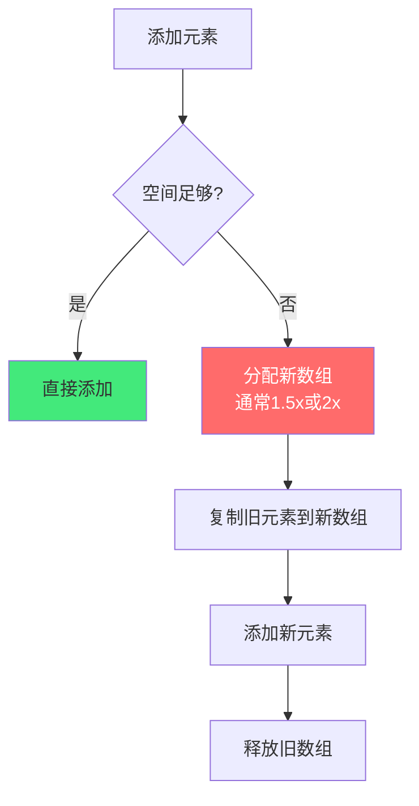
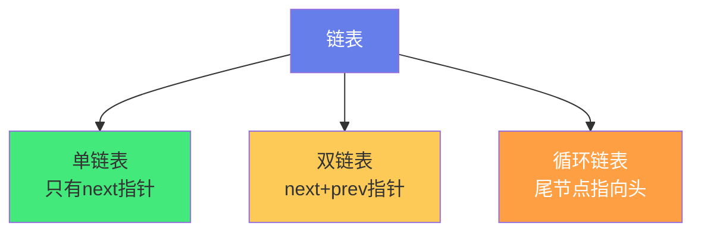

# 📏 线性结构：数组、链表、栈、队列

> **文档说明**：系统讲解四种最基础的线性数据结构——数组（Array）、链表（LinkedList）、栈（Stack）、队列（Queue）的底层原理、操作实现、复杂度分析与典型应用，涵盖线性结构的定义（元素间一对一的线性关系）、数组的原理（连续内存空间/随机访问 O(1)/插入删除 O(n)/动态数组扩容机制 ArrayList/Vector）、链表的原理（节点+指针/离散存储/顺序访问 O(n)/插入删除 O(1)/单链表/双链表/循环链表/哨兵节点）、数组 vs 链表深度对比（内存布局/访问方式/缓存友好性/适用场景）、栈的原理（LIFO 后进先出/push/pop/peek/isEmpty/数组实现/链表实现/应用：函数调用栈/括号匹配/表达式求值/浏览器后退/撤销操作）、队列的原理（FIFO 先进先出/enqueue/dequeue/front/循环数组实现/链表实现/应用：任务队列/BFS 广度优先搜索/消息队列/线程池）、双端队列 Deque、优先队列 Priority Queue（堆实现）、各语言内置实现（Java ArrayList/LinkedList/ArrayDeque/PriorityQueue、Python list/deque/heapq、JavaScript Array、Go slice）、复杂度总表、六道经典面试题（反转链表/有效括号/用栈实现队列/设计循环队列/链表环检测/最小栈）、常见问题与最佳实践。
>
> **适用人群**：计算机专业学生、算法学习者、准备技术面试的开发者、需要理解数据结构底层原理的工程师
>
> **前置知识**：[[算法复杂度分析]] · [[Python基础语法]]

---

## 一、概述

### 1.1 什么是线性结构

**线性结构**是数据元素之间存在「一对一」线性关系的数据结构：


**特征**：
- 有且仅有一个「第一个元素」和「最后一个元素」
- 除第一个外，每个元素有且仅有一个前驱
- 除最后一个外，每个元素有且仅有一个后继

**四种基本线性结构**：

| 结构 | 访问方式 | 插入/删除特点 | 典型应用 |
|------|---------|-------------|---------|
| **数组** | 随机访问 O(1) | 中间插入删除 O(n) | 通用存储、查找多的场景 |
| **链表** | 顺序访问 O(n) | 已知位置时插入删除 O(1) | 频繁增删、大小不确定 |
| **栈** | 只访问栈顶 O(1) | 只在栈顶操作 O(1) | 函数调用、括号匹配、撤销 |
| **队列** | 只访问两端 O(1) | 队尾入队首出 O(1) | 任务排队、BFS、消息队列 |

---

## 二、数组（Array）

### 2.1 底层原理

数组在内存中占用**连续的存储空间**，每个元素占用相同大小的内存：

```text
内存地址：  1000  1004  1008  1012  1016
元素：      [10]  [20]  [30]  [40]  [50]
索引：       [0]   [1]   [2]   [3]   [4]
```

**随机访问原理**：
```text
元素地址 = 首地址 + 索引 × 元素大小
例如：arr[2] = 1000 + 2 × 4 = 1008
```

因为地址计算是 O(1) 的数学运算，所以数组支持**随机访问**（任意索引访问都是 O(1)）。

### 2.2 操作复杂度

| 操作 | 复杂度 | 说明 |
|------|--------|------|
| 访问（按索引） | **O(1)** | 地址直接计算 |
| 尾部插入 | O(1) | 直接追加（未满时） |
| 中间/头部插入 | **O(n)** | 需要移动后续元素 |
| 尾部删除 | O(1) | 直接移除 |
| 中间/头部删除 | **O(n)** | 需要移动后续元素 |
| 查找（无序） | O(n) | 遍历 |
| 查找（有序） | O(log n) | 二分查找 |

### 2.3 插入操作示意

```json
插入前：[10] [20] [30] [40] [50]
在索引1插入25：
         [10] [20] [30] [40] [50]
                ↓ 移动
         [10] [20] [20] [30] [40] [50]  (元素后移)
                ↓ 写入
         [10] [25] [20] [30] [40] [50]  (需要移动4个元素)
```

### 2.4 动态数组（ArrayList）

普通数组大小固定，**动态数组**在空间不足时自动扩容：



**扩容开销**：扩容时需要复制所有元素（O(n)），但因为是「偶尔发生」，**均摊复杂度**仍是 O(1)。

| 语言 | 动态数组实现 | 扩容因子 |
|------|------------|---------|
| Java | ArrayList | 1.5x |
| Python | list | 约 1.125x（过度分配） |
| Go | slice | 2x（<1024）/ 1.25x（>1024） |
| JavaScript | Array | 引擎自动管理 |
| C++ | vector | 2x（常见实现） |

### 2.5 数组的优缺点

| 优点 | 缺点 |
|------|------|
| 随机访问 O(1) | 插入删除 O(n) |
| 内存连续，缓存友好 | 大小固定（动态数组有扩容开销） |
| 实现简单 | 可能有内存碎片（动态数组） |
| 支持二分查找 | 不适合频繁增删的场景 |

---

## 三、链表（LinkedList）

### 3.1 底层原理

链表由**节点（Node）**组成，每个节点包含「数据」和「指向下一个节点的指针」，节点在内存中**不连续**：

```text
节点：     [数据|指针] → [数据|指针] → [数据|指针] → null
内存地址：  0x1A         0x3F         0x2B
```

### 3.2 链表类型



**单链表节点**：
```python
class ListNode:
    def __init__(self, val=0, next=None):
        self.val = val
        self.next = next
```

**双链表节点**：
```python
class DListNode:
    def __init__(self, val=0, prev=None, next=None):
        self.val = val
        self.prev = prev
        self.next = next
```

### 3.3 操作复杂度

| 操作 | 单链表 | 双链表 |
|------|--------|--------|
| 访问第 i 个 | O(n) | O(n) |
| 头部插入 | O(1) | O(1) |
| 尾部插入 | O(n)（无尾指针）/ O(1)（有尾指针） | O(1) |
| 已知节点后插入 | O(1) | O(1) |
| 删除已知节点 | O(n)（需找前驱） | O(1) |
| 查找 | O(n) | O(n) |

### 3.4 插入操作示意

```text
插入前： A → B → C
在A和B之间插入X：

1. X.next = B      A → B → C
                    X ↗
2. A.next = X      A → X → B → C

只需修改2个指针，O(1)！
```

### 3.5 哨兵节点（Dummy Node）

哨兵节点是链表操作的常用技巧，简化边界处理：

```python
# 不带哨兵：需要处理 head 为 None 的情况
def remove_elements(head, val):
    # 删除头节点需要特殊处理
    while head and head.val == val:
        head = head.next
    curr = head
    while curr and curr.next:
        if curr.next.val == val:
            curr.next = curr.next.next
        else:
            curr = curr.next
    return head

# 带哨兵：统一处理
def remove_elements(head, val):
    dummy = ListNode(0, head)  # 哨兵节点
    curr = dummy
    while curr.next:
        if curr.next.val == val:
            curr.next = curr.next.next
        else:
            curr = curr.next
    return dummy.next
```

### 3.6 链表的优缺点

| 优点 | 缺点 |
|------|------|
| 插入删除 O(1)（已知位置） | 访问 O(n)，不支持随机访问 |
| 大小动态，无扩容开销 | 额外指针内存开销 |
| 不需要连续内存 | 缓存不友好（节点离散） |
| 适合频繁增删 | 实现稍复杂，易出错 |

---

## 四、数组 vs 链表对比

| 维度 | 数组 | 链表 |
|------|------|------|
| **内存** | 连续 | 离散 |
| **访问** | 随机 O(1) | 顺序 O(n) |
| **插入删除** | O(n)（需移动） | O(1)（已知位置） |
| **缓存友好** | ✅ 好（空间局部性） | ❌ 差（指针跳跃） |
| **扩容** | 有开销（复制元素） | 无（动态分配节点） |
| **额外空间** | 无 | 指针开销 |
| **适用场景** | 查找多、增删少 | 增删频繁、大小不定 |

> **选择原则**：如果操作以「查找/随机访问」为主，用数组；如果以「插入/删除」为主，用链表。实际开发中数组（动态数组）使用频率远高于链表，因为缓存友好性和随机访问的优势通常大于插入删除的劣势。

---

## 五、栈（Stack）

### 5.1 底层原理

**栈**是一种「后进先出」（LIFO, Last In First Out）的线性结构，只允许在**栈顶**操作：

```text
        栈顶 top
         ↓
┌─────────────────┐
│  元素3（最后入） │ ← 只能操作栈顶
├─────────────────┤
│  元素2          │
├─────────────────┤
│  元素1（最先入） │
└─────────────────┘
        栈底 bottom
```

### 5.2 核心操作

| 操作 | 说明 | 复杂度 |
|------|------|--------|
| `push(x)` | 入栈（栈顶添加） | O(1) |
| `pop()` | 出栈（栈顶移除并返回） | O(1) |
| `peek()/top()` | 查看栈顶（不移除） | O(1) |
| `isEmpty()` | 是否为空 | O(1) |
| `size()` | 元素个数 | O(1) |

### 5.3 数组实现栈

```python
class ArrayStack:
    def __init__(self):
        self.items = []
    
    def push(self, x):
        self.items.append(x)
    
    def pop(self):
        if self.is_empty():
            raise IndexError("pop from empty stack")
        return self.items.pop()
    
    def peek(self):
        if self.is_empty():
            raise IndexError("peek from empty stack")
        return self.items[-1]
    
    def is_empty(self):
        return len(self.items) == 0
    
    def size(self):
        return len(self.items)
```

### 5.4 链表实现栈

```python
class LinkedListStack:
    def __init__(self):
        self.head = None  # 栈顶
        self._size = 0
    
    def push(self, x):
        self.head = ListNode(x, self.head)
        self._size += 1
    
    def pop(self):
        if self.is_empty():
            raise IndexError("pop from empty stack")
        val = self.head.val
        self.head = self.head.next
        self._size -= 1
        return val
    
    def peek(self):
        if self.is_empty():
            raise IndexError("peek from empty stack")
        return self.head.val
    
    def is_empty(self):
        return self.head is None
```

### 5.5 栈的应用场景

| 应用 | 说明 |
|------|------|
| **函数调用栈** | 程序运行时的函数调用和返回 |
| **括号匹配** | 检查 `()[]{}` 是否匹配 |
| **表达式求值** | 中缀转后缀、后缀表达式求值 |
| **浏览器后退** | 后退按钮就是一个栈 |
| **撤销操作** | Ctrl+Z 撤销栈 |
| **DFS 深度优先搜索** | 递归本质是栈 |
| **单调栈** | 找下一个更大元素、柱状图最大矩形 |
| **语法分析** | 编译器的语法分析器 |

### 5.6 经典应用：括号匹配

```python
def is_valid_parentheses(s: str) -> bool:
    stack = []
    mapping = {')': '(', ']': '[', '}': '{'}
    
    for char in s:
        if char in mapping.values():  # 左括号入栈
            stack.append(char)
        elif char in mapping:  # 右括号匹配
            if not stack or stack.pop() != mapping[char]:
                return False
    return len(stack) == 0
```

---

## 六、队列（Queue）

### 6.1 底层原理

**队列**是一种「先进先出」（FIFO, First In First Out）的线性结构，在**队尾入队**，**队首出队**：

```text
  出队 ← ┌─────────────────────────────┐ ← 入队
         │ 元素1 │ 元素2 │ 元素3 │ 元素4 │
         └─────────────────────────────┘
           队首 front              队尾 rear
```

### 6.2 核心操作

| 操作 | 说明 | 复杂度 |
|------|------|--------|
| `enqueue(x)` | 入队（队尾添加） | O(1) |
| `dequeue()` | 出队（队首移除并返回） | O(1) |
| `front()/peek()` | 查看队首 | O(1) |
| `isEmpty()` | 是否为空 | O(1) |
| `size()` | 元素个数 | O(1) |

### 6.3 循环数组实现队列

普通数组实现队列会有「假溢出」问题（前面有空位但不能用），用**循环数组**解决：

```python
class CircularQueue:
    def __init__(self, capacity=10):
        self.capacity = capacity
        self.items = [None] * capacity
        self.front = 0  # 队首索引
        self.rear = 0   # 队尾索引（下一个可插入位置）
        self._size = 0
    
    def enqueue(self, x):
        if self.is_full():
            raise IndexError("queue is full")
        self.items[self.rear] = x
        self.rear = (self.rear + 1) % self.capacity
        self._size += 1
    
    def dequeue(self):
        if self.is_empty():
            raise IndexError("dequeue from empty queue")
        val = self.items[self.front]
        self.front = (self.front + 1) % self.capacity
        self._size -= 1
        return val
    
    def is_full(self):
        return self._size == self.capacity
    
    def is_empty(self):
        return self._size == 0
```

### 6.4 链表实现队列

```python
class LinkedListQueue:
    def __init__(self):
        self.head = None  # 队首
        self.tail = None  # 队尾
        self._size = 0
    
    def enqueue(self, x):
        node = ListNode(x)
        if self.is_empty():
            self.head = self.tail = node
        else:
            self.tail.next = node
            self.tail = node
        self._size += 1
    
    def dequeue(self):
        if self.is_empty():
            raise IndexError("dequeue from empty queue")
        val = self.head.val
        self.head = self.head.next
        if self.head is None:
            self.tail = None
        self._size -= 1
        return val
```

### 6.5 队列的应用场景

| 应用 | 说明 |
|------|------|
| **任务队列** | 打印任务、消息队列、线程池任务 |
| **BFS 广度优先搜索** | 图的层序遍历、最短路径 |
| **消息队列** | Kafka/RabbitMQ/RocketMQ |
| **操作系统调度** | 进程调度、IO 缓冲 |
| **滑动窗口** | 单调队列解决滑动窗口最大值 |
| **限流** | 令牌桶/漏桶算法 |
| **事件循环** | JavaScript 事件循环、任务排队 |

### 6.6 双端队列（Deque）

双端队列允许在**两端**都进行插入和删除：

| 操作 | 说明 |
|------|------|
| `addFirst(x)` | 队首插入 |
| `addLast(x)` | 队尾插入 |
| `removeFirst()` | 队首删除 |
| `removeLast()` | 队尾删除 |
| `getFirst()` | 查看队首 |
| `getLast()` | 查看队尾 |

Python 的 `collections.deque` 就是双端队列，两端操作都是 O(1)。

### 6.7 优先队列（Priority Queue）

优先队列中每个元素有优先级，出队时优先级最高的先出：

- 通常用**堆（Heap）**实现
- 入队 O(log n)，出队 O(log n)，查看最高优先级 O(1)
- 应用：Dijkstra 最短路径、任务调度、Top K 问题

> 详见 [[树与堆-二叉树与堆排序]]

---

## 七、各语言内置实现

| 语言 | 动态数组 | 链表 | 栈 | 队列 | 优先队列 |
|------|---------|------|-----|------|---------|
| **Java** | ArrayList | LinkedList | Stack/Deque | Queue/ArrayDeque | PriorityQueue |
| **Python** | list | （手写） | list（append/pop） | deque | heapq |
| **JavaScript** | Array | （手写） | Array（push/pop） | Array（shift 慢）/手写 | （手写堆） |
| **Go** | slice | container/list | slice | 手写/channel | container/heap |
| **C++** | vector | list | stack | queue | priority_queue |
| **C#** | List\<T> | LinkedList\<T> | Stack\<T> | Queue\<T> | PriorityQueue |

---

## 八、复杂度总表

| 数据结构 | 访问 | 头部插入 | 尾部插入 | 中间插入 | 头部删除 | 尾部删除 | 中间删除 | 查找 |
|---------|------|---------|---------|---------|---------|---------|---------|------|
| **数组** | O(1) | O(n) | O(1) | O(n) | O(n) | O(1) | O(n) | O(n) |
| **动态数组** | O(1) | O(n) | O(1)均摊 | O(n) | O(n) | O(1) | O(n) | O(n) |
| **单链表** | O(n) | O(1) | O(1)* | O(1)** | O(1) | O(n)* | O(n) | O(n) |
| **双链表** | O(n) | O(1) | O(1) | O(1)** | O(1) | O(1) | O(1) | O(n) |
| **栈** | O(1)（栈顶） | - | O(1)（入栈） | - | - | O(1)（出栈） | - | - |
| **队列** | O(1)（两端） | - | O(1)（入队） | - | O(1)（出队） | - | - | - |

> *有尾指针时 O(1)，否则 O(n)
> **已知节点位置时 O(1)，否则需先查找 O(n)

---

## 九、经典面试题

### 9.1 反转链表

```python
def reverse_list(head):
    prev = None
    curr = head
    while curr:
        next_node = curr.next  # 保存下一个
        curr.next = prev       # 反转指针
        prev = curr            # prev 前进
        curr = next_node       # curr 前进
    return prev
```

### 9.2 有效括号

见上文 5.6 节。

### 9.3 用栈实现队列

```python
class MyQueue:
    def __init__(self):
        self.in_stack = []   # 入队栈
        self.out_stack = []  # 出队栈
    
    def push(self, x):
        self.in_stack.append(x)
    
    def pop(self):
        self.peek()
        return self.out_stack.pop()
    
    def peek(self):
        if not self.out_stack:
            while self.in_stack:
                self.out_stack.append(self.in_stack.pop())
        return self.out_stack[-1]
    
    def empty(self):
        return not self.in_stack and not self.out_stack
```

### 9.4 链表环检测（快慢指针）

```python
def has_cycle(head):
    slow = fast = head
    while fast and fast.next:
        slow = slow.next
        fast = fast.next.next
        if slow == fast:
            return True
    return False
```

### 9.5 最小栈（支持 getMin O(1)）

```python
class MinStack:
    def __init__(self):
        self.stack = []
        self.min_stack = []  # 辅助栈，保存当前最小值
    
    def push(self, x):
        self.stack.append(x)
        # 辅助栈栈顶是当前最小值
        if not self.min_stack or x <= self.min_stack[-1]:
            self.min_stack.append(x)
    
    def pop(self):
        if self.stack.pop() == self.min_stack[-1]:
            self.min_stack.pop()
    
    def top(self):
        return self.stack[-1]
    
    def get_min(self):
        return self.min_stack[-1]
```

### 9.6 滑动窗口最大值（单调队列）

```python
from collections import deque

def max_sliding_window(nums, k):
    result = []
    dq = deque()  # 存储索引，对应值单调递减
    
    for i, num in enumerate(nums):
        # 移除超出窗口的元素
        if dq and dq[0] <= i - k:
            dq.popleft()
        # 移除比当前小的元素（它们不可能是最大值）
        while dq and nums[dq[-1]] < num:
            dq.pop()
        dq.append(i)
        # 窗口形成后记录最大值
        if i >= k - 1:
            result.append(nums[dq[0]])
    return result
```

---

## 十、常见问题

| 问题 | 回答 |
|------|------|
| **数组和链表怎么选？** | 查找多用数组（缓存友好+随机访问），频繁增删用链表。实际中动态数组用得更多。 |
| **栈和队列的本质区别？** | 栈 LIFO（后进先出），队列 FIFO（先进先出）。都是操作受限的线性表。 |
| **为什么函数调用用栈？** | 函数调用的「后调用先返回」天然符合 LIFO。 |
| **循环队列怎么判断空和满？** | 用 size 变量（最简单），或牺牲一个存储位（front==rear 为空，(rear+1)%cap==front 为满）。 |
| **链表有环怎么找环入口？** | 快慢指针相遇后，一个从头开始，两个指针同速前进，相遇点就是环入口。 |
| **动态数组扩容为什么是 1.5x/2x？** | 均摊复杂度 O(1) 的数学保证。太小频繁扩容，太大浪费内存。 |
| **栈溢出是什么？** | 函数调用层级过深（如无限递归），超出栈空间限制。Python 默认递归深度约 1000。 |
| **优先队列一定是堆实现吗？** | 通常是（二叉堆最常见），也可以用平衡二叉树，但堆更简单高效。 |

---

## 十一、关联笔记

### 数据结构与算法
- [[算法复杂度分析]] · [[树与堆-二叉树与堆排序]] · [[哈希表与哈希函数]]
- [[排序算法全解析]] · [[递归与分治]] · [[动态规划入门]]
- [[图论基础-BFS与DFS]] · [[字符串匹配算法]]

### 语言基础
- [[Python基础语法]] · [[Java-集合框架源码分析]] · [[JavaScript-数组与对象]]

### 导航
- [[MOC-计算机基础]] · [[MOC-算法与数据结构]] · [[Home]] · [[学习路线总览]]

> 🔍 **知识点深度解析**
>
> **作用**：线性结构（数组/链表/栈/队列）解决的是「如何在计算机中组织和存储一组有序数据，并高效地进行访问、插入、删除等操作」的基础问题——这是所有数据结构的基础，也是算法面试的核心。理解这四种结构的底层原理和取舍，是写出高效代码和通过技术面试的前提。
>
> **底层原理**：①数组的核心是「连续内存+元素等长」，这使得任意元素的地址可以通过「首地址+索引×元素大小」在 O(1) 内计算出来，这就是随机访问的本质。但连续内存也意味着插入删除时需要移动后续元素（O(n)），且大小固定（动态数组通过扩容解决，但有均摊开销）。数组的连续内存还带来了「缓存友好性」——CPU 缓存按缓存行加载连续内存，数组的空间局部性让缓存命中率远高于链表。②链表的核心是「节点+指针」，节点离散存储，通过指针连接。这使得插入删除只需修改指针（O(1)，已知位置时），大小动态无扩容开销。但离散存储导致无法随机访问（必须从头遍历 O(n)），且指针跳跃导致缓存不友好。链表的「哨兵节点（Dummy Node）」是一个重要技巧——在头部添加一个虚拟节点，让删除头节点和删除其他节点的操作统一，避免了大量边界判断。③栈的核心是「LIFO（后进先出）」，它是操作受限的线性表——只允许在一端（栈顶）操作。这种限制不是缺点，而是特性：函数调用的「后调用先返回」、括号匹配的「后开先闭」、撤销操作的「后做先撤」都天然符合 LIFO。栈的本质是「保存上下文，按相反顺序恢复」——函数调用栈保存的是函数的执行上下文，返回时按调用的反顺序恢复。④队列的核心是「FIFO（先进先出）」，也是操作受限的线性表——一端入队一端出队。FIFO 对应现实世界的「排队」，应用于任务调度、BFS、消息队列等。循环数组是队列的高效实现——通过取模运算让数组「循环」起来，解决了普通数组队列的「假溢出」问题（前面有空位但不能用）。⑤数组和链表的选择本质是「时间-空间权衡」和「访问模式权衡」——数组用连续内存换取随机访问和缓存友好，链表用指针开销换取灵活增删。没有绝对的优劣，只有是否适合场景。实际开发中动态数组（ArrayList/list）使用频率远高于链表，因为大多数场景「读多写少」，且缓存友好性的优势在现代 CPU 上非常显著。⑥栈和队列的选择本质是「处理顺序的选择」——需要「后到先处理」用栈，需要「先到先处理」用队列。双端队列（Deque）结合了两者的优势，是更通用的结构。
>
> **用法要点**：① 数组：连续内存，随机访问O(1)，插入删除O(n)，动态数组扩容(1.5x/2x)均摊O(1)，缓存友好，查找多用 ② 链表：节点+指针离散存储，访问O(n)，已知位置插入删除O(1)，双链表删除已知节点O(1)，哨兵节点简化边界，频繁增删用 ③ 栈LIFO：push/pop/peek都是O(1)，数组实现(append/pop)或链表实现，应用：函数调用/括号匹配/表达式求值/浏览器后退/撤销/DFS/单调栈 ④ 队列FIFO：enqueue/dequeue O(1)，循环数组实现(取模解决假溢出)或链表实现，应用：任务队列/BFS/消息队列/滑动窗口(单调队列) ⑤ 双端队列Deque：两端都可操作，Python collections.deque ⑥ 优先队列：堆实现，入队出队O(log n)，应用Dijkstra/TopK ⑦ 各语言：Java(ArrayList/LinkedList/ArrayDeque/PriorityQueue)/Python(list/deque/heapq)/C++(vector/list/stack/queue/priority_queue) ⑧ 经典题：反转链表(三指针)/有效括号(栈)/用栈实现队列(双栈)/环检测(快慢指针)/最小栈(辅助栈)/滑动窗口最大值(单调队列) ⑨ 选择原则：读多写少用数组，写多读少用链表；LIFO用栈，FIFO用队列 ⑩ 复杂度：数组访问O(1)增删O(n)，链表访问O(n)增删O(1)(已知位置)，栈队列操作O(1)。

> 💡 **深度讲解**：线性结构最核心的智慧是「不同的存储方式和访问限制，决定了不同的时间复杂度和适用场景——没有最好的数据结构，只有最合适的数据结构」——很多初学者学数据结构时会问「数组和链表哪个更好？」，答案是「取决于你的操作模式」。如果你需要频繁随机访问（如查表），数组是最好的；如果你需要频繁在中间插入删除（如播放列表），链表更合适。这种「没有银弹，只有权衡」的思维是计算机科学最核心的思维方式之一——从数据结构到算法，从架构到技术选型，到处都是权衡。线性结构的另一个深层智慧是「操作受限反而更强大」——栈和队列都是操作受限的线性表（栈只能在一端操作，队列只能在两端操作），但正是这种限制让它们有了明确的语义和高效的实现。如果允许任意位置操作，那就是数组或链表了，反而失去了「LIFO/FIFO」的语义保证。这告诉我们：**限制不是束缚，而是特性**——好的设计通过合理的限制来简化使用、提高效率、保证正确性。在实际开发中，线性结构无处不在：你用的 every 列表（动态数组）、浏览器的后退按钮（栈）、JavaScript 的事件循环（队列）、消息队列（队列）、函数调用（栈）……理解了这四种基础结构，你就理解了计算机中「数据如何被组织和处理」的根本逻辑。更重要的是，它们是更复杂数据结构的基础——哈希表用数组+链表实现，树用链表实现，图用数组（邻接矩阵）或链表（邻接表）实现，堆用数组实现。掌握了线性结构，就掌握了数据结构世界的「字母表」。

> 📝 **精简总结**：线性结构=元素间一对一关系，四种基础：数组/链表/栈/队列。数组：连续内存，随机访问O(1)，插入删除O(n)，动态数组扩容均摊O(1)，缓存友好，读多写少首选。链表：节点+指针离散存储，访问O(n)，已知位置插入删除O(1)，双链表删除O(1)，哨兵节点简化边界，写多读少用。栈LIFO：push/pop/peek O(1)，应用函数调用/括号匹配/撤销/DFS/单调栈。队列FIFO：enqueue/dequeue O(1)，循环数组实现，应用任务队列/BFS/消息队列/滑动窗口。双端队列Deque两端操作，优先队列用堆。经典题：反转链表/有效括号/双栈实现队列/快慢指针环检测/最小栈/单调队列滑动窗口。核心：没有最好只有最合适，操作受限是特性不是束缚。

> **学习路径建议**：先学习 [[算法复杂度分析]] 理解时间空间复杂度 → 学习本文档掌握四种线性结构 → 实践：用 Python/Java 手写数组、链表、栈、队列的实现 → 刷题：LeetCode 简单题（反转链表/有效括号/删除链表元素/用栈实现队列） → 学习 [[树与堆-二叉树与堆排序]] 和 [[哈希表与哈希函数]] → 刷题：中等题（最小栈/环检测/滑动窗口最大值/单调栈系列） → 学习 [[排序算法全解析]] 和 [[图论基础-BFS与DFS]] → 刷题：图的 BFS/DFS（队列和栈的应用） → 进阶：学习单调栈/单调队列/优先队列的高级应用 → 形成数据结构的知识体系。

---

> **线性结构的本质是「用不同的存储方式和访问规则，为不同的操作模式提供最优的时间复杂度——这是数据结构乃至计算机科学最核心的『权衡』思想」——我们每天都在使用线性结构，但很少思考它们背后的原理：你打开一个网页，浏览器用栈管理你的浏览历史（后退按钮）；你运行一个程序，操作系统用栈管理函数调用；你发送一条消息，消息队列用队列保证消息按序投递；你在 App 里刷列表，底层是动态数组在高效地渲染。这四种最基础的数据结构，构成了计算机世界的「基础设施」。学习线性结构的价值，不仅是为了通过面试，更是为了理解「计算机如何组织和处理数据」的根本逻辑。当你理解了数组的连续内存为什么能随机访问、链表的指针为什么能灵活增删、栈的 LIFO 为什么适合函数调用、队列的 FIFO 为什么适合任务调度，你就不再是「只会调用 API 的程序员」，而是「理解底层原理的工程师」——你能在合适的场景选择合适的数据结构，能在性能瓶颈时定位到根源，能在面试时从容应对各种变形题。更重要的是，线性结构教给你的「权衡思维」——没有最好，只有最合适——会贯穿你的整个技术生涯，从数据结构到算法，从架构到技术选型，从产品到人生。从今天开始，下次你用 list.append() 或 queue.push() 时，花一秒钟想想背后的数据结构——你会对这些「习以为常」的工具有全新的理解。**
