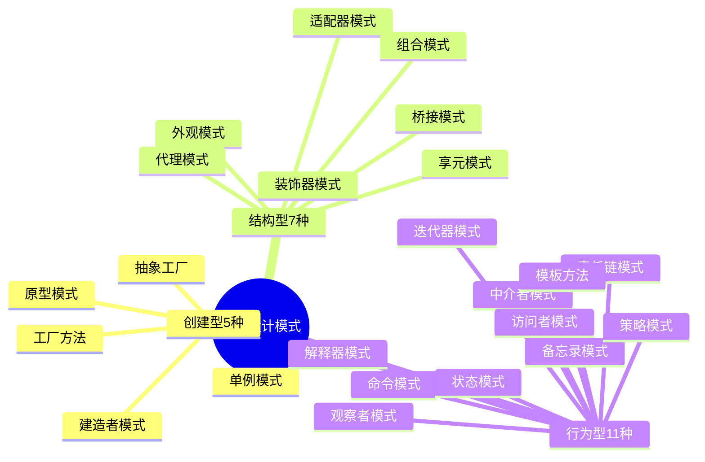
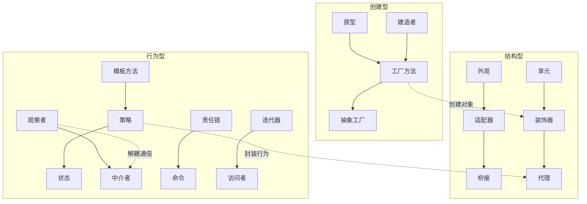
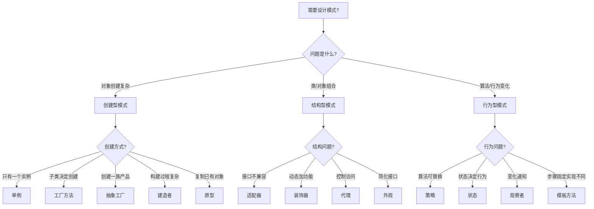

# 23 种设计模式分类速查

> **文档说明**：GoF（Gang of Four）23 种经典设计模式的完整分类速查表，涵盖创建型、结构型、行为型三大类，每种模式包含意图、核心角色、适用场景、关键代码结构和实际应用案例。
>
> **适用人群**：初中高级开发工程师、架构师、面试备考者
>
> **前置知识**：[[架构设计原则-SOLID]]、面向对象基础

---

## 一、总览分类



| 类别 | 数量 | 核心关注点 | 代表模式 |
|------|------|-----------|---------|
| 创建型 | 5 | 对象的创建过程，解耦创建与使用 | 单例、工厂方法、抽象工厂 |
| 结构型 | 7 | 类和对象的组合，形成更大结构 | 适配器、装饰器、代理、外观 |
| 行为型 | 11 | 对象间的通信和职责分配 | 观察者、策略、命令、责任链 |

---

## 二、创建型模式（5 种）

### 2.1 单例模式（Singleton）

| 维度 | 说明 |
|------|------|
| **意图** | 保证一个类只有一个实例，并提供全局访问点 |
| **核心角色** | Singleton（私有构造 + 静态实例） |
| **适用场景** | 配置管理、连接池、日志器、缓存、线程池 |
| **关键代码** | `private constructor` + `static getInstance()` |

```java
// 双重检查锁定（DCL）- 线程安全且高效
public class Singleton {
    private static volatile Singleton instance;
    private Singleton() {}
    public static Singleton getInstance() {
        if (instance == null) {
            synchronized (Singleton.class) {
                if (instance == null) {
                    instance = new Singleton();
                }
            }
        }
        return instance;
    }
}
```

**实际应用**：Spring Bean 默认单例、数据库连接池、Logger 实例、Redis 客户端。

### 2.2 工厂方法模式（Factory Method）

| 维度 | 说明 |
|------|------|
| **意图** | 定义创建对象的接口，让子类决定实例化哪个类 |
| **核心角色** | Product（产品接口）、ConcreteProduct、Creator（工厂接口）、ConcreteCreator |
| **适用场景** | 一类产品的多种实现，创建逻辑复杂且可能变化 |
| **关键代码** | 抽象工厂方法 `factoryMethod(): Product` |

```java
// 产品接口
interface Logger { void log(String msg); }
class FileLogger implements Logger { /* 文件日志 */ }
class ConsoleLogger implements Logger { /* 控制台日志 */ }

// 工厂接口
interface LoggerFactory { Logger createLogger(); }
class FileLoggerFactory implements LoggerFactory {
    public Logger createLogger() { return new FileLogger(); }
}
```

**实际应用**：SLF4J 的 `LoggerFactory`、Spring 的 `FactoryBean`、JDBC 的 `Connection.createStatement()`。

### 2.3 抽象工厂模式（Abstract Factory）

| 维度 | 说明 |
|------|------|
| **意图** | 提供创建一系列相关或相互依赖对象的接口，无需指定具体类 |
| **核心角色** | AbstractFactory、ConcreteFactory、AbstractProduct、ConcreteProduct |
| **适用场景** | 产品族（一组相关产品），需要切换整套产品配置 |
| **关键代码** | 工厂接口包含多个创建方法，每个方法创建一种产品 |

```java
// 产品族：按钮 + 输入框
interface Button { void render(); }
interface Input { void render(); }

// Windows 产品族
class WinButton implements Button {}
class WinInput implements Input {}
// Mac 产品族
class MacButton implements Button {}
class MacInput implements Input {}

// 抽象工厂
interface UIFactory {
    Button createButton();
    Input createInput();
}
class WinFactory implements UIFactory {
    public Button createButton() { return new WinButton(); }
    public Input createInput() { return new WinInput(); }
}
```

**实际应用**：跨平台 UI 框架（Qt/Java AWT）、数据库方言切换（MySQL/PostgreSQL）、主题切换。

### 2.4 建造者模式（Builder）

| 维度 | 说明 |
|------|------|
| **意图** | 将复杂对象的构建与表示分离，使同样的构建过程可创建不同表示 |
| **核心角色** | Builder（构建接口）、ConcreteBuilder、Director（指挥者）、Product |
| **适用场景** | 对象构造参数多（>4个）、构造过程有顺序、需要不可变对象 |
| **关键代码** | 链式调用 `builder.name("x").age(18).build()` |

```java
// 经典 Builder 模式
public class User {
    private final String name;
    private final int age;
    private final String email;
    private User(Builder b) { this.name=b.name; this.age=b.age; this.email=b.email; }
    public static class Builder {
        private String name; private int age; private String email;
        public Builder name(String n) { this.name=n; return this; }
        public Builder age(int a) { this.age=a; return this; }
        public Builder email(String e) { this.email=e; return this; }
        public User build() { return new User(this); }
    }
}
// 使用：User u = new User.Builder().name("张三").age(25).build();
```

**实际应用**：Lombok `@Builder`、StringBuilder、SQL 查询构建器（MyBatis Plus QueryWrapper）、OkHttp Request。

### 2.5 原型模式（Prototype）

| 维度 | 说明 |
|------|------|
| **意图** | 用原型实例指定创建对象的种类，通过拷贝原型创建新对象 |
| **核心角色** | Prototype（克隆接口）、ConcretePrototype、Client |
| **适用场景** | 对象创建成本高、需要大量相似对象、运行时动态指定类型 |
| **关键代码** | `clone()` 方法，深拷贝 vs 浅拷贝 |

```java
// 原型模式 - 深拷贝
public class Report implements Cloneable {
    private String title;
    private List<String> sections;
    @Override
    public Report clone() {
        try {
            Report copy = (Report) super.clone();
            copy.sections = new ArrayList<>(this.sections);  // 深拷贝
            return copy;
        } catch (CloneNotSupportedException e) { throw new AssertionError(); }
    }
}
```

**实际应用**：Java `Cloneable`、Spring `BeanUtils.copyProperties`、单元格复制、JSON 反序列化创建对象。

---

## 三、结构型模式（7 种）

### 3.1 适配器模式（Adapter）

| 维度 | 说明 |
|------|------|
| **意图** | 将一个类的接口转换成客户期望的另一个接口，使不兼容的类可协同工作 |
| **核心角色** | Target（目标接口）、Adaptee（被适配者）、Adapter（适配器） |
| **适用场景** | 第三方库接口不兼容、遗留系统集成、统一多接口 |
| **关键代码** | Adapter 实现 Target 接口，内部持有 Adaptee 实例 |

```java
// 目标接口
interface Payment { void pay(double amount); }
// 被适配者（第三方支付，接口不同）
class ThirdPartyPay {
    public void transfer(String from, String to, double money) { /* ... */ }
}
// 适配器
class PaymentAdapter implements Payment {
    private ThirdPartyPay thirdParty;
    private String account;
    public PaymentAdapter(ThirdPartyPay t, String acc) { this.thirdParty=t; this.account=acc; }
    public void pay(double amount) {
        thirdParty.transfer(account, "merchant", amount);  // 接口转换
    }
}
```

**实际应用**：JDBC 驱动、日志框架适配（SLF4J 适配 Log4j/Logback）、Jackson/Gson 转换、电源插头转换器。

### 3.2 桥接模式（Bridge）

| 维度 | 说明 |
|------|------|
| **意图** | 将抽象与实现分离，使两者可独立变化 |
| **核心角色** | Abstraction、RefinedAbstraction、Implementor、ConcreteImplementor |
| **适用场景** | 多维度变化（如形状×颜色、平台×功能），避免类爆炸 |
| **关键代码** | 抽象类持有实现接口的引用（组合而非继承） |

```java
// 实现维度：颜色
interface Color { void applyColor(); }
class Red implements Color { public void applyColor() { /* 红色 */ } }
class Blue implements Color { public void applyColor() { /* 蓝色 */ } }

// 抽象维度：形状（桥接颜色）
abstract class Shape {
    protected Color color;  // 桥接点
    public Shape(Color c) { this.color = c; }
    abstract void draw();
}
class Circle extends Shape {
    public Circle(Color c) { super(c); }
    public void draw() { color.applyColor(); /* 画圆 */ }
}
// 使用：Shape redCircle = new Circle(new Red());
```

**实际应用**：JDBC（Driver 接口桥接不同数据库）、GUI 框架（窗口×操作系统）、日志级别×输出方式。

### 3.3 组合模式（Composite）

| 维度 | 说明 |
|------|------|
| **意图** | 将对象组合成树形结构，统一处理单个对象和组合对象 |
| **核心角色** | Component（抽象构件）、Leaf（叶子）、Composite（容器） |
| **适用场景** | 树形结构（文件系统、菜单、组织架构）、递归处理 |
| **关键代码** | Composite 持有 `List<Component>`，实现与 Leaf 相同的接口 |

```java
interface FileSystemNode {
    void display(String indent);
    long getSize();
}
class FileNode implements FileSystemNode {  // 叶子
    private String name; private long size;
    public void display(String indent) { System.out.println(indent + "📄 " + name); }
    public long getSize() { return size; }
}
class DirectoryNode implements FileSystemNode {  // 容器
    private String name;
    private List<FileSystemNode> children = new ArrayList<>();
    public void add(FileSystemNode node) { children.add(node); }
    public void display(String indent) {
        System.out.println(indent + "📁 " + name);
        children.forEach(c -> c.display(indent + "  "));
    }
    public long getSize() { return children.stream().mapToLong(FileSystemNode::getSize).sum(); }
}
```

**实际应用**：文件系统、XML/JSON 解析树、UI 组件树（Vue/React Virtual DOM）、菜单导航、组织架构。

### 3.4 装饰器模式（Decorator）

| 维度 | 说明 |
|------|------|
| **意图** | 动态地给对象添加额外职责，比继承更灵活 |
| **核心角色** | Component、ConcreteComponent、Decorator（抽象装饰器）、ConcreteDecorator |
| **适用场景** | 动态添加功能、功能组合、避免子类爆炸 |
| **关键代码** | Decorator 实现 Component 接口，持有 Component 引用，在方法前后增强 |

```java
interface Coffee { double cost(); String desc(); }
class SimpleCoffee implements Coffee {
    public double cost() { return 10; }
    public String desc() { return "基础咖啡"; }
}
// 装饰器基类
abstract class CoffeeDecorator implements Coffee {
    protected Coffee coffee;
    public CoffeeDecorator(Coffee c) { this.coffee = c; }
}
class MilkDecorator extends CoffeeDecorator {
    public MilkDecorator(Coffee c) { super(c); }
    public double cost() { return coffee.cost() + 3; }
    public String desc() { return coffee.desc() + " + 牛奶"; }
}
class SugarDecorator extends CoffeeDecorator { /* 类似，+2元 */ }
// 使用：Coffee latte = new SugarDecorator(new MilkDecorator(new SimpleCoffee()));
```

**实际应用**：Java IO 流（`BufferedReader(new FileReader(...))`）、Spring AOP、MyBatis 拦截器、中间件（Express/Koa）。

### 3.5 外观模式（Facade）

| 维度 | 说明 |
|------|------|
| **意图** | 为子系统中的一组接口提供统一的高层接口，简化使用 |
| **核心角色** | Facade（外观类）、SubSystem（子系统类） |
| **适用场景** | 复杂子系统简化、分层架构、第三方 SDK 封装 |
| **关键代码** | Facade 内部组合多个子系统，对外提供简洁方法 |

```java
// 复杂子系统
class VideoConverter { void convert(String f) {} }
class AudioExtractor { void extract(String f) {} }
class SubtitleGenerator { void generate(String f) {} }
class ThumbnailCreator { void create(String f) {} }

// 外观类 - 一键处理
class MediaProcessor {
    private VideoConverter vc = new VideoConverter();
    private AudioExtractor ae = new AudioExtractor();
    private SubtitleGenerator sg = new SubtitleGenerator();
    private ThumbnailCreator tc = new ThumbnailCreator();
    public void process(String file) {  // 简化为一个方法
        vc.convert(file);
        ae.extract(file);
        sg.generate(file);
        tc.create(file);
    }
}
```

**实际应用**：SDK 设计、Controller 层封装 Service、Spring `JdbcTemplate`、`RestTemplate`、浏览器（封装复杂网络/DOM/渲染）。

### 3.6 享元模式（Flyweight）

| 维度 | 说明 |
|------|------|
| **意图** | 运用共享技术有效支持大量细粒度对象，减少内存占用 |
| **核心角色** | Flyweight（享元接口）、ConcreteFlyweight、FlyweightFactory（享元工厂） |
| **适用场景** | 大量相似对象、内存敏感、对象的大部分状态可外部化 |
| **关键代码** | 工厂内部维护 `Map<key, Flyweight>`，已存在则复用 |

```java
// 享元：字符样式（内部状态：字体、颜色；外部状态：位置、大小）
interface CharacterStyle { void display(int x, int y, int size); }
class ConcreteStyle implements CharacterStyle {
    private String font;  // 内部状态（共享）
    private String color;
    public ConcreteStyle(String font, String color) { this.font=font; this.color=color; }
    public void display(int x, int y, int size) { /* 外部状态作为参数传入 */ }
}
class StyleFactory {
    private Map<String, CharacterStyle> pool = new HashMap<>();
    public CharacterStyle getStyle(String font, String color) {
        String key = font + "_" + color;
        return pool.computeIfAbsent(key, k -> new ConcreteStyle(font, color));
    }
}
```

**实际应用**：Java `Integer.valueOf()` 缓存（-128~127）、字符串常量池、数据库连接池、线程池、文字编辑器字符样式、围棋棋子。

### 3.7 代理模式（Proxy）

| 维度 | 说明 |
|------|------|
| **意图** | 为其他对象提供代理以控制对该对象的访问 |
| **核心角色** | Subject（抽象主题）、RealSubject（真实主题）、Proxy（代理） |
| **适用场景** | 远程代理、虚拟代理（懒加载）、保护代理（权限控制）、智能引用（AOP） |
| **关键代码** | Proxy 实现 Subject 接口，持有 RealSubject 引用，在调用前后增加逻辑 |

```java
interface UserService { User getUserById(Long id); }
class UserServiceImpl implements UserService {
    public User getUserById(Long id) { return userMapper.selectById(id); }
}
// 缓存代理
class CachedUserServiceProxy implements UserService {
    private UserService target;
    private Map<Long, User> cache = new ConcurrentHashMap<>();
    public CachedUserServiceProxy(UserService t) { this.target = t; }
    public User getUserById(Long id) {
        return cache.computeIfAbsent(id, target::getUserById);
    }
}
```

**三种代理对比**：

| 类型 | 说明 | 示例 |
|------|------|------|
| 静态代理 | 编译时生成代理类 | 手写代理类 |
| JDK 动态代理 | 运行时基于接口生成 | `Proxy.newProxyInstance()` |
| CGLIB 代理 | 运行时基于继承生成 | Spring AOP（无接口时） |

**实际应用**：Spring AOP、MyBatis Mapper 代理、RPC 远程调用（Dubbo/Feign）、懒加载图片、权限校验。

---

## 四、行为型模式（11 种）

### 4.1 责任链模式（Chain of Responsibility）

| 维度 | 说明 |
|------|------|
| **意图** | 使多个对象都有机会处理请求，避免请求发送者与接收者耦合，将对象连成链传递请求 |
| **核心角色** | Handler（处理者接口）、ConcreteHandler、Client |
| **适用场景** | 多级审批、过滤器链、异常处理、日志级别处理 |
| **关键代码** | Handler 持有下一个 Handler 引用，`handle()` 中决定处理或传递 |

```java
abstract class Logger {
    public static int INFO=1, DEBUG=2, ERROR=3;
    protected int level;
    protected Logger next;
    public void setNext(Logger l) { this.next = l; }
    public void logMessage(int level, String msg) {
        if (this.level <= level) write(msg);
        if (next != null) next.logMessage(level, msg);
    }
    protected abstract void write(String msg);
}
class ConsoleLogger extends Logger { /* 输出到控制台 */ }
class FileLogger extends Logger { /* 输出到文件 */ }
class ErrorLogger extends Logger { /* 输出到错误日志 */ }
// 构建链：Console → File → Error
```

**实际应用**：Servlet Filter 链、Spring Interceptor、MyBatis 拦截器、OkHttp 拦截器、Netty Pipeline、OA 审批流。

### 4.2 命令模式（Command）

| 维度 | 说明 |
|------|------|
| **意图** | 将请求封装为对象，使可用不同请求对客户参数化，支持排队、记录、撤销 |
| **核心角色** | Command（命令接口）、ConcreteCommand、Receiver（接收者）、Invoker（调用者） |
| **适用场景** | 撤销/重做、任务队列、宏命令、事务回滚 |
| **关键代码** | Command 接口含 `execute()` 和 `undo()`，Invoker 持有命令队列 |

```java
interface Command { void execute(); void undo(); }
class Light {
    void on() { System.out.println("灯开了"); }
    void off() { System.out.println("灯关了"); }
}
class LightOnCommand implements Command {
    private Light light;
    public LightOnCommand(Light l) { this.light = l; }
    public void execute() { light.on(); }
    public void undo() { light.off(); }
}
// 调用者 - 支持撤销
class RemoteControl {
    private Deque<Command> history = new ArrayDeque<>();
    public void press(Command cmd) { cmd.execute(); history.push(cmd); }
    public void undo() { if (!history.isEmpty()) history.pop().undo(); }
}
```

**实际应用**：编辑器撤销/重做、线程池任务队列、数据库事务、菜单/按钮绑定操作、宏录制。

### 4.3 解释器模式（Interpreter）

| 维度 | 说明 |
|------|------|
| **意图** | 给定语言，定义其文法的表示，并定义解释器解释语言中的句子 |
| **核心角色** | AbstractExpression、TerminalExpression、NonterminalExpression、Context |
| **适用场景** | DSL 设计、规则引擎、表达式解析、SQL 解析 |
| **关键代码** | 表达式类实现 `interpret(Context)`，非终结符组合子表达式 |

```java
interface Expression { int interpret(); }
class NumberExpression implements Expression {
    private int number;
    public NumberExpression(int n) { this.number = n; }
    public int interpret() { return number; }
}
class AddExpression implements Expression {
    private Expression left, right;
    public AddExpression(Expression l, Expression r) { this.left=l; this.right=r; }
    public int interpret() { return left.interpret() + right.interpret(); }
}
// 解析 "1 + 2 + 3" → Add(Add(1,2), 3)
```

**实际应用**：正则表达式引擎、SQL 解析器（ANTLR）、Spring EL（SpEL）、规则引擎（Drools）、模板引擎。

### 4.4 迭代器模式（Iterator）

| 维度 | 说明 |
|------|------|
| **意图** | 提供一种方法顺序访问聚合对象中各个元素，而不暴露其内部表示 |
| **核心角色** | Iterator（迭代器接口）、ConcreteIterator、Aggregate（聚合接口）、ConcreteAggregate |
| **适用场景** | 遍历集合、统一不同集合的遍历方式、隐藏内部结构 |
| **关键代码** | Iterator 含 `hasNext()`、`next()`，Aggregate 含 `createIterator()` |

```java
interface Iterator<T> { boolean hasNext(); T next(); }
interface Aggregate<T> { Iterator<T> createIterator(); }

class BookShelf implements Aggregate<Book> {
    private List<Book> books = new ArrayList<>();
    public void addBook(Book b) { books.add(b); }
    public Iterator<Book> createIterator() { return new BookIterator(books); }
}
class BookIterator implements Iterator<Book> {
    private List<Book> books; private int index = 0;
    public BookIterator(List<Book> b) { this.books = b; }
    public boolean hasNext() { return index < books.size(); }
    public Book next() { return books.get(index++); }
}
```

**实际应用**：Java `Iterable`/`Iterator`、增强 for 循环、数据库游标、文件行读取、树的遍历（前中后序）。

### 4.5 中介者模式（Mediator）

| 维度 | 说明 |
|------|------|
| **意图** | 用中介对象封装一系列对象交互，使对象不需要显式相互引用，松耦合 |
| **核心角色** | Mediator（中介者接口）、ConcreteMediator、Colleague（同事类） |
| **适用场景** | 多对象复杂交互、GUI 组件联动、聊天室、航空管制 |
| **关键代码** | Colleague 持有 Mediator 引用，通过 Mediator 通信而非直接交互 |

```java
// 中介者：聊天室
interface ChatMediator { void sendMessage(String msg, User user); void addUser(User user); }
class ChatRoom implements ChatMediator {
    private List<User> users = new ArrayList<>();
    public void addUser(User u) { users.add(u); }
    public void sendMessage(String msg, User sender) {
        users.stream().filter(u -> u != sender).forEach(u -> u.receive(msg));
    }
}
// 同事类：用户（不直接交互，通过中介者）
class User {
    private String name; private ChatMediator mediator;
    public User(String n, ChatMediator m) { this.name=n; this.mediator=m; }
    public void send(String msg) { mediator.sendMessage(msg, this); }
    public void receive(String msg) { System.out.println(name + " 收到: " + msg); }
}
```

**实际应用**：MVC 中的 Controller（Model 和 View 的中介）、GUI 对话框组件联动、消息队列、事件总线、微服务网关。

### 4.6 备忘录模式（Memento）

| 维度 | 说明 |
|------|------|
| **意图** | 在不破坏封装的前提下，捕获对象内部状态并在外部保存，以便以后恢复 |
| **核心角色** | Originator（原发器）、Memento（备忘录）、Caretaker（管理者） |
| **适用场景** | 撤销/恢复、游戏存档、数据库事务回滚点、快照 |
| **关键代码** | Memento 只对 Originator 可见（窄接口），Caretaker 只保存不修改 |

```java
// 备忘录 - 保存编辑器状态
class EditorMemento {
    private final String content;  // 不可变
    public EditorMemento(String c) { this.content = c; }
    public String getContent() { return content; }  // 仅原发器可访问
}
// 原发器 - 编辑器
class Editor {
    private String content = "";
    public void type(String text) { content += text; }
    public EditorMemento save() { return new EditorMemento(content); }
    public void restore(EditorMemento m) { content = m.getContent(); }
}
// 管理者 - 历史记录
class History {
    private Deque<EditorMemento> stack = new ArrayDeque<>();
    public void push(EditorMemento m) { stack.push(m); }
    public EditorMemento pop() { return stack.pop(); }
}
```

**实际应用**：编辑器撤销、游戏存档/读档、数据库 SAVEPOINT、Git commit、浏览器历史记录、表单草稿。

### 4.7 观察者模式（Observer）

| 维度 | 说明 |
|------|------|
| **意图** | 定义对象间一对多依赖，当一个对象状态改变时，所有依赖者自动收到通知并更新 |
| **核心角色** | Subject（主题接口）、ConcreteSubject、Observer（观察者接口）、ConcreteObserver |
| **适用场景** | 事件监听、消息订阅、数据绑定、UI 更新 |
| **关键代码** | Subject 维护 `List<Observer>`，`notify()` 遍历调用 `update()` |

```java
interface Observer { void update(String event, Object data); }
interface Subject {
    void register(Observer o);
    void remove(Observer o);
    void notifyObservers(String event, Object data);
}
class NewsAgency implements Subject {
    private List<Observer> observers = new ArrayList<>();
    public void register(Observer o) { observers.add(o); }
    public void remove(Observer o) { observers.remove(o); }
    public void notifyObservers(String event, Object data) {
        observers.forEach(o -> o.update(event, data));
    }
    public void publishNews(String news) { notifyObservers("news", news); }
}
class NewsReader implements Observer {
    public void update(String event, Object data) {
        System.out.println("收到新闻: " + data);
    }
}
```

**实际应用**：Java `Observable`/`Observer`、Spring `ApplicationEvent`、Vue 响应式、React setState、消息队列 Pub/Sub、浏览器 addEventListener、Zookeeper watch。

### 4.8 状态模式（State）

| 维度 | 说明 |
|------|------|
| **意图** | 允许对象在内部状态改变时改变行为，对象看起来像修改了其类 |
| **核心角色** | Context（上下文）、State（状态接口）、ConcreteState |
| **适用场景** | 状态机、订单状态流转、工作流、有限状态机 |
| **关键代码** | Context 持有当前 State，行为委托给 State 对象，状态转换在 State 中完成 |

```java
interface OrderState {
    void pay(Order order);
    void ship(Order order);
    void cancel(Order order);
}
class PendingState implements OrderState {
    public void pay(Order order) { order.setState(new PaidState()); }
    public void ship(Order order) { throw new IllegalStateException("未付款不能发货"); }
    public void cancel(Order order) { order.setState(new CancelledState()); }
}
class PaidState implements OrderState {
    public void pay(Order order) { throw new IllegalStateException("已付款"); }
    public void ship(Order order) { order.setState(new ShippedState()); }
    public void cancel(Order order) { order.setState(new RefundingState()); }
}
// Context
class Order {
    private OrderState state = new PendingState();
    public void setState(OrderState s) { this.state = s; }
    public void pay() { state.pay(this); }
    public void ship() { state.ship(this); }
    public void cancel() { state.cancel(this); }
}
```

**实际应用**：订单状态机、工作流引擎（Activiti/Flowable）、TCP 连接状态、电梯控制、红绿灯、游戏角色状态。

### 4.9 策略模式（Strategy）

| 维度 | 说明 |
|------|------|
| **意图** | 定义一系列算法，封装起来并使它们可互换，算法变化独立于使用它的客户 |
| **核心角色** | Strategy（策略接口）、ConcreteStrategy、Context（上下文） |
| **适用场景** | 多种算法/规则切换、消除 if-else、运行时动态选择行为 |
| **关键代码** | Context 持有 Strategy 引用，通过 `setStrategy()` 动态切换 |

```java
interface PaymentStrategy {
    void pay(double amount);
}
class AlipayStrategy implements PaymentStrategy {
    public void pay(double amount) { System.out.println("支付宝支付 " + amount); }
}
class WechatPayStrategy implements PaymentStrategy {
    public void pay(double amount) { System.out.println("微信支付 " + amount); }
}
class CreditCardStrategy implements PaymentStrategy {
    public void pay(double amount) { System.out.println("信用卡支付 " + amount); }
}
// Context
class ShoppingCart {
    private PaymentStrategy strategy;
    public void setPaymentStrategy(PaymentStrategy s) { this.strategy = s; }
    public void checkout(double amount) { strategy.pay(amount); }  // 委托给策略
}
// 使用：cart.setPaymentStrategy(new AlipayStrategy()); cart.checkout(100);
```

**实际应用**：支付方式选择、排序算法切换、压缩算法、Spring `ResourceLoader`、鉴权策略、路由策略、表单校验规则。

### 4.10 模板方法模式（Template Method）

| 维度 | 说明 |
|------|------|
| **意图** | 定义操作中算法的骨架，将一些步骤延迟到子类，子类不改变算法结构即可重定义某些步骤 |
| **核心角色** | AbstractClass（抽象类）、ConcreteClass（具体类） |
| **适用场景** | 算法框架固定但步骤实现不同、代码复用（公共步骤抽取）、钩子方法 |
| **关键代码** | 抽象类定义 `final templateMethod()` 调用多个 `abstract` 步骤方法 |

```java
abstract class DataProcessor {
    // 模板方法 - final 防止子类改变算法骨架
    public final void process(String file) {
        readData(file);           // 步骤1
        processData();             // 步骤2（抽象，子类实现）
        validate();                // 步骤3（钩子，可选覆盖）
        saveResult();              // 步骤4
    }
    protected void readData(String file) { /* 公共实现 */ }
    protected abstract void processData();  // 子类必须实现
    protected void validate() { /* 默认空实现，钩子方法 */ }
    protected void saveResult() { /* 公共实现 */ }
}
class CSVProcessor extends DataProcessor {
    protected void processData() { /* CSV 特定处理 */ }
}
class JSONProcessor extends DataProcessor {
    protected void processData() { /* JSON 特定处理 */ }
    protected void validate() { /* JSON 特定校验 */ }  // 覆盖钩子
}
```

**实际应用**：Servlet `doGet/doPost`（模板方法是 `service()`）、JUnit `setUp/tearDown`、Spring `JdbcTemplate`、MyBatis `BaseTypeHandler`、生命周期回调。

### 4.11 访问者模式（Visitor）

| 维度 | 说明 |
|------|------|
| **意图** | 表示一个作用于某对象结构中各元素的操作，可在不改变元素类的前提下定义新操作 |
| **核心角色** | Visitor（访问者接口）、ConcreteVisitor、Element（元素接口）、ConcreteElement、ObjectStructure |
| **适用场景** | 数据结构稳定但操作频繁变化、需要对复杂结构做多种不同操作、双重分派 |
| **关键代码** | Element 含 `accept(Visitor v)`，Visitor 含多个 `visit(ConcreteElement e)` 重载 |

```java
interface Shape { void accept(ShapeVisitor visitor); }
class Circle implements Shape {
    private double radius;
    public void accept(ShapeVisitor v) { v.visit(this); }  // 双重分派
}
class Rectangle implements Shape {
    private double width, height;
    public void accept(ShapeVisitor v) { v.visit(this); }
}
// 访问者 - 新增操作无需修改 Shape 类
interface ShapeVisitor {
    void visit(Circle circle);
    void visit(Rectangle rectangle);
}
class AreaCalculator implements ShapeVisitor {
    private double totalArea = 0;
    public void visit(Circle c) { totalArea += Math.PI * c.getRadius() * c.getRadius(); }
    public void visit(Rectangle r) { totalArea += r.getWidth() * r.getHeight(); }
}
class PerimeterCalculator implements ShapeVisitor { /* 类似，计算周长 */ }
```

**实际应用**：编译器 AST 遍历、XML 文档处理、报表生成、对象序列化、代码分析工具、UI 组件渲染器。

---

## 五、设计模式速查总表

| 模式 | 类别 | 一句话总结 | 核心关键词 |
|------|------|-----------|-----------|
| 单例 | 创建型 | 全局唯一实例 | `getInstance()` |
| 工厂方法 | 创建型 | 子类决定创建什么 | `factoryMethod()` |
| 抽象工厂 | 创建型 | 创建一族相关产品 | 多个创建方法 |
| 建造者 | 创建型 | 分步构建复杂对象 | 链式 `.build()` |
| 原型 | 创建型 | 克隆创建新对象 | `clone()` |
| 适配器 | 结构型 | 接口转换兼容 | 包装 Adaptee |
| 桥接 | 结构型 | 抽象与实现分离 | 组合引用 |
| 组合 | 结构型 | 树形统一处理 | 叶子+容器 |
| 装饰器 | 结构型 | 动态增强功能 | 包装+委托 |
| 外观 | 结构型 | 简化复杂子系统 | 统一入口 |
| 享元 | 结构型 | 共享细粒度对象 | 对象池缓存 |
| 代理 | 结构型 | 控制对象访问 | 包装+前后逻辑 |
| 责任链 | 行为型 | 请求沿链传递处理 | `next` 引用 |
| 命令 | 行为型 | 请求封装为对象 | `execute()/undo()` |
| 解释器 | 行为型 | 定义语言文法解释 | `interpret()` |
| 迭代器 | 行为型 | 统一遍历集合 | `hasNext()/next()` |
| 中介者 | 行为型 | 对象间通过中介通信 | 松耦合 |
| 备忘录 | 行为型 | 保存恢复对象状态 | 快照+恢复 |
| 观察者 | 行为型 | 状态变更自动通知 | 订阅+发布 |
| 状态 | 行为型 | 状态改变行为改变 | 状态机 |
| 策略 | 行为型 | 算法可互换 | 消除 if-else |
| 模板方法 | 行为型 | 算法骨架固定步骤变化 | `final` + 抽象步骤 |
| 访问者 | 行为型 | 不改变类增加操作 | 双重分派 |

---

## 六、关联笔记

### 架构设计
- [[架构设计原则-SOLID]] · [[DDD领域驱动设计基础]] · [[高可用架构设计]]
- [[高并发系统设计案例]] · [[云原生架构设计]]

### 实战应用
- [[秒杀系统架构设计]] · [[实时协作系统设计]] · [[多语言混合架构设计]]

### 导航
- [[MOC-计算机基础]] · [[MOC-后端开发]] · [[全栈+AI工程双轨融合学习路线图]]

> **学习路径建议**：先掌握 [[架构设计原则-SOLID]] 设计原则 → 理解本文 23 种模式分类 → 重点掌握高频模式（单例、工厂、策略、观察者、装饰器、代理、责任链、模板方法）→ 在 [[高并发系统设计案例]] 中体会模式的实际应用。


## 补充：概述

设计模式（Design Pattern）是软件设计中**针对常见问题的可复用解决方案**，由 GoF（Gang of Four，Erich Gamma 等四人）在 1994 年的《设计模式》一书中系统总结为 23 种经典模式。设计模式不是具体的代码，而是**解决特定问题的思路和模板**，掌握设计模式能帮助开发者写出更优雅、更可维护、更易扩展的代码，也是技术面试的高频考点。

| 分类 | 数量 | 核心思想 | 代表模式 |
|------|------|---------|---------|
| **创建型模式** | 5 种 | 如何创建对象，解耦对象的创建与使用 | 单例、工厂方法、抽象工厂、建造者、原型 |
| **结构型模式** | 7 种 | 如何组合类和对象形成更大结构 | 适配器、桥接、组合、装饰器、外观、享元、代理 |
| **行为型模式** | 11 种 | 如何分配职责、设计对象间的通信 | 策略、模板方法、观察者、迭代器、责任链、命令、备忘录、状态、访问者、中介者、解释器 |

**学习设计模式的三个层次**：
1. **记住**：知道 23 种模式的名称、分类、基本结构（面试够用）
2. **理解**：理解每种模式解决的问题、适用场景、优缺点（能在代码中识别）
3. **应用**：在实际项目中灵活运用，甚至组合多种模式解决复杂问题（架构师能力）

**核心原则**：设计模式的底层是**面向对象设计原则**（SOLID、迪米特法则、里氏替换等），模式是原则的具体应用。不要为了用模式而用模式，简单问题用简单方案。

---

## 补充：底层原理

### 设计模式的本质：封装变化

设计模式的核心思想是**"封装变化"**——将系统中可能变化的部分隔离出来，使得变化不会影响到不需要变化的部分。

| 变化点 | 对应模式 | 封装方式 |
|--------|---------|---------|
| 对象创建方式变化 | 工厂方法/抽象工厂 | 将创建逻辑封装到工厂类 |
| 对象创建过程复杂 | 建造者 | 将构建过程与表示分离 |
| 算法/策略变化 | 策略模式 | 将算法封装为独立的策略类 |
| 对象行为随状态变化 | 状态模式 | 将状态封装为独立的状态类 |
| 请求处理者变化 | 责任链 | 将处理者组成链式结构 |
| 对象接口不兼容 | 适配器 | 将不兼容接口转换为目标接口 |
| 需要动态增加功能 | 装饰器 | 用装饰类包装原对象 |
| 访问复杂子系统 | 外观 | 提供统一的简化接口 |
| 对象间通信复杂 | 中介者 | 用中介者封装对象间交互 |
| 状态变化需要通知 | 观察者 | 主题-观察者订阅机制 |

### 面向对象设计原则（SOLID）

| 原则 | 缩写 | 含义 | 对应模式 |
|------|------|------|---------|
| **单一职责原则** | SRP | 一个类只做一件事，只有一个变化原因 | 策略、外观 |
| **开闭原则** | OCP | 对扩展开放，对修改关闭 | 策略、装饰器、观察者 |
| **里氏替换原则** | LSP | 子类必须能替换父类而不破坏行为 | 模板方法、状态 |
| **接口隔离原则** | ISP | 客户端不应该依赖不需要的接口 | 适配器、外观 |
| **依赖倒置原则** | DIP | 依赖抽象而非具体实现 | 工厂、策略、依赖注入 |

### 模式之间的关系



**模式组合示例**：
- **MVC**：观察者（View 监听 Model）+ 策略（Controller 是 View 的策略）+ 组合（View 层级）
- **Spring IOC**：工厂模式（BeanFactory）+ 单例模式（默认单例）+ 装饰器（AOP 代理）
- **MyBatis**：工厂模式（SqlSessionFactory）+ 代理模式（Mapper 代理）+ 模板方法（BaseExecutor）

---

## 补充：常见问题与排查

| 问题 | 原因 | 解决方案 |
|------|------|---------|
| 过度设计，代码复杂 | 为了用模式而用模式，简单问题复杂化 | 遵循 KISS/YAGNI，先写简单代码，需要时再重构 |
| 模式用错场景 | 不理解模式解决的问题，生搬硬套 | 先分析变化点，再选对应模式 |
| 类爆炸，难以维护 | 每个模式都创建大量类，小项目过度抽象 | 简单场景用 lambda/函数式替代，合并相似类 |
| 单例线程不安全 | 懒汉式未加锁或双重检查锁写错 | 用饿汉式、静态内部类、枚举（推荐）或正确的 DCL |
| 观察者内存泄漏 | 观察者未注销，被主题持有引用 | 用弱引用、手动注销、生命周期管理 |
| 代理模式性能差 | 动态代理反射调用开销大 | 用 CGLIB/ByteBuddy 字节码生成，缓存代理类 |
| 工厂类过于庞大 | 所有产品创建都放一个工厂，违反单一职责 | 拆分为多个工厂，或用抽象工厂分组 |
| 装饰器嵌套过深 | 多层装饰导致调用链长、调试困难 | 控制装饰层数（<3层），用建造者构建装饰组合 |

### 设计模式选型决策树



---

## 补充：进阶与最佳实践

### 1. 设计模式在主流框架中的应用

| 框架 | 设计模式 | 应用场景 |
|------|---------|---------|
| **Spring** | 工厂模式 | BeanFactory/ApplicationContext 创建 Bean |
| **Spring** | 单例模式 | Bean 默认作用域 singleton |
| **Spring AOP** | 代理模式 | JDK 动态代理/CGLIB 代理实现切面 |
| **Spring** | 模板方法 | JdbcTemplate、RestTemplate 固定流程 |
| **Spring** | 观察者 | ApplicationEvent/ApplicationListener 事件机制 |
| **MyBatis** | 代理模式 | Mapper 接口动态代理生成实现 |
| **MyBatis** | 工厂模式 | SqlSessionFactory 创建 SqlSession |
| **MyBatis** | 建造者 | XMLConfigBuilder 构建 Configuration |
| **Netty** | 责任链 | ChannelPipeline 处理器链 |
| **Netty** | 工厂 | ChannelFactory 创建 Channel |
| **Vue/React** | 观察者 | 响应式数据变化通知视图更新 |
| **Vue** | 代理 | Proxy 实现数据劫持（Vue3） |
| **Redux** | 观察者 | Store 变化通知订阅者 |
| **Webpack** | 工厂/策略 | 各种 Loader/Plugin 的加载和执行 |
| **Docker** | 建造者 | Dockerfile 逐层构建镜像 |

### 2. 函数式编程对设计模式的简化

现代语言（Java 8+、Python、Kotlin）的 lambda 和函数式特性可以简化很多设计模式：

| 传统模式 | 函数式替代 | 示例 |
|---------|-----------|------|
| **策略模式** | 函数参数/ lambda | `filter(list, x -> x > 0)` 替代策略类 |
| **模板方法** | 函数参数 | 传入回调函数替代子类重写 |
| **观察者** | 事件/回调 | `onClick(() -> {})` 替代观察者类 |
| **命令模式** | 函数引用 | `Runnable`/`Callable` 替代命令类 |
| **工厂方法** | 构造函数引用 | `Supplier<User>::new` 替代工厂类 |
| **访问者** | 模式匹配 | `switch (obj) { case A -> ... }` |
| **空对象** | Optional/空安全 | `Optional.ofNullable()` 替代 NullObject |

**原则**：能用简单函数解决的，不要创建类和接口。设计模式是在语言表达能力不足时的补偿，语言越现代，需要的模式越少。

### 3. 设计模式反模式（Anti-Patterns）

| 反模式 | 表现 | 危害 | 解决方案 |
|--------|------|------|---------|
| **上帝类** | 一个类做所有事，几千行 | 难维护、难测试、耦合高 | 按单一职责拆分 |
| **面条代码** | 控制流混乱，goto/多层嵌套 | 难理解、易出 Bug | 重构为清晰的方法/类 |
| **黄金锤子** | 什么都用同一个模式/技术 | 不适合的问题用错方案 | 具体问题具体分析 |
| **类爆炸** | 过度抽象，每个概念一个类 | 类太多，导航困难 | 合并简单类，用函数替代 |
| **循环依赖** | A 依赖 B，B 依赖 A | 难以测试和修改 | 用依赖倒置、事件解耦 |
| **硬编码** | 配置/常量写死在代码里 | 修改需要改代码重新发布 | 提取到配置文件/数据库 |
| **复制粘贴** | 大量重复代码 | 修改需要改多处，易遗漏 | 提取公共方法/类 |
| **过早优化** | 在性能瓶颈未确认时优化 | 代码复杂，可能优化错地方 | 先测量，再优化瓶颈 |

### 4. 学习与应用建议

1. **从代码中识别模式**：阅读 Spring/MyBatis/Netty 等优秀框架源码，识别其中的设计模式
2. **从重构中应用模式**：先写简单代码，当出现重复/扩展困难时，用模式重构
3. **不要死记硬背**：理解每种模式解决的问题和适用场景，而非 UML 图
4. **组合优于继承**：优先用组合（策略、装饰器）而非继承（模板方法）
5. **模式是工具不是目标**：简单问题用简单方案，不要为了炫技而用模式
6. **关注变化点**：设计模式的本质是封装变化，先分析哪里会变，再选模式
