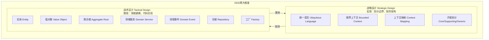
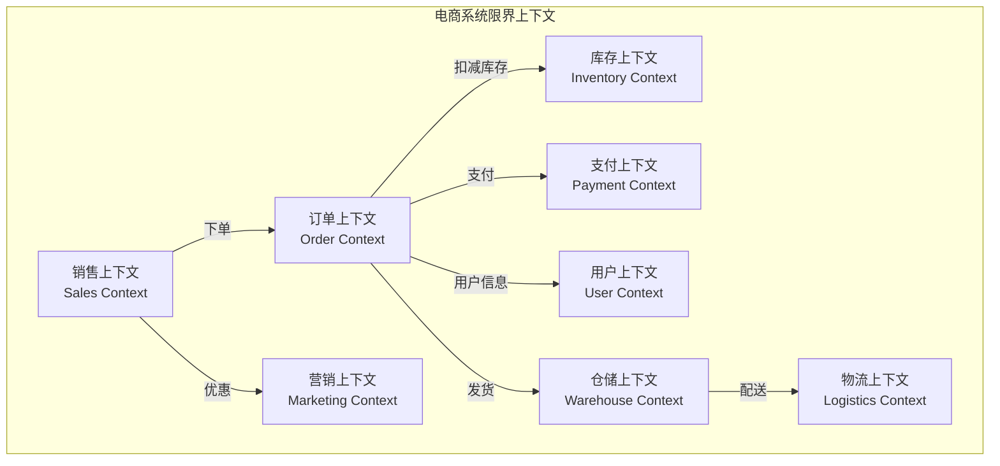
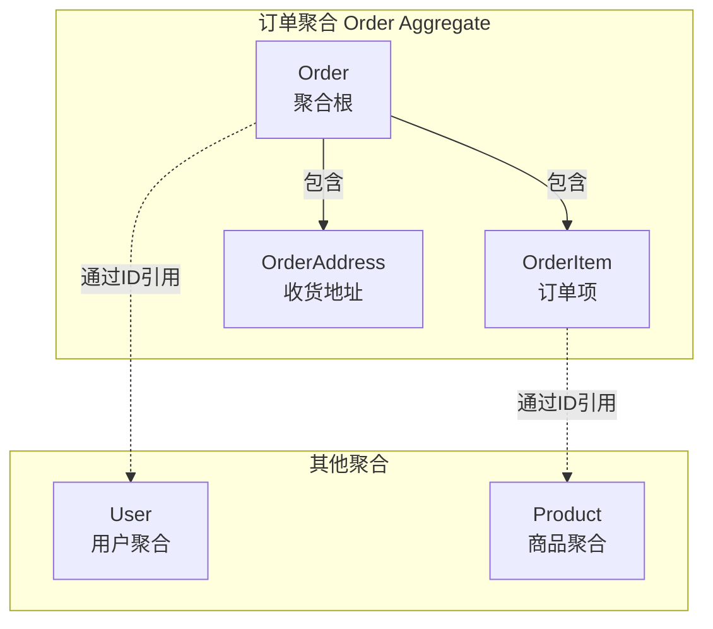
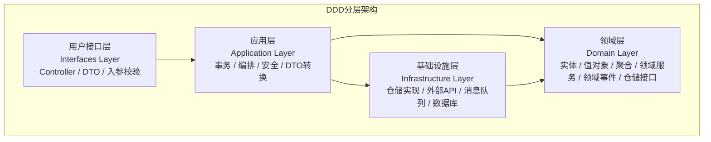

# DDD 领域驱动设计基础

> **文档说明**：系统讲解领域驱动设计（Domain-Driven Design, DDD）的核心概念、战术设计与战略设计，包括限界上下文、聚合根、实体、值对象、领域服务、领域事件、仓储、工厂、统一语言、上下文映射等，含电商领域完整建模示例和代码实现。
>
> **适用人群**：后端架构师、高级开发工程师、希望从 CRUD 开发进阶到领域建模的开发者
>
> **前置知识**：[[架构设计原则-SOLID]]、[[设计模式核心]]、[[微服务架构核心概念]]

---

## 一、概述

**领域驱动设计（Domain-Driven Design, DDD）** 是 Eric Evans 在 2003 年出版的《领域驱动设计：软件核心复杂性应对之道》中提出的一种软件开发方法论，核心思想是**以业务领域为核心驱动软件设计**，通过建立统一的领域模型来应对复杂业务系统的设计挑战。

### 1. 为什么需要 DDD

传统三层架构（Controller→Service→DAO）在复杂业务系统中的痛点：

| 痛点 | 说明 |
|------|------|
| **贫血模型** | Service 层充斥大量业务逻辑，Entity 只有 getter/setter，变成数据载体 |
| **业务逻辑分散** | 业务规则散落在 Service、Controller、甚至前端，难以维护 |
| **无法表达业务** | 代码结构与业务概念脱节，开发者和业务人员沟通困难 |
| **微服务拆分困难** | 没有清晰的领域边界，微服务拆分凭感觉，导致服务间耦合严重 |
| **变更成本高** | 业务规则变更时，需要在多处修改，容易遗漏 |

**DDD 的价值**：
- **统一语言**：业务人员和技术人员使用相同的术语沟通，减少误解
- **清晰边界**：通过限界上下文划分业务边界，指导微服务拆分
- **业务内聚**：业务逻辑封装在领域模型中，而非散落在 Service 层
- **可维护性**：领域模型反映业务本质，业务变更时模型同步演进
- **知识沉淀**：领域模型是业务知识的载体，新人可通过模型快速理解业务

### 2. DDD 两大维度



| 维度 | 关注点 | 产出 | 参与者 |
|------|--------|------|--------|
| **战略设计** | 业务边界划分、上下文关系、子域分类 | 限界上下文图、上下文映射图 | 架构师 + 领域专家 |
| **战术设计** | 领域模型内部结构、对象关系、行为建模 | 聚合、实体、值对象、领域服务 | 开发工程师 + 领域专家 |

### 3. DDD 适用场景

| 适合 DDD | 不适合 DDD |
|---------|-----------|
| 业务复杂、规则多的系统（电商、金融、保险） | 简单 CRUD 系统（后台管理、数据展示） |
| 业务变化频繁、需要快速响应的系统 | 技术复杂度高但业务简单的系统（中间件、基础设施） |
| 多团队协作、需要清晰边界的大型系统 | 小型项目、原型验证、MVP |
| 微服务架构、需要合理拆分服务的系统 | 团队缺乏领域专家、业务理解不足 |
| 长期维护、需要知识沉淀的核心系统 | 一次性项目、短期外包 |

---

## 二、战略设计

### 1. 统一语言（Ubiquitous Language）

**统一语言**是 DDD 的基石，指在一个限界上下文内，业务人员和技术人员使用**相同的术语**进行沟通，并且这些术语直接反映在代码中。

**为什么重要**：
- 业务人员说"订单"，代码里就叫 `Order`，而不是 `OrderInfo`、`OrderDTO`、`OrderEntity`
- 避免"翻译损耗"：业务概念 → 技术概念的翻译过程中容易丢失或曲解
- 代码即文档：阅读代码就能理解业务

**统一语言实践**：
```text
❌ 不好的命名（技术导向）：
- OrderInfo（订单信息？什么信息？）
- UserData（用户数据？）
- handleOrder（处理订单？怎么处理？）
- processData（处理数据？什么数据？）

✅ 好的命名（业务导向）：
- Order（订单）
- ShoppingCart（购物车）
- placeOrder（下单）
- cancelOrder（取消订单）
- calculateShippingFee（计算运费）
```

**建立统一语言的方法**：
1. **事件风暴（Event Storming）**：团队一起梳理业务事件，提取领域术语
2. **领域词汇表**：维护一个业务术语表，明确每个术语的定义
3. **代码评审**：评审时检查命名是否符合统一语言
4. **持续演进**：统一语言不是一成不变的，随着业务理解深入而演进

### 2. 限界上下文（Bounded Context）

**限界上下文**是 DDD 战略设计的核心概念，指一个**统一语言适用的边界**。在这个边界内，所有术语都有明确、唯一的含义；跨越边界，同一个术语可能有不同含义。

**为什么需要限界上下文**：
- 同一个词在不同业务场景下含义不同：
  - "商品"在销售上下文 = 可售卖的商品（含价格、库存）
  - "商品"在采购上下文 = 可采购的物料（含供应商、采购价）
  - "商品"在仓储上下文 = 可存储的物品（含重量、尺寸、存储位置）
- 如果不划分边界，"商品"模型会越来越臃肿，包含所有上下文的属性
- 限界上下文给每个术语一个明确的适用范围

**限界上下文示例（电商系统）**：



| 限界上下文 | 核心概念 | 统一语言示例 |
|-----------|---------|-------------|
| **销售上下文** | 商品、购物车、价格、促销 | Product（含售价）、ShoppingCart、Price |
| **订单上下文** | 订单、订单项、订单状态 | Order、OrderItem、OrderStatus |
| **库存上下文** | 库存、入库、出库、盘点 | Stock、StockIn、StockOut |
| **支付上下文** | 支付单、支付方式、退款 | Payment、PaymentMethod、Refund |
| **用户上下文** | 用户、账户、地址 | User、Account、Address |
| **营销上下文** | 优惠券、活动、积分 | Coupon、Campaign、Points |
| **仓储上下文** | 仓库、库位、物品 | Warehouse、Location、Item |
| **物流上下文** | 运单、快递、轨迹 | Shipment、Express、Tracking |

**限界上下文与微服务的关系**：
- 一个限界上下文 → 通常对应一个微服务（理想情况）
- 多个限界上下文 → 可能合并为一个微服务（初期团队小、业务简单时）
- 一个限界上下文 → 可能拆分为多个微服务（业务复杂、团队大时）
- **限界上下文是业务边界，微服务是技术边界，两者不一定一一对应**

### 3. 子域划分（Subdomain）

**子域**是对整个业务领域的划分，根据业务价值和重要性分为三类：

| 子域类型 | 说明 | 示例（电商） | 策略 |
|---------|------|-------------|------|
| **核心域（Core Domain）** | 业务的核心竞争力，投入最多资源 | 订单、交易、营销 | 自研、精细建模、持续投入 |
| **支撑域（Supporting Domain）** | 支持核心域运作，但不直接产生竞争力 | 库存、仓储、物流 | 可自研或采购，适度建模 |
| **通用域（Generic Domain）** | 行业通用能力，无差异化 | 用户认证、消息通知、文件存储 | 优先采购/开源，简单建模 |

**子域 vs 限界上下文**：
- 子域是**问题空间**（Problem Space）：从业务视角划分
- 限界上下文是**解决方案空间**（Solution Space）：从技术/设计视角划分
- 通常一个子域对应一个限界上下文，但也可能一个子域包含多个上下文

### 4. 上下文映射（Context Mapping）

**上下文映射**描述限界上下文之间的关系和集成方式。

| 关系类型 | 说明 | 示例 |
|---------|------|------|
| **合作关系（Partnership）** | 两个上下文紧密协作，一起演进 | 订单和支付（支付状态影响订单状态） |
| **共享内核（Shared Kernel）** | 两个上下文共享部分模型 | 订单和库存共享"商品ID"概念 |
| **客户-供应商（Customer-Supplier）** | 一个上下文依赖另一个的输出 | 物流依赖订单的发货信息 |
| **遵奉者（Conformist）** | 完全遵循上游上下文的模型，不做转换 | 第三方支付 API，只能按其接口对接 |
| **防腐层（ACL, Anti-Corruption Layer）** | 在依赖外部模型时，建立转换层防止外部概念污染本域 | 对接第三方物流 API，建立 ACL 转换为内部模型 |
| **开放主机服务（OHS, Open Host Service）** | 对外提供明确的协议/API，供其他上下文集成 | 订单上下文提供 REST API |
| **发布语言（PL, Published Language）** | 上下文间交换数据的标准格式 | JSON Schema、Protobuf、事件契约 |
| **另谋他路（Separate Way）** | 两个上下文没有关系，完全独立 | 用户认证和商品推荐（初期无关联） |
| **大泥球（Big Ball of Mud）** | 边界混乱、耦合严重的遗留系统 | 遗留单体系统 |

**防腐层（ACL）示例**：
```java
// 第三方物流 API 返回的模型（外部概念）
public class ThirdPartyShipmentDTO {
    private String waybillNo;      // 运单号
    private String recipientName;   // 收件人
    private String recipientPhone;  // 收件电话
    private String address;         // 地址（字符串）
    private String status;          // 状态（第三方编码）
}

// 防腐层：将外部模型转换为内部领域模型
@Component
public class LogisticsACL {
    private final ThirdPartyLogisticsClient client;

    public Shipment getShipment(String waybillNo) {
        ThirdPartyShipmentDTO dto = client.getShipment(waybillNo);
        // 转换为内部模型
        return Shipment.builder()
            .waybillNo(dto.getWaybillNo())
            .recipient(new Recipient(dto.getRecipientName(), dto.getRecipientPhone()))
            .address(Address.parse(dto.getAddress()))  // 字符串解析为值对象
            .status(ShipmentStatus.fromCode(dto.getStatus()))  // 编码转换为枚举
            .build();
    }
}
```

---

## 三、战术设计

### 1. 实体（Entity）

**实体**是具有**唯一标识**和**生命周期**的领域对象，其属性会随时间变化，但身份不变。

| 特征 | 说明 |
|------|------|
| **唯一标识** | 有 ID，两个实体即使所有属性相同，只要 ID 不同就是不同实体 |
| **可变状态** | 属性会随业务操作变化 |
| **生命周期** | 有创建、变更、销毁的过程 |
| **行为丰富** | 封装与自身相关的业务逻辑（充血模型） |

**实体示例**：
```java
// 订单实体（充血模型：封装业务行为）
public class Order {
    private OrderId id;           // 唯一标识（值对象）
    private UserId userId;
    private List<OrderItem> items;
    private OrderStatus status;
    private Money totalAmount;
    private Address shippingAddress;
    private LocalDateTime createdAt;

    // 构造函数：保证不变量
    public Order(UserId userId, List<OrderItem> items, Address shippingAddress) {
        if (items == null || items.isEmpty()) {
            throw new IllegalArgumentException("订单项不能为空");
        }
        this.id = new OrderId(UUID.randomUUID().toString());
        this.userId = userId;
        this.items = items;
        this.shippingAddress = shippingAddress;
        this.status = OrderStatus.CREATED;
        this.totalAmount = calculateTotal();
        this.createdAt = LocalDateTime.now();
    }

    // 业务行为：取消订单
    public void cancel(String reason) {
        if (status == OrderStatus.PAID) {
            throw new IllegalStateException("已支付订单不能直接取消，需申请退款");
        }
        if (status == OrderStatus.SHIPPED) {
            throw new IllegalStateException("已发货订单不能取消");
        }
        this.status = OrderStatus.CANCELLED;
        // 发布领域事件
        DomainEvents.publish(new OrderCancelledEvent(id, reason));
    }

    // 业务行为：支付
    public void pay(Payment payment) {
        if (status != OrderStatus.CREATED) {
            throw new IllegalStateException("只有待支付订单才能支付");
        }
        if (!payment.getAmount().equals(totalAmount)) {
            throw new IllegalArgumentException("支付金额与订单金额不一致");
        }
        this.status = OrderStatus.PAID;
        DomainEvents.publish(new OrderPaidEvent(id, payment.getId()));
    }

    // 内部计算
    private Money calculateTotal() {
        return items.stream()
            .map(OrderItem::getSubtotal)
            .reduce(Money.ZERO, Money::add);
    }

    // Getter（只读，不暴露修改入口）
    public OrderId getId() { return id; }
    public OrderStatus getStatus() { return status; }
    public Money getTotalAmount() { return totalAmount; }
}
```

**实体 vs 贫血模型**：
```java
// ❌ 贫血模型：只有 getter/setter，业务逻辑在 Service
public class Order {
    private String id;
    private String status;
    // getter/setter...
}

// 业务逻辑散落在 Service
@Service
public class OrderService {
    public void cancelOrder(String orderId, String reason) {
        Order order = orderRepository.findById(orderId);
        if ("PAID".equals(order.getStatus())) {
            throw new RuntimeException("已支付订单不能取消");
        }
        order.setStatus("CANCELLED");
        orderRepository.save(order);
    }
}

// ✅ 充血模型：业务逻辑封装在实体内
Order order = orderRepository.findById(orderId);
order.cancel(reason);  // 业务规则在实体内
orderRepository.save(order);
```

### 2. 值对象（Value Object）

**值对象**是没有唯一标识、通过**属性值**判断相等性的领域对象，通常是不可变的。

| 特征 | 说明 |
|------|------|
| **无唯一标识** | 没有 ID，两个值对象属性完全相同就视为相等 |
| **不可变** | 创建后属性不可修改，修改需创建新对象 |
| **可替换** | 可以被另一个相等的值对象替换 |
| **行为丰富** | 可以封装与自身相关的计算/验证逻辑 |

**值对象示例**：
```java
// 金额值对象（不可变）
public final class Money {
    public static final Money ZERO = new Money(BigDecimal.ZERO, "CNY");

    private final BigDecimal amount;
    private final String currency;

    public Money(BigDecimal amount, String currency) {
        if (amount == null || amount.compareTo(BigDecimal.ZERO) < 0) {
            throw new IllegalArgumentException("金额不能为负");
        }
        this.amount = amount;
        this.currency = currency;
    }

    // 行为：加法（返回新对象，不修改自身）
    public Money add(Money other) {
        if (!this.currency.equals(other.currency)) {
            throw new IllegalArgumentException("币种不同不能相加");
        }
        return new Money(this.amount.add(other.amount), this.currency);
    }

    // 行为：乘法
    public Money multiply(int quantity) {
        return new Money(this.amount.multiply(BigDecimal.valueOf(quantity)), this.currency);
    }

    // 相等性：基于属性值
    @Override
    public boolean equals(Object o) {
        if (this == o) return true;
        if (!(o instanceof Money)) return false;
        Money money = (Money) o;
        return amount.compareTo(money.amount) == 0 && currency.equals(money.currency);
    }

    @Override
    public int hashCode() {
        return Objects.hash(amount.stripTrailingZeros(), currency);
    }
}

// 地址值对象
public final class Address {
    private final String province;
    private final String city;
    private final String district;
    private final String detail;
    private final String zipCode;

    // 工厂方法：从字符串解析
    public static Address parse(String addressStr) {
        // 解析逻辑...
    }

    // 行为：格式化输出
    public String format() {
        return province + city + district + detail;
    }
}
```

**实体 vs 值对象**：

| 维度 | 实体 | 值对象 |
|------|------|--------|
| **标识** | 有唯一 ID | 无 ID，属性即标识 |
| **可变性** | 可变（状态变化） | 不可变 |
| **相等性** | ID 相等即相等 | 所有属性相等即相等 |
| **生命周期** | 有（创建→变更→销毁） | 无（创建即用，用完即弃） |
| **示例** | 订单、用户、商品 | 金额、地址、日期范围、坐标 |

### 3. 聚合根（Aggregate Root）

**聚合**是一组相关对象的集合，作为一个**数据修改的单元**。**聚合根**是聚合的入口对象，外部只能通过聚合根访问聚合内的其他对象。

| 规则 | 说明 |
|------|------|
| **唯一入口** | 外部只能引用聚合根，不能直接引用聚合内的其他对象 |
| **事务边界** | 一个事务只修改一个聚合（强一致性），跨聚合用最终一致性 |
| **不变量保护** | 聚合根负责维护聚合内所有对象的不变量（业务规则） |
| **引用其他聚合** | 聚合之间通过 ID 引用，不直接持有对象引用 |
| **大小适中** | 聚合不宜过大（影响性能），也不宜过小（失去一致性意义） |

**聚合示例（订单聚合）**：



```java
// 订单聚合根
public class Order {
    private OrderId id;
    private UserId userId;           // 通过 ID 引用用户聚合（不直接持有 User 对象）
    private List<OrderItem> items;   // 聚合内对象
    private OrderAddress address;     // 聚合内值对象
    private OrderStatus status;
    private Money totalAmount;

    // 外部只能通过聚合根操作订单项
    public void addItem(ProductId productId, Money price, int quantity) {
        // 聚合根维护不变量
        if (status != OrderStatus.CREATED) {
            throw new IllegalStateException("只有待支付订单才能添加商品");
        }
        // 检查是否已存在该商品，存在则合并数量
        Optional<OrderItem> existing = items.stream()
            .filter(item -> item.getProductId().equals(productId))
            .findFirst();
        if (existing.isPresent()) {
            existing.get().increaseQuantity(quantity);
        } else {
            items.add(new OrderItem(productId, price, quantity));
        }
        this.totalAmount = calculateTotal();
    }

    public void removeItem(ProductId productId) {
        items.removeIf(item -> item.getProductId().equals(productId));
        this.totalAmount = calculateTotal();
    }

    // 不暴露 items 的直接引用（防止外部修改）
    public List<OrderItem> getItems() {
        return Collections.unmodifiableList(items);
    }
}

// 订单项（聚合内实体，外部不能直接引用）
class OrderItem {
    private ProductId productId;
    private Money price;
    private int quantity;

    void increaseQuantity(int delta) {
        this.quantity += delta;
    }

    Money getSubtotal() {
        return price.multiply(quantity);
    }
}
```

**聚合设计原则**：
- [ ] **小聚合优先**：聚合越小，并发冲突越少，性能越好
- [ ] **通过 ID 引用其他聚合**：不直接持有对象引用，避免聚合过大
- [ ] **一个事务一个聚合**：跨聚合一致性用领域事件+最终一致性
- [ ] **聚合根是唯一入口**：外部不直接访问聚合内对象
- [ ] **不变量在聚合根内维护**：业务规则封装在聚合根

### 4. 领域服务（Domain Service）

**领域服务**是封装**不属于任何实体或值对象**的业务逻辑的服务，通常涉及多个聚合或需要外部资源的业务操作。

**什么时候用领域服务**：
1. 业务逻辑涉及**多个聚合**的协调（如转账涉及两个账户）
2. 业务逻辑需要**外部资源**（如调用外部 API、发送消息）
3. 业务逻辑是**纯操作**，没有状态（如计算运费规则）
4. 强行放在实体内会导致实体职责不单一

**领域服务示例**：
```java
// 转账领域服务（涉及两个账户聚合）
@DomainService
public class TransferService {
    private final AccountRepository accountRepository;
    private final TransactionRepository transactionRepository;

    @Transactional
    public TransactionId transfer(AccountId from, AccountId to, Money amount, String remark) {
        // 1. 加载源账户和目标账户（两个聚合）
        Account fromAccount = accountRepository.findById(from)
            .orElseThrow(() -> new AccountNotFoundException(from));
        Account toAccount = accountRepository.findById(to)
            .orElseThrow(() -> new AccountNotFoundException(to));

        // 2. 执行业务操作（委托给聚合根）
        fromAccount.debit(amount);   // 源账户扣款
        toAccount.credit(amount);     // 目标账户入账

        // 3. 创建交易记录
        Transaction transaction = Transaction.create(from, to, amount, remark);

        // 4. 持久化（一个事务修改两个聚合，这里是特例，通常应避免）
        accountRepository.save(fromAccount);
        accountRepository.save(toAccount);
        transactionRepository.save(transaction);

        return transaction.getId();
    }
}

// 运费计算领域服务（纯计算，无状态，涉及多个规则）
@DomainService
public class ShippingFeeCalculator {
    private final List<ShippingRule> rules;

    public Money calculate(Address destination, List<OrderItem> items) {
        Money totalWeight = calculateTotalWeight(items);
        // 按规则匹配最优运费
        return rules.stream()
            .filter(rule -> rule.supports(destination, totalWeight))
            .map(rule -> rule.calculate(destination, totalWeight))
            .min(Money::compareTo)
            .orElseThrow(() -> new ShippingNotSupportedException(destination));
    }
}
```

**领域服务 vs 应用服务**：

| 维度 | 领域服务 | 应用服务 |
|------|---------|---------|
| **职责** | 业务逻辑、领域规则 | 协调、事务、安全、外部调用 |
| **位置** | 领域层 | 应用层 |
| **示例** | 转账逻辑、运费计算 | 下单流程编排、DTO 转换 |
| **依赖** | 只依赖领域模型 | 依赖领域服务、仓储、外部服务 |

### 5. 领域事件（Domain Event）

**领域事件**是领域中发生的**有业务意义的事情**，用于解耦聚合间的协作，实现最终一致性。

**领域事件示例**：
```java
// 领域事件基类
public abstract class DomainEvent {
    private final String eventId;
    private final LocalDateTime occurredAt;

    protected DomainEvent() {
        this.eventId = UUID.randomUUID().toString();
        this.occurredAt = LocalDateTime.now();
    }
}

// 订单已支付事件
public class OrderPaidEvent extends DomainEvent {
    private final OrderId orderId;
    private final PaymentId paymentId;
    private final Money amount;

    public OrderPaidEvent(OrderId orderId, PaymentId paymentId, Money amount) {
        super();
        this.orderId = orderId;
        this.paymentId = paymentId;
        this.amount = amount;
    }
}

// 聚合根发布事件
public class Order {
    private List<DomainEvent> domainEvents = new ArrayList<>();

    public void pay(Payment payment) {
        // ... 业务逻辑
        this.status = OrderStatus.PAID;
        // 发布事件（先记录在聚合内，由仓储/应用服务统一发送）
        domainEvents.add(new OrderPaidEvent(this.id, payment.getId(), this.totalAmount));
    }

    public List<DomainEvent> getDomainEvents() {
        return Collections.unmodifiableList(domainEvents);
    }

    public void clearDomainEvents() {
        domainEvents.clear();
    }
}

// 事件处理器（库存上下文监听订单支付事件）
@Component
public class OrderPaidEventHandler {
    private final InventoryService inventoryService;

    @EventListener
    public void onOrderPaid(OrderPaidEvent event) {
        // 扣减库存（最终一致性）
        inventoryService.deductStock(event.getOrderId());
    }
}
```

**领域事件的价值**：
- **解耦**：订单聚合不需要知道库存聚合的存在，通过事件解耦
- **最终一致性**：跨聚合操作不要求强一致，通过事件异步处理
- **可追溯**：事件是业务操作的记录，可用于审计、回放、CQRS
- **扩展性**：新增下游服务只需监听事件，不需修改上游

### 6. 仓储（Repository）

**仓储**是封装**数据持久化**的接口，提供类似集合的访问方式，隐藏数据存储的细节。

```java
// 仓储接口（在领域层定义）
public interface OrderRepository {
    Order findById(OrderId id);
    void save(Order order);
    void delete(OrderId id);
    List<Order> findByUserId(UserId userId);
    Optional<Order> findByOrderNo(String orderNo);
}

// 仓储实现（在基础设施层实现）
@Repository
public class JpaOrderRepository implements OrderRepository {
    private final SpringDataOrderRepository jpaRepository;
    private final OrderConverter converter;

    @Override
    public Order findById(OrderId id) {
        return jpaRepository.findById(id.getValue())
            .map(converter::toDomain)
            .orElseThrow(() -> new OrderNotFoundException(id));
    }

    @Override
    @Transactional
    public void save(Order order) {
        OrderPO po = converter.toPO(order);
        jpaRepository.save(po);
        // 保存后发布领域事件
        order.getDomainEvents().forEach(DomainEvents::publish);
        order.clearDomainEvents();
    }
}
```

**仓储 vs DAO**：

| 维度 | 仓储（Repository） | DAO |
|------|-------------------|-----|
| **抽象层次** | 领域层，面向领域模型 | 数据层，面向数据表 |
| **返回类型** | 领域对象（聚合根） | 数据对象（PO/Entity） |
| **接口风格** | 类似集合（findById/save） | 类似 SQL（insert/update/select） |
| **职责** | 持久化聚合，管理领域事件 | CRUD 操作 |

### 7. 工厂（Factory）

**工厂**负责创建复杂的领域对象，封装创建逻辑，确保对象创建时满足不变量。

```java
// 订单工厂
@DomainService
public class OrderFactory {
    private final ProductRepository productRepository;

    public Order create(UserId userId, List<CartItem> cartItems, Address address) {
        // 1. 查询商品信息
        List<OrderItem> orderItems = cartItems.stream()
            .map(cartItem -> {
                Product product = productRepository.findById(cartItem.getProductId());
                return new OrderItem(product.getId(), product.getPrice(), cartItem.getQuantity());
            })
            .collect(Collectors.toList());

        // 2. 创建订单（构造函数保证不变量）
        return new Order(userId, orderItems, address);
    }
}
```

---

## 四、分层架构

DDD 推荐的分层架构：



| 层 | 职责 | 依赖方向 |
|----|------|---------|
| **用户接口层** | 接收请求、参数校验、DTO 转换、返回响应 | 依赖应用层 |
| **应用层** | 事务管理、用例编排、安全控制、调用领域服务 | 依赖领域层和基础设施层 |
| **领域层** | 领域模型（实体/值对象/聚合）、领域服务、领域事件、仓储接口 | 不依赖任何层（核心） |
| **基础设施层** | 仓储实现、外部服务调用、消息发送、技术框架 | 实现领域层接口 |

**依赖倒置原则**：领域层定义仓储接口，基础设施层实现接口，应用层依赖接口而非实现。

---

## 五、事件风暴（Event Storming）

**事件风暴**是 DDD 中常用的协作建模方法，由 Alberto Brandolini 提出，通过团队协作梳理业务事件来发现领域模型。

**事件风暴步骤**：
1. **准备**：大墙面、不同颜色便签、领域专家+开发团队
2. **事件梳理（橙色便签）**：按时间线列出所有领域事件（过去时命名，如"订单已支付"）
3. **命令识别（蓝色便签）**：每个事件前是什么命令触发的（如"支付订单"）
4. **聚合识别（黄色便签）**：命令和事件属于哪个聚合
5. **限界上下文划分**：按业务边界将聚合分组，形成限界上下文
6. **上下文映射**：梳理上下文间的关系

**事件风暴产出**：领域事件清单、聚合模型、限界上下文图、上下文映射图。

---

## 六、常见误区

| 误区 | 说明 | 正确理解 |
|------|------|---------|
| **所有系统都要用 DDD** | 简单 CRUD 系统强行 DDD 会过度设计 | 复杂业务系统才需要 DDD |
| **聚合就是表** | 把聚合根对应数据库表，聚合就是 ORM | 聚合是业务概念，表是存储概念，不一定一一对应 |
| **微服务=限界上下文** | 一个微服务就是一个限界上下文 | 限界上下文是业务边界，微服务是技术边界，不一定一一对应 |
| **贫血模型改充血** | 给 Entity 加几个方法就是 DDD | 关键是业务逻辑内聚、统一语言、清晰边界 |
| **领域服务=Service** | 把原来的 Service 改名叫 DomainService | 领域服务只放领域逻辑，应用逻辑放应用服务 |
| **所有操作都用领域事件** | 过度使用事件导致系统复杂 | 跨聚合、异步、解耦场景才用事件，简单同步调用即可 |
| **聚合越大越好** | 把所有相关对象放进一个聚合 | 小聚合优先，通过 ID 引用其他聚合 |
| **仓储就是 DAO** | 仓储接口和 DAO 一样写 CRUD | 仓储面向领域模型，提供类似集合的语义 |

---

## 七、关联笔记

### 架构
- [[架构设计原则-SOLID]] · [[设计模式核心]] · [[高可用架构设计]]
- [[高并发系统设计案例]] · [[微服务架构核心概念]] · [[技术选型决策指南]]

### 后端
- [[SpringBoot-自动装配原理]] · [[Spring事务管理与传播机制]] · [[MyBatis-核心原理与插件]]
- [[Gateway-网关路由与鉴权]] · [[统一AI网关设计与实现]]

### 分布式
- [[分布式事务解决方案]] · [[分布式锁原理与实现]] · [[分布式ID生成方案]]
- [[消息队列-Kafka与RabbitMQ]] · [[配置中心实战]]

### 实战
- [[DDD领域驱动设计实战]] · [[秒杀系统架构设计]] · [[支付系统架构设计]]
- [[秒杀系统架构设计]]

### 导航
- [[MOC-后端开发]] · [[全栈+AI工程双轨融合学习路线图]]

> **学习路径建议**：先掌握 [[架构设计原则-SOLID]] 设计原则 → 学习 [[设计模式核心]] 常用模式 → 深入本文 DDD 基础 → 实践 [[DDD领域驱动设计实战]] 建模 → 研究 [[微服务架构核心概念]] 服务拆分 → 应用于 [[秒杀系统架构设计]] 和 [[支付系统架构设计]] 复杂业务系统。

---

## 💡 全文深度讲解

本文系统梳理了DDD 领域驱动设计基础的核心知识体系，从概述入手，深入战略设计的底层机制，再通过战术设计掌握实战应用，最后涵盖常见误区与关联笔记。学习时建议先建立整体认知，再动手实践，最后结合常见问题深化理解。

## 📝 全文精简总结

- **概述**：掌握本模块的核心概念与关键要点
- **战略设计**：掌握本模块的核心概念与关键要点
- **战术设计**：掌握本模块的核心概念与关键要点
- **分层架构**：掌握本模块的核心概念与关键要点
- **事件风暴（Event Storming）**：掌握本模块的核心概念与关键要点
- **常见误区**：掌握本模块的核心概念与关键要点
- **关联笔记**：掌握本模块的核心概念与关键要点

