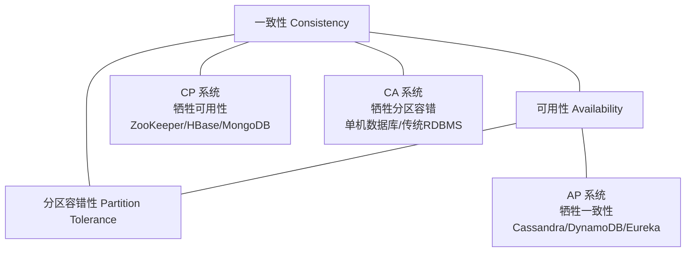
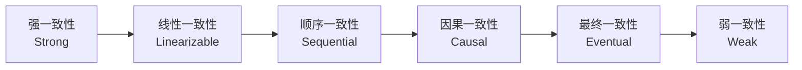

# 分布式系统-CAP定理与一致性

> **文档说明**：系统讲解 CAP 定理（一致性/可用性/分区容错性）、一致性模型谱系（强一致/最终一致/因果一致/读写一致）、BASE 理论、一致性协议（Paxos/Raft/Gossip）、分布式事务方案，以及 CAP 在实际系统中的权衡选择和常见问题。
>
> **适用人群**：后端开发工程师、全栈开发者、分布式系统架构师
>
> **前置知识**：[[分布式系统-高可用架构设计]]、[[Raft共识算法详解]]、[[分布式事务 知识点系统梳理_优化版]]、[[分布式锁知识点系统梳理_优化版]]

---

## 一、概述

### 1. 什么是 CAP 定理

**CAP 定理（CAP Theorem）** 由 Eric Brewer 在 2000 年提出，2002 年被 Seth Gilbert 和 Nancy Lynch 证明。该定理指出：**分布式系统不可能同时满足一致性（Consistency）、可用性（Availability）和分区容错性（Partition tolerance），最多只能同时满足其中两个。**

### 2. CAP 三要素

| 要素 | 缩写 | 说明 |
|------|------|------|
| **一致性（Consistency）** | C | 所有节点在同一时刻看到相同的数据。写操作后，所有读操作都返回最新值 |
| **可用性（Availability）** | A | 每个请求都能在有限时间内得到非错误响应（不保证是最新数据） |
| **分区容错性（Partition tolerance）** | P | 系统在网络分区（节点间通信中断）情况下仍能继续运行 |

### 3. CAP 三角



### 4. CAP 的常见误解

| 误解 | 正解 |
|------|------|
| **CAP 是三选二，随时可以切换** | P 是分布式系统的前提，实际是 C 和 A 之间的权衡 |
| **强一致一定不可用** | 无分区时可同时满足 C 和 A，分区时才需权衡 |
| **最终一致就是不一致** | 最终一致是一致性的一种，只是有延迟 |
| **CAP 适用于所有系统** | CAP 只适用于分布式存储系统，不适用于所有分布式系统 |

> **关键理解**：在分布式系统中，网络分区（P）不可避免，因此实际是在 **C（一致性）和 A（可用性）之间做权衡**。

---

## 二、一致性模型

### 1. 一致性谱系



| 一致性模型 | 说明 | 延迟 | 复杂度 | 示例 |
|-----------|------|------|--------|------|
| **线性一致性（强一致）** | 操作看起来是原子的、全局有序的 | 高 | 高 | ZooKeeper、etcd、HBase |
| **顺序一致性** | 所有进程看到相同的操作顺序 | 中高 | 中 | 部分分布式文件系统 |
| **因果一致性** | 有因果关系的操作顺序一致 | 中 | 中 | CODA、部分聊天系统 |
| **最终一致性** | 经过一段时间后所有副本一致 | 低 | 低 | DNS、Cassandra、DynamoDB |
| **弱一致性** | 不保证何时一致 | 最低 | 最低 | 缓存、CDN |

### 2. 强一致性

**强一致性（Strong Consistency）** 要求：一旦写操作完成，所有后续读操作（无论哪个节点）都返回最新值。

| 实现方式 | 说明 |
|---------|------|
| **主从同步复制** | 写主节点，同步复制到所有从节点后才返回成功 |
| **Quorum 读写** | 写 W 个节点，读 R 个节点，W + R > N 保证强一致 |
| **共识算法** | Paxos/Raft 等多数派共识协议 |

```text
强一致性读写（Quorum）：
N = 3（3 个副本）
W = 2（写至少 2 个节点成功）
R = 2（读至少 2 个节点）
W + R = 4 > N = 3 → 保证读到最新数据
```

### 3. 最终一致性

**最终一致性（Eventual Consistency）** 要求：如果没有新的更新操作，经过一段时间后，所有副本最终会达到一致状态。

| 变种 | 说明 |
|------|------|
| **读己之写（Read-your-writes）** | 写后立即可读到自己的写入 |
| **写后读（Writes follow reads）** | 写操作在之前的读操作之后 |
| **单调读（Monotonic reads）** | 读到某值后不会读到更旧的值 |
| **单调写（Monotonic writes）** | 写操作按发起顺序执行 |
| **因果一致（Causal consistency）** | 有因果关系的操作顺序一致 |

### 4. 一致性对比

| 维度 | 强一致性 | 最终一致性 |
|------|---------|-----------|
| **数据新鲜度** | 实时最新 | 可能有延迟 |
| **可用性** | 分区时可能不可用 | 始终可用 |
| **延迟** | 较高（需同步） | 较低 |
| **实现复杂度** | 高 | 低 |
| **冲突处理** | 无冲突（同步写） | 需处理并发冲突 |
| **适用场景** | 金融、库存、账户 | 社交、评论、浏览量 |

---

## 三、可用性与分区容错

### 1. 可用性

**可用性（Availability）** = 系统正常服务时间 / 总时间

| 可用性等级 | 年停机时间 | 说明 |
|-----------|-----------|------|
| **99%** | 3.65 天 | 基础可用 |
| **99.9%** | 8.76 小时 | 较高可用 |
| **99.99%** | 52.6 分钟 | 高可用（4个9） |
| **99.999%** | 5.26 分钟 | 极高可用（5个9） |
| **99.9999%** | 31.5 秒 | 电信级可用（6个9） |

### 2. 网络分区

**网络分区（Network Partition）** 是分布式系统中节点间通信中断的情况，是不可避免的：

| 分区原因 | 说明 |
|---------|------|
| **网络设备故障** | 交换机、路由器故障 |
| **网络拥塞** | 流量过大导致丢包 |
| **跨地域延迟** | 跨机房/跨地域网络延迟 |
| **防火墙策略** | 安全策略阻断通信 |
| **节点故障** | 节点宕机导致逻辑分区 |

> **关键结论**：分布式系统必须容忍分区（P），因此 CAP 实际是 **C 和 A 的二选一**。

### 3. 分区时的权衡

```text
网络分区发生时：
┌─────────────────────────────────────────────┐
│  选择 C（一致性）                           │
│  → 拒绝部分请求，保证数据一致               │
│  → 系统部分不可用                           │
│  → 适用：金融、库存、账户等强一致场景       │
├─────────────────────────────────────────────┤
│  选择 A（可用性）                           │
│  → 继续服务，但可能返回旧数据               │
│  → 分区恢复后通过冲突解决达到一致           │
│  → 适用：社交、内容推荐、浏览量等场景       │
└─────────────────────────────────────────────┘
```

---

## 四、CAP 实际应用

### 1. CP 系统（一致性优先）

**CP 系统**在网络分区时牺牲可用性，保证数据一致性。

| 系统 | 说明 | 场景 |
|------|------|------|
| **ZooKeeper** | 分布式协调服务，ZAB 协议 | 配置管理、命名服务、分布式锁 |
| **etcd** | 分布式键值存储，Raft 协议 | K8s 配置、服务发现 |
| **HBase** | 列式数据库，强一致 | 大数据存储 |
| **MongoDB** | 文档数据库（可配置） | 默认强一致 |
| **Redis（主从+Sentinel）** | 缓存（可配置） | 主从切换时可能短暂不可用 |
| **Consul** | 服务发现（可配置） | 默认 CP 模式 |

**CP 系统特点**：
- 分区时少数派节点拒绝服务
- 数据一致性有保障
- 适合对数据准确性要求高的场景

### 2. AP 系统（可用性优先）

**AP 系统**在网络分区时牺牲一致性，保证服务可用。

| 系统 | 说明 | 场景 |
|------|------|------|
| **Cassandra** | 宽列存储，Gossip 协议 | 高可用、跨地域、写入密集 |
| **DynamoDB** | AWS 键值数据库 | 高可用、低延迟 |
| **Eureka** | 服务注册中心 | 微服务注册发现（AP 优先） |
| **CouchDB** | 文档数据库，MVCC | 离线优先、多主复制 |
| **Riak** | 分布式键值存储 | 高可用、容错 |

**AP 系统特点**：
- 分区时所有节点继续服务
- 可能返回旧数据或冲突数据
- 分区恢复后通过冲突解决（Last-Write-Wins、向量时钟）达到一致
- 适合对可用性要求高、可容忍短暂不一致的场景

### 3. 系统选择决策

| 场景 | 推荐 | 原因 |
|------|------|------|
| **银行账户/支付** | CP | 金额必须准确，不能出现超扣 |
| **库存扣减** | CP | 不能超卖 |
| **订单状态** | CP | 状态必须准确 |
| **用户资料** | AP | 短暂旧数据可接受 |
| **社交动态/评论** | AP | 高可用优先，延迟可接受 |
| **浏览量/点赞数** | AP | 短暂不一致无影响 |
| **配置中心** | CP | 配置必须准确 |
| **服务发现** | AP（Eureka）或 CP（Nacos） | 看业务对一致性的要求 |
| **消息队列** | AP（Kafka）或 CP | 看对消息可靠性的要求 |

---

## 五、BASE 理论

### 1. BASE 概述

**BASE** 是对 CAP 中 AP 方案的抽象，是对传统 ACID 的补充：

| 缩写 | 全称 | 说明 |
|------|------|------|
| **B** | Basically Available（基本可用） | 系统出现故障时，允许损失部分可用性（响应时间变长、功能降级） |
| **S** | Soft State（软状态） | 允许系统存在中间状态，不影响整体可用性 |
| **E** | Eventually Consistent（最终一致性） | 数据不需要实时一致，经过一段时间后最终达到一致 |

### 2. ACID vs BASE

| 维度 | ACID | BASE |
|------|------|------|
| **一致性** | 强一致性 | 最终一致性 |
| **可用性** | 事务期间可能锁定 | 基本可用，允许降级 |
| **设计理念** | 保守，保证正确 | 激进，追求可用 |
| **适用场景** | 金融、传统关系型数据库 | 互联网高并发、分布式系统 |
| **事务** | 分布式事务（2PC/3PC） | 柔性事务（TCC/Saga/本地消息表） |
| **代表** | MySQL、PostgreSQL | Cassandra、DynamoDB、Redis |

### 3. 从 ACID 到 BASE 的演进

```text
传统单机数据库：ACID（强一致）
    ↓ 数据量增长，需要分布式
分布式数据库：CAP 权衡（C vs A）
    ↓ 互联网高可用需求
NoSQL 系统：BASE（最终一致 + 高可用）
    ↓ 新需求
NewSQL：兼顾 ACID 和高可用（Spanner、TiDB、OceanBase）
```

---

## 六、一致性协议

### 1. 共识算法

| 算法 | 说明 | 代表系统 |
|------|------|---------|
| **Paxos** | 经典共识算法，理论严谨但复杂 | Chubby、Google Spanner |
| **Raft** | Paxos 的易理解替代，工程友好 | etcd、Consul、TiKV |
| **ZAB** | ZooKeeper Atomic Broadcast | ZooKeeper |
| **Gossip** | 流行病协议，最终一致 | Cassandra、Redis Cluster |

### 2. Raft 共识（CP 系统）

Raft 通过 Leader 选举 + 日志复制实现强一致性，详细参考 [[Raft共识算法详解]]。

```text
Raft 核心：
1. Leader 选举：一个任期只有一个 Leader
2. 日志复制：Leader 接收写请求，复制到 Follower，多数派确认后提交
3. 安全性：保证已提交的日志不会被覆盖
```

### 3. Gossip 协议（AP 系统）

Gossip 协议通过节点间随机通信传播信息，实现最终一致性。

```text
Gossip 传播过程：
1. 节点 A 有新数据
2. A 随机选择几个节点发送数据
3. 收到数据的节点再随机选择其他节点传播
4. 像病毒传播一样，最终所有节点都收到数据
```

| Gossip 模式 | 说明 |
|------------|------|
| **反熵（Anti-Entropy）** | 节点定期对比数据，修复差异 |
| **谣言传播（Rumor-Mongering）** | 节点收到新数据后主动传播 |

### 4. Quorum 机制

Quorum 是一种通过多数派保证一致性的机制：

```text
N = 副本数
W = 写成功需要的副本数
R = 读成功需要的副本数

强一致：W + R > N（读写有交集，一定能读到最新）
高可用写：W = 1（写一个就成功）
高可用读：R = 1（读一个就返回）
```

| 配置 | W | R | 特点 |
|------|---|---|------|
| **强一致** | N/2+1 | N/2+1 | 一致性高，延迟较高 |
| **高可用写** | 1 | N | 写快，读慢 |
| **高可用读** | N | 1 | 写慢，读快 |
| **均衡** | N/2 | N/2+1 | 读写均衡 |

---

## 七、分布式事务与一致性

### 1. 分布式事务方案

| 方案 | 一致性 | 性能 | 复杂度 | 适用场景 |
|------|--------|------|--------|---------|
| **2PC（两阶段提交）** | 强一致 | 低 | 中 | 传统分布式事务 |
| **3PC（三阶段提交）** | 强一致 | 低 | 高 | 较少使用 |
| **TCC（Try-Confirm-Cancel）** | 最终一致 | 中 | 高 | 资金、库存 |
| **Saga** | 最终一致 | 高 | 中 | 长事务、业务流程 |
| **本地消息表** | 最终一致 | 高 | 低 | 异步解耦 |
| **事务消息** | 最终一致 | 高 | 低 | RocketMQ 事务消息 |
| **最大努力通知** | 最终一致 | 高 | 低 | 通知类业务 |

详细参考 [[分布式事务 知识点系统梳理_优化版]] 和 [[Seata-分布式事务]]。

### 2. 一致性与事务的关系

- **强一致系统**：通常使用 2PC/3PC 等同步事务，性能较低
- **最终一致系统**：通常使用 TCC/Saga/消息等柔性事务，性能较高
- **实际选择**：根据业务对一致性的要求选择合适的方案

---

## 八、常见问题与排查

| 问题 | 原因 | 解决方案 |
|------|------|---------|
| **数据不一致** | 分区后未同步 / 冲突解决策略不当 | 检查复制延迟、配置合适的一致性级别、冲突解决策略 |
| **服务不可用** | CP 系统分区时少数派拒绝服务 | 评估是否需要 AP 系统、增加副本数、跨地域部署 |
| **读写延迟高** | 强一致需要同步多数派 | 调整 Quorum 配置、使用缓存、读写分离 |
| **脑裂（Split Brain）** | 分区后两个分区都认为自己是主 | 多数派机制、Fencing、隔离级别配置 |
| **数据冲突** | AP 系统并发写入不同节点 | Last-Write-Wins、向量时钟、CRDT、业务层合并 |
| **复制延迟** | 网络慢 / 节点负载高 | 增加带宽、负载均衡、监控复制延迟 |
| **事务超时** | 2PC 长时间锁定 | 增加超时时间、改用柔性事务、优化事务 |
| **一致性级别配置错误** | 业务需要强一致但配置了最终一致 | 根据业务场景选择合适的一致性级别 |
| **跨地域一致性** | 跨地域网络延迟高 | 就近读写、异步复制、接受最终一致 |
| **缓存与 DB 不一致** | 缓存更新策略不当 | Cache-Aside、Write-Through、延迟双删、订阅 binlog |
| **分布式锁失效** | 锁过期 / 网络分区 | 续约机制、Fencing Token、Redlock |
| **消息重复消费** | 至少一次语义 | 幂等设计、去重表、唯一键 |

---

## 九、关联笔记

### 分布式系统
- [[分布式系统-高可用架构设计]] · [[分布式系统-服务网格ServiceMesh]] · [[Raft共识算法详解]]
- [[分布式事务 知识点系统梳理_优化版]] · [[分布式锁知识点系统梳理_优化版]] · [[ZooKeeper核心原理与实战]]

### 微服务
- [[微服务架构设计模式]] · [[微服务核心组件知识点系统梳理_优化版]] · [[SpringCloud-Alibaba组件体系]]
- [[Nacos-注册中心与配置中心]] · [[Seata-分布式事务]] · [[Sentinel-流量控制与熔断]]

### 数据库
- [[数据库性能优化实战]] · [[分库分表实战指南]] · [[Redis高级数据结构实战]]
- [[MySQL-InnoDB存储引擎]] · [[MySQL-索引优化与执行计划]]

### 云原生
- [[云原生架构设计]] · [[K8s-核心概念与架构]] · [[Serverless架构设计]]

### 导航
- [[MOC-计算机基础]] · [[MOC-后端开发]] · [[全栈+AI工程双轨融合学习路线图]]

> **学习路径建议**：先掌握 [[分布式系统-高可用架构设计]] 高可用基础 → 深入本文 CAP 定理与一致性 → 学习 [[Raft共识算法详解]] 共识算法 → 研究 [[分布式事务 知识点系统梳理_优化版]] 分布式事务 → 实践 [[ZooKeeper核心原理与实战]] 和 [[Nacos-注册中心与配置中心]] 中间件 → 应用于分布式系统架构设计。

---

## 💡 全文深度讲解

本文系统梳理了分布式系统-CAP定理与一致性的核心知识体系，从概述入手，深入一致性模型的底层机制，再通过可用性与分区容错掌握实战应用，最后涵盖常见问题与排查与关联笔记。学习时建议先建立整体认知，再动手实践，最后结合常见问题深化理解。

## 📝 全文精简总结

- **概述**：掌握本模块的核心概念与关键要点
- **一致性模型**：掌握本模块的核心概念与关键要点
- **可用性与分区容错**：掌握本模块的核心概念与关键要点
- **CAP 实际应用**：掌握本模块的核心概念与关键要点
- **BASE 理论**：掌握本模块的核心概念与关键要点
- **一致性协议**：掌握本模块的核心概念与关键要点
- **分布式事务与一致性**：掌握本模块的核心概念与关键要点
- **常见问题与排查**：掌握本模块的核心概念与关键要点
- 其余1个模块涵盖进阶主题与拓展内容

