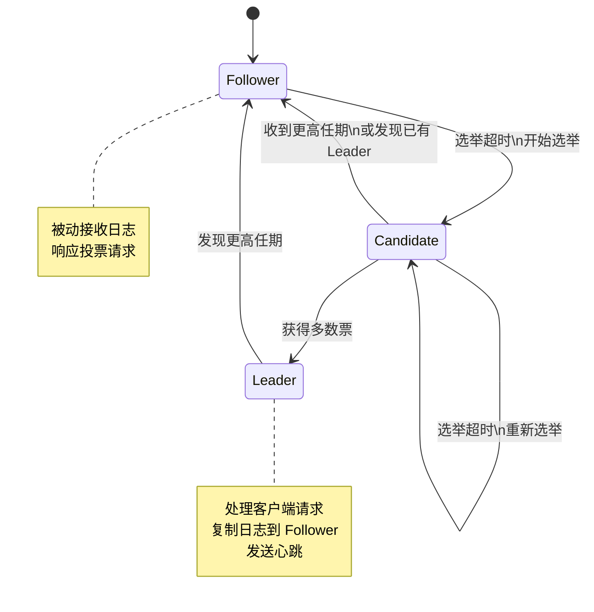

# 分布式系统-Raft共识算法

> **文档说明**：系统讲解 Raft 共识算法，包括共识问题、Leader 选举、日志复制、安全性保证、成员变更、日志压缩，以及实现要点和应用场景。
>
> **适用人群**：后端开发者、分布式系统学习者、需要理解分布式一致性的开发者
>
> **前置知识**：[[分布式系统基础]]、[[CAP定理与最终一致性]]、[[分布式锁实现原理]]

---

## 一、概述

### 1. 共识问题

```text
共识（Consensus）：
- 多个节点就某个值达成一致
- 即使部分节点故障、网络分区、消息延迟/丢失
- 是分布式系统的核心问题

共识算法的作用：
- 复制状态机（Replicated State Machine）
- 所有节点按相同顺序执行相同命令
- 保证状态一致

经典共识算法：
1. Paxos（Lamport，1989）：理论完善，但难以理解和实现
2. Raft（Diego Ongaro，2013）：为可理解性设计，工程化友好
3. ZAB（ZooKeeper Atomic Broadcast）：ZooKeeper 使用
4. Viewstamped Replication：较早的共识算法

Raft 的设计目标：可理解性（Understandability）
- 将问题分解为三个子问题：Leader 选举、日志复制、安全性
- 减少状态数量，简化算法
```

### 2. Raft 基本概念

```text
节点角色：
1. Leader（领导者）：处理所有客户端请求，复制日志到 Follower
2. Follower（跟随者）：被动接收 Leader 的日志，响应投票请求
3. Candidate（候选人）：选举期间的临时状态，争取成为 Leader

任期（Term）：
- 单调递增的整数，相当于逻辑时钟
- 每个任期最多一个 Leader
- 分为选举阶段和正常阶段
- 节点在每个任期最多投一票

核心 RPC：
1. RequestVote（请求投票）：Candidate 发起选举
2. AppendEntries（追加日志）：Leader 复制日志，也用作心跳
3. InstallSnapshot（安装快照）：Leader 发送快照给落后的 Follower
```



---

## 二、Leader 选举

### 1. 选举触发

```text
选举触发条件：
- Follower 在选举超时时间（election timeout）内没有收到 Leader 的心跳
- 认为 Leader 已故障，发起新的选举

选举超时：
- 随机化，通常 150ms ~ 300ms
- 随机化避免多个节点同时发起选举导致选票分裂
- 每次超时后重新随机

选举流程：
1. Follower 增加当前任期号（term + 1）
2. 切换为 Candidate 状态
3. 给自己投一票
4. 向所有其他节点发送 RequestVote RPC
5. 等待结果：
   - 获得多数票 → 成为 Leader
   - 收到其他节点的 AppendEntries（发现已有 Leader）→ 变回 Follower
   - 选举超时 → 增加任期，重新选举
```

### 2. RequestVote RPC

```text
RequestVote 请求参数：
- term：候选人的任期号
- candidateId：候选人 ID
- lastLogIndex：候选人最后一条日志的索引
- lastLogTerm：候选人最后一条日志的任期

RequestVote 响应：
- term：当前任期号（用于候选人更新自己）
- voteGranted：是否投票给候选人

投票规则：
1. 如果请求的 term < 当前节点的 term → 拒绝
2. 如果当前节点在该任期还没投票（或投票给同一个候选人）→ 可以投
3. 候选人的日志至少和自己一样新 → 才投票
   （比较 lastLogTerm 和 lastLogIndex）
4. 每个任期每个节点最多投一票（先到先得）
```

### 3. 选举安全性

```text
选举安全性保证：
- 每个任期最多选出一个 Leader
- 因为每个节点每个任期最多投一票
- 获得多数票才能成为 Leader
- 两个不同的候选人不可能同时获得多数票

处理分裂投票（Split Vote）：
- 多个 Candidate 同时发起选举，都没获得多数票
- 选举超时后，增加任期重新选举
- 随机化的选举超时减少同时发起的概率
- 通常一轮或几轮后就能选出 Leader
```

---

## 三、日志复制

### 1. 日志结构

```text
日志条目（Log Entry）：
- index：日志索引（单调递增）
- term：该条目被创建时的任期号
- command：状态机要执行的命令

日志示例：
index:  1   2   3   4   5   6   7
term:   1   1   1   2   2   3   3
cmd:    x=1 y=2 x=3 z=4 x=5 y=6 z=7

已提交（Committed）：
- 日志被复制到多数节点上
- Leader 可以将其应用到状态机
- 已提交的日志保证不会被覆盖

已应用（Applied）：
- 日志已经被状态机执行
- 通常在已提交之后应用
```

### 2. 复制流程

```text
日志复制流程：
1. 客户端向 Leader 发送命令
2. Leader 将命令追加到本地日志
3. Leader 向所有 Follower 发送 AppendEntries RPC
4. Follower 校验后追加到本地日志，返回成功
5. Leader 收到多数节点的成功响应后：
   - 将该日志标记为已提交（committed）
   - 应用到自己的状态机
   - 响应客户端
6. Leader 通过后续的 AppendEntries（心跳）通知 Follower 该日志已提交
7. Follower 应用已提交的日志到状态机

AppendEntries 也用作心跳：
- 没有新日志时，Leader 定期发送空的 AppendEntries
- 维持 Leader 权威，防止 Follower 发起选举
- 携带 commitIndex，通知 Follower 提交进度
```

### 3. AppendEntries RPC

```text
AppendEntries 请求参数：
- term：Leader 的任期号
- leaderId：Leader ID（Follower 可以重定向客户端）
- prevLogIndex：前一条日志的索引
- prevLogTerm：前一条日志的任期
- entries[]：要存储的日志条目（空表示心跳）
- leaderCommit：Leader 的 commitIndex

AppendEntries 响应：
- term：当前任期号（用于 Leader 更新自己）
- success：是否成功（prevLogIndex/prevLogTerm 匹配）

一致性检查：
- Follower 收到 AppendEntries 时，检查 prevLogIndex 和 prevLogTerm
- 如果本地日志在 prevLogIndex 处的任期不匹配 → 返回失败
- 匹配 → 追加新日志，删除冲突的后续日志

日志匹配属性（Log Matching Property）：
- 如果两个不同日志中的条目具有相同的 index 和 term
- 那么它们存储相同的命令
- 并且所有前面的日志条目也相同
```

### 4. 日志冲突处理

```text
Follower 日志可能落后或冲突：
1. 落后：Follower 日志比 Leader 少
2. 冲突：相同 index 但 term 不同（Follower 在旧 Leader 下写入了不同日志）

冲突处理：
- Leader 为每个 Follower 维护 nextIndex（下一条要发送的日志索引）
- 新 Leader 当选时，所有 nextIndex 初始化为自己最后一条日志 + 1
- 如果 AppendEntries 失败（一致性检查不通过）：
  - Leader 将该 Follower 的 nextIndex 减 1
  - 重试 AppendEntries
  - 直到找到匹配点
- 找到匹配点后，Follower 删除冲突的后续日志，追加 Leader 的日志

优化：快速回退
- Follower 在失败响应中返回冲突日志的 term 和该 term 的第一条日志索引
- Leader 可以直接跳过整个冲突的 term，而不是逐条回退
```

---

## 四、安全性

### 1. Raft 安全性保证

```text
Raft 保证的安全性：
1. 选举安全（Election Safety）：每个任期最多一个 Leader
2. Leader 只追加（Leader Append-Only）：Leader 不覆盖或删除自己的日志，只追加
3. 日志匹配（Log Matching）：相同 index 和 term 的日志相同，且前面的也相同
4. Leader 完整性（Leader Completeness）：已提交的日志会出现在所有更高任期的 Leader 中
5. 状态机安全（State Machine Safety）：如果一个节点应用了某条日志，其他节点不会在相同 index 应用不同的日志
```

### 2. Leader 完整性

```json
Leader 完整性是最关键的保证：
- 已提交的日志一定会出现在未来所有 Leader 的日志中
- 保证已提交的日志不会丢失

实现机制：
- 投票限制：Candidate 必须拥有所有已提交的日志才能当选
- RequestVote 中携带 lastLogIndex 和 lastLogTerm
- Follower 只投票给日志至少和自己一样新的 Candidate
- 因为已提交的日志在多数节点上
- Candidate 要获得多数票，必须与至少一个拥有所有已提交日志的节点投票
- 因此 Candidate 必须拥有所有已提交日志

"一样新"的比较：
- 比较 lastLogTerm：term 大的更新
- term 相同：index 大的更新
```

### 3. 提交规则

```text
提交规则：
- Leader 只能提交当前任期的日志（通过复制到多数节点）
- 之前任期的日志不能直接通过计数提交
- 之前任期的日志只能随着当前任期的日志一起提交

为什么？
- 考虑场景：旧任期的日志复制到多数节点，但还没提交
- 新 Leader 可能覆盖该日志（如果新 Leader 没有这条日志）
- 因此旧任期的日志即使在多数节点上，也不能认为已提交
- 只有当前任期的日志被复制到多数节点，才能确定提交
- 此时之前的日志也随之提交（因为日志匹配属性）
```

---

## 五、成员变更

### 1. 为什么需要成员变更

```text
成员变更（Membership Change）：
- 集群节点数量可能变化（扩容、缩容、节点替换）
- 直接切换配置会导致脑裂（split brain）
- 需要安全的配置变更协议

直接切换的问题：
- 集群从 Cold（3节点）切换到 Cnew（5节点）
- 不同节点切换时间不同
- 可能出现 Cold 的多数派和 Cnew 的多数派同时存在
- 两个多数派可能选出两个 Leader → 脑裂
```

### 2. 联合共识（Joint Consensus）

```text
Raft 的成员变更方案：联合共识（Joint Consensus）

变更流程：
1. Leader 创建 Cold,new 配置日志（同时包含新旧配置）
2. 复制到多数节点
3. 提交 Cold,new（需要 Cold 多数派 + Cnew 多数派都同意）
4. 此时任何决策都需要 Cold 和 Cnew 两个多数派
5. Leader 创建 Cnew 配置日志
6. 复制到多数节点
7. 提交 Cnew（只需要 Cnew 多数派）
8. 变更完成，Cold 节点可以下线

联合共识的安全性：
- 在 Cold,new 阶段，任何决策需要两个多数派
- 不可能出现 Cold 多数派和 Cnew 多数派分别决策
- 因为 Cold,new 的 Leader 需要两个多数派的支持
- 保证不会脑裂
```

### 3. 单节点变更（简化方案）

```text
很多实现使用简化方案：每次只变更一个节点

单节点变更的安全性：
- 每次增加或移除一个节点
- Cold 和 Cnew 的多数派一定有交集
- 因此不可能同时形成两个独立的多数派
- 不需要联合共识，直接切换即可

操作：
- 增加一个节点：Cnew = Cold + 新节点
- 移除一个节点：Cnew = Cold - 某节点
- 多次单节点变更可以实现任意配置变更

注意：
- 移除 Leader 节点时，需要先转移 Leadership
- 新节点加入时，需要先同步日志（可能需要快照）
```

---

## 六、日志压缩

### 1. 为什么需要日志压缩

```text
日志压缩（Log Compaction）：
- 日志会无限增长，占用大量磁盘和内存
- 状态机已经应用的日志不再需要保留
- 需要定期清理旧日志

快照（Snapshot）：
- 将状态机的当前状态持久化
- 快照之前的日志可以全部丢弃
- 快照包含：最后一条日志的 index 和 term、状态机状态、集群配置

快照时机：
- 日志大小超过阈值
- 定期（如每小时）
- 手动触发
```

### 2. InstallSnapshot RPC

```text
新加入的节点或严重落后的节点：
- Leader 的日志已经被压缩（快照之前的日志已删除）
- 无法通过 AppendEntries 同步
- Leader 直接发送快照给 Follower

InstallSnapshot RPC：
- term：Leader 任期
- leaderId：Leader ID
- lastIncludedIndex：快照包含的最后一条日志索引
- lastIncludedTerm：快照包含的最后一条日志任期
- offset：数据块偏移（分块传输）
- data[]：快照数据块
- done：是否是最后一块

Follower 处理：
- 丢弃所有日志（快照之前的已不需要，之后的可能冲突）
- 用快照替换状态机状态
- 如果有快照之后的日志且匹配，可以保留
```

---

## 七、实现要点

### 1. 核心状态

```go
// Raft 节点核心状态（Go 伪代码）
type Raft struct {
    // 持久化状态
    currentTerm int        // 当前任期
    votedFor    int        // 当前任期投票给谁（-1 表示未投）
    log         []LogEntry // 日志

    // 易失状态
    commitIndex int        // 已提交的最高日志索引
    lastApplied int        // 已应用的最高日志索引

    // Leader 易失状态
    nextIndex  []int       // 每个 Follower 下一条要发送的日志索引
    matchIndex []int       // 每个 Follower 已复制的最高日志索引

    // 其他
    state       State      // Follower/Candidate/Leader
    electionTimer *Timer   // 选举超时定时器
    heartbeatTimer *Timer  // 心跳定时器
}

type LogEntry struct {
    Term    int
    Command interface{}
}
```

### 2. 关键实现细节

```text
1. 持久化：
   - currentTerm、votedFor、log 必须持久化
   - 在响应 RPC 之前写入磁盘
   - 崩溃恢复后从磁盘加载

2. 定时器：
   - 选举超时：随机化 150-300ms
   - 心跳间隔：通常 50-100ms（远小于选举超时）
   - 收到心跳/AppendEntries 重置选举定时器

3. 并发安全：
   - RPC 处理和定时器回调需要加锁
   - 避免竞态条件

4. 日志索引：
   - 通常从 1 开始（0 表示空）
   - 方便处理边界条件

5. apply 流程：
   - 单独的 goroutine/线程处理
   - 定期检查 commitIndex > lastApplied
   - 按顺序应用日志到状态机
   - 更新 lastApplied
```

### 3. 读操作优化

```text
线性一致性读（Linearizable Read）：
- 读操作也需要走 Raft 协议，保证读到最新数据
- 直接读 Leader 本地状态机可能读到过期数据（Leader 可能已被分区）

读优化方案：
1. ReadIndex：
   - Leader 记录当前 commitIndex
   - 向多数节点发送心跳确认自己仍是 Leader
   - 等待状态机应用到 commitIndex
   - 然后读本地状态机

2. Lease Read：
   - Leader 在心跳得到多数响应后，获得一个"租约"
   - 租约期内（通常 < 选举超时）可以直接读本地
   - 性能更好，但依赖时钟

3. Follower Read：
   - 读请求可以发给 Follower
   - Follower 向 Leader 请求最新 commitIndex（ReadIndex）
   - 等待应用后读本地
   - 减轻 Leader 压力
```

---

## 八、应用场景

```text
Raft 的应用：
1. etcd：Kubernetes 的核心存储，使用 Raft
2. Consul：服务发现和配置中心，使用 Raft
3. TiKV：分布式 KV 存储，使用 Raft（Multi-Raft）
4. CockroachDB：分布式 SQL 数据库，使用 Raft
5. RabbitMQ：可选的 Raft 队列实现
6. 很多分布式系统的元数据管理

Raft vs Paxos：
- Raft 更易理解和实现
- 工程实现更多（etcd/Consul 等）
- Paxos 理论更完善，变体更多
- 两者安全性等价

Multi-Raft：
- 大规模系统中，数据分片（Shard/Region）
- 每个分片独立运行一个 Raft 组
- 不同分片的 Leader 可以在不同节点
- 提高并行度和吞吐量
- TiKV/CockroachDB 使用 Multi-Raft
```

---

## 九、最佳实践

- [ ] **持久化关键状态**：currentTerm/votedFor/log 在响应 RPC 前写入磁盘
- [ ] **随机化选举超时**：150-300ms 随机，避免选票分裂
- [ ] **心跳间隔远小于选举超时**：通常 50-100ms vs 150-300ms
- [ ] **日志索引从 1 开始**：方便处理空日志边界
- [ ] **批量复制日志**：减少 RPC 次数，提高吞吐量
- [ ] **流水线复制**：不等上一条响应就发下一条（etcd 优化）
- [ ] **定期快照**：避免日志无限增长
- [ ] **成员变更每次一个节点**：简化实现，保证安全
- [ ] **监控关键指标**：选举次数、日志延迟、提交延迟、Leader 变更频率
- [ ] **优雅关闭**：Leader 转移后再关闭，减少不可用时间

---

## 十、常见问题与排查

| 问题 | 原因 | 解决方案 |
|------|------|---------|
| **频繁选举** | 网络延迟/丢包、心跳间隔太大 | 检查网络、调小心跳间隔、增大选举超时 |
| **日志复制慢** | 单条复制、网络延迟 | 批量复制、流水线复制、压缩日志 |
| **数据不一致** | 实现错误、未持久化 | 检查持久化、日志匹配、提交规则 |
| **脑裂** | 成员变更错误、时钟问题 | 用联合共识/单节点变更、检查任期逻辑 |
| **读操作过期** | 直接读 Leader 本地 | 用 ReadIndex/Lease Read 保证线性一致性 |
| **节点恢复慢** | 日志太长、快照太大 | 定期快照、增量快照、分块传输快照 |
| **磁盘满** | 日志未压缩 | 配置快照阈值、定期清理 |
| **选举超时不触发** | 定时器实现错误 | 检查定时器重置逻辑、收到心跳要重置 |
| **投票错误** | 投票规则实现错误 | 检查任期比较、日志新旧比较、每任期一票 |
| **提交不推进** | Leader 无法联系多数节点 | 检查网络、节点健康度、多数派是否存活 |
| **快照后日志丢失** | 快照实现错误 | 保留快照元数据（lastIncludedIndex/Term） |
| **成员变更卡住** | 联合共识实现错误 | 检查配置日志提交、两阶段切换 |
| **性能瓶颈** | 单 Raft 组 | 用 Multi-Raft 分片、批量/流水线优化 |
| **时钟问题** | Lease Read 依赖时钟 | 用 ReadIndex 替代、时钟同步（NTP） |
| **网络分区后不恢复** | 任期不增加、不重新选举 | 检查分区恢复后的任期同步、重新选举逻辑 |

---

## 十一、关联笔记

### 分布式系统
- [[分布式系统基础]] · [[CAP定理与最终一致性]] · [[分布式锁实现原理]]
- [[分布式事务-2PC-3PC-TCC]] · [[一致性哈希算法]] · [[分布式ID生成方案]]
- [[服务注册与发现]] · [[API网关设计]]

### 计算机基础
- [[进程间通信-IPC]] · [[文件系统详解-ext4-btrfs]] · [[操作系统-进程与线程]]
- [[网络协议-TCP-IP]] · [[常见攻击与防御手段]]

### 云原生
- [[K8s-核心概念与架构]] · [[Operator与CRD开发]] · [[APM应用性能监控-SkyWalking]]

### 导航
- [[MOC-计算机基础]] · [[MOC-后端开发]] · [[全栈+AI工程双轨融合学习路线图]]

> **学习路径建议**：先掌握 [[分布式系统基础]] 分布式概念 → 学习 [[CAP定理与最终一致性]] 理论 → 深入本文 Raft 共识算法 → 实践 [[分布式事务-2PC-3PC-TCC]] 事务 → 研究 [[分布式锁实现原理]] 协调 → 构建完整的分布式系统设计能力。

---

## 💡 全文深度讲解

本文系统梳理了分布式系统-Raft共识算法的核心知识体系，从概述入手，深入Leader 选举的底层机制，再通过日志复制掌握实战应用，最后涵盖常见问题与排查与关联笔记。学习时建议先建立整体认知，再动手实践，最后结合常见问题深化理解。

## 📝 全文精简总结

- **概述**：掌握本模块的核心概念与关键要点
- **Leader 选举**：掌握本模块的核心概念与关键要点
- **日志复制**：掌握本模块的核心概念与关键要点
- **安全性**：掌握本模块的核心概念与关键要点
- **成员变更**：掌握本模块的核心概念与关键要点
- **日志压缩**：掌握本模块的核心概念与关键要点
- **实现要点**：掌握本模块的核心概念与关键要点
- **应用场景**：掌握本模块的核心概念与关键要点
- 其余3个模块涵盖进阶主题与拓展内容

