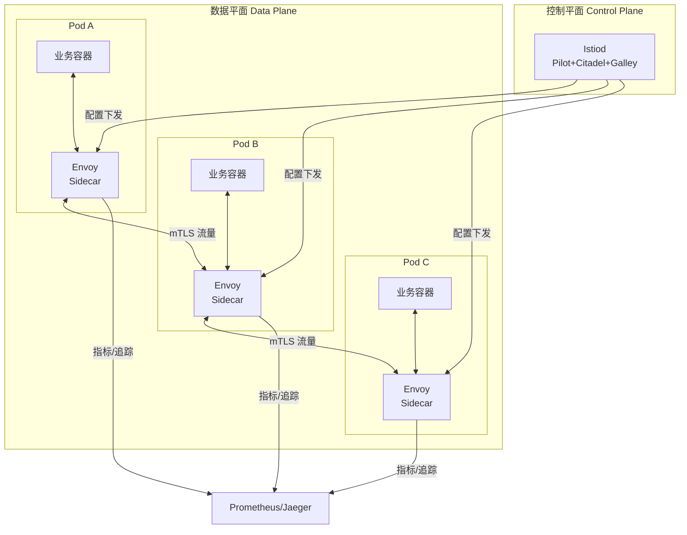

# 分布式系统-服务网格ServiceMesh

> **文档说明**：系统讲解服务网格（Service Mesh）的核心架构（Sidecar 代理、数据平面、控制平面）、Istio 核心概念与配置、流量管理（VirtualService/DestinationRule/Gateway）、安全（mTLS/认证授权）、可观测性（指标/日志/追踪）、服务网格对比（Istio/Linkerd/Consul），以及生产级最佳实践和常见问题。
>
> **适用人群**：后端开发工程师、全栈开发者、云原生架构师、DevOps 工程师
>
> **前置知识**：[[微服务架构设计模式]]、[[云原生架构设计]]、[[K8s-核心概念与架构]]、[[微服务核心组件知识点系统梳理_优化版]]

---

## 一、概述

### 1. 什么是服务网格

**服务网格（Service Mesh）** 是用于处理服务间通信的专用基础设施层，通过在每个服务实例旁部署一个 Sidecar 代理，将流量管理、安全、可观测性等能力从业务代码中抽离，实现服务间通信的透明化治理。

### 2. 为什么需要服务网格

微服务架构下，服务间通信面临以下挑战：

| 挑战 | 说明 | 传统方案 | 服务网格方案 |
|------|------|---------|-------------|
| **流量管理** | 灰度发布、A/B 测试、流量镜像 | 代码中实现 | Sidecar 配置 |
| **服务间安全** | mTLS 加密、认证授权 | 每个服务实现 | 统一配置 |
| **可观测性** | 分布式追踪、指标、日志 | 每个服务埋点 | 自动采集 |
| **容错** | 超时、重试、熔断、限流 | 代码中实现（Hystrix/Sentinel） | Sidecar 配置 |
| **服务发现** | 服务注册发现 | 注册中心 | K8s Service + Sidecar |
| **多语言支持** | 不同语言框架不一致 | 各语言 SDK | 语言无关 |

### 3. 服务网格架构



### 4. 核心概念

| 概念 | 说明 |
|------|------|
| **Sidecar** | 与业务容器同 Pod 的代理容器，拦截所有进出流量 |
| **数据平面（Data Plane）** | 由所有 Sidecar 代理组成，负责流量转发 |
| **控制平面（Control Plane）** | 管理和配置所有 Sidecar，不直接处理流量 |
| **代理（Proxy）** | Sidecar 的具体实现，如 Envoy、Linkerd2-proxy |
| **mTLS** | 双向 TLS，服务间通信自动加密 |
| **xDS** | Envoy 的配置发现协议（CDS/LDS/RDS/EDS/SDS） |

---

## 二、Istio 核心架构

### 1. Istio 组件

| 组件 | 说明 |
|------|------|
| **istiod** | 控制平面，整合了 Pilot、Citadel、Galley |
| **Pilot** | 流量管理，将路由规则转换为 Envoy 配置 |
| **Citadel** | 安全，证书签发和管理，mTLS |
| **Galley** | 配置验证、处理、分发 |
| **Envoy** | 数据平面 Sidecar 代理，C++ 编写，高性能 |
| **Ingress Gateway** | 入口网关，处理外部流量进入网格 |
| **Egress Gateway** | 出口网关，处理网格内访问外部服务 |

### 2. Sidecar 注入

```yaml
# 命名空间自动注入 Sidecar
apiVersion: v1
kind: Namespace
metadata:
  name: my-app
  labels:
    istio-injection: enabled  # 启用自动注入
```

```bash
# 手动注入
istioctl kube-inject -f deployment.yaml | kubectl apply -f -

# 查看注入状态
kubectl get pods -n my-app -o jsonpath='{.items[*].spec.containers[*].name}'
# 输出包含 istio-proxy 表示注入成功
```

### 3. Envoy 代理

Envoy 是 Lyft 开源的高性能代理，Istio 的默认 Sidecar：

| 特性 | 说明 |
|------|------|
| **L3/L4 过滤** | 网络层和传输层过滤 |
| **L7 过滤** | HTTP/2/gRPC/Redis/MongoDB 等应用层过滤 |
| **动态配置** | xDS API 动态更新配置，不需重启 |
| **健康检查** | 主动/被动健康检查 |
| **负载均衡** | 轮询、随机、最少请求、一致性哈希、区域感知 |
| **流量镜像** | 将流量镜像到另一个集群 |
| **故障注入** | 延迟、错误、中止等故障注入 |
| **可观测性** | 指标、访问日志、分布式追踪 |

---

## 三、流量管理

### 1. 核心资源

| 资源 | 说明 |
|------|------|
| **Gateway** | 入口网关，管理外部流量进入网格 |
| **VirtualService** | 虚拟服务，定义路由规则（路径、权重、匹配） |
| **DestinationRule** | 目标规则，定义负载均衡、连接池、异常检测 |
| **ServiceEntry** | 服务入口，将外部服务注册到网格 |
| **Sidecar** | Sidecar 配置，限制代理的配置范围 |
| **EnvoyFilter** | Envoy 过滤器，自定义 Envoy 配置 |

### 2. Gateway（入口网关）

```yaml
apiVersion: networking.istio.io/v1alpha3
kind: Gateway
metadata:
  name: app-gateway
spec:
  selector:
    istio: ingressgateway  # 使用默认 Ingress Gateway
  servers:
    - port:
        number: 80
        name: http
        protocol: HTTP
      hosts:
        - "app.example.com"
      tls:
        httpsRedirect: true  # HTTP 重定向到 HTTPS
    - port:
        number: 443
        name: https
        protocol: HTTPS
      tls:
        mode: SIMPLE
        credentialName: app-tls  # TLS 证书 Secret
      hosts:
        - "app.example.com"
```

### 3. VirtualService（虚拟服务）

```yaml
apiVersion: networking.istio.io/v1alpha3
kind: VirtualService
metadata:
  name: user-service
spec:
  hosts:
    - user-service
  gateways:
    - app-gateway
    - mesh  # 网格内部流量
  http:
    # 路由规则1：Header 匹配到 v2
    - match:
        - headers:
            x-version:
              exact: "v2"
      route:
        - destination:
            host: user-service
            subset: v2
          weight: 100

    # 路由规则2：灰度发布（90% v1, 10% v2）
    - route:
        - destination:
            host: user-service
            subset: v1
          weight: 90
        - destination:
            host: user-service
            subset: v2
          weight: 10

    # 路由规则3：故障注入（延迟）
    - fault:
        delay:
          percentage:
            value: 10
          fixedDelay: 5s
      route:
        - destination:
            host: user-service
            subset: v1

    # 路由规则4：超时
    - timeout: 3s
      retries:
        attempts: 3
        perTryTimeout: 1s
      route:
        - destination:
            host: user-service
```

### 4. DestinationRule（目标规则）

```yaml
apiVersion: networking.istio.io/v1alpha3
kind: DestinationRule
metadata:
  name: user-service
spec:
  host: user-service
  trafficPolicy:
    # 负载均衡策略
    loadBalancer:
      simple: LEAST_REQUEST  # ROUND_ROBIN / RANDOM / LEAST_REQUEST / PASSTHROUGH
    # 连接池
    connectionPool:
      tcp:
        maxConnections: 100
      http:
        http1MaxPendingRequests: 100
        maxRequestsPerConnection: 10
    # 异常检测（熔断）
    outlierDetection:
      consecutive5xxErrors: 5
      interval: 30s
      baseEjectionTime: 30s
      maxEjectionPercent: 50
  # 子集定义
  subsets:
    - name: v1
      labels:
        version: v1
    - name: v2
      labels:
        version: v2
      trafficPolicy:
        loadBalancer:
          simple: ROUND_ROBIN
```

### 5. 流量镜像

```yaml
apiVersion: networking.istio.io/v1alpha3
kind: VirtualService
metadata:
  name: user-service-mirror
spec:
  hosts:
    - user-service
  http:
    - route:
        - destination:
            host: user-service
            subset: v1
      mirror:
        host: user-service
        subset: v2
      mirrorPercentage:
        value: 100.0  # 100% 流量镜像到 v2（不影响主流量响应）
```

### 6. ServiceEntry（外部服务）

```yaml
apiVersion: networking.istio.io/v1alpha3
kind: ServiceEntry
metadata:
  name: external-api
spec:
  hosts:
    - api.external.com
  ports:
    - number: 443
      name: https
      protocol: HTTPS
  resolution: DNS
  location: MESH_EXTERNAL
```

---

## 四、安全

### 1. mTLS（双向 TLS）

Istio 自动为服务间通信启用 mTLS，不需修改业务代码。

```yaml
# 命名空间级 mTLS 策略
apiVersion: security.istio.io/v1beta1
kind: PeerAuthentication
metadata:
  name: default
  namespace: my-app
spec:
  mtls:
    mode: STRICT  # STRICT: 只接受 mTLS；PERMISSIVE: 同时接受明文和 mTLS；DISABLE: 禁用
```

| 模式 | 说明 |
|------|------|
| **STRICT** | 严格模式，只接受 mTLS 加密流量 |
| **PERMISSIVE** | 宽容模式，同时接受明文和 mTLS（迁移期使用） |
| **DISABLE** | 禁用 mTLS |

### 2. 请求认证（JWT）

```yaml
apiVersion: security.istio.io/v1beta1
kind: RequestAuthentication
metadata:
  name: jwt-auth
  namespace: my-app
spec:
  selector:
    matchLabels:
      app: user-service
  jwtRules:
    - issuer: "https://auth.example.com"
      jwksUri: "https://auth.example.com/.well-known/jwks.json"
      audiences:
        - "user-service"
```

### 3. 授权策略

```yaml
apiVersion: security.istio.io/v1beta1
kind: AuthorizationPolicy
metadata:
  name: user-service-authz
  namespace: my-app
spec:
  selector:
    matchLabels:
      app: user-service
  action: ALLOW  # ALLOW: 白名单；DENY: 黑名单
  rules:
    # 规则1：允许 admin 服务访问所有接口
    - from:
        - source:
            principals: ["cluster.local/ns/my-app/sa/admin-service"]
      to:
        - operation:
            methods: ["*"]
            paths: ["/api/*"]

    # 规则2：允许 GET 请求（不需认证）
    - to:
        - operation:
            methods: ["GET"]
            paths: ["/api/public/*"]

    # 规则3：JWT 角色检查
    - when:
        - key: request.auth.claims[role]
          values: ["admin"]
      to:
        - operation:
            paths: ["/api/admin/*"]
```

---

## 五、可观测性

### 1. 指标（Metrics）

Istio 自动采集以下指标（Prometheus 格式）：

| 指标 | 说明 |
|------|------|
| **istio_requests_total** | 请求总数（按服务、状态码、版本） |
| **istio_request_duration_milliseconds** | 请求延迟分布 |
| **istio_request_bytes** | 请求字节数 |
| **istio_response_bytes** | 响应字节数 |
| **istio_tcp_connections_opened_total** | TCP 连接数 |

```yaml
# Prometheus 采集配置（Istio 自动注入注解）
apiVersion: monitoring.coreos.com/v1
kind: ServiceMonitor
metadata:
  name: istio-sidecars
spec:
  selector:
    matchLabels:
      istio: sidecar
  endpoints:
    - port: http-envoy-prom
      path: /stats/prometheus
```

### 2. 分布式追踪

Istio 自动注入追踪 Header（x-request-id、x-b3-traceid 等），支持 Jaeger、Zipkin、SkyWalking。

```yaml
# 配置追踪采样率
apiVersion: telemetry.istio.io/v1alpha1
kind: Telemetry
metadata:
  name: tracing-config
  namespace: istio-system
spec:
  tracing:
    - randomSamplingPercentage:
        value: 10.0  # 10% 采样率
```

> **注意**：业务代码需要传播追踪 Header，否则追踪链会断裂。

### 3. 访问日志

```yaml
apiVersion: telemetry.istio.io/v1alpha1
kind: Telemetry
metadata:
  name: access-log
  namespace: my-app
spec:
  accessLogging:
    - providers:
        - name: envoy
      filter:
        expression: "response.code >= 400"  # 只记录 4xx/5xx
```

### 4. Kiali（服务网格可视化）

Kiali 是 Istio 的官方可视化工具，提供服务拓扑图、流量监控、配置管理等功能。

```bash
# 安装 Kiali
kubectl apply -f https://raw.githubusercontent.com/istio/istio/release-1.20/samples/addons/kiali.yaml

# 访问
istioctl dashboard kiali
```

---

## 六、服务网格对比

| 维度 | Istio | Linkerd | Consul Connect |
|------|-------|---------|---------------|
| **代理** | Envoy（C++） | linkerd2-proxy（Rust） | Envoy |
| **控制平面** | istiod（Go） | 控制器（Go/Rust） | Consul Server（Go） |
| **功能丰富度** | ⭐⭐⭐⭐⭐ 最全 | ⭐⭐⭐ 核心功能 | ⭐⭐⭐⭐ 多数据中心 |
| **性能开销** | 中（Envoy 内存占用较高） | 低（轻量代理） | 中 |
| **学习曲线** | 陡峭 | 平缓 | 中等 |
| **多语言** | ✅ | ✅ | ✅ |
| **多集群** | ✅ 强大 | ✅ | ✅ 原生支持 |
| **社区活跃度** | ⭐⭐⭐⭐⭐ | ⭐⭐⭐⭐ | ⭐⭐⭐⭐ |
| **企业支持** | Google、IBM、Red Hat | Buoyant | HashiCorp |
| **适用场景** | 复杂流量治理、大型企业 | 简单微服务、追求轻量 | 多数据中心、混合云 |

---

## 七、生产最佳实践

### 1. 部署规范

- [ ] **渐进式接入**：先 PERMISSIVE 模式，验证后再 STRICT
- [ ] **命名空间隔离**：按业务/环境划分命名空间，分别配置策略
- [ ] **资源限制**：为 Sidecar 设置合理的 CPU/内存 requests 和 limits
- [ ] **Sidecar 资源**：Envoy 默认 requests 100m CPU/128Mi 内存，limits 2CPU/1Gi
- [ ] **控制平面高可用**：istiod 至少 2 副本，跨可用区部署
- [ ] **网关高可用**：Ingress Gateway 至少 2 副本，Pod 反亲和性

### 2. 流量管理规范

- [ ] **灰度发布**：使用 VirtualService 权重路由，逐步增加流量
- [ ] **超时设置**：所有路由设置合理超时（默认 15 秒，建议 3-5 秒）
- [ ] **重试策略**：只对幂等接口启用重试，限制重试次数
- [ ] **熔断配置**：配置 outlierDetection，自动剔除异常实例
- [ ] **连接池**：根据服务容量配置连接池大小
- [ ] **流量镜像**：新版本验证使用镜像，不影响主流量

### 3. 安全规范

- [ ] **mTLS STRICT**：生产环境启用严格 mTLS
- [ ] **授权策略**：最小权限原则，默认拒绝，显式允许
- [ ] **JWT 认证**：外部入口统一 JWT 验证
- [ ] **证书轮换**：Istio 自动轮换证书（默认 24 小时）
- [ ] **外部服务管控**：使用 ServiceEntry + Egress Gateway 管控出口流量

### 4. 性能优化

- [ ] **Sidecar 范围限制**：使用 Sidecar 资源限制代理的配置范围，减少内存
- [ ] **协议优化**：使用 HTTP/2、gRPC 提升性能
- [ ] **连接复用**：配置连接池，复用连接
- [ ] **采样率调整**：生产环境追踪采样率 1-10%，避免开销过大
- [ ] **访问日志过滤**：只记录错误请求，减少 IO
- [ ] **控制平面调优**：大型集群调整 istiod 的内存和并发

### 5. 运维规范

- [ ] **版本管理**：Istio 版本与 K8s 版本兼容，定期升级
- [ ] **配置验证**：使用 `istioctl analyze` 验证配置
- [ ] **监控告警**：监控 5xx 率、延迟、Sidecar 资源使用
- [ ] **故障演练**：定期进行混沌工程测试
- [ ] **备份恢复**：备份 Istio 配置（CRD），支持快速恢复

---

## 八、常见问题与排查

| 问题 | 原因 | 解决方案 |
|------|------|---------|
| **Sidecar 未注入** | 命名空间未打标签 / 注入策略错误 | 检查 `istio-injection=enabled` 标签、Sidecar 注入策略 |
| **服务间通信失败** | mTLS 模式不匹配 / 授权策略拒绝 | 检查 PeerAuthentication、AuthorizationPolicy、istioctl proxy-config |
| **503 错误** | 上游服务不可用 / 连接池满 / 熔断 | 检查服务健康、连接池配置、outlierDetection |
| **延迟高** | Sidecar 资源不足 / 配置过多 / 网络问题 | 增加 Sidecar 资源、限制 Sidecar 配置范围、检查网络 |
| **追踪链断裂** | 业务代码未传播 Header / 采样率低 | 确保传播 x-b3-* Header、调整采样率 |
| **灰度不生效** | VirtualService 配置错误 / subset 未定义 | 检查路由规则、DestinationRule subsets、istioctl analyze |
| **mTLS 握手失败** | 证书问题 / 时钟不同步 / 协议不匹配 | 检查 Citadel 证书、节点时钟、TLS 模式 |
| **Ingress 502/504** | 后端服务不可用 / 超时 / 连接拒绝 | 检查服务健康、超时配置、Service 端口 |
| **内存占用高** | Sidecar 配置过多 / 集群规模大 | 使用 Sidecar 资源限制配置范围、增加内存 |
| **升级失败** | 版本不兼容 / CRD 未升级 | 先升级 CRD、检查版本兼容矩阵、渐进式升级 |
| **外部服务无法访问** | 未配置 ServiceEntry / 出口策略 | 配置 ServiceEntry、检查 REGISTRY_ONLY 模式 |
| **性能下降明显** | Envoy 开销 / 加密开销 / 配置复杂 | 评估是否需要服务网格、优化配置、使用 PERMISSIVE 过渡 |
| **配置不生效** | 命名空间错误 / 选择器不匹配 / 优先级问题 | 检查 metadata.namespace、selector、istioctl proxy-config |

### 排查命令

```bash
# 分析配置问题
istioctl analyze

# 查看代理配置
istioctl proxy-config routes <pod-name>
istioctl proxy-config clusters <pod-name>
istioctl proxy-config listeners <pod-name>
istioctl proxy-config endpoints <pod-name>

# 查看代理日志
kubectl logs <pod-name> -c istio-proxy

# 进入代理调试
istioctl dashboard envoy <pod-name>

# 验证 mTLS
istioctl authn tls-check <pod-name>

# 查看服务拓扑
istioctl dashboard kiali
```

---

## 九、关联笔记

### 微服务
- [[微服务架构设计模式]] · [[微服务核心组件知识点系统梳理_优化版]] · [[SpringCloud-Alibaba组件体系]]
- [[Nacos-注册中心与配置中心]] · [[Gateway-网关路由与鉴权]] · [[Sentinel-流量控制与熔断]]

### 云原生
- [[云原生架构设计]] · [[K8s-核心概念与架构]] · [[Docker-核心原理与镜像优化]]
- [[CI-CD持续集成与部署]] · [[Prometheus监控体系]]

### 分布式
- [[分布式系统-CAP定理与一致性]] · [[分布式系统-高可用架构设计]] · [[Raft共识算法详解]]
- [[分布式事务 知识点系统梳理_优化版]] · [[分布式锁知识点系统梳理_优化版]]

### 安全
- [[API安全最佳实践]] · [[密码学基础与应用]] · [[零信任安全架构]]

### 导航
- [[MOC-计算机基础]] · [[MOC-云原生与运维]] · [[全栈+AI工程双轨融合学习路线图]]

> **学习路径建议**：先掌握 [[微服务架构设计模式]] 微服务基础 → 学习 [[K8s-核心概念与架构]] 容器编排 → 深入本文服务网格 Service Mesh → 实践 Istio 流量管理和安全 → 研究 [[云原生架构设计]] 云原生体系 → 应用于生产微服务治理。

---

## 💡 全文深度讲解

本文系统梳理了分布式系统-服务网格ServiceMesh的核心知识体系，从概述入手，深入Istio 核心架构的底层机制，再通过流量管理掌握实战应用，最后涵盖常见问题与排查与关联笔记。学习时建议先建立整体认知，再动手实践，最后结合常见问题深化理解。

## 📝 全文精简总结

- **概述**：掌握本模块的核心概念与关键要点
- **Istio 核心架构**：掌握本模块的核心概念与关键要点
- **流量管理**：掌握本模块的核心概念与关键要点
- **安全**：掌握本模块的核心概念与关键要点
- **可观测性**：掌握本模块的核心概念与关键要点
- **服务网格对比**：掌握本模块的核心概念与关键要点
- **生产最佳实践**：掌握本模块的核心概念与关键要点
- **常见问题与排查**：掌握本模块的核心概念与关键要点
- 其余1个模块涵盖进阶主题与拓展内容

