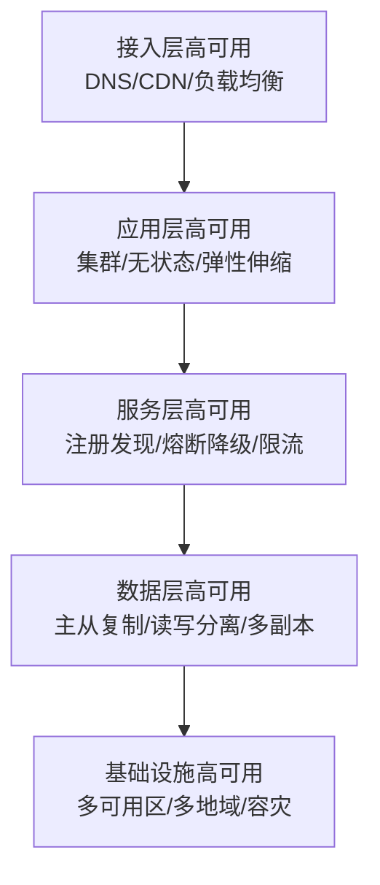

# 分布式系统-高可用架构设计

> **文档说明**：系统讲解高可用架构的核心概念（SLA/可用性等级）、设计原则、负载均衡、故障转移、熔断降级限流、多活架构（同城双活/异地多活）、数据高可用（主从复制/读写分离）、混沌工程，以及生产级高可用最佳实践和常见问题。
>
> **适用人群**：后端开发工程师、全栈开发者、架构师、SRE/运维工程师
>
> **前置知识**：[[分布式系统-CAP定理与一致性]]、[[微服务架构设计模式]]、[[云原生架构设计]]、[[Sentinel-流量控制与熔断]]

---

## 一、概述

### 1. 什么是高可用

**高可用（High Availability，HA）** 是系统通过冗余设计、故障自动转移、快速恢复等手段，最大限度减少服务中断时间，确保持续提供服务的能力。

### 2. 可用性等级（SLA）

| 可用性 | 年停机时间 | 日停机时间 | 等级 | 说明 |
|--------|-----------|-----------|------|------|
| **99%** | 3.65 天 | 14.4 分钟 | 两个9 | 基础可用 |
| **99.9%** | 8.76 小时 | 1.44 分钟 | 三个9 | 较高可用 |
| **99.99%** | 52.6 分钟 | 8.6 秒 | 四个9 | 高可用 |
| **99.999%** | 5.26 分钟 | 0.86 秒 | 五个9 | 极高可用 |
| **99.9999%** | 31.5 秒 | 0.086 秒 | 六个9 | 电信级 |

```text
可用性计算公式：
可用性 = 正常运行时间 / (正常运行时间 + 停机时间) × 100%

MTBF（平均无故障时间）= 总运行时间 / 故障次数
MTTR（平均修复时间）= 总修复时间 / 故障次数
可用性 = MTBF / (MTBF + MTTR) × 100%
```

### 3. 高可用目标

- [ ] **故障自动检测**：秒级发现故障
- [ ] **故障自动转移**：秒级切换到备用节点
- [ ] **数据不丢失**：RPO（恢复点目标）≈ 0
- [ ] **快速恢复**：RTO（恢复时间目标）秒级-分钟级
- [ ] **无单点故障**：所有组件都有冗余
- [ ] **灰度发布**：发布不影响服务可用性

---

## 二、高可用设计原则

### 1. 核心原则

| 原则 | 说明 |
|------|------|
| **冗余（Redundancy）** | 所有组件都有备份，消除单点故障 |
| **故障隔离（Fault Isolation）** | 一个组件故障不影响其他组件 |
| **自动恢复（Auto Recovery）** | 故障自动检测和恢复，不需人工干预 |
| **降级（Graceful Degradation）** | 部分故障时提供核心功能，非核心功能降级 |
| **限流（Rate Limiting）** | 防止流量冲垮系统 |
| **熔断（Circuit Breaker）** | 依赖故障时快速失败，防止级联故障 |
| **超时控制（Timeout）** | 所有远程调用设置超时，防止资源耗尽 |
| **幂等设计（Idempotency）** | 重试不产生副作用 |

### 2. 高可用架构层次



---

## 三、负载均衡

### 1. 负载均衡层次

| 层次 | 技术 | 说明 |
|------|------|------|
| **DNS 层** | DNS 轮询、智能 DNS | 地域级负载均衡 |
| **CDN 层** | Cloudflare、阿里云 CDN | 静态资源缓存、边缘加速 |
| **四层负载均衡** | LVS、F5、Nginx stream | TCP/UDP 层转发 |
| **七层负载均衡** | Nginx、HAProxy、ALB | HTTP/HTTPS 层路由 |
| **服务层负载均衡** | Ribbon、LoadBalancer、Dubbo | 微服务客户端负载均衡 |

### 2. 负载均衡算法

| 算法 | 说明 | 适用场景 |
|------|------|---------|
| **轮询（Round Robin）** | 依次分配请求 | 服务器性能相近 |
| **加权轮询** | 按权重分配 | 服务器性能不同 |
| **随机（Random）** | 随机分配 | 简单场景 |
| **最少连接（Least Connections）** | 分配给连接数最少的服务器 | 长连接场景 |
| **IP 哈希（IP Hash）** | 按客户端 IP 哈希，保证会话一致 | 需要会话保持 |
| **一致性哈希** | 哈希环，节点变化影响小 | 缓存、分布式存储 |
| **最快响应** | 分配给响应最快的服务器 | 延迟敏感场景 |

### 3. Nginx 高可用配置

```nginx
# Nginx 负载均衡配置
upstream backend {
    # 加权轮询
    server 192.168.1.10:8080 weight=3 max_fails=3 fail_timeout=30s;
    server 192.168.1.11:8080 weight=2 max_fails=3 fail_timeout=30s;
    server 192.168.1.12:8080 weight=1 backup;  # 备用节点

    # 健康检查
    keepalive 32;
}

server {
    listen 80;
    location / {
        proxy_pass http://backend;
        proxy_set_header Host $host;
        proxy_set_header X-Real-IP $remote_addr;

        # 超时设置
        proxy_connect_timeout 5s;
        proxy_read_timeout 30s;
        proxy_send_timeout 30s;

        # 重试
        proxy_next_upstream error timeout http_502 http_503;
        proxy_next_upstream_tries 2;
    }
}
```

### 4. Nginx 高可用（Keepalived）

```bash
# Keepalived 配置（主节点）
vrrp_instance VI_1 {
    state MASTER
    interface eth0
    virtual_router_id 51
    priority 100
    advert_int 1
    authentication {
        auth_type PASS
        auth_pass 1111
    }
    virtual_ipaddress {
        192.168.1.100  # 虚拟 IP（VIP）
    }
}
```

> Keepalived 通过 VRRP 协议实现 Nginx 主备切换，主节点故障时 VIP 自动漂移到备节点。

---

## 四、故障转移与集群

### 1. 主从切换

| 模式 | 说明 | 特点 |
|------|------|------|
| **主备（Active-Standby）** | 主节点服务，备节点待命，故障时切换 | 资源利用率 50%，切换有延迟 |
| **主主（Active-Active）** | 多节点同时服务，负载均衡 | 资源利用率高，需处理数据一致性 |
| **集群（Cluster）** | 多节点组成集群，共同服务 | 高可用+高扩展，需协调机制 |

### 2. 应用层无状态化

高可用的基础是应用无状态，状态存储在外部（Redis/DB）：

```text
无状态应用：
- 用户会话存 Redis（不存应用内存）
- 文件存对象存储（不存本地磁盘）
- 配置存配置中心（不写本地文件）
- 任意节点可处理任意请求
- 节点可随时增加/减少
```

### 3. 健康检查

| 检查类型 | 说明 | 示例 |
|---------|------|------|
| **TCP 检查** | 检查端口是否可连接 | telnet host port |
| **HTTP 检查** | 检查 HTTP 状态码 | GET /health 返回 200 |
| **深度检查** | 检查依赖（DB/Redis/MQ） | /health/ready 检查所有依赖 |
| **心跳检测** | 定期发送心跳包 | 微服务注册中心心跳 |

```java
// Spring Boot 健康检查（Actuator）
@RestController
public class HealthController {

    @GetMapping("/health/live")  // 存活探针
    public ResponseEntity<String> liveness() {
        return ResponseEntity.ok("UP");
    }

    @GetMapping("/health/ready")  // 就绪探针
    public ResponseEntity<String> readiness() {
        // 检查数据库、Redis 等依赖
        if (dbHealthy && redisHealthy) {
            return ResponseEntity.ok("READY");
        }
        return ResponseEntity.status(503).body("NOT_READY");
    }
}
```

### 4. K8s 高可用

```yaml
# K8s Deployment 高可用配置
apiVersion: apps/v1
kind: Deployment
metadata:
  name: user-service
spec:
  replicas: 3  # 多副本
  strategy:
    type: RollingUpdate
    rollingUpdate:
      maxSurge: 1        # 滚动更新时最多多 1 个
      maxUnavailable: 0  # 滚动更新时不可用副本数为 0
  selector:
    matchLabels:
      app: user-service
  template:
    metadata:
      labels:
        app: user-service
    spec:
      affinity:
        podAntiAffinity:  # Pod 反亲和性，分散到不同节点
          preferredDuringSchedulingIgnoredDuringExecution:
            - weight: 100
              podAffinityTerm:
                labelSelector:
                  matchLabels:
                    app: user-service
                topologyKey: kubernetes.io/hostname
      containers:
        - name: user-service
          image: user-service:latest
          ports:
            - containerPort: 8080
          livenessProbe:   # 存活探针
            httpGet:
              path: /health/live
              port: 8080
            initialDelaySeconds: 30
            periodSeconds: 10
          readinessProbe:  # 就绪探针
            httpGet:
              path: /health/ready
              port: 8080
            initialDelaySeconds: 10
            periodSeconds: 5
          resources:
            requests:
              cpu: 200m
              memory: 512Mi
            limits:
              cpu: 1000m
              memory: 1Gi
```

---

## 五、熔断、降级、限流

### 1. 熔断器模式


| 状态 | 说明 |
|------|------|
| **关闭（Closed）** | 正常请求，统计失败率 |
| **打开（Open）** | 失败率超阈值，快速失败，不调用下游 |
| **半开（Half-Open）** | 冷却时间后，允许少量请求试探，成功则关闭，失败则打开 |

详细参考 [[Sentinel-流量控制与熔断]]。

### 2. 降级策略

| 降级方式 | 说明 | 示例 |
|---------|------|------|
| **功能降级** | 关闭非核心功能 | 电商大促关闭商品推荐、评论 |
| **读降级** | 读缓存/默认值 | 商品详情读缓存，不查 DB |
| **写降级** | 异步写/暂存 | 下单先写队列，异步落库 |
| **页面降级** | 返回静态页面/简化页面 | 详情页返回静态缓存 |
| **限流降级** | 超过限流返回友好提示 | "系统繁忙，请稍后重试" |

### 3. 限流算法

| 算法 | 说明 | 特点 |
|------|------|------|
| **固定窗口** | 固定时间窗口计数 | 简单，窗口边界有突发问题 |
| **滑动窗口** | 滑动时间窗口 | 精确，实现稍复杂 |
| **令牌桶** | 恒定速率生成令牌，允许突发 | 推荐，Sentinel 默认 |
| **漏桶** | 恒定速率处理请求 | 流量整形，不允许突发 |

---

## 六、多活架构

### 1. 多活架构模式

| 模式 | 说明 | 可用性 | 复杂度 | 成本 |
|------|------|--------|--------|------|
| **冷备** | 备份站点不运行，故障时手动启动 | 低（RTO 小时级） | 低 | 低 |
| **热备（主备）** | 备份站点运行但不服务，故障时切换 | 中（RTO 分钟级） | 中 | 中 |
| **同城双活** | 同城两个机房同时服务 | 高（RTO 秒级） | 高 | 高 |
| **异地多活** | 跨地域多机房同时服务 | 极高（RTO 秒级） | 极高 | 极高 |

### 2. 同城双活

```text
同城双活架构：
┌─────────────┐     ┌─────────────┐
│  机房 A      │     │  机房 B      │
│  应用集群    │←───→│  应用集群    │
│  DB 主      │─────→│  DB 从      │
│  Redis 主   │─────→│  Redis 从   │
└─────────────┘     └─────────────┘
       ↑                   ↑
       └───── 负载均衡 ─────┘

特点：
- 两个机房同时提供服务
- 数据同步复制（同城延迟低 <2ms）
- 单机房故障，流量自动切到另一机房
- RPO ≈ 0，RTO 秒级
```

### 3. 异地多活

```text
异地多活架构：
┌──────────┐  ┌──────────┐  ┌──────────┐
│ 华东机房  │  │ 华北机房  │  │ 华南机房  │
│ 应用集群  │  │ 应用集群  │  │ 应用集群  │
│ DB 分片1  │  │ DB 分片2  │  │ DB 分片3  │
│ Redis    │  │ Redis    │  │ Redis    │
└──────────┘  └──────────┘  └──────────┘
      ↑             ↑             ↑
      └────── 全局负载均衡（GSLB）──────┘

特点：
- 按用户地域/数据分片路由到就近机房
- 数据异步复制（异地延迟 20-50ms）
- 单地域故障，流量切到其他地域
- 需处理数据一致性、冲突解决
- RPO 秒级，RTO 分钟级
```

### 4. 多活数据一致性

| 方案 | 说明 | 适用场景 |
|------|------|---------|
| **同步复制** | 写操作同步到所有机房才返回 | 同城双活、强一致 |
| **异步复制** | 写本地后返回，异步复制到其他机房 | 异地多活、最终一致 |
| **半同步复制** | 至少一个从节点确认后返回 | 折中方案 |
| **单元化分片** | 数据按用户分片，每个单元只写自己的分片 | 异地多活、避免跨机房写 |

---

## 七、数据高可用

### 1. 数据库高可用

| 方案 | 说明 | 特点 |
|------|------|------|
| **主从复制** | 主写从读，从节点备份 | 读写分离，主故障需切换 |
| **主主复制** | 双主都可写 | 需处理冲突，复杂 |
| **MHA/MGR** | MySQL 高可用方案 | 自动故障转移 |
| **分库分表** | 数据分片，水平扩展 | 高可用+高扩展 |
| **NewSQL** | TiDB/OceanBase/Spanner | 原生分布式，高可用 |

详细参考 [[分库分表实战指南]] 和 [[MySQL-InnoDB存储引擎]]。

### 2. Redis 高可用

| 方案 | 说明 | 特点 |
|------|------|------|
| **主从复制** | 主写从读 | 简单，主故障需手动切换 |
| **哨兵（Sentinel）** | 主从+哨兵自动故障转移 | 生产常用，自动切换 |
| **集群（Cluster）** | 数据分片+主从 | 高可用+高扩展，16384 槽 |

### 3. 消息队列高可用

| 方案 | 说明 |
|------|------|
| **Kafka** | 多副本、ISR 机制、Leader 选举 |
| **RocketMQ** | 主从+DLedger 自动选主 |
| **RabbitMQ** | 镜像队列、Quorum Queue |

---

## 八、混沌工程

### 1. 混沌工程概述

**混沌工程（Chaos Engineering）** 通过主动注入故障（如杀进程、断网、延迟），验证系统的容错和恢复能力，提前发现高可用隐患。

### 2. 混沌工程原则

- [ ] **建立稳态假设**：定义系统正常状态的指标
- [ ] **多样化真实事件**：模拟真实故障（节点宕机、网络延迟、磁盘满）
- [ ] **生产环境运行**：在生产或类生产环境实验
- [ ] **持续自动化运行**：自动化、持续执行
- [ ] **最小化爆炸半径**：控制实验范围，避免影响用户

### 3. 混沌工程工具

| 工具 | 说明 |
|------|------|
| **Chaos Monkey** | Netflix 开源，随机终止实例 |
| **Chaos Mesh** | K8s 混沌工程平台，支持 Pod/网络/IO 故障 |
| **Litmus** | 云原生混沌工程框架 |
| **Gremlin** | 商业混沌工程平台 |

```bash
# Chaos Mesh 示例：注入网络延迟
kubectl apply -f - <<EOF
apiVersion: chaos-mesh.org/v1alpha1
kind: NetworkChaos
metadata:
  name: network-delay
spec:
  action: delay
  mode: one
  selector:
    namespaces:
      - default
    labelSelectors:
      app: user-service
  delay:
    latency: "500ms"
    correlation: "100"
  duration: "5m"
EOF
```

---

## 九、最佳实践

### 1. 架构设计

- [ ] **无单点故障**：所有组件（应用、DB、缓存、MQ、负载均衡）都有冗余
- [ ] **无状态应用**：状态外部化，任意节点可处理任意请求
- [ ] **多可用区部署**：应用跨可用区部署，避免单机房故障
- [ ] **合理超时**：所有远程调用设置超时，默认 3-5 秒
- [ ] **重试机制**：幂等接口支持重试，指数退避
- [ ] **熔断降级**：依赖故障时快速失败，防止级联故障
- [ ] **限流保护**：入口限流，防止流量冲垮系统
- [ ] **异步解耦**：核心流程异步化，削峰填谷

### 2. 数据高可用

- [ ] **数据库主从**：至少一主一从，自动故障转移
- [ ] **读写分离**：读走从库，写走主库
- [ ] **数据备份**：定期全量+增量备份，定期恢复演练
- [ ] **Redis 哨兵/集群**：生产环境使用哨兵或集群模式
- [ ] **消息队列多副本**：MQ 配置多副本，防止消息丢失
- [ ] **对象存储多副本**：文件存储使用高可用对象存储

### 3. 发布与运维

- [ ] **灰度发布**：按比例/用户灰度，降低发布风险
- [ ] **蓝绿部署**：两套环境，切换流量，零停机
- [ ] **滚动更新**：逐个更新实例，不中断服务
- [ ] **健康检查**：存活探针+就绪探针，自动摘除故障节点
- [ ] **自动扩缩容**：根据 CPU/内存/QPS 自动伸缩
- [ ] **监控告警**：全链路监控，异常秒级告警
- [ ] **应急预案**：制定故障预案，定期演练
- [ ] **混沌工程**：定期注入故障，验证高可用能力

### 4. 监控与可观测性

- [ ] **指标监控**：Prometheus + Grafana，监控 QPS/延迟/错误率
- [ ] **日志收集**：ELK/Loki，集中日志，快速排查
- [ ] **链路追踪**：SkyWalking/Jaeger，分布式追踪
- [ ] **告警分级**：P0/P1/P2/P3，不同级别不同响应
- [ ] **SLO/SLI**：定义服务等级目标，监控达成情况
- [ ] **On-Call**：值班制度，故障快速响应

---

## 十、常见问题与排查

| 问题 | 原因 | 解决方案 |
|------|------|---------|
| **单点故障导致服务不可用** | 某组件只有一个实例 | 所有组件冗余部署，消除单点 |
| **级联故障（雪崩）** | 下游故障导致上游资源耗尽 | 熔断、降级、超时、限流、隔离 |
| **数据库主从切换数据丢失** | 异步复制延迟 | 半同步复制、MGR、RPO 监控 |
| **缓存击穿/雪崩** | 缓存失效/热点 Key | 互斥锁、永不过期、多级缓存 |
| **消息队列消息丢失** | 生产者未确认/消费者未 ACK | 生产者确认、消费者手动 ACK、持久化 |
| **发布导致服务中断** | 全量发布/未灰度 | 灰度发布、蓝绿部署、健康检查 |
| **流量突增系统崩溃** | 未限流/容量不足 | 限流、弹性伸缩、容量规划、压测 |
| **跨机房延迟高** | 异地多活同步复制 | 异步复制、单元化分片、就近访问 |
| **健康检查误判** | 检查过于敏感/网络抖动 | 合理设置超时、连续失败次数、检查间隔 |
| **故障恢复慢** | 无自动化/预案不完善 | 自动故障转移、应急预案、定期演练 |
| **脑裂（Split Brain）** | 网络分区导致双主 | 多数派机制、Fencing、隔离级别 |
| **连接池耗尽** | 慢查询/下游慢导致连接占用 | 超时设置、连接池监控、熔断 |
| **线程池耗尽** | 阻塞操作占用线程 | 异步化、线程池隔离、超时 |
| **数据不一致** | 主从延迟/分布式事务失败 | 最终一致+补偿、对账机制、分布式事务 |
| **监控告警风暴** | 告警规则不合理/级联告警 | 告警聚合、分级、抑制、根因分析 |

---

## 十一、关联笔记

### 分布式系统
- [[分布式系统-CAP定理与一致性]] · [[分布式系统-服务网格ServiceMesh]] · [[Raft共识算法详解]]
- [[分布式事务 知识点系统梳理_优化版]] · [[分布式锁知识点系统梳理_优化版]] · [[ZooKeeper核心原理与实战]]

### 微服务
- [[微服务架构设计模式]] · [[微服务核心组件知识点系统梳理_优化版]] · [[SpringCloud-Alibaba组件体系]]
- [[Nacos-注册中心与配置中心]] · [[Gateway-网关路由与鉴权]] · [[Sentinel-流量控制与熔断]]
- [[Seata-分布式事务]] · [[XXL-Job-分布式任务调度]]

### 云原生
- [[云原生架构设计]] · [[K8s-核心概念与架构]] · [[Docker-核心原理与镜像优化]]
- [[CI-CD持续集成与部署]] · [[Prometheus监控体系]] · [[Serverless架构设计]]

### 数据库
- [[数据库性能优化实战]] · [[分库分表实战指南]] · [[MySQL-InnoDB存储引擎]]
- [[MySQL-索引优化与执行计划]] · [[Redis高级数据结构实战]]

### 导航
- [[MOC-计算机基础]] · [[MOC-云原生与运维]] · [[全栈+AI工程双轨融合学习路线图]]

> **学习路径建议**：先掌握 [[分布式系统-CAP定理与一致性]] 分布式基础 → 深入本文高可用架构设计 → 学习 [[Sentinel-流量控制与熔断]] 熔断降级 → 研究 [[K8s-核心概念与架构]] 容器编排高可用 → 实践 [[云原生架构设计]] 云原生高可用 → 应用于生产系统的高可用建设。

---

## 💡 全文深度讲解

本文系统梳理了分布式系统-高可用架构设计的核心知识体系，从概述入手，深入高可用设计原则的底层机制，再通过负载均衡掌握实战应用，最后涵盖常见问题与排查与关联笔记。学习时建议先建立整体认知，再动手实践，最后结合常见问题深化理解。

## 📝 全文精简总结

- **概述**：掌握本模块的核心概念与关键要点
- **高可用设计原则**：掌握本模块的核心概念与关键要点
- **负载均衡**：掌握本模块的核心概念与关键要点
- **故障转移与集群**：掌握本模块的核心概念与关键要点
- **熔断、降级、限流**：掌握本模块的核心概念与关键要点
- **多活架构**：掌握本模块的核心概念与关键要点
- **数据高可用**：掌握本模块的核心概念与关键要点
- **混沌工程**：掌握本模块的核心概念与关键要点
- 其余3个模块涵盖进阶主题与拓展内容

