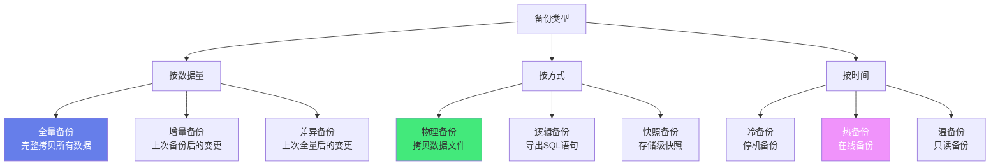
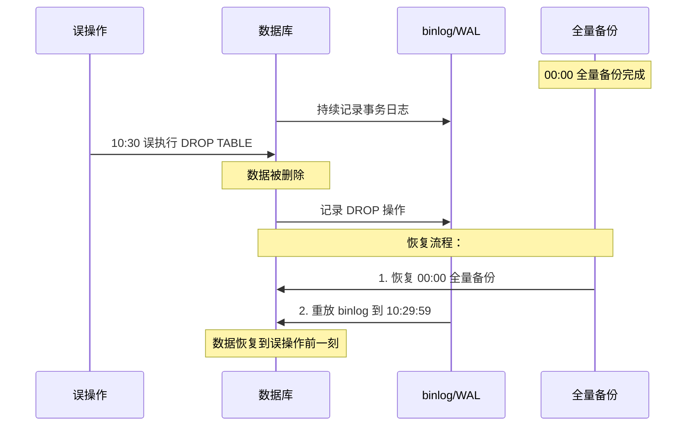

# 💾 数据库备份与恢复策略

> **文档说明**：系统讲解数据库备份与恢复的完整知识体系，涵盖备份类型（全量/增量/差异/日志）、备份方式（物理/逻辑/快照）、MySQL/PostgreSQL/Redis 各数据库备份方案、时间点恢复（PITR）、3-2-1 备份原则、RPO/RTO 指标、自动化备份脚本、备份验证与恢复演练、容灾架构设计、云数据库备份策略、常见问题与最佳实践。数据库备份是数据安全的最后防线，"备份不验证等于没备份"。
>
> **适用人群**：后端开发者、DBA、运维工程师、架构师
>
> **前置知识**：[[MySQL主从复制与读写分离]] · [[事务隔离级别与MVCC详解]]

---

## 一、概述

### 1.1 为什么需要备份

数据库是企业的核心资产，数据丢失可能导致业务中断、客户流失、合规风险甚至企业倒闭。备份是**数据安全的最后防线**，在以下场景中不可或缺：

| 场景 | 说明 |
|------|------|
| **人为误操作** | `DELETE`/`DROP` 误删数据、误改配置 |
| **软件 Bug** | 应用程序逻辑错误导致数据损坏 |
| **硬件故障** | 磁盘损坏、服务器宕机、存储故障 |
| **安全事件** | 黑客攻击、勒索软件加密、数据被篡改 |
| **自然灾害** | 火灾、水灾、地震导致机房损毁 |
| **升级失败** | 数据库版本升级或迁移出问题需要回滚 |
| **合规要求** | 金融、医疗等行业要求数据留存和可恢复 |

> **核心原则**：备份不验证等于没备份。只有经过恢复演练验证的备份才是真正有效的备份。

### 1.2 关键指标：RPO 与 RTO

| 指标 | 全称 | 含义 | 目标 |
|------|------|------|------|
| **RPO** | Recovery Point Objective（恢复点目标） | 最大可容忍的数据丢失时间窗口 | 越小越好，如 RPO<5 分钟表示最多丢失 5 分钟数据 |
| **RTO** | Recovery Time Objective（恢复时间目标） | 最大可容忍的业务中断时间 | 越小越好，如 RTO<1 小时表示 1 小时内恢复业务 |

```text
RPO 和 RTO 的关系：

时间轴：  ────●──────────────●──────────────●────
         故障发生          备份点          恢复完成
              │←── RPO ──→│←─── RTO ───→│
              
RPO = 故障发生时间 - 最近备份时间（数据丢失量）
RTO = 恢复完成时间 - 故障发生时间（业务中断时长）
```

| 备份策略 | RPO | RTO | 适用场景 |
|---------|-----|-----|---------|
| 每日全量备份 | 24 小时 | 数小时 | 非核心业务、开发环境 |
| 每日全量 + 每小时增量 | 1 小时 | 1-2 小时 | 一般业务系统 |
| 全量 + 增量 + binlog 实时备份 | 秒级-分钟级 | 30 分钟-1 小时 | 核心业务系统 |
| 主从复制 + 半同步 | 秒级 | 分钟级（切换从库） | 高可用核心系统 |
| 多活集群 | 近 0 | 近 0 | 金融级核心系统 |

### 1.3 3-2-1 备份原则

业界公认的备份黄金法则：

| 数字 | 含义 | 说明 |
|------|------|------|
| **3** | 至少 3 份数据副本 | 原始数据 + 2 份备份 |
| **2** | 存储在 2 种不同介质上 | 如磁盘 + 磁带/云存储，避免单一介质故障 |
| **1** | 至少 1 份异地备份 | 放在不同地理位置，避免区域性灾难 |

```text
3-2-1 备份架构示例：

生产数据库
    │
    ├── 本地磁盘备份（NAS/SAN）← 第1份备份，第1种介质
    │
    ├── 磁带库备份（离线）← 第2份备份，第2种介质
    │
    └── 云存储备份（异地）← 第3份备份，异地
```

---

## 二、底层原理

### 2.1 备份类型



#### 按数据量分类

| 类型 | 说明 | 优点 | 缺点 | 恢复方式 |
|------|------|------|------|---------|
| **全量备份** | 完整拷贝所有数据 | 恢复快、独立完整 | 耗时长、占空间大 | 直接恢复 |
| **增量备份** | 备份上次备份（任意类型）后的变更 | 备份快、省空间 | 恢复需全量+所有增量链 | 全量→增量1→增量2... |
| **差异备份** | 备份上次全量备份后的变更 | 恢复比增量快 | 备份量随时间增长 | 全量→最后一次差异 |

```text
增量 vs 差异备份对比：

周日：全量备份（100GB）
周一：增量（5GB）  差异（5GB）
周二：增量（3GB）  差异（8GB）
周三：增量（4GB）  差异（12GB）

恢复到周三：
  增量：全量 + 周一增量 + 周二增量 + 周三增量 = 4步
  差异：全量 + 周三差异 = 2步
```

#### 按备份方式分类

| 方式 | 说明 | 优点 | 缺点 | 工具 |
|------|------|------|------|------|
| **物理备份** | 直接拷贝数据库数据文件 | 速度快、适合大库 | 跨平台/版本兼容性差 | xtrabackup、pg_basebackup、cp/rsync |
| **逻辑备份** | 导出 SQL 语句或数据 | 跨平台、可选择性备份、可读 | 速度慢、大库恢复慢 | mysqldump、pg_dump、mongoexport |
| **快照备份** | 存储/文件系统级快照 | 极快（秒级）、几乎不影响性能 | 需要存储支持、依赖特定平台 | LVM快照、ZFS快照、云盘快照、SAN快照 |

### 2.2 时间点恢复（PITR）

**PITR（Point-In-Time Recovery）** 是指可以恢复到任意时间点，而不仅仅是备份时刻。这是通过「全量备份 + 事务日志（binlog/WAL）」实现的。



**PITR 恢复步骤**：
1. 恢复最近的全量备份
2. 应用全量备份之后的所有增量备份（如有）
3. 重放事务日志（binlog/WAL）到目标时间点之前
4. 验证数据完整性

### 2.3 备份一致性

备份时数据库正在运行，可能存在正在执行的事务，这就需要保证**备份一致性**：

| 一致性级别 | 说明 | 实现方式 |
|-----------|------|---------|
| **崩溃一致** | 备份的数据相当于数据库崩溃后的状态，重启后可恢复 | 直接拷贝数据文件（InnoDB 崩溃恢复） |
| **事务一致** | 备份的数据在某个时间点上事务完整一致 | `--single-transaction`（MVCC 快照）、锁表、暂停写入 |

**MySQL InnoDB 热备份原理**：
- `mysqldump --single-transaction`：在 REPEATABLE READ 隔离级别下开启事务，利用 MVCC 一致性快照读取数据，不锁表
- `xtrabackup`：在后台拷贝数据文件，同时记录 redo log，备份结束时应用 redo log 达到一致性

---

## 三、实操示例

### 3.1 MySQL 备份方案

#### 逻辑备份（mysqldump）

```bash
# ===== 全量备份所有数据库 =====
mysqldump -u root -p \
  --all-databases \
  --single-transaction \
  --routines \
  --triggers \
  --events \
  --set-gtid-purged=OFF \
  > /backup/full_$(date +%Y%m%d_%H%M%S).sql

# 参数说明：
# --single-transaction  InnoDB 热备份，不锁表（利用 MVCC）
# --routines            备份存储过程和函数
# --triggers            备份触发器
# --events              备份事件
# --set-gtid-purged=OFF  不写 GTID 信息（主从环境注意）

# ===== 备份单个数据库 =====
mysqldump -u root -p --single-transaction mydb > /backup/mydb.sql

# ===== 备份单张表 =====
mysqldump -u root -p --single-transaction mydb users > /backup/users.sql

# ===== 只备份表结构 =====
mysqldump -u root -p --no-data mydb > /backup/mydb_schema.sql

# ===== 只备份数据 =====
mysqldump -u root -p --no-create-info mydb > /backup/mydb_data.sql

# ===== 压缩备份（节省空间）=====
mysqldump -u root -p --single-transaction --all-databases | gzip > /backup/full.sql.gz

# ===== 恢复 =====
mysql -u root -p < /backup/full.sql
# 压缩文件恢复
gunzip < /backup/full.sql.gz | mysql -u root -p

# 恢复单个数据库
mysql -u root -p mydb < /backup/mydb.sql
```

#### 物理备份（xtrabackup）

```bash
# ===== 安装 Percona XtraBackup =====
# Ubuntu/Debian
wget https://repo.percona.com/apt/percona-release_latest.generic_all.deb
sudo dpkg -i percona-release_latest.generic_all.deb
sudo apt update && sudo apt install -y percona-xtrabackup-80

# ===== 全量备份 =====
xtrabackup --backup \
  --user=root --password=your_password \
  --target-dir=/backup/full_$(date +%Y%m%d)

# ===== 准备（Prepare）备份 —— 必须步骤！=====
# 将备份从"崩溃一致"状态变为"可用"状态
xtrabackup --prepare --target-dir=/backup/full_20260828

# ===== 恢复全量备份 =====
# 1. 停止 MySQL
systemctl stop mysql
# 2. 清空数据目录（或移走）
mv /var/lib/mysql /var/lib/mysql_old
# 3. 恢复
xtrabackup --copy-back --target-dir=/backup/full_20260828
# 4. 修复权限
chown -R mysql:mysql /var/lib/mysql
# 5. 启动 MySQL
systemctl start mysql

# ===== 增量备份 =====
# 第一次增量（基于全量）
xtrabackup --backup \
  --user=root --password=your_password \
  --target-dir=/backup/inc1 \
  --incremental-basedir=/backup/full_20260828

# 第二次增量（基于第一次增量）
xtrabackup --backup \
  --user=root --password=your_password \
  --target-dir=/backup/inc2 \
  --incremental-basedir=/backup/inc1

# ===== 恢复增量备份 =====
# 1. 准备全量备份（只 redo，不 undo）
xtrabackup --prepare --apply-log-only --target-dir=/backup/full_20260828
# 2. 应用第一次增量
xtrabackup --prepare --apply-log-only --target-dir=/backup/full_20260828 \
  --incremental-dir=/backup/inc1
# 3. 应用最后一次增量（不加 --apply-log-only，执行 undo）
xtrabackup --prepare --target-dir=/backup/full_20260828 \
  --incremental-dir=/backup/inc2
# 4. 恢复（同全量恢复步骤）
xtrabackup --copy-back --target-dir=/backup/full_20260828
```

#### binlog 备份与 PITR

```bash
# ===== 开启 binlog（my.cnf）=====
[mysqld]
server-id=1
log-bin=/var/lib/mysql/binlog
binlog_format=ROW          # 行格式，最安全
expire_logs_days=7         # 保留 7 天
binlog_expire_logs_seconds=604800

# ===== 实时备份 binlog =====
# mysqlbinlog 可以实时拉取远程 binlog
mysqlbinlog --read-from-remote-server --raw --host=db_host \
  --user=backup --password=xxx --result-file=/backup/binlog/ binlog.000001 &

# ===== 查看 binlog 内容 =====
mysqlbinlog /var/lib/mysql/binlog.000001 | head -50
mysqlbinlog --base64-output=decode-rows -v /var/lib/mysql/binlog.000001

# ===== PITR：恢复到指定时间点 =====
# 1. 恢复全量备份
# 2. 重放 binlog 到目标时间点（如误操作在 10:30，恢复到 10:29:59）
mysqlbinlog --start-datetime="2026-08-28 00:00:00" \
  --stop-datetime="2026-08-28 10:29:59" \
  /var/lib/mysql/binlog.000001 /var/lib/mysql/binlog.000002 | mysql -u root -p

# ===== PITR：恢复到指定 GTID =====
mysqlbinlog --skip-gtids --include-gtids="aaaaaaaa-bbbb-cccc-dddd-eeeeeeeeeeee:1-100" \
  binlog.000001 | mysql -u root -p

# ===== 找到误操作的位置 =====
mysqlbinlog --base64-output=decode-rows -v binlog.000001 | grep -n -i "drop table"
# 找到 DROP 语句的 end_log_pos，恢复到该位置之前
mysqlbinlog --stop-position=12345 binlog.000001 | mysql -u root -p
```

### 3.2 PostgreSQL 备份方案

```bash
# ===== 逻辑备份 =====
# 备份单个数据库
pg_dump -U postgres -h localhost mydb > /backup/mydb.sql
# 备份所有数据库
pg_dumpall -U postgres > /backup/all.sql
# 压缩备份
pg_dump -U postgres mydb | gzip > /backup/mydb.sql.gz
# 自定义格式（支持并行恢复和选择性恢复）
pg_dump -U postgres -Fc mydb > /backup/mydb.dump

# 恢复
psql -U postgres -d mydb -f /backup/mydb.sql
# 自定义格式恢复
pg_restore -U postgres -d mydb /backup/mydb.dump
# 并行恢复（加速）
pg_restore -U postgres -j 4 -d mydb /backup/mydb.dump

# ===== 物理备份（pg_basebackup）=====
# 开启 WAL 归档（postgresql.conf）
# wal_level = replica
# archive_mode = on
# archive_command = 'test ! -f /backup/wal/%f && cp %p /backup/wal/%f'

# 基础备份
pg_basebackup -U postgres -h localhost -D /backup/base_$(date +%Y%m%d) -Ft -z -P

# ===== PITR 恢复 =====
# 1. 停止 PostgreSQL
systemctl stop postgresql
# 2. 恢复基础备份
rm -rf /var/lib/postgresql/14/main/*
tar xzf /backup/base_20260828/base.tar.gz -C /var/lib/postgresql/14/main/
# 3. 创建 recovery.signal（PG12+）
touch /var/lib/postgresql/14/main/recovery.signal
# 4. 配置恢复目标（postgresql.conf）
# restore_command = 'cp /backup/wal/%f %p'
# recovery_target_time = '2026-08-28 10:29:59'
# recovery_target_action = 'pause'
# 5. 启动
systemctl start postgresql
# 6. 验证后结束恢复
psql -U postgres -c "SELECT pg_wal_replay_resume();"
```

### 3.3 Redis 备份方案

```bash
# ===== RDB 快照备份 =====
# 触发快照（redis-cli）
SAVE          # 阻塞式快照（不推荐生产用）
BGSAVE        # 后台快照（推荐）

# 配置自动快照（redis.conf）
save 900 1     # 900 秒内至少 1 个 key 变更
save 300 10    # 300 秒内至少 10 个 key 变更
save 60 10000  # 60 秒内至少 10000 个 key 变更
dbfilename dump.rdb
dir /var/lib/redis

# 备份 RDB 文件
cp /var/lib/redis/dump.rdb /backup/redis_$(date +%Y%m%d).rdb

# ===== AOF 追加日志 =====
# 开启 AOF（redis.conf）
appendonly yes
appendfilename "appendonly.aof"
appendfsync everysec    # 每秒刷盘（性能和安全的平衡）
# appendfsync always   # 每次写都刷盘（最安全，最慢）
# appendfsync no       # 操作系统决定（最快，可能丢数据）

# AOF 重写（减小 AOF 文件大小）
BGREWRITEAOF

# ===== 恢复 =====
# RDB 恢复：将 dump.rdb 放到数据目录，启动 Redis 自动加载
# AOF 恢复：将 appendonly.aof 放到数据目录，启动 Redis 自动重放
# 同时存在 RDB 和 AOF 时，Redis 优先加载 AOF（数据更完整）
```

### 3.4 自动化备份脚本

```bash
#!/bin/bash
# /usr/local/bin/mysql_backup.sh — MySQL 自动化备份脚本
# 配合 cron 使用：每天凌晨 2 点全量备份，每小时增量 binlog 备份

set -euo pipefail

# ===== 配置 =====
DB_USER="backup_user"
DB_PASS="your_password"
BACKUP_DIR="/backup/mysql"
RETENTION_DAYS=7
DATE=$(date +%Y%m%d_%H%M%S)
LOG_FILE="/var/log/mysql_backup.log"

# ===== 函数 =====
log() {
  echo "[$(date '+%Y-%m-%d %H:%M:%S')] $1" | tee -a "$LOG_FILE"
}

cleanup_old() {
  log "清理 $RETENTION_DAYS 天前的备份..."
  find "$BACKUP_DIR" -name "*.sql.gz" -mtime +$RETENTION_DAYS -delete
  find "$BACKUP_DIR" -name "*.log" -mtime +$RETENTION_DAYS -delete
  log "清理完成"
}

verify_backup() {
  local file="$1"
  if [ ! -f "$file" ]; then
    log "ERROR: 备份文件不存在: $file"
    return 1
  fi
  local size=$(stat -c%s "$file" 2>/dev/null || stat -f%z "$file")
  if [ "$size" -lt 1024 ]; then
    log "ERROR: 备份文件过小: $file (${size} bytes)"
    return 1
  fi
  # 验证 gzip 文件完整性
  if ! gzip -t "$file" 2>/dev/null; then
    log "ERROR: gzip 文件损坏: $file"
    return 1
  fi
  log "备份验证通过: $file (${size} bytes)"
  return 0
}

# ===== 全量备份 =====
full_backup() {
  log "========== 开始全量备份 =========="
  local backup_file="$BACKUP_DIR/full_${DATE}.sql.gz"
  
  mysqldump -u"$DB_USER" -p"$DB_PASS" \
    --all-databases \
    --single-transaction \
    --routines --triggers --events \
    --set-gtid-purged=OFF \
    | gzip > "$backup_file"
  
  if verify_backup "$backup_file"; then
    log "全量备份成功: $backup_file"
  else
    log "全量备份失败!"
    exit 1
  fi
  
  # 刷新 binlog（开始新的 binlog 文件，便于 PITR）
  mysql -u"$DB_USER" -p"$DB_PASS" -e "FLUSH BINARY LOGS;"
  log "已刷新 binlog"
  
  cleanup_old
  log "========== 全量备份完成 =========="
}

# ===== binlog 增量备份 =====
binlog_backup() {
  log "========== 开始 binlog 备份 =========="
  local binlog_dir="/var/lib/mysql"
  local dest_dir="$BACKUP_DIR/binlog_${DATE}"
  mkdir -p "$dest_dir"
  
  # 复制当前未使用的 binlog 文件（排除正在写入的）
  current_binlog=$(mysql -u"$DB_USER" -p"$DB_PASS" -N -e "SHOW MASTER STATUS;" | awk '{print $1}')
  for f in "$binlog_dir"/binlog.*; do
    fname=$(basename "$f")
    if [ "$fname" != "$current_binlog" ] && [ "$fname" != "binlog.index" ]; then
      cp "$f" "$dest_dir/"
      log "已复制: $fname"
    fi
  done
  
  log "binlog 备份完成: $dest_dir"
  log "========== binlog 备份完成 =========="
}

# ===== 主逻辑 =====
case "${1:-full}" in
  full)    full_backup ;;
  binlog)  binlog_backup ;;
  *)       echo "用法: $0 {full|binlog}"; exit 1 ;;
esac
```

```bash
# ===== cron 配置 =====
# 编辑 crontab
crontab -e

# 每天凌晨 2 点全量备份
0 2 * * * /usr/local/bin/mysql_backup.sh full >> /var/log/mysql_backup_cron.log 2>&1

# 每小时整点备份 binlog
0 * * * * /usr/local/bin/mysql_backup.sh binlog >> /var/log/mysql_backup_cron.log 2>&1

# ===== 备份到远程（rsync）=====
# 在备份脚本末尾添加
rsync -az --delete /backup/mysql/ backup_user@backup_server:/backup/mysql/

# ===== 备份到云存储（AWS S3）=====
aws s3 sync /backup/mysql/ s3://my-bucket/mysql-backup/ --storage-class STANDARD_IA
```

### 3.5 恢复演练流程

```bash
#!/bin/bash
# /usr/local/bin/restore_drill.sh — 定期恢复演练脚本
# 每月执行一次，验证备份可用性

set -euo pipefail

BACKUP_FILE="/backup/mysql/full_latest.sql.gz"
TEST_DB="restore_test_$(date +%Y%m%d)"
MYSQL_USER="root"
MYSQL_PASS="xxx"

log() { echo "[$(date '+%H:%M:%S')] $1"; }

log "========== 开始恢复演练 =========="

# 1. 创建测试数据库
log "创建测试数据库: $TEST_DB"
mysql -u"$MYSQL_USER" -p"$MYSQL_PASS" -e "CREATE DATABASE $TEST_DB;"

# 2. 恢复备份到测试库
log "恢复备份到测试库..."
START_TIME=$(date +%s)
gunzip < "$BACKUP_FILE" | mysql -u"$MYSQL_USER" -p"$MYSQL_PASS" "$TEST_DB"
END_TIME=$(date +%s)
RESTORE_TIME=$((END_TIME - START_TIME))
log "恢复完成，耗时: ${RESTORE_TIME}秒"

# 3. 验证数据完整性
log "验证数据完整性..."
TABLE_COUNT=$(mysql -u"$MYSQL_USER" -p"$MYSQL_PASS" -N -e "SELECT COUNT(*) FROM information_schema.tables WHERE table_schema='$TEST_DB';")
log "表数量: $TABLE_COUNT"

# 检查关键表是否有数据
for table in users orders products; do
  count=$(mysql -u"$MYSQL_USER" -p"$MYSQL_PASS" -N -e "SELECT COUNT(*) FROM $TEST_DB.$table;" 2>/dev/null || echo "0")
  log "  $table: $count 行"
done

# 4. 清理测试数据库
log "清理测试数据库..."
mysql -u"$MYSQL_USER" -p"$MYSQL_PASS" -e "DROP DATABASE $TEST_DB;"

log "========== 恢复演练完成 =========="
log "结果: 备份可用 ✓ | 恢复耗时: ${RESTORE_TIME}秒 | 表数量: $TABLE_COUNT"
```

---

## 四、常见问题与排查

| 问题现象 | 可能原因 | 解决方案 |
|---------|---------|---------|
| **mysqldump 锁表** | MyISAM 引擎或未加 `--single-transaction` | InnoDB 用 `--single-transaction`；MyISAM 用 `--lock-tables` 或停机备份 |
| **备份文件过大** | 未压缩；包含不必要的数据 | 用 gzip 压缩；用 `--ignore-table` 排除大表；归档历史数据 |
| **恢复太慢** | 逻辑备份大库；未优化 MySQL 恢复参数 | 大库用物理备份（xtrabackup）；恢复时关闭 binlog、增大 innodb_buffer_pool_size |
| **备份损坏** | 磁盘故障；备份过程中中断；传输错误 | 备份后验证（gzip -t / checksum）；用 rsync 校验；多份备份 |
| **PITR 失败** | binlog 丢失；时间点格式错误；GTID 问题 | 确保 binlog 实时备份；用 `--stop-position` 替代时间点；检查 GTID 连续性 |
| **主从备份不一致** | 从库延迟；从库有额外写入 | 备份前 `STOP SLAVE` 或等待延迟为 0；从库设为只读 |
| **磁盘空间不足** | 备份未清理；binlog 未过期 | 配置 `expire_logs_days`；定期清理旧备份；监控磁盘空间 |
| **xtrabackup 报错** | 版本不匹配；权限不足；数据目录损坏 | xtrabackup 版本与 MySQL 版本匹配；用 root 或有 RELOAD/LOCK 权限的用户 |
| **备份影响性能** | 全量备份 IO 压力大；高峰期备份 | 用物理备份（更快）；在低峰期备份；限流（`--throttle`）；从从库备份 |
| **恢复后数据不一致** | 备份时非一致性；恢复时遗漏增量/binlog | 用一致性备份（`--single-transaction`）；按顺序恢复全量→增量→binlog |
| **Redis AOF 文件过大** | 未重写 AOF | 配置 `auto-aof-rewrite-percentage`；定期 `BGREWRITEAOF` |
| **PostgreSQL WAL 堆积** | 归档命令失败；复制槽未释放 | 检查 `archive_command` 日志；清理无用复制槽；监控 WAL 目录大小 |
| **云数据库备份失败** | 存储空间不足；备份窗口冲突 | 扩容存储；调整备份时间；联系云厂商支持 |
| **加密备份无法恢复** | 密钥丢失；加密算法不兼容 | 密钥多份安全存储；记录加密方式和版本；定期测试加密备份恢复 |

---

## 五、进阶与最佳实践

### 5.1 备份策略设计

```text
备份策略设计 Checklist：

✅ 明确 RPO/RTO 目标
   - 核心业务：RPO<5min, RTO<30min
   - 一般业务：RPO<1h, RTO<4h
   - 非核心：RPO<24h, RTO<24h

✅ 选择备份类型组合
   - 每日全量 + 每小时增量 + 实时 binlog（核心业务）
   - 每日全量 + binlog（一般业务）
   - 每日全量（非核心/开发环境）

✅ 遵循 3-2-1 原则
   - 3 份副本：生产 + 本地备份 + 异地备份
   - 2 种介质：磁盘 + 磁带/云存储
   - 1 份异地：不同机房/区域/云

✅ 自动化备份
   - cron/定时任务自动执行
   - 备份结果监控告警（失败立即通知）
   - 备份文件自动上传到远程/云存储

✅ 定期恢复演练
   - 至少每月一次恢复演练
   - 记录恢复耗时（验证 RTO 是否达标）
   - 验证数据完整性和一致性
   - "备份不验证等于没备份"

✅ 监控与告警
   - 备份任务成功率
   - 备份文件大小和耗时趋势
   - 磁盘剩余空间
   - binlog/WAL 目录大小
   - 最近一次备份时间

✅ 安全与合规
   - 备份文件加密（敏感数据）
   - 备份传输加密（TLS/SSH）
   - 访问控制（最小权限）
   - 审计日志（谁在什么时候恢复了什么）
   - 数据留存周期（合规要求）
```

### 5.2 容灾架构

| 架构级别 | RPO | RTO | 成本 | 适用场景 |
|---------|-----|-----|------|---------|
| **本地备份** | 小时级 | 小时级 | 低 | 非核心业务、开发环境 |
| **异地备份** | 小时级 | 小时-天级 | 中 | 一般业务、合规要求 |
| **主从复制（同城）** | 秒级 | 分钟级 | 中 | 核心业务、高可用要求 |
| **主从复制（异地）** | 秒-分钟级 | 分钟-小时级 | 高 | 跨区域容灾 |
| **双活/多活** | 近 0 | 近 0 | 极高 | 金融级核心、全球业务 |

```text
异地容灾架构示例：

生产机房（北京）              灾备机房（上海）
┌──────────────┐             ┌──────────────┐
│  主数据库     │  主从复制    │  从数据库     │
│  (读写)       │ ──────────→ │  (只读/热备)  │
└──────────────┘             └──────────────┘
       │                            │
       │ 每日全量备份                │ 接收备份
       ▼                            ▼
┌──────────────┐             ┌──────────────┐
│ 本地备份存储   │  rsync/云同步 │ 异地备份存储   │
│ (NAS/SAN)    │ ──────────→ │ (NAS/云存储)  │
└──────────────┘             └──────────────┘
```

### 5.3 云数据库备份策略

| 云厂商 | 自动备份 | PITR | 跨区域备份 | 说明 |
|--------|---------|------|-----------|------|
| **阿里云 RDS** | ✅ 每日全量 + 实时 binlog | ✅ 7-730 天 | ✅ 跨地域备份 | 支持按时间点/位点恢复 |
| **AWS RDS** | ✅ 每日全量 + 实时事务日志 | ✅ 支持 | ✅ 跨区域快照复制 | 支持恢复到新实例 |
| **腾讯云 CDB** | ✅ 每日全量 + 实时 binlog | ✅ 支持 | ✅ 跨地域备份 | 支持冷备份归档 |
| **Google Cloud SQL** | ✅ 每日全量 + 实时事务日志 | ✅ 支持 | ✅ 跨区域备份 | 支持按时间点恢复 |

**云数据库备份最佳实践**：
- ✅ 开启自动备份，保留期至少 7 天（核心业务 30 天+）
- ✅ 开启 PITR（时间点恢复），这是云数据库最大的优势之一
- ✅ 定期手动创建快照（重要变更前后）
- ✅ 配置跨区域备份（满足异地容灾要求）
- ✅ 定期从备份恢复到新实例，验证备份可用性
- ✅ 监控备份任务状态和存储空间
- ✅ 重要数据额外导出逻辑备份（防止云厂商故障）

### 5.4 大数据库备份优化

| 优化方向 | 方法 | 效果 |
|---------|------|------|
| **备份速度** | 物理备份替代逻辑备份 | 速度提升 5-10 倍 |
| **备份速度** | 并行备份（`--parallel`） | 充分利用 CPU 和 IO |
| **备份速度** | 从从库备份 | 不影响主库性能 |
| **存储空间** | 压缩备份（gzip/zstd） | 节省 60-80% 空间 |
| **存储空间** | 增量+全量组合 | 减少每日备份量 |
| **存储空间** | 冷热数据分离归档 | 历史数据归档到廉价存储 |
| **恢复速度** | 物理备份恢复 | 比逻辑恢复快数倍 |
| **恢复速度** | 并行恢复（`pg_restore -j`） | 多线程加速恢复 |
| **恢复速度** | 恢复时优化参数（关闭 binlog、增大 buffer） | 显著提升恢复速度 |
| **性能影响** | 限流（`--throttle`） | 限制备份 IO，避免影响业务 |
| **性能影响** | 低峰期备份 | 业务影响最小 |
| **性能影响** | 快照备份（存储级） | 秒级完成，几乎无影响 |

---

## 六、关联笔记

### 数据库
- [[MySQL主从复制与读写分离]] · [[事务隔离级别与MVCC详解]] · [[NoSQL数据模型对比]]
- [[时序数据库入门与实战]]

### 高可用与架构
- [[高可用架构设计]] · [[Redis高可用与集群]] · [[K8s-故障排查手册]]

### 运维
- [[Linux系统管理与常用命令]] · [[ELK-日志聚合]] · [[Prometheus监控体系]]
- [[告警体系设计]]

### 导航
- [[MOC-计算机基础]] · [[MOC-数据库原理]] · [[MOC-综合导航]] · [[Home]]

> 🔍 **知识点深度解析**
>
> **作用**：数据库备份与恢复解决的是「数据安全和业务连续性」问题，在人为误操作、硬件故障、安全事件、自然灾害等场景下，能够恢复数据并最小化业务中断时间。备份是数据安全的最后防线。
>
> **底层原理**：备份分为全量（完整拷贝）、增量（上次备份后变更）、差异（上次全量后变更）；按方式分为物理（拷贝数据文件，快）、逻辑（导出 SQL，跨平台）、快照（存储级，秒级）。时间点恢复（PITR）通过「全量备份 + 事务日志（MySQL binlog / PostgreSQL WAL）」实现：先恢复全量备份，再重放事务日志到目标时间点。一致性备份利用 MVCC 快照（`--single-transaction`）或锁表保证备份在某个时间点事务完整。3-2-1 原则（3份副本、2种介质、1份异地）是备份的黄金法则。RPO（数据丢失窗口）和 RTO（业务中断时长）是衡量备份策略的核心指标。
>
> **用法要点**：① MySQL 逻辑备份用 `mysqldump --single-transaction --routines --triggers`，物理备份用 xtrabackup，PITR 用 binlog ② PostgreSQL 用 `pg_dump`（逻辑）和 `pg_basebackup` + WAL（物理+PITR） ③ Redis 用 RDB 快照 + AOF 日志组合 ④ 备份策略：每日全量 + 每小时增量 + 实时 binlog（核心业务） ⑤ 遵循 3-2-1 原则：本地 + 异地 + 不同介质 ⑥ 自动化：cron 定时 + 监控告警 + 自动上传远程 ⑦ 最重要：定期恢复演练，"备份不验证等于没备份" ⑧ 大库用物理备份+并行恢复，小库用逻辑备份 ⑨ 云数据库开启自动备份+PITR，额外导出逻辑备份防厂商故障 ⑩ 备份文件加密、传输加密、访问控制。

> 💡 **深度讲解**：数据库备份最容易被忽视但最重要的一点是「恢复演练」——很多团队定期备份，但从未实际恢复过，等到真正需要恢复时才发现备份损坏、恢复流程不熟悉、恢复时间远超 RTO。备份的目的不是"有备份文件"，而是"能在需要时成功恢复数据"，所以必须定期（至少每月）进行恢复演练，记录恢复耗时和数据完整性。另一个关键概念是 PITR（时间点恢复）——全量备份只能恢复到备份时刻，如果误操作发生在备份之后，就需要事务日志（binlog/WAL）来重放到误操作前的时刻。这就是为什么核心业务必须开启 binlog/WAL 并实时备份——它能将 RPO 从小时级降到秒级。物理备份 vs 逻辑备份的选择：大库（100GB+）必须用物理备份（xtrabackup/pg_basebackup），因为逻辑备份和恢复太慢；小库可以用逻辑备份，因为跨平台兼容性好、可读、可选择性恢复。快照备份是越来越流行的方式，利用存储/云盘的快照能力，秒级完成备份且几乎不影响性能，但需要存储平台支持。

> 📝 **精简总结**：数据库备份 = 数据安全最后防线。核心：全量+增量+binlog 实现 PITR，3-2-1 原则（3份/2介质/1异地），RPO/RTO 指标，定期恢复演练。MySQL：mysqldump（逻辑）+ xtrabackup（物理）+ binlog（PITR）。PostgreSQL：pg_dump + pg_basebackup + WAL。Redis：RDB + AOF。最重要：备份不验证等于没备份！

> **学习路径建议**：先学习 [[MySQL主从复制与读写分离]] 理解数据库高可用 → 学习 [[事务隔离级别与MVCC详解]] 理解事务原理 → 学习本文档掌握备份恢复策略 → 学习 [[高可用架构设计]] 理解整体容灾架构 → 在实际项目中设计和实施备份策略，并定期进行恢复演练。

---

> **数据库备份的本质是「为数据买保险」——你可能永远用不上，但一旦需要时，它就是挽救业务的唯一稻草。保险的价值不在于买了，而在于理赔时能顺利拿到钱；备份的价值不在于有文件，而在于需要时能成功恢复。**
