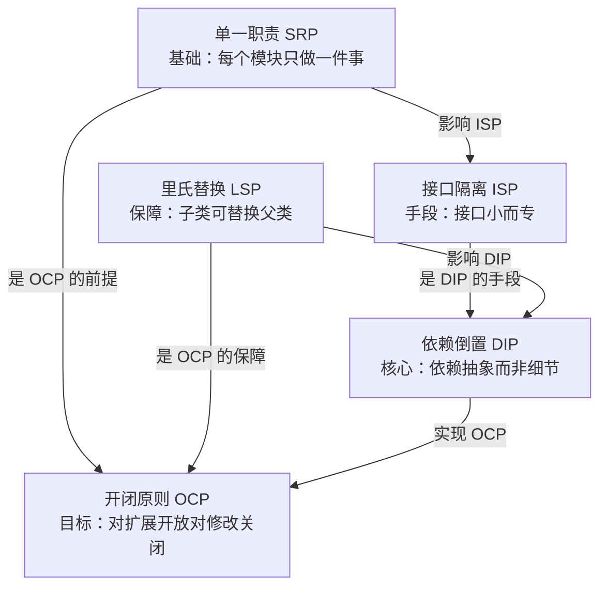

# 架构设计原则 - SOLID

> **文档说明**：系统讲解面向对象设计的五大核心原则（SOLID），包括单一职责原则、开闭原则、里氏替换原则、接口隔离原则、依赖倒置原则，每个原则包含定义、动机、代码示例（正反对比）、适用场景和常见误区，并延伸到架构层面的应用。
>
> **适用人群**：后端开发工程师、前端开发者、架构师、希望提升代码设计能力的开发者
>
> **前置知识**：[[设计模式核心]]、面向对象编程基础

---

## 一、概述

**SOLID** 是五个面向对象设计原则的首字母缩写，由 Robert C. Martin（Uncle Bob）在 2000 年初期提出，是面向对象设计和架构设计的基石。遵循 SOLID 原则可以让代码更易维护、更易扩展、更易测试、更具灵活性。

### 1. SOLID 五大原则

| 原则 | 英文 | 缩写 | 核心思想 |
|------|------|------|---------|
| **单一职责原则** | Single Responsibility Principle | **SRP** | 一个类/模块只做一件事，只有一个引起变化的原因 |
| **开闭原则** | Open/Closed Principle | **OCP** | 对扩展开放，对修改关闭 |
| **里氏替换原则** | Liskov Substitution Principle | **LSP** | 子类必须能替换父类而不破坏程序正确性 |
| **接口隔离原则** | Interface Segregation Principle | **ISP** | 客户端不应依赖它不需要的接口，接口要小而专 |
| **依赖倒置原则** | Dependency Inversion Principle | **DIP** | 高层模块不应依赖低层模块，两者都应依赖抽象；抽象不应依赖细节，细节应依赖抽象 |

### 2. SOLID 之间的关系



| 关系 | 说明 |
|------|------|
| SRP 是基础 | 职责清晰才能谈其他原则 |
| OCP 是目标 | 最终目的是让系统易扩展 |
| LSP 是保障 | 继承关系正确才能安全扩展 |
| ISP 是手段 | 细粒度接口实现依赖倒置 |
| DIP 是核心 | 依赖抽象是实现开闭的关键 |

### 3. 遵循 SOLID 的收益

| 收益 | 说明 |
|------|------|
| **可维护性** | 职责清晰，修改一个功能不会影响其他功能 |
| **可扩展性** | 新增功能只需扩展，不需修改已有代码 |
| **可测试性** | 依赖抽象，易于 Mock 和单元测试 |
| **可复用性** | 模块职责单一，接口清晰，易于复用 |
| **灵活性** | 实现可替换，不影响高层逻辑 |
| **降低耦合** | 依赖抽象而非具体实现，模块间松耦合 |

---

## 二、单一职责原则（SRP）

### 1. 定义

> **一个类或模块应该只有一个引起它变化的原因，即只负责一项职责。**

如果一个类承担了多个职责，那么修改其中一个职责的代码可能会影响其他职责的正常运行，增加了维护风险和测试难度。

### 2. 反例（违反 SRP）

```java
// ❌ 违反 SRP：UserService 同时负责用户管理、邮件发送、数据导出
public class UserService {

    public void createUser(User user) {
        // 1. 保存用户到数据库
        userRepository.save(user);
        // 2. 发送欢迎邮件
        sendWelcomeEmail(user);
        // 3. 记录操作日志
        logOperation("CREATE_USER", user.getId());
    }

    private void sendWelcomeEmail(User user) {
        // 邮件发送逻辑（SMTP、模板、重试）
        emailService.send(user.getEmail(), "欢迎注册", "欢迎加入我们！");
    }

    private void logOperation(String operation, Long userId) {
        // 日志记录逻辑（数据库、异步、格式化）
        logRepository.save(new OperationLog(operation, userId, new Date()));
    }

    public byte[] exportUsersToExcel() {
        // Excel 导出逻辑（POI、格式化、样式）
        // ...
    }
}
```

**问题**：
- `UserService` 有三个变化原因：用户管理逻辑变化、邮件发送逻辑变化、日志记录逻辑变化
- 修改邮件发送逻辑可能影响用户创建功能
- 无法单独测试邮件发送或日志记录
- 类越来越臃肿，难以维护

### 3. 正例（遵循 SRP）

```java
// ✅ 遵循 SRP：每个类只负责一个职责

// 用户服务：只负责用户业务逻辑
@Service
public class UserService {
    private final UserRepository userRepository;
    private final UserEventPublisher eventPublisher;

    public User createUser(User user) {
        User saved = userRepository.save(user);
        eventPublisher.publishUserCreated(saved);  // 发布事件，不直接处理
        return saved;
    }
}

// 邮件服务：只负责邮件发送
@Service
public class EmailService {
    public void sendWelcomeEmail(User user) {
        // 邮件发送逻辑
    }
}

// 邮件监听器：监听用户创建事件，发送邮件
@Component
public class UserEmailListener {
    private final EmailService emailService;

    @EventListener
    public void onUserCreated(UserCreatedEvent event) {
        emailService.sendWelcomeEmail(event.getUser());
    }
}

// 操作日志服务：只负责日志记录
@Service
public class OperationLogService {
    public void log(String operation, Long userId) {
        // 日志记录逻辑
    }
}

// Excel 导出服务：只负责导出
@Service
public class UserExportService {
    public byte[] exportToExcel(List<User> users) {
        // Excel 导出逻辑
    }
}
```

**改进**：
- 每个类只有一个变化原因
- 修改邮件发送不影响用户创建
- 每个类都可以独立测试
- 类职责清晰，易于理解和维护

### 4. SRP 的判断标准

| 判断维度 | 说明 |
|---------|------|
| **变化原因** | 这个类有几个可能引起变化的原因？超过 1 个就违反 SRP |
| **类名描述** | 类名能否准确描述其职责？需要用"和/与"连接就可能违反 |
| **方法内聚性** | 类的方法是否都围绕同一个职责？无关方法应拆分 |
| **测试难度** | 是否需要 Mock 大量不相关的依赖？是则可能违反 |
| **修改影响范围** | 修改一个功能是否会影响其他不相关功能？是则违反 |

### 5. 常见误区

| 误区 | 说明 | 正确理解 |
|------|------|---------|
| **过度拆分** | 把每个方法都拆成一个类 | SRP 是"一个变化原因"，不是"一个方法" |
| **只看类不看模块** | 只关注类级别，忽略方法/模块/服务级别 | SRP 适用于所有粒度：方法、类、模块、服务、微服务 |
| **忽略上下文** | 机械地拆分，不考虑业务上下文 | 职责划分取决于业务变化频率，不同场景不同 |
| **数据和行为分离** | 把数据类和行为类完全分离 | 面向对象强调数据和行为封装在一起，SRP 不反对 |

---

## 三、开闭原则（OCP）

### 1. 定义

> **软件实体（类、模块、函数）应该对扩展开放，对修改关闭。**

- **对扩展开放**：新增功能时，通过添加新代码实现，不需修改已有代码
- **对修改关闭**：已有代码一旦测试通过，不应再修改，避免引入新 Bug

### 2. 反例（违反 OCP）

```java
// ❌ 违反 OCP：每新增一种支付方式都要修改 PaymentService
public class PaymentService {

    public void pay(PaymentRequest request) {
        if ("ALIPAY".equals(request.getType())) {
            // 支付宝支付逻辑
            alipayClient.pay(request);
        } else if ("WECHAT".equals(request.getType())) {
            // 微信支付逻辑
            wechatClient.pay(request);
        } else if ("CREDIT_CARD".equals(request.getType())) {
            // 信用卡支付逻辑
            creditCardClient.pay(request);
        }
        // 新增支付方式需要继续加 else if，修改已有代码
    }
}
```

**问题**：
- 每新增一种支付方式都要修改 `PaymentService`，违反"对修改关闭"
- 修改已有代码可能引入新 Bug
- 类会越来越庞大，难以维护
- 违反 SRP（同时处理多种支付方式）

### 3. 正例（遵循 OCP）

```java
// ✅ 遵循 OCP：通过抽象和多态实现扩展

// 1. 定义抽象（支付策略接口）
public interface PaymentStrategy {
    String getType();
    void pay(PaymentRequest request);
}

// 2. 具体实现（每种支付方式一个类，新增只需加类）
@Component
public class AlipayStrategy implements PaymentStrategy {
    @Override
    public String getType() { return "ALIPAY"; }
    @Override
    public void pay(PaymentRequest request) {
        // 支付宝支付逻辑
    }
}

@Component
public class WechatStrategy implements PaymentStrategy {
    @Override
    public String getType() { return "WECHAT"; }
    @Override
    public void pay(PaymentRequest request) {
        // 微信支付逻辑
    }
}

@Component
public class CreditCardStrategy implements PaymentStrategy {
    @Override
    public String getType() { return "CREDIT_CARD"; }
    @Override
    public void pay(PaymentRequest request) {
        // 信用卡支付逻辑
    }
}

// 3. 支付服务（依赖抽象，不需修改）
@Service
public class PaymentService {
    private final Map<String, PaymentStrategy> strategyMap;

    // Spring 自动注入所有 PaymentStrategy 实现
    public PaymentService(List<PaymentStrategy> strategies) {
        this.strategyMap = strategies.stream()
            .collect(Collectors.toMap(PaymentStrategy::getType, s -> s));
    }

    public void pay(PaymentRequest request) {
        PaymentStrategy strategy = strategyMap.get(request.getType());
        if (strategy == null) {
            throw new IllegalArgumentException("不支持的支付方式: " + request.getType());
        }
        strategy.pay(request);
    }
}

// 4. 新增支付方式只需加一个类，不需修改 PaymentService
@Component
public class ApplePayStrategy implements PaymentStrategy {
    @Override
    public String getType() { return "APPLE_PAY"; }
    @Override
    public void pay(PaymentRequest request) {
        // Apple Pay 逻辑
    }
}
```

**改进**：
- 新增支付方式只需添加新的 `PaymentStrategy` 实现类，不需修改 `PaymentService`
- 已有代码不需修改，不会引入新 Bug
- 每种支付方式独立，职责清晰（同时遵循 SRP）
- 易于测试和扩展

### 4. 实现 OCP 的常用模式

| 模式 | 说明 | 示例 |
|------|------|------|
| **策略模式** | 定义算法族，可互换 | 支付方式、排序算法、压缩算法 |
| **模板方法模式** | 定义算法骨架，子类实现步骤 | 数据导出、工作流、游戏关卡 |
| **工厂模式** | 通过工厂创建对象，隐藏实现 | 数据库连接、日志器、解析器 |
| **观察者模式** | 事件通知，新增观察者不需修改被观察者 | 事件监听、消息通知 |
| **装饰器模式** | 动态添加功能，不需修改原类 | 数据流包装、缓存装饰、日志装饰 |
| **依赖注入** | 依赖抽象，实现可替换 | Spring DI、插件机制 |
| **配置驱动** | 通过配置扩展行为，不需改代码 | 规则引擎、工作流配置、功能开关 |

### 5. OCP 的判断标准

| 判断维度 | 说明 |
|---------|------|
| **新增功能方式** | 新增功能是添加新代码还是修改已有代码？修改则违反 OCP |
| `if/else`/`switch` | 是否有大量根据类型判断的分支？是则可能违反 OCP |
| **抽象程度** | 是否依赖抽象而非具体实现？依赖具体实现则难以扩展 |
| **扩展点设计** | 是否预留了扩展点（接口/抽象类/钩子方法）？ |

---

## 四、里氏替换原则（LSP）

### 1. 定义

> **子类对象必须能够替换其父类对象，而不改变程序的正确性和期望行为。**

换句话说，使用父类引用的地方，替换成任意子类对象后，程序的行为应该仍然正确，不需要修改代码。

### 2. 反例（违反 LSP）

```java
// ❌ 违反 LSP：正方形不是长方形的合理子类

// 父类：长方形
public class Rectangle {
    protected int width;
    protected int height;

    public void setWidth(int width) { this.width = width; }
    public void setHeight(int height) { this.height = height; }
    public int getArea() { return width * height; }
}

// 子类：正方形（继承长方形，但行为不一致）
public class Square extends Rectangle {
    @Override
    public void setWidth(int width) {
        this.width = width;
        this.height = width;  // 正方形宽高相等，同时修改 height
    }

    @Override
    public void setHeight(int height) {
        this.width = height;  // 同时修改 width
        this.height = height;
    }
}

// 使用父类引用的测试
public class RectangleTest {
    public void testArea(Rectangle rect) {
        rect.setWidth(5);
        rect.setHeight(4);
        // 期望面积 = 5 * 4 = 20
        assert rect.getArea() == 20;
    }

    public static void main(String[] args) {
        RectangleTest test = new RectangleTest();

        test.testArea(new Rectangle());  // ✅ 通过：5*4=20
        test.testArea(new Square());      // ❌ 失败：setWidth(5)→宽高都5，setHeight(4)→宽高都4，面积=16
    }
}
```

**问题**：
- `Square` 不能替换 `Rectangle`，因为 `setWidth` 和 `setHeight` 的行为与父类期望不一致
- 父类期望 `setWidth` 只修改宽度，不影响高度，但子类同时修改了高度
- 违反了"子类可以替换父类"的约定

**正确做法**：正方形和长方形应该是平级的，都继承自更抽象的 `Shape`：

```java
// ✅ 遵循 LSP：抽象出 Shape 接口
public interface Shape {
    int getArea();
}

public class Rectangle implements Shape {
    private int width;
    private int height;
    // 构造函数设置宽高，不提供 setWidth/setHeight
    public Rectangle(int width, int height) {
        this.width = width;
        this.height = height;
    }
    @Override
    public int getArea() { return width * height; }
}

public class Square implements Shape {
    private int side;
    public Square(int side) { this.side = side; }
    @Override
    public int getArea() { return side * side; }
}

// 使用 Shape 引用，任意实现都可替换
public void printArea(Shape shape) {
    System.out.println("面积: " + shape.getArea());
}
```

### 3. LSP 的核心约束

| 约束 | 说明 | 违反示例 |
|------|------|---------|
| **前置条件不能加强** | 子类方法的参数校验不能比父类更严格 | 父类接受 null，子类抛 NPE |
| **后置条件不能削弱** | 子类方法的返回值/副作用不能比父类弱 | 父类保证非空返回，子类可能返回 null |
| **不变量必须保持** | 子类不能改变父类的不变量 | 父类保证宽高独立，子类修改一个影响另一个 |
| **异常不能改变** | 子类不能抛出父类没有声明的新异常类型 | 父类抛 IOException，子类抛 RuntimeException |
| **方法签名兼容** | 子类方法参数和返回值必须兼容 | 父类返回 List，子类返回 ArrayList（协变返回 OK） |

### 4. 常见违反 LSP 的场景

| 场景 | 说明 | 正确做法 |
|------|------|---------|
| **is-a 误用** | 用继承表示"有一个"或"像一个" | 用组合/接口代替继承 |
| **重写改变行为** | 子类重写方法但行为与父类不一致 | 确保重写方法遵循父类契约 |
| **空实现/抛异常** | 子类实现接口方法但抛 `UnsupportedOperationException` | 拆分接口（ISP），或不继承该接口 |
| **缩小输入范围** | 子类方法对参数要求更严格 | 遵循前置条件不能加强 |
| **扩大输出范围** | 子类返回值范围比父类大 | 遵循后置条件不能削弱 |

**经典反例：`java.util.Properties`**
- `Properties` 继承自 `Hashtable<Object, Object>`，但实际只允许 String key/value
- 调用 `put(new Object(), new Object())` 编译通过但运行时可能出问题
- 违反 LSP：`Properties` 不能完全替换 `Hashtable`

---

## 五、接口隔离原则（ISP）

### 1. 定义

> **客户端不应依赖它不需要的接口。一个类对另一个类的依赖应该建立在最小的接口上。**

简单说：接口要小而专，不要把不相关的方法塞到一个接口里。实现类不应该被迫实现它不需要的方法。

### 2. 反例（违反 ISP）

```java
// ❌ 违反 ISP：Worker 接口包含了不相关的方法

// 大而全的接口
public interface Worker {
    void work();        // 工作
    void eat();         // 吃饭
    void sleep();       // 睡觉
    void attendMeeting(); // 开会
    void writeCode();   // 写代码
    void manageTeam();  // 管理团队
}

// 程序员实现类：被迫实现不需要的方法
public class Programmer implements Worker {
    @Override
    public void work() { /* 编程工作 */ }
    @Override
    public void eat() { /* 吃饭 */ }
    @Override
    public void sleep() { /* 睡觉 */ }
    @Override
    public void attendMeeting() { /* 程序员可能不需要开会？ */ }
    @Override
    public void writeCode() { /* 写代码 */ }
    @Override
    public void manageTeam() {
        throw new UnsupportedOperationException("程序员不需要管理团队"); // ❌ 被迫实现不需要的方法
    }
}

// 经理实现类：被迫实现不需要的方法
public class Manager implements Worker {
    @Override
    public void work() { /* 管理工作 */ }
    @Override
    public void eat() { /* 吃饭 */ }
    @Override
    public void sleep() { /* 睡觉 */ }
    @Override
    public void attendMeeting() { /* 开会 */ }
    @Override
    public void writeCode() {
        throw new UnsupportedOperationException("经理不需要写代码"); // ❌ 被迫实现不需要的方法
    }
    @Override
    public void manageTeam() { /* 管理团队 */ }
}
```

**问题**：
- `Programmer` 被迫实现 `manageTeam()`，`Manager` 被迫实现 `writeCode()`
- 接口方法变化会影响所有实现类，即使它们不需要那个方法
- 客户端依赖了不需要的方法，增加了耦合
- 违反 LSP（空实现/抛异常）

### 3. 正例（遵循 ISP）

```java
// ✅ 遵循 ISP：拆分为小而专的接口

// 基础能力接口
public interface Eatable {
    void eat();
}

public interface Sleepable {
    void sleep();
}

public interface Workable {
    void work();
}

// 专业能力接口
public interface Codable {
    void writeCode();
}

public interface MeetingAttendable {
    void attendMeeting();
}

public interface TeamManageable {
    void manageTeam();
}

// 程序员：只实现需要的接口
public class Programmer implements Workable, Eatable, Sleepable, Codable {
    @Override public void work() { /* 编程工作 */ }
    @Override public void eat() { /* 吃饭 */ }
    @Override public void sleep() { /* 睡觉 */ }
    @Override public void writeCode() { /* 写代码 */ }
    // 不需要 attendMeeting 和 manageTeam，不实现
}

// 经理：只实现需要的接口
public class Manager implements Workable, Eatable, Sleepable, MeetingAttendable, TeamManageable {
    @Override public void work() { /* 管理工作 */ }
    @Override public void eat() { /* 吃饭 */ }
    @Override public void sleep() { /* 睡觉 */ }
    @Override public void attendMeeting() { /* 开会 */ }
    @Override public void manageTeam() { /* 管理团队 */ }
    // 不需要 writeCode，不实现
}

// 客户端只依赖需要的接口
public class CodeReviewService {
    public void review(Codable coder) {  // 只依赖 Codable
        coder.writeCode();
        // ...
    }
}

public class MeetingService {
    public void holdMeeting(MeetingAttendable attendee) {  // 只依赖 MeetingAttendable
        attendee.attendMeeting();
    }
}
```

**改进**：
- 每个实现类只实现需要的方法，没有空实现
- 接口变化只影响需要它的实现类
- 客户端只依赖需要的接口，耦合度低
- 同时遵循 LSP（没有不支持的方法）

### 4. ISP 的判断标准

| 判断维度 | 说明 |
|---------|------|
| **空实现** | 实现类是否有空实现或抛 `UnsupportedOperationException`？是则违反 ISP |
| **方法相关性** | 接口中的方法是否都相关？不相关的方法应拆分 |
| **客户端依赖** | 客户端是否依赖了不需要的方法？是则接口太大 |
| **变化影响** | 修改接口方法是否影响了不需要该方法的实现类？是则接口太大 |

### 5. ISP vs SRP

| 维度 | SRP | ISP |
|------|-----|-----|
| **关注点** | 类/模块的职责 | 接口的设计 |
| **核心** | 一个类只有一个变化原因 | 客户端不依赖不需要的接口 |
| **粒度** | 类/模块级别 | 接口级别 |
| **关系** | SRP 关注实现类的内聚 | ISP 关注接口的粒度 |
| **互补** | 类职责单一 → 接口自然小 | 接口小 → 实现类更容易职责单一 |

---

## 六、依赖倒置原则（DIP）

### 1. 定义

> **1. 高层模块不应依赖低层模块，两者都应依赖抽象。**
> **2. 抽象不应依赖细节，细节应依赖抽象。**

- **高层模块**：包含业务逻辑、策略决策的模块（如 Service、Controller）
- **低层模块**：包含具体实现、工具的模块（如 Repository、外部 API 客户端）
- **抽象**：接口或抽象类
- **细节**：具体实现类

核心思想：**面向接口编程，而不是面向实现编程。**

### 2. 反例（违反 DIP）

```java
// ❌ 违反 DIP：高层模块直接依赖低层模块

// 低层模块：具体的 MySQL 数据库实现
public class MySQLUserRepository {
    public User findById(Long id) {
        // MySQL 数据库查询逻辑
        String sql = "SELECT * FROM users WHERE id = ?";
        // ...
        return user;
    }

    public void save(User user) {
        // MySQL 数据库保存逻辑
    }
}

// 高层模块：用户服务，直接依赖 MySQLUserRepository
public class UserService {
    private final MySQLUserRepository repository;  // ❌ 直接依赖具体实现

    public UserService(MySQLUserRepository repository) {
        this.repository = repository;
    }

    public User getUser(Long id) {
        return repository.findById(id);
    }
}

// 组装
public class Application {
    public static void main(String[] args) {
        MySQLUserRepository repository = new MySQLUserRepository();
        UserService service = new UserService(repository);
        // 如果要换成 PostgreSQL，需要修改 UserService 的代码
    }
}
```

**问题**：
- `UserService` 直接依赖 `MySQLUserRepository`，换数据库需要修改 `UserService`
- 高层模块和低层模块紧密耦合，难以测试（无法 Mock Repository）
- 违反 OCP（换实现需要修改高层代码）
- 低层模块变化会影响高层模块

### 3. 正例（遵循 DIP）

```java
// ✅ 遵循 DIP：高层和低层都依赖抽象

// 1. 定义抽象（Repository 接口）
public interface UserRepository {
    User findById(Long id);
    void save(User user);
}

// 2. 低层模块：依赖抽象（实现接口）
public class MySQLUserRepository implements UserRepository {
    @Override
    public User findById(Long id) {
        // MySQL 实现
    }
    @Override
    public void save(User user) {
        // MySQL 实现
    }
}

// 另一个实现：PostgreSQL
public class PostgreSQLUserRepository implements UserRepository {
    @Override
    public User findById(Long id) {
        // PostgreSQL 实现
    }
    @Override
    public void save(User user) {
        // PostgreSQL 实现
    }
}

// 测试用 Mock 实现
public class MockUserRepository implements UserRepository {
    @Override
    public User findById(Long id) {
        return new User(id, "Mock User");  // 返回测试数据
    }
    @Override
    public void save(User user) {
        // 不做实际操作
    }
}

// 3. 高层模块：依赖抽象（接口），不依赖具体实现
public class UserService {
    private final UserRepository repository;  // ✅ 依赖抽象

    public UserService(UserRepository repository) {  // 依赖注入
        this.repository = repository;
    }

    public User getUser(Long id) {
        return repository.findById(id);
    }
}

// 4. 组装（在最外层决定具体实现）
public class Application {
    public static void main(String[] args) {
        // 生产环境用 MySQL
        UserRepository repository = new MySQLUserRepository();
        UserService service = new UserService(repository);

        // 测试环境用 Mock，不需修改 UserService
        // UserRepository repository = new MockUserRepository();
        // UserService service = new UserService(repository);

        // 换 PostgreSQL，只需改这一行，不需修改 UserService
        // UserRepository repository = new PostgreSQLUserRepository();
    }
}
```

**改进**：
- `UserService` 依赖 `UserRepository` 接口，换实现不需修改 `UserService`
- 易于单元测试（可注入 Mock 实现）
- 高层和低层松耦合，低层变化不影响高层
- 同时遵循 OCP（扩展新实现不需修改高层代码）

### 4. DIP 的核心要点

| 要点 | 说明 |
|------|------|
| **面向接口编程** | 变量类型、方法参数、返回值都用接口/抽象类，不用具体类 |
| **依赖注入（DI）** | 依赖通过构造函数/Setter/字段注入，不在内部 new |
| **抽象在高层侧定义** | 接口由高层模块定义，低层模块实现（不是低层定义接口高层用） |
| **最外层组装** | 具体实现的选择在最外层（main 方法/配置类/IoC 容器） |
| **IoC 容器** | Spring 等 IoC 容器自动管理依赖注入，是 DIP 的工程化实现 |

### 5. 控制反转（IoC）与依赖注入（DI）

| 概念 | 说明 | 关系 |
|------|------|------|
| **IoC（控制反转）** | 对象的创建和依赖管理交给容器，不由代码直接控制 | 是一种设计思想/原则 |
| **DI（依赖注入）** | 容器将依赖注入到对象中（构造器/Setter/字段） | 是 IoC 的具体实现方式 |
| **DIP（依赖倒置）** | 高层依赖抽象不依赖细节 | 是面向对象设计原则 |

**关系**：DIP 是原则 → IoC 是思想 → DI 是实现手段。三者目标一致：解耦。

### 6. DIP 的判断标准

| 判断维度 | 说明 |
|---------|------|
| **new 关键字** | 高层模块中是否有 `new 具体实现类()`？是则可能违反 DIP |
| **参数类型** | 方法参数/返回值是否用了具体类而非接口？是则可能违反 |
| **测试难度** | 是否难以 Mock 依赖进行单元测试？是则可能违反 |
| **替换成本** | 替换一个实现是否需要修改高层代码？是则违反 DIP |

---

## 七、SOLID 在架构层面的应用

SOLID 不仅适用于类级别，也适用于模块、服务、系统架构层面：

| 原则 | 类级别 | 架构级别 |
|------|--------|---------|
| **SRP** | 一个类只做一件事 | 一个微服务只负责一个业务领域（如用户服务、订单服务） |
| **OCP** | 新增功能扩展类不修改类 | 新增功能添加新服务/插件，不修改已有服务 |
| **LSP** | 子类可替换父类 | 服务实现可替换（如换数据库、换消息队列），不影响上层 |
| **ISP** | 接口小而专 | API 接口细粒度，客户端不依赖不需要的 API（如 GraphQL） |
| **DIP** | 依赖抽象不依赖细节 | 服务间通过 API/事件通信，不直接依赖具体实现 |

**架构层面的 DIP 示例**：
```text
传统分层（违反 DIP）：
Controller → Service → Repository → MySQL
（高层依赖低层，换数据库要改 Service）

依赖倒置（遵循 DIP）：
Controller → Service → Repository 接口 ← MySQL 实现
                                  ← PostgreSQL 实现
                                  ← Redis 缓存实现
（Service 依赖接口，实现可替换）
```

---

## 八、SOLID 常见误区与权衡

### 1. 常见误区

| 误区 | 说明 | 正确理解 |
|------|------|---------|
| **过度设计** | 为每个类都定义接口，过度抽象 | SOLID 是指导原则，不是教条，简单场景不需要过度抽象 |
| **只看类不看全局** | 机械地让每个类符合 SOLID，忽略系统整体 | 先考虑系统架构和模块划分，再考虑类级别 |
| **为原则而原则** | 为了符合 SOLID 而增加不必要的复杂度 |  SOLID 的目标是降低复杂度，不是增加复杂度 |
| **忽略变化频率** | 不考虑业务变化频率，机械拆分 | 变化频繁的部分更需要 SOLID，稳定部分可以简单 |
| **性能忽略** | 过度抽象导致性能损耗 | 性能敏感场景需权衡抽象层次 |

### 2. 何时不必严格遵循 SOLID

| 场景 | 说明 |
|------|------|
| **简单 CRUD** | 逻辑简单，变化少，不需要过度抽象 |
| **一次性脚本** | 临时使用，不需维护 |
| **性能极致要求** | 抽象层次过多影响性能，可适当耦合 |
| **原型/POC** | 验证想法，快速迭代，不需完美设计 |
| **极小组件** | 逻辑极少，一个方法就够，不需拆分类 |

**原则**：SOLID 是为了应对变化和复杂度。如果没有变化和复杂度，就不需要过度设计。

---

## 九、关联笔记

### 设计模式
- [[设计模式核心]] · [[创建型设计模式]] · [[结构型设计模式]] · [[行为型设计模式]]

### 架构
- [[高可用架构设计]] · [[高并发系统设计案例]] · [[微服务架构核心概念]]
- [[领域驱动设计DDD]] · [[技术选型决策指南]]

### 后端
- [[SpringBoot-自动装配原理]] · [[Spring事务管理与传播机制]] · [[MyBatis-核心原理与插件]]
- [[Gateway-网关路由与鉴权]]

### 前端
- [[Vue3-组合式API设计模式]] · [[JavaScript核心语法与ES6+]] · [[TypeScript-类型系统进阶_backup_skeleton]]

### 计算机基础
- [[数据结构与算法核心]] · [[操作系统核心概念]]

### 导航
- [[MOC-后端开发]] · [[全栈+AI工程双轨融合学习路线图]]

> **学习路径建议**：先掌握 [[设计模式核心]] 理解常用设计模式 → 深入本文 SOLID 设计原则 → 学习 [[领域驱动设计DDD]] 领域建模 → 实践 [[微服务架构核心概念]] 服务拆分 → 研究 [[高可用架构设计]] 和 [[高并发系统设计案例]] 架构设计。

---

## 💡 全文深度讲解

本文系统梳理了架构设计原则 - SOLID的核心知识体系，从概述入手，深入单一职责原则（SRP）的底层机制，再通过开闭原则（OCP）掌握实战应用，最后涵盖SOLID 常见误区与权衡与关联笔记。学习时建议先建立整体认知，再动手实践，最后结合常见问题深化理解。

## 📝 全文精简总结

- **概述**：掌握本模块的核心概念与关键要点
- **单一职责原则（SRP）**：掌握本模块的核心概念与关键要点
- **开闭原则（OCP）**：掌握本模块的核心概念与关键要点
- **里氏替换原则（LSP）**：掌握本模块的核心概念与关键要点
- **接口隔离原则（ISP）**：掌握本模块的核心概念与关键要点
- **依赖倒置原则（DIP）**：掌握本模块的核心概念与关键要点
- **SOLID 在架构层面的应用**：掌握本模块的核心概念与关键要点
- **SOLID 常见误区与权衡**：掌握本模块的核心概念与关键要点
- 其余1个模块涵盖进阶主题与拓展内容

