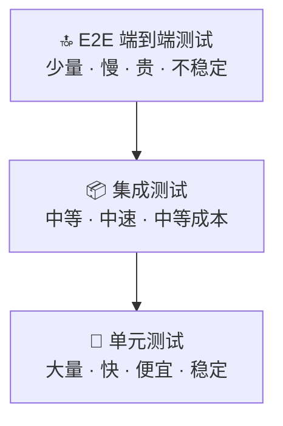

# 测试工程-测试金字塔与分层策略

> **文档说明**：系统讲解测试金字塔模型与分层测试策略，包括单元测试层、集成测试层、端到端（E2E）测试层的定位与实践，测试反模式（冰淇淋蛋筒、纸杯蛋糕），测试策略制定方法论，各层测试工具选型，以及测试分层的最佳实践和常见问题。
>
> **适用人群**：后端开发工程师、全栈开发者、QA 工程师、测试架构师
>
> **前置知识**：[[测试工程-TDD测试驱动开发]]、[[测试工程-测试覆盖率与质量度量]]、[[测试工程-契约测试与集成测试]]

---

## 一、概述

### 1. 什么是测试金字塔

**测试金字塔（Test Pyramid）** 是 Mike Cohn 在《Succeeding with Agile》中提出的测试分层模型，指导团队合理分配不同层级测试的比例，以达到**快速反馈、高覆盖率、低维护成本**的平衡。

### 2. 测试金字塔模型



| 层级 | 比例 | 速度 | 成本 | 稳定性 | 反馈速度 |
|------|------|------|------|--------|---------|
| **单元测试** | 70-80% | 毫秒级 | 低 | 高 | 秒级 |
| **集成测试** | 15-20% | 秒级 | 中 | 中 | 分钟级 |
| **E2E 测试** | 5-10% | 分钟级 | 高 | 低 | 十分钟级 |

### 3. 核心理念

- [ ] **底层多、顶层少**：越底层的测试越多，越顶层的测试越少
- [ ] **快速反馈**：大部分问题在单元测试层发现，快速定位
- [ ] **高内聚低耦合**：单元测试独立、快速、稳定
- [ ] **集成验证协作**：集成测试验证模块间协作
- [ ] **E2E 验证关键路径**：端到端测试只覆盖核心用户流程
- [ ] **避免重复**：底层已测的逻辑，顶层不重复测试

---

## 二、单元测试层

### 1. 单元测试定义

**单元测试（Unit Test）** 是对最小可测试单元（通常是一个函数/方法/类）进行的测试，隔离外部依赖（通过 Mock/Stub），验证其逻辑正确性。

### 2. 单元测试特征

| 特征 | 说明 |
|------|------|
| **快速** | 毫秒级执行，数千个测试几秒内完成 |
| **独立** | 不依赖外部系统（DB、网络、文件系统） |
| **可重复** | 多次运行结果一致，无副作用 |
| **隔离** | 每个测试独立，不依赖执行顺序 |
| **单一职责** | 每个测试只验证一个行为 |
| **自动验证** | 断言自动判断通过/失败，不需人工 |

### 3. 单元测试实践

```java
// 典型单元测试：纯逻辑，无外部依赖
@ExtendWith(MockitoExtension.class)
class OrderServiceTest {

    @Mock
    private OrderRepository orderRepository;

    @Mock
    private PaymentService paymentService;

    @InjectMocks
    private OrderService orderService;

    @Test
    @DisplayName("创建订单时应计算正确的总价")
    void shouldCalculateTotalPrice_whenCreateOrder() {
        // Given
        List<OrderItem> items = Arrays.asList(
            new OrderItem("商品A", 2, new BigDecimal("100.00")),
            new OrderItem("商品B", 1, new BigDecimal("50.00"))
        );

        // When
        Order order = orderService.createOrder(items);

        // Then
        assertEquals(new BigDecimal("250.00"), order.getTotalPrice());
        verify(orderRepository).save(any(Order.class));
    }

    @Test
    @DisplayName("支付失败时应抛出异常并回滚")
    void shouldThrowException_whenPaymentFailed() {
        // Given
        when(paymentService.pay(any())).thenThrow(new PaymentException("余额不足"));

        // When & Then
        assertThrows(PaymentException.class, () ->
            orderService.payOrder(1L)
        );
        verify(orderRepository, never()).updateStatus(any(), any());
    }
}
```

### 4. 单元测试工具

| 语言 | 测试框架 | Mock 框架 | 断言库 |
|------|---------|----------|--------|
| **Java** | JUnit 5 / TestNG | Mockito / WireMock | AssertJ / Hamcrest |
| **Python** | pytest / unittest | unittest.mock | pytest |
| **JavaScript/TS** | Jest / Vitest | Jest Mock / Sinon | Chai / Jest Assert |
| **Go** | testing | gomock / testify | testify |
| **Rust** | cargo test | mockall | assert! / pretty_assertions |

---

## 三、集成测试层

### 1. 集成测试定义

**集成测试（Integration Test）** 验证多个模块/组件协同工作的正确性，包括数据库、缓存、消息队列、外部服务等真实依赖。

### 2. 集成测试类型

| 类型 | 说明 | 示例 |
|------|------|------|
| **持久层集成** | 测试数据库访问层 | Repository + 真实 DB |
| **服务集成** | 测试服务间调用 | Service A → Service B |
| **API 集成** | 测试完整 API 端点 | Controller → Service → DB |
| **消息集成** | 测试消息队列 | Producer → MQ → Consumer |
| **外部服务集成** | 测试第三方 API | 支付网关、短信服务 |
| **契约测试** | 验证服务间接口契约 | Pact / Spring Cloud Contract |

### 3. 集成测试实践

```java
// Spring Boot 集成测试：使用真实数据库（Testcontainers）
@SpringBootTest
@AutoConfigureMockMvc
@Testcontainers
class UserControllerIntegrationTest {

    @Container
    static PostgreSQLContainer<?> postgres = new PostgreSQLContainer<>("postgres:15")
        .withDatabaseName("testdb")
        .withUsername("test")
        .withPassword("test");

    @DynamicPropertySource
    static void configureProperties(DynamicPropertyRegistry registry) {
        registry.add("spring.datasource.url", postgres::getJdbcUrl);
        registry.add("spring.datasource.username", postgres::getUsername);
        registry.add("spring.datasource.password", postgres::getPassword);
    }

    @Autowired
    private MockMvc mockMvc;

    @Autowired
    private UserRepository userRepository;

    @BeforeEach
    void setUp() {
        userRepository.deleteAll();
    }

    @Test
    @DisplayName("POST /api/users 应创建用户并返回 201")
    void shouldCreateUser_whenPostRequest() throws Exception {
        // Given
        String requestBody = """
            {"name": "张三", "email": "zhangsan@example.com"}
            """;

        // When & Then
        mockMvc.perform(post("/api/users")
                .contentType(MediaType.APPLICATION_JSON)
                .content(requestBody))
            .andExpect(status().isCreated())
            .andExpect(jsonPath("$.id").exists())
            .andExpect(jsonPath("$.name").value("张三"));

        // 验证数据库
        assertEquals(1, userRepository.count());
    }

    @Test
    @DisplayName("GET /api/users/{id} 应返回用户详情")
    void shouldReturnUser_whenGetById() throws Exception {
        // Given
        User saved = userRepository.save(new User("李四", "lisi@example.com"));

        // When & Then
        mockMvc.perform(get("/api/users/{id}", saved.getId()))
            .andExpect(status().isOk())
            .andExpect(jsonPath("$.name").value("李四"));
    }
}
```

### 4. 集成测试工具

| 工具 | 说明 | 适用场景 |
|------|------|---------|
| **Testcontainers** | 容器化依赖（DB、Redis、MQ） | 真实环境集成测试 |
| **WireMock** | HTTP 服务 Mock | 外部 API 模拟 |
| **MockMvc** | Spring MVC 测试 | API 层集成测试 |
| **RestAssured** | REST API 测试 | API 集成测试 |
| **Pact** | 消费者驱动契约测试 | 微服务契约测试 |
| **H2** | 内存数据库 | 轻量持久层测试 |

---

## 四、端到端测试层

### 1. E2E 测试定义

**端到端测试（End-to-End Test）** 从用户视角验证完整业务流程，模拟真实用户操作，覆盖前端、后端、数据库、外部服务的全链路。

### 2. E2E 测试特征

| 特征 | 说明 |
|------|------|
| **真实环境** | 使用接近生产的环境（或预发布环境） |
| **完整流程** | 覆盖用户完整操作路径（登录→浏览→下单→支付） |
| **UI 驱动** | 通过 UI 操作（浏览器点击、输入） |
| **慢** | 每个测试需要启动浏览器、加载页面、等待响应 |
| **不稳定** | 受网络、环境、UI 变化影响大（Flaky Test） |
| **难调试** | 失败后定位问题困难 |

### 3. E2E 测试实践

```javascript
// Playwright E2E 测试
const { test, expect } = require('@playwright/test');

test.describe('用户下单流程', () => {
  test('用户登录后可以成功下单', async ({ page }) => {
    // 1. 登录
    await page.goto('https://app.example.com/login');
    await page.fill('#username', 'testuser');
    await page.fill('#password', 'password123');
    await page.click('#login-btn');
    await expect(page).toHaveURL(/.*\/home/);

    // 2. 浏览商品
    await page.click('.product-item:first-child');
    await expect(page.locator('.product-name')).toBeVisible();

    // 3. 加入购物车
    await page.click('#add-to-cart');
    await expect(page.locator('.cart-count')).toHaveText('1');

    // 4. 结算
    await page.click('#checkout');
    await page.fill('#address', '北京市朝阳区');
    await page.click('#submit-order');

    // 5. 验证订单成功
    await expect(page.locator('.order-success')).toBeVisible();
    await expect(page.locator('.order-id')).toBeVisible();
  });
});
```

### 4. E2E 测试工具

| 工具 | 语言 | 特点 |
|------|------|------|
| **Playwright** | JS/TS/Python/Java | 多浏览器、自动等待、录制、推荐 |
| **Cypress** | JS/TS | 开发者友好、实时重载、时间旅行 |
| **Selenium** | 多语言 | 老牌、广泛支持、配置复杂 |
| **Puppeteer** | JS/TS | Chrome 专用、性能好 |
| **WebDriverIO** | JS/TS | 移动端支持、Appium 集成 |
| **Katalon** | 低代码 | 可视化、企业级 |

---

## 五、测试反模式

### 1. 冰淇淋蛋筒（Ice Cream Cone）

```json
反模式：大量 E2E 测试，少量单元测试
    [E2E 大量 · 慢 · 不稳定]
    [集成测试 中等]
    [单元测试 少量]

问题：
- 测试运行慢，反馈周期长
- E2E 测试不稳定（Flaky），维护成本高
- 失败后难以定位问题
- 开发人员不愿运行测试
```

### 2. 纸杯蛋糕（Cupcake）

```json
反模式：各层测试重复，缺乏单元测试
    [E2E 测试]
    [集成测试]
    [单元测试]
    [手动测试]
问题：每层都做完整测试，大量重复，维护成本极高
```

### 3. 沙漏（Hourglass）

```json
反模式：单元测试和 E2E 多，集成测试少
    [E2E 大量]
    [集成测试 极少]
    [单元测试 大量]
问题：模块间协作问题只在 E2E 才发现，定位困难
```

### 4. 正确的金字塔

```json
✅ 正确模型：
    [E2E 5-10%]  关键用户路径
    [集成 15-20%] 模块协作、API、DB
    [单元 70-80%] 业务逻辑、算法、边界条件
```

---

## 六、测试策略制定

### 1. 测试策略要素

| 要素 | 说明 |
|------|------|
| **测试范围** | 哪些模块/功能需要测试，哪些不需要 |
| **测试层级** | 各层测试的比例和重点 |
| **工具选型** | 各层使用的测试框架和工具 |
| **环境策略** | 测试环境配置（Testcontainers、Mock） |
| **数据策略** | 测试数据管理（工厂、Fixture、清理） |
| **CI/CD 集成** | 测试在流水线中的执行时机和门槛 |
| **覆盖率目标** | 各层覆盖率要求 |
| **质量门禁** | 测试通过率、覆盖率、严重 Bug 数 |

### 2. 测试策略模板

```markdown
## 测试策略

### 测试范围
- 核心业务逻辑：必须单元测试 + 集成测试
- 外部系统集成：集成测试（Testcontainers）
- 关键用户流程：E2E 测试（Playwright）
- 配置/CRUD：集成测试为主

### 测试层级
- 单元测试：70%，覆盖所有业务逻辑、算法、工具类
- 集成测试：20%，覆盖 API、持久层、服务间调用
- E2E 测试：10%，覆盖登录、下单、支付等核心流程

### 覆盖率目标
- 行覆盖率 ≥ 70%
- 分支覆盖率 ≥ 60%
- 核心模块行覆盖率 ≥ 85%

### CI/CD
- PR 提交：运行单元测试 + 集成测试
- 合并到主分支：运行全部测试 + E2E
- 发布前：全量回归测试
```

### 3. 按风险分配测试

| 风险等级 | 说明 | 测试策略 |
|---------|------|---------|
| **高风险** | 支付、资金、权限、核心业务 | 单元+集成+E2E，高覆盖率 |
| **中风险** | 一般业务逻辑、数据处理 | 单元+集成，中等覆盖率 |
| **低风险** | 配置、CRUD、内部工具 | 集成测试为主，低覆盖率 |
| **无风险** | 原型、临时代码、第三方 SDK | 可不测试或仅冒烟测试 |

---

## 七、各层测试对比

| 维度 | 单元测试 | 集成测试 | E2E 测试 |
|------|---------|---------|---------|
| **测试对象** | 单个函数/类 | 多个模块/组件 | 完整应用 |
| **外部依赖** | Mock/Stub | 真实/容器化 | 真实环境 |
| **执行速度** | 毫秒级 | 秒级 | 分钟级 |
| **稳定性** | 高 | 中 | 低 |
| **维护成本** | 低 | 中 | 高 |
| **定位难度** | 容易 | 中等 | 困难 |
| **编写成本** | 低 | 中 | 高 |
| **运行频率** | 每次提交 | 每次提交/每日 | 每日/发布前 |
| **覆盖重点** | 业务逻辑、边界、异常 | 模块协作、数据一致性 | 用户流程、跨系统 |
| **典型数量** | 数千 | 数百 | 数十 |

---

## 八、最佳实践

### 1. 单元测试最佳实践

- [ ] **FIRST 原则**：Fast、Independent、Repeatable、Self-validating、Timely
- [ ] **AAA 模式**：Arrange → Act → Assert
- [ ] **一个测试一个关注点**：每个测试只验证一个行为
- [ ] **测试命名清晰**：`should_行为_when_条件`
- [ ] **避免过度 Mock**：只 Mock 外部依赖，不 Mock 被测类
- [ ] **测试边界条件**：空值、零、负数、最大值、异常输入
- [ ] **测试数据工厂**：避免重复构造测试数据
- [ ] **不测试实现细节**：测试行为，不测试私有方法

### 2. 集成测试最佳实践

- [ ] **使用 Testcontainers**：真实依赖，避免 H2 与生产 DB 差异
- [ ] **测试数据隔离**：每个测试独立数据，@AfterEach 清理
- [ ] **事务回滚**：使用 @Transactional 自动回滚
- [ ] **避免依赖执行顺序**：每个测试独立可运行
- [ ] **合理超时**：设置测试超时，避免挂死
- [ ] **并行执行**：无状态测试可并行，提升速度
- [ ] **外部服务 Mock**：第三方 API 使用 WireMock

### 3. E2E 测试最佳实践

- [ ] **只测关键路径**：不要试图覆盖所有功能
- [ ] **稳定的测试环境**：专用测试环境，数据可控
- [ ] **显式等待**：不要用 sleep，用条件等待（Playwright 自动等待）
- [ ] **测试数据管理**：测试前准备数据，测试后清理
- [ ] **失败重试**：Flaky 测试可有限重试，但要记录和修复
- [ ] **Page Object 模式**：封装页面操作，减少重复
- [ ] **截图/录屏**：失败时自动截图，便于排查
- [ ] **定期清理**：删除过时和不稳定的测试

### 4. 整体测试策略

- [ ] **左移测试**：测试在开发早期介入（TDD）
- [ ] **自动化优先**：能自动化的不手动
- [ ] **持续集成**：每次提交都运行测试
- [ ] **质量门禁**：测试不通过不合并
- [ ] **定期回顾**：分析测试效果，调整策略
- [ ] **测试债务管理**：记录并偿还测试债务
- [ ] **全员参与**：开发写单元/集成测试，QA 写 E2E 和探索性测试

---

## 九、常见问题与排查

| 问题 | 原因 | 解决方案 |
|------|------|---------|
| **测试运行慢** | 集成测试过多 / 启动 Spring 上下文 / 真实 DB | 增加单元测试比例、切片测试、Testcontainers 复用 |
| **测试不稳定（Flaky）** | 依赖时间/随机数/外部服务 / 并发 / 数据未清理 | 固定时间、Mock 随机数、独立测试数据、@AfterEach 清理 |
| **测试间相互影响** | 共享静态变量 / 数据库未清理 / 顺序依赖 | 每个测试独立、事务回滚、避免静态状态 |
| **覆盖率低** | 未测异常分支 / 边界条件 / 私有方法 | 补充异常场景、边界测试、通过公共方法测试 |
| **维护成本高** | E2E 过多 / 测试与实现耦合 / 重复测试 | 调整金字塔比例、测试行为不测试实现、消除重复 |
| **集成测试环境复杂** | 依赖多 / 配置繁琐 | Testcontainers 一键启动、Docker Compose |
| **E2E 定位困难** | 错误信息不明确 / 缺少日志 | 失败截图/录屏、详细日志、分步断言 |
| **Mock 过度** | Mock 了不该 Mock 的对象 | 只 Mock 外部依赖，核心逻辑用真实实现 |
| **测试代码质量差** | 重复代码 / 命名混乱 / 无注释 | 测试数据工厂、统一命名规范、Code Review |
| **CI 中测试失败** | 环境差异 / 资源不足 / 时序问题 | 容器化保证一致、增加资源、重试机制 |
| **难以测试的代码** | 高耦合 / 静态方法 / new 对象 / 全局状态 | 依赖注入、接口抽象、可测试性设计 |
| **测试通过率低** | 大量 Flaky / 真实 Bug | 修复 Flaky 测试、优先修复阻塞 Bug |
| **测试与业务脱节** | 测试只验证实现不验证需求 | BDD、Given-When-Then、验收标准驱动 |

---

## 十、关联笔记

### 测试工程
- [[测试工程-TDD测试驱动开发]] · [[测试工程-测试覆盖率与质量度量]] · [[测试工程-契约测试与集成测试]]
- [[接口测试与Postman实战]] · [[Vitest-单元测试与组件测试]]

### 工程化
- [[CI-CD持续集成与部署]] · [[前端工程化知识点系统梳理_优化版]] · [[Vite-构建原理与插件开发]]
- [[ESLint+Prettier+Stylelint规范]] · [[Husky+Commitlint提交规范]]

### 后端
- [[SpringBoot-Web层设计]] · [[SpringBoot-自动装配原理]] · [[SpringBoot-配置管理与多环境]]
- [[Java-并发编程JUC]] · [[JVM-内存模型与GC调优]]

### 前端
- [[前端性能优化实战]] · [[Vue3-自定义Hooks封装]] · [[Vue3-组件通信全方案]]

### 导航
- [[MOC-计算机基础]] · [[MOC-后端开发]] · [[全栈+AI工程双轨融合学习路线图]]

> **学习路径建议**：先掌握 [[测试工程-TDD测试驱动开发]] TDD 方法 → 深入本文测试金字塔与分层策略 → 学习 [[测试工程-测试覆盖率与质量度量]] 覆盖率度量 → 实践 [[测试工程-契约测试与集成测试]] 集成测试 → 研究 [[CI-CD持续集成与部署]] 自动化测试 → 建立完整的测试体系。

---

## 💡 全文深度讲解

本文系统梳理了测试工程-测试金字塔与分层策略的核心知识体系，从概述入手，深入单元测试层的底层机制，再通过集成测试层掌握实战应用，最后涵盖常见问题与排查与关联笔记。学习时建议先建立整体认知，再动手实践，最后结合常见问题深化理解。

## 📝 全文精简总结

- **概述**：掌握本模块的核心概念与关键要点
- **单元测试层**：掌握本模块的核心概念与关键要点
- **集成测试层**：掌握本模块的核心概念与关键要点
- **端到端测试层**：掌握本模块的核心概念与关键要点
- **测试反模式**：掌握本模块的核心概念与关键要点
- **测试策略制定**：掌握本模块的核心概念与关键要点
- **各层测试对比**：掌握本模块的核心概念与关键要点
- **最佳实践**：掌握本模块的核心概念与关键要点
- 其余2个模块涵盖进阶主题与拓展内容

