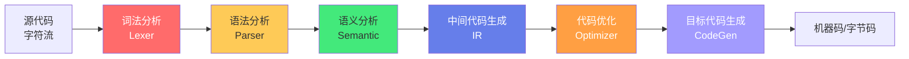
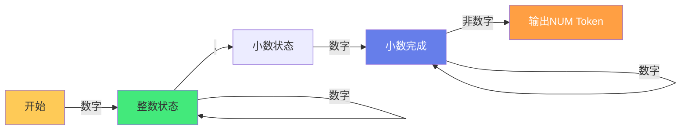
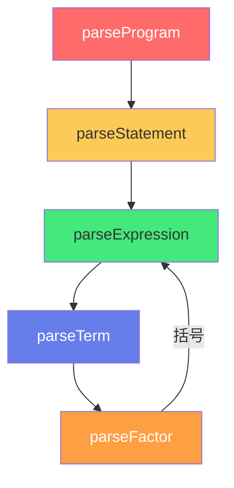
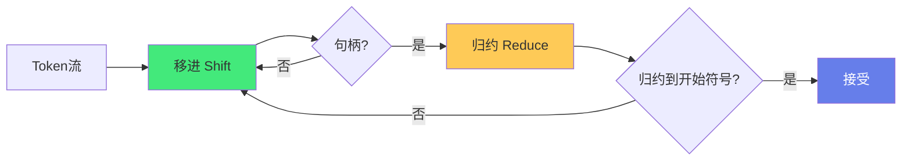

# 🔤 编译原理：词法分析与语法分析

> **文档说明**：系统讲解编译器前端的两大核心阶段——词法分析（Lexer）与语法分析（Parser）的原理、算法与实现，涵盖编译器完整流水线（词法分析→语法分析→语义分析→中间代码生成→优化→目标代码生成）、词法分析器的核心任务（字符流→Token 流）、Token 分类（关键字/标识符/字面量/运算符/分隔符/注释）、正则表达式与有限自动机理论（NFA→DFA 子集构造法/DFA 最小化 Hopcroft 算法）、Lex/Flex 词法分析生成器、手写词法分析器的实现、语法分析器的核心任务（Token 流→抽象语法树 AST）、上下文无关文法 CFG（产生式/推导/归约/语法树/二义性）、解析方法分类（自顶向下 LL/递归下降/PEG vs 自底向上 LR/SLR/LALR/CLR）、递归下降解析器手写实战、LL(1) 分析表构造（FIRST/FOLLOW 集）、LR 分析器的移进-归约机制（项集族/ACTION/GOTO 表）、抽象语法树 AST 的设计与遍历、语法错误恢复策略（恐慌模式/短语级/错误产生式）、实际应用（JSON 解析器/表达式求值器/自定义 DSL）、ANTLR/yacc/Bison 等 parser generator 工具、编译原理在现代开发中的应用（IDE/语法高亮/静态分析/DSL/模板引擎）、常见问题与最佳实践。
>
> **适用人群**：计算机专业学生、需要编写解析器的开发者、对编译器原理感兴趣的工程师、设计 DSL/模板引擎的架构师
>
> **前置知识**：[[数据结构基础]] · [[正则表达式入门]] · [[离散数学-集合与关系]]

---

## 一、概述

### 1.1 编译器完整流水线

编译器将高级语言源代码翻译为机器码，分为**前端**（与语言相关）和**后端**（与目标平台相关）：



| 阶段 | 输入 | 输出 | 核心问题 |
|------|------|------|---------|
| **词法分析** | 字符流 | Token 流 | 这串字符是什么词？ |
| **语法分析** | Token 流 | AST（抽象语法树） | 这些词组成什么结构？ |
| **语义分析** | AST | 带类型信息的 AST | 这个结构有意义吗？（类型检查/作用域） |
| **中间代码生成** | AST | IR（三地址码/SSA） | 翻译成与平台无关的中间表示 |
| **优化** | IR | 优化后的 IR | 怎么更快/更小？ |
| **目标代码生成** | IR | 机器码/字节码 | 翻译成目标平台指令 |

> 本文档聚焦**前端两大阶段**：词法分析 + 语法分析。这是所有「文本解析」任务的基础——不仅编译器，JSON 解析器、模板引擎、DSL、IDE 语法高亮都依赖这些原理。

### 1.2 为什么要学编译原理

即使你不写编译器，编译原理的应用无处不在：

| 应用 | 用到的编译原理 |
|------|--------------|
| JSON/YAML/XML 解析器 | 词法+语法分析 |
| 模板引擎（Vue/React JSX） | 词法+语法分析+代码生成 |
| IDE 语法高亮/自动补全 | 词法分析+增量解析 |
| 静态代码检查（ESLint） | 语法分析+语义分析 |
| 自定义 DSL（SQL/GitHub Actions） | 完整编译器前端 |
| 表达式求值器 | 递归下降解析 |
| Markdown 渲染器 | 词法+语法分析 |
| 浏览器 HTML/CSS 解析 | 词法+语法分析（容错） |

---

## 二、词法分析（Lexer）

### 2.1 词法分析的任务

**词法分析器（Lexer/Scanner/Tokenizer）** 将源代码的**字符流**转换为**Token 流**：

```text
输入字符流：  if (x > 10) { return x; }
                ↓ Lexer
输出Token流： [IF] [LPAREN] [ID:x] [GT] [NUM:10] [RPAREN] [LBRACE] [RETURN] [ID:x] [SEMI] [RBRACE]
```

**核心职责**：
- 识别单词（Token）的类型和值
- 跳过空白符、注释
- 记录行号/列号（用于错误报告）
- 处理词法错误（非法字符）

### 2.2 Token 分类

| Token 类型 | 说明 | 示例 |
|-----------|------|------|
| **关键字（Keyword）** | 语言保留字 | `if` `else` `for` `return` |
| **标识符（Identifier）** | 变量名/函数名/类型名 | `x` `myFunc` `User` |
| **字面量（Literal）** | 数值/字符串/布尔/空 | `42` `3.14` `"hello"` `true` `null` |
| **运算符（Operator）** | 算术/逻辑/比较/位运算 | `+` `&&` `>` `++` `=` |
| **分隔符（Punctuator）** | 括号/分号/逗号/点 | `(` `)` `{` `}` `;` `,` `.` |
| **注释（Comment）** | 通常被跳过 | `// 单行` `/* 多行 */` |
| **EOF** | 文件结束标记 | 内部使用 |

**Token 数据结构**：
```typescript
interface Token {
    type: TokenType;       // 枚举：IF, ID, NUM, ...
    value: string;         // 原始文本（如 "42", "x"）
    line: number;          // 行号（错误报告用）
    column: number;        // 列号
}
```

### 2.3 正则表达式描述词法

词法规则通常用**正则表达式**描述：

```text
数字：    [0-9]+(\.[0-9]+)?
标识符：  [a-zA-Z_][a-zA-Z0-9_]*
字符串：  "[^"]*"
运算符：  \+|\-|\*|\/|==|!=|<=|>=|<|>
关键字：  if|else|for|while|return|...
空白：    \s+            （跳过）
注释：    //[^\n]*|/\*[\s\S]*?\*/   （跳过）
```

**最长匹配原则（Maximal Munch）**：当多个规则都能匹配时，选择匹配最长的那个。
- `==` 匹配为 `==`（一个 Token），而非 `=` `=`（两个 Token）
- `ifx` 匹配为标识符（不是关键字 `if` + `x`），因为 `ifx` 比 `if` 长

**优先级原则**：长度相同时，先定义的规则优先。
- 关键字规则在标识符之前，确保 `if` 被识别为关键字而非标识符

### 2.4 有限自动机（FA）

正则表达式可以等价转换为**有限自动机（Finite Automaton）**，用于高效匹配：



**NFA（非确定有限自动机）**：
- 一个状态对同一个输入可以有多个转移
- 允许 ε 转移（不消耗字符的转移）
- 构造简单，但执行效率低（需要回溯或并行探索）

**DFA（确定有限自动机）**：
- 一个状态对每个输入最多一个转移
- 无 ε 转移
- 执行效率高（O(n)，一次扫描）

**NFA → DFA 转换（子集构造法）**：
1. 计算 NFA 的 ε-闭包（从状态集经 ε 转移可达的所有状态）
2. 每个 DFA 状态对应一个 NFA 状态集
3. 对每个 DFA 状态和输入符号，计算转移后的 ε-闭包，作为新 DFA 状态
4. 重复直到没有新状态

**DFA 最小化（Hopcroft 算法）**：将等价状态合并，得到最小 DFA。

### 2.5 手写词法分析器

简单语言可以手写 Lexer，核心是一个**状态机 + 指针扫描**：

```typescript
class Lexer {
    private pos = 0;
    constructor(private src: string) {}

    nextToken(): Token {
        this.skipWhitespace();
        if (this.pos >= this.src.length) return { type: 'EOF', value: '', line: 0, column: 0 };
        
        const c = this.src[this.pos];
        
        // 数字
        if (/[0-9]/.test(c)) return this.readNumber();
        // 标识符/关键字
        if (/[a-zA-Z_]/.test(c)) return this.readIdentifier();
        // 字符串
        if (c === '"') return this.readString();
        // 运算符/分隔符
        return this.readOperator();
    }

    private readNumber(): Token {
        const start = this.pos;
        while (this.pos < this.src.length && /[0-9.]/.test(this.src[this.pos])) this.pos++;
        return { type: 'NUM', value: this.src.slice(start, this.pos), line: 0, column: start };
    }

    private readIdentifier(): Token {
        const start = this.pos;
        while (this.pos < this.src.length && /[a-zA-Z0-9_]/.test(this.src[this.pos])) this.pos++;
        const value = this.src.slice(start, this.pos);
        const type = KEYWORDS.has(value) ? 'KEYWORD' : 'ID';
        return { type, value, line: 0, column: start };
    }
    // ... 其他方法
}
```

### 2.6 Lex/Flex 生成器

**Lex/Flex** 是词法分析生成器，输入正则规则，输出 C 语言的 Lexer：

```lex
%{
#include "token.h"
%}

%%
"if"|"else"|"for"|"return"   { return KEYWORD; }
[0-9]+(\.[0-9]+)?             { return NUM; }
[a-zA-Z_][a-zA-Z0-9_]*        { return ID; }
"=="|"!="|"<="|">="           { return OP; }
[+\-*/(){};,=]                { return *yytext; }
\s+                           { /* 跳过空白 */ }
.                             { fprintf(stderr, "未知字符: %s\n", yytext); }
%%
```

现代替代：**ANTLR**（词法+语法一体）、**Peg.js**（PEG 解析器）、**Jison**。

---

## 三、语法分析（Parser）

### 3.1 语法分析的任务

**语法分析器（Parser）** 将 **Token 流** 转换为 **抽象语法树（AST）**：

```text
Token流： [IF] [LPAREN] [ID:x] [GT] [NUM:10] [RPAREN] [LBRACE] [RETURN] [ID:x] [SEMI] [RBRACE]
           ↓ Parser
AST：
    IfStatement
    ├── condition: BinaryOp(>)
    │   ├── left: Identifier(x)
    │   └── right: NumberLiteral(10)
    └── body: Block
        └── ReturnStatement
            └── argument: Identifier(x)
```

**核心职责**：
- 根据文法规则验证 Token 流的语法结构
- 构建 AST（或其他中间表示）
- 报告语法错误（位置+期望+实际）
- 错误恢复（出错后继续解析，报告更多错误）

### 3.2 上下文无关文法（CFG）

语法规则用**上下文无关文法（Context-Free Grammar）**描述，由四元组 (V, Σ, R, S) 组成：
- **V**：非终结符集合（如 `表达式` `语句`）
- **Σ**：终结符集合（即 Token，如 `if` `(` `ID`）
- **R**：产生式规则集合
- **S**：开始符号

**产生式示例（表达式文法）**：
```text
表达式 → 表达式 + 项
表达式 → 表达式 - 项
表达式 → 项
项     → 项 * 因子
项     → 项 / 因子
项     → 因子
因子   → ( 表达式 )
因子   → 数字
因子   → 标识符
```

**推导（Derivation）**：从开始符号出发，反复用产生式右部替换左部，直到得到纯终结符串。

**归约（Reduction）**：推导的逆过程，从 Token 流出发，用产生式左部替换右部，直到归约到开始符号。

**语法树**：推导过程的树状表示，叶子是终结符，内部节点是非终结符。

### 3.3 二义性

如果一个句子可以用多种方式推导（多棵语法树），文法是**二义的**：

```text
表达式 → 表达式 + 表达式
表达式 → 表达式 * 表达式
表达式 → 数字

句子：1 + 2 * 3
推导1：(1 + 2) * 3   ← 先加后乘
推导2：1 + (2 * 3)   ← 先乘后加（正确）
```

**消除二义性的方法**：
1. **改写文法**：引入优先级层次（表达式→项→因子）
2. **结合性规则**：左结合/右结合
3. **解析器声明**：在 yacc/Bison 中用 `%left` `%right` 声明

### 3.4 解析方法分类

```mermaid
graph TB
    A[解析方法] --> B[自顶向下<br/>Top-Down]
    A --> C[自底向上<br/>Bottom-Up]
    
    B --> B1[递归下降<br/>Recursive Descent]
    B --> B2[LL(1)<br/>预测分析表]
    B --> B3[PEG<br/>解析表达式文法]
    
    C --> C1[LR(0)]
    C --> C2[SLR]
    C --> C3[LALR(1)<br/>最常用]
    C --> C4[CLR(1)/LR(1)]
    
    style B fill:#43e97b,color:#333
    style C fill:#667eea,color:#fff
```

| 方法 | 方向 | 原理 | 优点 | 缺点 | 代表工具 |
|------|------|------|------|------|---------|
| **递归下降** | 自顶向下 | 每个非终结符一个函数，递归调用 | 易手写、可读、错误恢复好 | 左递归文法需改写、回溯版慢 | 手写 |
| **LL(1)** | 自顶向下 | 预测分析表，无回溯 | 高效、可自动生成 | 文法限制严格（无左递归/无公共前缀） | ANTLR(LL*) |
| **PEG** | 自顶向下 | 解析表达式文法，有序选择 | 表达力强、无二义性 | 最坏 O(2^n)（需记忆化） | Peg.js |
| **LR/LALR** | 自底向上 | 移进-归约，分析表驱动 | 文法限制少、高效 | 手写困难、错误恢复难 | yacc/Bison/ANTLR |

---

## 四、递归下降解析器

### 4.1 原理

**递归下降（Recursive Descent）** 是最常用的手写解析方法：为每个非终结符写一个函数，函数之间相互递归调用。



### 4.2 完整示例：表达式求值器

```typescript
class Parser {
    private tokens: Token[];
    private pos = 0;

    constructor(tokens: Token[]) {
        this.tokens = tokens;
    }

    // 表达式 → 项 (('+'|'-') 项)*
    parseExpression(): ASTNode {
        let left = this.parseTerm();
        while (this.peek().type === 'OP' && ['+', '-'].includes(this.peek().value)) {
            const op = this.consume().value;
            const right = this.parseTerm();
            left = { type: 'BinaryOp', op, left, right };
        }
        return left;
    }

    // 项 → 因子 (('*'|'/') 因子)*
    parseTerm(): ASTNode {
        let left = this.parseFactor();
        while (this.peek().type === 'OP' && ['*', '/'].includes(this.peek().value)) {
            const op = this.consume().value;
            const right = this.parseFactor();
            left = { type: 'BinaryOp', op, left, right };
        }
        return left;
    }

    // 因子 → 数字 | 标识符 | '(' 表达式 ')'
    parseFactor(): ASTNode {
        const token = this.peek();
        if (token.type === 'NUM') {
            this.consume();
            return { type: 'NumberLiteral', value: Number(token.value) };
        }
        if (token.type === 'ID') {
            this.consume();
            return { type: 'Identifier', name: token.value };
        }
        if (token.type === 'LPAREN') {
            this.consume(); // '('
            const expr = this.parseExpression();
            this.expect('RPAREN'); // ')'
            return expr;
        }
        throw new Error(`意外的Token: ${token.value} at line ${token.line}`);
    }

    // 辅助方法
    private peek(): Token { return this.tokens[this.pos]; }
    private consume(): Token { return this.tokens[this.pos++]; }
    private expect(type: string): Token {
        const token = this.consume();
        if (token.type !== type) throw new Error(`期望 ${type}, 实际 ${token.type}`);
        return token;
    }
}
```

**关键设计**：
- 每个非终结符对应一个方法
- 方法内用循环处理重复（`while`），用条件处理选择（`if`）
- 优先级通过函数调用层次表达（表达式→项→因子，优先级递增）
- 左递归必须消除（`E → E + T` 改为 `E → T (('+'|'-') T)*`）

### 4.3 AST 遍历与求值

```typescript
function evaluate(node: ASTNode, env: Record<string, number>): number {
    switch (node.type) {
        case 'NumberLiteral': return node.value;
        case 'Identifier': return env[node.name] ?? 0;
        case 'BinaryOp':
            const left = evaluate(node.left, env);
            const right = evaluate(node.right, env);
            switch (node.op) {
                case '+': return left + right;
                case '-': return left - right;
                case '*': return left * right;
                case '/': return left / right;
            }
    }
}

// 使用
const lexer = new Lexer("1 + 2 * (3 + 4)");
const tokens = lexer.tokenize();
const ast = new Parser(tokens).parseExpression();
console.log(evaluate(ast, {})); // 15
```

---

```text
## 五、LL(1) 分析
```

### 5.1 FIRST 集与 FOLLOW 集

**LL(1)** 表示：从左到右扫描、最左推导、向前看 1 个 Token。

构造预测分析表需要两个集合：

**FIRST(α)**：从 α 推导得到的串的首终结符集合（含 ε）。
```text
FIRST(数字) = {0,1,2,...,9}
FIRST(标识符) = {a,b,...,z,A,...,Z,_}
FIRST(因子) = FIRST(数字) ∪ FIRST(标识符) ∪ {'('}
```

**FOLLOW(A)**：在某个句型中紧跟在 A 后面的终结符集合。
```text
FOLLOW(表达式) = {EOF, ')'}
FOLLOW(项) = FOLLOW(表达式) ∪ {'+', '-'}
```

### 5.2 预测分析表

根据 FIRST/FOLLOW 构造分析表 `M[A, a]`：
- 对产生式 `A → α`，对每个 `a ∈ FIRST(α)`，置 `M[A,a] = A → α`
- 若 `ε ∈ FIRST(α)`，对每个 `a ∈ FOLLOW(A)`，置 `M[A,a] = A → α`

分析时：栈顶是非终结符 A，当前 Token 是 a，查 `M[A,a]` 得到产生式，展开。

> LL(1) 限制：无左递归、无公共左因子、每个产生式的 FIRST 集不相交（含 ε 时还需 FOLLOW 不相交）。不满足时需改写文法或用 LL(k)/LL*。

---

```text
## 六、LR 分析（移进-归约）
```

### 6.1 核心思想

**LR 分析**是自底向上的方法：从 Token 流出发，逐步**归约**到开始符号。



**核心操作**：
- **移进（Shift）**：将下一个 Token 移入栈
- **归约（Reduce）**：栈顶形成某个产生式的右部时，用左部替换
- **接受（Accept）**：归约到开始符号，分析成功
- **报错（Error）**：无法移进也无法归约

### 6.2 LR 分析表

LR 分析器由**分析表**驱动，包含两个表：
- **ACTION 表**：`ACTION[state, token]` → 移进/归约/接受/报错
- **GOTO 表**：`GOTO[state, nonterminal]` → 归约后的新状态

**LR 变体**：
| 方法 | 向前看 | 状态数 | 文法表达力 | 工具 |
|------|--------|--------|-----------|------|
| LR(0) | 0 | 少 | 弱（很少文法满足） | - |
| SLR | FOLLOW集 | 少 | 中等 | yacc |
| LALR(1) | 1（合并状态） | 中 | 强（最常用） | yacc/Bison 默认 |
| CLR(1)/LR(1) | 1 | 多 | 最强 | - |

> **LALR(1)** 是实践中最常用的：比 SLR 表达力强，比 CLR 状态少。Bison/yacc 默认生成 LALR(1) 分析器。

### 6.3 Bison 示例

```yacc
%{
#include <stdio.h>
%}

%token NUM ID
%left '+' '-'
%left '*' '/'

%%
expr: expr '+' expr   { $$ = $1 + $3; }
    | expr '-' expr   { $$ = $1 - $3; }
    | expr '*' expr   { $$ = $1 * $3; }
    | expr '/' expr   { $$ = $1 / $3; }
    | '(' expr ')'    { $$ = $2; }
    | NUM             { $$ = $1; }
    | ID              { $$ = 0; /* 简化 */ }
    ;
%%
```

`%left` 声明左结合和优先级（先声明的优先级低）。

---

## 七、抽象语法树（AST）

### 7.1 AST vs 具体语法树

| 维度 | 具体语法树（CST） | 抽象语法树（AST） |
|------|------------------|------------------|
| **包含** | 所有语法细节（括号、分号） | 只保留语义结构 |
| **用途** | 解析过程的中间产物 | 语义分析/代码生成的输入 |
| **大小** | 大 | 精简 |

**示例**：`(1 + 2) * 3`
```text
CST（含括号）：          AST（精简）：
    *                       *
   / \                     / \
  ( )  3                  +   3
   |                      / \
   +                     1   2
  / \
 1   2
```

### 7.2 AST 节点设计

```typescript
type ASTNode =
    | { type: 'Program'; body: ASTNode[] }
    | { type: 'NumberLiteral'; value: number }
    | { type: 'StringLiteral'; value: string }
    | { type: 'Identifier'; name: string }
    | { type: 'BinaryOp'; op: string; left: ASTNode; right: ASTNode }
    | { type: 'IfStatement'; test: ASTNode; consequent: ASTNode; alternate?: ASTNode }
    | { type: 'FunctionDecl'; name: string; params: string[]; body: ASTNode }
    | { type: 'CallExpression'; callee: string; args: ASTNode[] };
```

### 7.3 AST 遍历模式

**访问者模式（Visitor）**：
```typescript
interface Visitor {
    visitNumber(node: NumberLiteral): void;
    visitBinaryOp(node: BinaryOp): void;
    visitIf(node: IfStatement): void;
    // ...
}

function traverse(node: ASTNode, visitor: Visitor) {
    switch (node.type) {
        case 'NumberLiteral': visitor.visitNumber(node); break;
        case 'BinaryOp':
            traverse(node.left, visitor);
            traverse(node.right, visitor);
            visitor.visitBinaryOp(node);
            break;
        // ...
    }
}
```

AST 的典型应用：语义分析（类型检查）、代码生成、代码转换（Babel/ESLint）、格式化（Prettier）。

---

## 八、错误恢复

### 8.1 为什么需要错误恢复

编译器不应遇到第一个错误就停止——用户希望一次看到所有错误。错误恢复让 Parser 在出错后继续解析。

### 8.2 常用策略

| 策略 | 原理 | 优点 | 缺点 |
|------|------|------|------|
| **恐慌模式（Panic Mode）** | 遇到错误后跳过 Token 直到同步词（如 `;` `}`） | 简单、易实现 | 可能跳过大量代码，漏报错误 |
| **短语级恢复** | 用错误产生式局部修正 | 精确 | 实现复杂 |
| **错误产生式** | 在文法中加入常见错误的产生式 | 针对性强 | 需要预见错误模式 |
| **全局纠正** | 找到最少修改使输入合法 | 最准确 | 计算量大 |

**递归下降中的恐慌模式**：
```typescript
parseStatement(): ASTNode | null {
    try {
        // 解析语句
    } catch (e) {
        console.error(e.message);
        // 跳过直到分号或右花括号
        while (this.peek().type !== 'SEMI' && this.peek().type !== 'RBRACE' && this.peek().type !== 'EOF') {
            this.consume();
        }
        if (this.peek().type === 'SEMI') this.consume();
        return null; // 继续解析下一条语句
    }
}
```

---

## 九、实际应用：JSON 解析器

用递归下降写一个 JSON 解析器是学习编译原理的最佳练习：

```typescript
class JSONParser {
    private pos = 0;
    constructor(private src: string) {}

    parse(): any {
        this.skipWhitespace();
        const value = this.parseValue();
        this.skipWhitespace();
        if (this.pos < this.src.length) throw new Error('意外的尾部字符');
        return value;
    }

    parseValue(): any {
        this.skipWhitespace();
        const c = this.src[this.pos];
        if (c === '{') return this.parseObject();
        if (c === '[') return this.parseArray();
        if (c === '"') return this.parseString();
        if (c === 't' || c === 'f') return this.parseBoolean();
        if (c === 'n') return this.parseNull();
        if (c === '-' || /[0-9]/.test(c)) return this.parseNumber();
        throw new Error(`意外字符: ${c} at ${this.pos}`);
    }

    parseObject(): Record<string, any> {
        this.consume('{');
        const obj: Record<string, any> = {};
        this.skipWhitespace();
        if (this.src[this.pos] === '}') { this.consume('}'); return obj; }
        while (true) {
            this.skipWhitespace();
            const key = this.parseString();
            this.skipWhitespace();
            this.consume(':');
            const value = this.parseValue();
            obj[key] = value;
            this.skipWhitespace();
            if (this.src[this.pos] === ',') { this.consume(','); continue; }
            if (this.src[this.pos] === '}') { this.consume('}'); break; }
            throw new Error('对象中期望 , 或 }');
        }
        return obj;
    }
    // parseArray/parseString/parseNumber/parseBoolean/parseNull...
}
```

---

## 十、工具与资源

### 10.1 Parser Generator

| 工具 | 语言 | 方法 | 特点 |
|------|------|------|------|
| **ANTLR4** | 多语言 | LL* / ALL(*) | 最流行，自动生成 AST Visitor/Listener |
| **Bison** | C/C++ | LALR(1) | GNU 经典，与 Flex 配合 |
| **Yacc** | C | LALR(1) | Bison 的前身 |
| **Peg.js** | JS | PEG | 简单，适合小语言 |
| **Jison** | JS | LALR/LR | JavaScript 的 yacc |
| **Tree-sitter** | C | GLR/增量 | 快、增量解析，IDE 用 |
| **Lark** | Python | LALR/ Earley | Python 友好 |

### 10.2 学习资源

- **龙书**：《Compilers: Principles, Techniques, and Tools》（Aho/Sethi/Ullman）
- **虎书**：《Modern Compiler Implementation in C/Java/ML》（Appel）
- **鲸书**：《Advanced Compiler Design and Implementation》（Muchnick）
- **Crafting Interpreters**：Bob Nystrom，免费在线，手写解释器实战
- **Let's Build a Compiler**：Jack Crenshaw，经典入门

---

## 十一、常见问题

| 问题 | 回答 |
|------|------|
| **必须学编译原理才能写解析器吗？** | 简单解析器（JSON/表达式）不需要，递归下降直接写即可。复杂语言建议学。 |
| **递归下降能处理所有文法吗？** | 不能。左递归文法必须消除，二义文法必须改写。 |
| **LL 和 LR 哪个好？** | 手写选递归下降（LL 家族），工具生成选 LALR（LR 家族）。LR 文法限制少但手写难。 |
| **ANTLR 还是手写？** | 复杂语言/快速原型用 ANTLR；小语言/高性能/自定义错误恢复用手写。 |
| **正则能解析 HTML 吗？** | 不能。HTML 不是正则语言（嵌套结构），需要上下文无关文法。用正则解析 HTML 是经典反模式。 |
| **AST 和 CST 用哪个？** | 解析时可先建 CST，再转换为 AST；现代解析器通常直接建 AST。 |
| **错误恢复重要吗？** | 对 IDE/编辑器极其重要（用户打字时代码经常不完整）。对一次性编译器可简化。 |
| **编译原理过时了吗？** | 没有。AI 代码生成、DSL 爆炸、静态分析、语言服务器（LSP）都需要编译原理。 |

---

## 十二、关联笔记

### 计算机基础
- [[数据结构基础]] · [[正则表达式入门]] · [[离散数学-集合与关系]]
- [[操作系统-进程与线程]] · [[计算机网络-TCP-IP]]

### 开发与工具
- [[设计模式-行为型模式]] · [[JSON数据格式]] · [[Postman-高级用法与团队协作]]
- [[VSCode-核心配置与插件]]

### 导航
- [[MOC-计算机基础]] · [[MOC-通用工具]] · [[Home]] · [[学习路线总览]]

> 🔍 **知识点深度解析**
>
> **作用**：词法分析与语法分析解决的是「如何将无结构的文本（源代码/配置/数据）转换为有结构的、可被程序处理的表示（Token 流/AST）」的核心问题——这是所有「让计算机理解文本」任务的基础，不仅编译器需要，JSON 解析、模板引擎、DSL 设计、IDE 语法高亮、静态分析、Markdown 渲染都依赖这两大阶段。掌握词法和语法分析原理，你就能自己写任何文本解析器，而不只是调用现成库。
>
> **底层原理**：①词法分析的核心是「正则表达式→有限自动机→状态机扫描」——正则表达式是描述词法规则的声明式语言，每个正则表达式等价于一个 NFA（非确定有限自动机），NFA 通过子集构造法转为 DFA（确定有限自动机），DFA 最小化后得到高效的状态机。Lexer 就是一个 DFA：从起始状态出发，每读一个字符转移状态，到达接受状态时识别出一个 Token。最长匹配原则确保 `==` 被识别为一个 Token 而非两个。②语法分析的核心是「上下文无关文法（CFG）+ 推导/归约」——CFG 用产生式描述语言的结构（如 `表达式 → 表达式 + 项`）。自顶向下分析（LL/递归下降）从开始符号出发「推导」出输入串；自底向上分析（LR）从输入串出发「归约」到开始符号。推导/归约的过程就是构建语法树的过程。③递归下降的本质是「文法到代码的直接映射」——每个非终结符对应一个函数，产生式的选择对应 if/switch，产生式的重复对应 while 循环，产生式的序列对应顺序调用。这种映射非常直观，所以递归下降是手写解析器的首选。但递归下降要求文法无左递归（`E → E + T` 会导致无限递归），必须改写为右递归或循环形式（`E → T (('+'|'-') T)*`）。④LR 分析的核心是「移进-归约 + 分析表驱动」——它维护一个状态栈，根据当前状态和下一个 Token 查 ACTION 表决定移进还是归约。LR 的强大在于它能处理更多文法（包括左递归），但分析表的构造复杂（需要计算项集族），所以通常用工具（yacc/Bison/ANTLR）生成而非手写。LALR(1) 是实践中最常用的 LR 变体——在表达力和状态数之间取得了平衡。⑤优先级和结合性是消除表达式文法二义性的关键——`1 + 2 * 3` 应该先乘后加，`1 - 2 - 3` 应该左结合。通过文法分层（表达式→项→因子）或在 parser generator 中声明 `%left/%right`，可以精确控制优先级和结合性。⑥AST（抽象语法树）是「语法结构的语义保留表示」——它丢弃了具体语法细节（括号、分号），只保留语义结构（操作符、操作数、控制流）。AST 是编译器前端和后端的桥梁：语义分析、类型检查、代码生成、代码转换都在 AST 上进行。访问者模式是遍历 AST 的标准方法。⑦错误恢复是「工业级解析器」和「玩具解析器」的分水岭——玩具解析器遇到错误就崩溃，工业级解析器（尤其是 IDE 用的）需要在错误后继续解析以报告更多错误。恐慌模式（跳过到同步词如 `;` `}`）是最简单有效的恢复策略。
>
> **用法要点**：① 编译器流水线：词法分析(字符→Token)→语法分析(Token→AST)→语义分析(AST→带类型AST)→中间代码→优化→目标代码 ② 词法分析：Token分类(关键字/标识符/字面量/运算符/分隔符)，正则描述规则，最长匹配+优先级原则，NFA→DFA→最小化，手写用状态机+指针，工具用Lex/Flex/ANTLR ③ 语法分析：CFG四元组(非终结符/终结符/产生式/开始符号)，推导(自顶向下)vs归约(自底向上)，二义性用分层文法或优先级声明消除 ④ 解析方法：自顶向下(递归下降/LL(1)/PEG) vs 自底向上(LR(0)/SLR/LALR/CLR) ⑤ 递归下降：每个非终结符一个函数，if处理选择/while处理重复，必须消除左递归，优先级靠函数调用层次，辅助方法peek/consume/expect ⑥ LL(1)：FIRST集(首终结符)+FOLLOW集(后跟终结符)→预测分析表，限制严格(无左递归/无公共前缀) ⑦ LR：移进-归约机制，ACTION表(移进/归约/接受)+GOTO表，LALR(1)最常用，工具yacc/Bison ⑧ AST：vs CST(精简语义结构)，节点用代数数据类型/联合类型，访问者模式遍历，用于语义分析/代码生成/转换 ⑨ 错误恢复：恐慌模式(跳到;或})/短语级/错误产生式，IDE需要强错误恢复 ⑩ 实战：写JSON解析器/表达式求值器是最佳练习，工具ANTLR4(多语言LL*)/Bison(C LALR)/Tree-sitter(增量)/Peg.js(PEG) ⑪ 常见：正则不能解析HTML(非正则语言)；小语言手写递归下降，复杂语言用ANTLR；左递归必须消除。

> 💡 **深度讲解**：编译原理最核心的智慧是「分层抽象：将『理解文本』这个复杂问题分解为『识别单词』和『识别结构』两个独立阶段，每个阶段用成熟的数学模型（正则/自动机/上下文无关文法）精确描述和自动化」——很多人第一次学编译原理时觉得「为什么要分 Lexer 和 Parser？不能一步到位吗？」答案是：**分离关注点**。词法分析只关心「这串字符是什么词」（正则语言，可用有限自动机高效处理），语法分析只关心「这些词组成什么结构」（上下文无关语言，需更强大的解析算法）。如果混在一起，解析器需要同时处理字符级和结构级的问题，复杂度爆炸。这种「分层」思想是计算机科学最核心的设计原则之一——网络协议（物理层/数据链路层/网络层/...）、操作系统（硬件/内核/系统调用/应用）、前端（HTML/CSS/JS）都是分层抽象的典范。编译原理的另一个深层智慧是「声明式描述 + 自动生成」——你不需要手写复杂的状态机和分析表，只需要用正则表达式描述词法、用 CFG 描述语法，工具（Lex/Flex/yacc/Bison/ANTLR）就能自动生成高效的解析器。这种「声明式」思想在现代编程中无处不在：SQL（声明查询而非遍历数据）、HTML/CSS（声明结构和样式而非绘制）、React（声明 UI 而非操作 DOM）、配置即代码（声明基础设施而非手动操作）。理解了编译原理的「声明式描述 + 自动生成」，你就理解了现代编程的一个核心范式。更重要的是，编译原理教给你的不仅是「怎么写编译器」，更是「如何设计一门语言」和「如何让计算机理解结构化文本」——在 DSL 爆炸的今天（GitHub Actions、Kubernetes YAML、Terraform、各种配置格式），这种能力越来越有价值。当你需要设计一个配置格式、一个模板引擎、一个自定义查询语言时，编译原理就是你的工具箱。

> 📝 **精简总结**：词法分析与语法分析=编译器前端两大核心，也是所有文本解析任务的基础。词法分析(Lexer)：字符流→Token流，正则描述规则，NFA→DFA→最小化，最长匹配+优先级，手写状态机或Lex/Flex生成。语法分析(Parser)：Token流→AST，CFG描述文法，推导(自顶向下LL/递归下降)vs归约(自底向上LR)。递归下降：每个非终结符一个函数，if选择/while重复，消除左递归，优先级靠层次，最易手写。LL(1)：FIRST+FOLLOW→预测分析表。LR：移进-归约+分析表，LALR(1)最常用，Bison/yacc生成。AST：抽象语法树，精简语义结构，访问者模式遍历，语义分析/代码生成的桥梁。错误恢复：恐慌模式(跳到;或})继续解析。实战：写JSON解析器/表达式求值器。工具：ANTLR4/Bison/Tree-sitter/Peg.js。核心：分层抽象(Lexer/Parser分离)+声明式描述(正则/CFG)+自动生成。

> **学习路径建议**：先学习 [[正则表达式入门]] 和 [[数据结构基础]] → 阅读《Crafting Interpreters》前几章或龙书前3章 → 实践：手写一个简单表达式求值器（Lexer+递归下降Parser+AST+求值） → 学习本文档的 NFA/DFA、CFG、LL/LR 理论 → 实践：手写一个 JSON 解析器 → 学习 ANTLR4，用 ANTLR 实现一个小语言 → 学习 AST 遍历和语义分析（符号表/类型检查） → 学习代码生成（三地址码/字节码） → 深入：阅读《现代编译原理》或龙书，学习 SSA、寄存器分配、优化 → 实战：为你的项目设计一个 DSL 或模板引擎。

---

> **词法分析与语法分析的本质是「让计算机理解结构化文本的两层抽象：先识别单词，再识别结构，将无意义的字符流转化为有意义的语法树」——我们每天都在和「文本解析」打交道：打开一个 JSON 配置、写一个 Vue 模板、在 IDE 里写代码、用 SQL 查询数据库、提交一个 GitHub Actions YAML……这些文本之所以能被计算机理解和执行，背后都有一个 Lexer 和一个 Parser 在工作。但大多数人把它们当作「黑盒」——能用就行，从不想背后的原理。学习编译原理的价值不在于「你要写一个 C 编译器」（大多数人不需要），而在于「你理解了文本解析的通用原理，就能自己设计和实现任何解析任务」——当你需要一个自定义配置格式、一个模板引擎、一个查询语言、一个数据导入器时，你不需要找现成库（可能不存在或不合适），你可以自己写一个递归下降解析器，几十行代码搞定。更重要的是，编译原理教给你的「分层抽象」和「声明式描述」思想，是计算机科学最核心的设计智慧——网络协议分层、操作系统分层、前端技术分层，都是同一个思想。当你理解了「将复杂问题分解为独立层次，每层用合适的数学模型精确描述，再自动生成实现」这个范式，你就掌握了计算机科学最强大的思维工具之一。从今天开始，下次你用 JSON.parse() 或写一个正则表达式时，花一分钟想想背后的 Lexer 和 Parser——你会对这些「习以为常」的工具有全新的理解。编译原理不是过时的象牙塔学问，而是理解「计算机如何理解语言」的钥匙，而「语言」是人机交互最根本的方式。**
