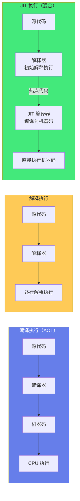
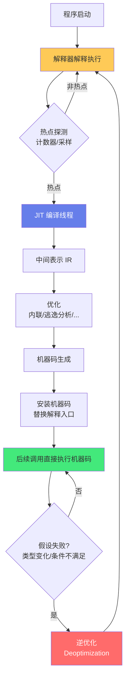

# ⚙️ 解释器与 JIT 编译

> **文档说明**：系统讲解解释器与 JIT（Just-In-Time）编译的完整知识体系，涵盖编译器 vs 解释器对比、解释器类型（树遍历解释器/字节码解释器）、AST 解释器实现、字节码与虚拟机（栈式虚拟机/寄存器虚拟机）、JIT 编译原理与分类（方法级/追踪级）、JIT 编译流程（探测/编译/优化/替换/逆优化）、热点探测（采样/计数器）、JIT 优化技术（内联/逃逸分析/锁消除/标量替换/向量化）、主流 JIT 实现（JVM HotSpot/V8/PyPy/LuaJIT/.NET RyuJIT）、AOT vs JIT 对比、JIT 调优与监控、常见问题与最佳实践。
>
> **适用人群**：编译器开发者、虚拟机工程师、性能优化工程师、高级后端开发者、计算机专业学生、面试准备者
>
> **前置知识**：[[编译原理-词法语法分析]] · [[计算机组成原理]] · [[进程线程与协程]]

---

## 一、概述

### 1.1 编译器 vs 解释器

程序语言的执行方式分为两大类：编译执行和解释执行。

| 维度 | 编译器（Compiler） | 解释器（Interpreter） |
|------|-------------------|---------------------|
| **执行方式** | 先将源代码全部编译为机器码，再执行机器码 | 逐行/逐语句读取源代码，边解释边执行 |
| **执行速度** | 快（直接执行机器码） | 慢（每次执行都要解释） |
| **启动速度** | 慢（需要完整编译） | 快（直接开始执行） |
| **跨平台** | 编译后的机器码平台相关，需分别编译 | 解释器跨平台，同一份源代码到处运行 |
| **优化能力** | 强（可做全局优化、静态分析） | 弱（通常只能做局部优化） |
| **调试友好** | 较差（编译后难以对应源码） | 好（逐行执行，易于调试） |
| **错误检查** | 编译时全部检查 | 执行到才检查 |
| **代表语言** | C/C++/Rust/Go（AOT） | Python/Ruby/PHP/Bash（纯解释） |
| **混合模式** | — | Java/C#/JavaScript（JIT，解释+编译混合） |



### 1.2 什么是 JIT 编译

JIT（Just-In-Time Compilation，即时编译）是一种混合执行模式——程序初始时由解释器解释执行，同时运行时监控代码执行频率，将频繁执行的「热点代码」（Hot Spot）动态编译为本地机器码，后续直接执行机器码以提升性能。

**JIT 的核心思想**：
- 程序运行时，80% 的时间花在 20% 的代码上（二八定律）
- 这 20% 的热点代码值得花时间编译优化
- 非热点代码保持解释执行，避免编译开销
- 运行时可以收集类型信息和执行 profile，做更激进的优化

**JIT 的优势**：
| 优势 | 说明 |
|------|------|
| **启动快** | 初始解释执行，不需要等待完整编译 |
| **峰值性能高** | 热点代码编译为机器码，接近 AOT 编译性能 |
| **运行时优化** | 可以根据运行时类型信息和 profile 做激进优化（如去虚化、内联缓存） |
| **动态适应** | 可以根据负载变化动态调整优化策略 |
| **跨平台** | 字节码跨平台，JIT 编译器为不同平台生成不同机器码 |

**JIT 的劣势**：
| 劣势 | 说明 |
|------|------|
| **预热开销** | 初始解释执行+编译，性能爬坡需要时间 |
| **内存占用** | 需要同时存储字节码和编译后的机器码 |
| **编译线程开销** | JIT 编译占用 CPU 资源，可能影响应用性能 |
| **逆优化开销** | 假设失败时需要逆优化（Deoptimization）回退到解释执行 |
| **调试复杂** | 动态编译和优化增加了调试难度 |
| **启动延迟** | 对于短生命周期程序，可能还没预热完就结束了 |

### 1.3 JIT 的历史与发展

| 年份 | 里程碑 |
|------|--------|
| 1960s | 最早的 JIT 思想出现在 Lisp 和 Smalltalk 中 |
| 1981 | Smalltalk-80 实现了 JIT 编译 |
| 1991 | Self 语言实现了自适应优化（Adaptive Optimization），影响了后来的 HotSpot |
| 1996 | Sun 发布 HotSpot JVM（收购 Animorphic 公司），引入热点探测 JIT |
| 2001 | .NET Framework 发布，包含 JIT 编译器 |
| 2008 | Mozilla 发布 TraceMonkey（Firefox 的追踪 JIT） |
| 2008 | Google 发布 V8 引擎（Chrome），引入方法级 JIT + 隐藏类 |
| 2010s | PyPy（Python JIT）、LuaJIT（Lua JIT）成熟 |
| 2017 | GraalVM 发布，支持多语言 JIT 和 AOT |
| 2020s | WebAssembly JIT、云原生 JIT 预热（CRaC、Coordinated Restore at Checkpoint） |

---

## 二、解释器原理

### 2.1 解释器的类型

| 类型 | 说明 | 代表 |
|------|------|------|
| **树遍历解释器（Tree-Walking）** | 直接遍历 AST（抽象语法树），边遍历边执行 | 早期 Ruby、简单的教学解释器 |
| **字节码解释器（Bytecode）** | 先将源代码编译为字节码，再由虚拟机解释执行字节码 | Python（CPython）、Java（解释阶段）、Lua、PHP |
| **JIT 解释器** | 字节码解释器 + JIT 编译器，热点代码编译为机器码 | Java HotSpot、V8、.NET CLR、PyPy |
| **线程代码解释器（Threaded Code）** | 将字节码替换为直接跳转地址，减少分发开销 | Forth、某些高性能解释器 |

### 2.2 树遍历解释器

树遍历解释器直接在 AST 上执行，不需要生成字节码。

**执行流程**：


**简单示例（表达式解释器）**：
```python
# AST 节点定义
class Number:
    def __init__(self, value):
        self.value = value

class Add:
    def __init__(self, left, right):
        self.left = left
        self.right = right

# 树遍历解释器
class Interpreter:
    def visit(self, node):
        if isinstance(node, Number):
            return node.value
        elif isinstance(node, Add):
            return self.visit(node.left) + self.visit(node.right)
    
    def interpret(self, ast):
        return self.visit(ast)

# 执行：1 + 2
ast = Add(Number(1), Number(2))
print(Interpreter().interpret(ast))  # 输出: 3
```

**树遍历解释器的优缺点**：
- 优点：实现简单，不需要设计字节码和虚拟机
- 缺点：每次执行都要遍历 AST，开销大（指针跳转、类型检查），性能差

### 2.3 字节码解释器

字节码解释器先将源代码编译为紧凑的字节码指令，再由虚拟机（VM）逐条解释执行字节码。

**执行流程**：


**字节码示例**：
```text
源代码：1 + 2 * 3

字节码（栈式虚拟机）：
PUSH 1      # 将 1 压入栈
PUSH 2      # 将 2 压入栈
PUSH 3      # 将 3 压入栈
MUL         # 弹出栈顶两个数相乘，结果压栈（2*3=6）
ADD         # 弹出栈顶两个数相加，结果压栈（1+6=7）
PRINT       # 弹出栈顶并打印（7）
```

**栈式虚拟机 vs 寄存器虚拟机**：

| 维度 | 栈式虚拟机（Stack-based） | 寄存器虚拟机（Register-based） |
|------|------------------------|------------------------------|
| **操作数位置** | 操作数在栈上，指令隐含操作数位置 | 操作数在虚拟寄存器中，指令显式指定寄存器 |
| **指令长度** | 短（通常 1-2 字节） | 长（需要指定多个寄存器编号） |
| **指令数量** | 多（需要大量 PUSH/POP） | 少（一条指令完成更多操作） |
| **实现难度** | 简单 | 较复杂 |
| **性能** | 较慢（大量栈操作） | 较快（减少栈操作和指令数） |
| **代表** | Java JVM、Python CPython、.NET IL | Lua 5.0+、Dalvik（Android）、Wasm（栈式但接近寄存器） |

**简单栈式虚拟机实现**：
```python
class StackVM:
    def __init__(self):
        self.stack = []
    
    def run(self, bytecode):
        pc = 0  # 程序计数器
        while pc < len(bytecode):
            op = bytecode[pc]
            if op == 'PUSH':
                pc += 1
                self.stack.append(bytecode[pc])
            elif op == 'ADD':
                b = self.stack.pop()
                a = self.stack.pop()
                self.stack.append(a + b)
            elif op == 'MUL':
                b = self.stack.pop()
                a = self.stack.pop()
                self.stack.append(a * b)
            elif op == 'PRINT':
                print(self.stack.pop())
            pc += 1

# 执行：1 + 2 * 3
bytecode = ['PUSH', 1, 'PUSH', 2, 'PUSH', 3, 'MUL', 'ADD', 'PRINT']
StackVM().run(bytecode)  # 输出: 7
```

### 2.4 解释器的性能瓶颈

字节码解释器的性能瓶颈主要在：
1. **分发开销（Dispatch Overhead）**：每条字节码都要取指、译码、分发，间接跳转导致 CPU 分支预测失败
2. **类型检查**：动态类型语言每次操作都要检查操作数类型
3. **栈操作**：栈式虚拟机大量的压栈/弹栈操作
4. **无法做全局优化**：解释器只能看到单条指令，无法做跨指令优化
5. **内存访问**：频繁的栈内存访问，缓存命中率低

> JIT 编译就是为了解决这些瓶颈——将热点字节码编译为机器码，消除分发开销、类型检查（通过类型特化）、栈操作（转为寄存器操作），并做全局优化。

---

## 三、JIT 编译原理

### 3.1 JIT 编译流程



**核心步骤详解**：

1. **解释执行**：程序启动时由解释器逐条解释字节码，同时收集执行信息（类型、调用次数等）

2. **热点探测**：运行时监控哪些代码被频繁执行
   - 方法调用计数器：方法被调用多少次
   - 回边计数器：循环回边执行多少次（检测热点循环）
   - 采样：周期性采样程序计数器，统计各方法执行时间占比

3. **JIT 编译**：热点代码提交给 JIT 编译线程，在后台编译
   - 将字节码翻译为中间表示（IR）
   - 在 IR 上做各种优化
   - 生成目标平台的机器码
   - 编译不阻塞主线程（后台线程执行）

4. **安装与替换**：编译完成后，将机器码安装到代码缓存，修改方法入口指向机器码，后续调用直接执行机器码

5. **逆优化（Deoptimization）**：如果 JIT 编译时做的假设（如类型假设、分支假设）在运行时被证明不成立，需要丢弃编译代码，回退到解释执行，重新收集信息后可能再次编译

### 3.2 JIT 编译的分类

| 分类维度 | 类型 | 说明 | 代表 |
|---------|------|------|------|
| **编译粒度** | 方法级 JIT | 以整个方法为单位编译 | HotSpot C1/C2、V8 Crankshaft |
| | 追踪级 JIT（Tracing） | 以热点循环/追踪路径为单位编译 | TraceMonkey、LuaJIT、PyPy（元追踪） |
| **编译层级** | 单层 JIT | 只有一个编译器 | 早期 V8、.NET |
| | 分层 JIT（Tiered） | 多个编译器，快速编译低优化 + 慢编译高优化 | HotSpot C1+C2、V8 Ignition+TurboFan、.NET QuickJIT+OptimizingJIT |
| **编译时机** | 预 JIT（Pre-JIT） | 程序启动前预先编译所有代码 | Ngen（.NET）、Excelsior JET |
| | 正常 JIT | 运行时按需编译热点 | 大多数 JIT |
| | OS R（On-Stack Replacement） | 循环执行中替换为编译代码 | HotSpot、V8 |

### 3.3 分层编译（Tiered Compilation）

分层编译使用多个编译器，在编译速度和优化程度之间取得平衡。

**HotSpot JVM 的四层编译**：

| 层级 | 编译器 | 说明 | 编译速度 | 优化程度 |
|------|--------|------|---------|---------|
| 0 | 解释器 | 解释执行，收集 profile | — | 无 |
| 1 | C1（Client） | 简单优化，快速编译 | 快 | 低 |
| 2 | C1 | 中等优化，调用次数高 | 中 | 中 |
| 3 | C1 | 完整 profile 引导优化 | 较慢 | 较高 |
| 4 | C2（Server） | 激进优化，编译慢 | 慢 | 高 |

**编译路径**：
- 方法首次执行：层级 0（解释）→ 层级 1/2/3（C1 快速编译）→ 层级 4（C2 深度优化）
- C1 编译快但优化少，先获得不错的性能
- C2 编译慢但优化激进，热点方法最终达到最高性能
- 这种设计兼顾了启动速度和峰值性能

**V8 的分层编译**：
| 层级 | 组件 | 说明 |
|------|------|------|
| 解析 | Ignition | 解释器，生成字节码并解释执行，收集类型反馈 |
| 编译 | TurboFan | 优化编译器，基于类型反馈生成高度优化的机器码 |

> V8 早期有 FullCodegen（基线编译器）+ Crankshaft（优化编译器），后来改为 Ignition（解释器）+ TurboFan（优化编译器），减少了内存占用和启动时间。

### 3.4 热点探测

热点探测决定了哪些代码值得 JIT 编译。

**方法一：计数器（Counter-based）**

HotSpot JVM 使用两种计数器：
1. **方法调用计数器（Invocation Counter）**：记录方法被调用的次数
2. **回边计数器（Backedge Counter）**：记录循环回边（循环回到开头）的次数，用于检测热点循环

当计数器达到阈值（可配置，如 C2 编译阈值约 10000 次），触发 JIT 编译。

**方法二：采样（Sampling-based）**

周期性（如每 1ms）中断线程，记录当前程序计数器（PC）的值，统计各方法/代码块被采样到的频率，频率高的就是热点。

| 维度 | 计数器 | 采样 |
|------|--------|------|
| **精度** | 精确（每次调用都计数） | 近似（采样有误差） |
| **开销** | 较高（每次调用都要递增计数器） | 低（周期性采样） |
| **实现** | 简单 | 需要操作系统定时器支持 |
| **代表** | HotSpot JVM | V8（早期）、.NET |

**OSR（On-Stack Replacement）**：

OSR 是一种特殊的 JIT 技术——当一个循环正在解释执行时（方法还没返回，栈上还在执行），如果检测到这是热点循环，可以在循环执行过程中将当前栈帧替换为编译后的代码，不需要等方法返回。

OSR 对于长循环特别重要——如果没有 OSR，一个执行 10 分钟的循环只能一直解释执行，因为方法还没返回，无法替换入口。

### 3.5 逆优化（Deoptimization）

JIT 编译器经常基于运行时假设做激进优化，例如：
- 类型假设：假设某个变量一直是某种类型（去虚化/内联缓存）
- 分支假设：假设某个条件分支一直不被执行
- 空值假设：假设某个变量一直非空

如果这些假设在运行时被打破（如变量类型变了、罕见分支被执行了），就需要**逆优化**——丢弃编译代码，回退到解释执行，重新收集 profile，之后可能再次编译。

**逆优化的触发场景**：
- 类型变化：之前假设是 String，现在传入了 Integer
- 类加载：新类加载后，之前的类型层次假设失效
- 罕见分支执行：优化时假设不执行的分支被执行了
- 空值出现：之前假设非空的变量变成了 null
- 方法替换：方法被重新定义（如热部署）

**逆优化的代价**：
- 需要从编译代码的优化状态恢复到解释器的状态（重建解释器栈帧）
- 可能导致性能暂时下降（回退到解释执行）
- 但保证了正确性——JIT 优化是「乐观」的，假设失败时必须能安全回退

> 逆优化是 JIT 的核心机制之一——正因为有逆优化做安全网，JIT 编译器才敢做激进的优化（如去虚化、内联缓存、分支预测）。没有逆优化，JIT 只能做保守的优化，性能会大打折扣。

---

## 四、JIT 优化技术

### 4.1 常见优化技术

| 优化技术 | 说明 | 效果 |
|---------|------|------|
| **方法内联（Inlining）** | 将被调用方法的代码直接展开到调用处，消除调用开销 | 消除调用开销，暴露更多优化机会（最重要的优化） |
| **逃逸分析（Escape Analysis）** | 分析对象是否逃逸出方法作用域 | 未逃逸的对象可以栈上分配、标量替换、锁消除 |
| **标量替换（Scalar Replacement）** | 将未逃逸的对象拆分为独立字段，消除对象头和内存分配 | 减少堆分配，提升缓存命中率 |
| **锁消除（Lock Elision）** | 消除不可能被多线程访问的锁（基于逃逸分析） | 消除不必要的同步开销 |
| **锁粗化（Lock Coarsening）** | 将相邻的多个锁合并为一个大锁 | 减少锁获取/释放的次数 |
| **去虚化（Devirtualization）** | 将虚方法调用转为直接调用（基于类型分析/profile） | 消除虚方法调用开销，支持内联 |
| **内联缓存（Inline Cache）** | 缓存方法调用的目标，避免每次查找 | 加速多态方法调用 |
| **公共子表达式消除（CSE）** | 消除重复计算的表达式 | 减少重复计算 |
| **死代码消除（DCE）** | 删除不会被执行的代码 | 减少代码量和执行时间 |
| **循环优化** | 循环展开、循环不变量外提、循环向量化 | 减少循环开销，利用 SIMD |
| **常量传播/折叠** | 将常量传播到使用处，编译时计算常量表达式 | 减少运行时计算 |
| **分支预测/优化** | 基于 profile 重排分支，预测错误时优化 | 减少分支预测失败 |
| **向量化（Vectorization）** | 将标量操作转为 SIMD 向量操作 | 利用 CPU SIMD 指令，数据并行 |
| **寄存器分配** | 将频繁使用的变量分配到寄存器 | 减少内存访问 |

### 4.2 方法内联（最重要的优化）

方法内联是 JIT 最重要的优化，因为它不仅消除了调用开销，还为其他优化创造了条件（内联后可以看到更多代码，做更激进的优化）。

**内联前**：
```java
int add(int a, int b) {
    return a + b;
}

int calculate() {
    return add(1, 2) + add(3, 4);  // 两次方法调用
}
```

**内联后**：
```java
int calculate() {
    return (1 + 2) + (3 + 4);  // 无方法调用，常量折叠后直接返回 10
}
```

**内联的好处**：
1. 消除方法调用开销（参数传递、栈帧创建、返回地址保存）
2. 消除虚方法调用的间接跳转（去虚化后内联）
3. 暴露更多代码给优化器（内联后可以做跨方法的常量传播、死代码消除等）
4. 改善指令缓存局部性（代码连续，缓存命中率高）

**内联的限制**：
- 方法太大不内联（代码膨胀）
- 调用深度太深不内联（防止无限内联）
- 多态调用点需要去虚化后才能内联
- 内联会增加代码大小，可能影响指令缓存

### 4.3 逃逸分析与栈上分配

逃逸分析分析对象的作用域，判断对象是否「逃逸」出方法。

**三种逃逸状态**：
| 状态 | 说明 | 优化 |
|------|------|------|
| **不逃逸（No Escape）** | 对象只在方法内使用，不返回、不赋值给外部变量 | 栈上分配、标量替换、锁消除 |
| **参数逃逸（Arg Escape）** | 对象作为参数传递给被调用方法，但不逃逸出调用链 | 部分优化 |
| **全局逃逸（Global Escape）** | 对象被返回、赋值给静态变量/外部对象字段 | 必须堆上分配 |

**示例**：
```java
void test() {
    // point 不逃逸：只在方法内使用
    Point point = new Point(1, 2);  // 可以栈上分配/标量替换
    System.out.println(point.x + point.y);
    
    // list 逃逸：被返回
    List<Integer> list = createList();  // 必须堆上分配
}

List<Integer> createList() {
    List<Integer> list = new ArrayList<>();
    list.add(1);
    return list;  // 逃逸
}
```

**标量替换**：将未逃逸的对象拆分为独立的标量（基本类型字段），消除对象头和内存分配。

```java
// 原始代码
void test() {
    Point p = new Point(1, 2);  // 堆分配，有对象头
    int sum = p.x + p.y;
}

// 标量替换后
void test() {
    int p_x = 1;  // 直接用局部变量，无对象分配
    int p_y = 2;
    int sum = p_x + p_y;
}
```

> 逃逸分析是 JIT 最强大的优化之一——它可以消除大量的堆分配，减少 GC 压力，提升缓存命中率。但逃逸分析是「乐观」的，如果分析错误（对象实际逃逸了），需要逆优化回退。

### 4.4 去虚化与内联缓存

面向对象语言的虚方法调用是性能瓶颈——每次调用都要查虚函数表（vtable），间接跳转导致分支预测失败，且无法内联。

**去虚化（Devirtualization）**：基于类型分析或运行时 profile，将虚方法调用转为直接调用。

```java
// 原始代码：虚方法调用
void test(Animal animal) {
    animal.speak();  // 虚调用，需要查 vtable
}

// 如果 profile 显示 animal 99% 是 Dog，去虚化后：
void test(Animal animal) {
    if (animal instanceof Dog) {
        ((Dog) animal).speak();  // 直接调用，可以内联
    } else {
        animal.speak();  // 罕见情况，保持虚调用
    }
}
```

**内联缓存（Inline Cache，IC）**：在调用点缓存上次调用的目标方法，下次调用时先比较类型，如果相同就直接调用缓存的方法，避免查 vtable。

- **单态内联缓存（Monomorphic IC）**：只缓存一个目标，性能最好，但遇到第二种类型就退化为多态
- **多态内联缓存（Polymorphic IC）**：缓存多个目标（如 2-4 个），线性查找
- **超态（Megamorphic）**：超过缓存上限，退化为每次查 vtable

> V8 的隐藏类（Hidden Class）和内联缓存是其高性能的关键——通过隐藏类将动态类型语言的属性访问转为固定偏移量的直接访问，配合内联缓存实现接近静态类型语言的性能。

---

## 五、主流 JIT 实现

### 5.1 JVM HotSpot

| 组件 | 说明 |
|------|------|
| **解释器** | 模板解释器（Template Interpreter），用汇编模板生成字节码解释器 |
| **C1 编译器** | Client 编译器，快速编译，简单优化（方法内联、常量传播、死代码消除） |
| **C2 编译器** | Server 编译器，慢速编译，激进优化（逃逸分析、标量替换、循环优化、向量化） |
| **分层编译** | 解释 → C1 → C2，兼顾启动速度和峰值性能 |
| **热点探测** | 方法调用计数器 + 回边计数器 |
| **OSR** | 支持栈上替换 |
| **逆优化** | 支持，假设失败时安全回退 |

**JVM JIT 调优参数**：
```bash
# 编译阈值
-XX:CompileThreshold=10000          # C2 编译阈值（方法调用次数）
-XX:OnStackReplacePercentage=140     # OSR 触发百分比

# 编译器选择
-client                               # 使用 C1（客户端模式，启动快）
-server                               # 使用 C2（服务器模式，峰值性能高）
-XX:TieredStopAtLevel=1              # 停在 C1，不做 C2 编译（启动快但峰值低）
-XX:-TieredCompilation                # 关闭分层编译

# 编译线程
-XX:CICompilerCount=4                 # JIT 编译线程数

# 代码缓存
-XX:InitialCodeCacheSize=32m          # 初始代码缓存
-XX:ReservedCodeCacheSize=240m        # 最大代码缓存（代码缓存满了会停止 JIT 编译）

# 打印编译信息
-XX:+PrintCompilation                  # 打印方法编译信息
-XX:+PrintInlining                     # 打印内联信息
-XX:+PrintEscapeAnalysis               # 打印逃逸分析信息
-XX:+UnlockDiagnosticVMOptions -XX:+PrintAssembly  # 打印汇编代码（需要 hsdis）
```

### 5.2 V8（JavaScript 引擎）

| 组件 | 说明 |
|------|------|
| **Ignition** | 解释器，将 JavaScript 编译为字节码并解释执行，收集类型反馈 |
| **TurboFan** | 优化编译器，基于类型反馈生成高度优化的机器码 |
| **隐藏类（Hidden Class）** | 将动态对象转为静态类结构，属性访问转为固定偏移 |
| **内联缓存** | 单态/多态/超态，加速属性和方法访问 |
| **热点探测** | 基于类型反馈和执行次数 |
| **OSR** | 支持 |
| **逆优化** | 支持（类型变化时去优化） |

**V8 的执行流程**：
1. 解析 JavaScript 源码为 AST
2. Ignition 将 AST 编译为字节码并解释执行
3. 解释执行时收集类型反馈（每个操作点的操作数类型）
4. 热点函数提交给 TurboFan 编译
5. TurboFan 基于类型反馈做优化（去虚化、内联、类型特化）
6. 生成机器码并安装
7. 如果类型假设失败，逆优化回退到 Ignition 解释执行

### 5.3 .NET CLR

| 组件 | 说明 |
|------|------|
| **RyuJIT** | 新一代 JIT 编译器，替代旧的 JIT64，性能更好，支持分层编译 |
| **分层编译** | .NET Core 3.0+ 支持，QuickJIT（快速编译）+ OptimizingJIT（优化编译） |
| **QuickJIT** | 快速编译，优化较少，用于启动阶段 |
| **OptimizingJIT** | 慢速编译，优化激进，用于热点方法 |
| **TieredCompilation** | 默认启用，先 QuickJIT 后 OptimizingJIT |
| **OSR** | .NET 7+ 支持 |
| **Native AOT** | .NET 7+ 支持 AOT 编译（发布时编译为机器码，启动快） |

### 5.4 PyPy（Python JIT）

| 特性 | 说明 |
|------|------|
| **元追踪 JIT（Meta-Tracing）** | PyPy 本身是用 RPython 写的解释器，JIT 编译器是从解释器自动生成的 |
| **追踪 JIT** | 以热点循环/追踪路径为单位编译，不是整个方法 |
| **性能** | 比 CPython 快很多（通常 4-10 倍，计算密集型可达 50 倍） |
| **兼容性** | 兼容大部分 Python 代码，但 C 扩展兼容性差（需要适配 PyPy） |
| **内存** | 内存占用比 CPython 大（JIT 代码缓存） |
| **启动** | 启动比 CPython 慢（JIT 预热） |

### 5.5 LuaJIT

| 特性 | 说明 |
|------|------|
| **追踪 JIT** | 以热点循环为单位编译，追踪执行路径 |
| **性能** | 最快的动态语言 JIT 之一，接近 C 语言性能 |
| **FFI** | 内置 FFI（Foreign Function Interface），可以直接调用 C 函数，零开销 |
| **内存** | 内存占用小 |
| **限制** | 追踪编译有路径限制，复杂控制流可能无法编译；维护不活跃（作者暂停开发） |

---

## 六、AOT vs JIT

| 维度 | AOT（Ahead-of-Time） | JIT（Just-In-Time） |
|------|---------------------|---------------------|
| **编译时机** | 运行前（发布/安装时） | 运行时（按需编译热点） |
| **启动速度** | 快（直接执行机器码） | 慢（初始解释+预热） |
| **峰值性能** | 高（静态优化充分） | 更高（运行时 profile 引导优化，可做更激进优化） |
| **跨平台** | 需为每个平台分别编译 | 字节码跨平台，JIT 为不同平台生成机器码 |
| **内存占用** | 低（只有机器码） | 高（字节码+机器码+JIT 编译器+profile 数据） |
| **编译开销** | 一次性（发布时），不影响运行 | 运行时占用 CPU 和内存编译 |
| **优化信息** | 只有静态信息（类型、控制流） | 有运行时 profile（类型、分支、调用频率） |
| **动态语言支持** | 困难（类型不确定） | 适合（运行时收集类型信息，类型特化） |
| **调试** | 好（编译时检查） | 较难（动态编译+逆优化） |
| **代表** | C/C++/Rust/Go、GraalVM Native Image、.NET Native AOT | Java/JVM、JavaScript/V8、C#/.NET、Python/PyPy |

**混合模式趋势**：
- **AOT + JIT**：启动时用 AOT 编译的代码（启动快），运行时热点代码用 JIT 重新编译（峰值性能高）
  - Java：GraalVM Native Image（AOT）+ JIT
  - .NET：Native AOT + JIT
  - Android：ART（AOT 编译 + JIT 回退 + Profile Guided AOT）
- **Profile Guided AOT（PGO-AOT）**：先运行收集 profile，再用 profile 引导 AOT 编译，兼顾 AOT 的启动速度和 JIT 的优化程度
  - .NET：PGO（Profile Guided Optimization）
  - Go：PGO（Go 1.20+）
  - Rust：PGO（通过 cargo-pgo）

---

## 七、JIT 调优与监控

### 7.1 JVM JIT 监控

```bash
# 查看 JIT 编译统计
jstat -compiler <pid>          # JIT 编译统计（编译次数、失败次数、耗时）
jstat -printcompilation <pid>  # 最近编译的方法

# 查看 JVM 版本和编译器
java -version

# 启用编译日志
java -XX:+PrintCompilation -jar app.jar
# 输出示例：
#  123   45       3       com.example.Foo::bar (45 bytes)
#  编号  层级    类型    方法名（字节码大小）

# 查看内联情况
java -XX:+PrintInlining -jar app.jar

# 查看逃逸分析
java -XX:+PrintEscapeAnalysis -jar app.jar

# 查看代码缓存使用
jcmd <pid> Compiler.codecache
jcmd <pid> VM.native_memory summary  # 需要 -XX:NativeMemoryTracking=summary

# 查看 JIT 编译线程
jstack <pid> | grep -i "c2 compiler\|c1 compiler"
```

### 7.2 常见 JIT 性能问题

| 问题 | 原因 | 解决方案 |
|------|------|---------|
| **启动慢** | JIT 预热开销大 | 使用 AOT（GraalVM Native Image）、AppCDS（类数据共享）、预热脚本、CRaC（检查点恢复） |
| **性能爬坡慢** | 编译阈值高，热点探测慢 | 降低 CompileThreshold、增加编译线程、分层编译 |
| **代码缓存满** | JIT 编译的机器码占满代码缓存，停止编译 | 增大 ReservedCodeCacheSize、减少不必要的类加载 |
| **编译线程占用 CPU** | JIT 编译线程太多，抢占应用 CPU | 调整 CICompilerCount，限制编译线程数 |
| **逆优化频繁** | 类型不稳定、假设频繁失败 | 稳定类型使用、减少多态、检查是否有类加载导致去优化 |
| **大方法不内联** | 方法超过内联大小限制 | 重构大方法、调整 MaxInlineSize/FreqInlineSize |
| **GC 影响 JIT** | GC 暂停影响编译线程和 profile 收集 | 优化 GC、选择合适的 GC 算法 |

### 7.3 JIT 预热最佳实践

1. **启动后预热**：应用启动后，先执行一些典型请求/任务，触发 JIT 编译热点代码，再接入流量
2. **预热脚本**：编写预热脚本，模拟真实业务请求，覆盖主要代码路径
3. **AppCDS/Class Data Sharing**：将类元数据和 JIT 编译代码缓存共享，减少启动时间
4. **CRaC（Coordinated Restore at Checkpoint）**：在应用预热完成后做检查点，启动时直接恢复，跳过预热
5. **分层编译**：使用 C1 快速获得不错的性能，C2 慢慢优化到最高性能
6. **避免动态类加载**：运行时动态加载类会导致已编译代码失效和逆优化

---

## 八、关联笔记

### 编译原理
- [[编译原理-词法语法分析]] · [[编译原理-语义分析与中间代码]] · [[编译原理-代码优化与生成]]

### 编程语言与虚拟机
- [[JVM核心原理]] · [[Java性能调优]] · [[JavaScript引擎原理]]
- [[Python解释器原理]] · [[Go语言设计原理]]

### 计算机基础
- [[计算机组成原理]] · [[进程线程与协程]] · [[内存管理与虚拟内存]]
- [[操作系统核心原理]]

### 性能优化
- [[性能优化方法论]] · [[Linux性能调优]] · [[JVM性能调优]]

### 导航
- [[MOC-计算机基础]] · [[MOC-编译原理]] · [[MOC-综合导航]] · [[Home]]

> 🔍 **知识点深度解析**
>
> **作用**：解释器与 JIT 编译解决的是「程序执行效率与开发效率的平衡」问题——纯编译执行（AOT）启动慢、跨平台差但执行快；纯解释执行启动快、跨平台好但执行慢；JIT（即时编译）是两者的混合——初始解释执行保证启动速度和跨平台性，运行时将热点代码编译为机器码提升峰值性能，同时利用运行时 profile 做静态编译器做不到的激进优化（去虚化、类型特化、逃逸分析）。JIT 是 Java、C#、JavaScript 等主流托管语言高性能的核心技术。
>
> **底层原理**：解释器分为树遍历解释器（直接遍历 AST 执行，简单但慢）和字节码解释器（先编译为字节码，再由虚拟机解释执行，性能较好）。字节码虚拟机分为栈式（操作数在栈上，指令短但指令多，如 JVM/CPython）和寄存器式（操作数在虚拟寄存器，指令长但指令少，如 Lua/Dalvik）。解释器的性能瓶颈在分发开销（每条指令取指译码分发，间接跳转导致分支预测失败）、类型检查（动态语言每次操作检查类型）、栈操作（大量压栈弹栈）。JIT 编译通过将热点字节码编译为机器码消除这些瓶颈——直接执行机器码无分发开销，通过类型特化消除类型检查，通过寄存器分配消除栈操作。JIT 编译流程：解释执行收集 profile → 热点探测（计数器/采样）→ JIT 编译器将字节码转为 IR → 在 IR 上做优化（内联/逃逸分析/去虚化/循环优化/向量化）→ 生成机器码 → 安装替换方法入口 → 后续直接执行机器码。JIT 是「乐观优化」——基于运行时假设做激进优化，假设失败时通过逆优化（Deoptimization）安全回退到解释执行，重新收集信息后可能再次编译。正因为有逆优化做安全网，JIT 才敢做静态编译器不敢做的优化（如基于类型 profile 的去虚化和内联）。
>
> **用法要点**：① 解释器类型：树遍历（教学/简单）vs 字节码（生产环境），栈式虚拟机（JVM/CPython）vs 寄存器式（Lua/Dalvik） ② JIT 分类：方法级（HotSpot/V8）vs 追踪级（LuaJIT/PyPy/TraceMonkey），单层 vs 分层（HotSpot C1+C2、V8 Ignition+TurboFan） ③ 热点探测：计数器（HotSpot，方法调用+回边计数）vs 采样（V8/.NET，周期性采样 PC） ④ 核心优化：方法内联（最重要，消除调用开销+暴露更多优化机会）、逃逸分析（未逃逸对象栈上分配+标量替换+锁消除）、去虚化+内联缓存（消除虚方法调用开销）、循环优化（展开/不变量外提/向量化）、常量传播/死代码消除 ⑤ 逆优化：JIT 乐观优化的安全网，假设失败（类型变化/罕见分支/类加载）时回退到解释执行 ⑥ 主流实现：HotSpot JVM（C1+C2 分层编译，最成熟）、V8（Ignition+TurboFan+隐藏类+内联缓存，JS 最快）、.NET RyuJIT（分层编译+Native AOT）、PyPy（元追踪 JIT，Python 最快）、LuaJIT（追踪 JIT+FFI，接近 C 性能） ⑦ AOT vs JIT：AOT 启动快跨平台差峰值高，JIT 启动慢跨平台好峰值更高（profile 引导优化），趋势是 AOT+JIT 混合（启动 AOT+运行 JIT）和 PGO-AOT（profile 引导 AOT） ⑧ JVM 调优：-XX:+PrintCompilation 查看编译、-XX:ReservedCodeCacheSize 调整代码缓存、-XX:CICompilerCount 调整编译线程、-XX:CompileThreshold 调整编译阈值 ⑨ 预热：启动后执行典型请求触发 JIT 编译，再接入流量；用 AppCDS/CRaC 减少启动时间 ⑩ 常见问题：启动慢（AOT/预热）、代码缓存满（增大 ReservedCodeCacheSize）、逆优化频繁（稳定类型）、大方法不内联（重构/调整阈值）。

> 💡 **深度讲解**：JIT 编译最核心的智慧是「二八定律 + 乐观优化 + 安全网」。二八定律：程序 80% 的时间花在 20% 的代码上，所以只需要把这 20% 的热点代码编译为机器码就能获得接近全编译的性能，而不需要为所有代码付出编译开销。这就是为什么 JIT 只编译热点代码——不是不能编译所有代码，而是不值得（编译所有代码的时间和内存开销太大，而且很多代码只执行一次，编译是浪费）。乐观优化：JIT 编译器基于运行时收集的 profile 信息做「乐观」假设——比如假设某个虚方法调用点一直是同一个类型（去虚化），假设某个对象不会逃逸（栈上分配），假设某个分支一直不执行（分支裁剪）。这些假设在静态编译时不敢做（因为静态编译器不知道运行时类型），但 JIT 可以做，因为它有运行时 profile。这些乐观优化能带来巨大的性能提升——去虚化后可以内联，内联后可以做更多优化，性能层层递进。安全网（逆优化）：乐观优化有风险——如果假设错了怎么办？逆优化就是安全网——当假设被打破时（类型变了、罕见分支执行了、新类加载了），JIT 会丢弃编译代码，从机器码的优化状态安全地恢复到解释器的状态，继续解释执行，重新收集 profile，之后可能再次编译。正因为有逆优化做安全网，JIT 才敢做激进的乐观优化。没有逆优化，JIT 只能做保守优化，性能会大打折扣。这三者结合——只编译热点（高效）、乐观优化（高性能）、逆优化安全网（正确性）——就是 JIT 的精髓。方法内联为什么是「最重要的优化」？因为它不仅消除了方法调用的开销（参数传递、栈帧创建、返回地址保存、间接跳转），更重要的是它「打开了优化的大门」——方法内联后，编译器可以看到调用者和被调用者的完整代码，做跨方法的常量传播、死代码消除、逃逸分析等优化。很多优化（如逃逸分析）只有在内联后才能充分发挥作用。所以 JIT 编译器会非常激进地做方法内联，甚至有「内联一切可以内联的」的说法。但内联也有限制——方法太大会导致代码膨胀（影响指令缓存），调用深度太深可能导致无限内联，所以 JIT 有各种内联阈值和启发式规则来平衡。

> 📝 **精简总结**：解释器=树遍历（直接执行AST，简单慢）/字节码（VM解释字节码，性能较好，栈式/寄存器式）。JIT=解释执行+热点编译为机器码，兼顾启动速度和峰值性能。流程：解释→热点探测（计数器/采样）→JIT编译（IR→优化→机器码）→安装替换→逆优化（假设失败时回退）。核心优化：方法内联（最重要）、逃逸分析（栈上分配+标量替换+锁消除）、去虚化+内联缓存、循环优化、向量化。主流实现：HotSpot（C1+C2分层）、V8（Ignition+TurboFan+隐藏类）、.NET RyuJIT、PyPy（元追踪）、LuaJIT（追踪+FFI）。AOT vs JIT：AOT启动快跨平台差，JIT启动慢跨平台好峰值更高，趋势是混合（AOT+JIT/PGO-AOT）。调优：PrintCompilation监控、ReservedCodeCacheSize代码缓存、CICompilerCount编译线程、预热+AppCDS+CRaC。

> **学习路径建议**：先学习 [[编译原理-词法语法分析]] 理解编译前端 → 学习本文档掌握解释器和 JIT 原理 → 学习 [[JVM核心原理]] 深入 HotSpot JVM → 学习 [[Java性能调优]] 实践 JVM 调优 → 学习 [[JavaScript引擎原理]] 理解 V8 → 阅读《编译原理》（龙书）和《Virtual Machines: Versatile Platforms for Systems and Processes》深入理论 → 尝试实现一个简单的解释器和 JIT（如用 LLVM 为 toy language 写 JIT）。

---

> **解释器与 JIT 编译的本质是「在执行效率和开发效率之间寻找最优平衡点」——纯编译（AOT）牺牲了开发效率（编译慢、跨平台差）换取执行效率，纯解释牺牲了执行效率换取开发效率（解释执行、跨平台好），JIT 则试图两者兼得——初始解释执行保证开发效率和启动速度，运行时编译热点代码换取峰值性能，同时利用运行时信息做静态编译器做不到的优化。JIT 的智慧不在于「编译」，而在于「选择编译什么」和「如何安全地做激进优化」——只编译热点（二八定律），基于 profile 乐观优化（运行时信息），通过逆优化保证正确性（安全网）。理解了这三点，你就理解了 JIT 的精髓，也理解了为什么 Java/JS/C# 这些「慢语言」在 JIT 的加持下能达到接近 C/C++ 的性能。**
