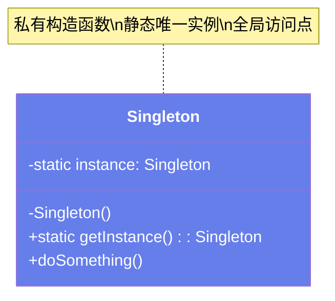

# 👤 设计模式 - 单例模式（Singleton Pattern）

> **文档说明**：系统讲解单例模式的完整知识体系，涵盖核心三要素、五种实现方式（饿汉/懒汉/DCL/静态内部类/枚举）对比、volatile 与指令重排原理、反射与反序列化攻击、Spring 单例与设计模式单例的区别、真实业务场景（配置/连接池/日志/缓存/线程池）、Python 实现、常见坑与面试考点。单例模式是最常用的创建型设计模式，确保一个类只有一个实例并提供全局访问点。
>
> **适用人群**：Java/Python 开发者、架构师、面试备考者
>
> **前置知识**：[[SOLID架构设计原则]] · [[23种设计模式分类速查]]

---

## 一、概述

### 1.1 什么是单例模式

单例模式（Singleton Pattern）是一种**创建型设计模式**，它确保一个类在整个应用中**只有一个实例**，并提供一个**全局访问点**。

**核心三要素**：
1. **私有构造函数** — 防止外部 `new` 创建实例
2. **私有静态实例** — 持有唯一实例
3. **公有静态获取方法** — 提供全局访问点



### 1.2 适用场景

| 场景 | 说明 | 为什么需要单例 |
|------|------|--------------|
| **配置管理** | 全局唯一的配置对象 | 避免重复加载配置，统一管理 |
| **数据库连接池** | 全局唯一的连接池 | 避免重复创建连接，控制连接数 |
| **日志器** | 全局统一的日志输出 | 统一日志格式和输出目标 |
| **缓存管理器** | 全局唯一的缓存 | 避免多份缓存不一致 |
| **线程池** | 全局统一的线程管理 | 控制线程数量，避免资源耗尽 |
| **硬件设备访问** | 打印机驱动等 | 硬件资源只能被一个实例控制 |
| **ID 生成器** | 全局唯一 ID 生成 | 避免 ID 重复 |
| **事件总线** | 全局唯一的消息发布/订阅 | 统一事件分发 |

### 1.3 不适用场景

- ❌ 需要多个实例的场景（如多租户环境，每个租户一个实例）
- ❌ 分布式系统中的有状态单例（每个 JVM 一个实例，不是全局唯一）
- ❌ 测试困难的场景（单例难以 Mock，影响单元测试）
- ❌ 对象状态需要频繁重置的场景

---

## 二、底层原理

### 2.1 五种实现方式对比

| 方式 | 线程安全 | 懒加载 | 性能 | 防反射 | 防反序列化 | 推荐度 |
|------|---------|--------|------|--------|-----------|--------|
| **饿汉式** | ✅ | ❌ | 高 | ❌ | ❌ | ⭐⭐ |
| **懒汉式（同步方法）** | ✅ | ✅ | 低 | ❌ | ❌ | ⭐ |
| **DCL 双重检查锁** | ✅ | ✅ | 高 | ❌ | ❌ | ⭐⭐⭐ |
| **静态内部类** | ✅ | ✅ | 高 | ❌ | ❌ | ⭐⭐⭐⭐ |
| **枚举** | ✅ | ❌ | 高 | ✅ | ✅ | ⭐⭐⭐⭐⭐ |

### 2.2 饿汉式（类加载时创建）

```java
/**
 * 饿汉式：类加载时就创建实例
 */
public class Singleton {
    // 类加载时初始化（JVM 保证线程安全）
    private static final Singleton instance = new Singleton();

    // 私有构造函数
    private Singleton() {}

    // 全局访问点
    public static Singleton getInstance() {
        return instance;
    }
}
```

| 优点 | 缺点 |
|------|------|
| 最简单，代码少 | 类加载就初始化，即使不用也占内存 |
| 天然线程安全（JVM 类加载机制保证） | 无法处理初始化异常 |
| 调用时无锁，性能高 | 不是懒加载，浪费资源（如果实例大且不一定用） |

**适用**：实例小、初始化快、确定会用到的场景。

### 2.3 懒汉式（同步方法，不推荐）

```java
/**
 * 懒汉式：第一次使用时创建，但用 synchronized 方法保证线程安全
 */
public class Singleton {
    private static Singleton instance;

    private Singleton() {}

    // 每次调用都加锁，性能差
    public static synchronized Singleton getInstance() {
        if (instance == null) {
            instance = new Singleton();
        }
        return instance;
    }
}
```

**问题**：`synchronized` 加到方法上，每次调用 `getInstance()` 都要加锁，即使实例已经创建。高并发下性能差。

### 2.4 DCL 双重检查锁（推荐）

```java
/**
 * DCL（Double-Checked Locking）：双重检查锁
 * 只在第一次创建时加锁，后续调用无锁
 */
public class Singleton {
    // volatile 关键字：防止指令重排
    private static volatile Singleton instance;

    private Singleton() {}

    public static Singleton getInstance() {
        if (instance == null) {                  // 第一次检查（无锁，快速判断）
            synchronized (Singleton.class) {     // 加锁
                if (instance == null) {          // 第二次检查（加锁后再判断）
                    instance = new Singleton();  // 创建实例
                }
            }
        }
        return instance;
    }
}
```

#### 为什么需要 volatile？

`new Singleton()` 在 JVM 中分为 3 步：
```text
1. 分配内存空间：memory = allocate()
2. 初始化对象：ctorInstance(memory)
3. 引用赋值：instance = memory
```

JVM 可能进行**指令重排**，执行顺序变为 1→3→2：
```text
1. 分配内存空间
3. 引用赋值（instance 不再是 null，但对象还没初始化！）
2. 初始化对象
```

如果线程 A 执行到步骤 3（instance 非 null 但未初始化），线程 B 进入 `getInstance()`，第一次检查 `instance == null` 为 false，直接返回未初始化的对象 → **程序崩溃**。

`volatile` 关键字**禁止指令重排**，保证 1→2→3 的顺序执行，避免此问题。

```mermaid
flowchart TB
    subgraph 无volatile（指令重排）
        A1[1.分配内存] --> A3[3.引用赋值<br/>instance非null]
        A3 --> A2[2.初始化对象]
        A3 -.->|线程B此时读取| BUG[❌ 返回未初始化对象]
    end

    subgraph 有volatile（禁止重排）
        B1[1.分配内存] --> B2[2.初始化对象]
        B2 --> B3[3.引用赋值<br/>instance非null且已初始化]
        B3 --> OK[✅ 返回正确对象]
    end

    style BUG fill:#fa709a,color:#fff
    style OK fill:#43e97b,color:#333
```

### 2.5 静态内部类（最推荐的普通方式）

```java
/**
 * 静态内部类：利用 JVM 类加载机制实现懒加载 + 线程安全
 */
public class Singleton {
    private Singleton() {}

    // 静态内部类，外部类加载时不会加载它
    private static class Holder {
        // JVM 加载 Holder 时初始化，类加载机制保证线程安全
        private static final Singleton instance = new Singleton();
    }

    // 第一次调用时才加载 Holder，实现懒加载
    public static Singleton getInstance() {
        return Holder.instance;
    }
}
```

**原理**：
- JVM 加载外部类 `Singleton` 时，**不会**加载内部类 `Holder`
- 第一次调用 `getInstance()` 时，才加载 `Holder`
- JVM 类加载过程是线程安全的（`<clinit>` 方法加锁）
- 所以 `Holder.instance` 的初始化是线程安全的

| 优点 | 缺点 |
|------|------|
| 懒加载（第一次调用才初始化） | 无法传参给构造函数 |
| 线程安全（JVM 保证） | 防反射/反序列化需要额外处理 |
| 无锁，性能高 | - |
| 代码简洁 | - |

### 2.6 枚举（Effective Java 推荐，最安全）

```java
/**
 * 枚举单例：Effective Java 作者 Josh Bloch 推荐
 */
public enum Singleton {
    INSTANCE;  // 唯一实例

    // 业务方法
    public void doSomething() {
        System.out.println("单例执行业务逻辑");
    }
}

// 使用
Singleton.INSTANCE.doSomething();
```

**为什么枚举最安全**：
1. **天然线程安全**：JVM 保证枚举类的初始化线程安全
2. **防反射**：反射无法通过 `setAccessible(true)` 创建枚举实例（JDK 层面禁止）
3. **防反序列化**：枚举反序列化时返回同一个实例（不需要 `readResolve()`）
4. **代码极简**：只有一行 `INSTANCE`

| 优点 | 缺点 |
|------|------|
| 最安全（防反射+防反序列化） | 不是懒加载（枚举类加载时初始化） |
| 代码极简 | 无法继承其他类（枚举已继承 Enum） |
| 天然线程安全 | 某些场景不够灵活 |

### 2.7 反射与反序列化攻击

```java
/**
 * 反射破坏单例（枚举除外）
 */
// 通过反射调用私有构造函数
Constructor<Singleton> constructor = Singleton.class.getDeclaredConstructor();
constructor.setAccessible(true);  // 绕过私有访问限制
Singleton instance2 = constructor.newInstance();  // 创建了第二个实例！

// 防御：在构造函数中判断
private Singleton() {
    if (instance != null) {
        throw new RuntimeException("禁止通过反射创建单例");
    }
}

/**
 * 反序列化破坏单例
 */
// 序列化后再反序列化，会创建新对象
ObjectOutputStream oos = new ObjectOutputStream(new FileOutputStream("obj.ser"));
oos.writeObject(Singleton.getInstance());
oos.close();

ObjectInputStream ois = new ObjectInputStream(new FileInputStream("obj.ser"));
Singleton instance2 = (Singleton) ois.readObject();  // 新对象！

// 防御：实现 readResolve() 返回已有实例
private Object readResolve() {
    return getInstance();
}
```

---

## 三、实操示例

### 3.1 Java 实战：全局配置管理

```java
/**
 * 全局配置管理器（DCL 实现）
 */
public class AppConfig {
    private static volatile AppConfig instance;
    private Properties props;

    // 私有构造：加载配置文件
    private AppConfig() {
        props = new Properties();
        try (InputStream is = getClass().getResourceAsStream("/app.properties")) {
            props.load(is);
        } catch (IOException e) {
            throw new RuntimeException("配置文件加载失败", e);
        }
    }

    public static AppConfig getInstance() {
        if (instance == null) {
            synchronized (AppConfig.class) {
                if (instance == null) {
                    instance = new AppConfig();
                }
            }
        }
        return instance;
    }

    public String get(String key) {
        return props.getProperty(key);
    }

    public String get(String key, String defaultValue) {
        return props.getProperty(key, defaultValue);
    }

    public int getInt(String key, int defaultValue) {
        return Integer.parseInt(props.getProperty(key, String.valueOf(defaultValue)));
    }
}

// 使用
String dbUrl = AppConfig.getInstance().get("db.url");
int poolSize = AppConfig.getInstance().getInt("db.pool.size", 20);
```

### 3.2 Java 实战：数据库连接池

```java
/**
 * 数据库连接池单例（饿汉式，启动时初始化）
 */
public class ConnectionPool {
    // 饿汉式：应用启动就初始化连接池
    private static final ConnectionPool instance = new ConnectionPool();
    private final HikariDataSource ds;

    private ConnectionPool() {
        HikariConfig config = new HikariConfig();
        config.setJdbcUrl("jdbc:mysql://localhost:3306/mydb");
        config.setUsername("root");
        config.setPassword("password");
        config.setMaximumPoolSize(20);
        config.setMinimumIdle(5);
        config.setConnectionTimeout(30000);
        ds = new HikariDataSource(config);
    }

    public static ConnectionPool getInstance() {
        return instance;
    }

    public Connection getConnection() throws SQLException {
        return ds.getConnection();
    }

    public void close() {
        if (ds != null && !ds.isClosed()) {
            ds.close();
        }
    }
}

// 使用
try (Connection conn = ConnectionPool.getInstance().getConnection()) {
    // 执行 SQL
}
```

### 3.3 Java 实战：枚举单例（ID 生成器）

```java
/**
 * 雪花算法 ID 生成器（枚举单例）
 */
public enum IdGenerator {
    INSTANCE;

    private final long workerId = 1L;
    private final long datacenterId = 1L;
    private long sequence = 0L;
    private long lastTimestamp = -1L;
    private static final long START_STAMP = 1704067200000L; // 2024-01-01

    public synchronized long nextId() {
        long timestamp = System.currentTimeMillis();
        if (timestamp < lastTimestamp) {
            throw new RuntimeException("时钟回拨");
        }
        if (timestamp == lastTimestamp) {
            sequence = (sequence + 1) & 4095;  // 12位序列号
            if (sequence == 0) {
                timestamp = tilNextMillis(lastTimestamp);
            }
        } else {
            sequence = 0;
        }
        lastTimestamp = timestamp;

        return ((timestamp - START_STAMP) << 22)
             | (datacenterId << 17)
             | (workerId << 12)
             | sequence;
    }

    private long tilNextMillis(long lastTimestamp) {
        long timestamp = System.currentTimeMillis();
        while (timestamp <= lastTimestamp) {
            timestamp = System.currentTimeMillis();
        }
        return timestamp;
    }
}

// 使用
long id = IdGenerator.INSTANCE.nextId();
```

### 3.4 Python 实现

```python
"""
Python 单例模式的三种实现
"""
import threading

# ===== 方式1：__new__ 方法 =====
class Singleton:
    _instance = None
    _lock = threading.Lock()

    def __new__(cls, *args, **kwargs):
        if cls._instance is None:
            with cls._lock:  # 双重检查锁
                if cls._instance is None:
                    cls._instance = super().__new__(cls)
        return cls._instance

# ===== 方式2：装饰器（最优雅，推荐） =====
def singleton(cls):
    instances = {}
    lock = threading.Lock()

    def get_instance(*args, **kwargs):
        if cls not in instances:
            with lock:
                if cls not in instances:
                    instances[cls] = cls(*args, **kwargs)
        return instances[cls]
    return get_instance

@singleton
class Config:
    def __init__(self):
        self.data = self._load_config()

    def _load_config(self):
        return {"db_url": "mysql://localhost:3306/db"}

# ===== 方式3：元类（最 Pythonic） =====
class SingletonMeta(type):
    _instances = {}
    _lock = threading.Lock()

    def __call__(cls, *args, **kwargs):
        if cls not in cls._instances:
            with cls._lock:
                if cls not in cls._instances:
                    cls._instances[cls] = super().__call__(*args, **kwargs)
        return cls._instances[cls]

class Logger(metaclass=SingletonMeta):
    def __init__(self):
        self.level = "INFO"

    def info(self, msg):
        print(f"[INFO] {msg}")

# 使用
logger1 = Logger()
logger2 = Logger()
print(logger1 is logger2)  # True
```

### 3.5 Spring 单例 vs 设计模式单例

| 维度 | 设计模式单例 | Spring 单例 |
|------|------------|------------|
| **范围** | JVM 级（一个 ClassLoader 一个实例） | ApplicationContext 级（一个容器一个实例） |
| **实现** | 私有构造 + 静态实例 | 容器管理 Bean 生命周期 |
| **创建方式** | 自己控制 | Spring 反射创建 |
| **可配置** | 不可（写死在代码里） | 可通过配置改变（prototype/request/session） |
| **依赖注入** | 不支持 | 支持（@Autowired） |
| **AOP** | 不支持 | 支持（代理增强） |

```java
// Spring 单例 Bean（默认 scope=singleton）
@Service
public class UserService {
    // Spring 保证容器内只有一个实例
    // 但不是设计模式的单例（可以 new UserService()）
}

// Spring 原型 Bean（每次获取新实例）
@Scope("prototype")
@Service
public class PrototypeBean { }
```

---

## 四、常见问题与排查

| 问题现象 | 可能原因 | 解决方案 |
|---------|---------|---------|
| **多线程创建了多个实例** | 懒汉式没加锁；DCL 没加 volatile | 用 DCL + volatile；或静态内部类/枚举 |
| **DCL 拿到未初始化对象** | 缺少 volatile，指令重排 | 加 `volatile` 关键字 |
| **反射创建了第二个实例** | 构造函数没防御 | 构造函数中判断 instance 非空抛异常；或用枚举 |
| **反序列化创建新对象** | 没实现 readResolve() | 实现 `readResolve()` 返回已有实例；或用枚举 |
| **多 ClassLoader 多个实例** | 不同 ClassLoader 加载的类是不同的 | 确保单例类由同一个 ClassLoader 加载 |
| **分布式环境不唯一** | 单例是 JVM 级别的 | 分布式用分布式锁/Redis 实现全局单例 |
| **单例有状态导致线程安全问题** | 多线程修改单例的可变状态 | 单例尽量无状态；有状态时加同步或用线程安全集合 |
| **单元测试困难** | 单例难以 Mock | 用依赖注入替代单例；或用 Mockito 模拟静态方法 |
| **内存泄漏** | 单例持有大对象不释放 | 单例生命周期 = 应用生命周期，注意不要持有大资源 |
| **初始化异常被吞** | 静态初始化块异常 | 用静态内部类或 DCL，异常可以正常抛出 |
| **Spring 单例注入原型 Bean 不生效** | 单例 Bean 只初始化一次，原型依赖只注入一次 | 用 `lookup-method` 或 `ObjectFactory` |
| **枚举单例无法继承** | 枚举默认继承 Enum | 用接口定义行为，枚举实现接口 |

---

## 五、进阶与最佳实践

### 5.1 实现方式选择指南

| 场景 | 推荐方式 | 原因 |
|------|---------|------|
| **简单场景，实例小** | 饿汉式 | 最简单，天然安全 |
| **需要懒加载** | 静态内部类 | 懒加载+安全+高性能 |
| **需要传参初始化** | DCL | 可以在 getInstance 中传参 |
| **最高安全性要求** | 枚举 | 防反射+防反序列化 |
| **Spring 项目** | Spring Bean（默认单例） | 容器管理，支持 DI/AOP |
| **Python 项目** | 装饰器 | 简洁优雅，可复用 |
| **有状态单例** | 枚举 + 同步方法 | 枚举安全，状态访问加锁 |

### 5.2 单例设计原则

```text
好的单例设计 Checklist：

✅ 私有构造函数，防止外部 new
✅ 静态实例持有唯一对象
✅ 全局访问点 getInstance()
✅ 线程安全（DCL+volatile / 静态内部类 / 枚举）
✅ 懒加载（如果实例大或初始化慢）
✅ 防反射（构造函数防御 / 枚举）
✅ 防反序列化（readResolve / 枚举）
✅ 尽量无状态（避免线程安全问题）
✅ 不要持有大资源（单例生命周期=应用生命周期）
✅ 考虑可测试性（优先用依赖注入）
```

### 5.3 单例 vs 静态类

| 维度 | 单例 | 静态类（工具类） |
|------|------|----------------|
| **本质** | 对象实例 | 类的静态方法 |
| **继承/实现接口** | ✅ 可以 | ❌ 不可以 |
| **作为参数传递** | ✅ 可以 | ❌ 不可以 |
| **延迟初始化** | ✅ 可以 | ❌ 类加载时初始化 |
| **多态** | ✅ 支持 | ❌ 不支持 |
| **状态** | 可以有状态 | 静态变量共享状态 |
| **Mock 测试** | 较难 | 更难 |
| **典型应用** | 连接池、配置、日志 | Math、Collections、工具方法 |

### 5.4 生产环境最佳实践

| 类别 | 建议 |
|------|------|
| **优先用 DI** | Spring 项目优先用依赖注入，不要手写单例 |
| **无状态优先** | 单例尽量无状态，避免并发问题 |
| **枚举最安全** | 新代码优先考虑枚举单例（Effective Java 推荐） |
| **延迟初始化** | 大对象用懒加载，避免启动慢 |
| **监控初始化** | 单例初始化失败要明确报错，不要静默失败 |
| **资源释放** | 单例持有的资源（连接池、线程池）要在应用关闭时释放 |
| **分布式注意** | 单例是 JVM 级的，分布式需要分布式方案 |
| **可测试性** | 关键业务逻辑不要写死在单例里，用接口抽象便于 Mock |

### 5.5 面试高频考点

| 问题 | 答案要点 |
|------|---------|
| 单例有几种实现方式？ | 5 种：饿汉/懒汉/DCL/静态内部类/枚举 |
| DCL 为什么要 volatile？ | 防止 `new` 对象时的指令重排，避免拿到未初始化对象 |
| 枚举为什么是最好的单例？ | 天然线程安全 + 防反射 + 防反序列化 + 代码极简 |
| 单例是线程安全的吗？ | 看实现：饿汉/枚举/静态内部类安全；懒汉不加锁不安全 |
| 单例和静态类的区别？ | 单例是对象，可以继承/传参/多态；静态类是方法集合 |
| Spring 单例和设计模式单例一样吗？ | 不一样：Spring 是容器级（ApplicationContext），设计模式是 ClassLoader 级 |
| 如何破坏单例？ | 反射（setAccessible）、反序列化、多 ClassLoader |
| 如何防止单例被破坏？ | 枚举（最彻底）；构造函数防御；readResolve() |
| 单例的缺点？ | 难以测试、违反单一职责（既管创建又管业务）、分布式不唯一 |
| 饿汉式和懒汉式的区别？ | 饿汉类加载时初始化（无懒加载），懒汉第一次使用时初始化（需考虑线程安全） |

---

## 六、关联笔记

### 设计模式
- [[23种设计模式分类速查]] · [[设计模式-工厂模式]] · [[设计模式-策略模式]]
- [[设计模式-观察者模式]] · [[设计模式-装饰器模式]] · [[设计模式-代理模式]]

### 架构与框架
- [[SOLID架构设计原则]] · [[Spring-IoC依赖注入]] · [[Spring-AOP面向切面编程]]

### 并发
- [[Java并发编程核心]] · [[volatile与内存屏障]] · [[synchronized与锁升级]]

### 导航
- [[MOC-计算机基础]] · [[MOC-设计模式与架构]] · [[MOC-综合导航]] · [[Home]]

> 🔍 **知识点深度解析**
>
> **作用**：单例模式解决的是「如何确保一个类在整个应用中只有一个实例，并提供全局访问点」的问题，用于管理全局唯一的资源（配置、连接池、日志、缓存等）。
>
> **底层原理**：通过私有构造函数禁止外部创建实例，内部持有静态唯一实例，通过公有静态方法提供访问。线程安全的关键是「如何安全地初始化唯一实例」：饿汉式靠 JVM 类加载机制；DCL 靠 `synchronized` + `volatile`（volatile 禁止 `new` 对象的指令重排，防止拿到未初始化对象）；静态内部类靠 JVM 加载内部类时的 `<clinit>` 锁；枚举靠 JVM 对枚举的特殊处理（天然防反射和反序列化）。
>
> **用法要点**：① 三要素：私有构造 + 静态实例 + getInstance() ② Java 推荐静态内部类（懒加载+安全）或枚举（最安全） ③ DCL 必须加 `volatile`，否则指令重排导致未初始化对象 ④ 防反射：构造函数判断 instance 非空抛异常 ⑤ 防反序列化：实现 `readResolve()` ⑥ 单例尽量无状态，有状态时加同步 ⑦ Spring 项目优先用 DI，不要手写单例 ⑧ Python 用装饰器或元类实现。

> 💡 **深度讲解**：单例模式看似简单（就一个私有构造+静态实例），但面试中能挖出很多深度问题。最经典的是「DCL 为什么需要 volatile」——很多人背了双重检查锁，却不知道 `new Singleton()` 不是原子操作，JVM 可能重排指令导致另一个线程拿到半初始化的对象。另一个高频考点是「枚举为什么是最好的单例」——因为 JVM 从根本上禁止了反射创建枚举实例，且枚举反序列化时返回同一个对象，这是其他实现方式需要额外处理才能做到的。实际开发中，Spring 项目很少手写单例（用 @Service 默认就是单例），但理解原理对面试和排查问题很重要。记住：**单例是 JVM 级的，不是分布式级的**——在多实例部署的微服务中，每个实例都有自己的单例，需要全局唯一时要用分布式锁。

> 📝 **精简总结**：单例 = 私有构造 + 静态实例 + 全局访问点。五种实现：饿汉（简单但非懒加载）、懒汉（懒加载但需加锁）、DCL（双重检查+volatile）、静态内部类（推荐，懒加载+安全）、枚举（最安全，防反射+防序列化）。DCL 的 volatile 防止指令重排。Spring 单例是容器级，设计模式单例是 ClassLoader 级。

> **学习路径建议**：先学习 [[SOLID架构设计原则]] 理解设计原则 → 学习 [[23种设计模式分类速查]] 建立全局认知 → 学习本文档掌握单例模式 → 对比学习 [[设计模式-工厂模式]] 和 [[设计模式-装饰器模式]] → 学习 [[volatile与内存屏障]] 深入理解并发原理 → 学习 [[Spring-IoC依赖注入]] 理解框架中的单例管理。

---

> **单例模式的本质是「全局唯一 + 受控访问」——不是不能创建多个，而是不应该创建多个。用私有构造把好门，用静态实例守住唯一，用 getInstance 提供入口。**
