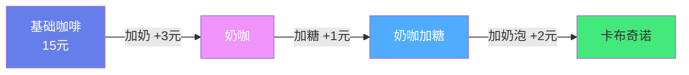
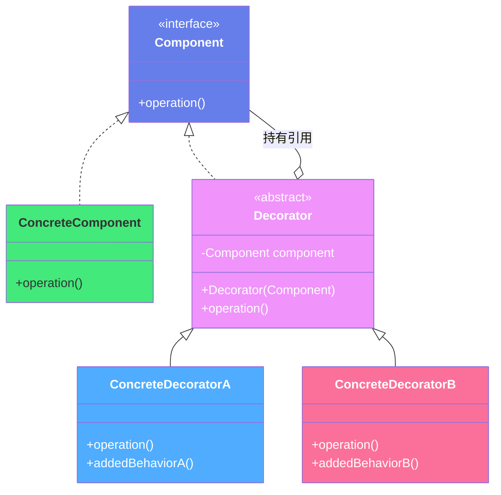
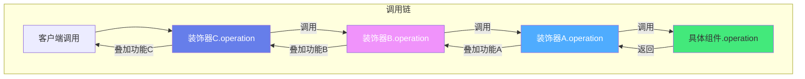

# 🎨 设计模式 - 装饰器模式（Decorator Pattern）

> **文档说明**：系统讲解装饰器模式的完整知识体系，涵盖核心思想、UML 结构、标准实现（Java/Python）、与继承的对比、Java IO 经典案例、真实业务场景（缓存/日志/权限/监控）、与代理模式的区别、Spring AOP 本质、常见坑与面试考点。装饰器模式是结构型设计模式，通过「包装」动态给对象叠加功能，比继承更灵活，是 Java IO 和 Spring AOP 的底层思想。
>
> **适用人群**：Java/Python 开发者、架构师、面试备考者
>
> **前置知识**：[[SOLID架构设计原则]] · [[23种设计模式分类速查]]

---

## 一、概述

### 1.1 什么是装饰器模式

装饰器模式（Decorator Pattern）是一种**结构型设计模式**，它允许在**不改变原有对象结构**的前提下，动态地给一个对象添加额外的职责（功能）。

**核心思想**：不修改原有类，通过「包装」的方式，在运行时动态叠加功能。就像给咖啡加奶、加糖、加奶泡——每加一种配料就是一层装饰，最终得到一杯定制咖啡。

> **一句话总结**：装饰器模式 = 持有组件引用 + 实现同一接口 + 叠加功能，运行时动态组合。

### 1.2 解决的问题

| 问题 | 说明 |
|------|------|
| **继承导致类爆炸** | N 种基础 × M 种功能 = N×M 个子类，无法维护 |
| **无法动态增减功能** | 继承在编译时确定，运行时不能灵活添加/移除功能 |
| **违反单一职责** | 一个子类承担多个功能，职责不清晰 |
| **无法扩展 final 类** | 被 final 修饰的类无法通过继承扩展 |

### 1.3 适用场景

- ✅ 需要**动态添加/移除**功能的场景
- ✅ 多种功能**任意组合**（继承会导致类爆炸）
- ✅ 不能用继承扩展（final 类）或继承不适合的场景
- ✅ **横切关注点**：日志、缓存、权限、监控、事务等
- ✅ Java IO 流（最经典案例）
- ✅ Python 装饰器语法（语言级支持）

### 1.4 生活中的类比



每加一种配料就是一层装饰，配料可以任意组合、随时增减，不需要为每种组合创建一个新类。

---

## 二、底层原理

### 2.1 UML 类图结构



| 角色 | 说明 | 咖啡示例 |
|------|------|---------|
| **Component（抽象组件）** | 定义对象接口，可以动态添加职责 | `Coffee` 接口 |
| **ConcreteComponent（具体组件）** | 被装饰的原始对象 | `Espresso`（浓缩咖啡） |
| **Decorator（抽象装饰器）** | 持有 Component 引用，实现 Component 接口 | `CoffeeDecorator` |
| **ConcreteDecorator（具体装饰器）** | 具体添加的功能 | `MilkDecorator`（加奶）、`SugarDecorator`（加糖） |

### 2.2 核心机制



**关键设计**：
1. 装饰器和被装饰对象实现**同一个接口**（Component）
2. 装饰器内部**持有**一个 Component 引用（被装饰对象）
3. 装饰器的方法中，先调用被装饰对象的方法，再**叠加自己的功能**
4. 多个装饰器可以**嵌套**，形成调用链

### 2.3 装饰器 vs 继承

| 维度 | 继承 | 装饰器 |
|------|------|--------|
| **功能组合** | 每种组合一个子类（类爆炸） | 运行时动态组合 |
| **灵活性** | 编译时确定，无法动态增减 | 运行时可增可减 |
| **类数量** | 随功能指数增长（N×M） | 线性增长（N+M） |
| **单一职责** | 子类可能承担多个职责 | 每个装饰器只负责一个功能 |
| **适用 final 类** | 无法继承 | 可以装饰 |
| **代码复用** | 继承父类实现 | 组合被装饰对象 |
| **开闭原则** | 新增功能需修改/新增子类 | 新增装饰器即可，不修改原有代码 |

**继承的类爆炸问题**：
```text
Coffee（3种基础：Espresso/Latte/Cappuccino）
  配料：Milk/Sugar/Whip/Cinnamon（4种）
  继承需要：3 + 3×4 + 3×C(4,2) + ... = 数十个子类
  装饰器需要：3 + 4 = 7 个类，任意组合
```

---

## 三、实操示例

### 3.1 Java 标准实现

```java
/**
 * 装饰器模式标准实现：咖啡定制系统
 */

// ===== 1. 抽象组件 =====
interface Coffee {
    double cost();           // 价格
    String description();    // 描述
}

// ===== 2. 具体组件（被装饰者） =====
class Espresso implements Coffee {
    @Override
    public double cost() { return 15.0; }
    @Override
    public String description() { return "浓缩咖啡"; }
}

class Latte implements Coffee {
    @Override
    public double cost() { return 20.0; }
    @Override
    public String description() { return "拿铁"; }
}

// ===== 3. 抽象装饰器 =====
abstract class CoffeeDecorator implements Coffee {
    protected Coffee coffee;  // 持有被装饰对象

    public CoffeeDecorator(Coffee coffee) {
        this.coffee = coffee;
    }
}

// ===== 4. 具体装饰器 =====
class MilkDecorator extends CoffeeDecorator {
    public MilkDecorator(Coffee coffee) { super(coffee); }

    @Override
    public double cost() {
        return coffee.cost() + 3.0;  // 加奶 +3元
    }
    @Override
    public String description() {
        return coffee.description() + " + 奶";
    }
}

class SugarDecorator extends CoffeeDecorator {
    public SugarDecorator(Coffee coffee) { super(coffee); }

    @Override
    public double cost() {
        return coffee.cost() + 1.0;  // 加糖 +1元
    }
    @Override
    public String description() {
        return coffee.description() + " + 糖";
    }
}

class WhipDecorator extends CoffeeDecorator {
    public WhipDecorator(Coffee coffee) { super(coffee); }

    @Override
    public double cost() {
        return coffee.cost() + 2.0;  // 加奶泡 +2元
    }
    @Override
    public String description() {
        return coffee.description() + " + 奶泡";
    }
}

// ===== 5. 使用：任意组合 =====
public class CoffeeShop {
    public static void main(String[] args) {
        // 基础咖啡
        Coffee espresso = new Espresso();
        System.out.println(espresso.description() + " ¥" + espresso.cost());
        // 浓缩咖啡 ¥15.0

        // 加奶 + 加糖（两层装饰）
        Coffee milkSugar = new SugarDecorator(new MilkDecorator(new Espresso()));
        System.out.println(milkSugar.description() + " ¥" + milkSugar.cost());
        // 浓缩咖啡 + 奶 + 糖 ¥19.0

        // 全配料（三层装饰）
        Coffee deluxe = new WhipDecorator(
                            new SugarDecorator(
                                new MilkDecorator(new Latte())));
        System.out.println(deluxe.description() + " ¥" + deluxe.cost());
        // 拿铁 + 奶 + 糖 + 奶泡 ¥26.0
    }
}
```

### 3.2 Python 实现（函数装饰器）

Python 从语言层面支持装饰器，是装饰器模式的语法糖：

```python
"""
Python 装饰器：函数装饰器和类装饰器
"""
import time
from functools import wraps

# ===== 函数装饰器：计时 =====
def timer(func):
    @wraps(func)  # 保留原函数元信息
    def wrapper(*args, **kwargs):
        start = time.time()
        result = func(*args, **kwargs)  # 调用原函数
        elapsed = time.time() - start
        print(f"{func.__name__} 耗时: {elapsed:.4f}s")  # 叠加功能
        return result
    return wrapper

# ===== 函数装饰器：日志 =====
def log(func):
    @wraps(func)
    def wrapper(*args, **kwargs):
        print(f"[LOG] 调用 {func.__name__}, 参数: {args}, {kwargs}")
        result = func(*args, **kwargs)
        print(f"[LOG] {func.__name__} 返回: {result}")
        return result
    return wrapper

# ===== 函数装饰器：缓存 =====
def cache(func):
    memo = {}
    @wraps(func)
    def wrapper(*args):
        if args not in memo:
            memo[args] = func(*args)
        return memo[args]
    return wrapper

# ===== 使用：装饰器叠加（顺序从下到上执行） =====
@timer          # 第二层：计时
@log            # 第一层：日志
def calculate(n):
    """计算斐波那契数列"""
    if n <= 1:
        return n
    return calculate(n-1) + calculate(n-2)

@cache
def fibonacci(n):
    """带缓存的斐波那契"""
    if n <= 1:
        return n
    return fibonacci(n-1) + fibonacci(n-2)

# 测试
print(calculate(10))
print(fibonacci(100))  # 有缓存，瞬间完成

# ===== 类装饰器 =====
class CountCalls:
    def __init__(self, func):
        self.func = func
        self.count = 0

    def __call__(self, *args, **kwargs):
        self.count += 1
        print(f"第 {self.count} 次调用 {self.func.__name__}")
        return self.func(*args, **kwargs)

@CountCalls
def greet(name):
    return f"你好, {name}!"

greet("张三")  # 第 1 次调用
greet("李四")  # 第 2 次调用
```

### 3.3 经典案例：Java IO 流

Java IO 是装饰器模式**最大规模的应用**：

```java
/**
 * Java IO 装饰器嵌套
 */
import java.io.*;

public class IOExample {
    public static void main(String[] args) throws Exception {
        // 基础组件：文件输入流
        InputStream fis = new FileInputStream("data.txt");

        // 层层装饰，叠加功能
        InputStream bis = new BufferedInputStream(fis);   // 装饰1：缓冲功能
        DataInputStream dis = new DataInputStream(bis);  // 装饰2：数据类型读取
        // ObjectInputStream ois = new ObjectInputStream(dis); // 装饰3：对象序列化

        // 一行写法（装饰器嵌套）
        DataInputStream stream = new DataInputStream(
            new BufferedInputStream(
                new FileInputStream("data.txt")
            )
        );

        // 读取数据
        int number = stream.readInt();
        String text = stream.readUTF();
        stream.close();
    }
}
```

| 装饰器角色 | IO 类 | 功能 |
|-----------|-------|------|
| Component | `InputStream` / `OutputStream` | 抽象组件 |
| ConcreteComponent | `FileInputStream` / `ByteArrayInputStream` | 具体组件（数据源） |
| Decorator | `FilterInputStream` / `FilterOutputStream` | 抽象装饰器 |
| ConcreteDecorator | `BufferedInputStream` | 缓冲功能 |
| ConcreteDecorator | `DataInputStream` | 基本数据类型读取 |
| ConcreteDecorator | `ObjectInputStream` | 对象反序列化 |
| ConcreteDecorator | `GZIPInputStream` | 解压功能 |
| ConcreteDecorator | `CipherInputStream` | 解密功能 |

> **设计精髓**：通过装饰器嵌套，可以自由组合「缓冲 + 数据类型 + 压缩 + 加密」等功能，不需要为每种组合创建一个类。

### 3.4 真实业务场景：服务层功能叠加

```java
/**
 * 业务场景：用户服务的缓存 + 日志 + 权限装饰
 */

// ===== 抽象组件 =====
interface UserService {
    User getUser(Long id);
    void updateUser(User user);
}

// ===== 具体组件 =====
class UserServiceImpl implements UserService {
    private UserMapper userMapper;

    @Override
    public User getUser(Long id) {
        return userMapper.selectById(id);
    }
    @Override
    public void updateUser(User user) {
        userMapper.updateById(user);
    }
}

// ===== 装饰器1：缓存 =====
class CacheUserService implements UserService {
    private UserService delegate;
    private Cache cache;

    public CacheUserService(UserService delegate, Cache cache) {
        this.delegate = delegate;
        this.cache = cache;
    }

    @Override
    public User getUser(Long id) {
        String key = "user:" + id;
        User user = cache.get(key);
        if (user == null) {
            user = delegate.getUser(id);  // 调用被装饰对象
            cache.put(key, user);         // 叠加缓存功能
        }
        return user;
    }

    @Override
    public void updateUser(User user) {
        delegate.updateUser(user);
        cache.evict("user:" + user.getId());  // 更新时清除缓存
    }
}

// ===== 装饰器2：日志 =====
class LogUserService implements UserService {
    private UserService delegate;
    private static final Logger log = LoggerFactory.getLogger(LogUserService.class);

    public LogUserService(UserService delegate) {
        this.delegate = delegate;
    }

    @Override
    public User getUser(Long id) {
        long start = System.currentTimeMillis();
        User user = delegate.getUser(id);
        log.info("getUser(id={}) 耗时={}ms", id, System.currentTimeMillis() - start);
        return user;
    }

    @Override
    public void updateUser(User user) {
        log.info("更新用户: {}", user.getId());
        delegate.updateUser(user);
    }
}

// ===== 装饰器3：权限校验 =====
class AuthUserService implements UserService {
    private UserService delegate;

    @Override
    public User getUser(Long id) {
        if (!SecurityUtils.hasPermission("user:read")) {
            throw new AccessDeniedException("无权限查看用户");
        }
        return delegate.getUser(id);
    }

    @Override
    public void updateUser(User user) {
        if (!SecurityUtils.hasPermission("user:write")) {
            throw new AccessDeniedException("无权限修改用户");
        }
        delegate.updateUser(user);
    }
}

// ===== 使用：三层装饰叠加 =====
public class Application {
    public static void main(String[] args) {
        UserService service = new LogUserService(          // 外层：日志
                                new CacheUserService(       // 中层：缓存
                                    new AuthUserService(    // 内层：权限
                                        new UserServiceImpl(), null), null));

        User user = service.getUser(1L);  // 日志 → 缓存 → 权限 → 真实查询
    }
}
```

### 3.5 Spring AOP：装饰器的动态代理实现

Spring AOP 本质是装饰器模式的应用，通过**动态代理**在运行时给目标对象包装增强逻辑：

```java
/**
 * Spring AOP：通过注解声明式地添加装饰功能
 */
@Service
public class OrderService {

    @Transactional          // 装饰：事务管理
    @Cacheable("orders")    // 装饰：缓存
    @Log("创建订单")         // 装饰：日志（自定义注解）
    public Order createOrder(OrderDTO dto) {
        // 核心业务逻辑
        return orderMapper.insert(dto);
    }
}

// Spring 在运行时通过动态代理生成代理对象：
// $Proxy（事务）→ $Proxy（缓存）→ $Proxy（日志）→ OrderService（真实对象）
// 调用链：代理1.创建订单 → 代理2.创建订单 → 代理3.创建订单 → 真实对象.创建订单
```

| AOP 概念 | 装饰器对应 | 说明 |
|---------|-----------|------|
| **Target（目标对象）** | ConcreteComponent | 被装饰的真实对象 |
| **Advice（通知）** | ConcreteDecorator 的功能 | 增强逻辑（前置/后置/环绕） |
| **Proxy（代理）** | Decorator | 包装目标对象的代理 |
| **Aspect（切面）** | 一组装饰器 | 横切关注点的模块化 |
| **Join Point（连接点）** | 被装饰的方法 | 可以插入增强逻辑的点 |

---

## 四、常见问题与排查

| 问题现象 | 可能原因 | 解决方案 |
|---------|---------|---------|
| **装饰后功能不生效** | 装饰器未调用被装饰对象的方法 | 确保装饰器方法中调用 `delegate.method()` |
| **结果与预期不符** | 装饰器顺序错误 | 注意嵌套顺序：`new A(new B(obj))` 先执行 B 再执行 A |
| **性能下降** | 装饰器嵌套过深，调用链太长 | 减少不必要的装饰层；合并相关功能 |
| **equals/hashCode 异常** | 装饰器包装后对象身份改变 | 重写 equals/hashCode，比较被装饰对象；或避免用装饰器对象做 Map key |
| **与代理模式混淆** | 两者结构相似 | 装饰器=加功能（客户端主动包装）；代理=控访问（客户端不知情） |
| **Python 装饰器丢失元信息** | 未使用 @wraps | 用 `functools.wraps` 保留原函数名、文档等 |
| **Python 装饰器顺序混乱** | 多个装饰器叠加顺序不清 | 装饰器从下到上应用，从上到下执行 |
| **IO 流关闭异常** | 只关闭最外层流 | 关闭最外层流会递归关闭所有被装饰流，正常 |
| **循环引用** | 装饰器持有被装饰对象，被装饰对象又引用装饰器 | 避免循环引用，注意内存泄漏 |
| **线程安全问题** | 装饰器有状态（如缓存） | 装饰器尽量无状态；有状态时加同步或用线程安全集合 |

---

## 五、进阶与最佳实践

### 5.1 装饰器 vs 代理模式 vs 适配器模式

| 维度 | 装饰器模式 | 代理模式 | 适配器模式 |
|------|-----------|---------|-----------|
| **目的** | 增强/添加功能 | 控制访问 | 转换接口 |
| **接口** | 与被装饰对象相同 | 与目标对象相同 | 与目标对象不同 |
| **关系** | 客户端知道被装饰对象，主动组合 | 客户端不知道代理背后的真实对象 | 客户端使用适配后的新接口 |
| **创建方式** | 客户端 new 装饰器包装目标 | 代理内部创建或持有目标 | 适配器包装不兼容接口 |
| **典型应用** | Java IO、Python 装饰器 | Spring AOP、RPC、延迟加载 | 旧系统接口兼容 |
| **关注点** | 功能叠加 | 访问控制 | 接口转换 |

### 5.2 装饰器设计原则

```text
好的装饰器设计 Checklist：

✅ 装饰器和被装饰对象实现同一接口（Component）
✅ 装饰器持有 Component 引用（组合优于继承）
✅ 装饰器方法中先调用被装饰对象，再叠加功能
✅ 每个装饰器只负责一个功能（单一职责）
✅ 装饰器无状态（或状态线程安全）
✅ 装饰器可以任意嵌套、顺序组合
✅ 新增功能只需新增装饰器类（开闭原则）
✅ 不修改原有组件代码（对扩展开放，对修改关闭）
```

### 5.3 透明装饰器 vs 半透明装饰器

| 类型 | 说明 | 示例 |
|------|------|------|
| **透明装饰器** | 装饰器接口与 Component 完全一致，客户端无感知 | Java IO、标准装饰器 |
| **半透明装饰器** | 装饰器新增了自己的方法，客户端需要知道具体类型 | `BufferedReader.readLine()` 是 Reader 没有的方法 |

> 半透明装饰器更灵活，但失去了「透明组合」的优势，客户端不能随意替换。实际项目中两者都常见。

### 5.4 生产环境最佳实践

| 场景 | 建议 |
|------|------|
| **横切关注点** | 优先用 AOP（Spring），不要手动写装饰器 |
| **功能组合** | 装饰器适合需要运行时动态组合的场景 |
| **简单增强** | 一个功能用装饰器，多个功能用 AOP |
| **性能敏感** | 注意装饰器嵌套深度，每层都有调用开销 |
| **Python** | 优先用语言级装饰器语法，简洁优雅 |
| **Java** | 简单场景手动实现，复杂场景用动态代理/AOP |
| **测试** | 装饰器可以单独测试，也可以组合测试 |
| **调试** | 嵌套装饰器的调用链较深，注意日志追踪 |

### 5.5 面试高频考点

| 问题 | 答案要点 |
|------|---------|
| 装饰器模式解决什么问题？ | 动态扩展功能，避免继承导致的类爆炸 |
| 装饰器和继承的区别？ | 装饰器运行时动态组合，继承编译时静态确定；装饰器类数量线性增长，继承指数增长 |
| 装饰器和代理的区别？ | 装饰器增强功能（客户端主动包装）；代理控制访问（客户端不知情） |
| Java IO 哪里用了装饰器？ | InputStream/OutputStream 体系，FilterInputStream 是抽象装饰器 |
| Spring AOP 用了什么模式？ | 动态代理（JDK/CGLIB），本质是装饰器思想的应用 |
| 装饰器模式的优缺点？ | 优点：灵活、可组合、符合开闭原则；缺点：嵌套层级深时调试困难，小类多 |
| Python 装饰器和装饰器模式的关系？ | Python 装饰器是装饰器模式的语法糖，用于函数/类的功能增强 |

---

## 六、关联笔记

### 设计模式
- [[23种设计模式分类速查]] · [[设计模式-单例模式]] · [[设计模式-工厂模式]]
- [[设计模式-策略模式]] · [[设计模式-观察者模式]] · [[设计模式-代理模式]]

### 架构原则
- [[SOLID架构设计原则]] · [[开闭原则OCP]] · [[依赖注入与控制反转]]

### 框架应用
- [[Spring-AOP面向切面编程]] · [[Spring-事务管理机制]] · [[Java-IO流体系]]

### 导航
- [[MOC-计算机基础]] · [[MOC-设计模式与架构]] · [[MOC-综合导航]] · [[Home]]

> 🔍 **知识点深度解析**
>
> **作用**：装饰器模式解决的是「如何在不修改原有类的前提下，动态灵活地给对象叠加功能」的问题，避免继承导致的类爆炸，是横切关注点（日志/缓存/权限/事务）的经典解决方案。
>
> **底层原理**：装饰器和被装饰对象实现同一个接口（Component），装饰器内部持有 Component 引用，方法中先调用被装饰对象的方法再叠加自己的功能。多个装饰器可以嵌套形成调用链，运行时动态组合。这符合「组合优于继承」和「开闭原则」——新增功能只需新增装饰器类，不修改原有代码。Java IO 是最大规模应用（InputStream 体系），Spring AOP 通过动态代理实现装饰器思想，Python 从语言层面提供装饰器语法糖。
>
> **用法要点**：① 四要素：Component 接口 + ConcreteComponent + Decorator 抽象类 + ConcreteDecorator ② 装饰器持有 Component 引用，方法中调用 `delegate.method()` 后叠加功能 ③ 每个装饰器只负责一个功能（单一职责） ④ 注意嵌套顺序：`new A(new B(obj))` 先执行 B 再执行 A ⑤ 与代理的区别：装饰器是「加功能」（客户端主动包装），代理是「控访问」（客户端不知情） ⑥ Python 用 `@wraps` 保留原函数元信息 ⑦ 横切关注点优先用 AOP，不要手动写装饰器。

> 💡 **深度讲解**：装饰器模式最精妙的地方是「透明性」——装饰器和被装饰对象实现同一个接口，客户端不需要知道被装饰了几层，可以像使用原始对象一样使用装饰后的对象。这使得功能可以像「搭积木」一样自由组合。很多人混淆装饰器和代理模式，关键区别是「客户端是否知情」：装饰器是客户端主动 `new MilkDecorator(new Espresso())` 来组合功能；代理是客户端拿到的就是代理对象，不知道背后还有真实对象。Java IO 的设计是装饰器模式的教科书级案例——`new BufferedInputStream(new FileInputStream())`，每一层都在叠加功能，你可以自由组合缓冲、压缩、加密、数据类型读取等。Spring AOP 则是装饰器的「自动化」版本——通过动态代理在运行时自动生成装饰器，不需要手动写包装代码。

> 📝 **精简总结**：装饰器模式 = 持有组件引用 + 实现同一接口 + 叠加功能，运行时动态组合。核心四要素：Component（接口）、ConcreteComponent（被装饰者）、Decorator（抽象装饰器）、ConcreteDecorator（具体功能）。经典案例：Java IO、Spring AOP、Python 装饰器。与代理的区别：装饰器加功能（客户端主动），代理控访问（客户端不知情）。

> **学习路径建议**：先学习 [[SOLID架构设计原则]] 理解设计原则 → 学习 [[23种设计模式分类速查]] 建立全局认知 → 学习本文档掌握装饰器模式 → 对比学习 [[设计模式-代理模式]] 和 [[设计模式-适配器模式]] → 学习 [[Spring-AOP面向切面编程]] 理解框架中的应用 → 在实际项目中应用装饰器处理横切关注点。

---

> **装饰器模式的本质是「组合优于继承」——用包装替代子类，用动态组合替代静态继承，让功能像积木一样自由搭建。**
