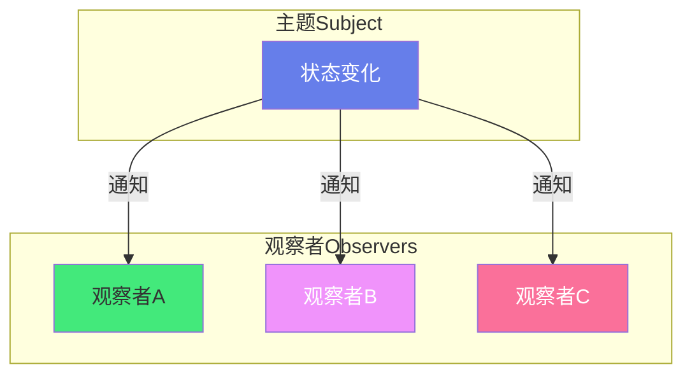
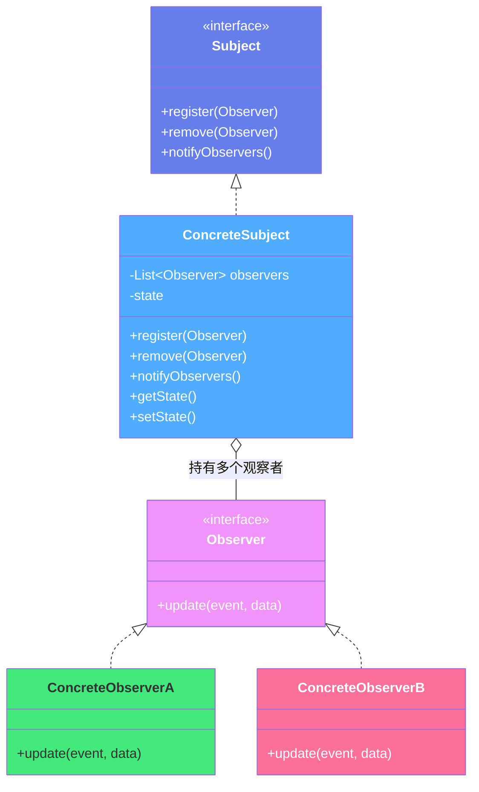
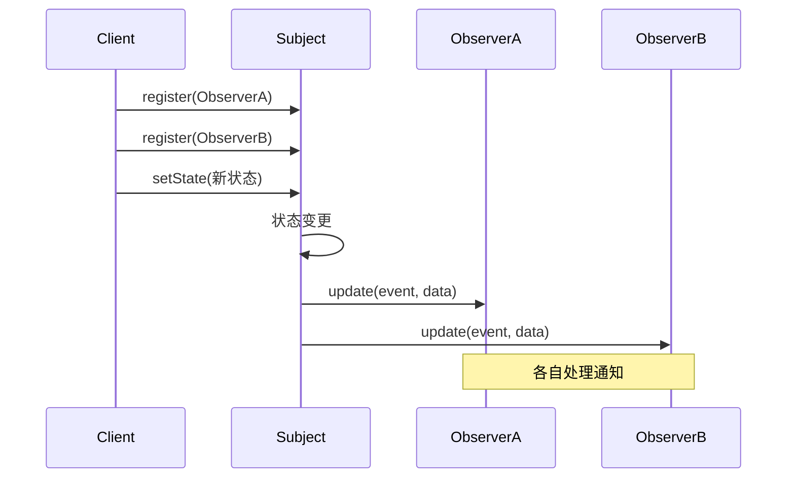
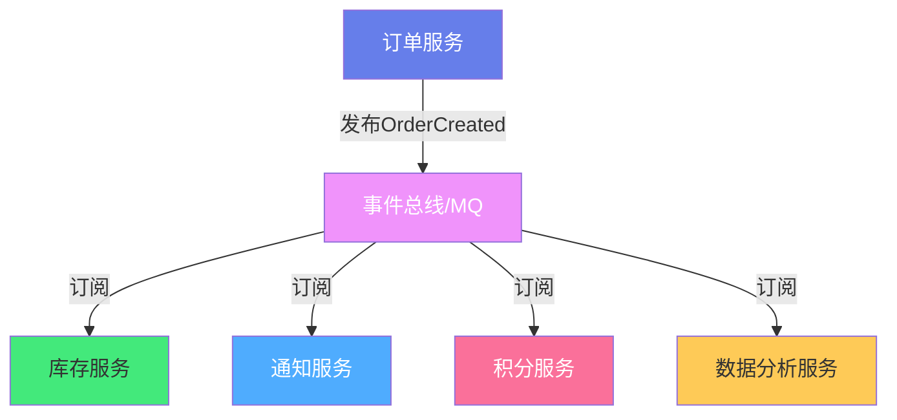

# 👁️ 设计模式 - 观察者模式（Observer Pattern）

> **文档说明**：系统讲解观察者模式的完整知识体系，涵盖核心思想、UML 结构、标准实现（Java/Python）、推模型 vs 拉模型、异步观察者、Spring 事件机制、真实业务场景（订单通知/配置热更新/MVC）、与发布-订阅模式的区别、常见坑与面试考点。观察者模式是最常用的行为型设计模式，实现对象间一对多的依赖通知，是事件驱动架构的基础。
>
> **适用人群**：Java/Python 开发者、架构师、面试备考者
>
> **前置知识**：[[SOLID架构设计原则]] · [[23种设计模式分类速查]]

---

## 一、概述

### 1.1 什么是观察者模式

观察者模式（Observer Pattern）定义了对象间**一对多**的依赖关系，当一个对象（主题/Subject）的状态发生改变时，所有依赖它的对象（观察者/Observer）都会**收到通知并自动更新**。

**别名**：发布-订阅模式（Publish-Subscribe，进程内版本）、事件监听器模式（Event Listener）

**核心思想**：主题和观察者**松耦合**——主题不知道观察者的具体实现，只知道观察者接口；观察者可以随时注册/注销，不影响主题。



### 1.2 适用场景

| 场景 | 说明 | 示例 |
|------|------|------|
| **事件监听** | UI 事件、系统事件 | 按钮点击、键盘事件 |
| **数据变更通知** | 状态变化时通知相关方 | 配置热更新、缓存失效 |
| **消息推送** | 订阅者接收推送 | 订阅号、RSS、WebSocket |
| **MVC 架构** | Model 变化通知 View 更新 | Spring MVC、Android |
| **分布式事件** | 微服务间事件驱动 | MQ 消息、领域事件 |
| **监控告警** | 指标异常触发告警 | Prometheus AlertManager |
| **工作流** | 状态机流转触发动作 | 订单状态变更、审批流 |

### 1.3 解决的问题

| 问题 | 说明 |
|------|------|
| **紧耦合** | 主题直接调用观察者的具体方法，新增观察者需修改主题代码 |
| **一对多通知** | 一个变化需要通知多个对象，硬编码导致代码臃肿 |
| **动态订阅** | 运行时需要动态添加/移除观察者 |
| **开闭原则** | 新增观察者不应修改主题代码 |

---

## 二、底层原理

### 2.1 UML 类图结构



| 角色 | 说明 |
|------|------|
| **Subject（主题接口）** | 定义注册、移除、通知观察者的方法 |
| **ConcreteSubject（具体主题）** | 持有观察者列表，状态变化时通知所有观察者 |
| **Observer（观察者接口）** | 定义 update 方法，接收通知 |
| **ConcreteObserver（具体观察者）** | 实现 update 方法，处理通知 |

### 2.2 推模型 vs 拉模型

| 模型 | 通知方式 | 优点 | 缺点 | 适用场景 |
|------|---------|------|------|---------|
| **推模型（Push）** | 主题把完整数据推给观察者 | 观察者简单，直接拿数据 | 主题需知道观察者需要什么数据 | 数据量小、观察者需求统一 |
| **拉模型（Pull）** | 主题只通知「我变了」，观察者自己拉数据 | 主题通用，观察者按需取 | 观察者需持有主题引用 | 数据量大、观察者需求不同 |

```java
// 推模型：主题推送完整数据
interface Observer {
    void update(String event, Order order);  // 直接拿到数据
}

// 拉模型：主题只通知，观察者自己取
interface Observer {
    void update(String event);  // 只知道事件
}
class ConcreteObserver implements Observer {
    private Subject subject;  // 持有主题引用
    public void update(String event) {
        Order order = subject.getLatestOrder();  // 自己拉数据
    }
}
```

> **实践中常用推模型**，简单直接；数据量大或观察者需求差异大时用拉模型。

### 2.3 通知流程



---

## 三、实操示例

### 3.1 Java 标准实现

```java
/**
 * 观察者模式标准实现：事件总线
 */
import java.util.List;
import java.util.concurrent.CopyOnWriteArrayList;

// ===== 1. 观察者接口 =====
interface Observer {
    void update(String event, Object data);
}

// ===== 2. 主题接口 =====
interface Subject {
    void register(Observer o);
    void remove(Observer o);
    void notifyObservers(String event, Object data);
}

// ===== 3. 具体主题：事件总线 =====
class EventBus implements Subject {
    // CopyOnWriteArrayList：线程安全，遍历不抛并发修改异常
    private final List<Observer> observers = new CopyOnWriteArrayList<>();

    @Override
    public void register(Observer o) {
        observers.add(o);
    }

    @Override
    public void remove(Observer o) {
        observers.remove(o);
    }

    @Override
    public void notifyObservers(String event, Object data) {
        for (Observer o : observers) {
            try {
                o.update(event, data);  // 通知每个观察者
            } catch (Exception e) {
                // 隔离异常：一个观察者失败不影响其他
                System.err.println("观察者通知失败: " + e.getMessage());
            }
        }
    }

    // 业务方法：发布事件
    public void publish(String event, Object data) {
        System.out.println("[EventBus] 发布事件: " + event);
        notifyObservers(event, data);
    }
}

// ===== 4. 具体观察者 =====
class EmailNotifier implements Observer {
    @Override
    public void update(String event, Object data) {
        System.out.println("[邮件通知] 事件=" + event + ", 数据=" + data);
    }
}

class SmsNotifier implements Observer {
    @Override
    public void update(String event, Object data) {
        System.out.println("[短信通知] 事件=" + event + ", 数据=" + data);
    }
}

class LogRecorder implements Observer {
    @Override
    public void update(String event, Object data) {
        System.out.println("[日志记录] 事件=" + event + ", 数据=" + data);
    }
}

// ===== 5. 使用 =====
public class ObserverDemo {
    public static void main(String[] args) {
        EventBus bus = new EventBus();

        // 注册观察者
        bus.register(new EmailNotifier());
        bus.register(new SmsNotifier());
        bus.register(new LogRecorder());

        // 发布事件（所有观察者都会收到）
        bus.publish("order_created", "订单号: 12345");
        bus.publish("payment_success", "金额: ¥99.00");
    }
}
```

### 3.2 Python 实现

```python
"""
观察者模式 Python 实现
"""
from abc import ABC, abstractmethod
from typing import List, Any

# ===== 观察者接口 =====
class Observer(ABC):
    @abstractmethod
    def update(self, event: str, data: Any):
        pass

# ===== 具体主题 =====
class EventBus:
    def __init__(self):
        self._observers: List[Observer] = []

    def register(self, observer: Observer):
        self._observers.append(observer)

    def remove(self, observer: Observer):
        self._observers.remove(observer)

    def notify(self, event: str, data: Any):
        for observer in self._observers:
            try:
                observer.update(event, data)
            except Exception as e:
                print(f"观察者通知失败: {e}")

    def publish(self, event: str, data: Any):
        print(f"[EventBus] 发布事件: {event}")
        self.notify(event, data)

# ===== 具体观察者 =====
class EmailNotifier(Observer):
    def update(self, event: str, data: Any):
        print(f"[邮件通知] {event}: {data}")

class SmsNotifier(Observer):
    def update(self, event: str, data: Any):
        print(f"[短信通知] {event}: {data}")

# 使用
bus = EventBus()
bus.register(EmailNotifier())
bus.register(SmsNotifier())
bus.publish("order_created", {"order_id": "12345", "amount": 99})
```

### 3.3 异步观察者（线程池）

```java
/**
 * 异步观察者：用线程池异步通知，避免一个慢观察者拖慢所有
 */
import java.util.concurrent.ExecutorService;
import java.util.concurrent.Executors;

class AsyncEventBus implements Subject {
    private final List<Observer> observers = new CopyOnWriteArrayList<>();
    private final ExecutorService executor = Executors.newFixedThreadPool(4);

    @Override
    public void notifyObservers(String event, Object data) {
        for (Observer o : observers) {
            // 每个观察者在独立线程中执行
            executor.submit(() -> {
                try {
                    o.update(event, data);
                } catch (Exception e) {
                    System.err.println("异步通知失败: " + e.getMessage());
                }
            });
        }
    }

    public void shutdown() {
        executor.shutdown();
    }
}
```

### 3.4 真实业务场景：订单状态变更通知

```java
/**
 * 订单状态变更：库存扣减、物流创建、消息推送、积分发放
 * 新增通知逻辑只需新增观察者，不修改 OrderService
 */

// 订单观察者接口
interface OrderObserver {
    void onStatusChanged(String orderId, String status);
}

// 订单服务（主题）
@Service
public class OrderService {
    private final List<OrderObserver> observers = new ArrayList<>();

    public void changeStatus(String orderId, String newStatus) {
        // 1. 更新数据库
        orderMapper.updateStatus(orderId, newStatus);
        // 2. 通知所有观察者
        notifyObservers(orderId, newStatus);
    }

    private void notifyObservers(String orderId, String status) {
        for (OrderObserver o : observers) {
            try {
                o.onStatusChanged(orderId, status);
            } catch (Exception e) {
                log.error("订单观察者通知失败", e);
            }
        }
    }

    public void register(OrderObserver o) { observers.add(o); }
}

// 观察者1：库存扣减
@Component
public class StockObserver implements OrderObserver {
    @Override
    public void onStatusChanged(String orderId, String status) {
        if ("PAID".equals(status)) {
            stockService.deduct(orderId);  // 支付成功扣库存
        }
    }
}

// 观察者2：物流创建
@Component
public class LogisticsObserver implements OrderObserver {
    @Override
    public void onStatusChanged(String orderId, String status) {
        if ("SHIPPED".equals(status)) {
            logisticsService.create(orderId);  // 发货时创建物流单
        }
    }
}

// 观察者3：消息推送
@Component
public class PushObserver implements OrderObserver {
    @Override
    public void onStatusChanged(String orderId, String status) {
        pushService.send(orderId, "订单状态更新: " + status);
    }
}
```

### 3.5 Spring 事件机制（观察者模式的实现）

Spring 的 `ApplicationEvent` + `@EventListener` 是观察者模式的经典实现：

```java
/**
 * Spring 事件机制：解耦业务逻辑
 */

// 1. 定义事件
public class OrderCreatedEvent extends ApplicationEvent {
    private final Order order;
    public OrderCreatedEvent(Object source, Order order) {
        super(source);
        this.order = order;
    }
    public Order getOrder() { return order; }
}

// 2. 发布事件
@Service
public class OrderService {
    @Autowired
    private ApplicationEventPublisher publisher;

    public Order createOrder(OrderDTO dto) {
        Order order = orderMapper.insert(dto);
        // 发布事件（不关心谁在监听）
        publisher.publishEvent(new OrderCreatedEvent(this, order));
        return order;
    }
}

// 3. 监听事件（可多个，互不影响）
@Component
public class SmsListener {
    @EventListener
    @Async  // 异步执行
    public void onOrderCreated(OrderCreatedEvent event) {
        smsService.send(event.getOrder().getPhone(), "订单创建成功");
    }
}

@Component
public class PointListener {
    @EventListener
    public void onOrderCreated(OrderCreatedEvent event) {
        pointService.add(event.getOrder().getUserId(), 100);  // 送积分
    }
}

@Component
public class AnalyticsListener {
    @EventListener
    public void onOrderCreated(OrderCreatedEvent event) {
        analyticsService.record(event.getOrder());  // 统计分析
    }
}
```

> **Spring 事件的优势**：通过 `@EventListener` 自动注册，`@Async` 异步执行，事务绑定（`@TransactionalEventListener`），完全解耦。

---

## 四、常见问题与排查

| 问题现象 | 可能原因 | 解决方案 |
|---------|---------|---------|
| **观察者收不到通知** | 未注册；注册的是不同实例 | 确认 register 调用；确保是同一个 Subject 实例 |
| **一个观察者慢拖慢所有** | 同步通知，阻塞执行 | 用线程池异步通知；Spring `@Async` |
| **一个观察者异常中断后续** | 未做异常隔离 | 每个观察者 update 用 try-catch 包裹 |
| **内存泄漏** | 观察者用完不注销，主题持有引用 | 用完调用 remove；用弱引用（WeakReference） |
| **循环通知死循环** | 观察者 update 触发主题变化 | 加状态标记防止循环；事件类型过滤 |
| **通知顺序不确定** | 观察者列表顺序不保证 | 观察者之间不应有顺序依赖；如需顺序用 @Order |
| **并发修改异常** | 通知过程中注册/移除观察者 | 用 CopyOnWriteArrayList；遍历时复制列表 |
| **事件丢失** | 异步通知时应用关闭 | 优雅关闭，等待线程池任务完成 |
| **重复通知** | 重复注册同一观察者 | 注册前去重；用 Set 存储观察者 |
| **事务不一致** | 观察者在事务提交前执行 | 用 `@TransactionalEventListener(phase=AFTER_COMMIT)` |
| **调试困难** | 调用链不直观 | 日志记录事件发布和接收；用事件追踪工具 |
| **观察者过多性能差** | 同步遍历大量观察者 | 异步通知；按事件类型分组；事件总线优化 |

---

## 五、进阶与最佳实践

### 5.1 观察者模式 vs 发布-订阅模式

很多人混淆二者，实际上有区别：

| 维度 | 观察者模式 | 发布-订阅模式 |
|------|-----------|-------------|
| **耦合度** | 主题和观察者互相知道（Subject 持有 Observer 引用） | 通过消息代理解耦，发布者和订阅者互不知道 |
| **通信方式** | 同步（直接方法调用） | 通常异步（通过消息队列） |
| **组件** | Subject + Observer | Publisher + Broker（消息代理） + Subscriber |
| **适用范围** | 单进程内 | 跨进程/分布式/微服务 |
| **事件过滤** | 主题自己过滤 | Broker 按 topic/路由过滤 |
| **典型实现** | Spring ApplicationEvent、Java Listener | Kafka、RabbitMQ、Redis Pub/Sub、Webhook |

```mermaid
flowchart LR
    subgraph 观察者模式（进程内）
        S[Subject] -->|直接调用| O1[Observer1]
        S -->|直接调用| O2[Observer2]
    end

    subgraph 发布订阅模式（分布式）
        P[Publisher] -->|发消息| B[Broker<br/>消息队列]
        B -->|推送| S1[Subscriber1]
        B -->|推送| S2[Subscriber2]
    end

    style S fill:#667eea,color:#fff
    style P fill:#f093fb,color:#fff
    style B fill:#fa709a,color:#fff
```

> **简单说**：发布-订阅是观察者模式的**分布式升级版**，中间多了一个消息代理（Broker），实现了完全解耦。

### 5.2 设计原则

```text
好的观察者设计 Checklist：

✅ 主题依赖观察者接口，不依赖具体实现（依赖倒置）
✅ 观察者可以动态注册/注销（开闭原则）
✅ 通知时隔离异常，一个失败不影响其他
✅ 观察者之间无顺序依赖
✅ 用完及时注销，防止内存泄漏
✅ 慢操作用异步通知
✅ 事件类型明确，观察者按需订阅
✅ 线程安全：用 CopyOnWriteArrayList 或同步块
✅ 日志可追踪：记录事件发布和接收
✅ 事务边界：注意观察者是否在事务内执行
```

### 5.3 事件驱动架构

观察者模式是事件驱动架构（EDA）的基础：



**事件驱动的优势**：
- 服务解耦：新增消费者不修改生产者
- 异步处理：非核心逻辑异步执行，提升响应速度
- 可扩展性：消费者可独立扩展
- 容错性：一个消费者失败不影响其他

### 5.4 生产环境最佳实践

| 类别 | 建议 |
|------|------|
| **同步 vs 异步** | 核心逻辑同步（确保执行），非核心异步（提升性能） |
| **异常处理** | 每个观察者 try-catch 隔离，记录失败日志 |
| **线程安全** | 用 CopyOnWriteArrayList，遍历时允许修改 |
| **内存管理** | 观察者用完注销；长生命周期用弱引用 |
| **事件设计** | 事件命名清晰（过去式：OrderCreated），携带必要数据 |
| **事务** | 数据库事务内发布事件用 `@TransactionalEventListener` |
| **幂等性** | 观察者处理要幂等（可能重复通知） |
| **监控** | 监控事件发布量、处理耗时、失败率 |
| **追踪** | 事件带 traceId，全链路追踪 |
| **测试** | 单元测试验证通知逻辑；集成测试验证端到端 |

### 5.5 面试高频考点

| 问题 | 答案要点 |
|------|---------|
| 观察者模式解决什么问题？ | 一对多依赖通知，主题和观察者松耦合，符合开闭原则 |
| 观察者和发布订阅的区别？ | 观察者是进程内同步直接调用；发布订阅通过消息代理异步解耦 |
| Spring 中哪里用了观察者？ | ApplicationEvent + @EventListener + ApplicationEventPublisher |
| 观察者模式的缺点？ | 通知顺序不确定、可能内存泄漏、调试困难、同步阻塞 |
| 如何实现异步观察者？ | 线程池 / EventBus / Spring @Async |
| 如何防止内存泄漏？ | 用完注销；用 WeakReference；Android 中用 Lifecycle 绑定 |
| 观察者之间有依赖怎么办？ | 用 @Order 控制顺序；或拆成多级事件 |
| Java 中已有的观察者实现？ | java.util.Observer/Observable（已废弃）、Spring 事件、Guava EventBus |

---

## 六、关联笔记

### 设计模式
- [[23种设计模式分类速查]] · [[设计模式-单例模式]] · [[设计模式-工厂模式]]
- [[设计模式-策略模式]] · [[设计模式-装饰器模式]] · [[设计模式-代理模式]]

### 架构与框架
- [[SOLID架构设计原则]] · [[Spring事件机制]] · [[事件驱动架构设计]]
- [[消息队列-Kafka入门]] · [[领域驱动设计DDD]]

### 分布式
- [[微服务架构设计]] · [[分布式事务解决方案]] · [[Redis-发布订阅与消息队列]]

### 导航
- [[MOC-计算机基础]] · [[MOC-设计模式与架构]] · [[MOC-综合导航]] · [[Home]]

> 🔍 **知识点深度解析**
>
> **作用**：观察者模式解决的是「一个对象状态变化时，如何自动通知多个依赖对象」的问题，实现主题和观察者的松耦合，是事件驱动架构的基础。
>
> **底层原理**：主题（Subject）持有观察者（Observer）接口的列表，提供注册/移除/通知方法。当主题状态变化时，遍历列表调用每个观察者的 update 方法。因为主题只依赖观察者接口（不依赖具体实现），所以新增观察者不需要修改主题代码（开闭原则）。通知方式分推模型（主题推送数据）和拉模型（观察者自己取数据）。Spring 的 ApplicationEvent 是观察者模式的经典实现，发布-订阅模式（MQ）是其分布式升级版。
>
> **用法要点**：① 四要素：Subject 接口 + ConcreteSubject + Observer 接口 + ConcreteObserver ② 主题用 CopyOnWriteArrayList 存储观察者（线程安全） ③ 通知时每个观察者 try-catch 隔离异常 ④ 慢操作用异步（线程池/@Async） ⑤ 观察者用完及时注销防内存泄漏 ⑥ 观察者之间不应有顺序依赖 ⑦ Spring 项目优先用 ApplicationEvent + @EventListener ⑧ 分布式场景用 MQ（发布-订阅），不要用进程内观察者。

> 💡 **深度讲解**：观察者模式最核心的价值是「解耦」——主题不需要知道有多少观察者、它们做什么，只负责「我变了，通知大家」。这让系统极具扩展性：新增一个观察者（比如订单创建后增加「送积分」逻辑），只需要新增一个类并注册，完全不需要修改订单服务的代码。很多人混淆观察者和发布-订阅，关键区别是「有没有中间代理」：观察者是主题直接调用观察者（进程内、同步），发布-订阅是通过消息队列中转（跨进程、异步）。实际开发中，Spring 的 ApplicationEvent 是最常用的观察者实现，配合 @Async 可以实现异步通知，配合 @TransactionalEventListener 可以控制事务边界。记住一个常见坑：**观察者用完不注销会导致内存泄漏**——主题持有观察者的强引用，观察者无法被 GC。

> 📝 **精简总结**：观察者模式 = 主题（注册/移除/通知）+ 观察者接口（update）+ 一对多通知。核心是松耦合和开闭原则。推模型推送数据，拉模型自己取。Spring 用 ApplicationEvent。与发布订阅的区别：观察者进程内同步，发布订阅跨进程异步（多了 Broker）。注意异常隔离、异步通知、内存泄漏。

> **学习路径建议**：先学习 [[SOLID架构设计原则]] 理解设计原则 → 学习 [[23种设计模式分类速查]] 建立全局认知 → 学习本文档掌握观察者模式 → 学习 [[Spring事件机制]] 掌握框架中的应用 → 学习 [[消息队列-Kafka入门]] 理解分布式发布订阅 → 学习 [[事件驱动架构设计]] 在微服务中应用。

---

> **观察者模式的本质是「你变了，告诉我」——主题不需要知道谁在听，只需要大声说出来。这就是松耦合的力量：新增听众不需要修改演讲者。**
