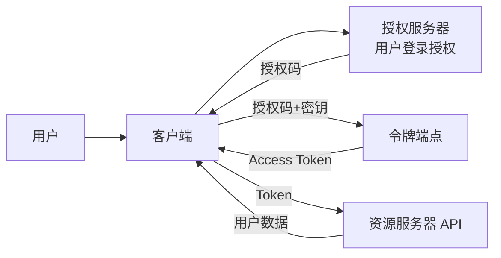

# API安全最佳实践

> **文档说明**：系统讲解 API 安全的完整体系，包括 OWASP API Security Top 10、认证与授权（JWT/OAuth2/API Key）、传输安全（HTTPS/TLS）、输入验证与注入防护、限流与防刷、敏感数据保护、日志审计、CORS/CSRF 防护，以及常见攻击与防护和生产级最佳实践。
>
> **适用人群**：后端开发工程师、全栈开发者、安全工程师、API 架构师
>
> **前置知识**：[[密码学基础与应用]]、[[Web安全-XSS-CSRF-SQL注入]]、[[RESTfulAPI设计原则]]、[[JWT与OAuth2认证授权]]

---

## 一、概述

### 1. API 安全的重要性

API 是现代应用的核心入口，也是攻击者的主要目标。API 安全漏洞可能导致数据泄露、未授权访问、服务拒绝等严重后果。

### 2. OWASP API Security Top 10（2023）

| 排名 | 风险 | 说明 |
|------|------|------|
| **API1** | 失效的对象级授权（BOLA） | 用户可访问其他用户的数据（IDOR） |
| **API2** | 失效的身份认证 | 认证机制薄弱，可被绕过或暴力破解 |
| **API3** | 失效的对象属性级授权 | 响应包含过多敏感字段 |
| **API4** | 不受限制的资源消耗 | 缺乏限流，导致 DoS |
| **API5** | 失效的功能级授权 | 普通用户可访问管理员功能 |
| **API6** | 不受限制的批量访问 | 缺乏分页/批量限制 |
| **API7** | 服务端请求伪造（SSRF） | API 可被利用发起内部请求 |
| **API8** | 安全配置错误 | CORS 配置错误、错误信息泄露 |
| **API9** | 库存资产管理不当 | 旧版本/测试 API 未下线 |
| **API10** | 不安全的 API 消费 | 不信任第三方 API 数据 |

---

## 二、认证与授权

### 1. 认证方式对比

| 方式 | 说明 | 适用场景 | 安全性 |
|------|------|---------|--------|
| **JWT** | 无状态 Token，包含用户信息 | 前后端分离、微服务 | ⭐⭐⭐⭐ |
| **OAuth2** | 授权框架，第三方登录 | 社交登录、开放平台 | ⭐⭐⭐⭐⭐ |
| **API Key** | 静态密钥，简单 | 服务间调用、开放 API | ⭐⭐ |
| **Session/Cookie** | 服务端会话 | 传统 Web 应用 | ⭐⭐⭐⭐ |
| **mTLS** | 双向证书认证 | 高安全服务间通信 | ⭐⭐⭐⭐⭐ |
| **HMAC 签名** | 请求签名，防篡改 | 支付、开放平台 | ⭐⭐⭐⭐⭐ |

### 2. JWT 安全实践

```java
// JWT 安全配置
@Configuration
public class JwtSecurityConfig {

    @Bean
    public SecurityFilterChain securityFilterChain(HttpSecurity http) throws Exception {
        http
            .csrf(csrf -> csrf.disable())  // API 服务禁用 CSRF
            .sessionManagement(session ->
                session.sessionCreationPolicy(SessionCreationPolicy.STATELESS)  // 无状态
            )
            .authorizeHttpRequests(auth -> auth
                .requestMatchers("/api/auth/**").permitAll()
                .requestMatchers("/api/admin/**").hasRole("ADMIN")
                .anyRequest().authenticated()
            )
            .oauth2ResourceServer(oauth2 -> oauth2.jwt());  // JWT 验证

        return http.build();
    }
}
```

**JWT 安全要点**：
- [ ] 使用强密钥（≥256 位）或非对称签名（RS256/ES256）
- [ ] 设置合理的过期时间（Access Token 15-30 分钟，Refresh Token 7-30 天）
- [ ] 不在 Token 中存储敏感信息（密码、密钥）
- [ ] 验证签名、过期时间、签发者、受众
- [ ] 支持 Token 吊销（黑名单或短有效期）
- [ ] 使用 HTTPS 传输，防止 Token 窃取

### 3. OAuth2 授权码流程



### 4. API Key 安全

```java
// API Key 验证过滤器
public class ApiKeyFilter extends OncePerRequestFilter {

    @Override
    protected void doFilterInternal(HttpServletRequest request,
                                    HttpServletResponse response,
                                    FilterChain filterChain) {
        String apiKey = request.getHeader("X-API-Key");
        if (apiKey == null || !apiKeyService.isValid(apiKey)) {
            response.setStatus(401);
            return;
        }
        // 设置认证信息
        filterChain.doFilter(request, response);
    }
}
```

**API Key 最佳实践**：
- 通过请求头传递（不要放 URL）
- 每个应用/用户独立 Key
- 支持 Key 轮换和吊销
- 记录 Key 使用日志
- 设置 Key 过期时间
- 限制 Key 的 IP 白名单和 API 范围

---

## 三、传输安全

### 1. HTTPS/TLS

| 配置 | 推荐值 |
|------|--------|
| **TLS 版本** | TLS 1.2+，推荐 TLS 1.3 |
| **禁用协议** | SSLv2、SSLv3、TLS 1.0、TLS 1.1 |
| **密码套件** | 优先 ECDHE、AES-GCM、ChaCha20 |
| **证书** | RSA 2048+ 或 ECC 256，自动续期 |
| **HSTS** | Strict-Transport-Security: max-age=31536000; includeSubDomains |

```nginx
# Nginx TLS 配置
server {
    listen 443 ssl http2;
    ssl_protocols TLSv1.2 TLSv1.3;
    ssl_ciphers ECDHE-ECDSA-AES128-GCM-SHA256:ECDHE-RSA-AES128-GCM-SHA256;
    ssl_prefer_server_ciphers on;
    ssl_session_cache shared:SSL:10m;
    ssl_session_timeout 10m;

    # HSTS
    add_header Strict-Transport-Security "max-age=31536000; includeSubDomains" always;

    # 安全响应头
    add_header X-Content-Type-Options nosniff;
    add_header X-Frame-Options DENY;
    add_header Content-Security-Policy "default-src 'self'";
}
```

### 2. 敏感数据传输

- [ ] **密码**：绝不明文传输，HTTPS + 服务端哈希存储
- [ ] **Token**：通过 Authorization 头传输，不存 URL
- [ ] **支付信息**：PCI DSS 合规，不存储完整卡号
- [ ] **个人信息**：最小化原则，只传必要字段

---

## 四、输入验证与注入防护

### 1. 输入验证原则

- [ ] **白名单验证**：只接受已知合法的输入
- [ ] **类型验证**：验证数据类型（字符串、数字、日期）
- [ ] **长度限制**：限制输入长度，防止超长输入
- [ ] **格式验证**：使用正则验证格式（邮箱、手机号、URL）
- [ ] **范围验证**：数字范围、日期范围
- [ ] **服务端验证**：永远不要信任客户端验证

```java
// Bean Validation 示例
public class UserCreateRequest {

    @NotBlank(message = "用户名不能为空")
    @Size(min = 3, max = 20, message = "用户名长度 3-20")
    @Pattern(regexp = "^[a-zA-Z0-9_]+$", message = "用户名只能包含字母数字下划线")
    private String username;

    @NotBlank
    @Email(message = "邮箱格式不正确")
    private String email;

    @NotBlank
    @Size(min = 8, max = 64)
    @Pattern(regexp = "^(?=.*[a-z])(?=.*[A-Z])(?=.*\\d).*$",
             message = "密码需包含大小写字母和数字")
    private String password;

    @Min(18)
    @Max(120)
    private Integer age;
}
```

### 2. SQL 注入防护

```java
// ✅ 使用参数化查询（PreparedStatement）
String sql = "SELECT * FROM users WHERE username = ?";
PreparedStatement stmt = connection.prepareStatement(sql);
stmt.setString(1, username);
ResultSet rs = stmt.executeQuery();

// ✅ 使用 MyBatis #{}（参数化）
@Select("SELECT * FROM users WHERE username = #{username}")
User findByUsername(@Param("username") String username);

// ❌ 禁止字符串拼接（${} 有注入风险）
@Select("SELECT * FROM users WHERE username = '${username}'")  // 危险！
```

### 3. XSS 防护

```java
// 输出转义
// 前端：使用 Vue/React 自动转义，不要使用 v-html/dangerouslySetInnerHTML
// 后端：存储时不转义，输出时根据上下文转义

// 内容安全策略（CSP）
// Content-Security-Policy: default-src 'self'; script-src 'self'
```

### 4. SSRF 防护

```java
// 服务端请求伪造防护
public HttpResponse safeHttpRequest(String url) {
    // 1. 验证 URL 协议（只允许 http/https）
    if (!url.startsWith("http://") && !url.startsWith("https://")) {
        throw new SecurityException("不支持的协议");
    }

    // 2. 解析域名，检查是否为内网 IP
    InetAddress address = InetAddress.getByName(new URL(url).getHost());
    if (address.isLoopbackAddress() || address.isSiteLocalAddress()) {
        throw new SecurityException("禁止访问内网地址");
    }

    // 3. 设置超时
    RequestConfig config = RequestConfig.custom()
        .setConnectTimeout(5000)
        .setSocketTimeout(5000)
        .build();

    // 4. 执行请求
    return httpClient.execute(new HttpGet(url), config);
}
```

---

## 五、限流与防刷

### 1. 限流算法

| 算法 | 说明 | 适用场景 |
|------|------|---------|
| **固定窗口** | 固定时间窗口内计数 | 简单场景 |
| **滑动窗口** | 滑动时间窗口，更精确 | 精确限流 |
| **令牌桶** | 恒定速率生成令牌，允许突发 | API 限流（推荐） |
| **漏桶** | 恒定速率处理请求 | 流量整形 |

### 2. 限流实现

```java
// Bucket4j 令牌桶限流
@Configuration
public class RateLimitConfig {

    @Bean
    public FilterRegistrationBean<RateLimitFilter> rateLimitFilter() {
        FilterRegistrationBean<RateLimitFilter> registration = new FilterRegistrationBean<>();
        registration.setFilter(new RateLimitFilter());
        registration.addUrlPatterns("/api/*");
        return registration;
    }
}

public class RateLimitFilter implements Filter {
    private final Map<String, Bucket> buckets = new ConcurrentHashMap<>();

    @Override
    public void doFilter(ServletRequest request, ServletResponse response, FilterChain chain) {
        String clientIp = getClientIp(request);
        Bucket bucket = buckets.computeIfAbsent(clientIp, k ->
            Bucket4j.builder()
                .addLimit(Bandwidth.classic(100, Refill.greedy(100, Duration.ofMinutes(1))))
                .build()
        );

        if (bucket.tryConsume(1)) {
            chain.doFilter(request, response);
        } else {
            ((HttpServletResponse) response).setStatus(429);  // Too Many Requests
            response.getWriter().write("{\"error\":\"请求过于频繁\"}");
        }
    }
}
```

### 3. 防刷策略

- [ ] **IP 限流**：按 IP 限制请求频率
- [ ] **用户限流**：登录用户按用户 ID 限流
- [ ] **接口限流**：不同接口不同限流阈值
- [ ] **验证码**：敏感操作（登录、注册）加验证码
- [ ] **设备指纹**：识别异常设备
- [ ] **行为分析**：检测异常访问模式

---

## 六、敏感数据保护

### 1. 数据分类

| 级别 | 说明 | 示例 | 保护措施 |
|------|------|------|---------|
| **公开** | 可公开访问 | 商品信息、公开文章 | 无特殊要求 |
| **内部** | 仅内部访问 | 内部文档、员工信息 | 访问控制 |
| **机密** | 敏感数据 | 用户手机号、邮箱 | 加密存储、脱敏展示 |
| **绝密** | 高度敏感 | 密码、支付信息、身份证 | 强加密、严格访问控制、审计 |

### 2. 数据脱敏

```java
// 数据脱敏工具
public class DataMaskUtil {

    // 手机号脱敏：138****1234
    public static String maskPhone(String phone) {
        if (phone == null || phone.length() < 7) return phone;
        return phone.substring(0, 3) + "****" + phone.substring(7);
    }

    // 身份证脱敏：110***********1234
    public static String maskIdCard(String idCard) {
        if (idCard == null || idCard.length() < 10) return idCard;
        return idCard.substring(0, 3) + "***********" + idCard.substring(idCard.length() - 4);
    }

    // 邮箱脱敏：z***@example.com
    public static String maskEmail(String email) {
        if (email == null || !email.contains("@")) return email;
        int atIndex = email.indexOf("@");
        String name = email.substring(0, atIndex);
        String domain = email.substring(atIndex);
        if (name.length() <= 1) return "*" + domain;
        return name.charAt(0) + "***" + domain;
    }
}
```

### 3. 数据加密存储

```java
// 敏感字段加密（JPA Converter）
@Converter
public class EncryptConverter implements AttributeConverter<String, String> {

    @Override
    public String convertToDatabaseColumn(String attribute) {
        if (attribute == null) return null;
        return AesGcmUtil.encrypt(attribute, getKey());
    }

    @Override
    public String convertToEntityAttribute(String dbData) {
        if (dbData == null) return null;
        return AesGcmUtil.decrypt(dbData, getKey());
    }
}

// 使用
@Entity
public class User {
    @Id
    private Long id;

    @Convert(converter = EncryptConverter.class)
    private String phone;  // 数据库中加密存储

    @Convert(converter = EncryptConverter.class)
    private String idCard;
}
```

---

## 七、日志与审计

### 1. 安全日志

```java
// 安全审计日志
@Aspect
@Component
public class SecurityAuditAspect {

    @Autowired
    private AuditLogService auditLogService;

    @AfterReturning("@annotation(audit)")
    public void afterMethod(JoinPoint joinPoint, Audit audit) {
        AuditLog log = AuditLog.builder()
            .userId(getCurrentUserId())
            .action(audit.value())
            .resource(getResource(joinPoint))
            .ip(getClientIp())
            .timestamp(LocalDateTime.now())
            .success(true)
            .build();
        auditLogService.save(log);
    }
}
```

**日志安全要点**：
- [ ] **不记录敏感信息**：密码、Token、信用卡号不记录
- [ ] **记录关键操作**：登录、权限变更、数据删除、配置修改
- [ ] **日志不可篡改**：日志集中存储，设置只追加权限
- [ ] **日志保留**：安全日志保留 ≥ 180 天
- [ ] **日志监控**：异常登录、频繁失败告警

### 2. 错误信息处理

```java
// ✅ 统一错误响应，不泄露内部信息
@RestControllerAdvice
public class GlobalExceptionHandler {

    @ExceptionHandler(Exception.class)
    public ResponseEntity<ErrorResponse> handleException(Exception e) {
        // 记录详细错误到日志
        log.error("系统异常", e);

        // 返回给用户的信息不包含堆栈和内部细节
        return ResponseEntity.status(500).body(
            ErrorResponse.builder()
                .code("INTERNAL_ERROR")
                .message("系统繁忙，请稍后重试")
                .build()
        );
    }
}
```

---

## 八、CORS 与 CSRF

### 1. CORS 配置

```java
// ✅ 安全的 CORS 配置
@Configuration
public class CorsConfig {

    @Bean
    public CorsFilter corsFilter() {
        CorsConfiguration config = new CorsConfiguration();
        // 明确指定允许的源，不要用 *
        config.setAllowedOrigins(Arrays.asList("https://app.example.com"));
        config.setAllowedMethods(Arrays.asList("GET", "POST", "PUT", "DELETE"));
        config.setAllowedHeaders(Arrays.asList("Authorization", "Content-Type"));
        config.setAllowCredentials(true);  // 允许携带 Cookie
        config.setMaxAge(3600L);

        UrlBasedCorsConfigurationSource source = new UrlBasedCorsConfigurationSource();
        source.registerCorsConfiguration("/api/**", config);
        return new CorsFilter(source);
    }
}
```

**CORS 安全要点**：
- 不要使用 `allowedOrigins("*")` + `allowCredentials(true)`
- 明确指定允许的源
- 限制允许的方法和头
- 生产环境不要允许所有源

### 2. CSRF 防护

- **API 服务（Token 认证）**：通常不需要 CSRF 防护（Token 在 Header 中，非自动携带）
- **Cookie/Session 认证**：需要 CSRF Token 防护
- **SameSite Cookie**：设置 `SameSite=Strict` 或 `Lax`

---

## 九、API 版本与库存管理

### 1. API 版本管理

```text
URL 版本：/api/v1/users、/api/v2/users
Header 版本：Accept: application/vnd.example.v1+json
```

- [ ] **旧版本标记废弃**：在响应头添加 `Deprecation: true` 和 `Sunset: date`
- [ ] **监控旧版本使用**：统计旧版本调用量
- [ ] **提前通知**：给用户足够的迁移时间
- [ ] **及时下线**：确认无人使用后删除旧版本

### 2. 库存资产管理

- [ ] **API 清单**：维护所有 API 的完整清单
- [ ] **环境隔离**：测试/预发布/生产环境隔离
- [ ] **测试 API 保护**：测试 API 不暴露到公网
- [ ] **定期清理**：删除不再使用的 API 和测试端点

---

## 十、常见攻击与防护

| 攻击 | 说明 | 防护 |
|------|------|------|
| **暴力破解** | 尝试大量用户名密码组合 | 登录限流、验证码、账户锁定、MFA |
| **凭证填充** | 使用其他网站泄露的账号密码尝试登录 | 检测异常登录、密码强度要求、MFA |
| **IDOR** | 越权访问其他用户数据（BOLA） | 对象级授权验证、资源归属检查 |
| **SQL 注入** | 通过输入注入 SQL 语句 | 参数化查询、ORM、输入验证 |
| **XSS** | 注入恶意脚本 | 输出转义、CSP、HttpOnly Cookie |
| **CSRF** | 跨站请求伪造 | CSRF Token、SameSite Cookie |
| **SSRF** | 利用服务端发起内部请求 | URL 白名单、内网 IP 过滤、协议限制 |
| **DoS/DDoS** | 大量请求耗尽资源 | 限流、CDN、WAF、弹性伸缩 |
| **数据爬取** | 批量爬取 API 数据 | 限流、API Key、行为检测、数据脱敏 |
| **中间人攻击** | 拦截篡改通信 | HTTPS/TLS、HSTS、证书验证 |
| **重放攻击** | 重放截获的请求 | 时间戳、Nonce、Token 过期 |
| **越权访问** | 普通用户访问管理员功能 | 功能级授权、RBAC、权限校验 |

---

## 十一、最佳实践清单

### 认证授权
- [ ] 使用 HTTPS 传输所有 API 请求
- [ ] 实现强认证（MFA 优先）
- [ ] 实施最小权限原则（RBAC/ABAC）
- [ ] 验证每个请求的对象级权限（防 IDOR）
- [ ] Token 短有效期 + Refresh Token
- [ ] 支持 Token 吊销机制

### 输入验证
- [ ] 所有输入服务端验证（白名单）
- [ ] 使用参数化查询防 SQL 注入
- [ ] 限制请求大小和字段长度
- [ ] 验证 Content-Type
- [ ] 防止 SSRF（URL 白名单、内网过滤）

### 限流防护
- [ ] 实现 API 限流（令牌桶）
- [ ] 按 IP/用户/接口分级限流
- [ ] 敏感操作加验证码
- [ ] 异常登录检测和告警

### 数据保护
- [ ] 敏感数据加密存储（AES-256）
- [ ] 密码使用 bcrypt/Argon2 哈希
- [ ] 响应数据脱敏
- [ ] 最小化数据返回（只返回必要字段）
- [ ] 日志不记录敏感信息

### 运维安全
- [ ] 安全响应头（HSTS、CSP、X-Frame-Options）
- [ ] CORS 严格配置
- [ ] 错误信息不泄露内部细节
- [ ] API 版本管理和旧版本下线
- [ ] 安全审计日志（不可篡改）
- [ ] 定期安全扫描和渗透测试
- [ ] 依赖漏洞扫描（OWASP Dependency-Check）

---

## 十二、关联笔记

### 安全
- [[密码学基础与应用]] · [[Web安全-XSS-CSRF-SQL注入]] · [[Java-数据加密与脱敏]]
- [[前端安全-XSS-CSRF防护]] · [[CSP内容安全策略]] · [[前端敏感数据保护]]
- [[零信任安全架构]] · [[SSO单点登录与分布式会话]]

### 后端
- [[SpringSecurity-认证授权]] · [[JWT与OAuth2认证授权]] · [[Gateway-网关路由与鉴权]]
- [[SpringBoot-Web层设计]] · [[SpringBoot-配置管理与多环境]] · [[Sentinel-流量控制与熔断]]

### API 设计
- [[RESTfulAPI设计原则]] · [[API设计规范与选型]] · [[接口测试与Postman实战]]

### 导航
- [[MOC-计算机基础]] · [[MOC-后端开发]] · [[全栈+AI工程双轨融合学习路线图]]

> **学习路径建议**：先掌握 [[Web安全-XSS-CSRF-SQL注入]] Web 安全基础 → 学习 [[密码学基础与应用]] 加密原理 → 深入本文 API 安全最佳实践 → 实践 [[SpringSecurity-认证授权]] 安全框架 → 研究 [[Gateway-网关路由与鉴权]] 网关层安全 → 应用于实际 API 的安全设计。

---

## 💡 全文深度讲解

本文系统梳理了API安全最佳实践的核心知识体系，从概述入手，深入认证与授权的底层机制，再通过传输安全掌握实战应用，最后涵盖最佳实践清单与关联笔记。学习时建议先建立整体认知，再动手实践，最后结合常见问题深化理解。

## 📝 全文精简总结

- **概述**：掌握本模块的核心概念与关键要点
- **认证与授权**：掌握本模块的核心概念与关键要点
- **传输安全**：掌握本模块的核心概念与关键要点
- **输入验证与注入防护**：掌握本模块的核心概念与关键要点
- **限流与防刷**：掌握本模块的核心概念与关键要点
- **敏感数据保护**：掌握本模块的核心概念与关键要点
- **日志与审计**：掌握本模块的核心概念与关键要点
- **CORS 与 CSRF**：掌握本模块的核心概念与关键要点
- 其余4个模块涵盖进阶主题与拓展内容

