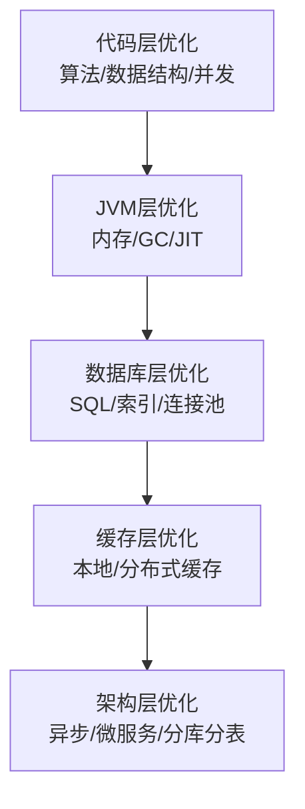

# 后端性能优化实战

> **文档说明**：系统讲解后端性能优化的完整体系，包括 JVM 优化（内存/GC/线程）、代码层面优化（算法/数据结构/并发）、数据库优化（连接池/SQL/缓存）、缓存优化（本地/分布式）、异步化（消息队列/异步处理）、网络优化、架构优化、性能监控与压测，以及生产级最佳实践和常见问题。
>
> **适用人群**：后端开发工程师、全栈开发者、性能优化工程师、架构师
>
> **前置知识**：[[JVM-内存模型与GC调优]]、[[Java-并发编程JUC]]、[[数据库性能优化实战]]、[[SpringBoot-Web层设计]]

---

## 一、概述

### 1. 性能优化目标

| 目标 | 指标 | 说明 |
|------|------|------|
| **低延迟** | P50/P95/P99 响应时间 | 用户体验核心指标 |
| **高吞吐** | QPS/TPS | 系统处理能力 |
| **高并发** | 并发连接数/并发请求 | 同时服务用户数 |
| **低资源消耗** | CPU/内存/IO | 成本和稳定性 |
| **高可用** | 可用性/故障率 | 系统稳定性 |

### 2. 性能优化层次



| 层次 | 优化手段 | 投入产出比 |
|------|---------|-----------|
| **代码层** | 算法优化、避免 N+1、减少对象创建 | ⭐⭐⭐⭐⭐ 最高 |
| **数据库层** | SQL 优化、索引、连接池 | ⭐⭐⭐⭐⭐ 最高 |
| **缓存层** | 本地缓存、Redis 缓存 | ⭐⭐⭐⭐ 高 |
| **JVM 层** | GC 调优、内存配置、JIT | ⭐⭐⭐ 中 |
| **架构层** | 异步化、微服务、分库分表 | ⭐⭐ 高成本 |

> **优化原则**：先定位瓶颈，再针对性优化。不要过早优化，也不要盲目优化。

---

## 二、JVM 优化

### 1. 内存配置

```bash
# JVM 内存参数（8G 内存服务器示例）
java -Xms4g -Xmx4g \                    # 堆内存初始和最大值（设为相同避免动态调整）
     -Xmn1.5g \                         # 新生代大小
     -XX:MetaspaceSize=256m \           # 元空间初始
     -XX:MaxMetaspaceSize=512m \        # 元空间最大
     -XX:SurvivorRatio=8 \              # Eden:Survivor = 8:1:1
     -XX:+UseG1GC \                     # G1 垃圾收集器
     -XX:MaxGCPauseMillis=200 \         # 目标 GC 停顿时间
     -XX:ParallelGCThreads=8 \          # 并行 GC 线程数
     -XX:ConcGCThreads=2 \              # 并发 GC 线程数
     -XX:+HeapDumpOnOutOfMemoryError \  # OOM 时 dump
     -XX:HeapDumpPath=/logs/heapdump.hprof \
     -Xlog:gc*:file=/logs/gc.log:time,uptime,level,tags \  # GC 日志
     -jar app.jar
```

### 2. GC 选择

| 收集器 | 特点 | 适用场景 |
|--------|------|---------|
| **G1** | 区域化、可预测停顿、默认（JDK9+） | 大堆（4G+）、低延迟要求 |
| **ZGC** | 极低停顿（<1ms）、并发标记整理 | 大堆（16G+）、极低延迟（JDK15+） |
| **Shenandoah** | 低停顿、并发整理 | OpenJDK、大堆 |
| **Parallel** | 吞吐量优先、STW 较长 | 后台任务、批处理 |
| **CMS** | 低停顿、已废弃 | 老应用（不推荐） |

```bash
# ZGC 配置（JDK17+，推荐大堆低延迟场景）
java -XX:+UseZGC \
     -Xmx16g \
     -XX:ZCollectionInterval=120 \
     -jar app.jar
```

### 3. GC 调优

- [ ] **监控 GC**：GC 日志、Prometheus + Grafana
- [ ] **目标停顿**：根据业务设置 MaxGCPauseMillis
- [ ] **避免 Full GC**：增大堆、优化内存泄漏、调整新生代比例
- [ ] **对象晋升**：长期存活对象尽早晋升，减少复制
- [ ] **大对象处理**：G1 的 Humongous 区域，避免大对象直接进老年代

### 4. JIT 优化

- [ ] **预热**：应用启动后预热核心接口，触发 JIT 编译
- [ ] **方法内联**：小方法、final 方法更容易被内联
- [ ] **避免反射**：反射影响 JIT 优化，使用 MethodHandle 或代码生成
- [ ] **类型稳定**：避免频繁更换实现类，影响CHA（类层次分析）

详细参考 [[JVM-内存模型与GC调优]]。

---

## 三、代码层面优化

### 1. 算法与数据结构

| 场景 | 低效方案 | 高效方案 |
|------|---------|---------|
| **频繁查找** | List.contains() O(n) | HashSet/HashMap O(1) |
| **排序后查找** | 每次排序 | 排序一次 + 二分查找 |
| **字符串拼接** | + 循环拼接 | StringBuilder / String.join |
| **日期格式化** | 每次 new SimpleDateFormat | DateTimeFormatter（线程安全）/ 缓存 |
| **JSON 序列化** | 反射慢 | 提前编译、使用流式 API |
| **大数计算** | double 精度问题 | BigDecimal / long（分为单位） |

```java
// ❌ 低效：循环中字符串拼接
String result = "";
for (String s : list) {
    result += s;  // 每次创建新 String
}

// ✅ 高效：StringBuilder
StringBuilder sb = new StringBuilder();
for (String s : list) {
    sb.append(s);
}
String result = sb.toString();

// ❌ 低效：ArrayList 频繁在头部插入
for (int i = 0; i < 10000; i++) {
    list.add(0, i);  // O(n) 每次移动元素
}

// ✅ 高效：LinkedList 或反向添加
LinkedList<Integer> list = new LinkedList<>();
for (int i = 0; i < 10000; i++) {
    list.addFirst(i);  // O(1)
}
```

### 2. 并发优化

```java
// ❌ 低效：锁粒度大
public synchronized void process() {
    // 大量不共享资源的操作
    // 只有一小部分需要同步
}

// ✅ 高效：缩小锁粒度
public void process() {
    // 不需要同步的操作
    doSomething();
    // 只在需要同步的地方加锁
    synchronized (this) {
        updateSharedState();
    }
}

// ❌ 低效：使用 Vector/Hashtable（全方法同步）
Vector<String> vector = new Vector<>();

// ✅ 高效：使用并发集合
ConcurrentHashMap<String, String> map = new ConcurrentHashMap<>();
CopyOnWriteArrayList<String> list = new CopyOnWriteArrayList<>();

// ❌ 低效：线程池不当
ExecutorService pool = Executors.newFixedThreadPool(100);  // 无界队列可能 OOM

// ✅ 高效：自定义线程池
ThreadPoolExecutor pool = new ThreadPoolExecutor(
    8, 16, 60, TimeUnit.SECONDS,
    new ArrayBlockingQueue<>(1000),
    new ThreadFactoryBuilder().setNameFormat("worker-%d").build(),
    new ThreadPoolExecutor.CallerRunsPolicy()  // 拒绝策略
);
```

### 3. 避免常见性能陷阱

- [ ] **避免 N+1 查询**：循环中查询数据库，改为批量查询
- [ ] **避免过度序列化**：大对象序列化开销大，考虑压缩或精简
- [ ] **避免反射**：频繁反射影响性能，缓存 Method/Field
- [ ] **避免正则重复编译**：预编译 Pattern，不要在循环中编译
- [ ] **避免资源泄漏**：流、连接、文件必须关闭（try-with-resources）
- [ ] **避免大对象**：大对象直接进老年代，增加 Full GC 风险
- [ ] **避免内存泄漏**：静态集合、ThreadLocal、监听器未移除

```java
// ❌ N+1 查询
for (Order order : orders) {
    User user = userRepository.findById(order.getUserId());  // 每次查 DB
}

// ✅ 批量查询
List<Long> userIds = orders.stream().map(Order::getUserId).toList();
Map<Long, User> userMap = userRepository.findAllByIds(userIds)
    .stream().collect(Collectors.toMap(User::getId, u -> u));
for (Order order : orders) {
    User user = userMap.get(order.getUserId());  // 内存查找
}

// ❌ 正则重复编译
for (String s : list) {
    s.matches("\\d+");  // 每次编译 Pattern
}

// ✅ 预编译 Pattern
private static final Pattern DIGIT_PATTERN = Pattern.compile("\\d+");
for (String s : list) {
    DIGIT_PATTERN.matcher(s).matches();
}
```

---

## 四、数据库优化

### 1. 连接池优化

```yaml
# HikariCP 最优配置
spring:
  datasource:
    hikari:
      maximum-pool-size: 20        # 连接数 = CPU核数*2 + 磁盘数
      minimum-idle: 20             # 保持固定连接，避免动态创建
      connection-timeout: 30000    # 获取连接超时
      idle-timeout: 600000         # 空闲连接超时
      max-lifetime: 1800000        # 连接最大生命周期（小于DB wait_timeout）
      leak-detection-threshold: 60000  # 连接泄漏检测
      validation-timeout: 5000
```

### 2. SQL 优化

详细参考 [[数据库性能优化实战]]。

- [ ] **使用索引**：确保查询命中索引，EXPLAIN 分析
- [ ] **避免 SELECT ***：只查需要的列
- [ ] **批量操作**：批量插入/更新，减少网络往返
- [ ] **分页优化**：深分页用游标分页
- [ ] **事务控制**：事务尽量短，避免长事务
- [ ] **读写分离**：读走从库，写走主库

### 3. 数据库缓存

```java
// MyBatis 二级缓存 / 应用层缓存
// 1. 热点数据缓存到 Redis
// 2. 字典数据缓存到本地（Caffeine）
// 3. 查询结果缓存（注意更新失效）

@Cacheable(value = "user", key = "#id")
public User getUserById(Long id) {
    return userRepository.findById(id);
}

@CacheEvict(value = "user", key = "#user.id")
public void updateUser(User user) {
    userRepository.update(user);
}
```

---

## 五、缓存优化

### 1. 缓存层次


### 2. 本地缓存（Caffeine）

```java
// Caffeine 本地缓存
LoadingCache<Long, User> userCache = Caffeine.newBuilder()
    .maximumSize(10_000)          // 最大条目数
    .expireAfterWrite(5, TimeUnit.MINUTES)  // 写入后过期
    .expireAfterAccess(2, TimeUnit.MINUTES) // 访问后过期
    .refreshAfterWrite(1, TimeUnit.MINUTES) // 异步刷新
    .recordStats()                 // 记录统计
    .build(id -> userRepository.findById(id));  // 缓存未命中时加载

// 使用
User user = userCache.get(123L);  // 自动加载
CacheStats stats = userCache.stats();  // 命中率统计
```

### 3. 分布式缓存（Redis）

```java
// Redis 缓存模板
@Service
public class UserCacheService {

    @Autowired
    private RedisTemplate<String, Object> redisTemplate;

    private static final String KEY_PREFIX = "user:";
    private static final Duration TTL = Duration.ofMinutes(30);

    public User getUser(Long id) {
        String key = KEY_PREFIX + id;
        User user = (User) redisTemplate.opsForValue().get(key);
        if (user == null) {
            user = userRepository.findById(id);
            if (user != null) {
                redisTemplate.opsForValue().set(key, user, TTL);
            }
        }
        return user;
    }

    public void evictUser(Long id) {
        redisTemplate.delete(KEY_PREFIX + id);
    }
}
```

### 4. 缓存问题与解决方案

| 问题 | 说明 | 解决方案 |
|------|------|---------|
| **缓存穿透** | 查询不存在的数据，请求直达 DB | 布隆过滤器、空值缓存、参数校验 |
| **缓存击穿** | 热点 Key 过期，大量请求直达 DB | 互斥锁、永不过期+异步刷新 |
| **缓存雪崩** | 大量 Key 同时过期 | 随机过期时间、多级缓存、熔断降级 |
| **数据不一致** | DB 更新后缓存未及时更新 | 先更 DB 再删缓存、延迟双删、订阅 binlog |

详细参考 [[Redis高级数据结构实战]]。

---

## 六、异步化优化

### 1. 异步处理

```java
// ❌ 同步：阻塞等待
public void createOrder(Order order) {
    orderRepository.save(order);
    emailService.sendConfirmation(order);  // 阻塞，耗时
    inventoryService.deduct(order);        // 阻塞
    notificationService.push(order);       // 阻塞
}

// ✅ 异步：核心流程同步，非核心异步
@Transactional
public void createOrder(Order order) {
    orderRepository.save(order);  // 核心：同步
    // 非核心：异步
    eventPublisher.publish(new OrderCreatedEvent(order));
}

// 事件监听（异步处理）
@Async
@EventListener
public void onOrderCreated(OrderCreatedEvent event) {
    emailService.sendConfirmation(event.getOrder());
    inventoryService.deduct(event.getOrder());
    notificationService.push(event.getOrder());
}
```

### 2. 消息队列削峰

```java
// 生产者：下单后发送消息到队列
@Service
public class OrderProducer {
    @Autowired
    private RabbitTemplate rabbitTemplate;

    public void createOrder(Order order) {
        orderRepository.save(order);
        // 发送到队列，异步处理
        rabbitTemplate.convertAndSend("order.exchange", "order.created", order);
    }
}

// 消费者：异步处理
@RabbitListener(queues = "order.queue")
public void handleOrder(Order order) {
    // 扣库存、发通知等耗时操作
    inventoryService.deduct(order);
    notificationService.push(order);
}
```

详细参考 [[Kafka-消息队列与消费模型]]。

### 3. 响应式编程

```java
// WebFlux 响应式（非阻塞）
@GetMapping("/users/{id}")
public Mono<User> getUser(@PathVariable Long id) {
    return userRepository.findById(id)  // 非阻塞
        .switchIfEmpty(Mono.error(new NotFoundException()));
}

// 并行调用多个服务
public Mono<OrderDetail> getOrderDetail(Long orderId) {
    Mono<Order> orderMono = orderService.findById(orderId);
    Mono<User> userMono = userService.findById(orderId);
    Mono<List<OrderItem>> itemsMono = itemService.findByOrderId(orderId).collectList();

    return Mono.zip(orderMono, userMono, itemsMono)
        .map(tuple -> new OrderDetail(tuple.getT1(), tuple.getT2(), tuple.getT3()));
}
```

---

## 七、网络优化

### 1. HTTP 优化

- [ ] **HTTP/2**：多路复用、头部压缩、服务端推送
- [ ] **连接复用**：HTTP Keep-Alive、连接池
- [ ] **压缩**：Gzip/Brotli 压缩响应体
- [ ] **CDN**：静态资源 CDN 加速
- [ ] **批量请求**：合并多个请求，减少往返
- [ ] **减少序列化**：使用 Protobuf/FlatBuffers 替代 JSON

### 2. 连接池配置

```yaml
# OkHttp / RestTemplate 连接池
spring:
  http:
    client:
      pool:
        max-connections: 200
        max-connections-per-route: 50
        connection-timeout: 5000
        read-timeout: 10000
```

### 3. 超时设置

```java
// 所有远程调用必须设置超时
OkHttpClient client = new OkHttpClient.Builder()
    .connectTimeout(5, TimeUnit.SECONDS)
    .readTimeout(10, TimeUnit.SECONDS)
    .writeTimeout(10, TimeUnit.SECONDS)
    .callTimeout(15, TimeUnit.SECONDS)
    .retryOnConnectionFailure(true)
    .build();
```

---

## 八、性能监控与压测

### 1. 监控指标

| 层级 | 指标 | 工具 |
|------|------|------|
| **应用** | QPS、延迟、错误率、线程数 | Micrometer + Prometheus |
| **JVM** | 堆内存、GC 次数/耗时、线程 | JMX、Micrometer |
| **数据库** | 连接数、慢查询、锁等待 | MySQL Exporter |
| **缓存** | 命中率、内存、连接数 | Redis Exporter |
| **系统** | CPU、内存、磁盘 IO、网络 | Node Exporter |
| **链路** | 调用链、服务依赖 | SkyWalking/Jaeger |

### 2. 压测工具

| 工具 | 说明 | 适用场景 |
|------|------|---------|
| **JMeter** | 开源、功能全、图形化 | 复杂场景、分布式压测 |
| **Gatling** | Scala DSL、高并发、报告好 | 高并发、代码化压测 |
| **wrk** | 轻量、高性能、命令行 | HTTP 接口快速压测 |
| **k6** | JS 脚本、现代化、云原生 | 开发者友好、CI 集成 |
| **Locust** | Python、分布式、可扩展 | 复杂用户行为模拟 |

```bash
# wrk 压测示例
wrk -t4 -c100 -d30s --latency https://api.example.com/users
# -t4: 4个线程
# -c100: 100个并发连接
# -d30s: 持续30秒
# --latency: 显示延迟分布
```

### 3. 性能诊断流程

```text
1. 建立基线：正常情况下的性能指标
2. 发现异常：监控告警 / 用户反馈
3. 定位瓶颈：
   - CPU 高？→ 分析线程栈（jstack）、热点方法
   - 内存高？→ 堆 dump（jmap）、分析对象
   - GC 频繁？→ GC 日志、调整内存/GC
   - DB 慢？→ 慢查询、EXPLAIN
   - 锁竞争？→ jstack 查看锁状态
4. 优化实施：针对性优化
5. 验证效果：压测对比、监控指标
6. 持续监控：防止退化
```

---

## 九、最佳实践

### 1. 开发阶段

- [ ] **性能意识**：写代码时考虑性能影响
- [ ] **避免过早优化**：先正确后优化，不要牺牲可读性
- [ ] **代码评审**：性能问题在评审阶段发现
- [ ] **基准测试**：关键模块做 JMH 基准测试
- [ ] **合理数据结构**：根据场景选择合适的集合
- [ ] **资源管理**：使用 try-with-resources 确保资源释放

### 2. 测试阶段

- [ ] **性能测试**：每次发布前做性能回归
- [ ] **压力测试**：验证系统极限和拐点
- [ ] **容量规划**：根据压测结果规划容量
- [ ] **混沌工程**：注入故障验证系统韧性

### 3. 运行阶段

- [ ] **全链路监控**：应用/JVM/DB/系统全监控
- [ ] **告警分级**：P0/P1/P2 不同响应级别
- [ ] **自动扩缩容**：根据负载自动伸缩
- [ ] **限流降级**：保护系统不被冲垮
- [ ] **定期复盘**：性能问题复盘，持续改进

### 4. JMH 基准测试

```java
// JMH 基准测试示例
@BenchmarkMode(Mode.AverageTime)
@OutputTimeUnit(TimeUnit.MICROSECONDS)
@State(Scope.Benchmark)
public class StringConcatBenchmark {

    @Param({"10", "100", "1000"})
    private int size;

    @Benchmark
    public String stringPlus() {
        String result = "";
        for (int i = 0; i < size; i++) {
            result += "a";
        }
        return result;
    }

    @Benchmark
    public String stringBuilder() {
        StringBuilder sb = new StringBuilder();
        for (int i = 0; i < size; i++) {
            sb.append("a");
        }
        return sb.toString();
    }
}
```

---

## 十、常见问题与排查

| 问题 | 原因 | 解决方案 |
|------|------|---------|
| **CPU 使用率高** | 死循环 / 频繁 GC / 正则回溯 / 计算密集 | jstack 分析线程、jstat 看 GC、优化算法 |
| **内存持续增长** | 内存泄漏 / 缓存无上限 / 大对象 | jmap dump、MAT 分析、限制缓存大小 |
| **频繁 Full GC** | 老年代满 / 大对象 / 内存泄漏 | 增大堆、优化内存、排查泄漏 |
| **响应时间抖动** | GC 停顿 / 锁竞争 / 缓存失效 | GC 调优、减少锁、预热缓存 |
| **数据库连接池满** | 慢查询占用连接 / 连接泄漏 | 优化 SQL、连接池配置、泄漏检测 |
| **线程数持续增长** | 线程池配置不当 / 线程阻塞 |  jstack 分析、合理配置线程池 |
| **死锁** | 循环等待锁 / 资源顺序不一致 | jstack 检测死锁、统一加锁顺序 |
| **QPS 上不去** | 瓶颈在 DB / 下游服务 / 线程池 | 定位瓶颈、扩容、异步化 |
| **缓存命中率低** | Key 设计不合理 / 过期时间短 | 优化 Key、调整 TTL、热点缓存 |
| **消息积压** | 消费慢 / 消费者少 / 处理异常 | 增加消费者、优化消费逻辑、死信队列 |
| **接口超时** | 下游慢 / DB 慢 / 网络问题 | 超时设置、熔断降级、异步化 |
| **启动慢** | Bean 多 / 初始化重 / 懒加载 | 懒加载、减少初始化、应用预热 |
| **序列化慢** | 大对象 / 反射 / JSON 库 | 精简对象、使用 Protobuf、预编译 |
| **类加载慢** | 类路径长 / Jar 多 / 自定义 ClassLoader | 精简依赖、AppCDS、模块化 |

---

## 十一、关联笔记

### JVM 与并发
- [[JVM-内存模型与GC调优]] · [[Java-并发编程JUC]] · [[Java-线程池原理与调优]]

### 数据库与缓存
- [[数据库性能优化实战]] · [[MySQL-索引优化与执行计划]] · [[MySQL-InnoDB存储引擎]]
- [[Redis高级数据结构实战]] · [[分库分表实战指南]]

### 后端框架
- [[SpringBoot-Web层设计]] · [[SpringBoot-自动装配原理]] · [[SpringBoot-配置管理与多环境]]
- [[SpringWebFlux-响应式编程]]

### 微服务
- [[微服务架构设计模式]] · [[Sentinel-流量控制与熔断]] · [[Kafka-消息队列与消费模型]]
- [[分布式系统-高可用架构设计]]

### 导航
- [[MOC-后端开发]] · [[MOC-计算机基础]] · [[全栈+AI工程双轨融合学习路线图]]

> **学习路径建议**：先掌握 [[JVM-内存模型与GC调优]] JVM 基础 → 学习 [[Java-并发编程JUC]] 并发编程 → 深入本文后端性能优化实战 → 实践 [[数据库性能优化实战]] 数据库优化 → 研究 [[Redis高级数据结构实战]] 缓存优化 → 应用于生产系统的性能调优和容量规划。

---

## 💡 全文深度讲解

本文系统梳理了后端性能优化实战的核心知识体系，从概述入手，深入JVM 优化的底层机制，再通过代码层面优化掌握实战应用，最后涵盖常见问题与排查与关联笔记。学习时建议先建立整体认知，再动手实践，最后结合常见问题深化理解。

## 📝 全文精简总结

- **概述**：掌握本模块的核心概念与关键要点
- **JVM 优化**：掌握本模块的核心概念与关键要点
- **代码层面优化**：掌握本模块的核心概念与关键要点
- **数据库优化**：掌握本模块的核心概念与关键要点
- **缓存优化**：掌握本模块的核心概念与关键要点
- **异步化优化**：掌握本模块的核心概念与关键要点
- **网络优化**：掌握本模块的核心概念与关键要点
- **性能监控与压测**：掌握本模块的核心概念与关键要点
- 其余3个模块涵盖进阶主题与拓展内容

