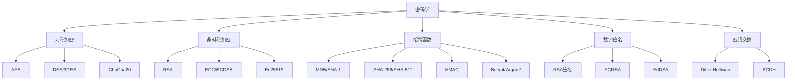
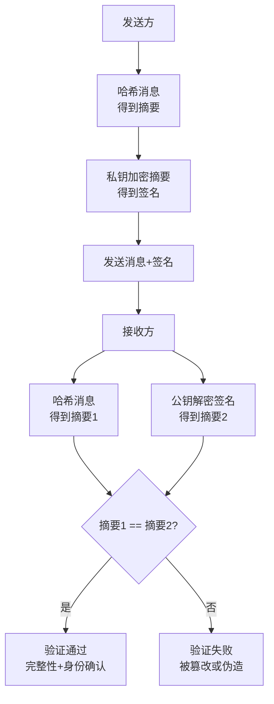
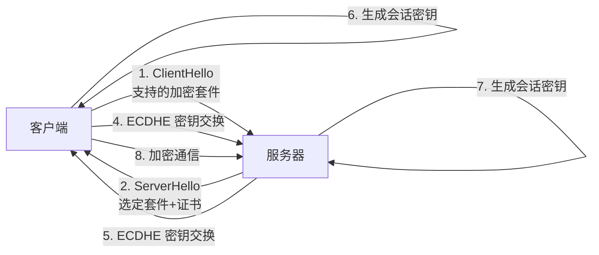

# 密码学基础与应用

> **文档说明**：系统讲解密码学的核心概念与应用，包括对称加密（AES/DES/分组模式）、非对称加密（RSA/ECC/Diffie-Hellman）、哈希算法（MD5/SHA/HMAC）、数字签名与证书（PKI/X.509）、密钥管理、实际应用（HTTPS/TLS、JWT、密码存储、数据加密），以及常见攻击与防护和最佳实践。
>
> **适用人群**：后端开发工程师、全栈开发者、安全工程师、需要理解加密原理的开发者
>
> **前置知识**：[[Web安全-XSS-CSRF-SQL注入]]、[[API安全最佳实践]]、[[Java-数据加密与脱敏]]

---

## 一、概述

### 1. 密码学的目标

| 目标 | 说明 | 技术手段 |
|------|------|---------|
| **机密性（Confidentiality）** | 数据不被未授权者读取 | 对称加密、非对称加密 |
| **完整性（Integrity）** | 数据不被篡改 | 哈希、HMAC、数字签名 |
| **认证（Authentication）** | 验证身份真实性 | 数字签名、证书、MAC |
| **不可否认性（Non-repudiation）** | 发送方无法否认发送行为 | 数字签名、PKI |
| **可用性（Availability）** | 数据和服务可被授权者访问 | 冗余、备份、访问控制 |

### 2. 密码学分类



---

## 二、对称加密

### 1. 对称加密概述

对称加密使用**相同的密钥**进行加密和解密，速度快，适合大量数据加密。

| 算法 | 密钥长度 | 块大小 | 安全性 | 推荐度 |
|------|---------|--------|--------|--------|
| **AES** | 128/192/256 位 | 128 位 | 高 | ⭐⭐⭐⭐⭐ 推荐 |
| **ChaCha20** | 256 位 | 流密码 | 高 | ⭐⭐⭐⭐⭐ 推荐（移动设备） |
| **3DES** | 168 位（有效 112 位） | 64 位 | 中 | ⭐⭐ 已废弃 |
| **DES** | 56 位 | 64 位 | 低 | ❌ 已破解 |
| **RC4** | 40-2048 位 | 流密码 | 低 | ❌ 已破解 |

### 2. AES 加密模式

| 模式 | 说明 | 特点 | 推荐度 |
|------|------|------|--------|
| **GCM** | Galois/Counter Mode，认证加密 | 机密性+完整性，并行加密，推荐 | ⭐⭐⭐⭐⭐ |
| **CBC** | Cipher Block Chaining | 需要 IV，机密性，需配合 HMAC | ⭐⭐⭐ |
| **CTR** | Counter Mode | 流密码模式，并行加密 | ⭐⭐⭐⭐ |
| **ECB** | Electronic Codebook | 相同明文产生相同密文，不安全 | ❌ 不推荐 |
| **CFB/OFB** | 反馈模式 | 流密码模式 | ⭐⭐ |

### 3. AES-GCM 代码示例

```java
// Java AES-GCM 加密
import javax.crypto.Cipher;
import javax.crypto.KeyGenerator;
import javax.crypto.SecretKey;
import javax.crypto.spec.GCMParameterSpec;
import javax.crypto.spec.SecretKeySpec;
import java.security.SecureRandom;
import java.util.Base64;

public class AesGcmUtil {
    private static final int GCM_IV_LENGTH = 12;   // GCM 推荐 IV 长度 12 字节
    private static final int GCM_TAG_LENGTH = 128;  // 认证标签 128 位

    // 生成密钥
    public static SecretKey generateKey() throws Exception {
        KeyGenerator keyGen = KeyGenerator.getInstance("AES");
        keyGen.init(256);  // AES-256
        return keyGen.generateKey();
    }

    // 加密
    public static String encrypt(String plaintext, SecretKey key) throws Exception {
        // 生成随机 IV
        byte[] iv = new byte[GCM_IV_LENGTH];
        new SecureRandom().nextBytes(iv);

        Cipher cipher = Cipher.getInstance("AES/GCM/NoPadding");
        GCMParameterSpec spec = new GCMParameterSpec(GCM_TAG_LENGTH, iv);
        cipher.init(Cipher.ENCRYPT_MODE, key, spec);

        byte[] ciphertext = cipher.doFinal(plaintext.getBytes("UTF-8"));

        // IV + 密文 一起存储/传输
        byte[] combined = new byte[iv.length + ciphertext.length];
        System.arraycopy(iv, 0, combined, 0, iv.length);
        System.arraycopy(ciphertext, 0, combined, iv.length, ciphertext.length);

        return Base64.getEncoder().encodeToString(combined);
    }

    // 解密
    public static String decrypt(String encrypted, SecretKey key) throws Exception {
        byte[] combined = Base64.getDecoder().decode(encrypted);

        // 分离 IV 和密文
        byte[] iv = new byte[GCM_IV_LENGTH];
        byte[] ciphertext = new byte[combined.length - GCM_IV_LENGTH];
        System.arraycopy(combined, 0, iv, 0, GCM_IV_LENGTH);
        System.arraycopy(combined, GCM_IV_LENGTH, ciphertext, 0, ciphertext.length);

        Cipher cipher = Cipher.getInstance("AES/GCM/NoPadding");
        GCMParameterSpec spec = new GCMParameterSpec(GCM_TAG_LENGTH, iv);
        cipher.init(Cipher.DECRYPT_MODE, key, spec);

        byte[] plaintext = cipher.doFinal(ciphertext);
        return new String(plaintext, "UTF-8");
    }
}
```

```python
# Python AES-GCM 加密
from cryptography.hazmat.primitives.ciphers.aead import AESGCM
import os

def encrypt(plaintext: str, key: bytes) -> bytes:
    aesgcm = AESGCM(key)
    nonce = os.urandom(12)  # 96-bit nonce
    ciphertext = aesgcm.encrypt(nonce, plaintext.encode(), None)
    return nonce + ciphertext

def decrypt(encrypted: bytes, key: bytes) -> str:
    nonce = encrypted[:12]
    ciphertext = encrypted[12:]
    aesgcm = AESGCM(key)
    plaintext = aesgcm.decrypt(nonce, ciphertext, None)
    return plaintext.decode()
```

---

## 三、非对称加密

### 1. 非对称加密概述

非对称加密使用**公钥-私钥对**，公钥加密私钥解密，或私钥签名公钥验证。

| 算法 | 密钥长度 | 安全性 | 速度 | 推荐度 |
|------|---------|--------|------|--------|
| **RSA** | 2048/3072/4096 位 | 高 | 慢 | ⭐⭐⭐⭐ 广泛使用 |
| **ECC（ECDSA）** | 256 位（≈RSA 3072） | 高 | 快 | ⭐⭐⭐⭐⭐ 推荐 |
| **Ed25519** | 256 位 | 高 | 快 | ⭐⭐⭐⭐⭐ 推荐（签名） |
| **X25519** | 256 位 | 高 | 快 | ⭐⭐⭐⭐⭐ 推荐（密钥交换） |

### 2. RSA 加密与签名

```java
// Java RSA 加密
import java.security.KeyPair;
import java.security.KeyPairGenerator;
import java.security.PrivateKey;
import java.security.PublicKey;
import javax.crypto.Cipher;

public class RsaUtil {
    // 生成密钥对
    public static KeyPair generateKeyPair() throws Exception {
        KeyPairGenerator keyGen = KeyPairGenerator.getInstance("RSA");
        keyGen.initialize(2048);  // 至少 2048 位
        return keyGen.generateKeyPair();
    }

    // 公钥加密
    public static byte[] encrypt(byte[] data, PublicKey publicKey) throws Exception {
        Cipher cipher = Cipher.getInstance("RSA/ECB/OAEPWithSHA-256AndMGF1Padding");
        cipher.init(Cipher.ENCRYPT_MODE, publicKey);
        return cipher.doFinal(data);
    }

    // 私钥解密
    public static byte[] decrypt(byte[] data, PrivateKey privateKey) throws Exception {
        Cipher cipher = Cipher.getInstance("RSA/ECB/OAEPWithSHA-256AndMGF1Padding");
        cipher.init(Cipher.DECRYPT_MODE, privateKey);
        return cipher.doFinal(data);
    }
}
```

> **注意**：RSA 不适合加密大量数据（2048 位密钥最多加密 245 字节）。实际应用中，RSA 用于加密对称密钥（混合加密）。

### 3. 混合加密（实际应用）

```text
混合加密流程：
1. 生成随机对称密钥（AES 密钥）
2. 用 AES 密钥加密大量数据
3. 用接收方公钥（RSA）加密 AES 密钥
4. 传输：加密的 AES 密钥 + 加密的数据
5. 接收方用私钥解密 AES 密钥，再解密数据
```

### 4. ECDSA 数字签名

```java
// Java ECDSA 签名
import java.security.KeyPair;
import java.security.KeyPairGenerator;
import java.security.Signature;

public class EcdsaUtil {
    // 生成 ECDSA 密钥对
    public static KeyPair generateKeyPair() throws Exception {
        KeyPairGenerator keyGen = KeyPairGenerator.getInstance("EC");
        keyGen.initialize(256);  // P-256 曲线
        return keyGen.generateKeyPair();
    }

    // 私钥签名
    public static byte[] sign(byte[] data, PrivateKey privateKey) throws Exception {
        Signature signature = Signature.getInstance("SHA256withECDSA");
        signature.initSign(privateKey);
        signature.update(data);
        return signature.sign();
    }

    // 公钥验证
    public static boolean verify(byte[] data, byte[] sign, PublicKey publicKey) throws Exception {
        Signature signature = Signature.getInstance("SHA256withECDSA");
        signature.initVerify(publicKey);
        signature.update(data);
        return signature.verify(sign);
    }
}
```

---

## 四、哈希算法

### 1. 哈希算法概述

哈希函数将任意长度输入映射为固定长度输出，具有单向性、抗碰撞性。

| 算法 | 输出长度 | 安全性 | 推荐度 |
|------|---------|--------|--------|
| **SHA-256** | 256 位 | 高 | ⭐⭐⭐⭐⭐ 推荐 |
| **SHA-512** | 512 位 | 高 | ⭐⭐⭐⭐⭐ 推荐 |
| **SHA-3** | 224/256/384/512 位 | 高 | ⭐⭐⭐⭐ 推荐 |
| **BLAKE2/3** | 可变 | 高 | ⭐⭐⭐⭐ 高性能 |
| **MD5** | 128 位 | 低（已碰撞） | ❌ 不用于安全 |
| **SHA-1** | 160 位 | 低（已碰撞） | ❌ 不用于安全 |

### 2. 哈希算法使用

```java
// Java SHA-256
import java.security.MessageDigest;
import java.util.HexFormat;

public class HashUtil {
    public static String sha256(String input) throws Exception {
        MessageDigest digest = MessageDigest.getInstance("SHA-256");
        byte[] hash = digest.digest(input.getBytes("UTF-8"));
        return HexFormat.of().formatHex(hash);
    }
}
```

### 3. HMAC（密钥相关哈希）

HMAC 使用密钥和哈希算法生成消息认证码，同时保证完整性和认证性。

```java
// Java HMAC-SHA256
import javax.crypto.Mac;
import javax.crypto.spec.SecretKeySpec;
import java.util.HexFormat;

public class HmacUtil {
    public static String hmacSha256(String data, String key) throws Exception {
        Mac mac = Mac.getInstance("HmacSHA256");
        SecretKeySpec secretKey = new SecretKeySpec(key.getBytes(), "HmacSHA256");
        mac.init(secretKey);
        byte[] hash = mac.doFinal(data.getBytes());
        return HexFormat.of().formatHex(hash);
    }
}
```

### 4. 密码哈希（慢哈希）

用户密码存储必须使用慢哈希算法，防止暴力破解。

| 算法 | 说明 | 推荐度 |
|------|------|--------|
| **Argon2** | 密码哈希竞赛冠军，内存硬 | ⭐⭐⭐⭐⭐ 推荐 |
| **bcrypt** | 广泛使用，自适应强度 | ⭐⭐⭐⭐ 推荐 |
| **scrypt** | 内存硬，抗 GPU 攻击 | ⭐⭐⭐⭐ |
| **PBKDF2** | NIST 标准，迭代哈希 | ⭐⭐⭐ |
| **MD5/SHA** | 快哈希，不适合密码 | ❌ 禁止 |

```java
// Java bcrypt 密码哈希
import org.mindrot.jbcrypt.BCrypt;

// 哈希密码
String hashed = BCrypt.hashpw("password123", BCrypt.gensalt(12));  // 强度 12

// 验证密码
boolean matches = BCrypt.checkpw("password123", hashed);
```

---

## 五、数字签名与证书

### 1. 数字签名流程



### 2. PKI 与数字证书

**PKI（Public Key Infrastructure）** 是管理公钥的体系，通过 CA（证书颁发机构）签发证书证明公钥归属。

| 概念 | 说明 |
|------|------|
| **CA** | 证书颁发机构，如 Let's Encrypt、DigiCert |
| **证书** | X.509 格式，包含公钥、主体、签发者、有效期、签名 |
| **根证书** | CA 的自签名证书，预置在操作系统/浏览器中 |
| **中间证书** | 根证书签发的下级 CA，用于签发终端证书 |
| **证书链** | 终端证书 → 中间证书 → 根证书，逐级验证 |

### 3. 证书格式

| 格式 | 说明 | 扩展名 |
|------|------|--------|
| **PEM** | Base64 编码，以 `-----BEGIN CERTIFICATE-----` 开头 | .pem, .crt, .cer |
| **DER** | 二进制格式 | .der, .cer |
| **PKCS#12** | 包含证书+私钥，密码保护 | .pfx, .p12 |
| **JKS** | Java KeyStore，Java 专用 | .jks |

```bash
# OpenSSL 生成自签名证书
openssl req -x509 -newkey rsa:2048 -keyout key.pem -out cert.pem -days 365 -nodes

# 查看证书信息
openssl x509 -in cert.pem -text -noout

# 证书格式转换
openssl x509 -in cert.pem -outform DER -out cert.der
```

---

## 六、密钥交换

### 1. Diffie-Hellman 密钥交换

DH 算法允许双方在不安全信道上协商出共享密钥，而不直接传输密钥。

```text
Alice 和 Bob 协商：
1. 约定公共参数：素数 p、生成元 g
2. Alice 生成私钥 a，计算公钥 A = g^a mod p，发送 A 给 Bob
3. Bob 生成私钥 b，计算公钥 B = g^b mod p，发送 B 给 Alice
4. Alice 计算共享密钥：s = B^a mod p = g^(ab) mod p
5. Bob 计算共享密钥：s = A^b mod p = g^(ab) mod p
6. 双方得到相同的共享密钥 s
```

### 2. ECDH（椭圆曲线 Diffie-Hellman）

ECDH 基于椭圆曲线，密钥更短、速度更快，是 TLS 1.3 的默认密钥交换算法。

---

## 七、实际应用

### 1. HTTPS/TLS 握手



TLS 1.3 握手只需 1-RTT（往返），比 TLS 1.2 的 2-RTT 更快。

### 2. JWT 签名

```java
// Java JWT 签名（HMAC-SHA256）
import io.jsonwebtoken.Jwts;
import io.jsonwebtoken.SignatureAlgorithm;
import java.util.Date;

// 生成 Token
String token = Jwts.builder()
    .setSubject("user123")
    .claim("role", "admin")
    .setIssuedAt(new Date())
    .setExpiration(new Date(System.currentTimeMillis() + 3600000))
    .signWith(SignatureAlgorithm.HS256, "secret-key")
    .compact();

// 验证 Token
Claims claims = Jwts.parser()
    .setSigningKey("secret-key")
    .parseClaimsJws(token)
    .getBody();
```

### 3. 数据加密存储

| 数据类型 | 加密方式 | 说明 |
|---------|---------|------|
| **密码** | bcrypt/Argon2 | 单向哈希，不可解密 |
| **敏感字段** | AES-GCM | 对称加密，可解密 |
| **密钥** | KMS/Vault | 外部密钥管理服务 |
| **传输数据** | TLS/HTTPS | 传输层加密 |
| **磁盘数据** | LUKS/云盘加密 | 存储层加密 |

---

## 八、常见攻击与防护

| 攻击 | 说明 | 防护 |
|------|------|------|
| **暴力破解** | 尝试所有可能的密钥/密码 | 强密码策略、慢哈希、登录限流 |
| **彩虹表** | 预计算哈希表破解密码 | 加盐（Salt）、慢哈希 |
| **中间人攻击** | 拦截并篡改通信 | TLS、证书验证、HSTS |
| **重放攻击** | 重放截获的请求 | 时间戳、Nonce、Token 过期 |
| **侧信道攻击** | 通过时间/功耗分析密钥 | 常量时间算法、硬件防护 |
| **Padding Oracle** | 利用填充错误解密 | 使用 GCM 模式、避免 CBC |
| **密钥泄露** | 密钥被窃取 | 密钥轮换、HSM/KMS、最小权限 |
| **降级攻击** | 强制使用弱加密算法 | 禁用旧协议（SSLv3/TLS1.0） |

---

## 九、最佳实践

- [ ] **使用标准库**：不要自己实现加密算法，使用经过验证的库
- [ ] **AES-GCM**：对称加密首选 AES-GCM，不要使用 ECB 模式
- [ ] **RSA ≥ 2048 位**：RSA 密钥至少 2048 位，推荐 3072 位或 ECC
- [ ] **密码用慢哈希**：用户密码使用 bcrypt/Argon2，禁止 MD5/SHA
- [ ] **HTTPS  everywhere**：所有通信使用 TLS 1.2+，推荐 TLS 1.3
- [ ] **密钥管理**：密钥不硬编码，使用 KMS/Vault/环境变量
- [ ] **密钥轮换**：定期轮换密钥，降低泄露影响
- [ ] **随机数安全**：使用密码学安全随机数（SecureRandom），不用 Random
- [ ] **IV/Nonce 唯一**：加密的 IV/Nonce 必须唯一，GCM 模式下绝不能重复
- [ ] **证书管理**：证书自动续期（Let's Encrypt + cert-manager）
- [ ] **最小权限**：密钥和证书权限最小化

---

## 十、常见问题与排查

| 问题 | 原因 | 解决方案 |
|------|------|---------|
| **加密数据无法解密** | 密钥不匹配 / IV 错误 / 算法模式不一致 | 检查密钥、IV、算法、填充模式 |
| **签名验证失败** | 公钥不匹配 / 数据被篡改 / 编码问题 | 检查公钥、数据完整性、Base64 编码 |
| **密码验证失败** | 算法不匹配 / 盐值丢失 / 编码问题 | 统一算法、保存盐值、检查编码 |
| **TLS 握手失败** | 证书过期 / 域名不匹配 / 协议不支持 | 检查证书有效期、CN/SAN、TLS 版本 |
| **性能瓶颈** | RSA 加密大文件 / 哈希迭代过多 | 使用混合加密、合理设置哈希强度 |
| **密钥泄露** | 硬编码 / 日志输出 / 权限过大 | 使用 KMS、禁止日志打印密钥、最小权限 |
| **GCM 认证失败** | IV 重复 / 数据被篡改 / Tag 错误 | 确保 IV 唯一、检查数据完整性、Tag 长度 |
| **证书链不完整** | 缺少中间证书 | 配置完整证书链（终端+中间） |
| **随机数可预测** | 使用了非安全随机数 | 使用 SecureRandom / crypto.getRandomValues |
| **跨语言加密不兼容** | 算法模式/填充/编码不一致 | 统一算法、模式、填充、编码格式 |

---

## 十一、关联笔记

### 安全
- [[Web安全-XSS-CSRF-SQL注入]] · [[API安全最佳实践]] · [[Java-数据加密与脱敏]]
- [[前端安全-XSS-CSRF防护]] · [[CSP内容安全策略]] · [[前端敏感数据保护]]
- [[零信任安全架构]] · [[SSO单点登录与分布式会话]]

### 后端
- [[SpringSecurity-认证授权]] · [[JWT与OAuth2认证授权]] · [[Gateway-网关路由与鉴权]]
- [[SpringBoot-配置管理与多环境]] · [[高可用架构设计]]

### 计算机基础
- [[RESTfulAPI设计原则]] · [[测试工程-TDD测试驱动开发]] · [[分布式系统-CAP定理与一致性]]

### 导航
- [[MOC-计算机基础]] · [[MOC-后端开发]] · [[全栈+AI工程双轨融合学习路线图]]

> **学习路径建议**：先掌握 [[Web安全-XSS-CSRF-SQL注入]] Web 安全基础 → 深入本文密码学基础与应用 → 实践 [[Java-数据加密与脱敏]] 数据加密 → 研究 [[SpringSecurity-认证授权]] 安全框架 → 应用于 [[API安全最佳实践]] API 安全设计。

---

## 💡 全文深度讲解

本文系统梳理了密码学基础与应用的核心知识体系，从概述入手，深入对称加密的底层机制，再通过非对称加密掌握实战应用，最后涵盖常见问题与排查与关联笔记。学习时建议先建立整体认知，再动手实践，最后结合常见问题深化理解。

## 📝 全文精简总结

- **概述**：掌握本模块的核心概念与关键要点
- **对称加密**：掌握本模块的核心概念与关键要点
- **非对称加密**：掌握本模块的核心概念与关键要点
- **哈希算法**：掌握本模块的核心概念与关键要点
- **数字签名与证书**：掌握本模块的核心概念与关键要点
- **密钥交换**：掌握本模块的核心概念与关键要点
- **实际应用**：掌握本模块的核心概念与关键要点
- **常见攻击与防护**：掌握本模块的核心概念与关键要点
- 其余3个模块涵盖进阶主题与拓展内容

