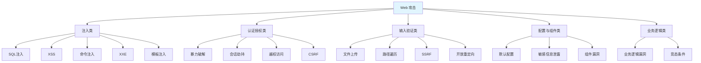

# 常见攻击与防御手段

> **文档说明**：系统讲解 Web 应用常见攻击手段与防御方法，涵盖 OWASP Top 10、SQL 注入、命令注入、文件上传、SSRF、XXE、路径遍历、暴力破解、DDoS、越权、敏感信息泄露等，以及完整的防御体系。
>
> **适用人群**：全栈开发者、安全工程师、需要构建安全 Web 应用的开发者
>
> **前置知识**：[[密码学基础-对称非对称哈希]]、[[前端安全-XSS-CSRF防护]]、[[API安全最佳实践]]

---

## 一、概述

### 1. OWASP Top 10（2021）

```text
OWASP（Open Web Application Security Project）Top 10：
1. 访问控制失效（Broken Access Control）
2. 加密机制失效（Cryptographic Failures）
3. 注入（Injection）- SQL/XSS/命令注入
4. 不安全设计（Insecure Design）
5. 安全配置错误（Security Misconfiguration）
6. 易受攻击和过时的组件（Vulnerable Components）
7. 身份认证失败（Identification and Authentication Failures）
8. 软件和数据完整性失败（Software and Data Integrity Failures）
9. 安全日志和监控失败（Security Logging and Monitoring Failures）
10. 服务端请求伪造（SSRF）
```

### 2. 攻击分类



---

## 二、SQL 注入

### 1. 攻击原理

```sql
SQL 注入（SQL Injection）：
- 攻击者在输入中注入恶意 SQL 代码
- 应用未正确过滤，恶意代码被数据库执行
- 后果：数据泄露、数据篡改、权限提升、数据库被接管

攻击示例：
登录表单：
  username = admin' --
  password = anything

生成的 SQL：
  SELECT * FROM users WHERE username = 'admin' --' AND password = 'anything'
  -- 注释掉密码检查，直接登录

UNION 注入：
  ?id=1 UNION SELECT username, password FROM users --

布尔盲注：
  ?id=1 AND 1=1  -- 正常
  ?id=1 AND 1=2  -- 异常
  -- 根据页面差异推断数据

时间盲注：
  ?id=1 AND SLEEP(5) -- 页面延迟5秒
```

### 2. 防御手段

```java
// ✅ 1. 参数化查询（预编译语句）- 最有效
String sql = "SELECT * FROM users WHERE username = ? AND password = ?";
PreparedStatement stmt = connection.prepareStatement(sql);
stmt.setString(1, username);
stmt.setString(2, password);
ResultSet rs = stmt.executeQuery();

// ✅ 2. ORM 框架（MyBatis #{} / JPA）
// MyBatis: 使用 #{} 而非 ${}
@Select("SELECT * FROM users WHERE username = #{username}")
User findByUsername(@Param("username") String username);

// ❌ 危险：${} 直接拼接
@Select("SELECT * FROM users WHERE username = '${username}'")

// ✅ 3. 输入校验（白名单）
if (!username.matches("^[a-zA-Z0-9_]{3,20}$")) {
    throw new IllegalArgumentException("用户名格式不正确");
}

// ✅ 4. 最小权限原则
// 数据库用户只授予必要权限，不要用 root/sa
// 禁止数据库用户执行 DROP/ALTER 等危险操作

// ✅ 5. 错误信息不泄露
// 生产环境不返回数据库错误详情
catch (SQLException e) {
    log.error("数据库错误", e);  // 日志记录详细信息
    throw new BusinessException("系统繁忙，请稍后重试");  // 用户只看到通用错误
}

// ✅ 6. WAF（Web 应用防火墙）
// 部署 WAF 拦截 SQL 注入攻击（辅助手段，不能替代代码防护）
```

### 3. NoSQL 注入

```javascript
// MongoDB 注入示例
// 登录：{ "username": { "$ne": null }, "password": { "$ne": null } }
// 绕过认证

// ✅ 防御：使用参数化查询、输入校验、类型检查
// Mongoose 等 ODM 框架默认防注入
// 避免直接拼接查询对象
const user = await User.findOne({
  username: req.body.username,  // 字符串，安全
  password: req.body.password
});

// ❌ 危险：直接传入对象
const user = await User.findOne(req.body);  // 可能被注入操作符
```

---

## 三、命令注入

### 1. 攻击原理

```text
命令注入（Command Injection）：
- 应用将用户输入拼接到系统命令中
- 攻击者注入 shell 元字符执行任意命令

攻击示例：
  功能：ping 测试，输入 IP 地址
  输入：127.0.0.1; cat /etc/passwd
  执行：ping 127.0.0.1; cat /etc/passwd
  结果：先 ping，再读取密码文件

危险字符：; | & && || ` $() > < \n
```

### 2. 防御手段

```java
// ✅ 1. 避免直接调用系统命令
// 用编程语言 API 替代系统命令
// 如：用 Java InetAddress 替代 ping 命令

// ✅ 2. 参数化执行（不通过 shell）
// 使用 ProcessBuilder，参数分开传递，不经过 shell 解析
ProcessBuilder pb = new ProcessBuilder("ping", "-c", "4", ipAddress);
pb.redirectErrorStream(true);
Process process = pb.start();
// 每个参数独立，不会被 shell 解释

// ❌ 危险：通过 shell 执行，字符串拼接
Runtime.getRuntime().exec("ping -c 4 " + ipAddress);

// ✅ 3. 输入白名单校验
if (!ipAddress.matches("^\\d{1,3}\\.\\d{1,3}\\.\\d{1,3}\\.\\d{1,3}$")) {
    throw new IllegalArgumentException("IP 地址格式不正确");
}

// ✅ 4. 沙箱/容器隔离
// 执行命令的服务运行在隔离的容器/沙箱中
// 限制权限，即使被注入也影响有限

// ✅ 5. 禁用危险函数
// PHP: disable_functions = exec, system, shell_exec, passthru
// Java: SecurityManager 限制
```

---

## 四、文件上传漏洞

### 1. 攻击原理

```text
文件上传漏洞：
- 应用允许用户上传文件，但未正确验证
- 攻击者上传恶意文件（WebShell、病毒、HTML）
- 后果：服务器被接管、XSS、钓鱼、恶意软件分发

攻击方式：
1. 直接上传 .php/.jsp/.asp 脚本文件
2. 修改 Content-Type 绕过类型检查
3. 文件名绕过：shell.php.jpg、shell.php%00.jpg
4. .htaccess 解析漏洞
5. 上传 SVG（含 XSS）、HTML（钓鱼）
6. 解压漏洞（Zip Slip 路径遍历）
```

### 2. 防御手段

```java
// ✅ 1. 文件类型白名单（校验文件头，不只看扩展名）
// 图片：检查 magic number（JPEG: FF D8 FF, PNG: 89 50 4E 47）
private static final Set<String> ALLOWED_TYPES = Set.of("image/jpeg", "image/png", "image/gif");

public String uploadFile(MultipartFile file) {
    // 校验 Content-Type
    String contentType = file.getContentType();
    if (!ALLOWED_TYPES.contains(contentType)) {
        throw new BusinessException("不支持的文件类型");
    }

    // 校验文件头（magic number）
    byte[] header = new byte[8];
    file.getInputStream().read(header);
    if (!isValidImageHeader(header)) {
        throw new BusinessException("文件内容不合法");
    }

    // ✅ 2. 重命名文件（不使用原始文件名）
    String extension = getExtension(contentType);  // 从白名单获取扩展名
    String filename = UUID.randomUUID() + "." + extension;

    // ✅ 3. 存储在非 Web 可访问目录
    Path storagePath = Paths.get("/data/uploads", filename);
    // /data/uploads 不在 Web 根目录下，通过接口读取

    // ✅ 4. 限制文件大小
    if (file.getSize() > 10 * 1024 * 1024) {  // 10MB
        throw new BusinessException("文件大小超过限制");
    }

    // ✅ 5. 图片重新编码（破坏 WebShell）
    // 用 ImageIO 读取后重新写入，清除恶意代码
    BufferedImage image = ImageIO.read(file.getInputStream());
    ImageIO.write(image, "png", storagePath.toFile());

    return filename;
}

// ✅ 6. 文件访问控制
// 通过接口读取文件，验证权限后返回
@GetMapping("/files/{filename}")
public ResponseEntity<Resource> downloadFile(@PathVariable String filename) {
    // 验证用户权限
    // 返回文件流，设置 Content-Disposition: attachment（强制下载，不执行）
}

// ✅ 7. 独立域名/CDN 存储
// 文件存储在独立域名（如 static.example.com）
// 即使上传了 HTML，也不会在主域名下执行（同源策略）
```

---

## 五、SSRF（服务端请求伪造）

### 1. 攻击原理

```text
SSRF（Server-Side Request Forgery）：
- 应用从用户输入获取 URL 并发起服务端请求
- 攻击者构造恶意 URL，让服务器访问内部资源
- 后果：内网探测、端口扫描、访问云元数据、攻击内网服务

攻击示例：
  功能：URL 预览/图片抓取/网页截图
  输入：http://169.254.169.254/latest/meta-data/  （AWS 元数据）
  结果：服务器访问云元数据，获取临时凭证

常见目标：
- 云元数据：169.254.169.254（AWS）、metadata.google.internal（GCP）
- 内网服务：127.0.0.1、10.x.x.x、192.168.x.x
- 本地文件：file:///etc/passwd
- 非 HTTP 协议：gopher://、dict://、ftp://
```

### 2. 防御手段

```java
// ✅ 1. URL 白名单（只允许指定域名）
private static final Set<String> ALLOWED_DOMAINS = Set.of(
    "example.com", "cdn.example.com"
);

public String fetchUrl(String urlString) throws Exception {
    URL url = new URL(urlString);

    // ✅ 2. 协议白名单（只允许 http/https）
    if (!"http".equals(url.getProtocol()) && !"https".equals(url.getProtocol())) {
        throw new BusinessException("不支持的协议");
    }

    // ✅ 3. 域名白名单校验
    String host = url.getHost().toLowerCase();
    boolean allowed = ALLOWED_DOMAINS.stream().anyMatch(host::endsWith);
    if (!allowed) {
        throw new BusinessException("不允许访问的域名");
    }

    // ✅ 4. 禁止内网 IP（DNS 重绑定防护）
    InetAddress[] addresses = InetAddress.getAllByName(host);
    for (InetAddress addr : addresses) {
        if (addr.isLoopbackAddress() || addr.isSiteLocalAddress()
            || addr.isLinkLocalAddress() || addr.isAnyLocalAddress()) {
            throw new BusinessException("不允许访问内网地址");
        }
    }

    // ✅ 5. 限制重定向（防止重定向到内网）
    // 禁用自动重定向，或重定向后再次校验
    HttpURLConnection conn = (HttpURLConnection) url.openConnection();
    conn.setInstanceFollowRedirects(false);  // 禁用自动重定向

    // ✅ 6. 网络隔离（出口防火墙）
    // 服务器安全组禁止访问内网和云元数据
    // 只允许访问白名单域名的 80/443 端口

    // ✅ 7. 专用代理服务
    // 用独立的代理服务发起外部请求，隔离主服务
    // 代理服务配置严格的访问控制

    return "success";
}
```

---

## 六、XXE（XML 外部实体）

### 1. 攻击原理

```html
XXE（XML External Entity）：
- 应用解析用户提交的 XML 时，加载了外部实体
- 攻击者构造恶意 XML，读取本地文件或发起请求
- 后果：文件读取、SSRF、DoS（Billion Laughs）

攻击示例：
<?xml version="1.0"?>
<!DOCTYPE foo [
  <!ENTITY xxe SYSTEM "file:///etc/passwd">
]>
<foo>&xxe;</foo>
<!-- 解析后 &xxe; 被替换为 /etc/passwd 的内容 -->

Billion Laughs（DoS）：
<!DOCTYPE lolz [
  <!ENTITY lol "lol">
  <!ENTITY lol2 "&lol;&lol;&lol;&lol;&lol;&lol;&lol;&lol;&lol;&lol;">
  ... 指数级增长，耗尽内存
]>
```

### 2. 防御手段

```java
// ✅ 1. 禁用外部实体和 DTD
DocumentBuilderFactory dbf = DocumentBuilderFactory.newInstance();
// 禁用 DTD
dbf.setFeature("http://apache.org/xml/features/disallow-doctype-decl", true);
// 禁用外部通用实体
dbf.setFeature("http://xml.org/sax/features/external-general-entities", false);
// 禁用外部参数实体
dbf.setFeature("http://xml.org/sax/features/external-parameter-entities", false);
// 禁用外部 DTD
dbf.setFeature("http://apache.org/xml/features/nonvalidating/load-external-dtd", false);
dbf.setXIncludeAware(false);
dbf.setExpandEntityReferences(false);

// ✅ 2. 使用安全的 XML 解析库
// JAXB 默认安全（但需确认配置）
// Jackson XML 模块默认安全
// 避免使用 SAXParser/DocumentBuilder 的默认配置

// ✅ 3. 避免使用 XML，改用 JSON
// JSON 没有外部实体问题
// 如果必须用 XML，严格配置解析器

// ✅ 4. 输入大小限制
// 限制 XML 文件大小，防止 Billion Laughs 攻击
```

---

## 七、路径遍历

### 1. 攻击原理

```css
路径遍历（Path Traversal / Directory Traversal）：
- 应用根据用户输入构造文件路径
- 攻击者用 ../ 跳出指定目录，访问任意文件
- 后果：读取敏感文件、覆盖配置、执行代码

攻击示例：
  功能：文件下载，参数 filename
  输入：../../../../etc/passwd
  构造路径：/var/www/downloads/../../../../etc/passwd
  实际路径：/etc/passwd

编码绕过：
  ..%2f..%2f..%2fetc%2fpasswd  （URL 编码）
  ..%252f..%252fetc%2fpasswd   （双重编码）
  ....//....//etc/passwd        （过滤不完整）
```

### 2. 防御手段

```java
// ✅ 1. 文件名白名单（不使用用户输入的路径）
// 用 ID 映射文件名，用户只传 ID
public ResponseEntity<Resource> downloadFile(@RequestParam Long fileId) {
    FileRecord record = fileRepository.findById(fileId);
    if (record == null) {
        throw new BusinessException("文件不存在");
    }
    // 用数据库中存储的安全文件名
    Path path = Paths.get(UPLOAD_DIR, record.getStoredFilename());
    // ...
}

// ✅ 2. 规范化路径后校验
public ResponseEntity<Resource> downloadFile(@RequestParam String filename) {
    // 规范化路径（解析 ../）
    Path basePath = Paths.get(UPLOAD_DIR).toAbsolutePath().normalize();
    Path filePath = basePath.resolve(filename).normalize();

    // 校验是否在基础目录内
    if (!filePath.startsWith(basePath)) {
        throw new BusinessException("非法文件路径");
    }

    // ✅ 3. 过滤危险字符
    if (filename.contains("..") || filename.contains("/") || filename.contains("\\")) {
        throw new BusinessException("文件名不合法");
    }

    // ✅ 4. 只允许特定字符
    if (!filename.matches("^[a-zA-Z0-9_\\-\\.]+$")) {
        throw new BusinessException("文件名不合法");
    }

    // ...
}
```

---

## 八、暴力破解与撞库

### 1. 攻击原理

```text
暴力破解（Brute Force）：
- 尝试大量用户名/密码组合，直到找到正确的
- 撞库（Credential Stuffing）：用其他网站泄露的账号密码尝试登录

攻击方式：
1. 纯暴力：遍历所有可能的密码组合
2. 字典攻击：用常用密码字典
3. 撞库：用泄露的账号密码库
4. 反向暴力：固定密码，遍历用户名
```

### 2. 防御手段

```java
// ✅ 1. 登录失败次数限制（账户锁定）
// 连续失败 5 次，锁定账户 15 分钟
public LoginResponse login(String username, String password) {
    // 检查账户是否锁定
    if (loginAttemptService.isLocked(username)) {
        throw new BusinessException("账户已锁定，请稍后再试");
    }

    User user = userRepository.findByUsername(username);
    if (user == null || !passwordEncoder.matches(password, user.getPassword())) {
        loginAttemptService.recordFailure(username);
        throw new BusinessException("用户名或密码错误");
    }

    loginAttemptService.reset(username);
    return generateToken(user);
}

// ✅ 2. IP 限流（Rate Limiting）
// 同一 IP 每分钟最多 10 次登录请求
// 用 Redis 计数器实现
// 或用 Spring Cloud Gateway / Nginx limit_req

// ✅ 3. 验证码（CAPTCHA）
// 登录失败 3 次后要求输入验证码
// 防止自动化攻击

// ✅ 4. 强密码策略
// 密码长度 ≥ 8，包含大小写字母、数字、特殊字符
// 禁止使用常见密码（Top 10000 弱密码库）

// ✅ 5. 多因素认证（MFA）
// 密码 + 手机验证码 / TOTP / 硬件密钥
// 即使密码泄露，攻击者也无法登录

// ✅ 6. 密码哈希存储
// 用 bcrypt/Argon2/PBKDF2，不要明文或 MD5/SHA
// 加盐，防止彩虹表

// ✅ 7. 异常登录检测
// 异地登录、新设备登录、异常时间登录
// 触发二次验证或告警

// ✅ 8. 登录接口隐藏
// 不暴露 /admin 登录路径
// 用非标准路径或 IP 白名单
```

---

## 九、越权访问

### 1. 攻击原理

```text
越权访问（Broken Access Control）：
- 水平越权：访问同级其他用户的数据（A 用户看 B 用户的订单）
- 垂直越权：普通用户访问管理员功能
- 未授权访问：未登录就能访问需要登录的资源

攻击示例：
  GET /api/orders/123  → 返回订单 123（属于用户 B）
  用户 A 把 URL 中的 ID 改成 123，就能看到 B 的订单

  GET /api/admin/users  → 普通用户访问管理员接口
  接口没有校验角色，直接返回所有用户数据
```

### 2. 防御手段

```java
// ✅ 1. 服务端校验资源归属（不能只靠前端隐藏）
@GetMapping("/api/orders/{id}")
public Order getOrder(@PathVariable Long id, @AuthenticationPrincipal User user) {
    Order order = orderRepository.findById(id);
    if (order == null) {
        throw new NotFoundException("订单不存在");
    }
    // ✅ 校验当前用户是否有权访问该订单
    if (!order.getUserId().equals(user.getId()) && !user.isAdmin()) {
        throw new ForbiddenException("无权访问该订单");
    }
    return order;
}

// ✅ 2. 基于角色的访问控制（RBAC）
@PreAuthorize("hasRole('ADMIN')")  // 只有管理员能访问
@DeleteMapping("/api/users/{id}")
public void deleteUser(@PathVariable Long id) {
    userRepository.deleteById(id);
}

@PreAuthorize("hasAnyRole('ADMIN', 'EDITOR')")
@PutMapping("/api/articles/{id}")
public Article updateArticle(@PathVariable Long id) {
    // ...
}

// ✅ 3. 统一认证授权中间件/过滤器
// Spring Security 配置
@Configuration
@EnableWebSecurity
public class SecurityConfig {
    @Bean
    public SecurityFilterChain filterChain(HttpSecurity http) throws Exception {
        http
            .authorizeHttpRequests(auth -> auth
                .requestMatchers("/api/public/**").permitAll()  // 公开接口
                .requestMatchers("/api/admin/**").hasRole("ADMIN")  // 管理员
                .anyRequest().authenticated()  // 其他需要登录
            )
            .oauth2ResourceServer(oauth2 -> oauth2.jwt(Customizer.withDefaults()));
        return http.build();
    }
}

// ✅ 4. 对象级权限（ABAC / 数据权限）
// 用 Spring Security ACL 或自定义数据权限
// 不仅校验角色，还校验数据归属

// ✅ 5. 最小权限原则
// 数据库用户、API Key、服务账户都只给必要权限
// 不要用超级管理员运行应用
```

---

## 十、DDoS 攻击

### 1. 攻击原理

```text
DDoS（Distributed Denial of Service）：
- 分布式拒绝服务攻击
- 大量受控主机（僵尸网络）同时向目标发送请求
- 耗尽目标的带宽、连接数、计算资源
- 后果：服务不可用

攻击类型：
1. 流量型：UDP 洪水、ICMP 洪水、放大攻击（DNS/NTP）
2. 连接型：SYN 洪水、慢速连接（Slowloris）
3. 应用层：HTTP 洪水、CC 攻击（频繁请求耗资源的接口）
```

### 2. 防御手段

```text
DDoS 防御层次：

1. 网络层（ISP/云服务商）
   - 流量清洗（Cloudflare、AWS Shield、阿里云高防）
   - 黑洞路由（攻击时丢弃流量）
   - Anycast（分布式接入点）

2. 传输层
   - SYN Cookie（防 SYN 洪水）
   - 连接数限制（Nginx limit_conn）
   - 超时设置（防慢速连接）

3. 应用层
   - 速率限制（Rate Limiting）：按 IP/用户/接口限流
   - 验证码：异常流量触发 CAPTCHA
   - WAF：拦截恶意请求特征
   - 静态资源 CDN：减轻源站压力
   - 接口缓存：高频查询结果缓存

4. 架构层
   - 弹性伸缩：自动扩容应对流量高峰
   - 多可用区/多地域：单点故障不影响全局
   - 降级熔断：非核心功能降级，保障核心功能
   - 队列削峰：用消息队列缓冲突发流量
```

```nginx
# Nginx 限流配置
# 按 IP 限制请求速率（10r/s，突发 20）
limit_req_zone $binary_remote_addr zone=api:10m rate=10r/s;

server {
    location /api/ {
        limit_req zone=api burst=20 nodelay;
        proxy_pass http://backend;
    }

    # 限制连接数
    limit_conn_zone $binary_remote_addr zone=conn:10m;
    location /download/ {
        limit_conn conn 5;  # 每 IP 最多 5 个连接
    }
}
```

---

## 十一、敏感信息泄露

### 1. 常见泄露场景

```text
敏感信息泄露方式：
1. 错误信息泄露：堆栈跟踪、SQL 错误、调试信息
2. 注释泄露：代码注释、HTML 注释包含敏感信息
3. 版本控制泄露：.git 目录可访问、提交了密钥
4. 备份文件泄露：.bak、.old、.swp 文件可下载
5. 配置文件泄露：.env、config.json 可访问
6. API 文档泄露：Swagger/生产环境可访问
7. 日志泄露：日志中记录密码、Token、身份证号
8. 前端泄露：JS 中硬编码 API Key、Secret
9. 云存储泄露：S3/OSS 桶设置为公开
10. 传输泄露：HTTP 明文传输
```

### 2. 防御手段

```java
// ✅ 1. 生产环境关闭调试信息
// Spring Boot: application-prod.yml
server:
  error:
    include-stacktrace: never
    include-message: never
    include-binding-errors: never

// 自定义全局异常处理
@RestControllerAdvice
public class GlobalExceptionHandler {
    @ExceptionHandler(Exception.class)
    public ResponseEntity<ApiResponse> handleException(Exception e) {
        log.error("系统异常", e);  // 日志记录详细信息
        // 用户只看到通用错误
        return ResponseEntity.status(500)
            .body(ApiResponse.error("SYSTEM_ERROR", "系统繁忙，请稍后重试"));
    }
}

// ✅ 2. 敏感数据脱敏
// 日志脱敏
public class SensitiveDataMasker {
    public static String maskPhone(String phone) {
        return phone.replaceAll("(\\d{3})\\d{4}(\\d{4})", "$1****$2");
    }
    public static String maskIdCard(String idCard) {
        return idCard.replaceAll("(\\d{6})\\d{8}(\\d{4})", "$1********$2");
    }
}

// ✅ 3. 禁止提交敏感文件
// .gitignore
.env
.env.local
*.pem
*.key
*.p12
credentials.json
secrets/

// ✅ 4. 用环境变量/密钥管理服务
// 不要硬编码密钥，用环境变量或 Vault/AWS Secrets Manager
String apiKey = System.getenv("API_KEY");  // 从环境变量读取

// ✅ 5. 生产环境关闭 API 文档
// SpringDoc/Swagger: 生产环境禁用
@Profile("!prod")
@Configuration
public class SwaggerConfig { ... }

// ✅ 6. 传输加密
// 全站 HTTPS，HSTS 强制
// add_header Strict-Transport-Security "max-age=31536000; includeSubDomains";

// ✅ 7. 定期扫描
// 用 git-secrets/trufflehog 扫描代码仓库中的密钥
// 用 Nuclei/Nikto 扫描敏感文件和配置
```

---

## 十二、防御体系总结

### 1. 纵深防御

```text
纵深防御（Defense in Depth）：
- 不依赖单一防护措施
- 多层防护，一层被突破还有下一层

防护层次：
1. 网络层：防火墙、WAF、DDoS 防护
2. 主机层：系统加固、最小权限、补丁管理
3. 应用层：输入校验、参数化查询、认证授权
4. 数据层：加密存储、脱敏、备份
5. 管理层：安全规范、代码审计、安全培训
6. 监控层：日志审计、入侵检测、应急响应
```

### 2. 安全开发流程

```text
安全左移（Shift Left）：
- 在开发早期就考虑安全，而不是上线后才补

安全开发流程（DevSecOps）：
1. 需求阶段：安全需求分析、威胁建模
2. 设计阶段：安全架构设计、安全评审
3. 编码阶段：安全编码规范、静态代码扫描（SAST）
4. 测试阶段：渗透测试、动态扫描（DAST）、依赖扫描
5. 部署阶段：安全配置检查、容器镜像扫描
6. 运行阶段：安全监控、漏洞管理、应急响应
```

### 3. 安全检查清单

```text
开发前：
- [ ] 威胁建模（识别潜在攻击面）
- [ ] 安全需求（认证、授权、加密、审计）
- [ ] 依赖评估（第三方库安全性）

开发中：
- [ ] 输入校验（所有外部输入白名单校验）
- [ ] 参数化查询（防 SQL 注入）
- [ ] 输出编码（防 XSS）
- [ ] 认证授权（每个接口校验身份和权限）
- [ ] 密码安全（bcrypt/Argon2、加盐）
- [ ] 敏感数据加密（传输 HTTPS、存储加密）
- [ ] 错误处理（不泄露敏感信息）
- [ ] 日志审计（记录关键操作，脱敏敏感数据）
- [ ] 安全头（CSP、X-Frame-Options、HSTS）

测试中：
- [ ] 静态代码扫描（SonarQube/Checkmarx）
- [ ] 依赖漏洞扫描（Snyk/Dependabot）
- [ ] 渗透测试（手动+自动）
- [ ] DAST 扫描（OWASP ZAP/Burp Suite）
- [ ] 安全单元测试

部署前：
- [ ] 安全配置检查（无默认密码、调试关闭）
- [ ] 容器镜像扫描（Trivy/Clair）
- [ ] 密钥检查（无硬编码密钥）
- [ ] 权限检查（最小权限原则）

运行中：
- [ ] 安全监控（异常登录、异常请求）
- [ ] 日志审计（关键操作可追溯）
- [ ] 漏洞管理（定期扫描、及时修复）
- [ ] 备份恢复（定期备份、演练恢复）
- [ ] 应急响应（有预案、定期演练）
```

---

## 十三、常见问题与排查

| 问题 | 原因 | 解决方案 |
|------|------|---------|
| **SQL 注入** | 字符串拼接 SQL | 参数化查询/ORM、输入校验 |
| **XSS** | 输出未编码 | 输出编码、CSP、HttpOnly |
| **CSRF** | 无 Token 验证 | CSRF Token、SameSite Cookie |
| **命令注入** | 拼接系统命令 | 参数化执行、白名单校验、避免调用系统命令 |
| **文件上传漏洞** | 未校验文件类型/内容 | 白名单、文件头校验、重命名、非 Web 目录 |
| **SSRF** | 服务端请求用户 URL | URL 白名单、协议限制、内网 IP 过滤、网络隔离 |
| **XXE** | XML 解析器配置不当 | 禁用外部实体/DTD、用 JSON 替代 XML |
| **路径遍历** | 用户输入构造路径 | ID 映射、路径规范化校验、白名单 |
| **暴力破解** | 无限次登录尝试 | 失败锁定、IP 限流、验证码、MFA |
| **越权访问** | 未校验资源归属/角色 | 服务端校验、RBAC、统一权限中间件 |
| **DDoS** | 大量恶意请求 | CDN/WAF、限流、弹性伸缩、流量清洗 |
| **敏感信息泄露** | 错误信息/日志/配置泄露 | 关闭调试、日志脱敏、环境变量、定期扫描 |
| **中间人攻击** | HTTP 明文传输 | HTTPS、HSTS、证书校验 |
| **会话劫持** | Session ID 泄露/固定 | 安全 Cookie（HttpOnly/Secure/SameSite）、会话再生 |
| **点击劫持** | 页面被 iframe 嵌入 | X-Frame-Options、CSP frame-ancestors |
| **开放重定向** | 未校验跳转 URL | 白名单域名、只允许相对路径 |
| **业务逻辑漏洞** | 流程设计缺陷 | 威胁建模、业务流程审查、状态机校验 |
| **竞态条件** | 并发操作未加锁 | 分布式锁、数据库乐观锁/悲观锁、幂等设计 |
| **依赖漏洞** | 第三方库有漏洞 | 依赖扫描、定期更新、Snyk/Dependabot |
| **配置错误** | 默认配置/调试开启 | 安全配置基线、配置扫描、环境隔离 |

---

## 十四、关联笔记

### 安全相关
- [[密码学基础-对称非对称哈希]] · [[前端安全-XSS-CSRF防护]] · [[API安全最佳实践]]
- [[Java-数据加密与脱敏]] · [[容器安全与镜像扫描]] · [[AI安全与对齐基础]]
- [[密码管理器-Bitwarden]]

### 后端
- [[认证与授权原理-OAuth2-JWT]] · [[Java-异常体系与最佳实践]] · [[SpringValidation-参数校验]]
- [[Java-数据库性能优化]]

### 运维
- [[CI-CD安全与凭据管理]] · [[APM应用性能监控-SkyWalking]] · [[K8s-核心概念与架构]]

### 导航
- [[MOC-计算机基础]] · [[MOC-后端开发]] · [[MOC-云原生与运维]] · [[全栈+AI工程双轨融合学习路线图]]

> **学习路径建议**：先掌握 [[密码学基础-对称非对称哈希]] 密码学基础 → 深入本文常见攻击与防御 → 学习 [[前端安全-XSS-CSRF防护]] 前端安全 → 实践 [[API安全最佳实践]] 接口安全 → 研究 [[认证与授权原理-OAuth2-JWT]] 身份认证 → 构建完整的全栈安全开发能力。

---

## 💡 全文深度讲解

本文系统梳理了常见攻击与防御手段的核心知识体系，从概述入手，深入SQL 注入的底层机制，再通过命令注入掌握实战应用，最后涵盖常见问题与排查与关联笔记。学习时建议先建立整体认知，再动手实践，最后结合常见问题深化理解。

## 📝 全文精简总结

- **概述**：掌握本模块的核心概念与关键要点
- **SQL 注入**：掌握本模块的核心概念与关键要点
- **命令注入**：掌握本模块的核心概念与关键要点
- **文件上传漏洞**：掌握本模块的核心概念与关键要点
- **SSRF（服务端请求伪造）**：掌握本模块的核心概念与关键要点
- **XXE（XML 外部实体）**：掌握本模块的核心概念与关键要点
- **路径遍历**：掌握本模块的核心概念与关键要点
- **暴力破解与撞库**：掌握本模块的核心概念与关键要点
- 其余6个模块涵盖进阶主题与拓展内容

