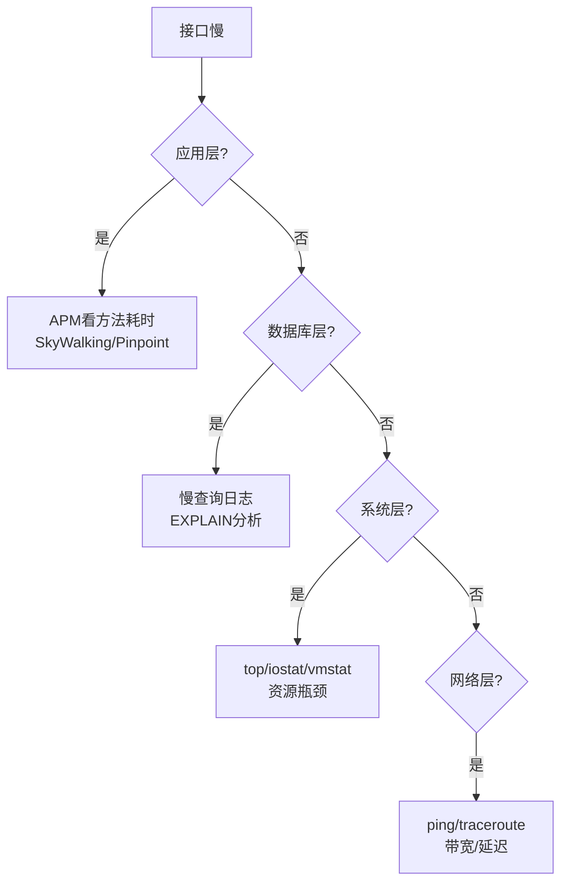
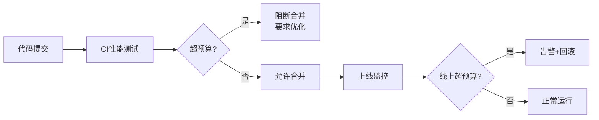
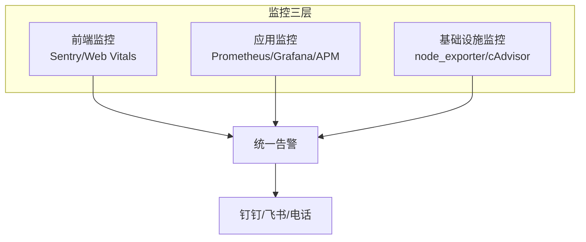

# 性能优化方法论

> **文档说明**：性能优化是工程师的核心能力之一，但很多人凭感觉优化、微优化、过度优化。本文档建立系统化的性能优化方法论，覆盖优化原则、五步法、瓶颈定位、各层优化手段、性能预算、真实案例、反模式，适用于前端、后端、数据库、AI推理等所有场景。
>
> **适用人群**：全栈工程师、后端高级工程师、需要系统化性能优化的开发者
>
> **前置知识**：计算机基础、系统架构概念

---

## 一、性能优化核心原则

### 1.1 先测量再优化

> "没有测量就没有优化" — 任何优化前必须有基准数据，否则就是猜。

**错误做法**：
- 凭感觉说"这个接口慢"，不知道慢在哪里
- 看到代码就想优化，不管是不是热点
- 优化后没有对比数据，不知道有没有效果

**正确做法**：
```text
优化前：接口P99=1200ms，QPS=200，CPU=45%
定位：数据库查询占800ms（慢SQL）
优化后：接口P99=180ms，QPS=800，CPU=35%
效果：P99降低85%，QPS提升4倍
```

### 1.2 二八定律（帕累托法则）

80%的性能问题来自20%的代码。**优化热点，不要优化冷路径**。

| 场景 | 热点 | 冷路径（不要优化） |
|------|------|------------------|
| Web应用 | 首页查询、订单创建 | 后台报表、数据导出 |
| 数据库 | 高频查询SQL | 低频管理SQL |
| 前端 | 首屏渲染、列表滚动 | 设置页、关于页 |
| AI推理 | 主模型推理路径 | 模型加载、初始化 |

### 1.3 不要过早优化

> "过早优化是万恶之源" — Donald Knuth

- 先让代码**正确运行**，再在有数据支撑时优化
- 优化会增加代码复杂度，影响可读性和可维护性
- 硬件成本 < 工程师时间成本时，优先加机器

**什么时候该优化**：
- 有明确的性能问题（用户投诉、监控告警）
- 有基准数据证明是瓶颈
- 优化收益 > 优化成本（包括维护成本）

### 1.4 权衡思维

性能优化几乎都是权衡，没有银弹：

| 权衡 | 收益 | 代价 |
|------|------|------|
| 空间换时间（缓存） | 读速度提升10-100倍 | 内存成本、一致性问题 |
| 时间换空间（压缩） | 存储/带宽减少 | CPU消耗增加 |
| 一致性换可用性 | 系统更可用 | 数据可能短暂不一致 |
| 开发效率换运行效率 | 运行更快 | 开发更慢、代码更复杂 |
| 批量换单次 | 减少IO次数 | 延迟增加、内存占用 |
| 异步换同步 | 响应更快 | 复杂度增加、最终一致 |

---

## 二、性能优化五步法


### 第一步：建立基准线

**明确性能指标**：

| 指标类型 | 具体指标 | 说明 |
|---------|---------|------|
| **延迟** | P50/P95/P99/P999 | 百分位比平均值更有意义 |
| **吞吐量** | QPS/TPS | 每秒请求/事务数 |
| **资源利用率** | CPU/内存/IO/网络 | 找出资源瓶颈 |
| **错误率** | 5xx/4xx比例 | 性能问题常伴随错误率上升 |
| **业务指标** | 转化率/跳出率 | 性能对业务的实际影响 |

**基准测试工具**：

| 场景 | 工具 | 说明 |
|------|------|------|
| HTTP压测 | wrk / JMeter / k6 | 并发压测，测QPS和延迟 |
| Java分析 | JProfiler / Arthas / async-profiler | CPU/内存/锁分析 |
| Python分析 | cProfile / py-spy / line_profiler | 函数级耗时分析 |
| 前端 | Chrome DevTools / Lighthouse / WebPageTest | 页面性能分析 |
| 数据库 | EXPLAIN / 慢查询日志 / SHOW PROFILE | SQL性能分析 |
| 系统 | top / iostat / vmstat / perf | 系统级资源分析 |

**wrk压测示例**：
```bash
# 12线程，200连接，持续30秒
wrk -t12 -c200 -d30s --latency http://localhost:8080/api/orders

# 输出关键指标：
# Requests/sec:  842.31  (QPS)
# Latency Distribution:
#    50%    85.32ms
#    90%   152.44ms
#    99%   320.18ms   (P99)
```

### 第二步：定位瓶颈

**自上而下排查**：从应用层到系统层，逐层定位。



**APM链路追踪定位**：
```text
一个请求的耗时分布（SkyWalking追踪）：
  总耗时: 1200ms
  ├── Controller: 5ms
  ├── Service逻辑: 20ms
  ├── 数据库查询1: 800ms  ← 瓶颈！占67%
  ├── Redis查询: 5ms
  ├── 数据库查询2: 300ms  ← 次要瓶颈
  └── 其他: 170ms
→ 优先优化数据库查询1
```

### 第三步：分析根因（五个为什么）

```text
现象：接口P99=1200ms
为什么慢？ → 数据库查询占800ms
为什么SQL慢？ → 没有走索引，全表扫描100万行
为什么没走索引？ → WHERE条件用了函数 DATE(created_at)
为什么用了函数？ → 开发图方便，不知道函数会导致索引失效
为什么没人发现？ → 没有SQL审核和慢查询告警
→ 根因：缺少SQL审核流程 + 开发缺乏索引知识
→ 解决方案：①修复SQL ②建立SQL审核 ③培训索引知识
```

### 第四步：实施优化

**优化原则**：
- **小步迭代**：每次只改一个变量，便于归因
- **保留回滚**：优化前确保可以快速回滚
- **测试验证**：先在测试环境验证，再灰度上线
- **记录文档**：记录优化前后对比，沉淀经验

**优化手段优先级**：
1. **架构级优化**（收益最大）：缓存、异步、分库分表
2. **代码级优化**：算法优化、批量操作、连接池
3. **配置级优化**：JVM参数、数据库参数、连接池大小
4. **硬件级优化**：升级CPU/内存/SSD（成本最高）

### 第五步：验证回归

**验证清单**：
- [ ] 性能指标达标（P99/QPS/资源利用率）
- [ ] 功能没有回归（自动化测试通过）
- [ ] 没有引入新的瓶颈（优化A可能让B成为瓶颈）
- [ ] 持续监控（上线后持续观察至少24小时）
- [ ] 记录优化报告（问题→根因→方案→效果）

---

## 三、常见性能瓶颈与优化方向

### 3.1 瓶颈类型识别

| 瓶颈类型 | 表现特征 | 优化方向 |
|---------|---------|---------|
| **CPU密集** | CPU使用率>80%，用户态高 | 算法优化、异步化、缓存、水平扩展 |
| **IO密集** | IO等待高（iowait>20%），CPU不高 | 批量操作、异步IO、索引优化、缓存 |
| **内存不足** | GC频繁、OOM、Swap使用 | 内存泄漏排查、对象池、堆大小调整 |
| **锁竞争** | 线程等待多，CPU不高但吞吐低 | 减小锁粒度、无锁设计、读写锁、ConcurrentHashMap |
| **网络延迟** | 响应时间长，带宽未打满 | 连接池、压缩、CDN、就近部署、批量请求 |
| **数据库慢** | 慢查询多，DB CPU高 | 索引优化、SQL改写、分库分表、读写分离、缓存 |

### 3.2 CPU密集型优化

```java
// ❌ 低效：每次循环都创建对象 + 字符串拼接
String result = "";
for (int i = 0; i < 10000; i++) {
    result = result + getData(i);  // 每次创建新String对象
}

// ✅ 高效：StringBuilder批量拼接
StringBuilder sb = new StringBuilder(10000 * 10);
for (int i = 0; i < 10000; i++) {
    sb.append(getData(i));
}
String result = sb.toString();
```

### 3.3 IO密集型优化

```java
// ❌ 低效：逐条查询（N+1问题）
for (Order order : orders) {
    User user = userMapper.selectById(order.getUserId());  // 每次查DB
    order.setUser(user);
}
// 100条订单 = 101次DB查询

// ✅ 高效：批量查询
List<Long> userIds = orders.stream().map(Order::getUserId).toList();
List<User> users = userMapper.selectBatchIds(userIds);  // 1次DB查询
Map<Long, User> userMap = users.stream().collect(toMap(User::getId, u -> u));
orders.forEach(o -> o.setUser(userMap.get(o.getUserId())));
// 100条订单 = 2次DB查询
```

### 3.4 锁竞争优化

```java
// ❌ 低效：方法级大锁，所有操作互斥
public synchronized void update(String key, String value) {
    // 读+写都加同一把锁
    cache.put(key, value);
}

// ✅ 高效：ConcurrentHashMap + 分段锁
private final ConcurrentHashMap<String, String> cache = new ConcurrentHashMap<>();
// 内部按桶分段加锁，不同key互不影响

// ✅ 读写分离：读多写少用读写锁
private final ReadWriteLock rwLock = new ReentrantReadWriteLock();
public String read(String key) {
    rwLock.readLock().lock();   // 读锁共享
    try { return cache.get(key); } finally { rwLock.readLock().unlock(); }
}
public void write(String key, String value) {
    rwLock.writeLock().lock();  // 写锁排他
    try { cache.put(key, value); } finally { rwLock.writeLock().unlock(); }
}
```

---

## 四、各层优化入口

### 4.1 前端性能优化

| 优化方向 | 具体手段 | 效果 |
|---------|---------|------|
| **加载性能** | 代码分割、懒加载、Tree Shaking、资源压缩 | 首屏时间减少50%+ |
| **渲染性能** | 虚拟列表、防抖节流、CSS硬件加速 | 滚动帧率60fps |
| **缓存策略** | 浏览器缓存、Service Worker、CDN | 二次访问秒开 |
| **网络优化** | HTTP/2、资源合并、图片WebP | 请求数减少60% |

### 4.2 后端性能优化

| 优化方向 | 具体手段 | 效果 |
|---------|---------|------|
| **缓存** | 多级缓存、缓存预热、热点Key | QPS提升10倍+ |
| **异步** | 消息队列、异步处理、响应式编程 | 响应时间减少80% |
| **连接池** | DB连接池、HTTP连接池、线程池 | 减少连接创建开销 |
| **批量** | 批量插入、批量查询、批量RPC | IO次数减少90% |
| **算法** | 时间复杂度优化、数据结构选择 | 从O(n²)到O(n) |

### 4.3 数据库性能优化

| 优化方向 | 具体手段 | 效果 |
|---------|---------|------|
| **索引** | 联合索引、覆盖索引、索引下推 | 查询速度提升10-100倍 |
| **SQL** | 避免SELECT *、避免函数、分页优化 | 减少扫描行数 |
| **架构** | 读写分离、分库分表、冷热分离 | 承载10倍流量 |
| **配置** | 连接池、缓冲池、参数调优 | 吞吐量提升30-50% |

### 4.4 AI推理性能优化

| 优化方向 | 具体手段 | 效果 |
|---------|---------|------|
| **模型量化** | INT8/INT4量化、GPTQ/AWQ | 显存减少50-75% |
| **推理引擎** | vLLM/TensorRT-LLM/SGLang | 吞吐量提升3-10倍 |
| **批处理** | Continuous Batching、PagedAttention | GPU利用率提升 |
| **KV Cache** | 缓存复用、Prefix Caching | 重复请求加速 |
| **模型选择** | 小模型+RAG替代大模型 | 成本降低90% |

---

## 五、性能预算（Performance Budget）

### 5.1 什么是性能预算

性能预算是为系统设定的**性能上限**，超过预算就不能上线。类似财务预算，花超了就要审批。

**示例预算**：
| 指标 | 预算值 | 说明 |
|------|--------|------|
| 首屏加载 | < 2秒 | 4G网络，中端手机 |
| API P99 | < 200ms | 核心接口 |
| API P999 | < 500ms | 核心接口 |
| 单SQL执行 | < 50ms | 线上慢查询阈值 |
| 页面LCP | < 2.5秒 | Core Web Vitals |
| 错误率 | < 0.1% | 5xx错误 |

### 5.2 性能预算执行



---

## 六、真实优化案例

### 案例1：订单列表接口从2s优化到80ms

```text
问题：订单列表接口P99=2000ms，用户投诉严重

定位（APM链路追踪）：
  总耗时2000ms
  ├── DB查询: 1500ms（分页查询+N+1）
  ├── 远程调用: 300ms（3次串行RPC）
  └── 其他: 200ms

根因：
  1. 分页用了OFFSET 100000，全表扫描
  2. 订单关联用户信息，N+1查询
  3. 3次RPC串行调用

优化：
  1. 游标分页替代OFFSET（WHERE id < lastId）
  2. 批量查询用户信息（IN查询）
  3. RPC并行调用（CompletableFuture）

效果：
  P99: 2000ms → 80ms（降低96%）
  QPS: 100 → 800（提升8倍）
```

### 案例2：Redis缓存命中率从60%提升到95%

```text
问题：Redis缓存命中率仅60%，DB压力大

定位：
  1. 缓存Key设计不合理，大量Key不存在
  2. 缓存过期时间一致，同时失效
  3. 没有缓存空值，缓存穿透

优化：
  1. 优化Key设计，预热热点数据
  2. 过期时间加随机值（基础时间±10%）
  3. 缓存空值（短TTL），布隆过滤器防穿透
  4. 多级缓存（本地Caffeine + Redis）

效果：
  命中率: 60% → 95%
  DB QPS: 5000 → 500（降低90%）
```

---

## 七、性能反模式

| 反模式 | 表现 | 后果 | 正确做法 |
|--------|------|------|---------|
| **凭感觉优化** | 没有数据就改代码 | 优化了非热点，浪费时间 | 先测量，用数据说话 |
| **微优化** | 纠结i++和++i、String拼接 | 忽略架构级问题 | 关注热点路径和架构 |
| **过度缓存** | 什么都缓存 | 一致性问题、内存浪费 | 缓存读多写少的热点数据 |
| **只优化不监控** | 优化完不管 | 性能退化不知道 | 建立性能监控和告警 |
| **忽略网络** | 以为代码快就够 | 网络延迟占比高 | 减少请求次数、就近部署 |
| **同步阻塞** | 所有操作串行 | 响应时间=所有操作之和 | 异步并行、非阻塞IO |
| **忽略GC** | 创建大量临时对象 | GC频繁，STW停顿 | 对象复用、减少临时对象 |
| **无限重试** | 失败立即重试无间隔 | 雪崩、放大故障 | 指数退避+熔断 |
| **大事务** | 事务包含远程调用 | 锁持有时间长、连接占满 | 事务只包DB操作，远程调用放事务外 |
| **SELECT *** | 查询所有列 | 浪费IO和内存 | 只查需要的列 |

---

## 八、性能监控与持续优化

### 8.1 监控体系



### 8.2 关键告警阈值

| 指标 | 警告阈值 | 严重阈值 |
|------|---------|---------|
| API P99 | > 500ms | > 1s |
| 错误率 | > 1% | > 5% |
| CPU使用率 | > 70% | > 85% |
| 内存使用率 | > 80% | > 90% |
| 慢查询数/分钟 | > 10 | > 50 |
| GC停顿 | > 200ms | > 500ms |
| 连接池使用率 | > 70% | > 90% |

### 8.3 持续优化机制

- **性能基线**：每次发布对比性能指标，退化则阻断
- **全链路压测**：大促前模拟真实流量压测
- **定期复盘**：线上性能问题复盘，沉淀优化经验
- **性能文化**：性能是每个人的责任，不是某个人的事

---

## 关联文档

- [[性能调优案例集]] — 真实调优案例
- [[JVM-内存模型与GC调优]] — JVM性能优化
- [[数据库性能优化实战]] — 数据库优化
- [[前端性能优化实战]] — 前端优化
- [[高可用架构设计]] — 高可用与性能
- [[线上故障排查手册]] — 性能问题排查
- [[技术选型决策指南]] — 性能相关选型

---

> 💡 **核心要点**：性能优化 = 先测量 → 定位瓶颈 → 分析根因 → 小步优化 → 验证回归。记住二八定律，优化热点而非全局；所有优化都是权衡，没有银弹；建立性能预算和监控，让性能成为持续保障而非一次性任务。最有效的优化往往是架构级的（缓存、异步、批量），而不是代码级的微优化。


## 补充：概述

性能优化是软件开发中最具挑战性也最有价值的技能之一，它不是简单的"调参数"，而是一套系统化的方法论：定义目标 → 测量现状 → 分析瓶颈 → 制定方案 → 实施优化 → 验证效果 → 持续监控。性能优化的核心原则是"先测量，再优化"——没有数据支撑的优化是盲目的，可能优化了错误的地方，甚至引入新问题。

| 优化维度 | 优化对象 | 关键指标 |
|---------|---------|---------|
| 前端性能 | 页面加载、渲染、交互 | FCP/LCP/TTI/FID/CLS、首屏时间 |
| 接口性能 | API 响应时间、吞吐量 | P50/P95/P99 延迟、QPS/TPS、错误率 |
| 数据库性能 | 查询、写入、连接 | 慢查询数、查询延迟、连接数、锁等待、缓存命中率 |
| 缓存性能 | 命中率、延迟 | 缓存命中率、缓存延迟、穿透/击穿/雪崩 |
| 服务性能 | CPU、内存、GC | CPU 使用率、内存使用、GC 频率/停顿、线程数 |
| 网络性能 | 延迟、带宽、丢包 | RTT、吞吐量、丢包率、连接数、TIME_WAIT |
| 存储性能 | IOPS、吞吐量、延迟 | 随机读/写 IOPS、顺序吞吐量、IO 等待时间 |
| 架构性能 | 扩展性、可用性 | 水平扩展能力、故障恢复时间、资源利用率 |

性能优化的核心原则：先测量后优化（用数据说话）、优化瓶颈（木桶效应）、设定目标（明确目标值）、小步迭代（每次优化一个点）、权衡取舍（空间换时间等）、避免过早优化（先让功能正确运行）、持续监控（防止性能回退）。

常见误区：不测量就优化、优化非瓶颈、只优化单接口忽略整体链路、优化后不验证、过度优化、忽略业务场景。

---

## 补充：进阶与最佳实践

### 1. 性能优化方法论（科学方法）

```text
1. 定义目标 → 2. 测量现状 → 3. 分析瓶颈 → 4. 制定方案
→ 5. 实施优化 → 6. 验证效果 → 7. 持续监控
（未达标则回到第3步）
```

| 阶段 | 关键活动 | 输出 |
|------|---------|------|
| 1. 定义目标 | 明确性能指标和目标值（P99<200ms, QPS>1000） | 性能需求文档 |
| 2. 测量现状 | 基准测试、性能监控、链路追踪、火焰图 | 性能基线报告 |
| 3. 分析瓶颈 | 自上而下分析（应用→服务→数据库→系统） | 瓶颈分析报告 |
| 4. 制定方案 | 针对瓶颈制定优化方案，评估收益和成本 | 优化方案文档 |
| 5. 实施优化 | 小步实施，每次一个优化点，保留回滚方案 | 优化代码/配置 |
| 6. 验证效果 | 对比优化前后指标，确认收益，检查是否引入新问题 | 优化验证报告 |
| 7. 持续监控 | 建立性能监控和告警，防止性能回退 | 监控仪表盘/告警 |

### 2. 性能分析工具链

| 层级 | 工具 | 用途 |
|------|------|------|
| 前端 | Chrome DevTools、Lighthouse、WebPageTest | 页面性能分析、火焰图 |
| 接口/服务 | JMeter、wrk、ab、Gatling、k6 | 压力测试、基准测试 |
| APM | SkyWalking、Pinpoint、Datadog | 全链路性能监控、慢调用追踪 |
| JVM | JProfiler、Arthas、async-profiler、jstack/jmap/jstat | Java 性能分析 |
| 数据库 | EXPLAIN、慢查询日志、pg_stat_statements | SQL 性能分析、索引优化 |
| 系统 | top/htop、vmstat、iostat、mpstat、pidstat、perf | 系统级性能分析 |
| 网络 | tcpdump、Wireshark、ss、iftop、curl -w | 网络抓包、延迟分析 |
| 火焰图 | FlameGraph、async-profiler、Py-Spy、pprof | CPU/内存火焰图 |

### 3. 各层性能优化要点

#### 前端性能优化
| 类别 | 优化措施 | 效果 |
|------|---------|------|
| 加载 | 代码分割、Tree Shaking、压缩（gzip/brotli）、CDN、预加载 | 首屏时间减少 30-70% |
| 渲染 | 虚拟列表、防抖节流、CSS 动画（GPU 加速）、避免重排重绘、骨架屏 | 交互流畅度提升 |
| 缓存 | 浏览器缓存（Cache-Control）、Service Worker、HTTP/2 多路复用 | 二次访问秒开 |
| 图片 | 格式优化（WebP/AVIF）、懒加载、响应式图片、雪碧图 | 图片加载减少 50% |
| JS | 避免长任务（>50ms）、Web Worker、requestIdleCallback | TTI 提升 |

#### 后端/接口性能优化
| 类别 | 优化措施 | 效果 |
|------|---------|------|
| 算法 | 优化时间复杂度（O(n2)→O(n)）、空间换时间、批量处理 | 延迟减少 50-90% |
| 数据库 | 索引优化、避免 N+1、分页优化、读写分离、分库分表 | 查询延迟减少 80%+ |
| 缓存 | 多级缓存（本地+分布式）、热点缓存、缓存预热、防穿透/击穿/雪崩 | 吞吐量提升 5-10 倍 |
| 异步 | 消息队列解耦、异步处理非核心逻辑、响应式编程 | 接口响应时间减少 |
| 并发 | 线程池优化、并行处理、无锁设计、连接池调优 | 吞吐量提升 |
| 序列化 | 高效序列化（Protobuf/MessagePack）、减少序列化次数、压缩传输 | 延迟和带宽减少 |
| JVM | GC 调优（G1/ZGC）、堆内存设置、JIT 预热、减少对象创建 | GC 停顿减少 |

#### 数据库性能优化
| 类别 | 优化措施 |
|------|---------|
| 索引 | 合适的索引（B-tree/Hash/GIN）、复合索引最左前缀、覆盖索引、避免索引失效 |
| 查询 | 避免 SELECT *、小表驱动大表、避免深分页、用 EXISTS 替代 IN、避免函数操作索引列 |
| 表设计 | 适度反范式、大字段拆表、合适的字段类型、分区表、归档历史数据 |
| 配置 | 连接池大小、Buffer Pool 大小、事务隔离级别、慢查询阈值、WAL 配置 |
| 架构 | 读写分离、分库分表、NewSQL（TiDB）、缓存层、搜索引擎（ES） |

#### 系统/架构性能优化
| 类别 | 优化措施 |
|------|---------|
| CPU | 绑定 CPU 核、减少上下文切换、无锁数据结构、CPU 亲和性、合理设置线程数 |
| 内存 | 内存池、对象池、减少内存分配、大页内存（HugePage）、内存对齐 |
| IO | 异步 IO、零拷贝（mmap/sendfile）、批量 IO、SSD/NVMe、IO 调度器优化 |
| 网络 | 连接池、长连接、HTTP/2、批量请求、数据压缩、CDN、边缘计算 |
| 架构 | 微服务拆分、负载均衡、弹性伸缩、限流熔断、读写分离、CQRS、事件驱动 |

### 4. 性能测试方法

| 测试类型 | 目的 | 方法 |
|---------|------|------|
| 基准测试 | 测量系统基础性能 | 单接口/单组件压测，测量最大吞吐量和延迟 |
| 负载测试 | 验证系统在预期负载下的表现 | 模拟预期用户量和请求量，持续运行 |
| 压力测试 | 找到系统极限和瓶颈 | 逐步增加负载，直到系统崩溃或延迟超标 |
| 稳定性测试 | 验证长时间运行的稳定性 | 中等负载持续运行 24-72 小时，检查内存泄漏/性能衰减 |
| 尖峰测试 | 验证突发流量处理能力 | 短时间内流量突增（如秒杀场景） |
| 容量测试 | 确定系统最大容量 | 逐步增加资源和负载，找到最优配置 |

压测关键指标：吞吐量（QPS/TPS）、延迟（P50/P90/P95/P99/P999 百分位延迟，比平均更有意义）、错误率（目标 < 0.1%）、资源使用率（CPU/内存/IO/网络，目标 70-80%，留有余量）。

### 5. 性能优化检查清单

- 是否有明确的性能目标和指标？
- 是否建立了性能基线（优化前数据）？
- 是否使用了正确的工具定位瓶颈（不是凭感觉）？
- 是否找到了真正的瓶颈（而不是优化了非瓶颈）？
- 优化方案是否评估了收益和成本（ROI）？
- 是否每次只优化一个点，便于归因？
- 优化后是否对比了前后指标，确认收益？
- 是否检查了优化是否引入新问题（功能/稳定性）？
- 是否建立了性能监控和告警，防止回退？
- 是否记录了优化过程和结果，形成知识库？
- 是否考虑了长期可维护性（不要为了性能牺牲可维护性）？
