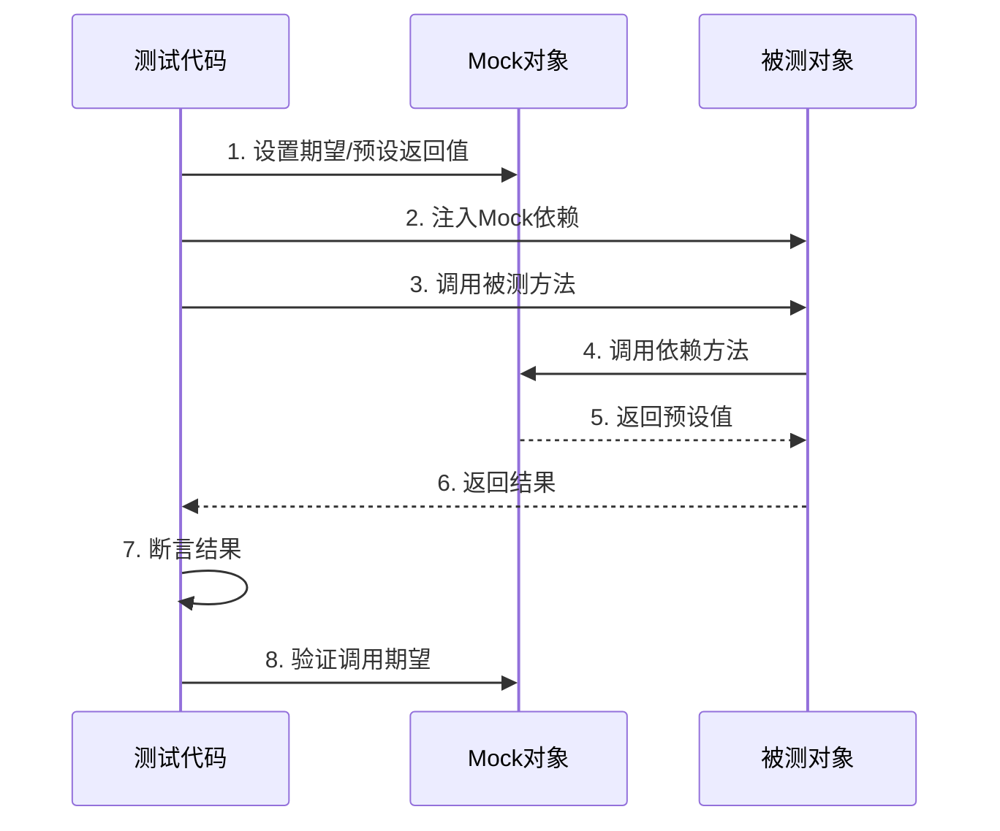

# 测试工程 - Mock 与 Stub 实战

> **文档说明**：测试替身（Test Double）的五种类型、使用场景、Python/Java实战、Mock的边界与反模式。

---

## 一、五种测试替身

| 类型 | 作用 | 特点 |
|------|------|------|
| Dummy（哑对象） | 只是传递，不被调用 | 占位用，如参数填充 |
| Stub（桩） | 提供预设返回值 | 控制间接输入 |
| Spy（间谍） | 记录调用信息 | 验证间接输出 |
| Mock（模拟） | 预设期望并验证 | 验证交互行为 |
| Fake（伪对象） | 有简化实现 | 如内存数据库 |

**核心区别**：Stub验证"返回什么"，Mock验证"怎么调用的"。

---

## 二、Python实战（unittest.mock）

```python
from unittest.mock import Mock, patch, MagicMock

# 1. Stub：控制返回值
def test_get_user_with_stub():
    db = Mock()
    db.find_user.return_value = User(id=1, name="张三")
    service = UserService(db)
    user = service.get_user(1)
    assert user.name == "张三"

# 2. Mock：验证调用
def test_send_email_called():
    email_service = Mock()
    service = UserService(email_service=email_service)
    service.register("test@test.com")
    email_service.send_welcome.assert_called_once_with("test@test.com")

# 3. patch：替换模块中的对象
@patch('requests.get')
def test_api_call(mock_get):
    mock_get.return_value.status_code = 200
    mock_get.return_value.json.return_value = {"id": 1}
    result = fetch_user(1)
    mock_get.assert_called_with("https://api.example.com/users/1")

# 4. 验证异常
def test_service_handles_api_error():
    api = Mock()
    api.get_user.side_effect = ConnectionError("网络错误")
    service = UserService(api)
    result = service.get_user_safe(1)
    assert result is None
```

---

## 三、Java实战（Mockito）

```java
import static org.mockito.Mockito.*;

// Stub
@Test
void test_get_user() {
    UserRepository repo = mock(UserRepository.class);
    when(repo.findById(1L)).thenReturn(Optional.of(new User(1L, "张三")));
    UserService service = new UserService(repo);
    User user = service.getUser(1L);
    assertEquals("张三", user.getName());
}

// Mock验证
@Test
void test_email_sent() {
    EmailService emailService = mock(EmailService.class);
    UserService service = new UserService(emailService);
    service.register("test@test.com");
    verify(emailService, times(1)).sendWelcome("test@test.com");
}

// Spy：部分mock（调用真实方法）
@Test
void test_with_spy() {
    List<String> list = new ArrayList<>();
    List<String> spy = spy(list);
    when(spy.size()).thenReturn(100);  // stub size方法
    spy.add("hello");  // 调用真实add
    assertEquals(100, spy.size());  // stub返回100
    assertEquals("hello", spy.get(0));  // 真实数据
}
```

---

## 四、何时用Mock

| 应该Mock | 不应该Mock |
|---------|-----------|
| 外部API/第三方服务 | 简单的值对象/POJO |
| 数据库（单元测试中） | 你自己写的业务逻辑 |
| 消息队列 | 测试本身要验证的对象 |
| 慢的/不稳定的依赖 | 领域模型/实体 |
| 文件系统/网络 | 工具函数（直接测更快） |

---

## 五、Mock反模式

- ❌ **Mock一切**：测试变成验证实现而非行为，重构就挂
- ❌ **Mock被测对象本身**：等于没测
- ❌ **过度验证**：验证每个内部调用，测试太脆弱
- ❌ **Mock返回Mock**：深层Mock，测试难以理解
- ❌ **用Mock测简单逻辑**：直接测更快更清晰

**原则**：Mock是为了隔离不可控的依赖，不是为了隔离一切。

---


## 补充：概述

### 什么是测试替身

在单元测试中，被测对象（SUT, System Under Test）往往依赖其他对象（DOC, Depended-on Component）。当这些依赖**不可控、不稳定或难以构造**时，我们使用**测试替身（Test Double）**来替代真实依赖，从而隔离被测对象、控制测试环境、加速测试执行。

| 测试替身类型 | 核心作用 | 验证重点 | 典型场景 |
|------------|---------|---------|---------|
| **Dummy** | 仅占位，不被实际调用 | 无 | 填充必填参数 |
| **Stub** | 提供预设返回值 | 控制间接输入 | 模拟数据库查询结果 |
| **Spy** | 记录调用信息 | 验证间接输出 | 记录邮件是否发送 |
| **Mock** | 预设期望并自动验证 | 验证交互行为 | 验证方法调用次数/参数 |
| **Fake** | 提供简化的可用实现 | 替代复杂依赖 | 内存数据库替代真实DB |

**核心原则**：测试替身的目的是**隔离不可控因素**，让测试聚焦于被测对象的行为。不要为了使用 Mock 而 Mock。

### 为什么需要 Mock/Stub

1. **隔离外部依赖**：数据库、网络、文件系统等外部依赖在单元测试中不可控，用 Stub 替代后测试稳定可重复
2. **加速测试执行**：真实的数据库查询、网络请求可能耗时数百毫秒，Mock 后测试毫秒级完成
3. **模拟异常场景**：可以轻松模拟网络超时、数据库连接失败等异常，测试错误处理逻辑
4. **验证交互行为**：Mock 可以验证方法是否被调用、调用了几次、参数是什么，这是普通断言做不到的
5. **TDD 友好**：在依赖尚未实现时，可以先 Mock 依赖，专注于被测对象的设计

---

## 补充：底层原理

### Mock 的实现原理：代理模式

Mock 框架的核心是**动态代理（Dynamic Proxy）**。当你创建一个 Mock 对象时，框架会在运行时生成一个代理类，该类实现了被 Mock 对象的接口，但所有方法都被拦截并转发给 Mock 框架的处理器。

```text
调用方 → Mock代理对象 → 方法拦截器 → 检查预设期望 → 返回预设值/记录调用
```

**Python 实现原理**（unittest.mock）：

```python
# Mock 的核心是 __getattr__ 动态创建属性
class Mock:
    def __init__(self):
        self._mock_children = {}
        self._mock_calls = []
    
    def __getattr__(self, name):
        # 每次访问不存在的属性，自动创建一个子 Mock
        if name not in self._mock_children:
            self._mock_children[name] = Mock()
        return self._mock_children[name]
    
    def __call__(self, *args, **kwargs):
        # 调用时记录调用信息
        self._mock_calls.append((args, kwargs))
        # 返回预设的 return_value
        return self.return_value
```

**Java 实现原理**（Mockito）：
- 使用 **ByteBuddy** 在运行时生成代理类的字节码
- 通过 **Java Agent** 或继承方式拦截方法调用
- 内部维护 `InvocationContainer` 存储预设的 stubbing 和调用记录

### Stub vs Mock 的本质区别

| 维度 | Stub | Mock |
|------|------|------|
| **关注点** | 状态（State） | 行为（Behavior） |
| **验证方式** | 断言返回值 | 验证调用交互 |
| **预设内容** | 返回值 | 期望的调用序列 |
| **失败时机** | 断言失败时 | 期望不满足时 |
| **典型框架** | unittest.mock.Mock(return_value=) | Mockito.verify() |

**经典定义**（Gerard Meszaros, xUnit Test Patterns）：
- **Stub**："an object that provides predefined answers to method calls"
- **Mock**："an object that pre-programmed with expectations which form a specification of the calls they are expected to receive"

### Mock 的工作流程



---

## 补充：常见问题与排查

### 问题1：Mock 不生效，仍然调用了真实方法

**原因排查**：
- `@patch` 的路径写错了：应该 patch **使用处**的引用，而非定义处
  - ❌ `@patch('mylib.requests.get')` — patch 定义处
  - ✅ `@patch('mymodule.requests.get')` — patch 使用处（mymodule 中 import 了 requests）
- Mock 对象没有正确注入到被测对象
- 使用了 `mock.patch` 但没有作为上下文管理器或装饰器使用

**修复示例**：
```python
# mymodule.py
import requests
def fetch_data():
    return requests.get("http://api.example.com").json()

# test_mymodule.py
@patch('mymodule.requests.get')  # ✅ patch 使用处
def test_fetch(mock_get):
    mock_get.return_value.json.return_value = {"data": "ok"}
    result = mymodule.fetch_data()
    assert result == {"data": "ok"}
```

### 问题2：Mock 返回 Mock 对象而非预期值

**原因**：没有设置 `return_value`，Mock 方法默认返回新的 Mock 对象。

```python
# ❌ 错误：mock.json() 返回 Mock 对象
mock_resp = Mock()
mock_resp.status_code = 200
# mock_resp.json() 返回 <Mock name='mock.json()' id='...'>

# ✅ 正确：设置 return_value
mock_resp = Mock()
mock_resp.status_code = 200
mock_resp.json.return_value = {"id": 1}
```

### 问题3：测试通过但实际功能有 Bug（Mock 过度）

**现象**：单元测试全绿，但集成测试或生产环境出问题。

**原因**：Mock 了不应该 Mock 的对象，测试只验证了 Mock 之间的交互，没有验证真实逻辑。

**解决方案**：
- 遵循 **Mock 边界原则**：只 Mock 外部依赖（数据库、网络、第三方 API），不要 Mock 自己写的业务逻辑
- 补充**集成测试**：验证真实依赖下的行为
- 使用 **契约测试**：验证 Mock 的接口与真实服务一致

### 问题4：动态参数无法精确匹配

**场景**：调用时传入了动态生成的参数（如时间戳、UUID），无法用 `assert_called_with` 精确匹配。

**解决方案**：使用 `any()` 匹配器或自定义匹配器：

```python
from unittest.mock import ANY

# 使用 ANY 匹配任意值
mock_service.create.assert_called_with(
    name="test",
    created_at=ANY,  # 匹配任意时间戳
    request_id=ANY    # 匹配任意 UUID
)

# 自定义匹配器
class AnyStringWith:
    def __init__(self, substring):
        self.substring = substring
    def __eq__(self, other):
        return isinstance(other, str) and self.substring in other

mock.log.assert_called_with(AnyStringWith("error"))
```

### 问题5：Mock 静态方法/类方法失败

**Python**：使用 `patch.object` 或 `patch` 类方法：
```python
@patch.object(MyClass, 'static_method')
def test_static(mock_static):
    mock_static.return_value = "mocked"
    assert MyClass.static_method() == "mocked"
```

**Java (Mockito)**：需要 `mockito-inline` 依赖支持静态方法 Mock：
```java
try (MockedStatic<UtilityClass> mocked = mockStatic(UtilityClass.class)) {
    mocked.when(UtilityClass::getData).thenReturn("mocked");
    assertEquals("mocked", UtilityClass.getData());
}
```

---

## 补充：进阶与最佳实践

### 1. Mock 成熟度模型

| 级别 | 特征 | 风险 |
|------|------|------|
| **L0：不用 Mock** | 所有测试用真实依赖 | 测试慢、不稳定、难模拟异常 |
| **L1：Mock 一切** | 所有依赖都 Mock | 测试与实现耦合，重构即挂 |
| **L2：Mock 外部依赖** | 只 Mock 数据库/网络/第三方 | ✅ 推荐做法 |
| **L3：Mock + 契约测试** | Mock 外部依赖 + 验证接口契约 | 企业级最佳实践 |
| **L4：测试金字塔** | 单元测试(Mock) + 集成测试(真实) + E2E | 完整测试策略 |

### 2. 经典测试模式：伦敦学派 vs 经典学派

| 维度 | 伦敦学派（Mockist） | 经典学派（Classicist） |
|------|-------------------|---------------------|
| **核心思想** | 测试应隔离每个对象 | 测试应验证真实行为 |
| **Mock 使用** | 大量使用 Mock | 尽量少用 Mock |
| **测试粒度** | 细粒度，一个类一个测试 | 粗粒度，关注行为 |
| **代表人物** | Steve Freeman, Nat Pryce | Kent Beck, Martin Fowler |
| **适用场景** | 复杂领域逻辑、外部依赖多 | 简单业务、集成测试 |

**实践建议**：两者结合——核心业务逻辑用经典学派（少 Mock，测行为），外部交互用伦敦学派（Mock 依赖，测交互）。

### 3. 高级 Mock 技术

#### 3.1 响应式 Mock（根据参数返回不同值）

```python
# Python：side_effect 可以是函数
def mock_get_user(user_id):
    if user_id == 1:
        return User(id=1, name="admin")
    elif user_id == 2:
        return User(id=2, name="user")
    raise NotFoundError(f"User {user_id} not found")

mock_repo.get_user.side_effect = mock_get_user

# Java：Answer 接口
when(repo.findById(anyLong())).thenAnswer(invocation -> {
    Long id = invocation.getArgument(0);
    if (id == 1L) return Optional.of(new User(1L, "admin"));
    return Optional.empty();
});
```

#### 3.2 调用序列 Mock（按顺序返回不同值）

```python
# Python：side_effect 可以是列表
mock_api.fetch.side_effect = [
    {"status": "pending"},   # 第一次调用
    {"status": "pending"},   # 第二次调用
    {"status": "completed"}, # 第三次调用
]

# Java：连续返回
when(api.fetch())
    .thenReturn("pending")
    .thenReturn("pending")
    .thenReturn("completed");
```

#### 3.3 验证调用顺序

```python
# Python：使用 mock_calls 列表
assert mock.method.mock_calls == [
    call("first"),
    call("second"),
    call("third"),
]

# Java：InOrder
InOrder inOrder = inOrder(mock1, mock2);
inOrder.verify(mock1).first();
inOrder.verify(mock2).second();
inOrder.verify(mock1).third();
```

### 4. Mock 与其他测试技术的配合

| 技术 | 与 Mock 的关系 | 适用场景 |
|------|--------------|---------|
| **Testcontainers** | 替代 Mock 数据库 | 集成测试中用真实数据库容器 |
| **WireMock** | 专门 Mock HTTP 服务 | 微服务间 HTTP 交互测试 |
| **Pact** | 契约测试，验证 Mock 接口 | 微服务消费者驱动契约测试 |
| **Faker** | 生成测试数据 | 配合 Mock 生成真实感数据 |
| **Property-based Testing** | 随机输入测试 | 配合 Mock 验证边界条件 |
| **Mutation Testing** | 评估测试质量 | 验证 Mock 测试是否真的有效 |

### 5. Mock 反模式检查清单

- [ ] 是否 Mock 了被测对象本身？（❌ 禁止）
- [ ] 是否 Mock 了简单的值对象/POJO？（❌ 直接用真实对象）
- [ ] 是否验证了每个内部方法调用？（❌ 过度验证，测试脆弱）
- [ ] Mock 返回的是否是另一个 Mock？（❌ 深层 Mock，难以理解）
- [ ] 是否用 Mock 测试了简单逻辑？（❌ 直接测更快）
- [ ] 测试是否只验证了 Mock 之间的交互？（⚠️ 需要补充集成测试）
- [ ] 修改实现后测试是否大面积失败？（⚠️ 说明 Mock 过度，测试与实现耦合）

> **黄金法则**：Mock 是手段，不是目的。测试的目标是验证**行为正确性**，而非验证**实现细节**。当 Mock 让测试变得脆弱或难以理解时，说明需要重新审视测试策略。

---

## 关联笔记
[[测试工程-测试金字塔与分层策略]] · [[测试工程-TDD测试驱动开发]] · [[测试工程-测试覆盖率与质量度量]]

> 🔍 **核心要点**：Stub控制输入，Mock验证行为，只Mock不可控的外部依赖，不要Mock被测逻辑本身。
