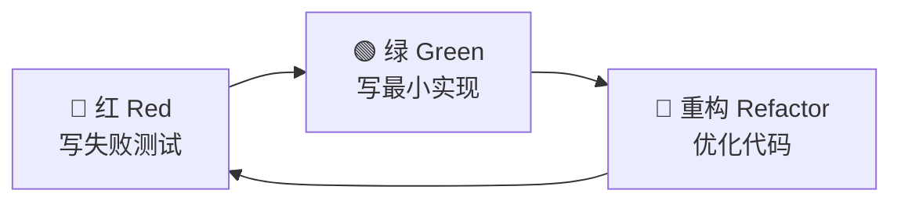
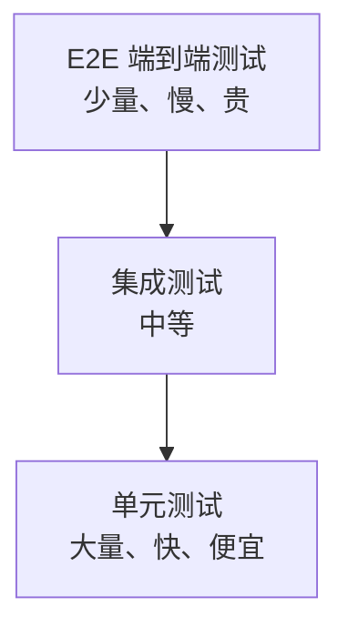

# 测试工程-TDD测试驱动开发

> **文档说明**：系统讲解测试驱动开发（TDD）的核心理念、红-绿-重构循环、单元测试实战（JUnit 5/Mockito/AssertJ）、测试金字塔、测试覆盖率与质量度量、BDD 行为驱动开发、测试最佳实践，以及常见问题与排查。
>
> **适用人群**：后端开发工程师、全栈开发者、QA 工程师、希望提升代码质量的开发者
>
> **前置知识**：[[测试工程-测试金字塔与分层策略]]、[[测试工程-测试覆盖率与质量度量]]、[[测试工程-契约测试与集成测试]]

---

## 一、概述

### 1. 什么是 TDD

**TDD（Test-Driven Development，测试驱动开发）** 是一种软件开发方法论，核心思想是**先写测试，再写代码**。通过测试驱动代码设计，确保代码可测试、可维护、符合需求。

### 2. TDD 核心理念

| 理念 | 说明 |
|------|------|
| **先写测试** | 先写失败的测试，再写实现代码 |
| **小步迭代** | 每次只写一个测试，实现最小功能 |
| **持续重构** | 测试通过后立即重构，保持代码整洁 |
| **测试即文档** | 测试用例是可执行的需求文档 |
| **设计涌现** | 通过测试驱动出良好的代码设计 |

### 3. TDD 的价值

- [ ] **代码质量高**：测试覆盖核心逻辑，减少 Bug
- [ ] **设计更优**：可测试性驱动出低耦合、高内聚的设计
- [ ] **重构安全**：有测试保护，重构不担心破坏功能
- [ ] **文档自动更新**：测试随代码更新，永远不过时
- [ ] **快速反馈**：运行测试快速验证功能正确性
- [ ] **减少调试**：测试定位问题快，减少调试时间

---

## 二、红-绿-重构循环

### 1. TDD 三步循环



| 步骤 | 说明 | 目标 |
|------|------|------|
| **红（Red）** | 写一个失败的测试，描述期望的行为 | 测试编译通过但运行失败 |
| **绿（Green）** | 写最少的代码让测试通过 | 测试通过，不追求代码质量 |
| **重构（Refactor）** | 在测试保护下优化代码结构 | 保持测试通过，提升代码质量 |

### 2. TDD 示例

```java
// 步骤1：红 - 写失败测试
import org.junit.jupiter.api.Test;
import static org.junit.jupiter.api.Assertions.*;

class CalculatorTest {
    @Test
    void shouldAddTwoNumbers() {
        Calculator calculator = new Calculator();
        int result = calculator.add(2, 3);
        assertEquals(5, result);
    }
}
// 此时 Calculator 类不存在，编译失败

// 步骤2：绿 - 写最小实现
class Calculator {
    public int add(int a, int b) {
        return a + b;  // 最简单的实现
    }
}
// 测试通过

// 步骤3：重构 - 优化代码（如果需要）
// 例如提取常量、重命名、消除重复等
```

### 3. TDD 三条法则

1. **只有在测试失败时，才写生产代码**
2. **只写刚好让测试失败的测试**（不通过编译也算失败）
3. **只写刚好让测试通过的生产代码**

---

## 三、单元测试实战

### 1. JUnit 5 核心注解

| 注解 | 说明 |
|------|------|
| `@Test` | 标记测试方法 |
| `@BeforeEach` | 每个测试方法前执行 |
| `@AfterEach` | 每个测试方法后执行 |
| `@BeforeAll` | 所有测试方法前执行一次（静态方法） |
| `@AfterAll` | 所有测试方法后执行一次（静态方法） |
| `@Disabled` | 禁用测试 |
| `@DisplayName` | 测试显示名称 |
| `@Nested` | 嵌套测试类 |
| `@ParameterizedTest` | 参数化测试 |
| `@Tag` | 测试标签分类 |

### 2. JUnit 5 断言

```java
import org.junit.jupiter.api.Test;
import static org.junit.jupiter.api.Assertions.*;

class AssertionTest {

    @Test
    void basicAssertions() {
        // 相等断言
        assertEquals(5, 2 + 3);
        assertNotEquals(4, 2 + 3);

        // 布尔断言
        assertTrue(3 > 2);
        assertFalse(2 > 3);

        // 空值断言
        assertNull(null);
        assertNotNull("hello");

        // 引用断言
        Object obj = new Object();
        assertSame(obj, obj);
        assertNotSame(new Object(), new Object());

        // 异常断言
        assertThrows(ArithmeticException.class, () -> {
            int result = 1 / 0;
        });

        // 超时断言
        assertTimeout(Duration.ofSeconds(1), () -> {
            Thread.sleep(500);
        });

        // 组合断言（全部执行，不短路）
        assertAll("person",
            () -> assertEquals("张三", person.getName()),
            () -> assertEquals(25, person.getAge()),
            () -> assertEquals("北京", person.getCity())
        );
    }
}
```

### 3. AssertJ 流式断言

```java
import org.junit.jupiter.api.Test;
import static org.assertj.core.api.Assertions.*;

class AssertJTest {

    @Test
    void fluentAssertions() {
        // 字符串断言
        assertThat("Hello World")
            .startsWith("Hello")
            .endsWith("World")
            .contains(" ")
            .hasSize(11);

        // 集合断言
        assertThat(Arrays.asList(1, 2, 3))
            .hasSize(3)
            .contains(2)
            .doesNotContain(4)
            .isSorted();

        // 对象断言
        assertThat(user)
            .isNotNull()
            .hasFieldOrPropertyWithValue("name", "张三")
            .hasFieldOrPropertyWithValue("age", 25);

        // 异常断言
        assertThatThrownBy(() -> {
            throw new IllegalArgumentException("参数错误");
        }).isInstanceOf(IllegalArgumentException.class)
          .hasMessage("参数错误");
    }
}
```

### 4. Mockito 模拟

```java
import org.junit.jupiter.api.Test;
import org.junit.jupiter.api.extension.ExtendWith;
import org.mockito.InjectMocks;
import org.mockito.Mock;
import org.mockito.junit.jupiter.MockitoExtension;
import static org.mockito.Mockito.*;
import static org.junit.jupiter.api.Assertions.*;

@ExtendWith(MockitoExtension.class)
class UserServiceTest {

    @Mock
    private UserRepository userRepository;  // 模拟依赖

    @InjectMocks
    private UserService userService;        // 被测试类，自动注入 mock

    @Test
    void shouldGetUserById() {
        // 1. 准备（Given）
        User mockUser = new User(1L, "张三");
        when(userRepository.findById(1L)).thenReturn(Optional.of(mockUser));

        // 2. 执行（When）
        User result = userService.getUserById(1L);

        // 3. 验证（Then）
        assertEquals("张三", result.getName());
        verify(userRepository, times(1)).findById(1L);  // 验证调用次数
    }

    @Test
    void shouldThrowWhenUserNotFound() {
        // 准备
        when(userRepository.findById(99L)).thenReturn(Optional.empty());

        // 执行 + 验证
        assertThrows(UserNotFoundException.class, () -> {
            userService.getUserById(99L);
        });
    }

    @Test
    void shouldCreateUser() {
        // 参数匹配器
        User newUser = new User(null, "李四");
        when(userRepository.save(any(User.class))).thenReturn(new User(1L, "李四"));

        User created = userService.createUser(newUser);

        assertNotNull(created.getId());
        verify(userRepository).save(argThat(user -> user.getName().equals("李四")));
    }
}
```

### 5. 参数化测试

```java
import org.junit.jupiter.params.ParameterizedTest;
import org.junit.jupiter.params.provider.*;

class ParameterizedTest {

    // 值源
    @ParameterizedTest
    @ValueSource(strings = {"racecar", "level", "madam"})
    void shouldBePalindrome(String word) {
        assertTrue(isPalindrome(word));
    }

    // CSV 源
    @ParameterizedTest
    @CsvSource({
        "2, 3, 5",
        "0, 0, 0",
        "-1, 1, 0",
        "100, 200, 300"
    })
    void shouldAdd(int a, int b, int expected) {
        assertEquals(expected, a + b);
    }

    // 方法源
    @ParameterizedTest
    @MethodSource("provideTestCases")
    void shouldCalculate(int a, int b, int expected) {
        assertEquals(expected, calculator.add(a, b));
    }

    static Stream<Arguments> provideTestCases() {
        return Stream.of(
            Arguments.of(2, 3, 5),
            Arguments.of(0, 0, 0),
            Arguments.of(-1, 1, 0)
        );
    }
}
```

---

## 四、测试金字塔

### 1. 测试金字塔模型



| 层级 | 比例 | 速度 | 成本 | 说明 |
|------|------|------|------|------|
| **单元测试** | 70-80% | 快（毫秒级） | 低 | 测试单个类/方法，Mock 外部依赖 |
| **集成测试** | 15-20% | 中（秒级） | 中 | 测试模块间协作，如 DB、HTTP |
| **E2E 测试** | 5-10% | 慢（分钟级） | 高 | 测试完整用户流程，真实环境 |

### 2. 测试反模式（冰淇淋蛋筒）

```json
反模式：大量 E2E 测试，少量单元测试
    [E2E 大量]
    [集成测试 中等]
    [单元测试 少量]
问题：测试慢、不稳定、维护成本高、定位困难
```

---

## 五、测试覆盖率

### 1. 覆盖率指标

| 指标 | 说明 | 推荐阈值 |
|------|------|---------|
| **行覆盖率** | 被执行的代码行比例 | ≥ 70% |
| **分支覆盖率** | if/else 分支被覆盖比例 | ≥ 60% |
| **方法覆盖率** | 被调用的方法比例 | ≥ 80% |
| **类覆盖率** | 被实例化的类比例 | ≥ 70% |

### 2. JaCoCo 配置

```xml
<!-- Maven JaCoCo 插件 -->
<plugin>
    <groupId>org.jacoco</groupId>
    <artifactId>jacoco-maven-plugin</artifactId>
    <version>0.8.11</version>
    <executions>
        <execution>
            <goals>
                <goal>prepare-agent</goal>
            </goals>
        </execution>
        <execution>
            <id>report</id>
            <phase>test</phase>
            <goals>
                <goal>report</goal>
            </goals>
        </execution>
        <execution>
            <id>check</id>
            <goals>
                <goal>check</goal>
            </goals>
            <configuration>
                <rules>
                    <rule>
                        <element>BUNDLE</element>
                        <limits>
                            <limit>
                                <counter>LINE</counter>
                                <value>COVEREDRATIO</value>
                                <minimum>0.70</minimum>
                            </limit>
                        </limits>
                    </rule>
                </rules>
            </configuration>
        </execution>
    </executions>
</plugin>
```

> **注意**：覆盖率高不等于测试质量高。100% 覆盖率也可能有逻辑漏洞，关键是测试有意义的场景。

---

## 六、BDD 行为驱动开发

### 1. BDD 概述

```text
**BDD（Behavior-Driven Development）** 是 TDD 的延伸，使用自然语言描述测试场景，促进开发、测试、产品之间的沟通。

### 2. Given-When-Then 格式
```

```gherkin
Feature: 用户登录
  用户可以使用用户名和密码登录系统

  Scenario: 正确的用户名和密码
    Given 用户已注册，用户名 "zhangsan"，密码 "123456"
    When 用户输入用户名 "zhangsan" 和密码 "123456" 并点击登录
    Then 登录成功，跳转到首页
    And 显示欢迎信息 "欢迎，张三"

  Scenario: 错误的密码
    Given 用户已注册，用户名 "zhangsan"，密码 "123456"
    When 用户输入用户名 "zhangsan" 和密码 "wrong" 并点击登录
    Then 登录失败
    And 显示错误信息 "用户名或密码错误"
```

### 3. 测试方法命名规范

```java
// 推荐：should_行为_when_条件
@Test
void shouldReturnUser_whenUserExists() { }

@Test
void shouldThrowException_whenUserNotFound() { }

@Test
void shouldUpdateCache_whenUserInfoChanged() { }

// 中文显示名
@Test
@DisplayName("当用户存在时，应返回用户信息")
void shouldReturnUser_whenUserExists() { }
```

---

## 七、测试最佳实践

### 1. FIRST 原则

| 原则 | 说明 |
|------|------|
| **F - Fast** | 测试要快，单元测试毫秒级 |
| **I - Independent** | 测试相互独立，不依赖执行顺序 |
| **R - Repeatable** | 测试可重复运行，结果一致 |
| **S - Self-Validating** | 测试自动验证，不需人工判断 |
| **T - Timely** | 及时编写，先于生产代码（TDD） |

### 2. 测试编写规范

- [ ] **一个测试一个关注点**：每个测试只验证一个行为
- [ ] **AAA 模式**：Arrange（准备）→ Act（执行）→ Assert（验证）
- [ ] **避免测试间依赖**：每个测试独立运行，不共享可变状态
- [ ] **使用测试数据工厂**：避免重复构造测试数据
- [ ] **测试命名清晰**：方法名描述测试场景和期望结果
- [ ] **避免过度 Mock**：不要 Mock 被测类本身，只 Mock 外部依赖
- [ ] **测试边界条件**：空值、零、负数、最大值、异常输入
- [ ] **保持测试简洁**：测试代码也要整洁，避免冗余
- [ ] **不测试实现细节**：测试行为，不测试私有方法
- [ ] **持续集成运行**：每次提交都运行测试，失败立即修复

### 3. 测试数据管理

```java
// 测试数据工厂模式
public class UserTestDataFactory {
    public static User.UserBuilder validUser() {
        return User.builder()
            .id(1L)
            .username("testuser")
            .email("test@example.com")
            .age(25)
            .active(true);
    }

    public static User.UserBuilder inactiveUser() {
        return validUser().active(false);
    }

    public static User.UserBuilder minorUser() {
        return validUser().age(15);
    }
}

// 使用
User user = UserTestDataFactory.validUser().build();
User inactive = UserTestDataFactory.inactiveUser().build();
```

---

## 八、常见问题与排查

| 问题 | 原因 | 解决方案 |
|------|------|---------|
| **测试运行慢** | 集成测试多 / 启动 Spring 上下文 / 数据库操作 | 单元测试不启动 Spring、用 H2 内存库、并行执行 |
| **测试不稳定（Flaky）** | 依赖时间/随机数/外部服务 / 并发问题 | 固定时间、Mock 随机数、Mock 外部服务、避免共享状态 |
| **测试间相互影响** | 共享静态变量 / 数据库未清理 / 文件未清理 | @AfterEach 清理、使用事务回滚、独立测试数据 |
| **Mock 过度** | Mock 了不该 Mock 的对象 / 测试失去意义 | 只 Mock 外部依赖，核心逻辑不 Mock |
| **覆盖率低** | 未测试异常分支 / 边界条件 / 私有方法 | 补充异常场景、边界测试、通过公共方法测试私有逻辑 |
| **难以测试** | 代码耦合高 / 依赖静态方法 / new 对象 | 依赖注入、接口抽象、工厂模式、可测试性设计 |
| **测试维护成本高** | 测试与实现耦合 / 频繁修改测试 | 测试行为不测试实现、稳定的测试接口 |
| **CI 中测试失败** | 环境差异 / 时序问题 / 资源不足 | 容器化保证环境一致、增加超时、资源限制 |
| **私有方法测试** | 直接测试私有方法 | 通过公共方法测试，或使用反射（不推荐），或提取为独立类 |
| **静态方法测试** | 静态方法难以 Mock | 使用 Mockito-inline / PowerMock，或重构为实例方法 |
| **数据库测试慢** | 真实数据库 / 数据初始化慢 | 使用 Testcontainers / H2 内存库 / 缓存数据库状态 |
| **并发代码测试** | 竞态条件难以复现 | 多线程循环测试、JCStress 工具、Thread.sleep 等待 |
| **测试代码重复** | 相似测试大量重复 | 参数化测试、测试数据工厂、@Nested 组织 |

---

## 九、关联笔记

### 测试工程
- [[测试工程-测试金字塔与分层策略]] · [[测试工程-测试覆盖率与质量度量]] · [[测试工程-契约测试与集成测试]]
- [[测试工程-TDD测试驱动开发]] · [[接口测试与Postman实战]]

### 工程化
- [[CI-CD持续集成与部署]] · [[前端工程化知识点系统梳理_优化版]] · [[Vite-构建原理与插件开发]]
- [[ESLint+Prettier+Stylelint规范]] · [[Husky+Commitlint提交规范]]

### 后端
- [[SpringBoot-自动装配原理]] · [[SpringBoot-Web层设计]] · [[SpringBoot-配置管理与多环境]]
- [[Java-并发编程JUC]] · [[JVM-内存模型与GC调优]]

### 前端
- [[Vitest-单元测试与组件测试]] · [[前端性能优化实战]] · [[Vue3-自定义Hooks封装]]

### 导航
- [[MOC-计算机基础]] · [[MOC-后端开发]] · [[全栈+AI工程双轨融合学习路线图]]

> **学习路径建议**：先掌握 [[测试工程-测试金字塔与分层策略]] 测试分层 → 深入本文 TDD 测试驱动开发 → 实践 JUnit 5 + Mockito 单元测试 → 学习 [[测试工程-契约测试与集成测试]] 集成测试 → 研究 [[CI-CD持续集成与部署]] 自动化测试 → 应用于实际项目的质量保障。

---

## 💡 全文深度讲解

本文系统梳理了测试工程-TDD测试驱动开发的核心知识体系，从概述入手，深入红-绿-重构循环的底层机制，再通过单元测试实战掌握实战应用，最后涵盖常见问题与排查与关联笔记。学习时建议先建立整体认知，再动手实践，最后结合常见问题深化理解。

## 📝 全文精简总结

- **概述**：掌握本模块的核心概念与关键要点
- **红-绿-重构循环**：掌握本模块的核心概念与关键要点
- **单元测试实战**：掌握本模块的核心概念与关键要点
- **测试金字塔**：掌握本模块的核心概念与关键要点
- **测试覆盖率**：掌握本模块的核心概念与关键要点
- **BDD 行为驱动开发**：掌握本模块的核心概念与关键要点
- **测试最佳实践**：掌握本模块的核心概念与关键要点
- **常见问题与排查**：掌握本模块的核心概念与关键要点
- 其余1个模块涵盖进阶主题与拓展内容

