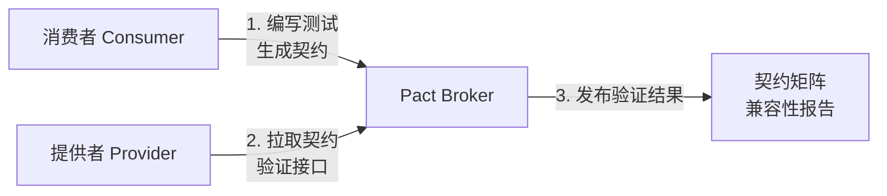
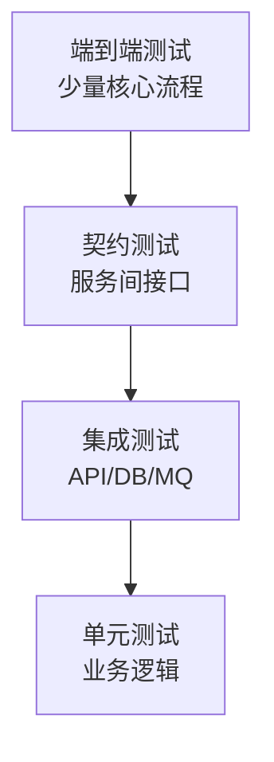

# 测试工程-契约测试与集成测试

> **文档说明**：系统讲解集成测试（持久层/API/服务间/消息集成）和契约测试（消费者驱动契约测试 Pact）的核心概念、工具选型、实战代码，以及契约测试与集成测试的对比、微服务测试策略和最佳实践。
>
> **适用人群**：后端开发工程师、全栈开发者、QA 工程师、微服务架构师
>
> **前置知识**：[[测试工程-TDD测试驱动开发]]、[[测试工程-测试金字塔与分层策略]]、[[测试工程-测试覆盖率与质量度量]]、[[接口测试与Postman实战]]

---

## 一、概述

### 1. 集成测试定义

**集成测试（Integration Test）** 验证多个模块/组件协同工作的正确性，测试模块间的接口和数据流转。与单元测试不同，集成测试使用真实的依赖（数据库、消息队列、外部服务）或容器化依赖。

### 2. 契约测试定义

**契约测试（Contract Test）** 验证服务提供者和消费者之间的接口契约是否一致。消费者定义期望的接口格式（契约），提供者验证自己是否满足契约，确保服务间接口不被意外破坏。

### 3. 集成测试 vs 契约测试 vs 单元测试

| 维度 | 单元测试 | 集成测试 | 契约测试 |
|------|---------|---------|---------|
| **测试对象** | 单个函数/类 | 多个模块协作 | 服务间接口 |
| **外部依赖** | Mock/Stub | 真实/容器化 | Mock 服务 |
| **速度** | 毫秒级 | 秒级 | 秒级 |
| **目的** | 验证业务逻辑 | 验证模块协作 | 验证接口兼容性 |
| **适用场景** | 所有业务逻辑 | API、DB、MQ 集成 | 微服务间接口 |
| **维护成本** | 低 | 中 | 中 |
| **发现问题** | 逻辑错误 | 集成问题、数据不一致 | 接口不兼容、破坏性变更 |

---

## 二、集成测试

### 1. 集成测试类型

| 类型 | 说明 | 测试范围 |
|------|------|---------|
| **持久层集成** | 测试数据访问层与数据库 | Repository + 真实 DB |
| **API 集成** | 测试完整 API 端点 | Controller → Service → DB |
| **服务间集成** | 测试多个服务调用 | Service A → Service B |
| **消息集成** | 测试消息队列 | Producer → MQ → Consumer |
| **外部服务集成** | 测试第三方 API | 服务 → 外部 API（Mock） |
| **全链路集成** | 测试完整业务流程 | 前端 → API → 服务 → DB → MQ |

### 2. Spring Boot 集成测试

```java
// 完整 API 集成测试
@SpringBootTest(webEnvironment = SpringBootTest.WebEnvironment.RANDOM_PORT)
@AutoConfigureMockMvc
@Testcontainers
class UserApiIntegrationTest {

    @Container
    static PostgreSQLContainer<?> postgres = new PostgreSQLContainer<>("postgres:15")
        .withDatabaseName("testdb")
        .withUsername("test")
        .withPassword("test");

    @DynamicPropertySource
    static void configureProperties(DynamicPropertyRegistry registry) {
        registry.add("spring.datasource.url", postgres::getJdbcUrl);
        registry.add("spring.datasource.username", postgres::getUsername);
        registry.add("spring.datasource.password", postgres::getPassword);
    }

    @Autowired
    private MockMvc mockMvc;

    @Autowired
    private UserRepository userRepository;

    @BeforeEach
    void setUp() {
        userRepository.deleteAll();
    }

    @Test
    @DisplayName("创建用户：POST /api/users 返回 201 并持久化")
    void shouldCreateUser_whenPostRequest() throws Exception {
        // Given
        String requestBody = """
            {"name": "张三", "email": "zhangsan@example.com", "age": 25}
            """;

        // When & Then
        mockMvc.perform(post("/api/users")
                .contentType(MediaType.APPLICATION_JSON)
                .content(requestBody))
            .andExpect(status().isCreated())
            .andExpect(header().exists("Location"))
            .andExpect(jsonPath("$.id").isNotEmpty())
            .andExpect(jsonPath("$.name").value("张三"))
            .andExpect(jsonPath("$.email").value("zhangsan@example.com"));

        // 验证数据库
        assertEquals(1, userRepository.count());
        User saved = userRepository.findAll().get(0);
        assertEquals("张三", saved.getName());
    }

    @Test
    @DisplayName("查询用户：GET /api/users/{id} 返回用户详情")
    void shouldReturnUser_whenGetById() throws Exception {
        // Given
        User saved = userRepository.save(new User("李四", "lisi@example.com", 30));

        // When & Then
        mockMvc.perform(get("/api/users/{id}", saved.getId()))
            .andExpect(status().isOk())
            .andExpect(jsonPath("$.id").value(saved.getId()))
            .andExpect(jsonPath("$.name").value("李四"));
    }

    @Test
    @DisplayName("查询不存在用户：返回 404")
    void shouldReturn404_whenUserNotFound() throws Exception {
        mockMvc.perform(get("/api/users/{id}", 999L))
            .andExpect(status().isNotFound())
            .andExpect(jsonPath("$.error").value("NOT_FOUND"));
    }

    @Test
    @DisplayName("参数校验失败：返回 400 和字段错误")
    void shouldReturn400_whenValidationFails() throws Exception {
        String invalidBody = """
            {"name": "", "email": "invalid", "age": -1}
            """;

        mockMvc.perform(post("/api/users")
                .contentType(MediaType.APPLICATION_JSON)
                .content(invalidBody))
            .andExpect(status().isBadRequest())
            .andExpect(jsonPath("$.error").value("VALIDATION_ERROR"))
            .andExpect(jsonPath("$.details[*].field")
                .value(org.hamcrest.Matchers.hasItems("name", "email", "age")));
    }
}
```

### 3. 切片测试（Slice Test）

Spring Boot 提供切片测试，只加载需要的层，比完整 @SpringBootTest 快：

```java
// Web 层切片测试
@WebMvcTest(UserController.class)
class UserControllerSliceTest {

    @Autowired
    private MockMvc mockMvc;

    @MockBean
    private UserService userService;  // Mock Service 层

    @Test
    void shouldReturnUser_whenGetById() throws Exception {
        when(userService.getUserById(1L))
            .thenReturn(new UserDTO(1L, "张三", "zhangsan@example.com"));

        mockMvc.perform(get("/api/users/1"))
            .andExpect(status().isOk())
            .andExpect(jsonPath("$.name").value("张三"));
    }
}

// 数据层切片测试
@DataJpaTest
@AutoConfigureTestDatabase(replace = AutoConfigureTestDatabase.Replace.NONE)
class UserRepositorySliceTest {

    @Autowired
    private UserRepository userRepository;

    @Test
    void shouldFindByEmail() {
        userRepository.save(new User("张三", "zhangsan@example.com"));
        Optional<User> found = userRepository.findByEmail("zhangsan@example.com");
        assertTrue(found.isPresent());
    }
}
```

### 4. Testcontainers 容器化依赖

```java
// 多容器集成测试
@Testcontainers
class OrderServiceIntegrationTest {

    // PostgreSQL
    @Container
    static PostgreSQLContainer<?> postgres = new PostgreSQLContainer<>("postgres:15");

    // Redis
    @Container
    static GenericContainer<?> redis = new GenericContainer<>("redis:7")
        .withExposedPorts(6379);

    // RabbitMQ
    @Container
    static RabbitMQContainer rabbitmq = new RabbitMQContainer("rabbitmq:3-management");

    @DynamicPropertySource
    static void configure(DynamicPropertyRegistry registry) {
        registry.add("spring.datasource.url", postgres::getJdbcUrl);
        registry.add("spring.redis.host", redis::getHost);
        registry.add("spring.redis.port", redis::getFirstMappedPort);
        registry.add("spring.rabbitmq.host", rabbitmq::getHost);
        registry.add("spring.rabbitmq.port", rabbitmq::getAmqpPort);
    }
}
```

### 5. 数据库集成测试

```java
// 使用 @Transactional 自动回滚
@SpringBootTest
@Transactional
class UserRepositoryTest {

    @Autowired
    private UserRepository userRepository;

    @Test
    void shouldSaveAndFindUser() {
        // 每个测试后自动回滚，不需手动清理
        User user = new User("张三", "zhangsan@example.com");
        userRepository.save(user);

        User found = userRepository.findById(user.getId()).orElseThrow();
        assertEquals("张三", found.getName());
    }
    // 测试结束后事务回滚，数据不残留
}
```

### 6. 消息队列集成测试

```java
@SpringBootTest
@Testcontainers
class OrderMessageIntegrationTest {

    @Container
    static RabbitMQContainer rabbitmq = new RabbitMQContainer("rabbitmq:3-management");

    @Autowired
    private RabbitTemplate rabbitTemplate;

    @Autowired
    private OrderRepository orderRepository;

    @Test
    void shouldConsumeOrderMessage_whenMessagePublished() throws Exception {
        // Given
        OrderCreatedEvent event = new OrderCreatedEvent(1L, "ORD-001", new BigDecimal("100.00"));

        // When
        rabbitTemplate.convertAndSend("order.exchange", "order.created", event);

        // Then（等待消费）
        await().atMost(5, TimeUnit.SECONDS)
            .untilAsserted(() -> {
                Order order = orderRepository.findByOrderNo("ORD-001");
                assertNotNull(order);
                assertEquals(OrderStatus.CREATED, order.getStatus());
            });
    }
}
```

---

## 三、契约测试

### 1. 契约测试概念

**契约测试**确保服务提供者（Provider）和消费者（Consumer）之间的接口一致。有两种模式：

| 模式 | 说明 | 代表工具 |
|------|------|---------|
| **提供者驱动（PDD）** | 提供者定义契约，消费者验证 | Spring Cloud Contract |
| **消费者驱动（CDCT）** | 消费者定义契约，提供者验证 | Pact |

### 2. 消费者驱动契约测试（Pact）



**Pact 工作流程**：
1. 消费者编写测试，定义对提供者的期望（请求/响应格式）
2. 运行消费者测试，生成 Pact 文件（JSON 契约）
3. 将 Pact 文件发布到 Pact Broker
4. 提供者从 Pact Broker 拉取契约
5. 提供者运行 Pact 验证，检查接口是否满足契约
6. 验证结果发布到 Pact Broker

### 3. Pact 消费者测试

```java
// 消费者端：定义契约
@PactTestFor(providerName = "user-service", port = "8080")
class UserServiceConsumerPactTest {

    @Pact(consumer = "order-service")
    public RequestResponsePact getUserPact(PactDslWithProvider builder) {
        return builder
            .given("user exists with id 1")
            .uponReceiving("a request to get user by id")
            .path("/api/users/1")
            .method("GET")
            .willRespondWith()
            .status(200)
            .headers(Map.of("Content-Type", "application/json"))
            .body(new PactDslJsonBody()
                .integerType("id", 1)
                .stringType("name", "张三")
                .stringType("email", "zhangsan@example.com")
                .integerType("age", 25))
            .toPact();
    }

    @Test
    void shouldGetUser(MockServer mockServer) {
        // 使用 Pact Mock Server 测试消费者代码
        UserClient client = new UserClient(mockServer.getUrl());
        User user = client.getUserById(1L);

        assertEquals(1L, user.getId());
        assertEquals("张三", user.getName());
    }
}
```

### 4. Pact 提供者验证

```java
// 提供者端：验证契约
@Provider("user-service")
@Consumer("order-service")
@PactFolder("pacts")  // 或 @PactBroker(url = "http://pact-broker:80")
@SpringBootTest(webEnvironment = SpringBootTest.WebEnvironment.RANDOM_PORT)
class UserServiceProviderPactTest {

    @LocalServerPort
    private int port;

    @BeforeEach
    void setUp(PactVerificationContext context) {
        context.setTarget(new HttpTestTarget("localhost", port));
    }

    @State("user exists with id 1")
    void userExistsWithId1() {
        // 准备测试数据：确保 ID=1 的用户存在
        userRepository.save(new User(1L, "张三", "zhangsan@example.com", 25));
    }

    @TestTemplate
    @ExtendWith(PactVerificationInvocationContextProvider.class)
    void pactVerificationTestTemplate(PactVerificationContext context) {
        context.verifyInteraction();
    }
}
```

### 5. Spring Cloud Contract

```groovy
// 提供者端：定义契约（Groovy DSL）
// src/test/resources/contracts/shouldReturnUser.groovy
package contracts

org.springframework.cloud.contract.spec.Contract.make {
    request {
        method 'GET'
        url '/api/users/1'
    }
    response {
        status 200
        headers {
            contentType(applicationJson())
        }
        body([
            id   : 1,
            name : '张三',
            email: 'zhangsan@example.com',
            age  : 25
        ])
    }
}
```

```java
// 提供者端：自动生成测试
@SpringBootTest
@AutoConfigureMockMvc
class UserServiceContractTest extends ContractVerifierBase {
    // Spring Cloud Contract 自动生成测试类
    // 继承 ContractVerifierBase 即可
}
```

### 6. 契约测试 vs 端到端测试

| 维度 | 契约测试 | 端到端测试 |
|------|---------|-----------|
| **测试范围** | 接口格式兼容性 | 完整业务流程 |
| **依赖** | 只启动被测服务 | 需要所有服务运行 |
| **速度** | 快（秒级） | 慢（分钟级） |
| **稳定性** | 高 | 低（受多服务影响） |
| **定位** | 明确哪个接口不兼容 | 难以定位问题 |
| **成本** | 低 | 高 |
| **互补关系** | 验证接口不被破坏 | 验证业务流程正确 |

> **建议**：微服务架构中，用契约测试替代大部分端到端测试，只保留核心流程的端到端测试。

---

## 四、微服务测试策略

### 1. 微服务测试金字塔



| 层级 | 比例 | 工具 |
|------|------|------|
| **单元测试** | 60-70% | JUnit、Mockito |
| **集成测试** | 15-20% | Spring Boot Test、Testcontainers |
| **契约测试** | 10-15% | Pact、Spring Cloud Contract |
| **端到端测试** | 5-10% | Playwright、RestAssured |

### 2. 测试策略矩阵

| 测试类型 | 验证内容 | 何时运行 | 环境 |
|---------|---------|---------|------|
| 单元测试 | 业务逻辑正确性 | 每次提交 | 本地/CI |
| 集成测试 | 模块协作、数据一致性 | 每次提交 | CI（Testcontainers） |
| 契约测试 | 服务间接口兼容 | 每次提交 | CI（Pact Broker） |
| 组件测试 | 单个服务完整功能 | 每日/PR | CI（独立环境） |
| 端到端测试 | 核心业务流程 | 发布前 | 预发布环境 |
| 性能测试 | 响应时间、吞吐量 | 定期/发布前 | 性能环境 |
| 安全测试 | 漏洞、权限 | 定期/发布前 | 安全扫描工具 |

---

## 五、最佳实践

### 1. 集成测试最佳实践

- [ ] **使用 Testcontainers**：真实依赖，避免 H2 与生产 DB 差异
- [ ] **测试数据隔离**：每个测试独立数据，@AfterEach 清理或 @Transactional 回滚
- [ ] **避免依赖执行顺序**：每个测试独立可运行
- [ ] **合理超时**：设置测试超时，避免挂死
- [ ] **外部服务 Mock**：第三方 API 使用 WireMock，不依赖真实外部服务
- [ ] **并行执行**：无状态测试可并行，提升速度
- [ ] **测试配置分离**：测试使用独立配置文件（application-test.yml）
- [ ] **避免过度集成**：不要在集成测试中测试所有组合，聚焦关键路径

### 2. 契约测试最佳实践

- [ ] **消费者驱动**：由消费者定义契约，更贴近实际使用
- [ ] **契约版本管理**：使用 Pact Broker 管理契约版本
- [ ] **CI 集成**：每次提交运行契约验证，防止破坏性变更
- [ ] **契约即文档**：Pact 文件可作为 API 文档
- [ ] **状态管理**：提供者使用 @State 准备测试数据
- [ ] **渐进式引入**：先在核心服务间引入，逐步推广
- [ ] **契约最小化**：只定义实际使用的字段，不过度约束
- [ ] **兼容 Can I Deploy**：部署前检查契约兼容性

### 3. 测试数据管理

```java
// 测试数据工厂模式
public class UserTestDataFactory {
    public static User.UserBuilder validUser() {
        return User.builder()
            .id(1L)
            .name("测试用户")
            .email("test@example.com")
            .age(25)
            .status(UserStatus.ACTIVE);
    }

    public static User.UserBuilder inactiveUser() {
        return validUser().status(UserStatus.INACTIVE);
    }

    public static User.UserBuilder minorUser() {
        return validUser().age(15);
    }
}

// 使用
User user = UserTestDataFactory.validUser().build();
User inactive = UserTestDataFactory.inactiveUser().build();
```

### 4. WireMock 外部服务 Mock

```java
// WireMock 模拟外部服务
@SpringBootTest
class PaymentServiceTest {

    @RegisterExtension
    static WireMockExtension wireMock = WireMockExtension.newInstance()
        .options(wireMockConfig().port(8089))
        .build();

    @Test
    void shouldProcessPayment_whenGatewayReturnsSuccess() {
        // Mock 支付网关响应
        wireMock.stubFor(post(urlEqualTo("/api/pay"))
            .willReturn(aResponse()
                .withStatus(200)
                .withHeader("Content-Type", "application/json")
                .withBody("{\"status\":\"success\",\"transactionId\":\"tx-001\"}")));

        // 测试支付服务
        PaymentResult result = paymentService.pay(new PaymentRequest("ORD-001", new BigDecimal("100")));

        assertEquals("success", result.getStatus());
        assertEquals("tx-001", result.getTransactionId());
    }

    @Test
    void shouldHandleFailure_whenGatewayReturnsError() {
        wireMock.stubFor(post(urlEqualTo("/api/pay"))
            .willReturn(aResponse().withStatus(500)));

        assertThrows(PaymentException.class, () ->
            paymentService.pay(new PaymentRequest("ORD-001", new BigDecimal("100"))));
    }
}
```

---

## 六、常见问题与排查

| 问题 | 原因 | 解决方案 |
|------|------|---------|
| **集成测试运行慢** | 启动完整 Spring 上下文 / 真实 DB | 使用切片测试、Testcontainers 复用、并行执行 |
| **测试间数据干扰** | 数据未清理 / 共享状态 | @Transactional 回滚、@AfterEach 清理、唯一测试数据 |
| **Testcontainers 启动失败** | Docker 未运行 / 镜像拉取失败 | 启动 Docker、预拉取镜像、检查网络 |
| **契约测试不通过** | 提供者接口变更 / 消费者期望过时 | 更新契约、检查接口兼容性、沟通接口变更 |
| **Pact Broker 连接失败** | Broker 地址错误 / 认证失败 | 检查 Pact Broker URL、配置认证信息 |
| **集成测试环境复杂** | 依赖多 / 配置繁琐 | Docker Compose、Testcontainers、统一配置 |
| **外部服务不稳定** | 第三方 API 不可用 / 限流 | WireMock Mock、录制回放、超时重试 |
| **消息测试不稳定** | 消费延迟 / 消息丢失 | 使用 Awaitility 等待、检查队列配置、死信队列 |
| **测试覆盖率低** | 集成测试少 / 异常路径未测 | 补充异常场景、边界条件、错误处理测试 |
| **CI 中测试失败** | 环境差异 / 资源不足 / 时序问题 | 容器化保证一致、增加资源、重试机制、固定超时 |
| **契约与实现不同步** | 接口变更未更新契约 | CI 中强制契约验证、契约即文档、变更评审 |
| **数据库迁移测试难** | Flyway/Liquibase 迁移脚本 | Testcontainers + 迁移脚本，测试迁移正确性 |
| **测试数据量大** | 全量数据导入慢 | 精简测试数据、数据工厂、按需插入 |
| **Flaky 测试** | 并发 / 时间 / 随机数 / 外部依赖 | 固定时间、Mock 随机数、独立测试、重试并记录 |

---

## 七、关联笔记

### 测试工程
- [[测试工程-TDD测试驱动开发]] · [[测试工程-测试金字塔与分层策略]] · [[测试工程-测试覆盖率与质量度量]]
- [[接口测试与Postman实战]] · [[Vitest-单元测试与组件测试]]

### 微服务
- [[微服务架构设计模式]] · [[微服务核心组件知识点系统梳理_优化版]] · [[SpringCloud-Alibaba组件体系]]
- [[Nacos-注册中心与配置中心]] · [[Gateway-网关路由与鉴权]]

### 工程化
- [[CI-CD持续集成与部署]] · [[前端工程化知识点系统梳理_优化版]] · [[Vite-构建原理与插件开发]]
- [[Docker-核心原理与镜像优化]] · [[K8s-核心概念与架构]]

### 后端
- [[SpringBoot-Web层设计]] · [[SpringBoot-自动装配原理]] · [[SpringBoot-配置管理与多环境]]
- [[Java-并发编程JUC]] · [[JVM-内存模型与GC调优]]

### 导航
- [[MOC-计算机基础]] · [[MOC-后端开发]] · [[全栈+AI工程双轨融合学习路线图]]

> **学习路径建议**：先掌握 [[测试工程-TDD测试驱动开发]] TDD 方法 → 学习 [[测试工程-测试金字塔与分层策略]] 测试分层 → 深入本文契约测试与集成测试 → 实践 Spring Boot Test + Testcontainers 集成测试 → 研究 Pact 契约测试 → 应用于微服务架构的测试体系建设。

---

## 💡 全文深度讲解

本文系统梳理了测试工程-契约测试与集成测试的核心知识体系，从概述入手，深入集成测试的底层机制，再通过契约测试掌握实战应用，最后涵盖常见问题与排查与关联笔记。学习时建议先建立整体认知，再动手实践，最后结合常见问题深化理解。

## 📝 全文精简总结

- **概述**：掌握本模块的核心概念与关键要点
- **集成测试**：掌握本模块的核心概念与关键要点
- **契约测试**：掌握本模块的核心概念与关键要点
- **微服务测试策略**：掌握本模块的核心概念与关键要点
- **最佳实践**：掌握本模块的核心概念与关键要点
- **常见问题与排查**：掌握本模块的核心概念与关键要点
- **关联笔记**：掌握本模块的核心概念与关键要点

