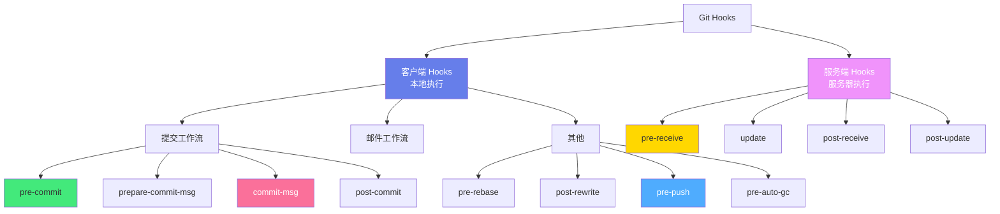
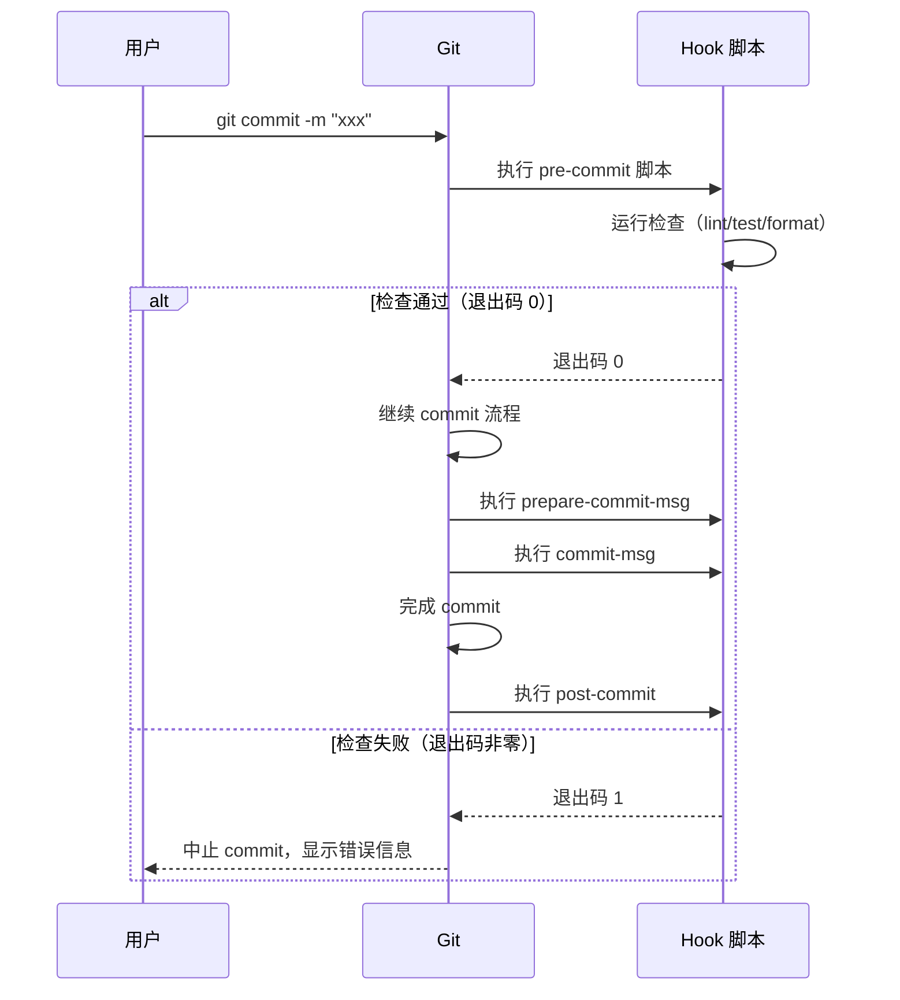

# 🪝 Git Hooks 自动化

> **文档说明**：系统讲解 Git Hooks（钩子）的完整知识体系，涵盖 Hooks 概念与分类（客户端/服务端）、常用钩子详解（pre-commit/commit-msg/pre-push/pre-receive 等）、钩子脚本编写（Shell/Python/Node.js）、Husky 框架使用、lint-staged 增量检查、commitlint 提交规范、ESLint/Prettier 集成、服务端钩子（pre-receive/update/post-receive）、钩子调试与绕过、常见问题与最佳实践。Git Hooks 是在 Git 操作的特定阶段自动执行脚本，实现代码质量检查、提交规范、自动化部署等。
>
> **适用人群**：开发者、DevOps、技术负责人、任何使用 Git 的团队
>
> **前置知识**：[[Git基础与进阶]]

---

## 一、概述

### 1.1 什么是 Git Hooks

Git Hooks（钩子）是 Git 在执行特定操作（如 commit、push、merge 等）的前后自动触发执行的脚本。通过 Hooks，可以在不修改 Git 核心代码的情况下，自定义和扩展 Git 的行为，实现自动化检查和操作。

**核心特点**：
- ✅ **事件驱动**：在 Git 操作的特定阶段自动触发
- ✅ **可定制**：可以用任何可执行语言编写（Shell/Python/Node.js/Ruby 等）
- ✅ **可拦截**：客户端钩子返回非零退出码可以中止 Git 操作
- ✅ **本地/服务端**：分为客户端钩子（本地执行）和服务端钩子（服务器执行）

### 1.2 解决的问题

| 问题 | 说明 |
|------|------|
| **代码质量参差不齐** | 提交的代码不符合规范、有语法错误、未格式化 |
| **提交信息混乱** | commit message 格式不统一，难以追溯和生成 changelog |
| **敏感信息泄露** | 密码、密钥、私钥等敏感文件被误提交到仓库 |
| **大文件误提交** | 构建产物、依赖目录、大文件被误提交 |
| **测试不通过** | 提交的代码未通过单元测试/构建 |
| **手动操作繁琐** | 提交前需要手动运行 lint/test/format，容易遗漏 |
| **服务端管控** | 需要在服务端统一检查分支权限、提交规范、代码审查 |

### 1.3 Hooks 分类



| 类别 | 钩子 | 触发时机 | 能否拦截 |
|------|------|---------|---------|
| **客户端-提交** | `pre-commit` | `git commit` 执行前，获取提交信息前 | ✅ 非零退出码中止 commit |
| | `prepare-commit-msg` | 启动提交信息编辑器前 | ❌ 不影响 commit（除非退出码非零） |
| | `commit-msg` | 提交信息保存后，commit 完成前 | ✅ 非零退出码中止 commit |
| | `post-commit` | commit 完成后 | ❌ 不影响 commit |
| **客户端-其他** | `pre-rebase` | `git rebase` 执行前 | ✅ 中止 rebase |
| | `pre-push` | `git push` 执行前，更新远程引用前 | ✅ 中止 push |
| | `post-rewrite` | 被 amend/rebase 等重写提交后 | ❌ |
| | `pre-auto-gc` | 自动垃圾回收前 | ✅ 中止 gc |
| **服务端** | `pre-receive` | 接收 push 时，更新引用前 | ✅ 拒绝整个 push |
| | `update` | 每个引用更新前 | ✅ 拒绝单个引用更新 |
| | `post-receive` | 所有引用更新完成后 | ❌ 常用于触发部署 |
| | `post-update` | 所有引用更新完成后（在 post-receive 之后） | ❌ |

---

## 二、底层原理

### 2.1 Hooks 存储位置

Git Hooks 存储在仓库的 `.git/hooks/` 目录下，每个钩子是一个可执行文件，文件名就是钩子名（无后缀）。

```css
.git/hooks/
├── applypatch-msg.sample
├── commit-msg.sample
├── fsmonitor-watchman.sample
├── post-update.sample
├── pre-applypatch.sample
├── pre-commit.sample
├── pre-merge-commit.sample
├── pre-push.sample
├── pre-rebase.sample
├── pre-receive.sample
├── prepare-commit-msg.sample
├── push-to-checkout.sample
├── sendemail-validate.sample
└── update.sample
```

> Git 初始化时会生成 `.sample` 后缀的示例脚本，去掉 `.sample` 后缀并赋予可执行权限即可启用。

**自定义 Hooks 目录**：
```bash
# 通过 core.hooksPath 配置自定义钩子目录（Git 2.9+）
git config core.hooksPath .githooks
# 这样 Git 会从 .githooks/ 目录读取钩子，而不是 .git/hooks/
# 好处：钩子可以纳入版本控制，团队共享
```

### 2.2 Hooks 执行机制



**关键机制**：
1. **可执行权限**：钩子文件必须有可执行权限（`chmod +x`），否则 Git 会忽略
2. **退出码**：返回 0 表示通过，非零表示失败（拦截操作）
3. **标准输入/输出**：某些钩子通过 stdin 接收参数，stdout/stderr 输出会显示给用户
4. **工作目录**：钩子执行时的工作目录是仓库根目录
5. **环境变量**：Git 会设置一些环境变量（如 `GIT_DIR`、`GIT_INDEX_FILE` 等）

### 2.3 常用钩子详解

#### pre-commit（最常用）

**触发时机**：`git commit` 执行后，获取提交信息前（在编辑器打开前）。

**用途**：
- 代码风格检查（ESLint/PEP8/Checkstyle）
- 代码格式化（Prettier/Black/Go fmt）
- 单元测试（快速测试）
- 敏感信息扫描（密钥/密码）
- 大文件检查
- 编译/构建检查

**特点**：
- 可以用 `git commit --no-verify` 跳过
- 不影响暂存区内容（除非脚本修改了文件）
- 退出码非零中止 commit

#### commit-msg

**触发时机**：提交信息编辑器保存后，commit 完成前。

**用途**：
- 校验 commit message 格式（Conventional Commits）
- 检查是否关联了 issue/任务号
- 自动添加签名/信息

**特点**：
- 第一个参数是包含提交信息的临时文件路径
- 可以修改提交信息内容
- 退出码非零中止 commit

#### pre-push

**触发时机**：`git push` 执行后，远程引用更新前。

**用途**：
- 运行完整测试套件
- 代码审查检查
- 分支权限检查（禁止直接 push 到 main/master）
- 敏感信息最终扫描

**特点**：
- stdin 接收要推送的引用信息（本地引用、SHA、远程引用、远程 SHA）
- 可以用 `git push --no-verify` 跳过
- 退出码非零中止 push

#### pre-receive（服务端）

**触发时机**：远程仓库接收 push 时，更新任何引用前。

**用途**：
- 分支权限控制（谁能 push 到哪些分支）
- 提交信息规范检查（服务端强制）
- 代码审查状态检查（是否已 approve）
- CI 状态检查（是否通过测试）
- 强制禁止 force push
- 敏感信息扫描（最后一道防线）

**特点**：
- stdin 逐行接收：`<old-value> <new-value> <ref-name>`
- 退出码非零拒绝整个 push
- 输出会显示给 push 的用户

#### post-receive（服务端）

**触发时机**：所有引用更新完成后。

**用途**：
- 触发自动部署（CI/CD）
- 发送通知（邮件/钉钉/飞书/Slack）
- 同步到镜像仓库
- 生成文档
- 更新 issue 状态

**特点**：
- 不影响 push 结果（无法拦截）
- stdin 同 pre-receive
- 最常用于自动化部署

---

## 三、实操示例

### 3.1 基础：创建第一个 Hook

```bash
# ===== 1. 查看示例钩子 =====
ls -la .git/hooks/
cat .git/hooks/pre-commit.sample

# ===== 2. 创建 pre-commit 钩子 =====
cat > .git/hooks/pre-commit << 'EOF'
#!/bin/bash
# pre-commit 钩子：检查暂存的文件中是否包含敏感词

echo "🔍 运行 pre-commit 检查..."

# 获取暂存的文件列表
staged_files=$(git diff --cached --name-only --diff-filter=ACM)

# 检查是否包含密码/密钥（简单示例）
if echo "$staged_files" | xargs grep -l -i "password\|secret\|api_key\|private_key" 2>/dev/null; then
  echo "❌ 错误：暂存文件中可能包含敏感信息！"
  echo "   请检查上述文件，确认无误后用 git commit --no-verify 跳过"
  exit 1
fi

# 检查大文件（>10MB）
large_files=$(git diff --cached --name-only --diff-filter=ACM | while read f; do
  if [ -f "$f" ]; then
    size=$(stat -c%s "$f" 2>/dev/null || stat -f%z "$f" 2>/dev/null)
    if [ "$size" -gt 10485760 ]; then
      echo "$f ($(numfmt --to=iec $size))"
    fi
  fi
done)

if [ -n "$large_files" ]; then
  echo "❌ 错误：暂存文件超过 10MB："
  echo "$large_files"
  echo "   请使用 Git LFS 或从提交中移除"
  exit 1
fi

echo "✅ pre-commit 检查通过"
exit 0
EOF

# ===== 3. 赋予可执行权限（关键！）=====
chmod +x .git/hooks/pre-commit

# ===== 4. 测试 =====
git commit -m "test"  # 会触发钩子
git commit -m "test" --no-verify  # 跳过钩子
```

### 3.2 commit-msg：提交信息规范检查

```bash
#!/bin/bash
# .git/hooks/commit-msg — 检查提交信息是否符合 Conventional Commits 规范

COMMIT_MSG_FILE=$1
COMMIT_MSG=$(head -1 "$COMMIT_MSG_FILE")

# Conventional Commits 格式：type(scope): subject
# 允许的 type：feat/fix/docs/style/refactor/perf/test/chore/ci/build/revert
PATTERN="^(feat|fix|docs|style|refactor|perf|test|chore|ci|build|revert)(\(.+\))?: .{1,100}"

if ! echo "$COMMIT_MSG" | grep -qE "$PATTERN"; then
  echo "❌ 提交信息格式错误！"
  echo ""
  echo "正确格式：type(scope): subject"
  echo ""
  echo "示例："
  echo "  feat(auth): 添加用户登录功能"
  echo "  fix(api): 修复用户列表接口空指针"
  echo "  docs(readme): 更新安装说明"
  echo "  style(ui): 格式化代码"
  echo "  refactor(core): 重构数据处理模块"
  echo ""
  echo "当前提交信息：$COMMIT_MSG"
  exit 1
fi

# 检查提交信息长度（首行不超过 100 字符）
if [ ${#COMMIT_MSG} -gt 100 ]; then
  echo "❌ 提交信息首行超过 100 字符（当前 ${#COMMIT_MSG}）"
  exit 1
fi

echo "✅ 提交信息检查通过"
exit 0
```

### 3.3 pre-push：分支保护与测试

```bash
#!/bin/bash
# .git/hooks/pre-push — push 前检查

protected_branches=("main" "master" "production")

while read local_ref local_sha remote_ref remote_sha; do
  # 提取分支名
  branch_name=$(echo "$remote_ref" | sed 's/refs\/heads\///')
  
  # 检查是否是受保护分支
  for protected in "${protected_branches[@]}"; do
    if [ "$branch_name" = "$protected" ]; then
      echo "❌ 禁止直接 push 到受保护分支：$branch_name"
      echo "   请通过 Pull Request 提交代码"
      exit 1
    fi
  done
  
  # 检查是否包含 force push（old SHA 不是 new SHA 的祖先）
  if ! git merge-base --is-ancestor "$local_sha" "$remote_sha" 2>/dev/null; then
    if [ "$remote_sha" != "0000000000000000000000000000000000000000" ]; then
      echo "⚠️  检测到 force push 到 $branch_name"
      echo "   请确认这是有意操作"
      # 可以选择阻止或警告
    fi
  fi
done

# 运行快速测试（如果存在）
if [ -f "package.json" ]; then
  echo "🔍 运行单元测试..."
  if ! npm test -- --passWithNoTests 2>/dev/null; then
    echo "❌ 单元测试未通过，push 被阻止"
    exit 1
  fi
fi

if [ -f "pom.xml" ]; then
  echo "🔍 运行 Maven 测试..."
  if ! mvn test -q 2>/dev/null; then
    echo "❌ Maven 测试未通过，push 被阻止"
    exit 1
  fi
fi

echo "✅ pre-push 检查通过"
exit 0
```

### 3.4 服务端 post-receive：自动部署

```bash
#!/bin/bash
# /path/to/repo.git/hooks/post-receive — 接收 push 后自动部署

DEPLOY_DIR="/var/www/myapp"
GIT_DIR="/path/to/repo.git"
BRANCH="main"

while read oldrev newrev refname; do
  # 只处理 main 分支的 push
  if [ "$refname" = "refs/heads/$BRANCH" ]; then
    echo "🚀 检测到 $BRANCH 分支更新，开始部署..."
    
    # 进入部署目录
    cd "$DEPLOY_DIR" || exit 1
    
    # 拉取最新代码
    echo "📥 拉取最新代码..."
    git --git-dir="$GIT_DIR" --work-tree="$DEPLOY_DIR" checkout -f "$BRANCH"
    
    # 安装依赖
    if [ -f "package.json" ]; then
      echo "📦 安装 npm 依赖..."
      npm ci --production
    fi
    
    if [ -f "requirements.txt" ]; then
      echo "📦 安装 Python 依赖..."
      pip install -r requirements.txt
    fi
    
    # 构建
    if [ -f "package.json" ]; then
      echo "🔨 构建项目..."
      npm run build
    fi
    
    # 重启服务
    if command -v pm2 &> /dev/null; then
      echo "🔄 重启 PM2 服务..."
      pm2 reload ecosystem.config.js
    fi
    
    if command -v systemctl &> /dev/null; then
      echo "🔄 重启 systemd 服务..."
      sudo systemctl restart myapp
    fi
    
    echo "✅ 部署完成！"
    
    # 发送通知（可选）
    # curl -X POST https://hooks.slack.com/services/xxx -d '{"text":"部署完成"}'
  fi
done

exit 0
```

### 3.5 Husky 框架（Node.js 项目推荐）

Husky 是最流行的 Git Hooks 管理工具，让 Hooks 可以纳入版本控制并在团队间共享。

```bash
# ===== 安装 Husky =====

# 方式1：自动配置（推荐，Husky 8+）
npx husky-init && npm install

# 方式2：手动配置
npm install husky --save-dev
npx husky install

# 配置 package.json，安装时自动启用 husky
npm pkg set scripts.prepare="husky install"

# ===== 添加钩子 =====

# 添加 pre-commit 钩子
npx husky add .husky/pre-commit "npm run lint"
npx husky add .husky/pre-commit "npm run format:check"

# 添加 commit-msg 钩子（配合 commitlint）
npx husky add .husky/commit-msg 'npx --no -- commitlint --edit "$1"'

# 添加 pre-push 钩子
npx husky add .husky/pre-push "npm run test"

# ===== 生成的钩子文件示例 =====
# .husky/pre-commit
#!/usr/bin/env sh
. "$(dirname -- "$0")/_/husky.sh"

npm run lint
npm run format:check

# ===== 跳过钩子 =====
git commit -m "xxx" --no-verify   # 跳过所有客户端钩子
git push --no-verify                # 跳过 pre-push
# 或设置环境变量
HUSKY=0 git commit -m "xxx"        # Husky 专用跳过方式
```

```json
// package.json 完整配置示例
{
  "name": "my-project",
  "scripts": {
    "prepare": "husky install",
    "lint": "eslint . --ext .js,.ts",
    "format": "prettier --write .",
    "format:check": "prettier --check .",
    "test": "jest",
    "commit": "git-cz"
  },
  "devDependencies": {
    "husky": "^8.0.0",
    "lint-staged": "^14.0.0",
    "@commitlint/cli": "^18.0.0",
    "@commitlint/config-conventional": "^18.0.0",
    "eslint": "^8.0.0",
    "prettier": "^3.0.0",
    "jest": "^29.0.0"
  },
  "lint-staged": {
    "*.{js,ts}": ["eslint --fix", "prettier --write"],
    "*.{json,md,css}": ["prettier --write"]
  },
  "commitlint": {
    "extends": ["@commitlint/config-conventional"]
  }
}
```

### 3.6 lint-staged：只检查暂存文件

lint-staged 配合 pre-commit 使用，只对暂存区（git add）的文件运行 lint/format，大大加快提交速度。

```bash
# 安装
npm install lint-staged --save-dev

# 配置（package.json 或 .lintstagedrc）
```

```json
// .lintstagedrc
{
  "*.{js,jsx,ts,tsx}": [
    "eslint --fix",
    "prettier --write",
    "jest --bail --findRelatedTests"
  ],
  "*.{json,md,yml,yaml,css,scss}": [
    "prettier --write"
  ],
  "*.{py}": [
    "black",
    "flake8"
  ],
  "*.{java}": [
    "google-java-format --replace"
  ]
}
```

```bash
# .husky/pre-commit — 配合 lint-staged
#!/usr/bin/env sh
. "$(dirname -- "$0")/_/husky.sh"

npx lint-staged
```

**工作流程**：
1. `git add file.js`（暂存文件）
2. `git commit -m "feat: xxx"`（触发 pre-commit）
3. lint-staged 只对暂存的 `file.js` 运行 eslint --fix 和 prettier --write
4. 修复后的文件自动重新暂存
5. commit 完成

### 3.7 commitlint：提交信息规范

```bash
# 安装
npm install @commitlint/cli @commitlint/config-conventional --save-dev

# 配置
echo "module.exports = { extends: ['@commitlint/config-conventional'] }" > commitlint.config.js

# Husky 集成
npx husky add .husky/commit-msg 'npx --no -- commitlint --edit "$1"'
```

```javascript
// commitlint.config.js — 自定义规则
module.exports = {
  extends: ['@commitlint/config-conventional'],
  rules: {
    // type 枚举
    'type-enum': [2, 'always', [
      'feat', 'fix', 'docs', 'style', 'refactor', 
      'perf', 'test', 'chore', 'ci', 'build', 'revert'
    ]],
    // subject 不能为空
    'subject-empty': [2, 'never'],
    // subject 首字母不大写
    'subject-case': [2, 'never', ['sentence-case', 'start-case', 'pascal-case', 'upper-case']],
    // header 最大长度
    'header-max-length': [2, 'always', 100],
    // body 每行最大长度
    'body-max-line-length': [1, 'always', 100],
  }
}
```

**Conventional Commits 格式**：
```text
<type>(<scope>): <subject>

<body>

<footer>
```

| type | 说明 |
|------|------|
| `feat` | 新功能 |
| `fix` | Bug 修复 |
| `docs` | 文档变更 |
| `style` | 代码格式（不影响功能） |
| `refactor` | 重构（既不修复 bug 也不添加功能） |
| `perf` | 性能优化 |
| `test` | 测试相关 |
| `chore` | 构建/工具/依赖变更 |
| `ci` | CI/CD 配置变更 |
| `build` | 构建系统或外部依赖变更 |
| `revert` | 回滚提交 |

```text
### 3.8 Python 项目：pre-commit 框架

Python 生态有专门的 pre-commit 框架，功能强大。
```

```bash
# 安装
pip install pre-commit

# 配置 .pre-commit-config.yaml
```

```yaml
# .pre-commit-config.yaml
repos:
  - repo: https://github.com/pre-commit/pre-commit-hooks
    rev: v4.5.0
    hooks:
      - id: trailing-whitespace        # 去除行尾空格
      - id: end-of-file-fixer          # 文件末尾换行
      - id: check-yaml                  # YAML 语法检查
      - id: check-json                  # JSON 语法检查
      - id: check-added-large-files    # 检查大文件
        args: ['--maxkb=1024']
      - id: detect-private-key         # 检测私钥
      - id: detect-aws-credentials     # 检测 AWS 凭证
      - id: no-commit-to-branch        # 禁止提交到特定分支
        args: ['--branch', 'main']

  - repo: https://github.com/psf/black
    rev: 23.12.1
    hooks:
      - id: black                       # Python 代码格式化
        language_version: python3.11

  - repo: https://github.com/pycqa/flake8
    rev: 7.0.0
    hooks:
      - id: flake8                      # Python 代码检查
        args: ['--max-line-length=120']

  - repo: https://github.com/pycqa/isort
    rev: 5.13.2
    hooks:
      - id: isort                       # import 排序

  - repo: https://github.com/antonbabenko/pre-commit-terraform
    rev: v1.83.5
    hooks:
      - id: terraform_fmt
      - id: terraform_validate
```

```bash
# 安装钩子到 .git/hooks/
pre-commit install

# 手动运行所有钩子
pre-commit run --all-files

# 运行特定钩子
pre-commit run black --all-files

# 更新钩子版本
pre-commit autoupdate
```

### 3.9 敏感信息扫描：gitleaks

```bash
# 安装 gitleaks
# macOS: brew install gitleaks
# Linux: 下载二进制文件

# .gitleaks.toml 配置
title = "gitleaks config"

[extend]
useDefault = true

[allowlist]
description = "允许的规则"
paths = [
  '''.*\.key$''',
  '''.*\.pem$''',
]
regexes = [
  '''fake.*password''',
  '''example.*key''',
]

# pre-commit 集成
# .pre-commit-config.yaml 添加：
repos:
  - repo: https://github.com/gitleaks/gitleaks
    rev: v8.18.2
    hooks:
      - id: gitleaks
```

### 3.10 团队共享 Hooks

`.git/hooks/` 目录默认不纳入版本控制（在 .git 目录内），团队共享 Hooks 有两种方式：

```bash
# ===== 方式1：core.hooksPath（Git 2.9+，推荐）=====

# 1. 在仓库中创建 .githooks/ 目录
mkdir .githooks

# 2. 将钩子脚本放入 .githooks/
cp my-pre-commit .githooks/pre-commit
chmod +x .githooks/pre-commit

# 3. 配置 Git 使用自定义钩子目录
git config core.hooksPath .githooks

# 4. 纳入版本控制
git add .githooks/
git commit -m "chore: 添加团队共享 git hooks"

# 5. 新成员 clone 后执行一次
git config core.hooksPath .githooks
# 或在 package.json 的 prepare 脚本中自动配置
# "prepare": "git config core.hooksPath .githooks"

# ===== 方式2：Husky（Node.js 项目）=====
# Husky 自动管理，钩子在 .husky/ 目录，纳入版本控制
# 新成员 npm install 时自动启用（prepare 脚本）

# ===== 方式3：符号链接 =====
# 将 .git/hooks 链接到版本控制的目录
ln -sf ../../git-hooks .git/hooks
```

---

## 四、常见问题与排查

| 问题现象 | 可能原因 | 解决方案 |
|---------|---------|---------|
| **Hook 不执行** | 文件没有可执行权限；文件名错误（有后缀）；hooksPath 配置错误 | `chmod +x .git/hooks/pre-commit`；确认文件名无后缀；检查 `git config core.hooksPath` |
| **Hook 执行了但不拦截** | 脚本退出码为 0；脚本有语法错误但退出码为 0 | 确保检查失败时 `exit 1`；在命令行手动运行脚本测试；加 `set -e` 让错误自动退出 |
| **pre-commit 修改了文件但未暂存** | 钩子修改了文件但没有 `git add` | lint-staged 会自动处理；手动脚本需要 `git add` 修改后的文件 |
| **--no-verify 不生效** | 服务端钩子无法用 --no-verify 跳过；Husky 用 HUSKY=0 | 客户端钩子用 `--no-verify`；Husky 用 `HUSKY=0 git commit`；服务端钩子无法跳过 |
| **Hook 执行太慢** | 运行了全量检查（而非增量）；测试太慢 | 用 lint-staged 只检查暂存文件；pre-commit 只跑快速检查，完整测试放 CI |
| **Windows 下 Hook 报错** | Shell 脚本不兼容 Windows 路径；换行符问题 | 用 Git Bash 执行；脚本用 `#!/usr/bin/env sh`；确保换行符为 LF；用 Husky 跨平台 |
| **commit-msg 修改了提交信息但不生效** | 没有正确写入临时文件；编辑器重新打开覆盖 | 确保写入 `$1` 指向的文件；用 `--no-edit` 避免重新打开编辑器 |
| **服务端 post-receive 不触发部署** | 钩子路径错误；权限问题；分支判断错误 | 确认钩子在 bare repo 的 hooks/ 目录；`chmod +x`；检查 refname 判断逻辑；加日志调试 |
| **pre-push 无法获取远程信息** | stdin 读取方式错误；非交互式环境 | 用 `while read oldrev newrev refname` 读取 stdin；确保脚本从 stdin 读取 |
| **Husky 安装后钩子不生效** | 没有运行 `husky install`；Node 版本过低；Git 版本 < 2.13.2 | 确保 `prepare` 脚本执行了 `husky install`；升级 Node/Git；检查 `.husky/` 目录权限 |
| **lint-staged 找不到命令** | 依赖未安装；命令路径问题 | `npm install`；用 `npx` 执行；检查 package.json 的 scripts |
| **钩子在 CI 中也执行** | CI 环境也触发了客户端钩子 | CI 中设置 `HUSKY=0` 或 `git config --global core.hooksPath /dev/null`；CI 用自己的检查流程 |
| **pre-receive 拒绝了 push 但用户看不到原因** | 钩子输出没有正确返回；输出被缓冲 | 确保输出到 stdout/stderr；用 `echo` 输出错误信息；Git 会将输出显示给用户 |

### Hook 调试技巧

```bash
# ===== 调试方法 =====

# 1. 手动运行钩子脚本
bash -x .git/hooks/pre-commit    # 详细执行过程
bash .git/hooks/pre-commit       # 正常运行
echo $?                           # 查看退出码

# 2. 在脚本中加调试输出
#!/bin/bash
set -x  # 开启调试模式，显示每条命令
echo "当前目录: $(pwd)"
echo "暂存文件: $(git diff --cached --name-only)"

# 3. 临时禁用钩子
git commit --no-verify -m "test"
HUSKY=0 git commit -m "test"     # Husky 专用

# 4. 查看钩子是否被识别
git config --get core.hooksPath
ls -la .git/hooks/ | grep -v sample

# 5. 服务端钩子调试（在服务器端加日志）
echo "$(date): pre-receive triggered" >> /tmp/hook-debug.log
echo "stdin: $(cat)" >> /tmp/hook-debug.log
```

---

## 五、进阶与最佳实践

### 5.1 Hooks 选择策略

| 检查类型 | 推荐位置 | 原因 |
|---------|---------|------|
| 代码格式化（Prettier/Black） | pre-commit + lint-staged | 快速，只检查暂存文件，自动修复 |
| Lint 检查（ESLint/flake8） | pre-commit + lint-staged | 快速，只检查暂存文件 |
| 类型检查（TypeScript） | pre-push 或 CI | 较慢，pre-commit 可能太慢 |
| 单元测试（快速） | pre-commit 或 pre-push | 快速测试放 pre-commit，完整测试放 CI |
| 单元测试（完整） | CI | 慢，不适合本地钩子 |
| 提交信息规范 | commit-msg | 必须在提交时检查 |
| 敏感信息扫描 | pre-commit + pre-receive（服务端） | 双重保险，服务端是最后防线 |
| 大文件检查 | pre-commit | 提交前拦截 |
| 分支权限 | pre-push（客户端）+ pre-receive（服务端） | 客户端提示，服务端强制 |
| 代码审查状态 | pre-receive（服务端） | 需要查询外部系统，服务端更合适 |
| CI 状态检查 | pre-receive（服务端） | 需要查询 CI 系统 |
| 自动部署 | post-receive（服务端） | 无法拦截，适合触发操作 |
| 通知 | post-commit（客户端）+ post-receive（服务端） | 本地和远程都可通知 |

### 5.2 性能优化

```bash
Git Hooks 性能优化：

✅ 增量检查：用 lint-staged 只检查暂存文件，不检查全量
✅ 并行执行：lint-staged 支持并发（--concurrent）
✅ 缓存结果：ESLint 用 --cache，Prettier 只检查修改的文件
✅ 分级检查：
   - pre-commit：只跑最快的检查（format + lint）
   - pre-push：跑类型检查 + 快速测试
   - CI：跑完整测试 + 构建 + 安全扫描
✅ 避免全量测试：pre-commit 不要跑完整测试套件
✅ 超时控制：钩子脚本设置超时（如 timeout 30s）
✅ 跳过机制：--no-verify 用于紧急情况，但团队应约定使用规范
✅ 工具选择：用更快的工具（如 Rome 替代 ESLint+Prettier，Ruff 替代 flake8）
✅ 后台执行：非关键检查可以异步执行，不阻塞 commit
```

### 5.3 团队协作最佳实践

```text
团队 Git Hooks 最佳实践：

✅ 钩子纳入版本控制
   - 用 Husky 或 core.hooksPath，让钩子随仓库一起管理
   - 新成员 clone 后自动启用（prepare 脚本）

✅ 渐进式引入
   - 先从格式化（prettier/black）开始，最容易接受
   - 再引入 lint 检查
   - 最后引入提交规范和测试
   - 避免一次性引入太多检查导致团队抵触

✅ 明确规则和文档
   - 在 CONTRIBUTING.md 中说明钩子检查规则
   - 说明如何跳过（--no-verify）和何时可以跳过
   - 提供常见错误的修复指南

✅ 本地和服务端双重检查
   - 本地钩子：快速反馈，开发者自己修复
   - 服务端钩子：最后防线，强制规范
   - 本地可以跳过，服务端不能跳过

✅ 钩子失败时给出清晰提示
   - 告诉用户哪里错了
   - 告诉用户如何修复
   - 提供自动修复命令（如 npm run lint:fix）

✅ 定期审查钩子配置
   - 检查是否有过时的检查
   - 优化执行速度
   - 根据团队反馈调整规则

✅ CI 与 Hooks 互补
   - Hooks：本地快速反馈，轻量检查
   - CI：完整检查，强制门禁
   - 两者检查规则保持一致

✅ 安全考虑
   - 钩子脚本本身需要代码审查
   - 防止恶意钩子脚本（post-checkout 等可以执行任意命令）
   - 服务端钩子限制执行权限
```

### 5.4 常用工具生态

| 工具 | 语言/生态 | 功能 | 推荐度 |
|------|----------|------|--------|
| **Husky** | Node.js | Git Hooks 管理 | ⭐⭐⭐⭐⭐ Node 项目首选 |
| **lint-staged** | Node.js | 对暂存文件运行命令 | ⭐⭐⭐⭐⭐ 必装 |
| **commitlint** | Node.js | 提交信息规范检查 | ⭐⭐⭐⭐⭐ 配合 Conventional Commits |
| **pre-commit** | Python | Python 生态 Hooks 框架 | ⭐⭐⭐⭐⭐ Python 项目首选 |
| **gitleaks** | Go | 敏感信息扫描 | ⭐⭐⭐⭐ 安全必备 |
| **lefthook** | Go/Ruby | 快速 Git Hooks 管理器 | ⭐⭐⭐⭐ 跨语言，速度快 |
| **overcommit** | Ruby | Git Hooks 管理器 | ⭐⭐⭐ Ruby 项目 |
| **simple-git-hooks** | Node.js | 轻量 Git Hooks | ⭐⭐⭐ 简单项目 |
| **commitizen** | Node.js | 交互式提交信息生成 | ⭐⭐⭐⭐ 配合 commitlint |
| **standard-version** | Node.js | 自动版本号和 changelog | ⭐⭐⭐⭐ 配合 Conventional Commits |

---

## 六、关联笔记

```text
### Git 与版本控制
```
- [[Git基础与进阶]] · [[Git-冲突解决与变基]] · [[Git工作流与分支策略]]

### 工程化与 CI/CD
- [[GitLab-CI配置]] · [[GitHub-Actions自动化]] · [[代码审查与质量保障]]

### 前端工程化
- [[ESLint代码规范]] · [[Prettier代码格式化]] · [[TypeScript-类型系统进阶_backup_skeleton]]

### 导航
- [[MOC-通用工具]] · [[MOC-Git版本控制]] · [[MOC-综合导航]] · [[Home]]

> 🔍 **知识点深度解析**
>
> **作用**：Git Hooks 解决的是「代码提交前的自动化质量检查和流程管控」问题，在 commit/push 等操作的特定阶段自动执行脚本，实现代码格式化、lint 检查、提交规范校验、敏感信息扫描、自动部署等，将质量保障左移到开发者本地。
>
> **底层原理**：Git Hooks 是存储在 `.git/hooks/`（或自定义 `core.hooksPath`）目录下的可执行脚本，Git 在执行特定操作时会检查对应钩子文件是否存在且可执行，如果存在则执行该脚本，根据退出码决定是否继续操作（0=通过，非0=拦截）。分为客户端钩子（pre-commit/commit-msg/pre-push 等，本地执行，可用 --no-verify 跳过）和服务端钩子（pre-receive/update/post-receive 等，服务器执行，无法跳过）。pre-commit 在获取提交信息前执行，适合代码检查；commit-msg 在提交信息保存后执行，适合校验提交信息格式；pre-push 在推送前执行，适合完整测试和分支保护；post-receive 在推送完成后执行，适合触发自动部署和通知。
>
> **用法要点**：① 钩子文件必须有可执行权限（`chmod +x`），文件名就是钩子名（无后缀） ② 退出码 0 通过，非零拦截操作 ③ 团队共享用 Husky（Node.js）或 `core.hooksPath`（通用），不要直接用 `.git/hooks/`（不纳入版本控制） ④ 最常用组合：Husky + lint-staged（只检查暂存文件）+ commitlint（提交规范）+ ESLint/Prettier（代码质量） ⑤ pre-commit 只跑快速检查（format/lint），完整测试放 CI ⑥ 敏感信息扫描用 gitleaks，在 pre-commit 和服务端 pre-receive 双重检查 ⑦ 服务端 post-receive 最常用于自动部署（CD） ⑧ 跳过钩子用 `--no-verify`（客户端）或 `HUSKY=0`（Husky），但团队应约定使用规范 ⑨ 钩子失败时给出清晰的错误提示和修复建议 ⑩ Python 项目用 pre-commit 框架（.pre-commit-config.yaml），功能强大。

> 💡 **深度讲解**：Git Hooks 最核心的价值是「质量左移」——传统的代码质量检查在 CI 阶段（提交后）才执行，开发者提交代码后几分钟甚至几十分钟才收到 CI 失败的通知，这时可能已经切换到其他任务，修复成本高。Git Hooks 将检查前移到 commit/push 阶段，开发者在提交时就能立即发现问题并修复，反馈周期从「分钟级」降到「秒级」，大大提升开发效率。但 Hooks 也有边界——它是客户端执行的，可以被 `--no-verify` 跳过，所以不能作为唯一的质量门禁，必须配合服务端钩子和 CI 形成「三道防线」：本地 Hooks（快速反馈，可跳过）→ 服务端 Hooks（强制门禁，不可跳过）→ CI（完整检查，强制门禁）。最常见的坑是「pre-commit 太慢」——如果 pre-commit 跑完整测试和全量 lint，每次 commit 要等几十秒，开发者会不耐烦甚至用 --no-verify 跳过。解决方案是 lint-staged——只对暂存区（git add）的文件运行检查，通常只需 1-2 秒，体验好很多。另一个坑是「Windows 兼容性」——Shell 脚本在 Windows 上可能有路径和换行符问题，用 Husky 可以很好地解决跨平台问题。

> 📝 **精简总结**：Git Hooks = Git 操作前后自动执行的脚本，实现代码质量检查和自动化。客户端钩子：pre-commit（代码检查）、commit-msg（提交规范）、pre-push（测试/分支保护），可用 --no-verify 跳过。服务端钩子：pre-receive（强制检查）、post-receive（自动部署），不可跳过。推荐组合：Husky + lint-staged（只查暂存文件）+ commitlint（Conventional Commits）+ ESLint/Prettier。Python 用 pre-commit 框架。关键：钩子必须可执行、退出码非零拦截、团队共享用 Husky/core.hooksPath、pre-commit 只跑快速检查、配合服务端和 CI 形成三道防线。

> **学习路径建议**：先学习 [[Git基础与进阶]] 掌握 Git 基础 → 学习本文档掌握 Git Hooks 自动化 → 学习 [[Git工作流与分支策略]] 理解团队协作流程 → 学习 [[GitLab-CI配置]] 或 [[GitHub-Actions自动化]] 掌握 CI/CD → 在项目中实践完整的代码质量保障体系（Hooks + CI + Code Review）。

---

> **Git Hooks 的本质是「给 Git 操作装上自动安检门」——每次提交和推送都自动检查代码质量、提交规范、敏感信息，把问题消灭在萌芽状态。好的 Hooks 配置像一个严格但友善的代码审查员，在你提交时就告诉你哪里需要改进，而不是等 CI 失败后才发现。**

---

## 🔗 关联笔记

- [[MOC-通用工具]] — 返回本分类知识地图，查看更多相关文档

## 📖 前置知识

- [[Git基础与进阶]]

## 🏷️ 相关标签

`#Git` `#Hooks` `#自动化` `#版本控制` `#代码质量` `#CI/CD`

[[Home|🏠 返回首页]] · [[MOC-通用工具|📚 返回分类]]
