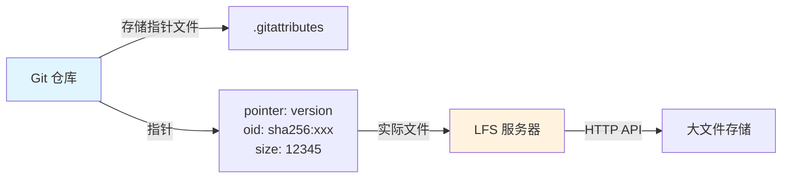

# Git-LFS大文件管理

> **文档说明**：系统讲解 Git LFS（Large File Storage）的原理、安装配置、基本使用、文件迁移、常用命令、最佳实践，以及大文件管理的常见问题与解决方案。
>
> **适用人群**：全栈开发者、需要管理大文件（图片、视频、模型、二进制）的 Git 用户
>
> **前置知识**：[[Git版本控制核心命令]]、[[Git分支管理与工作流]]、[[Git进阶技巧与最佳实践]]

---

## 一、概述

### 1. 为什么需要 Git LFS

Git 本身不适合管理大文件：

| 问题 | 说明 |
|------|------|
| **仓库膨胀** | 大文件每次修改都会存储完整副本，仓库体积快速增长 |
| **克隆缓慢** | `git clone` 需要下载所有历史版本的大文件 |
| **内存占用** | Git 操作大文件时内存消耗大 |
| **平台限制** | GitHub/GitLab 对单文件大小有限制（通常 100MB） |
| **diff 无效** | 二进制文件无法做有意义的 diff |

**Git LFS（Large File Storage）** 是 Git 的扩展，将大文件存储在专用 LFS 服务器上，Git 仓库中只保存指针文件。

### 2. Git LFS 原理



```text
工作原理：
1. git lfs track "*.psd"  →  标记需要 LFS 管理的文件类型
2. git add file.psd       →  Git LFS 拦截，替换为指针文件
3. git commit             →  提交指针文件到 Git 仓库
4. git push               →  指针推送到 Git，大文件推送到 LFS 服务器
5. git checkout           →  根据指针从 LFS 服务器下载真实文件
6. git pull               →  自动下载 LFS 文件
```

### 3. 指针文件格式

```text
version https://git-lfs.github.com/spec/v1
oid sha256:4d7a214614ab2935c943f9e0fe190b62e61b3f5d9f5e2c6a7e8b9c0d1e2f3a4b
size 12345678
```

指针文件只有几十字节，包含：
- `version`：LFS 规范版本
- `oid`：文件的 SHA-256 哈希（唯一标识）
- `size`：文件大小（字节）

---

## 二、安装与配置

### 1. 安装

```bash
# macOS
brew install git-lfs

# Ubuntu/Debian
sudo apt install git-lfs

# Windows（Git for Windows 已自带）
# 或下载安装包：https://git-lfs.com

# 验证安装
git lfs version
# git-lfs/3.4.0 (GitHub; windows amd64; go 1.21.0)
```

### 2. 全局初始化

```bash
# 全局安装 Git LFS 钩子（只需执行一次）
git lfs install
# Updated git hooks.
# Git LFS initialized.

# 验证
git lfs env
```

### 3. 仓库级配置

```bash
# 在特定仓库启用 LFS
cd my-repo
git lfs install --local

# 配置 LFS 服务器（自定义服务器时）
git config -f .lfsconfig lfs.url https://lfs.example.com/my-repo
```

---

## 三、基本使用

### 1. 跟踪文件类型

```bash
# 跟踪特定扩展名
git lfs track "*.psd"
git lfs track "*.mp4"
git lfs track "*.zip"
git lfs track "*.bin"

# 跟踪特定目录
git lfs track "assets/models/*"

# 跟踪特定文件
git lfs track "data/large_dataset.csv"

# 查看已跟踪的文件类型
git lfs track
# Listing tracked patterns
#     *.psd (.gitattributes)
#     *.mp4 (.gitattributes)

# 取消跟踪
git lfs untrack "*.psd"
```

> `git lfs track` 会自动修改 `.gitattributes` 文件，需要提交到仓库。

### 2. 提交和推送

```bash
# 正常 add/commit/push，LFS 自动处理
git add design.psd
git commit -m "Add design file"
git push origin main

# push 时 LFS 文件会自动上传
# Uploading LFS objects: 100% (1/1), 12 MB | 0 B/s, done.
```

### 3. 克隆和拉取

```bash
# 正常克隆（自动下载 LFS 文件）
git clone https://github.com/user/repo.git

# 跳过 LFS 文件下载（只下载指针）
GIT_LFS_SKIP_SMUDGE=1 git clone https://github.com/user/repo.git

# 后续需要时再下载
git lfs pull

# 只拉取特定文件
git lfs pull --include="*.psd"

# 排除某些文件
git lfs pull --exclude="*.mp4"
```

### 4. 查看 LFS 文件

```bash
# 查看仓库中 LFS 管理的文件
git lfs ls-files
# 4d7a214614 * design.psd
# a1b2c3d4e5 * video.mp4

# 查看 LFS 文件详情
git lfs ls-files --long
# 4d7a214614 * design.psd (12.3 MB)
# a1b2c3d4e5 * video.mp4 (156.7 MB)

# 查看 LFS 存储使用量
git lfs status
```

---

## 四、历史文件迁移

### 1. 将已有大文件迁移到 LFS

```bash
# 迁移历史中所有 .psd 文件到 LFS（重写历史！）
git lfs migrate import --include="*.psd" --everything

# 迁移多个类型
git lfs migrate import --include="*.psd,*.mp4,*.zip" --everything

# 迁移特定目录
git lfs migrate import --include="assets/*" --everything

# 迁移后需要强制推送（重写了历史）
git push --force-with-lease origin --all
```

> **警告**：`git lfs migrate import` 会重写 Git 历史，所有协作者需要重新克隆。

### 2. 从 LFS 迁出（不再使用 LFS）

```bash
# 将 LFS 文件转回普通 Git 文件
git lfs migrate export --include="*.psd" --everything

# 强制推送
git push --force-with-lease origin --all
```

### 3. 迁移前检查

```bash
# 查看仓库中大文件（找出需要迁移的文件）
git lfs migrate info --everything --top=20
# 显示按大小排序的文件类型统计

# 查看特定分支
git lfs migrate info --include-ref=main --top=10
```

---

## 五、常用命令速查

| 命令 | 说明 |
|------|------|
| `git lfs install` | 全局安装 LFS 钩子 |
| `git lfs track "*.ext"` | 跟踪文件类型 |
| `git lfs untrack "*.ext"` | 取消跟踪 |
| `git lfs ls-files` | 列出 LFS 管理的文件 |
| `git lfs pull` | 下载 LFS 文件 |
| `git lfs push` | 上传 LFS 文件 |
| `git lfs fetch` | 抓取 LFS 文件（不 checkout） |
| `git lfs checkout` | 从 LFS 缓存还原文件 |
| `git lfs status` | 查看 LFS 状态 |
| `git lfs env` | 查看 LFS 环境配置 |
| `git lfs version` | 查看版本 |
| `git lfs migrate import` | 迁移文件到 LFS |
| `git lfs migrate export` | 从 LFS 迁出 |
| `git lfs migrate info` | 迁移信息统计 |
| `git lfs prune` | 清理本地 LFS 缓存 |
| `git lfs locks` | 查看文件锁 |
| `git lfs lock file` | 锁定文件 |
| `git lfs unlock file` | 解锁文件 |

---

## 六、高级特性

### 1. 文件锁定（File Locking）

```bash
# 锁定文件（防止多人同时编辑二进制文件）
git lfs lock design.psd
# Locked design.psd

# 查看锁定的文件
git lfs locks
# design.psd  user@example.com  ID: 123

# 解锁文件
git lfs unlock design.psd

# 强制解锁（管理员）
git lfs unlock --force design.psd
```

### 2. 部分克隆（Partial Clone）

```bash
# 只克隆指针，不下载大文件
GIT_LFS_SKIP_SMUDGE=1 git clone repo.git

# 需要时下载特定文件
git lfs pull --include="assets/design.psd"

# 配置默认排除大文件
git config lfs.fetchinclude "*.psd"
git config lfs.fetchexclude "*.mp4"
```

### 3. 自定义 LFS 服务器

```bash
# 配置自定义 LFS 服务器地址
git config -f .lfsconfig lfs.url https://lfs.example.com/repo

# .lfsconfig 文件内容
# [lfs]
#     url = https://lfs.example.com/repo

# 支持的 LFS 服务器：
# - GitHub LFS
# - GitLab LFS
# - Gitea LFS
# - 自建：git-lfs-server、minio + lfs 适配
```

### 4. 清理本地缓存

```bash
# 查看本地 LFS 缓存大小
du -sh .git/lfs

# 清理未引用的 LFS 对象
git lfs prune

# 清理所有（包括最近的）
git lfs prune --verify-remote
```

---

## 七、最佳实践

### 1. 文件类型选择

| 适合 LFS | 不适合 LFS |
|---------|-----------|
| 图片（PSD、AI、PNG 大图） | 源代码 |
| 视频（MP4、MOV） | 文本配置文件 |
| 音频（WAV、MP3 大文件） | Markdown 文档 |
| 3D 模型（FBX、OBJ） | JSON/YAML 配置 |
| AI 模型（.pt、.pth、.bin） | 小型依赖文件 |
| 数据集（CSV 大文件、Parquet） | 普通文档 |
| 压缩包（ZIP、TAR 大文件） | 小于 10MB 的文件 |

> **经验法则**：大于 10MB 的二进制文件考虑用 LFS；文本文件永远不用 LFS。

### 2. .gitattributes 规范

```gitattributes
# 图片
*.psd filter=lfs diff=lfs merge=lfs -text
*.ai filter=lfs diff=lfs merge=lfs -text
*.png filter=lfs diff=lfs merge=lfs -text
*.jpg filter=lfs diff=lfs merge=lfs -text

# 视频
*.mp4 filter=lfs diff=lfs merge=lfs -text
*.mov filter=lfs diff=lfs merge=lfs -text

# 模型
*.pt filter=lfs diff=lfs merge=lfs -text
*.pth filter=lfs diff=lfs merge=lfs -text
*.bin filter=lfs diff=lfs merge=lfs -text
*.onnx filter=lfs diff=lfs merge=lfs -text

# 数据集
*.csv filter=lfs diff=lfs merge=lfs -text
*.parquet filter=lfs diff=lfs merge=lfs -text
```

### 3. 团队协作规范

- [ ] **统一安装**：所有协作者安装 Git LFS
- [ ] **提前规划**：项目初始化时就配置 `.gitattributes`
- [ ] **避免历史迁移**：尽量不在项目中期迁移（会重写历史）
- [ ] **大文件不频繁修改**：LFS 适合大但不常改的文件
- [ ] **CI/CD 配置**：CI 环境需要安装 LFS 并配置认证
- [ ] **存储配额**：关注 LFS 存储配额和带宽限制
- [ ] **备份策略**：LFS 服务器数据需要独立备份

### 4. CI/CD 配置

```yaml
# GitHub Actions
- name: Checkout
  uses: actions/checkout@v4
  with:
    lfs: true  # 自动拉取 LFS 文件

# GitLab CI
variables:
  GIT_LFS_SKIP_SMUDGE: "1"  # 先不下载
before_script:
  - git lfs install
  - git lfs pull --include="models/*.pt"  # 需要时下载
```

---

## 八、常见问题与排查

| 问题 | 原因 | 解决方案 |
|------|------|---------|
| **push 时 LFS 上传失败** | 认证失败 / 网络问题 | 检查 LFS 服务器认证、网络连接 |
| **clone 后文件是指针** | 未安装 LFS / smudge 被跳过 | 安装 LFS 后执行 `git lfs pull` |
| **仓库体积仍然很大** | 历史中有大文件未迁移 | `git lfs migrate import` 迁移历史 |
| **LFS 配额超限** | 存储/带宽超出限制 | 清理不必要的 LFS 文件、升级配额 |
| **文件锁定冲突** | 他人已锁定文件 | 联系锁定者解锁或强制解锁 |
| **CI 环境 LFS 失败** | CI 未安装 LFS / 无权限 | CI 中安装 LFS、配置 token |
| **迁移后协作者报错** | 历史被重写 | 协作者重新克隆仓库 |
| **大文件 push 慢** | 网络带宽限制 | 分批推送、使用更近的 LFS 服务器 |
| **误删 LFS 文件** | 本地文件被删 | `git lfs checkout` 从缓存还原 |
| **LFS 对象丢失** | 服务器数据丢失 | 从备份恢复、重新上传 |
| **Windows 换行符问题** | .gitattributes 配置不当 | 二进制文件加 `-text` 禁止换行转换 |
| **diff 显示指针内容** | LFS 文件未正确 smudge | `git lfs checkout` 还原文件 |
| **多个 LFS 服务器** | 配置冲突 | 检查 `.lfsconfig` 和 remote 配置 |
| **离线环境使用** | 无法连接 LFS 服务器 | 提前 `git lfs fetch` 缓存文件 |
| **大模型文件管理** | 模型文件过大 | 考虑用模型注册表（HuggingFace、ModelScope）替代 LFS |

---

## 九、关联笔记

```text
### Git 相关
```
- [[Git版本控制核心命令]] · [[Git分支管理与工作流]] · [[Git进阶技巧与最佳实践]]
- [[Git-Worktree多工作树]]

### 工具相关
- [[kubectl命令速查表]] · [[浏览器开发者工具进阶]] · [[Zed-高性能编辑器]]

### 导航
- [[MOC-通用工具]] · [[全栈+AI工程双轨融合学习路线图]]

> **学习路径建议**：先掌握 [[Git版本控制核心命令]] Git 基础 → 学习 [[Git分支管理与工作流]] 分支策略 → 深入本文 Git LFS 大文件管理 → 实践 [[Git-Worktree多工作树]] 多工作树 → 研究 [[Git进阶技巧与最佳实践]] 高级用法 → 构建完整的 Git 版本管理能力。

---

## 🔗 关联笔记

- [[MOC-通用工具]] — 返回本分类知识地图，查看更多相关文档

## 📖 前置知识

- [[Git版本控制核心命令]]
- [[Git分支管理与工作流]]
- [[Git进阶技巧与最佳实践]]

## 🏷️ 相关标签

`#Git` `#大文件管理` `#版本控制` `#原子笔记`

[[Home|🏠 返回首页]] · [[MOC-通用工具|📚 返回分类]]
