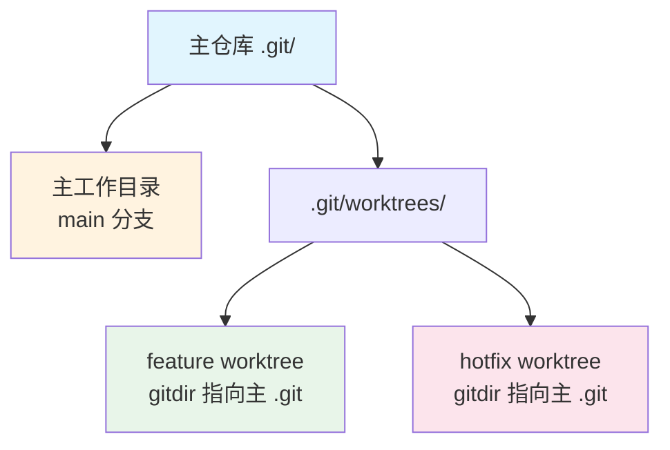

# Git-Worktree多工作树

> **文档说明**：系统讲解 Git Worktree 的原理、基本使用、典型工作流、高级用法、最佳实践，以及多工作树管理的常见问题与解决方案。
>
> **适用人群**：全栈开发者、需要并行处理多个分支的 Git 用户
>
> **前置知识**：[[Git版本控制核心命令]]、[[Git分支管理与工作流]]、[[Git-LFS大文件管理]]

---

## 一、概述

### 1. 什么是 Git Worktree

**Git Worktree** 允许同一个 Git 仓库同时检出多个分支到不同的工作目录，无需多次克隆仓库。

```text
传统方式（多次克隆）：
~/project-main/     → main 分支
~/project-feature/  → feature 分支（完整克隆，占空间）
~/project-hotfix/   → hotfix 分支（完整克隆，占空间）

Worktree 方式（共享 .git）：
~/project/              → 主工作目录（main 分支）
~/project-feature/      → worktree（feature 分支，共享 .git）
~/project-hotfix/       → worktree（hotfix 分支，共享 .git）
```

### 2. 为什么使用 Worktree

| 优势 | 说明 |
|------|------|
| **节省空间** | 共享 `.git` 目录，不需要重复克隆 |
| **切换快速** | 不需要 stash/commit 即可切换分支 |
| **并行开发** | 同时在多个分支上工作，互不干扰 |
| **紧急修复** | 主分支开发中，临时开 worktree 修 bug |
| **代码审查** | 检出 PR 分支到独立目录审查 |
| **构建对比** | 同时构建两个分支对比结果 |

### 3. 原理



```text
Worktree 原理：
- 主仓库的 .git 目录是完整的 Git 数据
- 每个 worktree 有自己的工作目录和 .git 文件（指向主 .git）
- worktree 的 HEAD、index 独立，但对象库共享
- 同一分支不能同时被多个 worktree 检出
```

---

## 二、基本使用

### 1. 创建 Worktree

```bash
# 在新目录创建 worktree，检出指定分支
git worktree add ../project-feature feature-branch

# 创建并切换到新分支
git worktree add -b new-feature ../project-newfeature

# 基于某个 commit 创建 worktree
git worktree add ../project-hotfix abc1234

# 创建分离 HEAD 的 worktree（不关联分支）
git worktree add --detach ../project-test

# 指定路径（相对或绝对）
git worktree add /path/to/worktree branch-name
```

### 2. 查看 Worktree

```bash
# 列出所有 worktree
git worktree list
# /path/to/main         abc1234 [main]
# /path/to/feature      def5678 [feature-branch]
# /path/to/hotfix       ghi9012 [hotfix] (detached HEAD)

# 详细信息（含分支、是否锁定）
git worktree list --porcelain
```

### 3. 删除 Worktree

```bash
# 删除 worktree（需先清理工作目录）
git worktree remove ../project-feature

# 强制删除（有未提交更改时）
git worktree remove --force ../project-feature

# 如果目录已手动删除，清理元数据
git worktree prune
```

### 4. 移动 Worktree

```bash
# 移动 worktree 到新位置
git worktree move ../project-feature ../new-location/feature
```

---

## 三、典型工作流

### 1. 紧急修复（Hotfix）

```bash
# 场景：正在 feature 分支开发，需要紧急修复 main 分支的 bug

# 当前在 main 工作目录，正在开发 feature
cd ~/project
git status  # 有未提交的更改

# 不需要 stash，直接创建 hotfix worktree
git worktree add -b hotfix/critical-bug ../project-hotfix main

# 进入 hotfix worktree 修复
cd ../project-hotfix
# ... 修复代码 ...
git commit -am "fix: critical bug"
git push origin hotfix/critical-bug

# 修复完成，回到主工作目录继续开发
cd ~/project
# 之前的未提交更改完好无损

# 清理 worktree
git worktree remove ../project-hotfix
```

### 2. 并行开发

```bash
# 场景：同时开发两个功能，需要频繁切换

# 主目录开发 feature-a
cd ~/project
git checkout feature-a

# 创建 feature-b 的 worktree
git worktree add ../project-feature-b feature-b

# 两个目录并行工作
# ~/project          → feature-a
# ~/project-feature-b → feature-b

# 各自独立 commit/push，互不干扰
```

### 3. 代码审查

```bash
# 场景：审查同事的 PR，不影响当前工作

# 创建 PR 分支的 worktree
git fetch origin pull/123/head:pr-123
git worktree add ../project-pr-123 pr-123

# 进入审查
cd ../project-pr-123
# 查看代码、运行测试、构建...

# 审查完成后清理
cd ~/project
git worktree remove ../project-pr-123
git branch -d pr-123
```

### 4. 构建对比

```bash
# 场景：对比 main 和 feature 分支的构建结果

# main 分支构建
cd ~/project
git checkout main
npm run build  # 输出到 dist-main/

# feature 分支构建（worktree）
git worktree add ../project-feature feature
cd ../project-feature
npm run build  # 输出到 dist-feature/

# 对比两个构建结果
diff -r ~/project/dist-main ~/project-feature/dist-feature
```

---

## 四、高级用法

### 1. 锁定 Worktree

```bash
# 锁定 worktree（防止被 prune 清理，适合可移动介质）
git worktree lock ../project-feature --reason "在 U 盘上"

# 解锁
git worktree unlock ../project-feature

# 查看锁定状态
git worktree list --porcelain | grep locked
```

### 2. 与子模块配合

```bash
# worktree 默认不初始化子模块
git worktree add ../project-feature feature

# 需要手动初始化子模块
cd ../project-feature
git submodule update --init --recursive
```

### 3. 与 LFS 配合

```bash
# worktree 共享 LFS 缓存，不需要重复下载
git worktree add ../project-feature feature

# 如果 LFS 文件缺失，手动拉取
cd ../project-feature
git lfs pull
```

### 4. 批量管理脚本

```bash
#!/bin/bash
# 批量列出所有 worktree 的状态
for wt in $(git worktree list --porcelain | grep '^worktree ' | cut -d' ' -f2); do
  echo "=== $wt ==="
  cd "$wt"
  git status --short
  git log --oneline -1
  echo ""
done
```

---

## 五、与其他方案对比

| 方案 | 空间 | 切换速度 | 并行工作 | 适用场景 |
|------|------|---------|---------|---------|
| **git stash** | 无 | 快 | 否 | 临时切换 |
| **git worktree** | 小（共享 .git） | 快 | 是 | 并行开发、hotfix |
| **多次 clone** | 大（完整 .git） | 慢 | 是 | 完全隔离 |
| **git new-workdir**（旧） | 小 | 快 | 是 | 已废弃，用 worktree |

---

## 六、最佳实践

### 1. 目录组织

```bash
# 推荐：worktree 放在主仓库同级目录
~/projects/
  my-app/              # 主工作目录（main）
  my-app-feature/      # feature worktree
  my-app-hotfix/       # hotfix worktree
  my-app-pr-123/       # PR 审查 worktree

# 不推荐：worktree 放在主仓库目录内（会被 git 追踪）
# ~/projects/my-app/feature/  ❌
```

### 2. 命名规范

- [ ] **worktree 目录名**：`项目名-分支名`，如 `my-app-feature-login`
- [ ] **临时 worktree**：加 `tmp-` 前缀，如 `my-app-tmp-pr-123`
- [ ] **定期清理**：删除不再使用的 worktree
- [ ] **避免嵌套**：worktree 目录不要放在主仓库目录内

### 3. 使用规范

- [ ] **同一分支不重复检出**：一个分支只能在一个 worktree 中
- [ ] **及时清理**：用完删除 worktree，避免元数据膨胀
- [ ] **提交后推送**：worktree 中的 commit 共享仓库，记得 push
- [ ] **大项目注意**：node_modules 等依赖目录各自独立，占用额外空间
- [ ] **IDE 配置**：每个 worktree 可独立配置 IDE，但共享 .git

### 4. 注意事项

```text
⚠️ 重要限制：
1. 同一分支不能同时在多个 worktree 检出
2. worktree 中的 .git 是文件不是目录（指向主 .git）
3. 删除 worktree 目录后需要 git worktree prune 清理
4. worktree 不支持稀疏检出（sparse checkout）的某些场景
5. 子模块需要在每个 worktree 中单独初始化
6. worktree 的 reflog 独立，但对象库共享
```

---

## 七、常见问题与排查

| 问题 | 原因 | 解决方案 |
|------|------|---------|
| **分支已被检出** | 该分支在另一个 worktree 中 | 先删除其他 worktree 或用其他分支 |
| **worktree 目录已存在** | 目录非空 | 删除目录或换个路径 |
| **删除后 list 还显示** | 元数据未清理 | `git worktree prune` |
| **worktree 中 git 命令慢** | 大仓库 + 多个 worktree | 确保使用 Git 2.5+，维护 gc |
| **子模块文件缺失** | worktree 未初始化子模块 | `git submodule update --init` |
| **LFS 文件是指针** | worktree 未拉取 LFS | `git lfs pull` |
| **IDE 识别错误** | .git 是文件不是目录 | 配置 IDE 识别 worktree 或用主目录 |
| **依赖冲突** | 共享 node_modules？ | 每个 worktree 独立安装依赖 |
| **无法移动 worktree** | 目录被占用 | 关闭 IDE/终端后再移动 |
| **prune 删不掉** | worktree 被锁定 | `git worktree unlock` 后再 prune |
| **磁盘空间不足** | 每个 worktree 有独立工作文件 | 定期清理不用的 worktree |
| **合并冲突** | 两个 worktree 修改同一文件 | 正常合并流程，注意共享仓库 |

---

## 八、关联笔记

```text
### Git 相关
```
- [[Git版本控制核心命令]] · [[Git分支管理与工作流]] · [[Git进阶技巧与最佳实践]]
- [[Git-LFS大文件管理]]

### 工具相关
- [[kubectl命令速查表]] · [[浏览器开发者工具进阶]] · [[Zed-高性能编辑器]]

### 导航
- [[MOC-通用工具]] · [[全栈+AI工程双轨融合学习路线图]]

> **学习路径建议**：先掌握 [[Git版本控制核心命令]] Git 基础 → 学习 [[Git分支管理与工作流]] 分支策略 → 深入本文 Git Worktree 多工作树 → 实践 [[Git-LFS大文件管理]] 大文件管理 → 研究 [[Git进阶技巧与最佳实践]] 高级用法 → 构建高效的 Git 工作流。

---

## 🔗 关联笔记

- [[MOC-通用工具]] — 返回本分类知识地图，查看更多相关文档

## 📖 前置知识

- [[Git版本控制核心命令]]
- [[Git分支管理与工作流]]
- [[Git-LFS大文件管理]]

## 🏷️ 相关标签

`#Git` `#多工作树` `#并行开发` `#原子笔记`

[[Home|🏠 返回首页]] · [[MOC-通用工具|📚 返回分类]]
