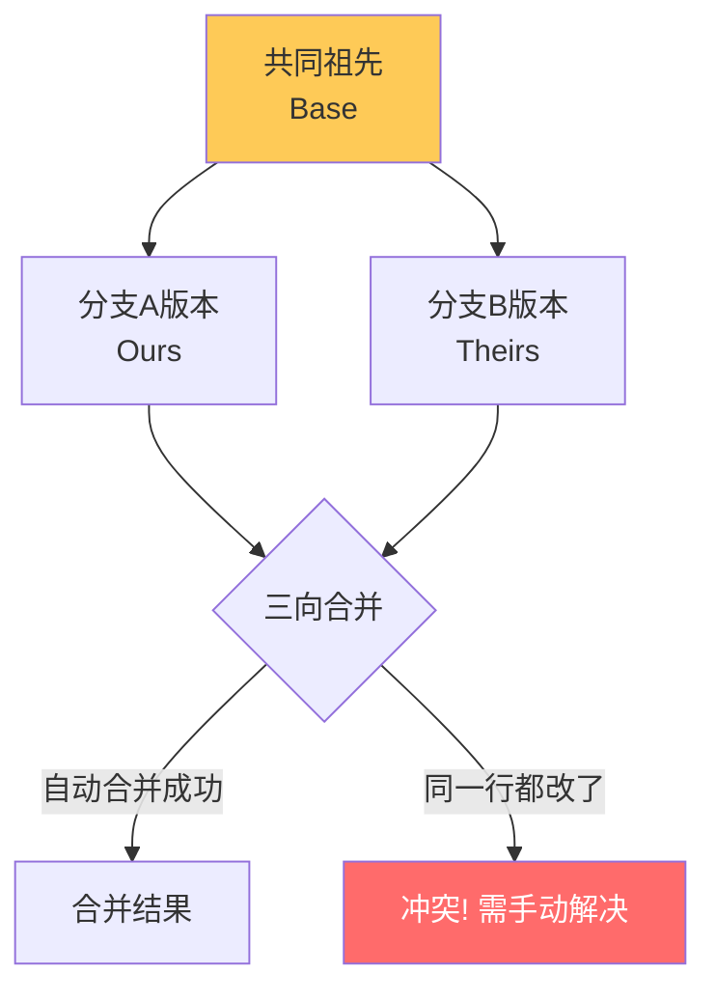
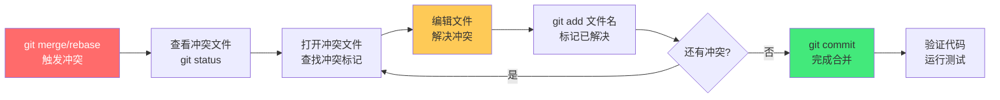
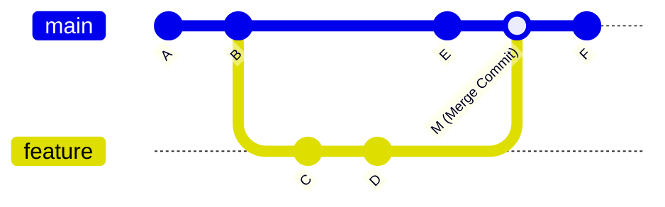

# 🔀 Git 冲突解决与变基

> **文档说明**：系统讲解 Git 冲突解决与变基（Rebase）的完整知识体系，涵盖冲突产生的根本原因、冲突类型（内容冲突/结构冲突/二进制冲突）、冲突标记解析、手动解决冲突的步骤、冲突解决工具（VSCode/IDE/命令行/mergetool）、merge vs rebase 深度对比、变基的底层原理（重放提交）、交互式变基（rebase -i）的全部操作（pick/reword/edit/squash/fixup/drop/reorder）、变基冲突处理、变基风险与黄金法则、pull --rebase 工作流、cherry-pick、reset/revert/reflog 恢复、大型合并策略、常见错误与最佳实践。
>
> **适用人群**：开发者、DevOps 工程师、技术负责人、需要团队协作的所有程序员
>
> **前置知识**：[[Git基础与核心命令]] · [[Git分支管理与工作流]]

---

## 一、概述

### 1.1 什么是 Git 冲突

Git 冲突（Conflict）发生在两个分支修改了同一文件的同一部分，Git 无法自动决定保留哪个版本时。

**冲突产生的条件**：
1. 两个分支（或提交）修改了**同一个文件**
2. 修改了**同一行或相邻行**（Git 三向合并无法自动解决）
3. 执行 `git merge`、`git rebase`、`git cherry-pick`、`git pull` 等操作时

**Git 三向合并（Three-way Merge）原理**：


Git 合并时找到两个分支的**共同祖先（Base）**，然后对比：
- 如果只有一个分支改了某行 → 采用改了的版本（自动合并）
- 如果两个分支改了不同的行 → 两个都保留（自动合并）
- 如果两个分支改了同一行 → **冲突**，需要手动解决

### 1.2 冲突的类型

| 冲突类型 | 说明 | 解决难度 |
|---------|------|---------|
| **内容冲突（Content Conflict）** | 两个分支修改了同一文件的同一行 | ⭐⭐ 中等 |
| **结构冲突（Structural Conflict）** | 一个分支删除了文件，另一个分支修改了该文件 | ⭐⭐ 中等 |
| **重命名冲突（Rename Conflict）** | 两个分支对同一文件重命名为不同名称 | ⭐⭐⭐ 较难 |
| **二进制冲突（Binary Conflict）** | 两个分支修改了同一二进制文件（图片/编译产物） | ⭐⭐⭐⭐ 难（无法文本合并） |
| **子模块冲突（Submodule Conflict）** | 两个分支更新了同一子模块到不同版本 | ⭐⭐ 中等 |
| **换行符冲突（Line Ending Conflict）** | CRLF/LF 不一致导致的伪冲突 | ⭐ 简单（配置 .gitattributes） |

### 1.3 冲突标记解析

当冲突发生时，Git 会在冲突文件中插入特殊标记：

```text
<<<<<<< HEAD（当前分支，ours）
这是当前分支的内容
=======
这是合并进来的分支的内容（theirs）
>>>>>>> branch-name
```

**标记说明**：
| 标记 | 含义 |
|------|------|
| `<<<<<<< HEAD` | 冲突开始，当前分支（ours）的版本 |
| `=======` | 分隔线，上方是 ours，下方是 theirs |
| `>>>>>>> branch-name` | 冲突结束，合并分支（theirs）的版本 |

**解决冲突**：编辑文件，删除标记，保留想要的内容（可以是 ours、theirs、或两者的组合），然后 `git add` 标记为已解决。

---

## 二、冲突解决实操

### 2.1 标准冲突解决流程



**详细步骤**：
```bash
# 1. 执行合并，触发冲突
git merge feature-branch
# Auto-merging src/app.js
# CONFLICT (content): Merge conflict in src/app.js
# Automatic merge failed; fix conflicts and then commit the result.

# 2. 查看哪些文件有冲突
git status
# On branch main
# You have unmerged paths.
#   (fix conflicts and run "git commit")
#   (use "git merge --abort" to abort the merge)
#
# Unmerged paths:
#   (use "git add <file>..." to mark resolution)
#         both modified:   src/app.js

# 3. 查看冲突内容
git diff
# 或直接打开文件编辑

# 4. 解决冲突后，标记为已解决
git add src/app.js

# 5. 完成合并
git commit
# 会自动生成合并提交信息，保存即可

# 6. 验证
git log --oneline --graph
```

### 2.2 冲突解决策略

| 策略 | 命令 | 适用场景 |
|------|------|---------|
| **保留当前分支版本** | `git checkout --ours <file>` | 当前分支的版本是正确的 |
| **保留合并分支版本** | `git checkout --theirs <file>` | 合并分支的版本是正确的 |
| **手动编辑** | 直接编辑文件 | 需要组合两个版本的内容 |
| **合并工具** | `git mergetool` | 复杂冲突，用可视化工具 |
| **取消合并** | `git merge --abort` | 冲突太复杂，不想合并了 |

```bash
# 保留当前分支版本（ours）
git checkout --ours src/app.js
git add src/app.js

# 保留合并分支版本（theirs）
git checkout --theirs src/app.js
git add src/app.js

# 取消合并，回到合并前状态
git merge --abort

# 取消变基
git rebase --abort
```

> **注意**：在 `git rebase` 中，ours/theirs 的含义是反的！变基时当前正在重放的提交是 theirs，被变基到的目标分支是 ours。这是一个常见的坑。

### 2.3 冲突解决工具

**VSCode 内置冲突解决**：
- 打开冲突文件，VSCode 会高亮显示冲突
- 提供四个快捷选项：`Accept Current Change`（接受当前）、`Accept Incoming Change`（接受传入）、`Accept Both Changes`（接受两者）、`Compare Changes`（对比）
- 解决后点击 `Resolve in Merge Editor` 进入可视化合并编辑器

**命令行工具**：
```bash
# 查看冲突文件列表
git status

# 查看某个文件的冲突
git diff <file>

# 查看合并双方的版本
git show :1:<file>  # 共同祖先（Base）
git show :2:<file>  # 当前分支（ours）
git show :3:<file>  # 合并分支（theirs）

# 启动 mergetool
git mergetool
```

**配置 mergetool**：
```bash
# 查看可用的 mergetool
git mergetool --tool-help

# 配置 VSCode 作为 mergetool
git config --global merge.tool vscode
git config --global mergetool.vscode.cmd 'code --wait $MERGED'

# 配置 Beyond Compare
git config --global merge.tool bc3
git config --global mergetool.bc3.path "C:/Program Files/Beyond Compare 4/BCompare.exe"

# 配置 vimdiff（默认）
git config --global merge.tool vimdiff
```

### 2.4 二进制文件冲突

二进制文件（图片、编译产物、字体等）无法文本合并，只能选择保留其中一个版本：

```bash
# 保留当前分支的二进制文件
git checkout --ours images/logo.png
git add images/logo.png

# 保留合并分支的二进制文件
git checkout --theirs images/logo.png
git add images/logo.png

# 完成合并
git commit
```

**最佳实践**：
- 二进制文件尽量不要在多个分支同时修改
- 用 Git LFS 管理大文件
- 图片等资源用设计工具协作，而非 Git 合并

---

## 三、Merge vs Rebase 深度对比

### 3.1 Merge（合并）

Merge 将两个分支的历史合并在一起，创建一个新的合并提交（Merge Commit）。



**Merge 的特点**：
- ✅ **保留完整历史**：所有提交都保留，包括分支结构
- ✅ **非破坏性**：不修改已有提交，安全
- ✅ **冲突解决简单**：只在合并提交时解决一次冲突
- ❌ **历史杂乱**：合并提交多了之后，提交图会像「意大利面」一样乱
- ❌ **提交噪音**：大量 "Merge branch 'feature' into main" 提交

**Merge 命令**：
```bash
# 合并指定分支到当前分支
git merge feature-branch

# 快进合并（如果可能）
git merge --ff-only feature-branch

# 禁止快进，强制创建合并提交
git merge --no-ff feature-branch

# 压缩合并（将分支所有提交压缩为一个提交）
git merge --squash feature-branch
git commit
```

### 3.2 Rebase（变基）

Rebase 将当前分支的提交「重放」到目标分支的最新提交之后，产生一条线性历史。


**变基的原理**：
1. 找到当前分支和目标分支的共同祖先
2. 将当前分支从共同祖先之后的每个提交「保存」起来
3. 将当前分支指向目标分支的最新提交
4. 将保存的提交逐个「重放」到目标分支之上
5. 每个重放的提交会生成**新的 commit hash**（因为父提交变了）

**Rebase 的特点**：
- ✅ **线性历史**：提交图干净整洁，像一条直线
- ✅ **易于追溯**：`git log` 清晰，`git bisect` 更有效
- ✅ **无合并提交噪音**：没有 "Merge branch" 提交
- ❌ **修改历史**：重放的提交是新的 hash，改变了提交历史
- ❌ **冲突可能多次**：每个提交重放时都可能冲突，需要逐个解决
- ❌ **有风险**：对已推送的公共分支变基会导致其他人的问题

**Rebase 命令**：
```bash
# 将当前分支变基到目标分支
git rebase main

# 变基时保留合并提交
git rebase --preserve-merges main

# 交互式变基
git rebase -i main

# 变基冲突后继续
git rebase --continue

# 跳过当前提交
git rebase --skip

# 取消变基
git rebase --abort
```

### 3.3 Merge vs Rebase 对比表

| 维度 | Merge | Rebase |
|------|-------|--------|
| **历史形态** | 保留分支结构，有合并提交 | 线性历史，无合并提交 |
| **是否修改历史** | ❌ 不修改（安全） | ✅ 修改（重写提交 hash） |
| **冲突次数** | 一次（合并提交时） | 可能多次（每个提交重放时） |
| **提交 traceability** | 完整保留所有提交 | 提交 hash 改变，但内容保留 |
| **公共分支** | ✅ 安全 | ❌ 危险（黄金法则：不要变基已推送的公共分支） |
| **个人特性分支** | 可用 | ✅ 推荐（保持线性历史） |
| **学习曲线** | 简单 | 较陡（需要理解重放原理） |
| **回滚难度** | 简单（revert 合并提交） | 较难（历史被改写） |
| **CI/CD** | 合并提交触发 | 线性历史更清晰 |

### 3.4 变基黄金法则

> **黄金法则：永远不要对已经推送到公共仓库的分支执行变基（rebase）。**

原因：
1. 变基会重写提交历史（生成新的 commit hash）
2. 其他人可能已经基于旧的提交做了工作
3. 变基后推送需要 `git push --force`，可能覆盖别人的提交
4. 其他人拉取后会遇到混乱的合并

**什么情况下可以变基**：
- ✅ 本地未推送的个人分支
- ✅ 自己的特性分支，且确认没有其他人基于它工作
- ✅ 清理自己的提交历史（rebase -i）后，强制推送到自己的 PR 分支
- ❌ 已推送到公共分支（main/develop/release）
- ❌ 其他人正在协作的分支

**如果必须变基已推送的分支**：
```bash
# 1. 变基
git rebase main

# 2. 强制推送（--force-with-lease 比 --force 更安全）
git push --force-with-lease origin feature-branch

# 3. 通知协作者重新拉取
# 协作者需要：
git fetch origin
git reset --hard origin/feature-branch  # 丢弃本地修改，强制同步
# 或
git pull --rebase origin feature-branch  # 变基拉取
```

---

## 四、交互式变基（rebase -i）

### 4.1 交互式变基简介

交互式变基（Interactive Rebase）是 Git 最强大的功能之一，可以在变基过程中对提交进行编辑、合并、删除、重排等操作。

```bash
# 交互式变基最近 N 个提交
git rebase -i HEAD~5

# 交互式变基到某个提交之后
git rebase -i <commit-hash>

# 交互式变基到某个分支
git rebase -i main
```

执行后会打开编辑器，显示提交列表和可用命令：

```css
pick a1b2c3d 提交信息1
pick d4e5f6g 提交信息2
pick h7i8j9k 提交信息3

# Rebase 1a2b3c4..h7i8j9k onto 1a2b3c4 (3 commands)
#
# Commands:
# p, pick <commit> = use commit
# r, reword <commit> = use commit, but edit the commit message
# e, edit <commit> = use commit, but stop for amending
# s, squash <commit> = use commit, but meld into previous commit
# f, fixup <commit> = like squash, but discard this commit's log message
# x, exec <command> = run command (the rest of the line) using shell
# b, break = stop here (continue rebase later with 'git rebase --continue')
# d, drop <commit> = remove commit
# l, label <label> = label current HEAD with a name
# t, reset <label> = reset HEAD to a label
# m, merge [-C <commit> | -c <commit>] <label> [# <oneline>]
# .       create a merge commit using the original merge commit's
# .       message (or the oneline, if no original merge commit was
# .       specified). Use -c <commit> to reword the commit message.
```

### 4.2 全部操作详解

| 命令 | 缩写 | 说明 |
|------|------|------|
| `pick` | `p` | 保留该提交（默认） |
| `reword` | `r` | 保留提交，但修改提交信息 |
| `edit` | `e` | 保留提交，但暂停以便修改（可以改代码/添加文件） |
| `squash` | `s` | 将该提交合并到前一个提交，保留两个提交信息 |
| `fixup` | `f` | 将该提交合并到前一个提交，丢弃该提交信息 |
| `drop` | `d` | 删除该提交 |
| `exec` | `x` | 执行 shell 命令 |
| `break` | `b` | 在此处暂停（后续用 --continue 继续） |
| 重排序 | - | 直接调整行的顺序，提交会按新顺序重放 |

**示例1：修改提交信息（reword）**
```bash
git rebase -i HEAD~3
# 将 pick 改为 reword
reword a1b2c3d 旧的提交信息
pick d4e5f6g 提交信息2
pick h7i8j9k 提交信息3
# 保存后会打开编辑器，输入新的提交信息
```

**示例2：合并提交（squash）**
```bash
git rebase -i HEAD~4
# 将后两个提交合并到第一个
pick a1b2c3d 功能实现
squash d4e5f6g 修复bug
squash h7i8j9k 代码优化
pick k1l2m3n 另一个功能
# 保存后会打开编辑器，编辑合并后的提交信息
```

**示例3：修复旧提交（edit）**
```bash
git rebase -i HEAD~5
# 将 pick 改为 edit
pick a1b2c3d 提交1
edit d4e5f6g 需要修改的提交
pick h7i8j9k 提交3
# 保存后 Git 会暂停在该提交
# 修改代码...
git add .
git commit --amend  # 修改该提交
git rebase --continue  # 继续变基
```

**示例4：删除提交（drop）**
```bash
git rebase -i HEAD~3
# 将 pick 改为 drop（或直接删除该行）
pick a1b2c3d 保留的提交
drop d4e5f6g 要删除的提交
pick h7i8j9k 保留的提交
```

**示例5：重排提交顺序**
```bash
git rebase -i HEAD~3
# 直接调整行的顺序
pick h7i8j9k 提交3（原第3个，现在排第1）
pick a1b2c3d 提交1（原第1个，现在排第2）
pick d4e5f6g 提交2（原第2个，现在排第3）
```

### 4.3 变基冲突处理

变基过程中，每个提交重放时都可能遇到冲突：

```bash
# 变基时遇到冲突
git rebase main
# Auto-merging src/app.js
# CONFLICT (content): Merge conflict in src/app.js
# error: could not apply a1b2c3d... 提交信息
# Resolve all conflicts manually, mark them as resolved with
# "git add/rm <file>", then run "git rebase --continue".
# You can instead skip this commit: run "git rebase --skip".
# To abort and get back to the state before "git rebase", run "git rebase --abort".

# 1. 查看冲突
git status

# 2. 解决冲突
# 编辑文件...

# 3. 标记已解决
git add src/app.js

# 4. 继续变基
git rebase --continue

# 如果当前提交的冲突不想解决，可以跳过该提交
git rebase --skip

# 如果想完全取消变基
git rebase --abort
```

> **变基冲突中的 ours/theirs 反转**：在 `git rebase` 中，`--ours` 指的是目标分支（被变基到的分支），`--theirs` 指的是正在重放的提交。这与 `git merge` 中的含义相反，是一个常见的坑。记忆口诀：merge 时 ours=当前分支，rebase 时 ours=目标分支（因为变基时当前分支的提交正在被重放，是"外来的"）。

---

## 五、高级操作

### 5.1 pull --rebase 工作流

`git pull --rebase` 是推荐的拉取远程更新的方式——先拉取远程更新，然后将本地提交变基到远程最新提交之上，保持线性历史。

```bash
# 推荐：拉取时变基
git pull --rebase origin main

# 等价于：
git fetch origin
git rebase origin/main

# 配置默认使用 rebase 拉取
git config --global pull.rebase true

# 或针对某个分支配置
git config branch.main.rebase true
```

**pull --rebase vs pull（merge）对比**：
| 方式 | 历史形态 | 适用场景 |
|------|---------|---------|
| `git pull`（默认 merge） | 产生合并提交 | 简单项目，不介意合并提交 |
| `git pull --rebase` | 线性历史 | 推荐，保持提交历史整洁 |

```text
### 5.2 Cherry-pick
```

Cherry-pick 将某个分支的特定提交「挑拣」到当前分支。

```bash
# 挑拣单个提交
git cherry-pick <commit-hash>

# 挑拣多个提交
git cherry-pick <commit1> <commit2> <commit3>

# 挑拣一段提交范围（不包含 start）
git cherry-pick <start>..<end>

# 挑拣一段提交范围（包含 start）
git cherry-pick <start>^..<end>

# 只应用变更，不自动提交
git cherry-pick --no-commit <commit-hash>

# 冲突后继续
git cherry-pick --continue

# 跳过当前提交
git cherry-pick --skip

# 取消 cherry-pick
git cherry-pick --abort
```

**适用场景**：
- 将某个 bug 修复从开发分支挑到发布分支
- 只需要某个分支的部分提交，不需要整个分支合并
- 回滚某个特定提交（挑拣反向提交）

### 5.3 Reset、Revert 与 Reflog

**git reset（重置）**：
```bash
# 三种模式
git reset --soft <commit>    # 移动 HEAD，暂存区和工作区不变
git reset --mixed <commit>   # 移动 HEAD，重置暂存区，工作区不变（默认）
git reset --hard <commit>     # 移动 HEAD，重置暂存区和工作区（危险！）

# 撤销最近一次提交（保留修改）
git reset --soft HEAD~1

# 撤销最近一次提交和暂存（保留工作区修改）
git reset HEAD~1

# 彻底撤销最近一次提交（丢弃修改，危险！）
git reset --hard HEAD~1
```

**git revert（回滚）**：
```bash
# 创建一个新提交，撤销指定提交的变更（安全，不修改历史）
git revert <commit-hash>

# 回滚合并提交（需要指定 -m 保留哪个父分支）
git revert -m 1 <merge-commit-hash>

# 不自动提交
git revert --no-commit <commit-hash>
```

**reset vs revert 对比**：
| 维度 | reset | revert |
|------|-------|--------|
| 是否修改历史 | ✅ 修改（删除提交） | ❌ 不修改（创建反向提交） |
| 公共分支 | ❌ 危险 | ✅ 安全 |
| 本地未推送 | ✅ 可用 | 可用 |
| 提交历史 | 提交被删除 | 保留原提交+新增回滚提交 |

**git reflog（引用日志）**：
```bash
# 查看 HEAD 的所有移动记录（包括被 reset 删除的提交）
git reflog

# 恢复被误删的提交
git reflog  # 找到被删除前的 commit hash
git reset --hard <commit-hash>  # 恢复

# 查看某个分支的 reflog
git reflog show main
```

> **reflog 是 Git 的「时光机」**——几乎所有被 Git 删除的提交都可以通过 reflog 找回（reflog 默认保留 90 天）。即使执行了 `git reset --hard`，只要提交还在 reflog 中，就可以恢复。这是 Git 最强大的安全网之一。

### 5.4 大型合并策略

对于大型合并（如长期特性分支合并回主分支），推荐策略：

1. **先变基到主分支最新**：
   ```bash
   git checkout feature
   git rebase main
   # 解决冲突...
   ```

2. **充分测试**：变基后运行完整测试套件，确保没有破坏功能

3. **合并到主分支**：
   ```bash
   git checkout main
   git merge --no-ff feature  # --no-ff 保留分支合并记录
   ```

4. **或者用 Squash Merge**：
   ```bash
   git checkout main
   git merge --squash feature
   git commit -m "feat: 完整的功能描述"
   ```

---

## 六、常见问题与最佳实践

### 6.1 常见问题

| 问题 | 原因 | 解决方案 |
|------|------|---------|
| **冲突太多，不想合并了** | 两个分支差异太大 | `git merge --abort` 或 `git rebase --abort` 取消 |
| **变基后推送被拒绝** | 变基重写了历史，远程还是旧历史 | `git push --force-with-lease`（比 --force 安全） |
| **变基冲突反复出现** | 每个提交重放都冲突 | 可以先 squash 提交再变基，或用 merge 替代 |
| **误删了提交** | `git reset --hard` 误操作 | `git reflog` 找到提交，`git reset --hard` 恢复 |
| **合并提交信息乱** | 大量自动生成的合并提交 | 用 rebase 保持线性历史，或用 --squash 压缩 |
| **二进制文件冲突** | 两个分支都改了同一二进制文件 | 只能选一个版本（ours/theirs），用 LFS 管理大文件 |
| **换行符冲突** | CRLF/LF 不一致 | 配置 `.gitattributes`，`core.autocrlf` |
| **子模块冲突** | 两个分支更新了子模块到不同版本 | 选择正确的子模块版本，`git add` 后继续 |
| **变基后丢失了提交** | 变基过程中 drop 了或冲突 skip 了 | `git reflog` 找回，或 `git rebase --abort` 重新来 |
| **merge 后想撤销** | 合并错了分支或有问题 | 未推送：`git reset --hard HEAD~1`；已推送：`git revert -m 1 <merge>` |
| **cherry-pick 冲突** | 挑拣的提交与当前分支有冲突 | 解决冲突后 `git cherry-pick --continue` |
| **交互式变基编辑器打不开** | 默认编辑器配置问题 | `git config --global core.editor "code --wait"` 配置编辑器 |

### 6.2 最佳实践

1. **小步提交，频繁合并**：
   - 特性分支不要存活太久，定期合并主分支更新
   - 小提交更容易解决冲突（冲突范围小）

2. **特性分支用 rebase，主分支用 merge**：
   - 个人特性分支：用 rebase 保持线性历史
   - 合并到主分支：用 `--no-ff` merge 保留合并记录
   - 主分支本身：永远不要 rebase

3. **提交前先 pull --rebase**：
   ```bash
   git pull --rebase origin main
   # 解决冲突...
   git push origin feature
   ```

4. **配置默认 rebase pull**：
   ```bash
   git config --global pull.rebase true
   git config --global rebase.autoStash true  # 变基时自动暂存未提交的修改
   ```

5. **变基前确保工作区干净**：
   ```bash
   git status  # 确保没有未提交的修改
   # 如果有，先 commit 或 stash
   git stash
   git rebase main
   git stash pop
   ```

6. **用 rebase -i 整理提交**：
   - 合并 "fix typo"、"wip" 等临时提交
   - 修改不清晰的提交信息
   - 删除不需要的提交
   - 整理后再推送 PR

7. **强制推送用 --force-with-lease**：
   ```bash
   # ❌ 危险：可能覆盖别人的推送
   git push --force

   # ✅ 安全：如果远程有新的提交会拒绝
   git push --force-with-lease
   ```

8. **团队约定 Git 工作流**：
   - 明确哪些分支可以 rebase，哪些只能 merge
   - 统一提交信息规范（Conventional Commits）
   - PR 合并策略（merge commit / squash / rebase）

9. **冲突解决后运行测试**：
   - 冲突解决不代表代码正确，可能逻辑有问题
   - 合并/变基后必须运行测试，确保功能正常

10. **善用 reflog 作为安全网**：
    - 任何历史改写操作前，记住可以用 reflog 恢复
    - 不确定操作后果时，先打个 tag 备份：`git tag backup-before-rebase`

---

## 七、关联笔记

```text
### Git 版本控制
```
- [[Git基础与核心命令]] · [[Git分支管理与工作流]] · [[Git高级操作与底层原理]]
- [[GitLab与代码评审]] · [[语义化版本与CHANGELOG]]

### 团队协作
- [[代码评审最佳实践]] · [[CI-CD流水线]] · [[敏捷开发与Scrum]]

### 导航
- [[MOC-通用工具]] · [[MOC-综合导航]] · [[Home]]

> 🔍 **知识点深度解析**
>
> **作用**：Git 冲突解决与变基解决的是「多人协作时代码合并的冲突问题」和「提交历史的整洁性问题」——团队协作中，多个开发者在不同分支修改同一文件的同一部分时，Git 无法自动合并，产生冲突；同时，大量合并提交会让提交历史变得杂乱（「意大利面」式的提交图），难以追溯和排查。冲突解决提供了手动合并冲突内容的方法，变基（Rebase）提供了将提交历史线性化的手段，两者结合让团队协作既高效又整洁。
>
> **底层原理**：Git 合并的核心是「三向合并（Three-way Merge）」——找到两个分支的共同祖先（Base），然后对比 Base→分支A（ours）和 Base→分支B（theirs）的变更：如果只有一方改了某行，采用改了的版本；如果双方改了不同行，都保留；如果双方改了同一行，产生冲突，需要手动解决。变基（Rebase）的核心是「提交重放（Replay）」——将当前分支从共同祖先之后的每个提交保存为补丁（patch），然后将当前分支指针移动到目标分支的最新提交，再将保存的补丁逐个应用（重放）到新的基础之上。因为每个重放的提交的父提交变了，所以会生成新的 commit hash——这就是为什么变基「修改了历史」。交互式变基（rebase -i）在重放过程中允许对每个提交进行操作（pick/reword/edit/squash/fixup/drop），本质是在重放前编辑「重放计划」。Git 对象模型中，提交是不可变的（immutable），变基不是「修改」提交，而是「创建新的提交并移动分支指针」，旧的提交仍然存在（可通过 reflog 找回）。
>
> **用法要点**：① 冲突解决：冲突标记 `<<<<<<< HEAD`/`=======`/`>>>>>>> branch`，编辑文件删除标记保留正确内容，`git add` 标记已解决，`git commit` 完成合并；策略：ours（`git checkout --ours`）、theirs（`git checkout --theirs`）、手动编辑、mergetool；取消：`git merge --abort`/`git rebase --abort` ② Merge vs Rebase：merge 保留分支结构+合并提交（安全但历史乱），rebase 线性历史（整洁但修改历史）；黄金法则：不要变基已推送到公共分支的提交；个人特性分支推荐 rebase，合并到主分支用 --no-ff merge ③ 交互式变基：`git rebase -i HEAD~N`，操作：pick（保留）、reword（改信息）、edit（暂停修改）、squash（合并到前一个+保留信息）、fixup（合并到前一个+丢弃信息）、drop（删除）、重排序（调整行顺序）；冲突后 `git rebase --continue`/`--skip`/`--abort` ④ 变基冲突注意 ours/theirs 反转：rebase 中 ours=目标分支，theirs=正在重放的提交（与 merge 相反） ⑤ pull --rebase：推荐 `git pull --rebase`，配置 `git config --global pull.rebase true` ⑥ cherry-pick：`git cherry-pick <commit>` 挑拣特定提交，冲突后 --continue/--skip/--abort ⑦ reset/revert/reflog：reset（--soft/--mixed/--hard，修改历史，本地用）、revert（创建反向提交，不修改历史，公共分支用）、reflog（时光机，找回被删提交，默认保留90天） ⑧ 强制推送：用 `--force-with-lease` 而非 `--force`，更安全 ⑨ 最佳实践：小步提交频繁合并、特性分支 rebase+主分支 merge、变基前确保工作区干净、冲突解决后运行测试、团队约定工作流、善用 reflog 安全网。

> 💡 **深度讲解**：Git 冲突与变基最核心的智慧是「理解 Git 的提交是不可变的，所有『修改历史』的操作本质都是创建新提交+移动指针」。很多人害怕 rebase，是因为觉得它「修改了历史」很危险，但理解了不可变性就知道——rebase 不是销毁旧提交，而是创建新提交并把分支指针移过去，旧提交还在对象库中，通过 reflog 可以找回。这就像写书——merge 是把两本书的内容合并成一本新书（保留两本书的所有页码），rebase 是把一本书的内容重新抄写在另一本书的后面（新的页码，但内容一样），旧的那本书没有被销毁，只是被放到了书架角落（reflog）。理解了这个比喻，rebase 就不再可怕。「三向合并」是理解冲突的关键。很多人以为冲突是「两个版本不一样」，但实际上 Git 很聪明——它会找到共同祖先，然后看每个分支相对于祖先做了什么变更。如果 A 改了第1行，B 改了第2行，Git 会自动合并（两个变更都保留）；只有当 A 和 B 都改了同一行（且改得不一样），Git 才会冲突，因为它不知道该听谁的。这就是为什么小步提交、频繁合并能减少冲突——每次合并的变更范围小，冲突概率低。「变基黄金法则」的本质是「不要让其他人的基于旧历史的工作失效」。当你对已推送的公共分支执行 rebase 后，你的本地分支和远程分支的历史分叉了——你有新的提交（新 hash），远程还有旧的提交。其他人可能已经基于旧提交拉取了代码并做了工作。如果你强制推送覆盖远程，其他人拉取时会遇到混乱的合并，甚至丢失工作。这就是为什么黄金法则说「不要变基公共分支」——不是技术上做不到，而是协作上会给别人带来麻烦。对于个人特性分支，因为只有你一个人在用，rebase 后强制推送不会影响别人，所以是安全的。

> 📝 **精简总结**：Git 冲突 = 两个分支改了同一文件同一行，三向合并无法自动解决；解决 = 编辑文件删标记→git add→git commit。Merge vs Rebase：merge 保留分支结构+合并提交（安全），rebase 线性历史（整洁但改历史）；黄金法则：不变基公共分支。交互式变基 rebase -i：pick/reword/edit/squash/fixup/drop/重排序。变基冲突中 ours/theirs 反转。pull --rebase 推荐。cherry-pick 挑拣提交。reset（改历史，本地）vs revert（不改历史，公共）。reflog 时光机找回被删提交。强制推送用 --force-with-lease。最佳实践：小步提交、特性分支rebase+主分支merge、变基前干净工作区、冲突后测试、团队约定工作流。

> **学习路径建议**：先学习 [[Git基础与核心命令]] 掌握 Git 基础 → 学习 [[Git分支管理与工作流]] 理解分支和工作流 → 学习本文档掌握冲突解决与变基 → 实践：在个人项目中练习 rebase -i 整理提交 → 学习 [[Git高级操作与底层原理]] 深入 Git 底层 → 学习 [[GitLab与代码评审]] 掌握团队协作 → 阅读《Pro Git》第3章（分支）和第7章（高级工具）深入理解。

---

> **Git 冲突与变基的本质是「协作的秩序」——多人协作中，每个人的工作最终要合并到一起，冲突是不可避免的（因为大家都在改代码），关键是如何优雅地处理冲突、如何保持提交历史的整洁可追溯。冲突解决教会我们「面对分歧时如何整合」——不是简单地选 A 或选 B，而是理解双方的意图，整合出更好的结果。变基教会我们「对历史负责」——提交历史不是随便的草稿，而是项目的编年史，整洁的历史让后来者能清晰地理解「为什么做了这个变更」，混乱的历史则让项目变成无法理解的黑盒。当你掌握了冲突解决和变基，你就不再是「Git 的使用者」，而是「Git 的驾驭者」——你能从容面对任何复杂的合并场景，能整理出清晰的提交历史，能在团队协作中建立秩序。这就是 Git 高级操作的终极意义：从「能提交代码」到「能管理协作的秩序」。**

---

## 🔗 关联笔记

- [[MOC-通用工具]] — 返回本分类知识地图，查看更多相关文档

## 📖 前置知识

- 无特殊前置知识要求，具备基础编程概念即可

## 🏷️ 相关标签

`#Git` `#版本控制` `#冲突解决` `#变基` `#Rebase` `#Merge`

[[Home|🏠 返回首页]] · [[MOC-通用工具|📚 返回分类]]
