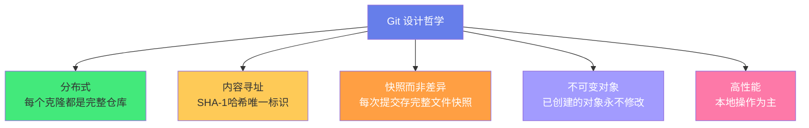
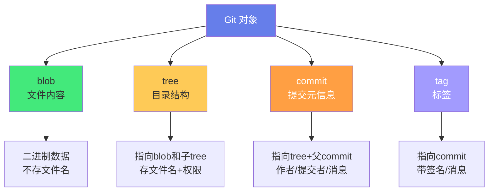
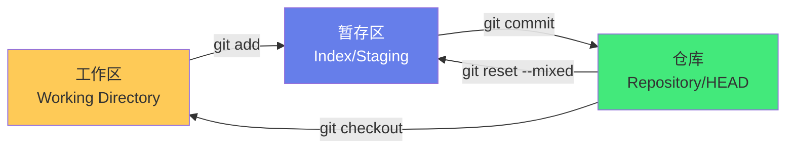
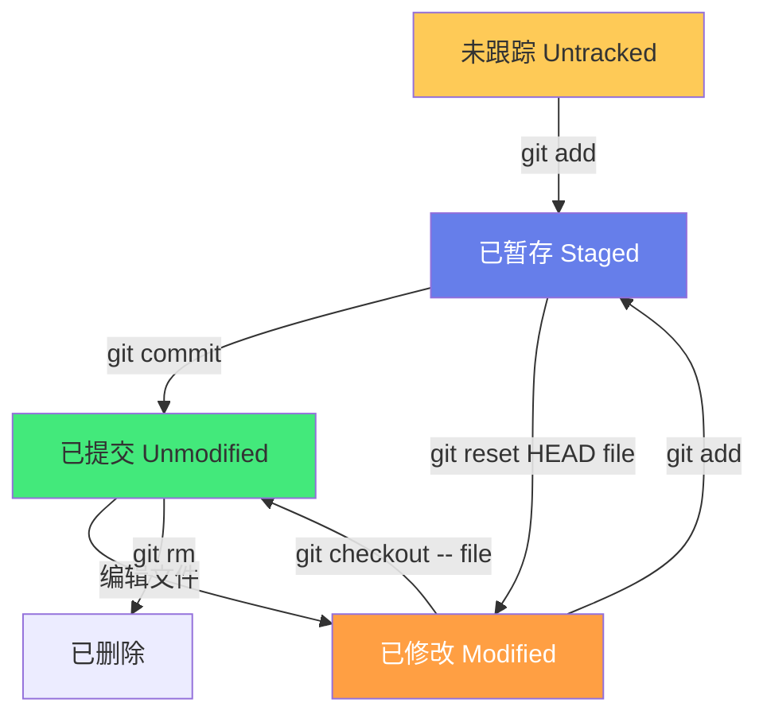
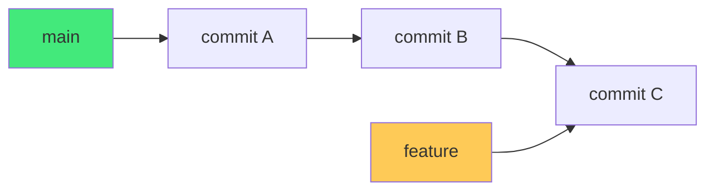
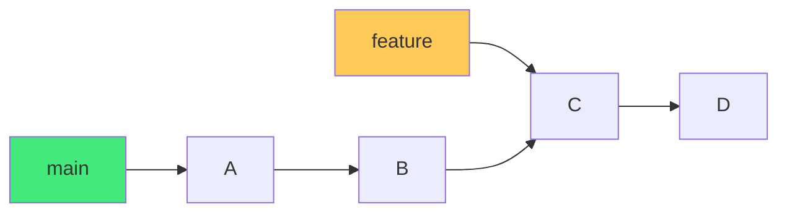
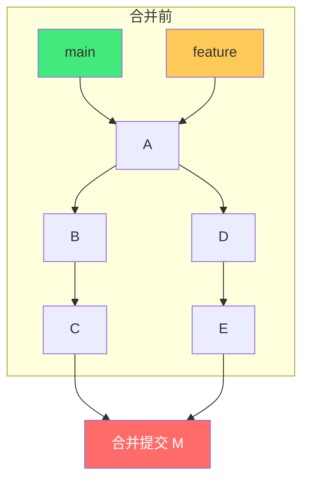
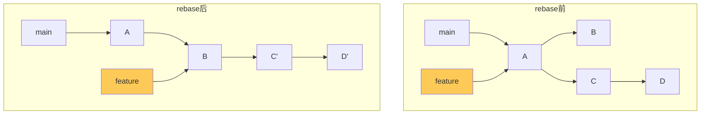
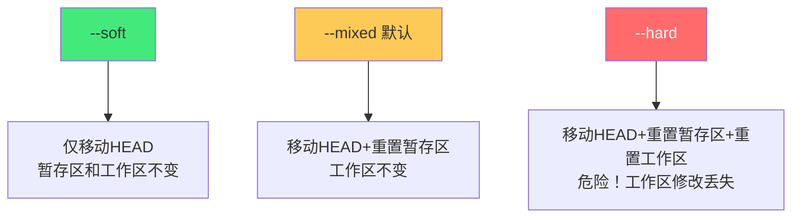
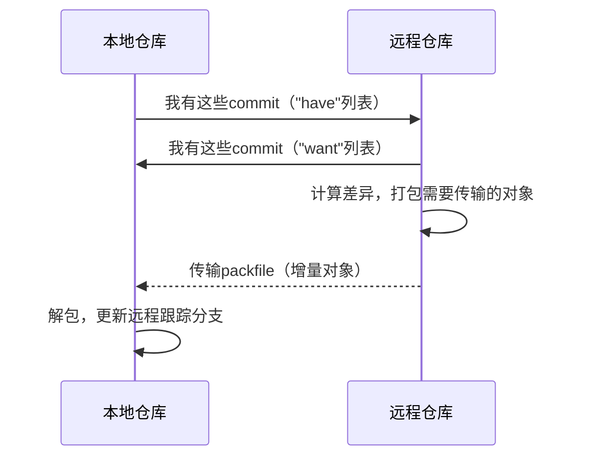

# 🔧 Git 高级命令与底层原理

> **文档说明**：系统讲解 Git 的底层架构、对象模型、核心原理与高级命令，涵盖 Git 的设计哲学（分布式版本控制/内容寻址存储/SNAPSHOT 而非差异）、底层对象模型（blob 数据块/tree 目录树/commit 提交对象/tag 标签对象，四种对象的 SHA-1 哈希与存储方式）、.git 目录完整结构（objects/refs/HEAD/config/index/hooks/packed-refs 等）、Git 三区模型（工作区 Working Directory / 暂存区 Index/Staging / 仓库 Repository）与文件状态生命周期、引用（Refs）与 HEAD 的本质（分支只是指向 commit 的可变指针）、合并的底层原理（快进合并 Fast-Forward / 三方合并 Three-Way Merge / 递归合并策略 / 合并冲突的产生与解决）、变基 rebase 的原理（找到共同祖先→重放提交→移动分支指针）与 merge vs rebase 的选择、cherry-pick 原理（将指定 commit 的变更重新应用到当前分支）、reset 的三种模式（--soft 仅移动 HEAD / --mixed 移动 HEAD+重置暂存区 / --hard 移动 HEAD+重置暂存区+工作区）与危险操作、reflog 引用日志（HEAD 的操作历史，误操作恢复的救命稻草）、stash 暂存原理、高级排查命令（bisect 二分查找 bug 引入提交 / blame 逐行追溯 / rev-parse / rev-list / cat-file / show-ref / update-ref / fsck 完整性检查）、Git 内部对象操作（hash-object / cat-file / write-tree / commit-tree / mktag，从底层理解 Git）、Git 钩子 hooks（pre-commit/commit-msg/pre-push 等客户端与服务端钩子）、Git 配置三级体系（system/global/local）与常用配置、Git 传输协议（本地/HTTP/SSH/Git 协议，fetch/push 的握手与对象传输）、打包文件 packfile 与垃圾回收 gc（松散对象→打包文件→增量存储，git gc / git prune）、Git 工作流对比（GitFlow / GitHub Flow / GitLab Flow / Trunk-Based）、子模块 submodule 与子树 subtree、稀疏检出 sparse-checkout 与部分克隆 partial clone、大文件存储 LFS、常见问题排查（分离头指针 Detached HEAD / 合并冲突 / 误提交恢复 / 历史改写 amend/rebase/filter-repo / 敏感信息泄露处理）、性能优化（浅层克隆/单分支克隆/打包优化）、安全最佳实践（.gitignore/签名提交/密钥扫描）。
>
> **适用人群**：需要深入理解 Git 原理的开发者、DevOps、技术负责人、经常遇到 Git 问题需要排查的工程师
>
> **前置知识**：[[Git基础命令与工作流]] · [[Linux基础命令]]

---

## 一、概述

### 1.1 Git 的设计哲学

Git 由 Linus Torvalds 于 2005 年为管理 Linux 内核开发，其设计哲学深刻影响了现代软件开发：



| 设计原则 | 说明 | 影响 |
|---------|------|------|
| **分布式** | 每个克隆都包含完整历史，无中心服务器也能工作 | 离线可用、多点备份、协作灵活 |
| **内容寻址** | 所有对象通过 SHA-1 哈希标识，内容相同则哈希相同 | 完整性校验、去重、高效传输 |
| **快照而非差异** | 每次 commit 存储所有文件的快照（未变更文件引用旧对象） | 切换分支快、历史完整、但存储需优化 |
| **不可变对象** | blob/tree/commit 对象一旦创建永不修改 | 历史可追溯、reflog 可恢复 |
| **本地优先** | 几乎所有操作都是本地操作，不依赖网络 | 速度极快、离线可用 |

> **核心洞察**：Git 不是「版本控制系统」，而是「内容寻址的文件系统 + 一套追踪内容变化的工具」。理解了这一点，Git 的所有命令和行为都能从底层推导出来。

### 1.2 为什么要学底层原理

- **遇到问题能排查**：合并冲突、误提交、分离头指针、历史损坏——不懂底层只能瞎试
- **高级操作有把握**：rebase、cherry-pick、reset、filter-repo——懂原理才敢用
- **优化性能**：大仓库的克隆/提交/切换慢——懂 packfile 和 gc 才能优化
- **真正掌握工具**：从「会用命令」到「理解机制」，是新手到专家的关键跨越

---

## 二、Git 底层对象模型

### 2.1 四种对象

Git 的底层是一个**内容寻址的对象数据库**，所有内容都存储为四种对象之一：



| 对象类型 | 存储内容 | 标识 | 说明 |
|---------|---------|------|------|
| **blob（二进制大对象）** | 文件内容 | `blob <size>\0<content>` 的 SHA-1 | 不存文件名，只存内容；相同内容只存一份 |
| **tree（树）** | 目录结构 | 条目列表（模式+类型+哈希+文件名） | 指向 blob 和子 tree，对应文件系统的目录 |
| **commit（提交）** | 提交元信息 | tree 哈希+父 commit+作者/提交者+时间+消息 | 一次提交的完整快照 |
| **tag（标签）** | 标签信息 | 指向 commit（或其他对象）+标签名+标签者+消息+签名 | 通常用于版本发布标记 |

### 2.2 SHA-1 哈希与内容寻址

Git 对每个对象计算 SHA-1 哈希，作为其唯一标识：

```text
对象内容 = "blob 11\0hello world"  (类型+大小+空字节+内容)
SHA-1("blob 11\0hello world") = 3b18e512dba79e4c8300dd08aeb37f8e728b8dad
```

**存储路径**：`.git/objects/<前2位>/<后38位>`
- 例如哈希 `3b18e512dba79e4c8300dd08aeb37f8e728b8dad`
- 存储在 `.git/objects/3b/18e512dba79e4c8300dd08aeb37f8e728b8dad`

**内容寻址的优势**：
- **完整性校验**：内容变了哈希就变，能检测损坏
- **去重**：相同内容（即使文件名不同）只存一份
- **高效传输**：fetch/push 时只需传输对方没有的对象

### 2.3 commit 对象的结构

```text
tree d8329fc1cc938780ffdd9f94e0d364e0ea74f579     # 根目录tree
parent 1a410efbd13591db07496601ebc7a059dd55cfe9   # 父commit（首次提交无此项）
author Scott Chacon <schacon@gmail.com> 1243040974 +0100    # 作者
committer Scott Chacon <schacon@gmail.com> 1243040974 +0100 # 提交者

这是提交信息（subject + body）
```

**关键点**：
- 一个 commit 指向一个 tree（完整快照）和零或多个 parent（父提交）
- 首次提交无 parent，合并提交有 2+ 个 parent
- author（写代码的人）和 committer（提交代码的人）可以不同

### 2.4 tree 对象的结构

```text
100644 blob a1b2c3d4...    README.md      # 普通文件
100755 blob e5f6g7h8...    deploy.sh      # 可执行文件
040000 tree i9j0k1l2...    src/           # 子目录
120000 blob m3n4o5p6...    symlink        # 符号链接
```

| 模式 | 含义 |
|------|------|
| `100644` | 普通文件 |
| `100755` | 可执行文件 |
| `040000` | 目录 |
| `120000` | 符号链接 |
| `160000` | submodule（gitlink） |

### 2.5 用底层命令理解 Git

```bash
# 1. 创建 blob 对象（计算哈希并存储）
echo "hello world" | git hash-object -w --stdin
# 输出: 3b18e512dba79e4c8300dd08aeb37f8e728b8dad

# 2. 查看对象内容
git cat-file -p 3b18e512
# 输出: hello world

# 3. 查看对象类型
git cat-file -t 3b18e512
# 输出: blob

# 4. 从暂存区创建 tree
git write-tree
# 输出: d8329fc1cc938780ffdd9f94e0d364e0ea74f579

# 5. 创建 commit 对象
echo "首次提交" | git commit-tree d8329fc1
# 输出: 1a410efbd13591db07496601ebc7a059dd55cfe9

# 6. 更新分支指针
git update-ref refs/heads/main 1a410efb
```

> 这就是 `git add` + `git commit` 的底层实现：hash-object（存文件）→ write-tree（建目录树）→ commit-tree（建提交）→ update-ref（更新分支）。

---

## 三、.git 目录结构

### 3.1 完整结构

```css
.git/
├── HEAD                  # 当前指向（ref: refs/heads/main 或 commit哈希）
├── config                # 仓库级配置
├── description           # 仓库描述（GitWeb使用）
├── index                 # 暂存区（二进制文件）
├── packed-refs           # 打包的引用（压缩后）
├── COMMIT_EDITMSG        # 最后一次提交信息
├── ORIG_HEAD             # 危险操作前的HEAD位置（reset/merge前）
├── FETCH_HEAD            # 最后一次fetch的分支记录
├── MERGE_HEAD            # 合并中的其他分支
├── objects/              # 对象数据库
│   ├── 3b/18e512...      # 松散对象（前2位目录/后38位文件）
│   ├── pack/             # 打包文件
│   │   ├── pack-xxx.pack # 打包的数据
│   │   └── pack-xxx.idx  # 打包索引
│   └── info/             # 对象信息
├── refs/                 # 引用
│   ├── heads/            # 分支（main/develop/feature-x）
│   ├── tags/             # 标签（v1.0.0）
│   └── remotes/          # 远程跟踪分支（origin/main）
├── hooks/                # 钩子脚本
│   ├── pre-commit
│   ├── commit-msg
│   ├── pre-push
│   └── ...
├── logs/                 # reflog 日志
│   ├── HEAD
│   └── refs/heads/main
├── info/
│   └── exclude           # 全局忽略（不纳入版本控制）
└── modules/              # submodule 的 .git 目录
```

### 3.2 关键文件说明

| 文件/目录 | 作用 |
|----------|------|
| `HEAD` | 当前位置，通常是 `ref: refs/heads/main`（指向分支），分离头指针时是 commit 哈希 |
| `index` | 暂存区，二进制格式，存储下一次提交将包含的文件快照 |
| `config` | 仓库级配置（remote、branch、user 等） |
| `objects/` | 所有 Git 对象（blob/tree/commit/tag） |
| `refs/` | 所有引用（分支、标签、远程跟踪分支） |
| `logs/` | reflog，记录 HEAD 和分支的移动历史 |
| `hooks/` | 钩子脚本，特定事件触发 |
| `packed-refs` | 打包后的引用（gc 后生成，减少文件数） |

---

## 四、三区模型与文件状态

### 4.1 三个区域



| 区域 | 说明 | 对应命令 |
|------|------|---------|
| **工作区（Working Directory）** | 你在磁盘上看到/编辑的文件 | 直接编辑 |
| **暂存区（Index/Staging）** | `.git/index`，下一次提交的快照 | `git add` 加入，`git reset` 移出 |
| **仓库（Repository）** | `.git/objects` 中的 commit 对象 | `git commit` 永久保存 |

### 4.2 文件状态生命周期



| 状态 | 含义 | 查看 |
|------|------|------|
| **Untracked（未跟踪）** | 新文件，未加入版本控制 | `git status` 显示红色 |
| **Staged（已暂存）** | 已 `git add`，将进入下次提交 | `git status` 显示绿色 |
| **Unmodified（未修改）** | 与 HEAD 一致 | `git status` 不显示 |
| **Modified（已修改）** | 工作区与暂存区/HEAD 不同 | `git status` 显示红色 |

---

## 五、引用与分支的本质

### 5.1 引用（Refs）

**引用**是一个简单的文本文件，存储一个 commit 哈希：

```bash
# 分支引用
cat .git/refs/heads/main
# 输出: 1a410efbd13591db07496601ebc7a059dd55cfe9

# 标签引用
cat .git/refs/tags/v1.0.0
# 输出: 1a410efbd13591db07496601ebc7a059dd55cfe9

# 远程跟踪分支
cat .git/refs/remotes/origin/main
# 输出: 1a410efbd13591db07496601ebc7a059dd55cfe9
```

### 5.2 分支的本质

**分支只是一个指向 commit 的可变指针**——没有什么特殊的，就是 `refs/heads/<分支名>` 文件里存了一个 commit 哈希。



- 创建分支 = 新建一个引用文件，指向当前 commit
- 切换分支 = 修改 HEAD 文件，指向另一个引用
- 删除分支 = 删除引用文件（commit 对象仍在，直到 gc）
- 这就是为什么 Git 分支极轻量——创建/切换/删除都是 O(1) 的文件操作

### 5.3 HEAD

`HEAD` 是一个特殊引用，指向「当前所在位置」：

```bash
# 正常情况：HEAD 指向分支
cat .git/HEAD
# ref: refs/heads/main

# 分离头指针：HEAD 直接指向 commit
git checkout 1a410efb
cat .git/HEAD
# 1a410efbd13591db07496601ebc7a059dd55cfe9
```

**分离头指针（Detached HEAD）**：HEAD 直接指向 commit 而非分支。此时提交不会移动任何分支指针，切换分支后这些提交可能丢失（但 reflog 可恢复）。

---

## 六、合并原理

### 6.1 快进合并（Fast-Forward）

当目标分支是当前分支的直接祖先时，Git 只需移动分支指针：



合并前：main 在 B，feature 在 D，B 是 D 的祖先。
合并后（快进）：main 直接移动到 D，无新 commit。

```bash
git checkout main
git merge feature
# Updating 1a410ef..5f4e3d2
# Fast-forward
```

### 6.2 三方合并（Three-Way Merge）

当两个分支都有新提交时，Git 进行三方合并：



**三方**：
1. **当前分支末端**（ours）：commit C
2. **被合并分支末端**（theirs）：commit E
3. **共同祖先**（base）：commit A

Git 比较 base→ours 和 base→theirs 的差异：
- 只有一方修改的文件 → 自动采用修改
- 双方都修改了同一文件的不同部分 → 自动合并
- 双方修改了同一行 → **合并冲突**，需手动解决

### 6.3 合并冲突

```bash
# 冲突标记
<<<<<<< HEAD
当前分支的内容
=======
被合并分支的内容
>>>>>>> feature
```

**解决步骤**：
1. 编辑文件，删除冲突标记，保留正确内容
2. `git add <file>` 标记为已解决
3. `git commit` 完成合并（或 `git merge --continue`）

**中止合并**：`git merge --abort`（回到合并前状态）

### 6.4 合并策略

| 策略 | 说明 |
|------|------|
| `recursive`（默认） | 两个头时使用，递归处理多个共同祖先 |
| `resolve` | 简单三方合并，仅一个共同祖先 |
| `octopus` | 合并 3+ 个分支（`git merge A B C`） |
| `ours` | 忽略被合并分支的变更，只保留当前分支 |
| `subtree` | 子树合并（用于 subtree 管理） |

---

## 七、变基（rebase）原理

### 7.1 rebase 的本质

**变基**：找到两个分支的共同祖先，将当前分支从共同祖先之后的提交「重放」到目标分支之上，然后移动分支指针。



- 原 commit C、D 被「复制」为 C'、D'（哈希不同，因为父提交变了）
- feature 分支指针移动到 D'
- 原 C、D 成为悬空对象（reflog 可恢复，gc 后清理）

### 7.2 rebase vs merge

| 维度 | merge | rebase |
|------|-------|--------|
| **历史** | 保留真实历史，有合并提交 | 线性历史，无合并提交 |
| **commit 哈希** | 不变 | 重放的 commit 哈希改变 |
| **冲突解决** | 一次解决 | 每个重放的 commit 都可能冲突 |
| **安全性** | 安全（不改写历史） | 危险（改写已推送的历史会影响他人） |
| **适用** | 公共分支、团队协作 | 个人特性分支、整理提交历史 |

> **黄金法则**：**不要对已经推送到公共仓库的 commit 执行 rebase**——会导致协作者的历史混乱。

### 7.3 交互式 rebase

```bash
git rebase -i HEAD~3    # 交互式变基最近3个提交
```

打开编辑器后可对每个 commit 执行操作：

| 命令 | 缩写 | 作用 |
|------|------|------|
| `pick` | `p` | 保留该 commit |
| `reword` | `r` | 保留但修改提交信息 |
| `edit` | `e` | 保留但暂停修改（可 amend） |
| `squash` | `s` | 合并到上一个 commit |
| `fixup` | `f` | 合并到上一个，丢弃提交信息 |
| `drop` | `d` | 删除该 commit |

---

## 八、reset 与 reflog

### 8.1 reset 的三种模式

`git reset` 移动 HEAD 指针，并可选地重置暂存区和工作区：



| 模式 | HEAD | 暂存区 | 工作区 | 用途 |
|------|------|--------|--------|------|
| `--soft` | ✅ 移动 | ❌ 不变 | ❌ 不变 | 撤销 commit，保留修改在暂存区 |
| `--mixed`（默认） | ✅ 移动 | ✅ 重置 | ❌ 不变 | 撤销 commit + add，保留修改在工作区 |
| `--hard` | ✅ 移动 | ✅ 重置 | ✅ 重置 | 彻底撤销，工作区修改丢失（危险） |

**常用场景**：
```bash
git reset --soft HEAD~1     # 撤销最近一次commit，修改保留在暂存区
git reset HEAD~1            # 撤销commit+add（默认--mixed），修改保留在工作区
git reset --hard HEAD~1     # 彻底撤销最近一次commit（工作区也回退）
git reset --hard origin/main # 强制回退到远程分支状态
```

### 8.2 reflog：救命稻草

**reflog（引用日志）** 记录 HEAD 和分支的每一次移动，是误操作后的恢复手段：

```bash
git reflog                    # 查看 HEAD 的操作历史
# 1a410ef HEAD@{0}: commit: 添加登录功能
# 5f4e3d2 HEAD@{1}: rebase -i (finish): ...
# 3b18e51 HEAD@{2}: checkout: ...

git reflog show main          # 查看 main 分支的历史
git reset --hard HEAD@{2}     # 恢复到2步前的状态
```

> **关键认知**：Git 对象不可变，即使 `reset --hard` 或 `rebase` 后，旧 commit 对象仍然存在（直到 gc）。通过 reflog 找到旧 commit 哈希，就能恢复。reflog 默认保留 90 天。

---

## 九、高级命令

### 9.1 bisect：二分查找 bug

```bash
git bisect start
git bisect bad HEAD           # 当前版本有bug
git bisect good v1.0.0        # v1.0.0没有bug
# Git 自动 checkout 中间版本，测试后标记：
git bisect good               # 这个版本没问题
git bisect bad                # 这个版本有bug
# 重复直到找到引入bug的commit
git bisect reset              # 结束bisect，回到原位置
```

**原理**：二分查找，O(log n) 次测试定位 bug 引入的提交。

### 9.2 blame：逐行追溯

```bash
git blame file.txt                    # 查看每行最后修改的commit和作者
git blame -L 10,20 file.txt           # 只看10-20行
git blame -C file.txt                 # 跟踪代码从其他文件复制而来
git blame -e file.txt                 # 显示作者邮箱
```

### 9.3 stash：暂存工作区

```bash
git stash                       # 暂存当前修改
git stash save "描述"           # 暂存并加描述
git stash list                  # 查看暂存列表
git stash pop                   # 恢复最近的暂存并删除
git stash apply stash@{1}       # 恢复指定暂存（不删除）
git stash drop stash@{0}        # 删除指定暂存
git stash clear                 # 清空所有暂存
git stash branch new-branch     # 从暂存创建新分支
```

**原理**：stash 创建两个特殊 commit（一个存暂存区状态，一个存工作区状态），然后 reset --hard 工作区。恢复时将这些变更应用回来。

### 9.4 cherry-pick：挑选提交

```bash
git cherry-pick abc1234         # 将指定commit的变更应用到当前分支
git cherry-pick abc1234 def5678 # 挑选多个commit
git cherry-pick main..feature   # 挑选feature有但main没有的所有commit
git cherry-pick -n abc1234      # 应用但不自动commit
```

**原理**：找到指定 commit 与其父的差异，将该差异应用到当前分支并创建新 commit（哈希不同）。

### 9.5 底层排查命令

| 命令 | 作用 |
|------|------|
| `git cat-file -p <hash>` | 查看对象内容 |
| `git cat-file -t <hash>` | 查看对象类型 |
| `git rev-parse HEAD` | 将引用解析为 commit 哈希 |
| `git rev-list --all --oneline` | 列出所有 commit |
| `git show-ref` | 列出所有引用 |
| `git update-ref refs/heads/x <hash>` | 手动更新引用 |
| `git fsck --lost-found` | 检查对象完整性，找悬空对象 |
| `git count-objects -v` | 统计对象数量和大小 |
| `git verify-pack -v .git/objects/pack/*.idx` | 查看打包文件内容 |

---

## 十、Git 钩子（Hooks）

### 10.1 常用钩子

| 钩子 | 触发时机 | 用途 |
|------|---------|------|
| `pre-commit` | `git commit` 前 | 代码检查（lint/格式化/单元测试） |
| `commit-msg` | 提交信息编辑后 | 校验提交信息格式（如 Conventional Commits） |
| `pre-push` | `git push` 前 | 运行测试/检查分支保护 |
| `post-merge` | 合并成功后 | 安装依赖（如 npm install） |
| `post-checkout` | 切换分支后 | 清理构建产物/切换环境配置 |
| `pre-rebase` | rebase 前 | 禁止 rebase 某些分支 |

```text
### 10.2 示例：pre-commit
```

```bash
#!/bin/sh
# .git/hooks/pre-commit（需 chmod +x）

# 运行 ESLint
npm run lint
if [ $? -ne 0 ]; then
    echo "ESLint 检查未通过，提交被阻止"
    exit 1
fi

# 运行单元测试
npm test
if [ $? -ne 0 ]; then
    echo "单元测试未通过，提交被阻止"
    exit 1
fi

exit 0
```

> 团队共享钩子：用 [Husky](https://typicode.github.io/husky/) 管理，将钩子配置纳入版本控制。

---

## 十一、传输协议与 packfile

### 11.1 fetch/push 原理



- **fetch**：从远程获取对象，更新 `refs/remotes/origin/*`，不影响本地分支
- **pull** = fetch + merge（或 rebase，取决于配置）
- **push**：将本地对象推送到远程，更新远程分支指针

### 11.2 packfile 与垃圾回收

松散对象（每个对象一个文件）效率低，Git 会将多个对象打包为 packfile：

```bash
git gc                  # 垃圾回收：打包对象+清理悬空对象
git gc --aggressive     # 更彻底的打包（慢但压缩率高）
git prune               # 清理不可达的对象
git repack              # 重新打包对象
```

**packfile 优势**：
- 增量存储（相似对象只存差异）
- 单个文件便于传输
- 索引文件快速查找

---

## 十二、Git 工作流

| 工作流 | 特点 | 适用 |
|--------|------|------|
| **GitFlow** | main+develop+feature+release+hotfix，严格分支管理 | 有明确版本发布周期的项目 |
| **GitHub Flow** | main+feature分支，PR合并即部署 | 持续部署、Web应用 |
| **GitLab Flow** | main+pre-production+production，环境分支 | 有多个部署环境 |
| **Trunk-Based** | 直接提交main+特性开关+短生命周期分支 | 高频率发布、CI/CD成熟的团队 |

> **参考**：[[Git工作流-GitFlow与Trunk]] 有详细对比。

---

## 十三、常见问题排查

### 13.1 误操作恢复

| 场景 | 解决方案 |
|------|---------|
| 误删 commit（reset --hard） | `git reflog` 找到旧哈希 → `git reset --hard <hash>` |
| 误删分支 | `git reflog` 找到分支最后位置 → `git branch <name> <hash>` |
| 错误的 commit 信息 | `git commit --amend`（未推送时） |
| 意外提交了大文件/敏感信息 | `git filter-repo` 改写历史（已推送需通知团队强制更新） |
| 合并冲突太多 | `git merge --abort` 中止，或用 `git mergetool` |
| 分离头指针下的提交丢失 | `git reflog` 找到提交 → `git branch recover <hash>` |

### 13.2 敏感信息泄露处理

```bash
# 使用 git-filter-repo（推荐，替代旧的 filter-branch）
git filter-repo --path secrets.env --invert-paths  # 删除指定文件的所有历史
git filter-repo --replace-text passwords.txt        # 替换敏感文本

# 强制推送（改写历史后）
git push --force --all
git push --force --tags

# 通知所有协作者重新克隆（或 fetch + reset）
```

> **重要**：改写已推送的历史会影响所有人，务必提前沟通。泄露的密钥应立即轮换（即使从历史中删除）。

### 13.3 大仓库优化

```bash
# 浅层克隆（只取最近N次提交）
git clone --depth 1 https://github.com/user/repo.git

# 单分支克隆
git clone --single-branch --branch main https://...

# 部分克隆（按需获取blob）
git clone --filter=blob:none https://...

# 稀疏检出（只检出部分目录）
git sparse-checkout init --cone
git sparse-checkout set src/ docs/
```

---

## 十四、关联笔记

### 版本控制与协作
- [[Git基础命令与工作流]] · [[Git工作流-GitFlow与Trunk]] · [[GitHub-Actions流水线设计]]

### 开发工具
- [[VSCode-核心配置与插件]] · [[Cursor-AI编辑器深度使用]] · [[WindowsTerminal与PowerShell]]

### 导航
- [[MOC-通用工具]] · [[Home]] · [[学习路线总览]]

> 🔍 **知识点深度解析**
>
> **作用**：Git 高级命令与底层原理解决的是「如何从『会用 Git 命令』升级为『理解 Git 机制』，从而能自信地使用高级操作、快速排查复杂问题、优化大仓库性能」的问题——大多数开发者只会 add/commit/pull/push 等基础命令，遇到合并冲突、误提交、分离头指针、历史改写、大仓库慢等问题时只能瞎试或求助。理解 Git 的底层对象模型（blob/tree/commit/tag）、三区模型、引用本质、合并/rebase 原理、reflog 机制后，所有 Git 行为都能从底层推导，高级操作（rebase/cherry-pick/reset/filter-repo）不再是黑盒，问题排查有章可循。
>
> **底层原理**：①Git 的核心是「内容寻址的对象数据库」——所有内容（文件内容、目录结构、提交元信息、标签）都存储为四种对象（blob/tree/commit/tag），每个对象通过 SHA-1 哈希唯一标识，存储在 `.git/objects/` 中。这种设计带来了完整性校验（内容变哈希就变）、去重（相同内容只存一份）、高效传输（只需传对方没有的对象）三大优势。Git 不是「存储差异」，而是「存储快照」——每次 commit 指向一个 tree（完整目录快照），未变更的文件引用旧 blob 对象，变更的文件创建新 blob。②分支的本质是「指向 commit 的可变指针」——`.git/refs/heads/<分支名>` 就是一个存了 commit 哈希的文本文件，创建分支=新建文件，切换分支=改 HEAD 指向，删除分支=删文件，都是 O(1) 操作。这就是 Git 分支极轻量的根本原因。HEAD 是特殊引用，正常时指向分支（`ref: refs/heads/main`），分离头指针时直接指向 commit 哈希。③合并的核心是「三方合并」——找到两个分支的共同祖先（base），比较 base→ours 和 base→theirs 的差异，只有一方修改的自动采用，双方修改不同部分的自动合并，双方修改同一行的产生冲突。快进合并是特殊情况（目标分支是当前分支的直接祖先），只需移动指针无需新 commit。④rebase 的本质是「重放提交」——找到共同祖先，将当前分支在祖先之后的每个 commit 逐一应用到目标分支末端（相当于对每个 commit 做 cherry-pick），生成哈希不同的新 commit，然后移动分支指针。原 commit 成为悬空对象（reflog 可恢复）。rebase 产生线性历史但改写历史，merge 保留真实历史但有合并提交。⑤reset 的三种模式本质是「移动 HEAD 指针时，是否同步重置暂存区和工作区」——--soft 只动指针（最安全），--mixed 动指针+重置暂存区（默认），--hard 动指针+重置暂存区+重置工作区（最危险，工作区修改丢失）。⑥reflog 是「HEAD 和分支的操作日志」——每次 HEAD 移动（commit/checkout/reset/rebase/merge）都记录一条，默认保留90天。由于 Git 对象不可变，即使 reset --hard 或 rebase 后旧 commit 仍存在，通过 reflog 找到哈希即可恢复，是误操作的救命稻草。⑦packfile 是「对象打包压缩机制」——松散对象（每个对象一个文件）在大仓库中效率低（文件多、传输慢），git gc 将多个对象打包为 packfile，使用增量存储（相似对象存差异）和索引文件，大幅减少空间和传输时间。
>
> **用法要点**：① 四种对象：blob(文件内容)/tree(目录结构)/commit(元信息+父提交)/tag(标签)，SHA-1哈希标识，存.git/objects/ ② 三区模型：工作区(编辑)→git add→暂存区(index)→git commit→仓库(HEAD)，git status查看状态 ③ 分支本质：refs/heads/下的指针文件，创建/切换/删除都是O(1)；HEAD指向分支或commit(分离头指针) ④ 合并：快进(移动指针)/三方合并(base+ours+theirs)/冲突(同文件同行双方修改)；解决：编辑→git add→git commit ⑤ rebase：找到共同祖先→重放commit到目标分支→移动指针；产生线性历史但改写哈希；黄金法则：不要rebase已推送的公共commit ⑥ reset：--soft(仅HEAD)/--mixed(HEAD+暂存,默认)/--hard(HEAD+暂存+工作区,危险) ⑦ reflog：git reflog查看操作历史，git reset --hard HEAD@{N}恢复，误操作救命稻草 ⑧ 高级命令：bisect(二分找bug)/blame(逐行追溯)/stash(暂存工作区)/cherry-pick(挑选commit)/cat-file(查看对象)/fsck(完整性检查) ⑨ 钩子：pre-commit(代码检查)/commit-msg(信息校验)/pre-push(推送前检查)，用Husky团队共享 ⑩ 传输：fetch(获取对象+更新远程跟踪分支)/pull=fetch+merge/push(推送对象+更新远程分支) ⑪ 优化：git gc打包清理/--depth 1浅克隆/--single-branch单分支/sparse-checkout稀疏检出 ⑫ 敏感信息：git filter-repo改写历史+强制推送+密钥轮换 ⑬ 工作流：GitFlow(版本发布)/GitHub Flow(持续部署)/Trunk-Based(高频发布) ⑭ 排查：误删用reflog恢复/冲突用merge --abort或mergetool/大仓库用浅克隆+稀疏检出。

> 💡 **深度讲解**：Git 最核心的智慧是「用内容寻址的对象数据库实现了分布式版本控制，让『历史』从线性的日志变成了可分叉、可合并、可回溯的有向无环图（DAG）」——传统版本控制系统（SVN/CVS）是「中心式+差异存储」：有一个中心服务器存储文件的每个版本差异，客户端只能看到当前版本，必须联网才能查看历史。Git 颠覆了这个范式：每个克隆都是完整仓库（分布式），每次提交存储完整快照而非差异（快照存储），所有对象通过内容寻址标识（SHA-1），分支只是指向 commit 的指针（轻量）。这种设计让 Git 的几乎所有操作都是本地的（极快），让分支创建/切换/合并变得极其廉价（O(1) 文件操作），让历史变成了可任意操作的 DAG（rebase/cherry-pick/reset 都是在 DAG 上移动指针和复制节点）。理解了「Git 是内容寻址的 DAG 数据库」，你就能推导出一切：为什么切换分支快？因为只是改 HEAD 指针。为什么合并能自动处理？因为三方合并比较的是 DAG 上 base→ours 和 base→theirs 的路径差异。为什么 reflog 能恢复？因为对象不可变，旧 commit 还在对象数据库里。为什么大仓库慢？因为对象太多，需要 packfile 打包和浅克隆优化。很多人学 Git 觉得「命令多、容易乱」，本质是只记命令不理解模型。一旦理解了对象模型+三区+引用+DAG，所有命令都是这些底层概念的组合操作，不再需要死记硬背。Git 的另一个智慧是「不可变对象+可变引用」的分离——对象（blob/tree/commit）一旦创建永不修改（保证历史完整性和可追溯），引用（分支/标签/HEAD）可以随意移动（提供操作灵活性）。这种分离让 Git 既安全（历史不会真正丢失，reflog 可恢复）又灵活（可以 rebase/reset/cherry-pick 改写引用指向）。理解了这个分离，你就不会再害怕「危险操作」——只要对象还在（reflog 90天内），一切都可恢复。

> 📝 **精简总结**：Git高级命令与底层原理=从会用到精通的关键。核心：内容寻址对象数据库(blob/tree/commit/tag, SHA-1标识, .git/objects/)。三区：工作区→git add→暂存区(index)→git commit→仓库(HEAD)。分支本质：refs/heads/下的commit指针，O(1)操作。HEAD：指向分支或commit(分离头指针)。合并：快进(移动指针)/三方合并(base+ours+theirs)/冲突(同行修改)。rebase：重放commit到目标分支，线性历史但改写哈希，勿rebase已推送公共commit。reset：--soft(仅HEAD)/--mixed(HEAD+暂存,默认)/--hard(全重置,危险)。reflog：操作历史日志，误操作恢复救命稻草(90天)。高级命令：bisect二分找bug/blame逐行追溯/stash暂存/cherry-pick挑选/cat-file查看对象/fsck检查。钩子：pre-commit/commit-msg/pre-push，Husky共享。传输：fetch/pull=fetch+merge/push。优化：git gc打包/--depth浅克隆/sparse-checkout稀疏。敏感信息：git filter-repo改写历史+强制推送+轮换密钥。工作流：GitFlow/GitHub Flow/Trunk-Based。核心心法：Git是内容寻址的DAG数据库，对象不可变+引用可变，理解模型则命令自明。

> **学习路径建议**：先掌握 [[Git基础命令与工作流]]（add/commit/pull/push/branch/merge） → 学习本文档底层原理（对象模型/三区/引用/合并rebase原理） → 实践：用 git cat-file/git hash-object 手动创建对象，理解 commit 结构 → 学习高级命令（rebase -i/cherry-pick/reset/bisect/blame/stash） → 实践：故意制造合并冲突并解决、用 reflog 恢复误操作、用 bisect 找 bug → 学习钩子和工作流（pre-commit/Husky/GitFlow/Trunk） → 学习大仓库优化（浅克隆/稀疏检出/packfile/git gc） → 学习历史改写（git filter-repo 处理敏感信息） → 深入：阅读 Git 源码或 Pro Git 全书，成为 Git 专家。

---

> **Git 高级命令与底层原理的本质是「理解 Git 不是一组神秘的命令，而是一个内容寻址的有向无环图数据库——所有命令都是在这个数据库上移动指针、创建对象、比较差异」——大多数开发者与 Git 的关系是「恐惧性使用」：会基础命令，但遇到合并冲突就慌，看到 detached HEAD 就怕，不敢用 rebase，误操作后只能重新克隆。这种恐惧源于「不理解底层」——把 Git 命令当作黑盒，不知道背后发生了什么。一旦你理解了 Git 的底层：四种对象（blob/tree/commit/tag）通过 SHA-1 内容寻址、三区模型（工作区/暂存区/仓库）、分支只是指向 commit 的指针、合并是三方比较、rebase 是重放提交、reflog 记录所有操作历史——Git 就从「神秘的黑盒」变成了「透明的工具」。你会知道为什么切换分支快（只是改指针），为什么 reflog 能恢复（对象不可变），什么时候用 merge 什么时候用 rebase（公共分支用 merge，个人分支用 rebase），reset --hard 也不再可怕（reflog 能救回来）。这种「从恐惧到掌控」的转变，是每个开发者必经的成长——不是因为 Git 变简单了，而是因为你理解了它。Git 是这个时代最重要的开发工具之一，它不仅是版本控制系统，更是协作方式、工程文化、甚至思维方式（分支=并行思考，合并=整合观点，rebase=整理思路）。花时间理解它的底层原理，是对职业生涯最有价值的投资之一——因为你会用 Git 很多年，而理解底层会让这很多年都更高效、更自信、更少恐惧。从今天开始，不要只记命令，要理解模型——当你能在脑中画出 Git 的对象图和引用关系时，你就真正掌握了 Git。**

---

## 🔗 关联笔记

- [[MOC-通用工具]] — 返回本分类知识地图，查看更多相关文档

## 📖 前置知识

- [[Git基础命令与工作流]]
- [[Linux基础命令]]

## 🏷️ 相关标签

`#Git` `#版本控制` `#底层原理` `#高级命令` `#分布式` `#对象模型`

[[Home|🏠 返回首页]] · [[MOC-通用工具|📚 返回分类]]
