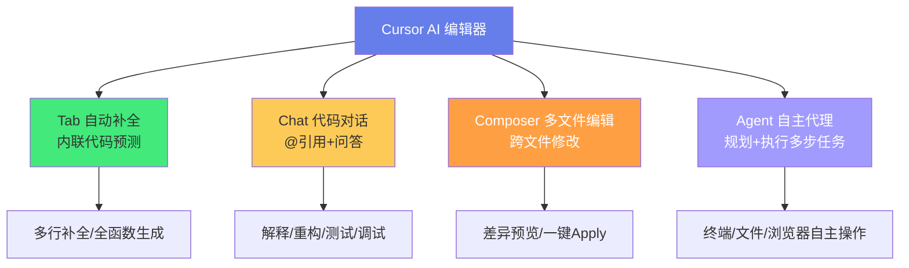
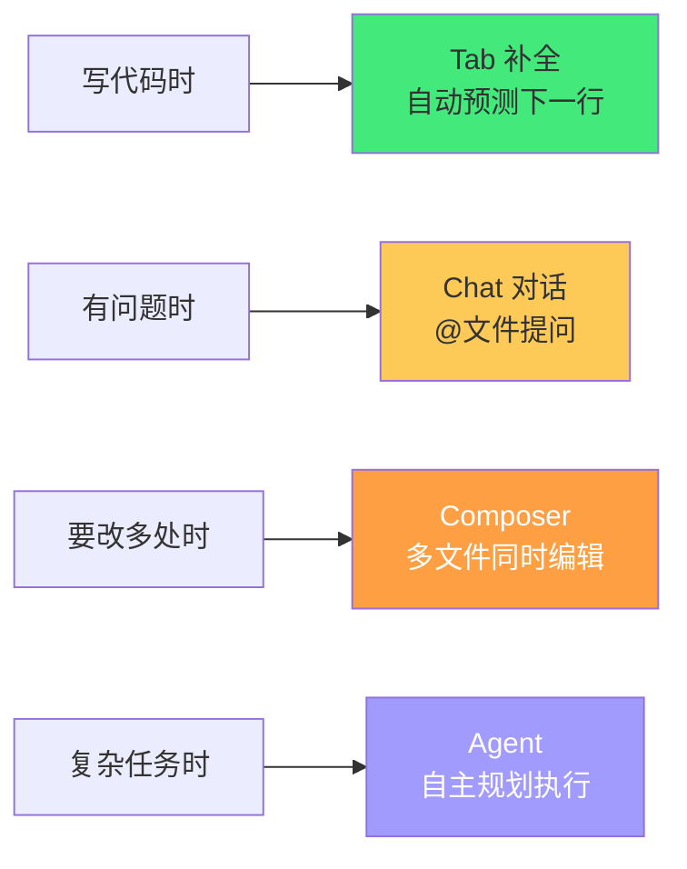
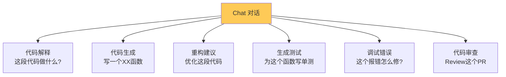
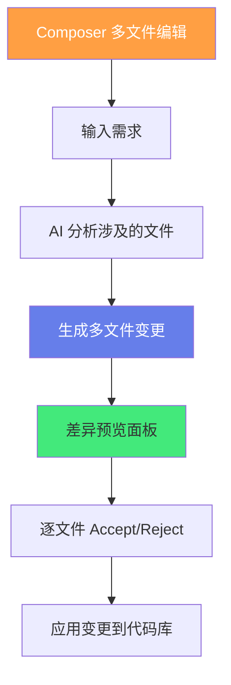
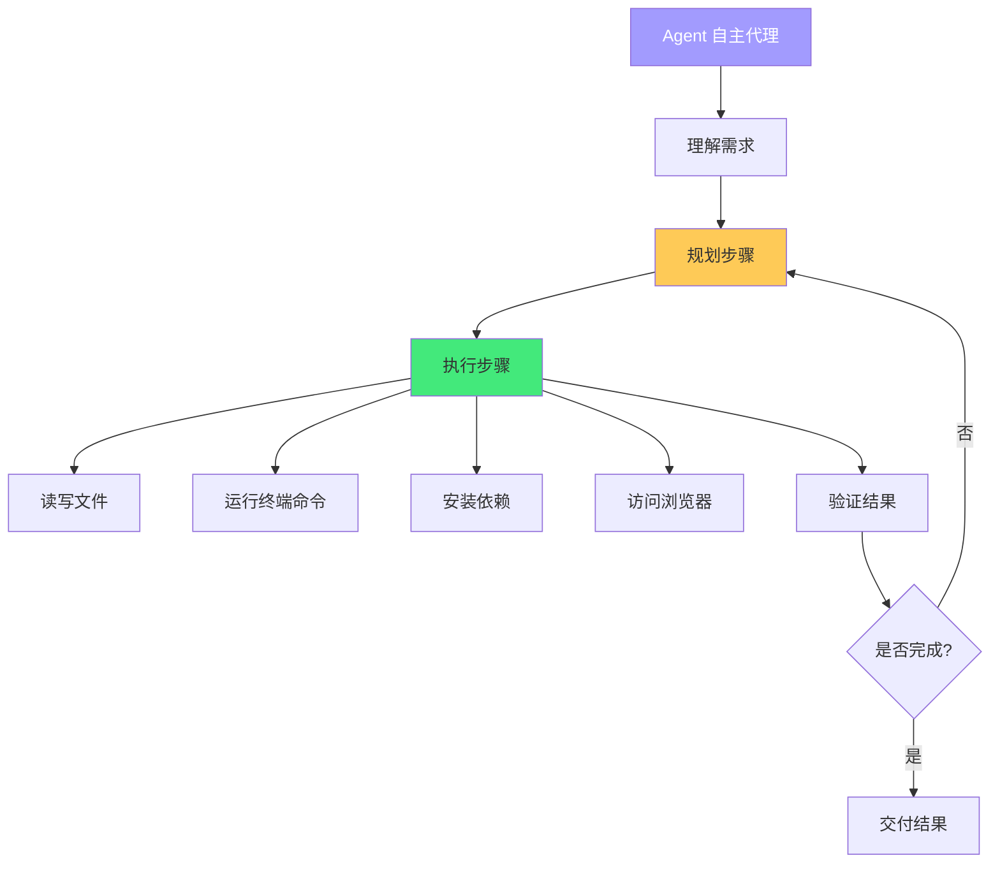

# 🤖 Cursor AI 编辑器深度使用

> **文档说明**：系统讲解 Cursor AI 编辑器的核心功能、使用技巧、配置方法与高效工作流，涵盖 Cursor 的起源与定位（Anysphere 公司基于 VSCode Fork 开发的 AI 原生编辑器）、Cursor 与 VSCode 的关系（100% 兼容 VSCode 扩展/主题/快捷键/设置，可直接导入 VSCode 配置）、四大核心 AI 功能（Tab 内联自动补全 / Chat 代码对话 / Composer 多文件编辑 / Agent 自主代理）、模型选择与切换（Claude 3.5 Sonnet / GPT-4o / GPT-4 Turbo / Cursor Tab 自研模型 / 本地模型）、Tab 自动补全深度用法（内联预测/多行补全/接受拒绝/循环建议/补全质量优化）、Chat 功能详解（@引用文件/@代码库/@文档/@Web/@Git，代码解释/重构建议/生成测试/调试错误/代码审查）、Composer 多文件编辑（跨文件同时修改/生成新文件/差异预览/一键 Apply/Accept-Reject 工作流）、Agent 模式（自主规划任务/多步执行/终端操作/文件读写/浏览器访问）、Cursor Rules 规则系统（.cursorrules 项目级规则/全局规则/角色设定/代码风格约束/技术栈指定）、上下文管理技巧（@精准引用/代码库索引/Folder 引用/排除大文件）、快捷键大全（Cmd/Ctrl+K 内联编辑/Cmd+L Chat/Cmd+I Composer/Tab 接受补全等）、高效 AI 辅助开发工作流（需求理解→架构设计→编码→测试→调试→重构全流程 AI 协作）、提示词工程技巧（角色设定/上下文提供/分步指令/输出格式约束）、隐私与安全（本地模式/数据不训练政策/企业版 SSO）、Cursor vs GitHub Copilot vs Windsurf vs VSCode + 插件对比、定价与套餐（Free/Pro/Business/Enterprise）、常见问题排查（补全不出现/Chat 无响应/扩展冲突/性能问题）、生产级最佳实践。
>
> **适用人群**：全栈开发者、前端/后端工程师、AI 编程实践者、从 VSCode 迁移的开发者、追求开发效率提升的技术人员
>
> **前置知识**：[[VSCode-核心配置与插件]] · [[Git-高级命令与底层原理]] · [[提示词工程基础]]

---

## 一、概述

### 1.1 什么是 Cursor

**Cursor** 是由 **Anysphere** 公司开发的 **AI 原生代码编辑器**，基于 VSCode 深度 Fork，将大语言模型（LLM）深度集成到编辑器的每一个角落——从代码补全到代码对话，从多文件编辑到自主 Agent，旨在让 AI 成为开发者的「结对编程伙伴」。



**核心定位**：不是「给编辑器加个 AI 插件」，而是「从头为 AI 设计的编辑器」——AI 功能深度融入编辑体验，而非附加在表面。

### 1.2 Cursor vs VSCode

| 维度 | VSCode | Cursor |
|------|--------|--------|
| **基础** | 微软开源编辑器 | 基于 VSCode Fork |
| **AI 功能** | 需安装 Copilot 等插件 | 原生深度集成（Tab/Chat/Composer/Agent） |
| **扩展兼容** | 全部 | ✅ 100% 兼容 VSCode 扩展 |
| **设置/主题/快捷键** | 标准 | ✅ 完全兼容，可直接导入 |
| **多文件 AI 编辑** | ❌ 需插件 | ✅ Composer 原生支持 |
| **自主 Agent** | ❌ | ✅ Agent 模式 |
| **代码库索引** | 有限 | ✅ 内置代码库语义索引 |
| **模型选择** | 取决于插件 | ✅ 内置多模型切换 |
| **更新频率** | 微软节奏 | 快速迭代（AI功能优先） |

> **迁移友好**：Cursor 可以直接导入 VSCode 的所有设置、扩展、快捷键和主题，迁移成本几乎为零。

### 1.3 四大核心功能



| 功能 | 触发 | 适用场景 |
|------|------|---------|
| **Tab 补全** | 打字时自动出现，Tab 接受 | 写代码时的逐行/逐函数补全 |
| **Chat** | `Ctrl/Cmd+L` | 代码解释、重构建议、生成测试、调试 |
| **Composer** | `Ctrl/Cmd+I` 或 Chat 中切换 | 跨多文件修改、生成新文件、大规模重构 |
| **Agent** | Chat 中切换 Agent 模式 | 复杂多步任务（如「给项目加用户认证」） |

---

## 二、安装与初始配置

### 2.1 安装

```powershell
# Windows: winget 安装
winget install Anysphere.Cursor

# macOS: brew
brew install --cask cursor

# 或官网下载：https://cursor.com
```

### 2.2 从 VSCode 迁移

首次启动 Cursor 时会提示导入 VSCode 配置：
- 扩展（Extensions）
- 设置（Settings）
- 快捷键（Keybindings）
- 主题（Theme）
- 用户代码片段（Snippets）

也可手动导入：`Ctrl/Cmd+Shift+P` → `Cursor: Import from VS Code`

### 2.3 核心设置

```json
// settings.json（Cursor 中 Ctrl+, 打开设置）
{
    // AI 模型选择
    "cursor.tabModel": "cursor-tab",        // Tab补全模型
    "cursor.chatModel": "claude-3-5-sonnet", // Chat默认模型
    
    // 外观
    "workbench.colorTheme": "One Dark Pro",
    "editor.fontFamily": "CaskaydiaCove Nerd Font",
    "editor.fontSize": 14,
    
    // 编辑器
    "editor.formatOnSave": true,
    "editor.defaultFormatter": "esbenp.prettier-vscode",
    
    // AI 相关
    "cursor.codebaseIndexing": true,         // 启用代码库索引
    "cursor.semanticSearch": true,           // 语义搜索
    "cursor.enableTab": true,                // 启用Tab补全
    "cursor.inlineChat": true                // 启用内联Chat
}
```

### 2.4 模型选择

| 模型 | 特点 | 适用 |
|------|------|------|
| **Claude 3.5 Sonnet** | 代码能力强、上下文长、速度快 | ✅ 日常首选（Chat/Composer） |
| **GPT-4o** | 多模态、通用能力强 | 复杂推理、多模态任务 |
| **GPT-4 Turbo** | 稳定、函数调用强 | 需要稳定输出时 |
| **Cursor Tab** | 自研、快、专为补全优化 | Tab 自动补全 |
| **Claude 3 Opus** | 最强推理、慢、贵 | 极复杂任务 |
| **本地模型** | 隐私、免费、需配置 | 敏感代码/离线 |

> **切换模型**：Chat 窗口顶部下拉菜单切换，不同功能可设不同模型（Tab 用快速模型，Chat 用强模型）。

---

## 三、Tab 自动补全

### 3.1 基本用法

打字时 Cursor 会自动预测后续代码，以灰色内联文本显示：

```javascript
// 输入 function debounce 后，Cursor 自动补全：
function debounce(fn, delay) {
    let timer = null;
    return function(...args) {
        clearTimeout(timer);
        timer = setTimeout(() => fn.apply(this, args), delay);
    };
}
// ↑ 灰色文本，按 Tab 接受，Esc 拒绝
```

| 操作 | 快捷键 |
|------|--------|
| **接受补全** | `Tab` |
| **拒绝补全** | `Esc` |
| **下一个建议** | `Alt+]` |
| **上一个建议** | `Alt+[` |
| **接受一个词** | `Ctrl+→` |
| **接受一行** | `Ctrl+Shift+→` |

### 3.2 高级技巧

**1. 引导补全方向**：
- 写注释描述需求，AI 会按注释补全代码
- 写函数签名（参数+返回类型），AI 补全函数体
- 写测试用例，AI 补全实现（TDD 风格）

**2. 多行补全**：
- Cursor 可一次补全整个函数/类/组件
- 补全出现后按 `Tab` 接受全部，或用 `Ctrl+→` 逐词接受

**3. 补全质量优化**：
- 保持文件聚焦（一个文件一个职责，AI 上下文更清晰）
- 用 TypeScript 类型注解（AI 更懂你的意图）
- 写清晰的变量名和函数名（AI 从命名推断意图）
- 在 `.cursorrules` 中指定代码风格和技术栈

**4. 触发补全**：
- 正常打字自动触发
- 手动触发：`Ctrl/Cmd+Space`（IntelliSense 与 AI 补全结合）

---

## 四、Chat 代码对话

### 4.1 基本用法

`Ctrl/Cmd+L` 打开 Chat 面板，输入问题即可与 AI 对话。



### 4.2 @ 引用系统

Chat 最强大的是 `@` 引用，可以精准提供上下文：

| 引用 | 语法 | 说明 |
|------|------|------|
| **@文件** | `@src/utils/auth.ts` | 引用具体文件内容 |
| **@文件夹** | `@src/components/` | 引用整个文件夹 |
| **@代码库** | `@Codebase` | 语义搜索整个代码库 |
| **@文档** | `@Docs` | 引用官方文档（如React/Vue文档） |
| **@Web** | `@Web` | 联网搜索最新信息 |
| **@Git** | `@Git` | 引用 Git 历史/变更 |
| **@当前选择** | 自动 | 选中代码后打开 Chat 自动引用 |
| **@错误** | 自动 | 终端报错后可直接引用错误 |

**使用示例**：
```text
@src/utils/auth.ts 解释这个文件的认证逻辑，有没有安全隐患？

@Codebase 项目中是如何处理错误处理的？找出统一的错误处理模式。

@Docs React 19 的 use() Hook 怎么用？给我一个示例。

@Web 最新的 TypeScript 5.5 有什么新特性？
```

### 4.3 Chat 常用场景

**1. 代码解释**：
```text
选中一段复杂代码 → Ctrl+L → "解释这段代码的执行流程"
```

**2. 重构建议**：
```text
@src/services/userService.ts 这个文件有什么代码坏味道？给出重构建议。
```

**3. 生成测试**：
```text
@src/utils/validator.ts 为这个文件中的所有函数生成 Jest 单元测试，覆盖边界条件。
```

**4. 调试错误**：
```text
终端报错后 → Ctrl+L → "这个错误是什么原因？怎么修复？"
（Cursor 会自动引用终端中的错误信息）
```

**5. 代码审查**：
```text
@Git 审查当前分支与 main 的差异，指出潜在问题。
```

### 4.4 Chat 内编辑（Inline Edit）

选中代码后 `Ctrl/Cmd+K` 打开内联编辑框，直接在代码位置修改：

```text
选中一段代码 → Ctrl+K → "将这个函数改为异步，加上错误处理"
→ AI 显示差异预览 → Accept/Reject
```

---

## 五、Composer 多文件编辑

### 5.1 什么是 Composer

**Composer** 是 Cursor 的杀手级功能——允许 AI **同时修改多个文件**，并以差异预览的方式展示所有变更，你可以逐个文件 Accept 或 Reject。



### 5.2 使用方法

**触发方式**：
- `Ctrl/Cmd+I`：在编辑器中直接打开 Composer
- Chat 窗口中切换到 Composer 模式
- 选中代码后 `Ctrl/Cmd+K`（内联 Composer）

**使用示例**：
```text
Ctrl+I → "给用户模块加上输入验证：
1. 在 user.model.ts 中添加验证规则
2. 在 user.controller.ts 中调用验证
3. 在 user.service.ts 中处理验证错误
4. 生成验证错误的测试用例"
```

### 5.3 Composer 工作流

1. **描述需求**：清晰说明要做什么，涉及哪些文件
2. **AI 规划**：AI 分析需要修改/创建哪些文件
3. **差异预览**：左侧文件列表，右侧 diff 视图
4. **审查变更**：逐个文件查看 AI 的修改
5. **Accept/Reject**：接受合理的修改，拒绝不合理的
6. **手动调整**：接受后可继续手动微调

### 5.4 Composer 最佳实践

- **明确范围**：告诉 AI 涉及哪些文件，避免它修改不该改的
- **分步执行**：大任务拆成小步骤，每步用 Composer 处理
- **仔细审查**：AI 可能引入 bug，务必逐个文件审查 diff
- **先提交 Git**：使用 Composer 前先 commit，方便回滚
- **提供上下文**：用 @ 引用相关文件和技术文档

---

## 六、Agent 自主代理

### 6.1 什么是 Agent

**Agent 模式**是 Cursor 最强大的功能——AI 可以**自主规划并执行多步任务**，包括读写文件、运行终端命令、安装依赖、甚至访问浏览器，完成从需求到实现的完整流程。



### 6.2 使用方法

在 Chat 窗口中切换到 **Agent** 模式（或输入 `/agent`），描述复杂任务：

```json
"给这个 Vue3 项目加上完整的用户认证系统：
1. 安装 pinia 和 axios
2. 创建 auth store（登录/注册/登出/token管理）
3. 创建登录和注册页面
4. 添加路由守卫
5. 配置 axios 请求拦截器自动携带 token
6. 运行项目验证没有编译错误"
```

Agent 会：
1. 分析项目结构
2. 规划执行步骤
3. 创建/修改文件
4. 运行 `npm install` 安装依赖
5. 运行 `npm run build` 验证
6. 如果有错误，自动修复并重试

### 6.3 Agent 注意事项

- **危险操作确认**：Agent 执行终端命令前会请求确认（可设置自动批准）
- **先 Git 提交**：Agent 可能修改大量文件，务必先 commit
- **监控执行**：Agent 执行过程中可查看每一步的操作和结果
- **复杂任务拆分**：过于复杂的任务可能跑偏，拆成中等复杂度的子任务
- **设置边界**：在 `.cursorrules` 中指定技术栈和约束，避免 Agent 引入不想要的依赖

---

## 七、Cursor Rules 规则系统

### 7.1 什么是 Cursor Rules

**Cursor Rules** 是给 AI 的「项目级/全局级指令」，让 AI 了解你的技术栈、代码风格、项目规范，从而生成更符合预期的代码。

### 7.2 项目级规则 .cursorrules

在项目根目录创建 `.cursorrules` 文件：

```markdown
# 项目规则

## 技术栈
- 前端：Vue 3 + TypeScript + Vite + Pinia + Element Plus
- 后端：Spring Boot 3 + Java 17 + MyBatis-Plus + MySQL 8
- 构建：pnpm + Maven
- 代码规范：ESLint + Prettier + Google Java Format

## 代码风格
- 使用 TypeScript 严格模式，禁止 any
- 组件使用 <script setup lang="ts"> 语法
- API 调用统一封装在 src/api/ 目录
- 错误处理使用统一的 try-catch + 错误码
- 命名：组件 PascalCase，函数 camelCase，常量 UPPER_SNAKE_CASE

## AI 行为约束
- 生成代码时必须包含 JSDoc/TSDoc 注释
- 修改代码时保持现有风格，不要大规模重构
- 涉及安全的代码（认证/加密/输入验证）必须说明安全考虑
- 不要引入新的依赖，除非明确要求
- 生成测试时使用 Vitest（前端）和 JUnit 5（后端）

## 项目结构
- src/components/ - 通用组件
- src/views/ - 页面组件
- src/stores/ - Pinia 状态管理
- src/api/ - API 接口封装
- src/utils/ - 工具函数
```

### 7.3 全局规则

在 Cursor 设置中配置全局规则（适用于所有项目）：
- `Ctrl/Cmd+Shift+P` → `Cursor: Open Rules`
- 或设置中搜索 `cursor.rules`

全局规则适合放个人偏好（如「总是添加注释」「使用函数式组件」等）。

### 7.4 Rules 最佳实践

- **具体而非笼统**：不要写「写好代码」，要写「使用 TypeScript 严格模式，禁止 any」
- **技术栈明确**：指定框架版本、语言版本、关键库
- **代码风格可执行**：引用 ESLint/Prettier 配置，而非模糊描述
- **AI 行为约束**：明确什么可以做、什么不可以做
- **定期更新**：项目技术栈变化时同步更新 .cursorrules

---

## 八、上下文管理技巧

### 8.1 为什么上下文管理重要

LLM 的上下文窗口有限，提供**精准、相关、充足**的上下文是 AI 输出质量的关键。上下文太少→AI 不了解项目；上下文太多→噪音干扰、超出窗口。

### 8.2 精准引用

| 场景 | 方法 |
|------|------|
| **问具体代码** | 选中代码 → Chat 自动引用 |
| **问某个文件** | `@path/to/file.ts` |
| **问某个模块** | `@src/modules/auth/` |
| **问整个项目模式** | `@Codebase` + 具体问题 |
| **问技术用法** | `@Docs` + 技术名 |
| **问最新信息** | `@Web` + 查询 |

### 8.3 代码库索引

Cursor 会自动为项目建立**语义索引**，让 `@Codebase` 能理解整个代码库的结构和语义：
- 大项目首次索引需要几分钟
- 索引在后台运行，不影响编辑
- 可在设置中排除不需要索引的目录（node_modules/dist/.git）

**排除大文件**：在 `.cursorignore` 中添加（类似 .gitignore）：
```text
node_modules/
dist/
build/
*.min.js
*.lock
```

### 8.4 上下文优化技巧

- **小文件优先**：AI 处理小文件更精准，大文件拆分为小模块
- **类型即文档**：TypeScript 类型注解是最好的上下文
- **注释即上下文**：清晰的注释帮助 AI 理解意图
- **先描述再引用**：先说明你要做什么，再 @ 引用相关文件
- **避免冗余**：不要同时 @ 整个文件夹和其中的具体文件

---

## 九、快捷键大全

### 9.1 核心 AI 快捷键

| 功能 | Windows/Linux | macOS |
|------|--------------|-------|
| **打开 Chat** | `Ctrl+L` | `Cmd+L` |
| **内联编辑/Composer** | `Ctrl+K` | `Cmd+K` |
| **新建 Composer** | `Ctrl+I` | `Cmd+I` |
| **接受 Tab 补全** | `Tab` | `Tab` |
| **拒绝补全** | `Esc` | `Esc` |
| **下一个补全建议** | `Alt+]` | `Opt+]` |
| **上一个补全建议** | `Alt+[` | `Opt+[` |
| **接受一个词** | `Ctrl+→` | `Cmd+→` |
| **切换 Chat/Composer/Agent** | Chat 内标签 | Chat 内标签 |

### 9.2 VSCode 兼容快捷键

Cursor 完全兼容 VSCode 快捷键，常用：

| 功能 | Windows/Linux | macOS |
|------|--------------|-------|
| 命令面板 | `Ctrl+Shift+P` | `Cmd+Shift+P` |
| 快速打开文件 | `Ctrl+P` | `Cmd+P` |
| 切换侧边栏 | `Ctrl+B` | `Cmd+B` |
| 终端 | `Ctrl+`` | `Cmd+`` |
| 搜索文件内容 | `Ctrl+Shift+F` | `Cmd+Shift+F` |
| 分屏 | `Ctrl+\` | `Cmd+\` |

---

## 十、高效 AI 辅助开发工作流

### 10.1 全流程 AI 协作

```mermaid
graph TB
    A[1.需求理解] --> B[2.架构设计]
    B --> C[3.编码实现]
    C --> D[4.测试生成]
    D --> E[5.调试修复]
    E --> F[6.重构优化]
    
    A --> A1[Chat: 需求拆解/技术选型]
    B --> B1[Chat+@Codebase: 设计模式/目录结构]
    C --> C1[Tab补全+Composer: 逐文件实现]
    D --> D1[Chat: 生成单元测试]
    E --> E1[Chat+@错误: 调试分析]
    F --> F1[Chat+Composer: 代码审查/重构]
    
    style A fill:#667eea,color:#fff
    style C fill:#43e97b,color:#333
    style E fill:#ff6b6b,color:#fff
```

### 10.2 各阶段 AI 用法

**1. 需求理解阶段**：
```text
Chat: "我要做一个XX功能，核心需求是...，请帮我拆解为技术任务清单，并评估技术难点。"
```

**2. 架构设计阶段**：
```text
Chat + @Codebase: "参考项目现有架构，为XX模块设计目录结构和核心接口定义。"
```

**3. 编码实现阶段**：
- 用 Tab 补全逐行写代码
- 用 Composer 同时生成多个相关文件
- 用内联编辑（Ctrl+K）快速修改选中代码

**4. 测试生成阶段**：
```text
Chat + @src/utils/auth.ts: "为这个文件生成完整的单元测试，覆盖正常流程、边界条件和异常情况。"
```

**5. 调试阶段**：
- 终端报错后直接 Ctrl+L，AI 自动引用错误
- 选中可疑代码问「这里可能有什么 bug？」

**6. 重构优化阶段**：
```text
Composer: "重构这个模块：提取重复逻辑、添加类型注解、优化性能，保持功能不变。"
```

### 10.3 AI 辅助开发原则

| 原则 | 说明 |
|------|------|
| **AI 是助手不是替代** | AI 生成的代码必须审查，理解每一行 |
| **小步迭代** | 不要让 AI 一次写整个项目，拆成小任务 |
| **先想后问** | 自己先思考方案，再用 AI 验证/补充 |
| **提供上下文** | 精准 @ 引用，让 AI 了解项目 |
| **Git 随时提交** | AI 修改前 commit，方便对比和回滚 |
| **测试驱动** | 让 AI 写测试，自己/AI 写实现，用测试验证 |

---

## 十一、提示词工程技巧

### 11.1 结构化提示词模板

```css
# 角色
你是一个资深的 Vue3 + TypeScript 前端架构师。

# 上下文
- 项目使用 Vue 3.4 + TypeScript 5 + Vite + Pinia
- 参考 @src/components/Button.vue 的代码风格
- 遵循项目 .cursorrules 中的规范

# 任务
创建一个可复用的表单验证组件，要求：
1. 支持多种验证规则（必填/邮箱/手机号/自定义）
2. 使用 Composition API + <script setup>
3. 包含完整的 TypeScript 类型定义
4. 提供使用示例

# 输出格式
- 先说明设计思路
- 再给出完整代码
- 最后列出使用注意事项
```

### 11.2 提示词技巧

| 技巧 | 说明 | 示例 |
|------|------|------|
| **角色设定** | 让 AI 扮演专家角色 | "你是资深后端架构师..." |
| **上下文提供** | @ 引用相关文件/文档 | "@src/api/user.ts 参考这个风格..." |
| **分步指令** | 复杂任务拆成步骤 | "第一步...第二步..." |
| **输出约束** | 指定格式/长度/语言 | "用中文回答，代码加注释" |
| **示例引导** | 给一个期望的示例 | "类似这样：function example() {}" |
| **反向约束** | 明确不要做什么 | "不要使用 any，不要引入新依赖" |
| **迭代优化** | 先让 AI 出方案，再逐步修正 | "第一版不错，把X改为Y..." |

---

## 十二、隐私与安全

### 12.1 数据政策

- Cursor 默认使用云端 AI 模型，代码会发送到模型服务商
- Cursor 声明**不使用用户代码训练模型**
- 企业版支持 SSO 和更严格的数据政策

### 12.2 本地模式

对于敏感代码，可使用本地模型：
- 支持 Ollama 本地运行模型
- 设置中配置本地模型端点
- 代码完全不离开本地机器

### 12.3 安全最佳实践

- 敏感项目使用本地模式或企业版
- 不要在 Chat 中粘贴密钥/密码/敏感数据
- 使用 `.cursorignore` 排除敏感文件
- 审查 AI 生成的代码，特别注意安全相关代码（认证/加密/SQL）
- 企业用户考虑 Business/Enterprise 版本

---

## 十三、Cursor vs 其他 AI 编程工具

| 维度 | Cursor | GitHub Copilot | Windsurf | VSCode + 插件 |
|------|--------|---------------|----------|--------------|
| **定位** | AI 原生编辑器 | AI 补全插件 | AI 原生编辑器 | 编辑器+AI插件 |
| **Tab 补全** | ✅ 强 | ✅ 强 | ✅ 强 | 取决于插件 |
| **Chat** | ✅ 深度集成 | ✅ 集成 | ✅ 深度集成 | 需插件 |
| **多文件编辑** | ✅ Composer | ❌ 有限 | ✅ Cascade | ❌ |
| **Agent** | ✅ 自主代理 | ❌ | ✅ Agent | ❌ |
| **VSCode 兼容** | ✅ Fork | ✅ 插件 | ✅ Fork | 本身 |
| **模型选择** | ✅ 多模型 | ❌ 固定(GPT) | ✅ 多模型 | 取决于插件 |
| **价格** | Free/Pro $20/月 | $10/月 | Free/Pro $15/月 | 插件各自定价 |
| **适合** | 想要完整AI体验 | 只想补全 | 想要AI原生体验 | 不想换编辑器 |

---

## 十四、常见问题排查

| 问题 | 原因 | 解决方案 |
|------|------|---------|
| **Tab 补全不出现** | 未启用/模型加载中/网络问题 | 检查设置 enableTab、等待模型加载、检查网络 |
| **Chat 无响应** | 网络/模型服务波动/上下文过大 | 切换模型、减少 @ 引用、重启 Cursor |
| **扩展不兼容** | 极少数扩展与 Fork 冲突 | 禁用可疑扩展，查看 Cursor 文档 |
| **代码库索引慢** | 项目太大/文件太多 | 配置 .cursorignore 排除 node_modules/dist |
| **Composer 修改错误文件** | 需求描述不清/上下文不足 | 明确指定文件范围、@ 引用目标文件 |
| **Agent 执行卡住** | 命令等待输入/网络超时 | 手动确认/取消任务、拆分更简单的子任务 |
| **内存占用高** | 大项目索引+多模型 | 关闭不需要的功能、排除大目录 |
| **中文输入问题** | 输入法与内联补全冲突 | 更新 Cursor、切换输入法、报告 issue |

---

## 十五、关联笔记

### 开发工具
- [[VSCode-核心配置与插件]] · [[JetBrains-IDEA高效配置]] · [[Vim-Neovim入门与配置]]
- [[WindowsTerminal与PowerShell]] · [[Git-高级命令与底层原理]]

### AI 工程
- [[提示词工程基础]] · [[AIGC应用开发]] · [[AI Agent架构设计]]
- [[LLM服务开发]] · [[RAG检索增强生成]]

### 导航
- [[MOC-通用工具]] · [[MOC-AI工程]] · [[Home]] · [[学习路线总览]]

> 🔍 **知识点深度解析**
>
> **作用**：Cursor AI 编辑器解决的是「如何将大语言模型深度融入代码编辑体验，让 AI 成为真正的结对编程伙伴，从补全、对话、多文件编辑到自主代理，全方位提升开发效率」的问题——传统的 AI 编程工具（如 GitHub Copilot）只是给编辑器加了一个补全插件，AI 功能浮于表面；Cursor 从编辑器层面为 AI 重新设计，将 Tab 补全、Chat 对话、Composer 多文件编辑、Agent 自主代理四大能力深度集成，配合代码库语义索引和 .cursorrules 规则系统，让 AI 能理解整个项目、同时修改多个文件、甚至自主执行多步开发任务，实现从「AI 辅助写代码」到「AI 协作开发」的跃迁。
>
> **底层原理**：①Cursor 的核心架构是「VSCode Fork + AI 中间层」——它基于 VSCode 开源代码构建，保留了 100% 的扩展兼容性和编辑体验，同时在编辑器内核中插入了一层 AI 中间层，负责与 LLM API 通信、管理上下文、渲染内联补全、处理 Composer 差异预览、协调 Agent 执行。这种「Fork 而非插件」的架构让 AI 功能可以深度访问编辑器内部状态（当前文件、选中内容、终端输出、Git 状态），而非插件 API 限制的有限接口。②Tab 自动补全的原理是「前缀语言模型 + 实时上下文工程」——当你打字时，Cursor 将当前文件的前缀内容（光标前的代码）、相关文件的片段（通过语义索引检索）、项目规则（.cursorrules）打包为 prompt，发送给专门优化的代码补全模型（如 Cursor Tab），模型生成后续代码的预测，以灰色内联文本渲染在编辑器中。关键优化包括：延迟触发（停止打字 200ms 后才请求，避免每次按键都发请求）、缓存（相同前缀缓存结果）、多模型路由（简单补全用快模型，复杂补全用强模型）。③Chat 的 @ 引用系统本质是「上下文检索增强（RAG）」——`@Codebase` 通过对整个代码库建立语义索引（向量嵌入），将用户问题与代码库中的文件/函数/类进行语义相似度匹配，检索最相关的代码片段作为上下文注入 prompt，让 AI 能回答关于整个项目的问题而不仅是当前文件。`@文件`/`@文件夹` 是精确上下文注入，`@Docs`/`@Web` 是外部知识检索，共同构成了「精准上下文工程」体系。④Composer 多文件编辑的原理是「规划-生成-差异渲染-增量应用」——AI 先分析需求涉及哪些文件（规划阶段），然后为每个文件生成完整的修改后内容（生成阶段），Cursor 将 AI 生成的内容与原文件做 diff，以类似 Git diff 的界面展示（差异渲染），用户逐文件 Accept 后才将变更写入磁盘（增量应用）。这种「先预览后应用」的设计让大规模 AI 修改可控、可审查、可回滚。⑤Agent 模式的核心是「ReAct 循环（推理-行动）」——AI 收到复杂任务后，先推理（Reasoning）需要做什么、分几步，然后执行一个行动（Action：读文件/写文件/运行终端命令），观察行动结果（Observation），再推理下一步，循环直到任务完成。这是一种「思考-行动-观察」的迭代循环，让 AI 能处理需要多步交互、依赖中间结果的复杂任务，而非一次性生成所有代码。⑥.cursorrules 的作用是「系统提示词注入」——每次与 AI 交互时，Cursor 会自动将 .cursorrules 的内容作为系统级上下文注入 prompt，让 AI 始终了解项目的技术栈、代码风格和行为约束。这类似于给 AI 设定了「项目宪法」，确保 AI 生成的代码符合项目规范，而非每次都要重复说明技术栈和风格。
>
> **用法要点**：① 四大功能：Tab补全(打字自动出现/Tab接受/Ctrl+→逐词接受)、Chat(Ctrl+L打开/@引用文件/代码库/文档/Web)、Composer(Ctrl+I/多文件编辑/diff预览/逐文件Accept)、Agent(Chat中切换/自主规划执行多步任务/终端操作) ② 模型选择：日常Chat用Claude 3.5 Sonnet，复杂推理用GPT-4o，Tab补全用Cursor Tab，敏感代码用本地模型 ③ 配置：从VSCode一键导入扩展/设置/快捷键；settings.json中配置tabModel/chatModel/codebaseIndexing ④ .cursorrules：项目根目录创建，指定技术栈/代码风格/AI行为约束/项目结构；全局规则放个人偏好 ⑤ @引用：@文件/@文件夹/@Codebase(语义搜索)/@Docs(官方文档)/@Web(联网)/@Git(历史)/选中代码自动引用 ⑥ 上下文管理：.cursorignore排除node_modules/dist；小文件优先；TypeScript类型即文档；精准引用避免冗余 ⑦ 快捷键：Ctrl+L Chat/Ctrl+K内联编辑/Ctrl+I Composer/Tab接受补全/Alt+]下一个建议 ⑧ 工作流：需求理解(Chat拆解)→架构设计(Chat+@Codebase)→编码(Tab+Composer)→测试(Chat生成)→调试(Chat+@错误)→重构(Composer) ⑨ 提示词：角色设定+上下文(@引用)+任务(具体)+输出格式约束+反向约束(不要做什么) ⑩ 安全：敏感代码用本地模式；.cursorignore排除敏感文件；审查AI生成的安全相关代码；不要粘贴密钥 ⑪ 最佳实践：AI是助手非替代(必须审查代码)/小步迭代(拆成小任务)/先想后问/Git随时提交(AI修改前commit)/测试驱动 ⑫ 常见问题：补全不出现检查enableTab和网络/Chat无响应切换模型减少上下文/Composer改错文件明确指定范围/Agent卡住拆分子任务。

> 💡 **深度讲解**：Cursor 最核心的智慧是「不是给编辑器加 AI，而是为 AI 重新设计编辑器」——这看似只是表述差异，实则是范式的根本不同。GitHub Copilot 代表的是「插件范式」：在现有编辑器上加一个 AI 补全层，AI 能访问的上下文受限于插件 API（主要是当前文件和选中内容），能做的操作受限于插件能力（只能插入文本，不能同时改多个文件，不能运行终端）。这种范式下，AI 永远是「外挂」，无法真正融入开发流程。Cursor 代表的是「原生范式」：基于 VSCode Fork，AI 中间层深度嵌入编辑器内核，可以访问一切编辑器状态（文件树、终端、Git、调试器、扩展 API），可以执行一切编辑器操作（多文件修改、终端命令、依赖安装）。这种范式下，AI 是「内核级伙伴」，而非外挂。Composer 和 Agent 就是原生范式的产物——插件范式根本做不到「同时修改 10 个文件并展示 diff」或「自主运行 npm install 并修复编译错误」，因为插件没有这么深的系统权限。这种「为 AI 重新设计工具」的思路不仅适用于编辑器，也适用于整个 AI 时代的软件设计——不是给旧工具加 AI 功能，而是思考「如果 AI 从第一天就存在，这个工具应该怎么设计？」。Cursor 的另一个智慧是「上下文工程是 AI 工具的核心竞争力」——LLM 的能力是固定的（大家都用 GPT-4/Claude），真正决定 AI 输出质量的是「给模型提供了什么上下文」。Cursor 的 @ 引用系统、代码库语义索引、.cursorrules 规则、自动引用选中代码和终端错误，本质都是「上下文工程」——让 AI 在正确的时间获得正确的上下文。很多人用 AI 编程工具觉得「不好用」，往往不是模型不行，而是上下文没给对——没有 @ 引用相关文件，AI 就不了解项目结构；没有 .cursorrules，AI 就不知道你的代码风格；没有选中具体代码，AI 就只能泛泛而谈。理解了「上下文即质量」，你就能通过精准 @ 引用、完善 .cursorrules、保持代码结构清晰，让同一个模型输出质量提升数倍。Cursor 代表的不仅是一个编辑器，更是「AI 原生工具」的设计哲学——在 AI 时代，工具的价值不再是「功能多少」，而是「能否让 AI 与人类高效协作」。

> 📝 **精简总结**：Cursor=基于VSCode Fork的AI原生编辑器。四大功能：Tab补全(打字自动预测/Tab接受)、Chat(Ctrl+L/@引用文件/代码库/文档/Web/解释重构测试调试)、Composer(Ctrl+I/多文件同时编辑/diff预览/逐文件Accept)、Agent(自主规划执行多步任务/终端操作)。模型：Claude 3.5 Sonnet(日常首选)/GPT-4o(复杂)/Cursor Tab(补全)/本地模型(隐私)。配置：从VSCode一键导入；settings.json配模型和索引；.cursorrules项目规则(技术栈/风格/约束)。@引用：@文件/@文件夹/@Codebase语义搜索/@Docs官方文档/@Web联网/@Git历史。快捷键：Ctrl+L Chat/Ctrl+K内联/Ctrl+I Composer/Tab接受/Alt+]切换建议。工作流：需求(Chat拆解)→架构(Chat+Codebase)→编码(Tab+Composer)→测试(Chat生成)→调试(Chat+错误)→重构(Composer)。提示词：角色+上下文+任务+格式+反向约束。安全：本地模式/.cursorignore/审查代码。对比Copilot(仅补全插件)/Windsurf(类似AI原生)。最佳实践：AI是助手非替代/小步迭代/先想后问/Git提交/测试驱动/上下文精准。

> **学习路径建议**：先安装 Cursor 并从 VSCode 导入配置 → 体验 Tab 自动补全（写代码时观察灰色预测，Tab接受） → 学习 Chat 功能（Ctrl+L，尝试代码解释和生成测试） → 掌握 @ 引用系统（@文件/@Codebase/@Docs） → 学习 Composer 多文件编辑（Ctrl+I，尝试小范围重构） → 配置 .cursorrules 项目规则 → 学习 Agent 模式（从简单任务开始，逐步增加复杂度） → 学习提示词工程技巧（角色/上下文/分步/约束） → 实践：用 Cursor 完成一个完整功能的开发（从需求到测试） → 探索高级功能（本地模型/自定义规则/团队协作） → 形成自己的 AI 辅助开发工作流。

---

> **Cursor AI 编辑器的本质是「为 AI 时代重新设计的开发工具，让 AI 从『外挂式补全』升级为『内核级协作伙伴』」——在 AI 浪潮中，大多数工具的做法是「给旧工具加个 AI 插件」：编辑器加个补全插件、Office 加个写作插件、浏览器加个翻译插件。这种「插件范式」虽然快速，但 AI 永远是「外挂」——受限于插件 API，只能访问有限的上下文，只能执行有限的操作，无法真正融入工作流。Cursor 选择了更难但更正确的路：基于 VSCode Fork，为 AI 重新设计编辑器。AI 中间层深度嵌入内核，可以访问一切编辑器状态，可以执行一切操作，于是才有了 Composer（多文件编辑）和 Agent（自主任务执行）这些插件范式根本做不到的功能。这种「为 AI 重新设计工具」的思路，是 AI 时代工具进化的核心方向——不是问「怎么给旧工具加 AI」，而是问「如果 AI 从第一天就存在，这个工具应该怎么设计？」。更重要的是，Cursor 揭示了一个关键洞察：在 AI 能力趋同的时代（大家都用 GPT-4/Claude），**上下文工程才是核心竞争力**——给 AI 提供什么上下文，决定了 AI 的输出质量。Cursor 的 @ 引用、代码库索引、.cursorrules、自动引用错误，都是上下文工程的具体实现。很多人觉得 AI 编程「不好用」，往往不是模型不行，而是上下文没给对。掌握了 Cursor，你不仅掌握了一个高效编辑器，更掌握了「如何与 AI 高效协作」的核心能力——精准提供上下文、合理拆分任务、仔细审查输出、持续迭代优化。这种能力在 AI 时代将越来越重要，因为未来的开发不是「人写代码」或「AI 写代码」，而是「人与 AI 协作写代码」，而 Cursor 就是这种协作的最佳载体。从今天开始，尝试用 Cursor 替代你的旧编辑器，让 AI 成为你的结对编程伙伴——你会发现，开发从未如此高效和愉悦。**

---

## 🔗 关联笔记

- [[MOC-通用工具]] — 返回本分类知识地图，查看更多相关文档

## 📖 前置知识

- [[VSCode-核心配置与插件]]
- [[Git-高级命令与底层原理]]
- [[提示词工程基础]]

## 🏷️ 相关标签

`#Cursor` `#AI编辑器` `#AI编程` `#VSCode` `#代码补全` `#ChatGPT`

[[Home|🏠 返回首页]] · [[MOC-通用工具|📚 返回分类]]
