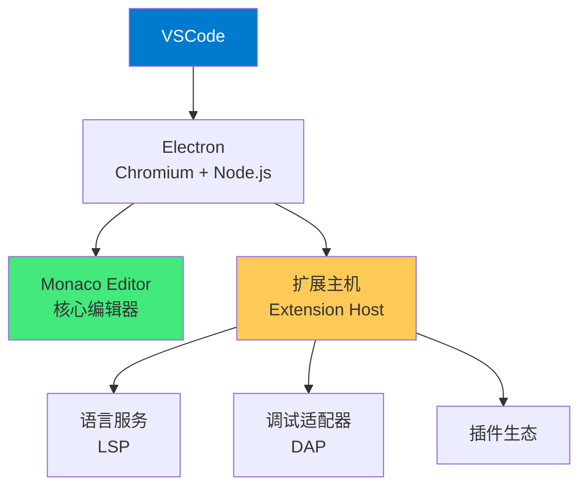

# 🎨 VSCode 核心配置与插件

> **文档说明**：系统讲解 Visual Studio Code（VSCode）的完整配置与使用指南，涵盖 VSCode 简介与架构、安装与启动、界面布局（活动栏/侧边栏/编辑器/面板/状态栏）、核心配置（settings.json 详解：编辑器/字体/文件/搜索/终端/Git/窗口/工作台）、快捷键体系（keybindings.json、必背快捷键、自定义快捷键、快捷键冲突解决）、命令面板（Command Palette）、多光标与列选择、Emmet 缩写、用户代码片段（User Snippets）、工作区配置（.vscode/settings.json、extensions.json、launch.json、tasks.json）、调试配置（Node.js/Python/Java/Chrome/附加调试）、任务配置（npm/scripts/自定义任务）、终端集成、Git 集成、Markdown 支持、必备插件推荐（开发效率/代码质量/框架支持/UI美化/主题/AI/远程开发/数据库）、远程开发（Remote-SSH/Dev Container/WSL/Remote-Tunnels）、VSCodeVim 模式、性能优化（启动加速/内存优化/插件管理）、各语言环境配置、常见问题与最佳实践。
>
> **适用人群**：全栈开发者、前端/后端/AI 工程师、使用 VSCode 的所有开发者
>
> **前置知识**：[[JetBrains-IDEA高效配置]] · [[Vim-Neovim入门与配置]] · [[Git 版本控制知识点系统梳理_优化版]]

---

## 一、概述

### 1.1 VSCode 简介

Visual Studio Code（简称 VSCode）是微软开发的**免费、开源、跨平台**的代码编辑器，基于 Electron（Chromium + Node.js）构建，以轻量、高速、可扩展著称，是目前最流行的代码编辑器。



**VSCode 的核心特性**：
| 特性 | 说明 |
|------|------|
| **轻量高速** | 启动快，内存占用低（相比 IDE） |
| **跨平台** | Windows/macOS/Linux 全平台支持 |
| **免费开源** | MIT 协议，源码在 GitHub |
| **智能补全** | IntelliSense，基于语言服务 |
| **调试器** | 内置调试，支持多种语言 |
| **Git 集成** | 内置 Git 支持，差异查看、提交、分支 |
| **终端集成** | 内置终端，支持多 shell |
| **扩展生态** | 丰富的插件市场，几乎支持所有语言和框架 |
| **远程开发** | Remote-SSH/Container/WSL，远程开发体验 |
| **多光标** | 强大的多光标和列选择编辑 |
| **Emmet** | 内置 Emmet，HTML/CSS 快速编写 |
| **命令面板** | Ctrl+Shift+P，几乎所有操作都可通过命令执行 |

**VSCode vs IDE（IDEA/WebStorm）**：
| 维度 | VSCode | JetBrains IDE |
|------|--------|--------------|
| **定位** | 代码编辑器（可扩展为 IDE） | 集成开发环境 |
| **启动速度** | 快（1-3秒） | 慢（10-30秒） |
| **内存占用** | 低（200-500MB） | 高（1-3GB） |
| **语言支持** | 插件按需安装 | 特定语言深度集成 |
| **智能程度** | 依赖 LSP，各语言参差不齐 | 深度语义分析，智能度高 |
| **重构能力** | 基础重构（依赖插件） | 强大的重构（全项目分析） |
| **调试** | 通用调试器（DAP） | 语言专属调试器 |
| **价格** | 免费 | 付费（社区版免费） |
| **适用** | 全栈/多语言/轻量开发 | 特定语言深度开发 |

> **选择建议**：前端/全栈/多语言/轻量开发选 VSCode；Java/Kotlin/大型企业项目选 IDEA；Python 选 VSCode 或 PyCharm；Go 选 VSCode 或 GoLand。很多开发者是「VSCode + IDEA」组合——前端用 VSCode，后端用 IDEA。

### 1.2 版本选择

| 版本 | 说明 |
|------|------|
| **VSCode（稳定版）** | 正式稳定版，推荐大多数用户 |
| **VSCode Insiders** | 每日构建版，最新特性，可能不稳定 |
| **VSCodium** | 社区编译版，去除微软遥测和品牌，完全开源 |
| **Cursor** | 基于 VSCode 的 AI 原生编辑器（内置 AI 补全） |
| **Windsurf** | 基于 VSCode 的 AI 编辑器（Codeium 出品） |

---

## 二、安装与界面

### 2.1 安装

```bash
# Windows
# 从 https://code.visualstudio.com/ 下载安装包
# 或用 Chocolatey: choco install vscode
# 或用 winget: winget install Microsoft.VisualStudioCode

# macOS
brew install --cask visual-studio-code
# 或从官网下载 .dmg

# Linux (Ubuntu/Debian)
sudo apt install ./code_*.deb
# 或添加微软源
sudo apt install code

# Linux (Arch)
sudo pacman -S code

# 验证
code --version
```

**命令行启动**：
```bash
code .                  # 在当前目录打开 VSCode
code filename.txt       # 打开文件
code -r .               # 在最近窗口打开
code -n .               # 新窗口打开
code --diff file1 file2 # 比较两个文件
code --list-extensions  # 列出已安装插件
code --install-extension ext.id  # 安装插件
code --uninstall-extension ext.id  # 卸载插件
```

> **macOS 命令行**：首次需要在 VSCode 中执行 `Cmd+Shift+P → Shell Command: Install 'code' command in PATH`。

### 2.2 界面布局

```text
┌─────────────────────────────────────────────────────────┐
│  标题栏（菜单/窗口控制）                                    │
├────┬────────────────────────────────────────────────────┤
│    │  标签栏（打开的文件）                                  │
│ 活 ├────────────────────────────────────────────────────┤
│ 动 │                                                    │
│ 栏 │              编辑器区域（多列/多行分屏）               │
│    │                                                    │
│(图 ├────────────────────────────────────────────────────┤
│标) │  面板（终端/问题/输出/调试控制台）                     │
├────┴────────────────────────────────────────────────────┤
│  状态栏（分支/错误/语言/行号/编码/空格）                    │
└─────────────────────────────────────────────────────────┘
```

| 区域 | 说明 | 显示/隐藏 |
|------|------|---------|
| **活动栏（Activity Bar）** | 最左侧图标栏（资源管理器/搜索/Git/调试/插件） | `Ctrl+B` 切换侧边栏 |
| **侧边栏（Side Bar）** | 活动栏对应内容（文件树/搜索结果等） | `Ctrl+B` |
| **编辑器（Editor）** | 代码编辑区域，支持分屏 | `Ctrl+\` 分屏 |
| **面板（Panel）** | 底部终端/问题/输出 | `Ctrl+`` 终端，`Ctrl+J` 面板 |
| **状态栏（Status Bar）** | 底部信息栏 | 点击各项可快速操作 |

**常用布局快捷键**：
| 快捷键 | 功能 |
|--------|------|
| `Ctrl+B` | 切换侧边栏 |
| `Ctrl+J` | 切换底部面板 |
| `Ctrl+\`` | 切换终端 |
| `Ctrl+\` | 向右分屏 |
| `Ctrl+K Z` | 禅模式（全屏专注） |
| `Ctrl+K Ctrl+F` | 关闭所有编辑器 |
| `F11` | 全屏 |

---

## 三、核心配置（settings.json）

### 3.1 打开配置

```text
Ctrl+,                    # 打开设置界面（图形化）
Ctrl+Shift+P → "Open User Settings (JSON)"  # 打开 settings.json
```

**配置层级**：
| 层级 | 路径 | 优先级 |
|------|------|--------|
| **默认设置** | VSCode 内置 | 最低 |
| **用户设置** | `%APPDATA%\Code\User\settings.json`（Win）<br/>`~/Library/Application Support/Code/User/settings.json`（Mac）<br/>`~/.config/Code/User/settings.json`（Linux） | 中 |
| **工作区设置** | `.vscode/settings.json`（项目根目录） | 最高 |

> 工作区设置会覆盖用户设置，适合项目特定配置（如 Python 解释器路径、代码格式化规则）。

### 3.2 完整推荐配置

```json
{
  // ============================================================
  // 基础设置
  // ============================================================
  "editor.fontFamily": "'JetBrains Mono', 'Fira Code', 'Consolas', 'Microsoft YaHei', monospace",
  "editor.fontSize": 14,
  "editor.fontLigatures": true,
  "editor.lineHeight": 1.6,
  "editor.letterSpacing": 0.5,
  "editor.fontWeight": "400",

  // ============================================================
  // 编辑器行为
  // ============================================================
  "editor.tabSize": 2,
  "editor.insertSpaces": true,
  "editor.detectIndentation": true,
  "editor.wordWrap": "on",
  "editor.wordWrapColumn": 120,
  "editor.minimap.enabled": true,
  "editor.minimap.renderCharacters": false,
  "editor.minimap.maxColumn": 80,
  "editor.scrollBeyondLastLine": false,
  "editor.smoothScrolling": true,
  "editor.cursorBlinking": "smooth",
  "editor.cursorSmoothCaretAnimation": "on",
  "editor.cursorWidth": 2,
  "editor.multiCursorModifier": "ctrlCmd",
  "editor.columnSelection": false,
  "editor.foldingStrategy": "auto",
  "editor.foldingMaximumRegions": 5000,
  "editor.showFoldingControls": "always",
  "editor.emptySelectionClipboard": true,
  "editor.copyWithSyntaxHighlighting": false,

  // ============================================================
  // 智能补全
  // ============================================================
  "editor.quickSuggestions": {
    "other": true,
    "comments": true,
    "strings": true
  },
  "editor.quickSuggestionsDelay": 10,
  "editor.suggestOnTriggerCharacters": true,
  "editor.acceptSuggestionOnEnter": "smart",
  "editor.acceptSuggestionOnCommitCharacter": true,
  "editor.suggestSelection": "first",
  "editor.suggest.localityBonus": true,
  "editor.suggest.shareSuggestSelections": true,
  "editor.tabCompletion": "on",
  "editor.parameterHints.enabled": true,
  "editor.parameterHints.cycle": true,
  "editor.inlineSuggest.enabled": true,

  // ============================================================
  // 格式化
  // ============================================================
  "editor.formatOnSave": true,
  "editor.formatOnPaste": true,
  "editor.formatOnType": false,
  "editor.defaultFormatter": "esbenp.prettier-vscode",
  "[javascript]": {
    "editor.defaultFormatter": "esbenp.prettier-vscode"
  },
  "[typescript]": {
    "editor.defaultFormatter": "esbenp.prettier-vscode"
  },
  "[python]": {
    "editor.defaultFormatter": "ms-python.black-formatter"
  },
  "[java]": {
    "editor.defaultFormatter": "redhat.java"
  },
  "[json]": {
    "editor.defaultFormatter": "esbenp.prettier-vscode"
  },
  "[markdown]": {
    "editor.defaultFormatter": "esbenp.prettier-vscode",
    "editor.wordWrap": "on"
  },

  // ============================================================
  // 保存行为
  // ============================================================
  "files.autoSave": "afterDelay",
  "files.autoSaveDelay": 1000,
  "files.trimTrailingWhitespace": true,
  "files.trimFinalNewlines": true,
  "files.insertFinalNewline": true,
  "files.eol": "\n",
  "files.encoding": "utf8",
  "files.associations": {
    "*.env": "dotenv",
    "*.mdx": "markdown",
    "Dockerfile*": "dockerfile"
  },
  "files.exclude": {
    "**/.git": true,
    "**/.svn": true,
    "**/.hg": true,
    "**/CVS": true,
    "**/.DS_Store": true,
    "**/node_modules": true,
    "**/__pycache__": true,
    "**/*.pyc": true
  },
  "files.watcherExclude": {
    "**/.git/objects/**": true,
    "**/node_modules/**": true,
    "**/dist/**": true,
    "**/build/**": true
  },

  // ============================================================
  // 搜索
  // ============================================================
  "search.exclude": {
    "**/node_modules": true,
    "**/bower_components": true,
    "**/dist": true,
    "**/build": true,
    "**/.next": true,
    "**/coverage": true,
    "**/*.lock": true
  },
  "search.useIgnoreFiles": true,
  "search.useGlobalIgnoreFiles": true,
  "search.followSymlinks": false,
  "search.smartCase": true,

  // ============================================================
  // 终端
  // ============================================================
  "terminal.integrated.fontSize": 13,
  "terminal.integrated.fontFamily": "'JetBrains Mono', 'Fira Code', monospace",
  "terminal.integrated.lineHeight": 1.3,
  "terminal.integrated.cursorBlinking": true,
  "terminal.integrated.cursorStyle": "line",
  "terminal.integrated.scrollback": 10000,
  "terminal.integrated.copyOnSelection": true,
  "terminal.integrated.defaultProfile.windows": "PowerShell",
  "terminal.integrated.defaultProfile.osx": "zsh",
  "terminal.integrated.defaultProfile.linux": "zsh",
  "terminal.integrated.profiles.windows": {
    "PowerShell": {
      "source": "PowerShell",
      "icon": "terminal-powershell"
    },
    "Git Bash": {
      "source": "Git Bash"
    }
  },
  "terminal.integrated.env.windows": {},
  "terminal.integrated.enableBell": false,
  "terminal.integrated.showExitAlert": false,

  // ============================================================
  // Git
  // ============================================================
  "git.enabled": true,
  "git.autofetch": true,
  "git.autofetchPeriod": 180,
  "git.confirmSync": false,
  "git.enableSmartCommit": true,
  "git.smartCommitChanges": "all",
  "git.postCommitCommand": "push",
  "git.pruneOnFetch": true,
  "git.ignoreLegacyWarning": true,
  "git.inputValidation": "always",
  "diffEditor.ignoreTrimWhitespace": true,
  "diffEditor.renderSideBySide": true,
  "diffEditor.wordWrap": "on",
  "scm.defaultViewMode": "tree",
  "scm.diffDecorations": "all",
  "scm.diffDecorationsGutterWidth": 3,
  "gitlens.advanced.messages": {
    "suppressCommitNotFoundWarning": true
  },

  // ============================================================
  // 窗口与工作台
  // ============================================================
  "window.title": "${dirty}${activeEditorMedium}${separator}${rootName}",
  "window.titleBarStyle": "custom",
  "window.commandCenter": true,
  "window.menuBarVisibility": "compact",
  "window.restoreWindows": "all",
  "window.newWindowDimensions": "maximized",
  "workbench.startupEditor": "none",
  "workbench.editor.enablePreview": true,
  "workbench.editor.enablePreviewFromQuickOpen": false,
  "workbench.editor.showTabs": true,
  "workbench.editor.wrapTabs": true,
  "workbench.editor.pinnedTabsOnSeparateRow": false,
  "workbench.editor.tabCloseButton": "off",
  "workbench.editor.splitInGroupLayout": "vertical",
  "workbench.iconTheme": "material-icon-theme",
  "workbench.productIconTheme": "material-product-icons",
  "workbench.colorTheme": "One Dark Pro",
  "workbench.colorCustomizations": {
    "[One Dark Pro]": {
      "editor.background": "#282c34",
      "sideBar.background": "#21252b",
      "activityBar.background": "#181a1f",
      "statusBar.background": "#181a1f"
    }
  },
  "workbench.tree.indent": 16,
  "workbench.tree.renderIndentGuides": "always",
  "workbench.tree.expandMode": "singleClick",
  "workbench.list.smoothScrolling": true,
  "workbench.list.mouseWheelScrollSensitivity": 1,
  "workbench.activityBar.location": "default",
  "workbench.statusBar.visible": true,
  "workbench.panel.defaultLocation": "bottom",
  "workbench.sideBar.location": "left",
  "workbench.layoutControl.enabled": true,
  "workbench.commandPalette.preserveInput": true,
  "workbench.quickOpen.closeOnFocusLost": true,
  "workbench.editorAssociations": {
    "*.ipynb": "jupyter-notebook"
  },

  // ============================================================
  // 问题与错误
  // ============================================================
  "problems.visibility": true,
  "problems.showCurrentInStatus": true,
  "editor.glyphMargin": true,
  "editor.errorMargin": "left",
  "editor.lightbulb.enabled": true,
  "editor.codeActionsOnSave": {
    "source.fixAll": "explicit",
    "source.organizeImports": "explicit"
  },
  "editor.stickyScroll.enabled": true,
  "editor.stickyScroll.maxLineCount": 5,
  "editor.bracketPairColorization.enabled": true,
  "editor.guides.bracketPairs": "active",
  "editor.guides.indentation": true,
  "editor.guides.highlightActiveIndentation": true,
  "editor.linkedEditing": true,
  "editor.inlayHints.enabled": "on",
  "editor.inlayHints.fontSize": 11,
  "editor.inlayHints.padding": true,

  // ============================================================
  // Emmet
  // ============================================================
  "emmet.includeLanguages": {
    "javascript": "javascriptreact",
    "typescript": "typescriptreact",
    "vue": "html",
    "markdown": "html"
  },
  "emmet.triggerExpansionOnTab": true,
  "emmet.showSuggestionsAsSnippets": true,
  "emmet.preferences": {
    "comment.after": false
  },

  // ============================================================
  // 调试
  // ============================================================
  "debug.showInStatusBar": "always",
  "debug.internalConsoleOptions": "openOnSessionStart",
  "debug.inlineValues": true,
  "debug.inlineValuesVerbosity": "verbose",
  "debug.console.fontSize": 13,
  "debug.console.wordWrap": true,
  "debug.toolBarLocation": "docked",
  "debug.focusWindowOnBreak": true,
  "debug.allowBreakpointsEverywhere": true,
  "debug.disassemblyView.showSourceCode": true,

  // ============================================================
  // 安全与遥测
  // ============================================================
  "telemetry.telemetryLevel": "off",
  "security.workspace.trust.untrustedFiles": "open",
  "security.workspace.trust.enabled": true,

  // ============================================================
  // 更新
  // ============================================================
  "update.mode": "default",
  "extensions.autoCheckUpdates": true,
  "extensions.autoUpdate": true,
  "extensions.ignoreRecommendations": false,

  // ============================================================
  // 语言特定
  // ============================================================
  "typescript.updateImportsOnFileMove.enabled": "always",
  "javascript.updateImportsOnFileMove.enabled": "always",
  "typescript.suggest.autoImports": true,
  "javascript.suggest.autoImports": true,
  "python.defaultInterpreterPath": "${workspaceFolder}/.venv/bin/python",
  "python.analysis.typeCheckingMode": "basic",
  "python.analysis.autoImportCompletions": true,
  "java.configuration.runtimes": [
    {
      "name": "JavaSE-17",
      "path": "/usr/lib/jvm/java-17-openjdk",
      "default": true
    }
  ],
  "go.toolsManagement.autoUpdate": true,
  "go.useLanguageServer": true,
  "rust-analyzer.check.command": "clippy",

  // ============================================================
  // 插件特定
  // ============================================================
  "prettier.singleQuote": true,
  "prettier.semi": false,
  "prettier.trailingComma": "all",
  "prettier.printWidth": 100,
  "prettier.tabWidth": 2,
  "eslint.validate": ["javascript", "typescript", "vue", "react"],
  "eslint.run": "onType",
  "stylelint.validate": ["css", "scss", "less", "vue"],
  "todo-tree.general.tags": ["TODO", "FIXME", "HACK", "XXX", "BUG", "NOTE", "OPTIMIZE"],
  "todo-tree.highlights.defaultHighlight": {
    "icon": "alert",
    "type": "text"
  },
  "material-icon-theme.folders.associations": {
    "src": "src",
    "app": "app",
    "components": "components",
    "pages": "pages",
    "utils": "utils",
    "hooks": "hooks",
    "store": "store",
    "styles": "styles",
    "public": "public",
    "assets": "assets",
    "docs": "docs",
    "tests": "test",
    "__tests__": "test"
  }
}
```

---

## 四、快捷键体系

### 4.1 必背快捷键（Windows/Linux）

| 分类 | 快捷键 | 功能 |
|------|--------|------|
| **通用** | `Ctrl+Shift+P` / `F1` | 命令面板（最重要！） |
| | `Ctrl+,` | 设置 |
| | `Ctrl+K Ctrl+S` | 快捷键设置 |
| | `Ctrl+Shift+N` | 新窗口 |
| | `Ctrl+W` | 关闭窗口 |
| | `Ctrl+,` | 用户设置 |
| **文件** | `Ctrl+N` | 新文件 |
| | `Ctrl+O` | 打开文件 |
| | `Ctrl+S` | 保存 |
| | `Ctrl+Shift+S` | 另存为 |
| | `Ctrl+K S` | 全部保存 |
| | `Ctrl+W` | 关闭当前标签 |
| | `Ctrl+K Ctrl+W` | 关闭所有标签 |
| | `Ctrl+Shift+T` | 重新打开关闭的标签 |
| | `Ctrl+Tab` | 切换标签（MRU顺序） |
| | `Ctrl+1/2/3` | 切换到第N个标签组 |
| **编辑** | `Ctrl+X` | 剪切行（无选中时剪切整行） |
| | `Ctrl+C` | 复制行（无选中时复制整行） |
| | `Ctrl+Shift+K` | 删除整行 |
| | `Ctrl+Enter` | 下方插入行 |
| | `Ctrl+Shift+Enter` | 上方插入行 |
| | `Alt+↑/↓` | 上下移动行 |
| | `Shift+Alt+↑/↓` | 上下复制行 |
| | `Ctrl+D` | 选中下一个相同词（多光标） |
| | `Ctrl+Shift+L` | 选中所有相同词 |
| | `Alt+Click` | 添加多光标 |
| | `Ctrl+Alt+↑/↓` | 上下添加多光标 |
| | `Ctrl+U` | 撤销上一个多光标 |
| | `Ctrl+/` | 行注释 |
| | `Shift+Alt+A` | 块注释 |
| | `Ctrl+Z` | 撤销 |
| | `Ctrl+Y` | 重做 |
| | `Ctrl+Shift+Z` | 重做（部分键盘） |
| | `Tab` / `Shift+Tab` | 缩进/反缩进 |
| | `Shift+Alt+F` | 格式化文档 |
| | `Ctrl+K Ctrl+F` | 格式化选中 |
| | `F2` | 重命名符号 |
| | `Ctrl+F2` | 重命名所有出现 |
| | `Ctrl+.` | 快速修复/代码操作 |
| | `Ctrl+K Ctrl+X` | 删除行尾空白 |
| **导航** | `Ctrl+P` | 快速打开文件（第二重要！） |
| | `Ctrl+Shift+O` | 转到符号（当前文件） |
| | `Ctrl+T` | 转到符号（所有文件） |
| | `Ctrl+G` | 转到行 |
| | `Ctrl+Shift+M` | 转到下一个错误/警告 |
| | `F8` | 下一个错误 |
| | `Shift+F8` | 上一个错误 |
| | `Alt+←/→` | 后退/前进导航位置 |
| | `Ctrl+M` | 折叠/展开区域 |
| | `Ctrl+K Ctrl+[` | 折叠所有子区域 |
| | `Ctrl+K Ctrl+]` | 展开所有子区域 |
| | `Ctrl+K Ctrl+0` | 折叠所有 |
| | `Ctrl+K Ctrl+J` | 展开所有 |
| **搜索替换** | `Ctrl+F` | 查找 |
| | `Ctrl+H` | 替换 |
| | `F3` / `Shift+F3` | 下一个/上一个匹配 |
| | `Alt+Enter` | 选中所有匹配 |
| | `Ctrl+Shift+F` | 全局搜索 |
| | `Ctrl+Shift+H` | 全局替换 |
| **多光标/选择** | `Ctrl+D` | 添加下一个匹配到选择 |
| | `Ctrl+Shift+L` | 选择所有匹配 |
| | `Alt+Click` | 插入光标 |
| | `Ctrl+Alt+↑/↓` | 上下插入光标 |
| | `Shift+Alt+拖拽` | 列选择（框选择） |
| | `Ctrl+Shift+Alt+↑/↓` | 列选择上下扩展 |
| **视图** | `Ctrl+B` | 切换侧边栏 |
| | `Ctrl+J` | 切换面板 |
| | `Ctrl+\`` | 切换终端 |
| | `Ctrl+\` | 分屏 |
| | `Ctrl+K Z` | 禅模式 |
| | `F11` | 全屏 |
| | `Ctrl+=` / `Ctrl+-` | 放大/缩小 |
| | `Ctrl+K Ctrl+T` | 切换主题 |
| **终端** | `Ctrl+\`` | 显示终端 |
| | `Ctrl+Shift+\`` | 新终端 |
| | `Ctrl+Shift+[` | 上一个终端 |
| | `Ctrl+Shift+]` | 下一个终端 |
| | `Ctrl+C` | 终止（终端中） |
| **调试** | `F5` | 开始调试/继续 |
| | `Shift+F5` | 停止调试 |
| | `F9` | 切换断点 |
| | `F10` | 单步跳过 |
| | `F11` | 单步进入 |
| | `Shift+F11` | 单步跳出 |
| | `Ctrl+F5` | 运行不调试 |
| | `Ctrl+Shift+F5` | 重启调试 |
| | `Ctrl+Shift+D` | 显示调试视图 |
| **Git** | `Ctrl+Shift+G` | 显示 Git 视图 |
| | `Ctrl+Shift+G G` | Git 命令面板 |
| | `Ctrl+Shift+G P` | 拉取 |
| | `Ctrl+Shift+G C` | 提交 |
| | `Ctrl+Shift+G S` | 暂存 |

### 4.2 macOS 快捷键差异

| Windows/Linux | macOS |
|---------------|-------|
| `Ctrl` | `Cmd (⌘)` |
| `Alt` | `Option (⌥)` |
| `Ctrl+Shift+P` | `Cmd+Shift+P` |
| `Ctrl+P` | `Cmd+P` |
| `Ctrl+D` | `Cmd+D` |
| `Ctrl+/` | `Cmd+/` |
| `Ctrl+\`` | `Ctrl+\``（不变） |

### 4.3 自定义快捷键

```text
Ctrl+K Ctrl+S 打开快捷键设置
点击右上角 {} 图标打开 keybindings.json
```

```json
// keybindings.json 示例
[
  {
    "key": "ctrl+d",
    "command": "-editor.action.addSelectionToNextFindMatch",
    "when": "editorFocus"
  },
  {
    "key": "ctrl+d",
    "command": "editor.action.deleteLines",
    "when": "editorTextFocus && !editorReadonly"
  },
  {
    "key": "ctrl+shift+l",
    "command": "workbench.action.terminal.kill",
    "when": "terminalFocus"
  },
  {
    "key": "alt+f",
    "command": "workbench.action.terminal.focusFind",
    "when": "terminalFocus"
  },
  {
    "key": "ctrl+shift+alt+m",
    "command": "markdown.showPreviewToSide",
    "when": "editorLangId == markdown"
  }
]
```

> **快捷键冲突解决**：`Ctrl+K Ctrl+S` 打开快捷键设置，搜索冲突的快捷键，右键可以删除或修改。用 `when` 条件可以让同一快捷键在不同上下文有不同功能。

### 4.4 命令面板技巧

`Ctrl+Shift+P` 打开命令面板，几乎所有操作都可以通过命令执行：

| 输入 | 功能 |
|------|------|
| `> ` | 命令模式（默认） |
| `删除 >` | 变成文件搜索（同 Ctrl+P） |
| `? ` | 显示帮助 |
| `:line` | 跳到行（同 Ctrl+G） |
| `@` | 当前文件符号（同 Ctrl+Shift+O） |
| `@:` | 按类别分组符号 |
| `#` | 全局符号（同 Ctrl+T） |
| `term` | 终端相关命令 |
| `git` | Git 相关命令 |
| `format` | 格式化命令 |
| `theme` | 主题切换 |

---

## 五、必备插件推荐

### 5.1 核心必备

| 插件 | ID | 功能 |
|------|-----|------|
| **Chinese (Simplified)** | `MS-CEINTL.vscode-language-pack-zh-hans` | 中文语言包 |
| **Material Icon Theme** | `PKief.material-icon-theme` | 文件图标主题（最流行） |
| **One Dark Pro** | `zhuangtongfa.material-theme` | One Dark 主题（最流行深色主题） |
| **Prettier** | `esbenp.prettier-vscode` | 代码格式化（JS/TS/CSS/HTML/JSON/Markdown） |
| **ESLint** | `dbaeumer.vscode-eslint` | JS/TS 代码检查 |
| **GitLens** | `eamodio.gitlens` | Git 增强（行内 blame/历史/分支图） |
| **Path Intellisense** | `christian-kohler.path-intellisense` | 路径自动补全 |
| **Auto Rename Tag** | `formulahendry.auto-rename-tag` | 自动重命名配对标签（HTML/XML） |
| **Bracket Pair Colorizer** | 已内置 | 括号配对着色（VSCode 已内置） |
| **Indent Rainbow** | `oderwat.indent-rainbow` | 缩进彩虹色 |
| **Todo Tree** | `Gruntfuggly.todo-tree` | TODO/FIXME 注释树状视图和高亮 |
| **Code Spell Checker** | `streetsidesoftware.code-spell-checker` | 拼写检查 |
| **Error Lens** | `usernamehw.errorlens` | 错误信息内联显示（行尾显示错误） |
| **Better Comments** | `aaron-bond.better-comments` | 彩色注释（TODO/FIXME/!/?/*） |

### 5.2 前端开发

| 插件 | ID | 功能 |
|------|-----|------|
| **Volar** | `Vue.volar` | Vue 3 语言支持（替代 Vetur） |
| **Vetur** | `octref.vetur` | Vue 2 支持 |
| **ES7+ React/Redux/React-Native snippets** | `dsznajder.es7-react-js-snippets` | React 代码片段 |
| **Tailwind CSS IntelliSense** | `bradlc.vscode-tailwindcss` | Tailwind CSS 智能提示 |
| **CSS Peek** | `pranaygp.vscode-css-peek` | 跳转到 CSS 定义 |
| **HTML CSS Support** | `ecmel.vscode-html-css` | HTML 中 CSS 类名补全 |
| **Stylelint** | `stylelint.vscode-stylelint` | CSS/SCSS/Less 检查 |
| **Sass** | `Syler.sass-indented` | Sass 语法支持 |
| **Live Server** | `ritwickdey.LiveServer` | 本地开发服务器（实时刷新） |
| **JavaScript and TypeScript Nightly** | `ms-vscode.vscode-typescript-next` | TS 每日构建版 |

### 5.3 后端/全栈

| 插件 | ID | 功能 |
|------|-----|------|
| **Python** | `ms-python.python` | Python 语言支持 |
| **Pylance** | `ms-python.vscode-pylance` | Python 快速语言服务器 |
| **Black Formatter** | `ms-python.black-formatter` | Python 格式化（Black） |
| **Jupyter** | `ms-toolsai.jupyter` | Jupyter Notebook 支持 |
| **Java Extension Pack** | `vscjava.vscode-java-pack` | Java 扩展包（含 Language Support/Debugger/Maven/Project Manager/Test） |
| **Spring Boot Extension Pack** | `vmware.vscode-boot-dev-pack` | Spring Boot 扩展包 |
| **Go** | `golang.go` | Go 语言支持 |
| **Rust Analyzer** | `rust-lang.rust-analyzer` | Rust 语言支持 |
| **C/C++** | `ms-vscode.cpptools` | C/C++ 支持 |
| **PHP Intelephense** | `bmewburn.vscode-intelephense-client` | PHP 智能提示 |
| **Docker** | `ms-azuretools.vscode-docker` | Docker 支持 |
| **Kubernetes** | `ms-kubernetes-tools.vscode-kubernetes-tools` | K8s 支持 |
| **Terraform** | `hashicorp.terraform` | Terraform 支持 |
| **YAML** | `redhat.vscode-yaml` | YAML 支持（含 Kubernetes/Ansible schema） |
| **DotENV** | `mikestead.dotenv` | .env 文件支持 |
| **REST Client** | `humao.rest-client` | REST API 测试（.http 文件，类似 Postman） |
| **Thunder Client** | `rangav.vscode-thunder-client` | REST API 客户端（GUI，类似 Postman） |

### 5.4 数据库

| 插件 | ID | 功能 |
|------|-----|------|
| **MySQL** | `cweijan.vscode-mysql-client2` | MySQL 客户端 |
| **SQLite** | `alexcvzz.vscode-sqlite` | SQLite 浏览器 |
| **Database Client** | `cweijan.vscode-database-client2` | 通用数据库客户端（MySQL/PostgreSQL/SQLite/Redis/MongoDB） |
| **SQL Formatter** | `adpyke.vscode-sql-formatter` | SQL 格式化 |

### 5.5 AI 辅助

| 插件 | ID | 功能 |
|------|-----|------|
| **GitHub Copilot** | `GitHub.copilot` | AI 代码补全（付费） |
| **GitHub Copilot Chat** | `GitHub.copilot-chat` | AI 对话（付费） |
| **Codeium** | `Codeium.codeium` | 免费 AI 补全和对话 |
| **Tabnine** | `TabNine.tabnine-vscode` | AI 补全（免费版有限） |
| **Continue** | `continue.continue` | 开源 AI 编程助手（支持本地模型） |
| **Cursor** | 独立编辑器 | 基于 VSCode 的 AI 原生编辑器 |

### 5.6 远程开发

| 插件 | ID | 功能 |
|------|-----|------|
| **Remote - SSH** | `ms-vscode-remote.remote-ssh` | SSH 远程开发 |
| **Dev Containers** | `ms-vscode-remote.remote-containers` | 容器内开发 |
| **WSL** | `ms-vscode-remote.remote-wsl` | WSL 开发 |
| **Remote - Tunnels** | `ms-vscode.remote-server` | 远程隧道开发 |
| **Remote Development** | `ms-vscode-remote.vscode-remote-extensionpack` | 远程开发扩展包（包含以上全部） |

### 5.7 Markdown / 笔记

| 插件 | ID | 功能 |
|------|-----|------|
| **Markdown All in One** | `yzhang.markdown-all-in-one` | Markdown 增强（快捷键/目录/列表/格式化） |
| **Markdown Preview Enhanced** | `shd101wyy.markdown-preview-enhanced` | 增强 Markdown 预览（Mermaid/PlantUML/数学公式） |
| **Markdownlint** | `DavidAnson.vscode-markdownlint` | Markdown 语法检查 |
| **Paste Image** | `mushan.vscode-paste-image` | 粘贴图片到 Markdown |
| **Foam** | `foam.foam-vscode` | 个人知识管理（类似 Obsidian，双向链接） |
| **Dendron** | `dendron.dendron` | 层级化笔记工具 |
| **Mermaid Markdown Syntax Highlighting** | `bpruitt-goddard.mermaid-markdown-syntax-highlighting` | Mermaid 语法高亮 |

### 5.8 Vim 模式

| 插件 | ID | 功能 |
|------|-----|------|
| **VSCodeVim** | `vscodevim.vim` | Vim 模式（最完善，支持 .vimrc） |
| **Which Key** | `VSpaceCode.whichkey` | 空格键引导的快捷键（类似 Emacs which-key） |
| **VSpaceCode** | `VSpaceCode.vspacecode` | 完整的 Vim + Which Key 配置 |

### 5.9 其他实用

| 插件 | ID | 功能 |
|------|-----|------|
| **Project Manager** | `alefragnani.project-manager` | 项目管理（快速切换项目） |
| **Settings Sync** | 内置 | 设置同步（GitHub/Microsoft 账号） |
| **Live Share** | `MS-vsliveshare.vsliveshare` | 实时协作编程 |
| **Code Runner** | `formulahendry.code-runner` | 运行代码片段（多语言） |
| **Quokka.js** | `WallabyJs.quokka-vscode` | 实时 JavaScript/TypeScript 原型工具 |
| **Polacode** | `pnp.polacode` | 代码截图（精美分享图） |
| **Carbon-now-sh** | `ericadamski.carbon-now-sh` | Carbon 代码截图 |
| **Git Graph** | `mhutchie.git-graph` | Git 分支图 |
| **Git History** | `donjayamanne.githistory` | Git 历史查看 |
| **Git Blame** | `waderyan.gitblame` | 行内 Git blame |
| **Partial Diff** | `ryu1kn.partial-diff` | 比较选中文本 |
| **Diff Viewer** | `capaj.vscode-diff-viewer` | 差异查看器 |
| **Regex Previewer** | `chrmarti.regex` | 正则表达式实时预览 |
| **EditorConfig for VS Code** | `EditorConfig.EditorConfig` | EditorConfig 支持（统一编辑器配置） |
| **Dotenv Official** | `dotenv.dotenv-vscode` | .env 文件语法高亮和自动完成 |
| **SVG** | `jock.svg` | SVG 预览和编辑 |
| **Image preview** | `kisstkondoros.vscode-gutter-preview` | 图片预览（悬停显示） |

---

## 六、用户代码片段（Snippets）

```text
Ctrl+Shift+P → "Snippets: Configure User Snippets"
选择语言（如 javascript.json / python.json）或新建全局片段
```

```json
// javascript.json 示例
{
  "Print to console": {
    "prefix": "log",
    "body": [
      "console.log('$1', $2);",
      "$0"
    ],
    "description": "Log output to console"
  },
  "React Functional Component": {
    "prefix": "rfc",
    "body": [
      "import React from 'react';",
      "",
      "const ${1:ComponentName} = () => {",
      "  return (",
      "    <div>",
      "      $0",
      "    </div>",
      "  );",
      "};",
      "",
      "export default ${1:ComponentName};"
    ],
    "description": "React Functional Component"
  },
  "Async Function": {
    "prefix": "asf",
    "body": [
      "const ${1:functionName} = async (${2:params}) => {",
      "  try {",
      "    $0",
      "  } catch (error) {",
      "    console.error(error);",
      "  }",
      "};"
    ],
    "description": "Async Arrow Function with try-catch"
  }
}
```

**片段语法**：
| 语法 | 说明 |
|------|------|
| `$1`, `$2` | Tab 停止位（按 Tab 跳转） |
| `$0` | 最终光标位置 |
| `${1:default}` | 带默认值的停止位 |
| `${1|option1,option2|}` | 下拉选择 |
| `${TM_FILENAME}` | 变量（文件名/日期/时间等） |

**常用变量**：
| 变量 | 说明 |
|------|------|
| `TM_SELECTED_TEXT` | 选中文本 |
| `TM_CURRENT_LINE` | 当前行 |
| `TM_FILENAME` | 文件名 |
| `TM_FILENAME_BASE` | 文件名（无扩展名） |
| `TM_DIRECTORY` | 文件目录 |
| `CURRENT_YEAR` | 当前年 |
| `CURRENT_MONTH` | 当前月 |
| `CURRENT_DATE` | 当前日 |
| `CURRENT_TIME` | 当前时间 |

---

## 七、工作区配置（.vscode/）

项目根目录下的 `.vscode/` 文件夹包含项目特定配置，可以提交到 Git 统一团队配置。

```css
.vscode/
├── settings.json      # 项目设置（覆盖用户设置）
├── extensions.json    # 推荐插件
├── launch.json        # 调试配置
├── tasks.json         # 任务配置
└── *.code-workspace   # 工作区文件（多根工作区）
```

### 7.1 extensions.json（推荐插件）

```json
{
  "recommendations": [
    "esbenp.prettier-vscode",
    "dbaeumer.vscode-eslint",
    "eamodio.gitlens",
    "bradlc.vscode-tailwindcss",
    "Vue.volar"
  ],
  "unwantedRecommendations": [
    "octref.vetur"
  ]
}
```

### 7.2 launch.json（调试配置）

```json
{
  "version": "0.2.0",
  "configurations": [
    {
      "name": "Next.js: debug server-side",
      "type": "node-terminal",
      "request": "launch",
      "command": "npm run dev"
    },
    {
      "name": "Next.js: debug client-side",
      "type": "chrome",
      "request": "launch",
      "url": "http://localhost:3000"
    },
    {
      "name": "Python: Current File",
      "type": "debugpy",
      "request": "launch",
      "program": "${file}",
      "console": "integratedTerminal",
      "env": {
        "PYTHONPATH": "${workspaceFolder}"
      }
    },
    {
      "name": "Java: Debug",
      "type": "java",
      "request": "attach",
      "hostName": "localhost",
      "port": 5005
    },
    {
      "name": "Docker: Attach to Node",
      "type": "node",
      "request": "attach",
      "port": 9229,
      "address": "localhost",
      "localRoot": "${workspaceFolder}",
      "remoteRoot": "/app"
    }
  ]
}
```

### 7.3 tasks.json（任务配置）

```json
{
  "version": "2.0.0",
  "tasks": [
    {
      "label": "npm: dev",
      "type": "npm",
      "script": "dev",
      "problemMatcher": [],
      "isBackground": true,
      "presentation": {
        "reveal": "always",
        "panel": "dedicated"
      }
    },
    {
      "label": "npm: build",
      "type": "npm",
      "script": "build",
      "problemMatcher": "$tsc"
    },
    {
      "label": "npm: test",
      "type": "npm",
      "script": "test",
      "problemMatcher": []
    },
    {
      "label": "Python: Run Current File",
      "type": "shell",
      "command": "python ${file}",
      "group": {
        "kind": "build",
        "isDefault": true
      },
      "problemMatcher": []
    },
    {
      "label": "Docker: Build",
      "type": "shell",
      "command": "docker build -t myapp:latest .",
      "problemMatcher": []
    }
  ]
}
```

---

## 八、远程开发

```text
### 8.1 Remote-SSH
```

1. 安装 `Remote - SSH` 插件
2. `Ctrl+Shift+P` → `Remote-SSH: Connect to Host`
3. 输入 SSH 地址（如 `user@host`）或选择配置的主机
4. VSCode 服务器端自动安装在远程机器
5. 打开远程文件夹，所有操作在远程执行

**SSH 配置**（`~/.ssh/config`）：
```ssh-config
Host my-server
    HostName 192.168.1.100
    User username
    Port 22
    IdentityFile ~/.ssh/id_rsa
```

### 8.2 Dev Containers

1. 安装 `Dev Containers` 插件
2. 项目根目录创建 `.devcontainer/devcontainer.json`
3. `Ctrl+Shift+P` → `Dev Containers: Reopen in Container`
4. VSCode 在容器内开发，环境完全隔离

```json
// .devcontainer/devcontainer.json
{
  "name": "Node.js Dev",
  "image": "mcr.microsoft.com/devcontainers/javascript-node:20",
  "features": {
    "ghcr.io/devcontainers/features/git:1": {},
    "ghcr.io/devcontainers/features/docker-in-docker:2": {}
  },
  "customizations": {
    "vscode": {
      "extensions": [
        "esbenp.prettier-vscode",
        "dbaeumer.vscode-eslint"
      ],
      "settings": {
        "editor.formatOnSave": true
      }
    }
  },
  "forwardPorts": [3000, 5173],
  "postCreateCommand": "npm install"
}
```

### 8.3 WSL

1. 安装 WSL（Windows）
2. 安装 `WSL` 插件
3. `Ctrl+Shift+P` → `WSL: Connect to WSL`
4. 在 Linux 子系统中开发，Windows 上的 VSCode 界面

---

## 九、性能优化

### 9.1 启动加速

| 优化 | 方法 |
|------|------|
| **禁用不必要插件** | 只启用当前项目需要的插件，用工作区设置禁用 |
| **排除大文件夹** | `files.watcherExclude` 排除 node_modules/dist/build |
| **使用 SSD** | VSCode 是 IO 密集型，SSD 比 HDD 快很多 |
| **关闭动画** | `"workbench.list.smoothScrolling": false` 等 |
| **减少启动恢复** | `"window.restoreWindows": "none"` |
| **禁用遥测** | `"telemetry.telemetryLevel": "off"` |
| **使用 Insiders** | 性能优化通常先在 Insiders 发布 |

### 9.2 内存优化

| 优化 | 方法 |
|------|------|
| **限制插件数量** | 每个插件占用内存，只装必要的 |
| **关闭大文件符号** | `"editor.largeFileOptimizations": true` |
| **减少搜索范围** | `search.exclude` 排除大目录 |
| **关闭文件监视** | `files.watcherExclude` 排除不需要监视的目录 |
| **重启 VSCode** | 长期运行可能内存泄漏，定期重启 |
| **增加内存限制** | 快捷方式目标后加 `--max-memory=4096`（默认约 4GB） |

### 9.3 大文件处理

VSCode 对大文件（>50MB）默认禁用部分功能以保证性能：
- 语法高亮可能降级
- 智能补全可能不可用
- 搜索可能受限
- 建议用专用工具（如 `less`/`grep`）处理超大文件

---

## 十、常见问题

| 问题 | 解决方案 |
|------|---------|
| **中文乱码** | `"files.encoding": "utf8"`，终端也设置 UTF-8 |
| **终端中文乱码** | Windows 终端执行 `chcp 65001`，或设置终端为 PowerShell 7 |
| **格式化不生效** | 检查 `editor.defaultFormatter`，安装对应格式化插件，右下角选择格式化器 |
| **补全不生效** | 检查语言服务是否启动（右下角语言图标），安装对应语言插件 |
| **Git 不显示** | 检查 `"git.enabled": true`，Git 是否在 PATH，`git.path` 配置 |
| **插件安装失败** | 网络问题，配置代理 `"http.proxy"`，或手动下载 .vsix 安装 |
| **设置不生效** | 检查工作区设置是否覆盖用户设置，检查 settings.json 语法错误 |
| **快捷键冲突** | `Ctrl+K Ctrl+S` 搜索冲突，右键删除或修改 |
| **远程连接慢** | 检查网络，使用 SSH 配置压缩和复用连接 |
| **CPU 占用高** | 检查文件监视排除（node_modules），禁用不必要插件，检查语言服务 |
| **内存占用高** | 减少插件，关闭大文件，重启 VSCode |
| **光标消失** | 按 `Ctrl+C` 或点击编辑器，可能是终端焦点问题 |
| **Emmet 不生效** | 检查 `emmet.includeLanguages` 配置，确保语言映射正确 |
| **保存时不格式化** | 检查 `editor.formatOnSave`，检查文件类型的 defaultFormatter |
| **Python 解释器找不到** | `Ctrl+Shift+P` → `Python: Select Interpreter`，选择虚拟环境 |

---

## 十一、关联笔记

### 开发工具
- [[JetBrains-IDEA高效配置]] · [[Vim-Neovim入门与配置]] · [[Git 版本控制知识点系统梳理_优化版]]
- [[PowerShell脚本自动化]] · [[Linux-运维常用命令手册]]

### 前端/全栈
- [[Vue3核心概念]] · [[React核心概念]] · [[TypeScript入门与进阶]]
- [[Node.js核心概念]] · [[前端工程化与构建工具]]

### 导航
- [[MOC-通用工具]] · [[MOC-开发效率]] · [[MOC-综合导航]] · [[Home]]

> 🔍 **知识点深度解析**
>
> **作用**：VSCode 核心配置与插件解决的是「如何将一个轻量代码编辑器打造成适合个人/团队的高效开发环境的问题」——VSCode 本身只是一个「编辑器外壳 + 扩展主机」，默认功能有限（基本编辑/终端/Git），但通过合理的配置（settings.json/keybindings.json/snippets/launch.json/tasks.json）和精选插件，可以将其打造成媲美专业 IDE 的全栈开发环境。配置的目标是「减少重复操作、消除摩擦、提高编辑效率、统一团队规范」——好的配置能让你「手不离键盘、操作肌肉记忆、格式化自动完成、调试一键启动、错误即时可见」，从而将精力集中在代码逻辑而非工具操作上。
>
> **底层原理**：①VSCode 的架构是「Electron + Monaco Editor + 扩展主机 + 语言服务协议（LSP）+ 调试适配器协议（DAP）」——Electron 提供跨平台桌面应用框架（Chromium 渲染 + Node.js 主进程），Monaco Editor 是核心编辑器（也是 VSCode 在线版的编辑器），扩展主机是独立的 Node.js 进程运行插件（避免插件崩溃影响编辑器），LSP（Language Server Protocol）是微软提出的通用语言服务协议（每种语言一个 Language Server 进程，通过 JSON-RPC 通信，VSCode 不需要为每种语言内置支持），DAP（Debug Adapter Protocol）类似，每种调试器一个 Adapter。这种「协议化」的架构是 VSCode 插件生态繁荣的根本——语言开发者只需要实现一个 LSP Server，就能在所有支持 LSP 的编辑器中使用（VSCode/Neovim/Emacs/Sublime）。②settings.json 的层级覆盖机制是「默认设置 < 用户设置 < 工作区设置 < 文件夹设置」，高优先级覆盖低优先级。这种设计允许全局默认配置 + 项目特定配置（如 Python 项目指定解释器、前端项目指定 Prettier），团队可以将 `.vscode/settings.json` 提交到 Git 统一配置。③多光标和列选择的原理是「多个独立的光标位置，每个光标独立操作，输入时同步到所有光标」——VSCode 的多光标支持任意位置添加（Alt+Click）、按匹配添加（Ctrl+D）、列选择（Shift+Alt+拖拽），编辑时所有光标同步执行，适合批量修改（如修改变量名、添加前缀、批量注释）。④命令面板（Ctrl+Shift+P）是「命令的统一入口」——VSCode 的几乎所有功能（菜单操作/设置/插件命令/编辑器操作）都注册为一个 Command，命令面板通过模糊搜索让用户快速执行任何命令，不需要记住快捷键或在菜单中寻找。这是「键盘驱动」的核心——手不需要离开键盘就能执行任何操作。⑤Emmet 的原理是「缩写展开为完整 HTML/CSS」——Emmet 用类似 CSS 选择器的语法描述 HTML 结构（如 `ul>li.item$*5` 展开为 5 个带 class 的 li），通过解析缩写表达式生成完整代码，大大加快 HTML/CSS 编写速度。VSCode 内置 Emmet，支持在 HTML/CSS/JSX/Vue 等文件中使用。
>
> **用法要点**：① 核心配置：字体（JetBrains Mono/Fira Code 14号+连字）、tabSize=2/4、formatOnSave、wordWrap、minimap、平滑滚动、stickyScroll、bracketPairColorization、inlayHints、files.trimTrailingWhitespace、files.eol=\n、autoSave=afterDelay ② 快捷键：Ctrl+Shift+P（命令面板，最重要）、Ctrl+P（快速打开文件，第二重要）、Ctrl+B（侧边栏）、Ctrl+`（终端）、Ctrl+\（分屏）、Ctrl+D（多光标选中下一个）、Ctrl+/（注释）、Alt+↑↓（移动行）、Shift+Alt+↑↓（复制行）、F2（重命名）、Ctrl+.（快速修复）、Shift+Alt+F（格式化）、Ctrl+Shift+F（全局搜索）、F5（调试） ③ 自定义快捷键：keybindings.json，用 when 条件区分上下文，删除冲突用 "-command" ④ 插件：核心必备（Prettier/ESLint/GitLens/Material Icon Theme/One Dark Pro/Error Lens/Todo Tree/Path Intellisense/Auto Rename Tag）、前端（Volar/React Snippets/Tailwind CSS IntelliSense/Live Server）、后端（Python/Pylance/Java Extension Pack/Go/Rust Analyzer/Docker/Kubernetes/REST Client）、AI（GitHub Copilot/Codeium/Continue）、远程（Remote-SSH/Dev Containers/WSL）、Markdown（Markdown All in One/Markdown Preview Enhanced/Paste Image） ⑤ 代码片段：User Snippets，$1/$2 Tab停止位，$0最终位置，${1:default}默认值，TM_FILENAME等变量 ⑥ 工作区配置：.vscode/settings.json（项目设置）、extensions.json（推荐插件）、launch.json（调试配置）、tasks.json（任务配置），提交到Git统一团队 ⑦ 调试：launch.json配置，F5启动，F9断点，F10跳过，F11进入，支持Node/Python/Java/Chrome/Docker附加 ⑧ 远程开发：Remote-SSH（远程服务器）、Dev Containers（容器内）、WSL（Windows子系统），远程体验接近本地 ⑨ 性能优化：禁用不必要插件、files.watcherExclude排除大目录、search.exclude排除、SSD、定期重启、减少启动恢复 ⑩ 效率技巧：命令面板执行任何操作、Ctrl+P模糊搜索文件、@/#搜索符号、多光标批量编辑、Emmet快速写HTML/CSS、格式化自动保存、禅模式专注编码、设置同步跨设备。

> 💡 **深度讲解**：VSCode 最核心的智慧是「协议化 + 扩展化的开放架构」——传统 IDE（如 IDEA/Eclipse）是「单体式」的，语言支持、调试器、工具链都内置在 IDE 中，每种语言需要 IDE 厂商自己实现或深度集成，这导致 IDE 体积大、启动慢、支持新语言慢。VSCode 重新定义了编辑器的架构：它本身只是一个「编辑器外壳 + 扩展主机 + 协议实现」，语言支持通过 LSP（Language Server Protocol）由语言社区自己实现（TypeScript 团队做 TS Server、Python 团队做 Pyright、Rust 团队做 rust-analyzer），调试通过 DAP（Debug Adapter Protocol）由调试器厂商实现，其他功能通过插件扩展。这种「协议化」的架构有三个革命性的优势：一是「语言支持质量高」——语言团队最懂自己的语言，做出来的 Language Server 比 IDE 厂商通用实现更精准；二是「生态繁荣」——任何人都可以实现一个 LSP Server 或插件，不需要 IDE 厂商授权，这就是为什么 VSCode 插件市场有几万款插件；三是「跨编辑器复用」——LSP/DAP 是开放协议，Neovim/Emacs/Sublime 都可以使用同一个 Language Server，这降低了整个行业的重复劳动。VSCode 的成功不是因为它的编辑器本身有多好（Monaco Editor 确实优秀，但不是决定性的），而是因为它的「开放协议架构」激活了整个开发者社区——这就是「平台思维」的胜利：做一个好的平台和协议，让生态自己生长，比自己做所有功能更有力量。「配置即代码是 VSCode 的另一个核心理念」——VSCode 的所有配置（settings/keybindings/snippets/launch/tasks）都是 JSON 文件，存储在用户目录或项目 `.vscode/` 目录中，可以版本控制、可以分享、可以同步。这与传统 IDE 的「图形化设置界面」形成鲜明对比——传统 IDE 的设置散落在各个对话框中，难以版本控制和分享，换一台电脑就要重新配置。VSCode 的「配置即代码」使得：个人可以用 Git 管理自己的 dotfiles（包含 VSCode 配置），在多设备间同步；团队可以将 `.vscode/` 目录提交到项目仓库，新成员克隆后自动获得统一的格式化规则、推荐插件、调试配置、任务配置，不需要手动配置；可以用代码审查来评审配置变更。这种「配置即代码」的理念与「基础设施即代码（IaC）」「流水线即代码」一脉相承，是 DevOps 文化在编辑器领域的体现。「VSCode + 插件是『刚刚好』的开发环境哲学」——VSCode 本身很轻量（启动快、内存低），但通过插件可以按需扩展为全功能 IDE。这种「按需加载」的哲学与 IDEA 的「开箱即用」形成对比：IDEA 为 Java 深度优化，开箱即用所有 Java 功能，但体积大、启动慢、对其他语言支持不如专用 IDE；VSCode 默认很轻，你需要什么功能就装什么插件，不需要的功能不占用资源。这种「刚刚好」的哲学特别适合全栈开发者——你可能同时写前端（JS/TS/Vue/React）、后端（Python/Go/Node）、脚本（Shell/PowerShell）、配置（YAML/Dockerfile/Terraform），VSCode 通过插件可以统一支持所有这些语言，而不需要切换多个 IDE。当然，这种灵活性也有代价：需要自己挑选和配置插件，语言支持的深度可能不如专用 IDE（如 Java 的重构和调试，IDEA 仍然更强）。但对于大多数全栈和多语言场景，VSCode + 精选插件是「效率 vs 重量」的最佳平衡点。

> 📝 **精简总结**：VSCode=微软开源跨平台代码编辑器，Electron+Monaco+LSP+DAP架构。核心配置settings.json：字体(JetBrains Mono 14+连字)、tabSize、formatOnSave、wordWrap、minimap、stickyScroll、bracketPairColorization、files.trimTrailingWhitespace、autoSave。快捷键：Ctrl+Shift+P命令面板、Ctrl+P快速打开、Ctrl+B侧边栏、Ctrl+`终端、Ctrl+\分屏、Ctrl+D多光标、Ctrl+/注释、Alt+↑↓移动行、F2重命名、Ctrl+.快速修复、Shift+Alt+F格式化、F5调试。插件：Prettier/ESLint/GitLens/Material Icon Theme/One Dark Pro/Error Lens/Todo Tree/Volar/Python/Java Extension Pack/Go/Rust Analyzer/Docker/Remote-SSH/GitHub Copilot。代码片段User Snippets（$1/$0/${1:default}）。工作区.vscode/：settings.json/extensions.json/launch.json/tasks.json。调试launch.json（Node/Python/Java/Chrome）。远程开发Remote-SSH/Dev Containers/WSL。性能优化：禁用不必要插件、排除大目录、SSD、定期重启。配置即代码，可版本控制和团队共享。

> **学习路径建议**：先安装 VSCode 和中文语言包 → 学习基础操作（打开文件/保存/终端/Git）→ 掌握核心快捷键（Ctrl+Shift+P/Ctrl+P/Ctrl+B/Ctrl+`/Ctrl+D/Ctrl+/）→ 配置 settings.json（字体/格式化/保存行为/搜索排除）→ 安装必备插件（Prettier/ESLint/GitLens/Material Icon Theme/主题）→ 学习多光标和列选择（批量编辑效率飞跃）→ 学习 Emmet（HTML/CSS 快速编写）→ 配置 User Snippets（常用代码模板）→ 学习调试配置（launch.json）→ 学习远程开发（Remote-SSH/Dev Containers）→ 根据技术栈安装语言插件（Python/Java/Go/Vue/React）→ 安装 AI 插件（Copilot/Codeium）→ 探索高级功能（任务/工作区/设置同步/禅模式）→ 形成自己的配置和插件组合，用 Git 管理 dotfiles。

---

> **VSCode 的本质是「一个开放的、可扩展的、协议化的编辑平台，而不仅仅是一个代码编辑器」——它重新定义了「编辑器」的边界：通过 LSP 协议，它可以支持任何编程语言；通过 DAP 协议，它可以调试任何运行时；通过插件 API，它可以扩展任何功能（从数据库客户端到 AI 编程助手）；通过远程开发，它可以在任何环境（远程服务器/容器/WSL/浏览器）中运行。VSCode 的成功不是因为它的编辑器本身有多强大，而是因为它的「开放架构」激活了整个开发者社区——语言团队做 Language Server，工具厂商做 Debug Adapter，独立开发者做插件，微软做平台和协议，所有人都在这个生态中获益。这就是「平台思维」的胜利：做一个好的平台和协议，让生态自己生长，比自己做所有功能更有力量。当你真正掌握了 VSCode 的配置和插件体系，你会发现它不仅仅是一个编辑器，而是一个「个人开发操作系统」——你可以在其中写代码、调试、运行终端、管理 Git、操作数据库、调用 API、写文档、画图表、做 AI 编程，所有开发工作都在一个窗口中完成，不需要切换工具。这种「一站式」的体验，加上「配置即代码」的可移植性，加上「按需扩展」的灵活性，使得 VSCode 成为了这个时代最流行的开发工具——它不是完美的（语言深度不如专用 IDE、插件质量参差不齐、Electron 内存占用偏高），但它是「最适合大多数开发者的最佳平衡点」。**

---

## 🔗 关联笔记

- [[MOC-通用工具]] — 返回本分类知识地图，查看更多相关文档

## 📖 前置知识

- [[JetBrains-IDEA高效配置]]
- [[Vim-Neovim入门与配置]]

## 🏷️ 相关标签

`#VSCode` `#Visual Studio Code` `#编辑器` `#效率工具` `#配置` `#插件`

[[Home|🏠 返回首页]] · [[MOC-通用工具|📚 返回分类]]
